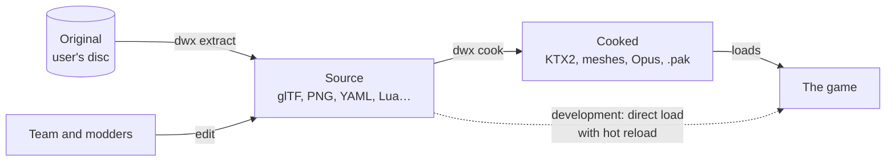

# Asset pipeline

How content goes from the original disc to something the team can edit and the engine loads. The decision is in
[ADR 0005](../adr/0005-asset-pipeline.md) and the rules for what can be published are in the
[legal policy](../legal/assets.md).

## Three states



| State | What it is | Where it lives |
|---|---|---|
| **Original** | Each user's disc. Read only | On their machine |
| **Source** | Open formats that open with Blender, Krita or a text editor. This is what gets edited | The base, on each user's machine; the team's content, in the repositories |
| **Cooked** | Optimized for the GPU and for fast loading | Local cache and the team's releases |

Extraction **only goes one way**. We do not rebuild the disc and we do not aim for a byte-for-byte identical result.
The quality criterion is that every file on the disc is extracted and the engine loads the result, with a coverage
report that lists whatever is missing.

## What happens with each type

| Type | Original | Source | Cooked |
|---|---|---|---|
| Models and animations | TMD/MMD | glTF 2.0 binary (`.glb`, with mesh, skeleton and animations) | The same `.glb`, validated by the current cooker |
| Textures | TIM with 4/8-bit palettes | PNG, with the palette stored as metadata | KTX2 UASTC with zstd, transcoded to BC7 on load; PNG if the palette is chosen at play time |
| Map backgrounds | Prerendered image for day, dusk and night | PNG per layer + depth mask | KTX2 |
| Map data | Collision, warps, NPCs, camera | YAML | YAML kept by the current cooker |
| Game tables | Executable data: stats, evolutions, techniques, items | YAML; they seed the first ruleset | YAML kept by the current cooker |
| Texts | Per region, in their encoding | UTF-8, one file per language | The same |
| Events and story | Script bytecode | Lua (and the YAML listing) | The same: Lua text, no bytecode (the sandbox only loads text) |
| Music | VAB + SEQ | SF2 + MIDI | The same, or Opus if it is a remaster |
| Sound effects | VAB | WAV | Opus |
| Videos | STR (MDEC + XA) | Y4M + WAV + YAML (what extraction writes) | AV1 (IVF) + Opus ([Movies](movies.md#cooked-format-and-later-work)) |
| Typefaces | Bitmap | PNG + metrics, or TTF for new languages | Glyph atlas |

## Content layers

The engine mounts a virtual file system with stacked layers. Each layer is a **package** with its manifest (id,
version, dependencies and priority). If two layers define the same asset, the top one wins. The details (manifest,
IDs, stack order and errors) are in [Packages and virtual file system](vfs.md).

| Priority | Layer | Who makes it |
|---|---|---|
| 4 (wins) | User | The player: their settings and their own images (a package written by the launcher) |
| 3 | Mods | The team or the community: new story, Digimon and modes |
| 2 | Remaster | The team: HD textures, backgrounds and music |
| 1 | Base | The extractor, from the user's disc |

- **Stable IDs by name:** `map/file_city_01/data`, `map/file_city_01/background`. Never numeric indexes. A package
  **overrides** an ID that already exists or **adds** a new one, which is why there is no limit on Digimon or maps.
- **Classic/HD per category:** the settings let you choose, for example, HD backgrounds with the original music. If
  the HD asset is missing, the base one is used.

## How each thing is improved

- **Textures:** they are scaled up or repainted at a higher resolution with the same UVs.
- **Models:** they can be replaced by more detailed ones if they meet the **Digimon contract**: a compatible skeleton
  and the full list of animations the game needs (idle, walk, attack, eat, sleep…), or their own animations if they
  bring them. `dwx validate` checks it.
- **Backgrounds:** the original is scaled up, the edges are extended for widescreen, or the scene is recreated in 3D
  and rendered with the exported camera. The depth mask has to match the collision.
- **Music:** a remastered track overrides the original by ID.

How the improved images of the `remaster` layer are generated on your machine (recipes, providers, cache, cost and
review) is in the [remaster pipeline](remaster-pipeline.md); of that, only the index upscaling of `dwx upscale`
exists, the rest is still a design. The player's own images, set from the launcher, start from the ones that
`dwx export-images` writes ([custom images](../guides/custom-images.md)).

## The `dwx` tool

| Command | What it does |
|---|---|
| `dwx extract <disc>` | Recognizes the disc version from its executable and generates the base in source format |
| `dwx validate <package>` | Schemas, broken references and contracts (for example, each Digimon's animations), as a mod; `--engine` for the game's own. See [below](#dwx-validate) |
| `dwx cook <package> -o <folder>` | Source → cooked, into another folder |
| `dwx pack <package> -o <file.pak>` | Generates a distributable package in a single file, with its manifest |
| `dwx export-images <content> -o <folder>` | Writes the images a player can change, with the names a custom-images package uses |
| `dwx evolution-guide <content> <output.md>` | Writes each species' evolution requirements as Markdown tables |
| `dwx upscale <recipe> <package> -o <folder>` | Enlarges the indexed images that a recipe selects ([remaster](remaster-pipeline.md#what-already-exists-dwx-upscale)) |

When installing the disc, the launcher runs `dwx extract` on the user's image and stores the base in its data
folder; the game mounts it as is, without cooking.

## Cooking

`dwx cook` reads a package in source format and writes another one with the same `pack.yaml` and the same IDs, but
with each file passed through the **cooker for its extension**. [ADR 0017](../adr/0017-cooking-and-pak-files.md)
decides this.

| Source | Cooked | Cooker |
|---|---|---|
| PNG | KTX2 with Basis Universal UASTC and zstd supercompression, with all mipmaps, sRGB or linear ([KTX2](../formats/ktx2.md)) | `texture` |
| PNG that the game reads from its PNG (`assets::PngOnlyImages`: map backgrounds and texture pages, the two title images of the original look, font atlases) | The same PNG: its reader needs the indexes or the exact pixels | `texture` lets it pass |
| Indexed PNG whose sidecar YAML lists more than one palette, or map TIM with CLUT | The same PNG: the palette is chosen at play time | `texture` lets it pass |
| GLB | The same GLB, with the header checked | `glb` |
| WAV | Ogg Opus at 48 kHz, with the loop and the note in comments ([Opus](../formats/opus.md)) | `audio` |
| Movie video (`movie/<name>/video.y4m`) | AV1 in an IVF, with libaom ([video](../formats/video.md)) | `video` |
| Anything else (YAML, MIDI, SF2…) | Copied as is | — |

- A new type is one more entry in the registry (`apps/dwx/src/cook.cpp`) and the function that cooks it. Before
  cooking, the cooker's plan reads the file and its **sidecar YAML** (the `<id>_meta.yaml` asset, if it exists) and
  decides the options: let it pass as is, or the color space (`color_space: srgb | linear`). The texture rules are in
  [KTX2](../formats/ktx2.md).
- **Cache:** the output folder keeps in `.dwx-cook` (hidden, so it is not an asset), for each file, the SHA-1 of its
  source, the cooker with its version and options, and the SHA-1 of what it wrote. If the sidecar YAML changes the
  decision, the file is cooked again even if it has not changed. When cooking again in the same folder, what did not
  change is left as is, what changed (or was edited by hand) is cooked again, and what no longer has a source is
  deleted. Two assets with the same bytes are cooked only once.
- **Deterministic:** the same package gives the same bytes, with or without the cache.
- It refuses to write to a folder with files that `dwx cook` did not write, and to one that is inside the package or
  contains it.
- The cookers' dependencies (libktx with Basis Universal, zstd, libopus and libopusenc) and the scope of the
  determinism are in ADR 0017.

## Packing

`dwx pack` stores a package (source or cooked) in a [`.pak` archive](../formats/pak.md): the `pack.yaml` and all its
files, sorted by ID, with the SHA-1 of each one, each file compressed with zstd if that makes it smaller. When it
finishes it opens the archive and reads every entry to check that it matches the folder.

The engine mounts a `.pak` the same as a folder (`PakFileSystem`), so one stack can hold both kinds of packages: for
example, the base as a `.pak` and a mod in its folder while it is being edited.

```text
dwx extract disco.cue --out content/base
dwx cook content/base -o content/cooked
dwx pack content/cooked -o base.pak
```

## `dwx validate`

```text
dwx validate [--schemas <carpeta>] [--with <carpeta>]... [--engine] <paquete | carpeta de paquetes>
```

Checks a package, or all those in a folder (`content/base` or `content`; folders and `.pak` archives), the way the
engine is going to use them and before it uses them. It mounts the stack with the VFS, the same as the game, so a mod
is checked together with the base it overrides. The schemas are read from `--schemas` or, if it is not given, from
the `schemas` folder next to the packages (`content/schemas` in both examples); a package that does not have it
alongside takes the one from a folder further up, like the game's own (`content/packs/game` reads `content/schemas`).
`--with` also mounts the packages of another folder (a package or a folder of packages), to check a package that
depends on another one located elsewhere; those packages are also checked. The packages in the folder are checked as
mods, the way the game loads them from a mods folder: they can only declare the `mods` or `user` layers and do not
have the base's rights (ids without a namespace and the tables' `index`). With `--engine` they are checked as the
game's own packages, and those from `--with` always are. This is how the repository's `game` package is checked on a
`base` extraction:
`dwx validate --engine --schemas content/schemas --with <contenido>/base content/packs/game`, and a mod:
`dwx validate --with <contenido>/base <mod>`. The code is in `apps/dwx/src/validate.cpp`.

What it checks:

1. **Manifests:** each `pack.yaml` follows `pack.schema.json`.
2. **Schemas:** each YAML document follows the schema that the `schemas` rules of the mounted manifests assign to it
   ([VFS](vfs.md#document-schemas)). It is an error if a document fits no rule, fits rules of two schemas,
   or the schema does not exist or uses something outside the [JSON Schema subset](json-schema.md) the engine
   understands.
3. **References:** each text that the schema marks with `assetReference` has to lead to an asset in the stack
   ([how it is written](json-schema.md#asset-references)). Today they are marked by the SoundFont, the samples and
   the tracks of the sound and music banks, the destination of each warp and the Digimon of each NPC of a map, the
   texture and the model of each effect, the model of each contract, and the outputs of the coverage report. If the
   reference names a file, its type has to match, or be the type that `dwx cook` made the file into: a cooked
   package keeps the documents as they were extracted, so they still name `sample_001.wav` or `background.png` even
   if the file is `.opus` or `.ktx2`.
4. **Metadata:** each `<name>_meta` describes an asset `<name>` that has to exist.
5. **glTF models:** the images and buffers that a model reads from outside its file have to be next to it.
6. **Contracts:** each `digimon/<id>/model` needs its `digimon/<id>/contract`, and the model that a contract names
   has to have a skin with one bone for each entry of `joint_parents`, with those parents and in that order, and an
   animation with each name in `animations` (it may have more). The extractor writes the contract with the skeleton
   of the type in the executable and the animations of the original MMD ([schema](https://github.com/Indie-Modding-Games/dw-engine/blob/main/content/schemas/model_contract.schema.json)),
   so an HD model that meets it can be animated like the original. The MMD animations that the extractor could not
   convert go in `unconverted_animations`, which is not checked.
7. **Reading:** each asset is opened with the engine's readers (`assets::checkContent`), the same as
   `dwe-game --check-content`: PNG, KTX2 (transcoded to BC7), glTF, YAML, Ogg Opus (`.opus` and `.ogg`, fully
   decoded), and the headers of WAV, SF2, MIDI and Y4M. So a cooked package is checked the same as an extracted one.
   The assets that the game reads with its own reader also go through that reader: the images that the game reads
   from its PNG (`assets::PngOnlyImages`) have to be a PNG its reader can read, indexed for the maps and with exact
   pixels for the font, so a cooked package that converted a map background to KTX2 does not pass; each `.glb` goes
   through `parseModel` (skin, weights, joints and the clips' `extras`), each `map/<id>/data` through
   `parseMapDocument` and `data/maps` through `parseMapTable`, which allow neither extra nor missing keys. A failure
   is reported with the asset ID and the reason.

Known limit: the operands of the scripts (`script/…` and each effect's `script.yaml`) are stored as they are on the
disc, and the schema only checks their form (a number, a variable, an address or a label), not what they mean for
each instruction. A game id that a script carries as a number (a map, an item, a Digimon) is not followed as a
reference.

The report has one line per problem, `file:line:column: message` (without line or column if it does not refer to a
place in the YAML), sorted by file, place and message, and a summary. The same stack always gives the same report. It
exits with 0 if there are no problems, 1 if there are, and 2 if it cannot be checked (there are no packages or they
cannot be mounted).

With the US disc, freshly extracted: 1 package, 4813 assets, 2078 documents, 9271 references, 178 contracts and no
problems. The disc test (`DWE_DISC`, in `apps/dwx/tests/real_disc_tests.cpp`) extracts, validates and opens the base
package with the same result; without a disc it is skipped. In the `ci` build, `dwx validate` on that package takes
about a minute: opening the assets (`checkContent`, which spreads them across threads, at most 16) takes about 13 s
and the rest is checking the documents against their schemas, on one thread.

Without a disc, in CI, the extractor tests that mount a synthetic disc (images, maps, tables, sound, scripts and
movies) write the base package of what was extracted and pass it through `validatePacks` with the schemas in
`content/schemas` (`apps/dwx/tests/written_pack.hpp`): this always checks that the engine loads what `dwx extract`
writes.

## Where each thing lives

| What | Where |
|---|---|
| Extracted base (`content/base/`) and cooked (`content/cooked/`) | Only on each user's machine; they are in `.gitignore` |
| Data and Lua created by the team | `content/packs/` in this repository |
| The team's source art (`.blend`, `.kra`, glTF, audio) | Assets repository with Git LFS |
| Fixtures for tests and CI | Each module's `tests/` (synthetic discs in the code, `tests/fixtures/`) and `tests/mods/`, made by the team |
