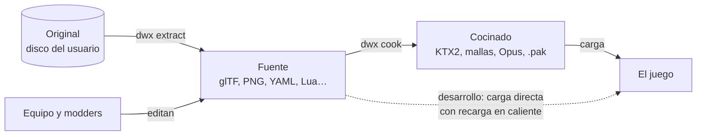

# Tubería de assets

Cómo pasa el contenido del disco original a algo que el equipo puede editar y que el motor carga. La decisión está en
el [ADR 0005](../adr/0005-tuberia-de-assets.md) y las reglas de qué se puede publicar en la
[política legal](../legal/assets.md).

## Tres estados



| Estado | Qué es | Dónde vive |
|---|---|---|
| **Original** | El disco de cada usuario. Solo se lee | En su máquina |
| **Fuente** | Formatos abiertos que se abren con Blender, Krita o un editor de texto. Es lo que se edita | La base, en la máquina de cada usuario; lo del equipo, en los repositorios |
| **Cocinado** | Optimizado para la GPU y para cargar rápido | Caché local y releases del equipo |

La extracción **solo va en un sentido**. No reconstruimos el disco ni buscamos que el resultado sea igual byte a byte.
El criterio de calidad es que cada fichero del disco se extraiga y el motor cargue el resultado, con un informe de
cobertura que lista lo que falte.

## Qué pasa con cada tipo

| Tipo | Original | Fuente | Cocinado |
|---|---|---|---|
| Modelos y animaciones | TMD/MMD | glTF 2.0 (malla, esqueleto y animaciones) | Malla binaria + paquete de animaciones |
| Texturas | TIM con paletas de 4/8 bits | PNG, con la paleta guardada como metadato | KTX2 (hoy RGBA8 sin comprimir; BC7 o Basis cuando se apruebe) |
| Fondos de mapa | Imagen prerenderizada de día, atardecer y noche | PNG por capa + máscara de profundidad | KTX2 |
| Datos de mapa | Colisión, warps, NPCs, cámara | YAML | Binario |
| Tablas del juego | Datos del ejecutable: stats, evoluciones, técnicas, objetos | YAML; siembran el primer ruleset | Binario |
| Textos | Por región, en su codificación | UTF-8, un fichero por idioma | Igual |
| Eventos e historia | Bytecode de scripts | Lua | Bytecode de Lua |
| Música | VAB + SEQ | SF2 + MIDI | Igual, u Opus si es un remaster |
| Efectos de sonido | VAB | WAV/FLAC | Opus |
| Vídeos | STR (MDEC + XA) | Y4M + WAV + YAML (lo que escribe la extracción hoy) | **Pendiente** de decisión del usuario (propuesta: AV1/WebM; opciones en [Formatos](formats.md#vídeo)); no implementado |
| Fuentes tipográficas | Bitmap | PNG + métricas, o TTF para idiomas nuevos | Atlas de glifos |

## Capas de contenido

El motor monta un sistema de ficheros virtual con capas apiladas. Cada capa es un **paquete** con su manifiesto
(id, versión, dependencias y prioridad). Si dos capas definen el mismo asset, gana la de arriba. Los detalles
(manifiesto, IDs, orden de la pila y errores) están en [Paquetes y sistema de ficheros virtual](vfs.md).

| Prioridad | Capa | Quién la hace |
|---|---|---|
| 4 (gana) | Usuario | El propio jugador: sus ajustes |
| 3 | Mods | El equipo o la comunidad: historia, Digimon y modos nuevos |
| 2 | Remaster | El equipo: texturas, fondos y música en HD |
| 1 | Base | El extractor, a partir del disco del usuario |

- **IDs estables por nombre:** `digimon/agumon/model`, `map/file_city_01/background`. Nunca índices numéricos. Un
  paquete **sobrescribe** un ID que ya existe o **añade** uno nuevo, y por eso no hay límite de Digimon ni de mapas.
- **Clásico/HD por categoría:** en los ajustes se elige, por ejemplo, fondos HD con música original. Si falta el
  asset HD, se usa el de la base.

## Cómo se mejora cada cosa

- **Texturas:** se escalan o se repintan a más resolución con las mismas UV.
- **Modelos:** se pueden sustituir por otros con más detalle si cumplen el **contrato del Digimon**: un esqueleto
  compatible y la lista completa de animaciones que el juego necesita (reposo, andar, atacar, comer, dormir…), o sus
  propias animaciones si las trae. `dwx validate` lo comprueba.
- **Fondos:** se escala el original, se amplían los bordes para panorámico o se recrea la escena en 3D y se renderiza
  con la cámara exportada. La máscara de profundidad tiene que coincidir con la colisión.
- **Música:** un tema remasterizado sobrescribe el original por ID.

## Herramienta `dwx`

| Comando | Qué hace |
|---|---|
| `dwx extract <disco>` | Comprueba el SHA-1 del disco y genera la base en formato fuente |
| `dwx validate <paquete>` | Esquemas, referencias rotas y contratos (por ejemplo, las animaciones de cada Digimon); ver [abajo](#dwx-validate) |
| `dwx cook <paquete> -o <carpeta>` | Fuente → cocinado, en otra carpeta |
| `dwx pack <paquete> -o <fichero.pak>` | Genera un paquete distribuible en un solo fichero, con su manifiesto |

La primera vez que se abre el juego, el launcher ejecuta `extract` y `cook` sobre el disco del usuario y guarda el
resultado en caché.

## Cocinar

`dwx cook` lee un paquete en formato fuente y escribe otro con el mismo `pack.yaml` y los mismos IDs, pero cada
fichero pasado por el **cocinero de su extensión**. Lo decide el [ADR 0017](../adr/0017-cocinado-y-archivos-pak.md).

| Fuente | Cocinado | Cocinero |
|---|---|---|
| PNG | KTX2 RGBA8 sin comprimir, con todos los mipmaps, sRGB o lineal ([KTX2](../formats/ktx2.md)) | `texture` |
| GLB | El mismo GLB, con la cabecera comprobada | `glb` |
| Cualquier otro (YAML, WAV, MIDI, SF2…) | Copiado tal cual | — |

- Un tipo nuevo es una entrada más en el registro (`apps/dwx/src/cook.cpp`) y la función que cocina.
- **Caché:** la carpeta de salida guarda en `.dwx-cook` (oculto, así no es un asset), por cada fichero, el SHA-1 de
  su fuente, el cocinero con su versión y el SHA-1 de lo que escribió. Al volver a cocinar en la misma carpeta, lo que
  no cambió se deja como está, lo que cambió (o se tocó a mano) se cocina otra vez y lo que ya no tiene fuente se
  borra. Dos assets con los mismos bytes se cocinan una sola vez.
- **Determinista:** el mismo paquete da los mismos bytes, con caché o sin ella.
- Se niega a escribir en una carpeta con ficheros que no escribió `dwx cook`, y en una que esté dentro del paquete o
  lo contenga.
- Lo que falta, porque necesita dependencias que el equipo tiene que aprobar: supercompresión Basis o BC7 para las
  texturas y Opus para el audio. Están en las propuestas del ADR 0017.

## Empaquetar

`dwx pack` guarda un paquete (fuente o cocinado) en un [archivo `.pak`](../formats/pak.md): el `pack.yaml` y todos
sus ficheros, ordenados por ID, con el SHA-1 de cada uno. No comprime todavía. Al terminar abre el archivo y lee cada
entrada para comprobar que coincide con la carpeta.

El motor monta un `.pak` igual que una carpeta (`PakFileSystem`), así que en una misma pila puede haber paquetes de
las dos clases: por ejemplo, la base en `.pak` y un mod en su carpeta mientras se edita.

```text
dwx extract disco.cue --out content/base
dwx cook content/base -o content/cooked
dwx pack content/cooked -o base.pak
```

## `dwx validate`

```text
dwx validate [--schemas <carpeta>] <paquete | carpeta de paquetes>
```

Comprueba un paquete, o todos los de una carpeta (`content/base` o `content`), tal como los va a usar el motor y antes
de que los use. Monta la pila con el VFS, igual que el juego, así que un mod se comprueba junto con la base que
sobrescribe. Los esquemas se leen de `--schemas` o, si no se da, de la carpeta `schemas` junto a los paquetes
(`content/schemas` en los dos ejemplos). El código está en `apps/dwx/src/validate.cpp`.

Qué comprueba:

1. **Manifiestos:** cada `pack.yaml` sigue `pack.schema.json`.
2. **Esquemas:** cada documento YAML sigue el esquema que le asignan las reglas `schemas` de los manifiestos montados
   ([VFS](vfs.md#esquemas-de-los-documentos)). Es un error que un documento no encaje en ninguna regla, que encaje en
   reglas de dos esquemas o que el esquema no exista o use algo fuera del
   [subconjunto de JSON Schema](json-schema.md) que entiende el motor.
3. **Referencias:** cada texto que el esquema marca con `assetReference` tiene que llevar a un asset de la pila
   ([cómo se escribe](json-schema.md#referencias-a-assets)). Hoy lo marcan el SoundFont, las muestras y las pistas de
   los bancos de sonido y de música, el destino de cada warp y el Digimon de cada NPC de un mapa, la textura y el
   modelo de cada efecto, el modelo de cada contrato y las salidas del informe de cobertura.
4. **Metadatos:** cada `<nombre>_meta` describe un asset `<nombre>` que tiene que existir.
5. **Modelos glTF:** las imágenes y los buffers que un modelo lee de fuera de su fichero tienen que estar junto a él.
6. **Contratos:** cada `digimon/<id>/model` necesita su `digimon/<id>/contract`, y el modelo que nombra un contrato
   tiene que tener una piel con un hueso por cada entrada de `joint_parents`, con esos padres y en ese orden, y una
   animación con cada nombre de `animations` (puede tener más). El extractor escribe el contrato con el esqueleto del
   tipo en el ejecutable y las animaciones del MMD original ([esquema](../../content/schemas/model_contract.schema.json)),
   así que un modelo HD que lo cumple se puede animar como el original. Las animaciones del MMD que el extractor no
   pudo convertir van en `unconverted_animations`, que no se comprueba.
7. **Lectura:** cada asset se abre con los lectores del motor (`assets::checkContent`), lo mismo que
   `dwe-game --check-content`: PNG, glTF/GLB, YAML, WAV, SF2, MIDI e Y4M.

Límite conocido: los operandos de los scripts (`script/…` y el `script.yaml` de cada efecto) se guardan tal como
están en el disco, y el esquema solo comprueba su forma (un número, una variable, una dirección o una etiqueta), no lo
que significan para cada instrucción. Un id de juego que un script lleve como número (un mapa, un objeto, un Digimon)
no se sigue como referencia.

El informe tiene una línea por problema, `fichero:línea:columna: mensaje` (sin línea ni columna si no se refiere a un
sitio del YAML), ordenadas por fichero, sitio y mensaje, y un resumen. La misma pila da siempre el mismo informe. Sale
con 0 si no hay problemas, 1 si los hay y 2 si no se puede comprobar (no hay paquetes o no se pueden montar).

Con el disco US, recién extraído: 1 paquete, 4801 assets, 2074 documentos, 9259 referencias, 178 contratos y ningún
problema. El test del disco (`DWE_DISC`, en `apps/dwx/tests/real_disc_tests.cpp`) extrae, valida y abre el paquete
base con el mismo resultado; sin disco se salta. En el build `ci`, `dwx validate` sobre ese paquete tarda alrededor de
un minuto: abrir los assets (`checkContent`, que los reparte entre hilos, como mucho 16) son unos 10 s y el resto es
comprobar los documentos contra sus esquemas, en un hilo.

Sin disco, en CI, los tests de los extractores que montan un disco sintético (imágenes, mapas, tablas, sonido y
scripts) escriben el paquete base de lo extraído y lo pasan por `validatePacks` con los esquemas de `content/schemas`
(`apps/dwx/tests/written_pack.hpp`): así se comprueba siempre que el motor carga lo que escribe `dwx extract`.

## Dónde vive cada cosa

| Qué | Dónde |
|---|---|
| Base extraída (`content/base/`) y cocinada (`content/cooked/`) | Solo en la máquina de cada usuario; están en `.gitignore` |
| Datos y Lua creados por el equipo | `content/packs/` en este repositorio |
| Arte fuente del equipo (`.blend`, `.kra`, glTF, audio) | Repositorio de assets con Git LFS |
| Fixtures para tests y CI | `content/fixtures/`, hechos por el equipo |
