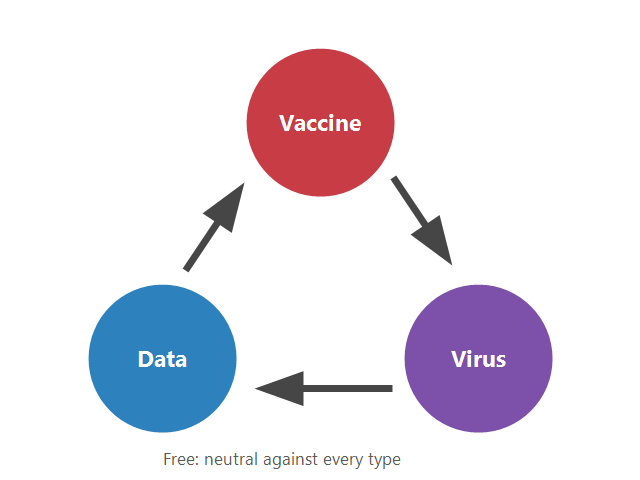

# Combat system design

> Design document for the combat system of Digimon World Project Folder (DWPF). Proposals not yet validated are marked as **provisional** or **pending balance**.

---


# 1. Combat vision and philosophy

## 1.1 Overview

DWPF aims to keep the essence of Digimon World: Digimon fight autonomously while the trainer intervenes through orders and tactical decisions. The system expands the player's options without turning combat into direct control, manual action or a traditional skill rotation.

Depth should emerge from preparation, techniques, stats, positioning, behaviour, reading the fight and cooperation between players.

## 1.2 Principles

- **Autonomy:** the Digimon executes its actions and adapts to the context.
- **Tactical control:** the trainer decides the important actions, especially which technique to use and against whom.
- **Preparation:** attributes, arsenal and prior configuration matter.
- **Identity:** Digimon should differ by capabilities, dimensions, techniques and behaviour.
- **Cooperation:** several players can create tactical opportunities and complement each other.
- **Positioning:** range, terrain, obstacles, hitboxes and size influence combat.
- **Accessibility:** the player must be able to make useful decisions without constantly managing a crowd of menus.

## 1.3 The trainer's role

The trainer directs combat through orders. Their actions include:


- Selecting a technique.
- Selecting or changing a target, when applicable.
- Using items.
- Coordinating actions with other players.
- Making tactical decisions as the fight changes.

The player does not directly control every movement. Their skill is expressed mainly in reading the situation, choosing actions, timing them and coordinating.

## 1.4 Desired experience

Fights should allow emergent situations. One Digimon may stand out for damage, another for its capacity to resist or control space, and another for keeping the team up through support. These differences must come from their traits and configuration, not from rigid classes.

---

# 2. Command system

## 2.1 Philosophy

The trainer selects the strategic action; the Digimon keeps autonomy to execute it. The order defines **what to do**, while the AI decides **how to do it** given the current conditions.

The system aims to reduce the randomness of technique selection without removing all uncertainty from combat. Damage variations, effect application and other elements may remain probabilistic.

## 2.2 Main orders

The proposal includes:

- **Technique:** select a learned and equipped technique.
- **Target:** select a target when the action requires one.
- **Item:** use a valid resource.
- **Tactical changes:** issue a new order or modify the target.
- **Movement:** set the stance that defines how the Digimon positions itself between orders (2.9).

The definitive list of orders, accessibility and distribution in the interface remains pending design.

## 2.3 Technique selection

The trainer directly selects a technique from the available arsenal. Examples: Mega Flame, Thunder Justice, Dynamite Kick, Heal, Speed Charge, Defense Charge, Counter or Poison Powder.

Selecting it does not force instant execution: the Digimon validates the conditions, positions itself and performs it when possible. The AI **never substitutes the ordered technique with another chosen autonomously**.

## 2.4 Target selection

When an order requires a target, the trainer sets the reference. The Digimon may follow its movement and recompute positioning, but does not arbitrarily switch to another enemy.

If the target is defeated, becomes inaccessible or stops being valid, the order must resolve into a defined state (for example, cancellation, waiting or returning to a safe condition). The exact behaviour is pending implementation and testing.

## 2.5 Responsibilities

| Trainer | Digimon |
|---|---|
| Selects the technique | Validates and executes the ordered technique |
| Selects the target | Orients, approaches or keeps distance |
| Decides timing and priority | Adapts movement to the environment |
| Uses items and resources | Manages the execution of the order |
| Coordinates with other players | Reacts to interruptions and state changes |
| Sets the movement stance | Adjusts positioning to the active stance |

## 2.6 Example

The trainer selects Mega Flame and an enemy. The Digimon processes the order, checks the conditions, orients itself, looks for a valid position according to range, executes the technique and enters recovery. If the target moves, it may adjust its position; if the order stops being valid, it must resolve it without switching technique on its own initiative or getting stuck in repetitive attempts.

## 2.7 Multiplayer

Direct selection lets players plan actions together: control while another prepares damage, recovery while a partner keeps pressure, coordinated attacks or target distribution. Co-op must avoid being a simple accumulation of orders and damage.

## 2.8 Decisions

- There is a simple order queue of at most 2 actions; how fast entries can be replaced depends on the action's execution speed, which lets smarter Digimon respond faster; the interface should reflect what is queued and what is not.

- Orders received during an execution or recovery are simply queued until they can be performed.

- With insufficient MP the Digimon no longer executes skills, it only performs movement actions; invalid conditions simply cancel the action and the Digimon retries it, or if it was overwritten, it executes the new action.

- Not all area attacks damage allies, but in general these always do; every other offensive technique must have no friendly fire; self-target and support always work as long as they are in range.

- In multiplayer all orders happen in parallel and each Digimon has its own queue.

## 2.9 Movement orders

**Provisional proposal.** Movement orders do not replace techniques and are not queued as actions: they set a **stance**, a continuous context the AI uses to resolve positioning while it executes the orders. The last stance issued is the active one and stays until replaced.

| Stance | Intended behaviour |
|---|---|
| **Aggressive** | Always close on the current target until **point-blank**, even when the technique could be used from farther away: apply constant pressure and look for openings. The default stance when a fight begins. |
| **Hold position** | Keep the current position. It only moves when the ordered technique requires it or to avoid clear danger. |
| **Distance** | Stay separated at the equipped technique's **maximum range**, beyond the reach of the most dangerous threat. Back away if crowded. |
| **Guard** | Prioritise defence: reduce exposure, rely on blocking and mitigation and stay near the ally being protected. |

Interaction with the rest of the system:

- An ordered technique always resolves its own positioning: the stance tunes the preferred distance during execution, but never blocks the technique when its conditions require another distance.
- DEF always mitigates: flat DEF is subtracted from the damage after all modifiers are applied (§6.2). With the **Guard** stance active, that subtraction applies twice (×2 DEF). The result may reach 0: guarding fully absorbs the damage when the defense covers it all.
- In stances other than **Guard**, there is a passive chance to cover based on DEF: `DEF / 1000 × 30 %` (at DEF 1000, 30 %; the cap is 30 %). If it applies, the hit resolves as if guarding (×2 DEF); otherwise normal damage applies (×1 DEF).
- **Guard depletion and break:** every hit taken adds its final damage to a **defense bar** whose capacity is `6 × DEF` using the **current defense**, recomputed continuously. When the bar fills, the defense **breaks**: the Digimon suffers **−50 % ATK, −50 % VEL and −50 % DEF** debuffs for **4 seconds**, cannot cover (no doubled Guard mitigation, no passive cover) and its stance defaults to **Hold position** while the break lasts, unless an ordered technique requires another positioning.
- The bar empties with rest: without taking damage it falls from full back toward 0 in about **6 seconds**. The same VEL/DEF modifier (up to a combined 30 %) can accelerate the drain to ≈ 4.2 seconds. During the break the bar **drains uninterruptedly** and is drawn the same way, with a **red area** marking the broken state: cover is not recovered until the Defense-broken debuff ends.
- The lockout is shortened **proportionally** by VEL and DEF, up to **15 % per stat and a combined 30 %** (with both at 1000, "the limit", which may change; 4 s become ≈ 2.8 s). The reduction uses the base values: the break's debuffs never alter the recovery calculation, but they do affect behaviour.
- The interface must show the defense bar and the **Defense broken** state (chapter 10) so the player understands the mechanic.
- With insufficient MP the Digimon performs movement only: the stance defines which movement it makes (the rule in §2.8).
- Changing stance never cuts an execution or recovery in progress: it applies from the next moment where positioning is resolved.
- The stance belongs to the own Digimon and never replaces the selected target. In multiplayer each player issues the stance of their own Digimon.

**Pending:** positioning tolerances and navigation rules per stance (chapter 7) and whether support needs its own stance (stay near whoever must be helped). It is **decided** (§6.2, §2.9, §3.8, §7.4): the effective subtraction `(Damage + Attribute modifier + Element modifier) − DEF − (extra DEF when covering; may reach 0)`, with the modifiers stacking additively on base damage: elemental in 20 % steps under a 1-to-1 structure (advantage, resistance and STAB) and the Vaccine/Data/Virus type ±25 % with Free neutral (§3.8); passive cover `DEF / 1000 × 30 %` outside Guard; a bar of capacity `6 × DEF` on the current defense that drains in about 6 s of rest, accelerable up to 30 % by VEL/DEF, and that during the break drains uninterruptedly shown with a red area; a 4 s break, proportionally reducible up to 30 % (15 % per stat), with −50 % ATK, −50 % VEL and −50 % DEF debuffs that never affect the recovery calculation; during the break the stance defaults to Hold position and cover returns when the debuff ends; stances take the equipped technique's maximum range as their preferred distance, Aggressive excepted, which always closes to point-blank; damage does not fall off with distance; and only one speed attribute exists (VEL, §6.2). Pending: the attribute modifier scale and the distance-based block chance bonus (§6.2, §7.4).

---

# 3. Techniques and arsenal

## 3.1 Philosophy

Techniques must offer offensive, defensive, support and control tools. They must not be limited to damage variants: each one needs a function, a situational advantage or an interaction that justifies its existence.

The catalogue starts from the **56 original Digimon World techniques**, which will be reviewed and adapted. The plan is to reach **100 or more techniques**, adding options from other games and new techniques when they bring relevant mechanics. The number is a goal, not an obligation to add redundant content.

## 3.2 Functions

Functions are not exclusive: a technique can belong to more than one.

| Function | Purpose | Example properties |
|---|---|---|
| Offensive | Deal damage | Impact, projectile, elemental, area, multi-hit |
| Defensive | Avoid, reduce or manage damage | Shield, mitigation, evasion, interception, protection |
| Support | Improve or recover capabilities | Healing, regeneration, buffs, resource recovery, status cleansing |
| Control | Alter enemy capabilities or position | Stun, confusion, poison, slow, knockdown, displacement, interruption |

Functions describe utility; they are not classes and do not restrict which Digimon can learn a technique.

## 3.3 Specialties

The original specialties will serve as the initial organization. They will not, on their own, determine a technique's function.

| Specialty | Approximate identity |
|---|---|
| Fire | Fire and heat |
| Battle | Physical combat and direct techniques |
| Air | Electricity, wind and aerial attacks |
| Earth | Nature, insects and organic effects |
| Ice | Ice and cold |
| Mech | Technology, energy and mechanical attacks |
| Filth | Dirt and peculiar techniques |
| Holy *(proposal)* | Sacred energy, protection, recovery or sacred-themed damage |
| Dark *(proposal)* | Dark energy, weakening, corruption or other dark-themed effects |

Holy and Dark are considered new specialties under evaluation, not support or control functions.

## 3.4 Expansion and adaptation

Techniques from Digimon World 2, Digimon World 3, Next Order, Dawn/Dusk and other titles will be researched. Their original values will not transfer automatically: each technique must be adapted to real time, orders, range, recovery, effects and multiplayer.

Adaptation criteria:
- Bring a distinguishable mechanic or use.
- Keep a recognizable identity.
- Be compatible with the command system.
- Have understandable range, execution and recovery.
- Have justified cost and risk.
- Interact reasonably with other techniques.
- Be useful in solo and co-op scenarios, where applicable.

Functional variety takes priority over quantity.

## 3.5 Signature techniques

Each Digimon may have a signature technique that reinforces its identity. It is not a generic category of unique techniques: its design, behaviour, animation or effect belongs to that Digimon.

## 3.6 Effects

Effects are defined as properties of a technique and can be combined:

- Stun or action alteration.
- Confusion.
- Poison and persistent damage.
- Slow.
- Buffs and debuffs.
- Knockdown and displacement.
- Interruption.
- Recovery and regeneration.
- Protection or shields.

Duration, probability, resistance, stacking and reapplication must be balanced according to real impact.

### Definitions: buffs and debuffs

- **Buff:** modifier that raises an attribute, grants protection or improves an action while active. Examples: ATK +20 % for 10 s, regeneration, shields.
- **Debuff:** modifier that lowers an attribute, imposes an altered status or restricts actions. Examples: the break's debuff −50 % ATK / −50 % VEL / −50 % DEF (§2.9), slow, poison.

Altered statuses are a subtype of debuff. A numeric modifier is expressed as a percentage of the relevant attribute unless the rule states a flat value (such as the DEF subtraction, §6.2). Stacking, duration, immunity and removal of buffs and debuffs remain pending balance. Where the original catalogue (`tecnicas.md`) lists SPD, it is read as VEL.
## 3.7 Interruptions and counterattacks

Interruption is a property of certain techniques or interactions, not a mandatory arsenal category. Its strength will depend on impact, attack type, target resistance, action state and other conditions.

Counterattacks may work through states or conditioned real-time windows: the Digimon adopts a stance and responds if a valid aggression occurs within the conditions. Turning them into a turn-based mechanic is not planned.
## 3.8 Elemental attributes and affinities

The system has two advantage layers: the elemental attributes of techniques (§3.3) and the Digimon's Vaccine, Data or Virus type.

### Elemental attributes: advantage, resistance and STAB

Every technique has one elemental attribute and every Digimon has up to three elemental attributes. The "who beats who" scale follows the modern Digimon **1-to-1** structure: every attribute beats exactly one and loses to exactly one. Matchups not listed are neutral (0 %):

| Attribute | Beats | Loses to |
|---|---|---|
| Fire | Earth | Air |
| Earth | Air | Fire |
| Air | Fire | Earth |
| Ice | Filth | Battle |
| Filth | Mech | Ice |
| Mech | Battle | Filth |
| Battle | Ice | Mech |
| Holy | Dark | Dark |
| Dark | Holy | Holy |

Fire > Earth > Air > Fire forms a triangle; Ice > Filth > Mech > Battle > Ice forms a square; Holy and Dark are a **mutual pair**, like Light and Dark in modern games: they hit each other with advantage and receive it in both directions. Four links are backed by the ×2 of the original PS1 table (Fire > Earth, Earth > Air, Ice > Filth, Filth > Mech); the rest were adapted to close the 1-to-1 structure.

The modifiers are **decided** and always worth 20 %:

| Situation | Modifier |
|---|---|
| The technique's attribute beats one of the target's attributes | Damage **+20 %** |
| The technique's attribute beats two of the target's attributes | Damage **+40 %** |
| One of the target's attributes resists (beats) the technique's | Damage **−20 %** |
| Advantages and disadvantages crossed | they add up algebraically (e.g. +20 % − 20 % = 0 %) |
| **STAB:** the Digimon using the technique possesses that elemental attribute | **+20 %** extra, applied once |

The percentages are computed on base damage and enter the formula (§6.2) as the elemental-modifier term, stacking **additively** with each other and with the type layer.

### Vaccine, Data, Virus and Free

The classic cycle (decided):
**Vaccine > Virus > Data > Vaccine**


- When the attacker's type beats the defender's type: **+25 % additional damage** on top of the modifier stack.
- When the defender's type beats the attacker's: the same 25 % applies in reverse as a reduction, **symmetrically** (decided).
- **Free** is neutral against everyone: it neither applies nor receives a type modifier.

| Attacker ↓ \ Defender → | Vaccine | Virus | Data | Free |
|---|---|---|---|---|
| **Vaccine** | 0 % | **+25 %** | −25 % | 0 % |
| **Virus** | −25 % | 0 % | **+25 %** | 0 % |
| **Data** | **+25 %** | −25 % | 0 % | 0 % |
| **Free** | 0 % | 0 % | 0 % | 0 % |

This layer adds to the elemental one (±20 % and STAB) within the same formula term (§6.2), stacking additively: the three affinity sources can combine in a single hit. As before: no absolute immunities or automatic outcomes; no layer must replace stats, techniques, positioning, composition or tactical decisions.
## 3.9 Balance and MP cost

Original MP costs are not definitive. Cost should reflect the technique's performance, not only its damage.

| Variable | Impact on balance |
|---|---|
| Power | Potential damage |
| Range | Safety and execution opportunities |
| Area | Number and distribution of affected targets |
| Execution | Exposure and reaction time before impact |
| Recovery | Time until it can act again |
| Control | Alteration of enemy capabilities or behaviour |
| Interruption | Capacity to cancel actions |
| Effects | Additional value of the technique |
| MP cost | Usage frequency and resource management |
| Risk | Vulnerability during execution |
| Conditions | Specific requirements to use it |

A low-damage technique can justify a high cost if it offers meaningful control. A high-damage technique can be offset through slow execution, recovery, risk or demanding conditions.

### Companion documents

- [Technique cost system](costo-mp.md) — MP calculation formula, covering damage, effects, distance, area and support techniques.
- [Technique catalogue](tecnicas.md) — The 56 original Digimon World techniques with their values, and the Holy and Dark candidates for expanding the arsenal.

## 3.10 Technique data

The structure must be extensible and not require every field from every technique.

| Field | Description |
|---|---|
| Name | Technique name |
| Origin | Game or reference source |
| Specialty | Thematic branch |
| Functions | Offensive, defensive, support, control or a combination |
| Damage type | Damage type or element, if applicable |
| Power | Base damage value |
| MP cost | Resource consumption |
| Range | Valid execution distance |
| Area | Effect area, always defined in pixels of distance; may be "global" (§7.5) |
| Execution | Preparation or casting time |
| Recovery | Time after the action |
| Effects | Additional properties and parameters |
| Interruption | Capacity and level, if applicable |
| Displacement | Imposed or generated movement, if applicable |
| Resistance | Protection during execution, if applicable |
| Targets | User, allies, enemies, multiple or special selection |
| Conditions | Requirements or restrictions |
| Particularities | Additional behaviours |

## 3.11 Adding techniques

Before adding a technique it will be evaluated:
- What function does it serve and what distinguishes it?
- Is there a situation where it is especially useful?
- Is its cost justified?
- What risk, condition or limitation does it carry?
- Does it add a tactical possibility?
- Does it interact with multiplayer?
- Does another technique do exactly the same?

Redundant techniques may be discarded, merged or modified.
## 3.12 Arsenal goal

The goal is a broad, varied arsenal with useful alternatives across stages and compositions. Exceeding 100 techniques is a content reference; no technique will be added just to reach that number.

---

# 4. Behaviour and execution cycle

> This chapter defines **the flow of an order and its execution states**. The stats that modify that flow are specified in chapter 6; movement and geometry in chapter 7; and the AI architecture in chapter 11.

## 4.1 Principle

The Digimon keeps autonomy to execute and adapt the trainer's order. It does not choose a substitute technique or change targets on its own initiative.
## 4.2 Order cycle

The general proposed flow is:

1. **Reception:** the order reaches the Digimon.
2. **Processing:** it interprets technique, target and parameters.
3. **Validation:** it checks resources, availability and conditions.
4. **Preparation:** it resolves orientation and positioning as needed.
5. **Execution:** it performs the ordered technique or action.
6. **Recovery:** it applies the post-execution state.
7. **Finalization:** the order ends and another becomes available.

This cycle is conceptual; some techniques may omit states or use special phases.
## 4.3 Execution states

**Proposed states:**

| State | Purpose |
|---|---|
| Idle | No active order; stays available |
| Processing | Interprets the order and evaluates conditions |
| Positioning | Moves or orients to meet conditions |
| Preparing | Performs prior preparation, if the technique requires it |
| Executing | Executes the action |
| Recovering | Applies recovery or post-action restriction |
| Interrupted | The action was interrupted and must resolve |
| Failed/Invalid | Cannot continue with the current order |
| Cancelled | The order was cancelled or replaced |

The final list, transitions and names must be adjusted to the implementation. Not every state needs to be visible to the player.
## 4.4 Adaptation during an order

During an order, the Digimon can:
- Reorient toward the target.
- Update its position if the target moves.
- Recompute the route when there are obstacles.
- Adjust distance to meet range.
- React to damage, interruption or loss of conditions.

Adaptation modifies the execution, not the intention of the order.
## 4.5 Interruption, cancellation and replacement

These situations must be distinguished:
- **Interruption:** an external event alters or stops an action in progress.
- **Cancellation:** the order stops being valid or is cancelled by a system rule.
- **Replacement:** the trainer issues a new order that supersedes the previous one, according to priority rules.

The handling of animations, recovery, MP cost, penalties and the possibility of resuming remains pending per-technique specification and testing.
## 4.6 Invalid or impossible order

If an order cannot be executed (insufficient MP, technique unavailable, invalid target, blocked, unreachable range or other condition), the Digimon must exit the attempt and enter a valid state. It must not repeat the same movement indefinitely, switch techniques or pick an alternative target without authorization.

The exact response (wait, cancel, notify or allow a new order) will be defined together with the interface.
## 4.7 Design goal

Behaviour should feel autonomous yet predictable in its rules: the player understands which order they issued and why the Digimon is trying to execute it. Adaptation avoids rigid movement; consistency avoids the AI contradicting the order.

---

# 5. Combat roles

> Roles are descriptive labels for understanding what a Digimon contributes; they are not classes or restrictions.

| Role | Function | Example capabilities |
|---|---|---|
| Offensive | Concentrate damage or pressure | Damage, execution, multi-target |
| Defensive | Resist or protect space and allies | Mitigation, protection, interception |
| Control | Alter the flow of combat | Stun, displacement, interruption, debuffs |
| Support | Maintain or improve the team | Healing, buffs, recovery, protection |
| Versatile | Adapt to different situations | Combination of capabilities |

Roles are not exclusive. A Digimon can fulfil several according to its stats, techniques and configuration. The arsenal will not be restricted by role, nor will AI depend on a rigid label.

---

# 6. Statistics and attributes

> This chapter centralizes the definition of attributes and their effects. Other chapters only reference them, to avoid duplicating formulas.

## 6.1 Principles

Stats must create perceptible differences between Digimon and offer preparation decisions, without invalidating techniques, orders, positioning or cooperation. The values and formulas here are design references; they must be validated through testing.

## 6.2 Combat attributes

The proposal includes the traditional statistics and the system's specific attributes:

| Attribute | Proposed function |
|---|---|
| HP | Capacity to take damage before being defeated |
| MP | Resource used to execute techniques |
| ATK | Influence on the damage of certain offensive actions |
| DEF | Flat damage mitigation: `Final damage = (Damage + Attribute modifier + Element modifier) − DEF − (extra DEF when covering; may reach 0)` (§2.9), where the elemental modifier is computed on base damage per §3.8 (±20 %, STAB and type +25 %). In other stances, DEF grants a passive chance to cover of `DEF / 1000 × 30 %`. DEF also sets the capacity of the depletion bar (`6 × DEF` on the current defense), takes part — with VEL — in the proportional break reduction (15 % each) and receives its own −50 % debuff while the defense is broken (§2.9). Structure decided; the scale of the attribute modifier remains pending balance |
| SPD | Original stat that **no longer exists as a separate attribute**: it is merged into VEL (see the decision under the table) |
| VEL | The system's only speed attribute: physical movement, physical reaction, technique execution speed, and the target of every "speed" effect in buffs, debuffs and the break |
| INT | Order processing, condition evaluation and adaptation |

**Decided:** there is only one speed attribute, **VEL**. The original SPD is merged into it and not kept as a separate stat; every effect, buff, debuff or text that speaks of "speed" (including the break's −50 % debuff, §2.9) applies to VEL.
## 6.3 INT and VEL range

The reference formulas use a range of **0 to 1000**. If the game uses another range in progression, values must be normalized before applying the multipliers.
## 6.4 VEL — Movement and execution

VEL represents physical capacity and speed: movement, physical reaction and technique execution.

### Movement

```text
MovementMultiplier = 0.75 + 0.5 × (VEL / 1000)
```

The proposed multiplier goes from 0.75x to 1.25x of base speed.

| VEL | Multiplier |
|---:|---:|
| 0 | 0.75x |
| 200 | 0.85x |
| 400 | 0.95x |
| 600 | 1.05x |
| 800 | 1.15x |
| 1000 | 1.25x |

### Technique execution

```text
ExecutionMultiplier = 1.0 - 0.4 × (VEL / 1000)
```

The proposal reduces execution time by up to 40%.

| VEL | Relative time |
|---:|---:|
| 0 | 100% |
| 200 | 92% |
| 400 | 84% |
| 600 | 76% |
| 800 | 68% |
| 1000 | 60% |

Example, for a technique with a 2-second base:

| VEL | Resulting time |
|---:|---:|
| 0 | 2.00 s |
| 200 | 1.84 s |
| 400 | 1.68 s |
| 600 | 1.52 s |
| 800 | 1.36 s |
| 1000 | 1.20 s |

VEL does not directly increase damage. Its effect on recovery, animations, interruptions and other physical actions must be defined separately; not all times are assumed to shrink with the same formula.
## 6.5 INT — Processing and adaptation

INT represents the capacity to process orders, evaluate conditions and respond to tactical changes. It does not increase physical speed, nor does it allow choosing techniques on its own.

```text
ResponseMultiplier = 1.0 - 0.5 × (INT / 1000)
```

The proposal reduces processing time by up to 50%.

| INT | Relative time |
|---:|---:|
| 0 | 100% |
| 200 | 90% |
| 400 | 80% |
| 600 | 70% |
| 800 | 60% |
| 1000 | 50% |

Example for a base processing time of 0.8 seconds:

| INT | Resulting time |
|---:|---:|
| 0 | 0.80 s |
| 200 | 0.72 s |
| 400 | 0.64 s |
| 600 | 0.56 s |
| 800 | 0.48 s |
| 1000 | 0.40 s |

INT may influence processing new orders, evaluating conditions, detecting changes, updating routes, responding to interruptions and resolving invalid orders. Implementation must avoid INT causing excessive checks or unnecessary reevaluations.
## 6.6 Attributes and affinities

Chapter 3.8 defines two layers with decided values and tables: elemental attributes in a **1-to-1** structure (triangle, square and the Holy-Dark mutual pair) with ±20 % steps and STAB, and the Vaccine, Data and Virus type at symmetric **±25 %** (Free neutral). Neither layer must replace the Digimon's stats.
## 6.7 Attribute balance principles

- No attribute should be mandatory for a strategy to be viable.
- Attributes must not override decision-making.
- Effects should be perceptible, but not extreme.
- No duplicate stats: there is only one speed attribute (VEL; the original SPD is merged, §6.2) and no derived parameter may reproduce its effect.
- Multipliers must be tested at the extremes and at mid values.
- Progression must stay useful across different stages of the game.

---

# 7. Positioning and geometry

## 7.1 Philosophy

The position, size and shape of combatants must have real consequences. Geometry is not just decoration: it determines range, access, occupied space, collisions, orientation and attack opportunities.
## 7.2 Spatial factors

The system must consider:
- Distance between combatants and technique range.
- Hitboxes and dimensions of each Digimon.
- Orientation and attack direction.
- Obstacles and navigation.
- Space available around the target.
- Attacks that occupy or cross zones.
- Possible collisions between allies and enemies.
## 7.3 Size and physical presence

Size can affect occupied space, ease of surrounding a target, route blocking and interception opportunities. It must not automatically translate into damage or resistance advantage.

A large Digimon may control space or block a route naturally, while a small one may find it easier to occupy tight positions. These consequences must emerge from geometry, not arbitrary bonuses.
## 7.4 Range and positioning

Techniques will define their distance and area conditions. The AI will look for a valid position to execute the order, but the player does not need to micromanage every movement.

It is **decided** that the unit of distance and area is the **pixel**: every range and every effect area is defined in pixels of distance.

It is also **decided** that distance **does not attenuate damage**: every target inside the range receives the same damage, whether at the edge of reach or point-blank. As a counterbalance, the block chance modifier receives a **bonus based on distance** between attacker and target (proposal: the closer, the easier to block; final direction and magnitude pending balance). Stances resolve their preferred distance against the technique's maximum range, Aggressive excepted (§2.9).

**Pending:** range measurement, tolerances, navigation rules, collision, space priority and the treatment of unreachable terrain.
## 7.5 Effect areas

Every technique must have an effect area defined in pixels of distance. Areas must specify shape, size, origin point, orientation and impact rules. **"Global"** areas are allowed: they affect every valid target with no distance limit inside the fight. Behaviour regarding allies inside the area, obstacles and targets that move during execution remains pending per technique or technique family.
## 7.6 Design goal

Geometry must generate tactical decisions and differences between Digimon without causing constant blocking, frustrating navigation or unfair size advantages.

---

# 8. Cooperative combat system

## 8.1 Goals

Co-op must let several players contribute different decisions and capabilities. Difficulty, target distribution and combat spaces must adapt to the number of participants without merely inflating HP and damage.
## 8.2 Coordination

Opportunities contemplated include:
- One player applies control while another concentrates damage.
- One player interrupts while another prepares a technique.
- One Digimon keeps pressure while another recovers or protects.
- Players distribute targets.
- Area attacks or compatible effects are combined.
## 8.3 Ally interference

The system must reduce frustrating interference:
- Accidental blocking of routes.
- Redundant occupation of the same space.
- Interrupting an ally's positioning.
- Area attacks that affect allies, where the design allows ally damage.
- Several Digimon trying to reach an incompatible position.

The solution must not remove physical interaction entirely. Shared positioning is part of the tactics, but it must be legible and manageable.
## 8.4 Difficulty scaling

**Proposal pending tests:** difficulty by player count may adjust enemy composition, quantity, capabilities, pressure, patterns or resources. Increasing stats will not be assumed to be the only solution.

Scaling must consider:
- Number of active players.
- The group's control and healing capacity.
- Number of targets and available space.
- Fight duration.
- The risk of enemies losing responsiveness under simultaneous control.
- Simulation performance and synchronization.
## 8.5 Synchronization

Orders, target changes, states, interruptions, resources and technique results must be consistent across players. Network architecture and authority are defined in the multiplayer technical document.
## 8.6 Principles

- Cooperation must reward coordination, not just player count.
- Each player keeps control of their own Digimon's orders.
- AI must not make strategic decisions that contradict individual orders.
- Avoid player count trivializing control or blocking the simulation.
- Difficulty must adapt while preserving the rhythm and identity of combat.

---

# 9. Items and resources

## 9.1 Philosophy

Items must expand tactical options and preparation without replacing techniques or becoming an obligation to use constantly.
## 9.2 Proposed categories

| Category | Function |
|---|---|
| Recovery | Restore HP or MP, where the item allows it |
| Status healing | Remove or reduce altered states |
| Temporary boost | Modify capabilities for a limited period |
| Utility | Resolve specific situations or support strategy |
| Revival | Recover a defeated Digimon, if this mechanic is included |

These categories are proposals and must be checked against the available items and the game's economy.
## 9.3 Use during combat

Pending definition:
- Who can use items and under what conditions.
- Use time and interruption possibility.
- Cost, quantity and restrictions.
- Whether an item affects the own Digimon, an ally or an area.
- How the result is communicated in the interface.
- Usage rules in co-op and synchronization.
## 9.4 Resources

MP is the central resource for techniques. Its costs are documented in `costo-mp.md`. HP, MP, consumables and any additional resource must have differentiated roles to avoid redundant systems.
## 9.5 Principles

- Items must not invalidate MP costs or technique choice.
- Their use must have an understandable opportunity, cost or limitation.
- The interface must clearly show their effect and availability.
- Multiplayer must avoid duplications or inconsistent results.

---

# 10. Combat interface

## 10.1 Goals

The interface must communicate the state of combat and let the trainer issue orders quickly. It must minimize menu navigation and make the relevant decisions visible.
## 10.2 Priority information

Proposed information:
- Own Digimon's HP and MP.
- Selected technique and available techniques.
- MP cost and availability.
- Current target.
- Relevant altered states.
- Execution state (processing, positioning, executing, recovering or blocked).
- Defense depletion bar; during the break, the same bar with a **red area** marking the **Defense broken** state (§2.9).
- Relevant ally information, when multiplayer requires it.
## 10.3 Order selection

The interface must allow selecting techniques and targets, issuing orders, replacing or cancelling actions according to the final rules. Unavailable techniques should show a clear reason, when possible.
## 10.4 Feedback

The player must be able to understand:
- Which order they issued.
- Whether the Digimon received it.
- Whether it is trying to position itself.
- Whether it is executing or recovering.
- Why it cannot continue, when relevant.
- Whether the order was cancelled, interrupted or replaced.

Feedback must be informative without saturating the screen.
## 10.5 Multiplayer

The interface must distinguish own information from allies' and let players read their actions without unnecessarily duplicating all data. Visual design and final controls remain pending a prototype.

---

# 11. AI and decision-making

## 11.1 Responsibility

The AI is responsible for executing orders consistently and autonomously. It does not decide which strategic technique to use, nor does it select substitute techniques.

This chapter describes implementation and behaviour criteria; the visible cycle of an order is in chapter 4.
## 11.2 Priorities

Proposed processing priorities:
1. Keep a valid state (defeat, incapacitation or another critical condition).
2. Resolve interruptions and events that invalidate the execution.
3. Process new orders according to the priority rules.
4. Validate resources, target and conditions.
5. Resolve positioning and navigation.
6. Execute the ordered action.
7. Manage recovery and finalization.

The exact priority and special states must be defined in implementation.
## 11.3 Consistency

The AI must:
- Avoid selecting techniques that were not ordered.
- Avoid changing targets without authorization or an explicit rule.
- Avoid repeating impossible attempts.
- Avoid position or route oscillation.
- Respect hitboxes, obstacles and range.
- Resolve cancelled or replaced orders.
- Keep a valid state under interruptions and simultaneous events.
- Avoid space conflicts with allies when a valid alternative exists.
## 11.4 INT and VEL

INT and VEL modify processing and physical performance according to the formulas in chapter 6. The AI must apply those modifiers without duplicating them in other layers of the system.
## 11.5 Architecture

**Pending technical proposal:** separate at least order reception, validation, navigation/positioning, technique execution, event reaction and recovery. Techniques must expose data the system can query uniformly, instead of implementing ad hoc logic for each skill.
## 11.6 Multiplayer

The AI must produce results compatible with network synchronization, avoid divergent decisions from stale information, and respect the authority defined by the multiplayer system. Network architecture is not specified in this document.

---

# 12. Balance and testing

## 12.1 Goal

Balance must evaluate combat as a complete system: attributes, techniques, costs, positioning, behaviour, items, affinities and cooperation. No technique or statistic should dominate every situation on its own.
## 12.2 Metrics

Proposed test metrics:
- Average combat duration and its distribution.
- Damage dealt and taken.
- Usage frequency per technique.
- MP cost and efficiency per use.
- Percentage of techniques interrupted.
- Time out of range or pathing.
- Frequency of invalid or failed orders.
- Use of healing, support and items.
- Incidence of altered states.
- Relative contribution in co-op groups.
- Frequency of blocks, collisions and AI loops.
## 12.3 Scenarios

Must be tested:
- Solo combat against a simple enemy.
- Multiple enemies and mobile targets.
- Short, medium and long range techniques.
- Area techniques and control effects.
- Digimon with extreme VEL and INT differences.
- Different sizes and hitboxes.
- Obstacles and narrow spaces.
- Interruptions and replaced orders.
- Insufficient MP and invalid targets.
- Co-op with several Digimon and simultaneous orders.
## 12.4 Edge cases

- Minimum and maximum VEL and INT.
- Techniques with very long execution or recovery.
- A target that keeps moving or becomes inaccessible.
- A new order during preparation, execution or recovery.
- Consecutive interruptions.
- Several allies trying to occupy the same position.
- Chained control effects.
- Depleted resources.
## 12.5 Acceptance criteria

A system or technique is ready to continue when:
- The order has an understandable and consistent result.
- There are no known execution or navigation loops.
- Cost and effect are reasonable against alternatives.
- Stats produce perceptible differences without breaking balance.
- Behaviour does not contradict the trainer's orders.
- Cooperative interaction is stable and legible.
- Invalid situations resolve without locked states.
## 12.6 Iteration

The initial values and formulas are hypotheses. Balance will come from testing, tuning and comparing scenarios, documenting changes so an isolated tweak does not break other parts of the system.

---

# General system principles

- The trainer decides tactical intent; the Digimon keeps execution autonomy.
- AI does not replace techniques or targets on its own initiative.
- Stats must have differentiated roles and not overlap.
- Techniques must bring real utility and functional variety.
- Rigid classes are not part of the design; roles are flexible references.
- Positioning and geometry must have tactical consequences.
- Cooperation must generate coordination and interaction, not just multiply stats.
- The system must be accessible, consistent and able to resolve invalid situations.
- Provisional values must be validated through testing before being considered final.
