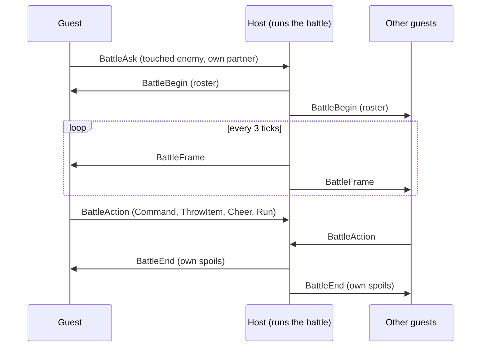

# Co-op combat with every partner (design document)

Status: **partly implemented** (2026-11-20, #351, #361). Proposed 2026-11-19 (ticket #362) as the step after the first
version of co-op battles (#351, PR #363), where only the starter's partner fights. Section 12 says what is built. It
builds on [online co-op](multiplayer.md), [ADR 0024](../adr/0024-co-op-with-authoritative-host.md), sessions of up to
four players (#352, [room browser and four players](coop-browser-4p.md)) and the scaling in [co-op
difficulty](coop-difficulty.md).

**Design base:** the base of all combat documentation in the project is the [Combat system
design](combat-design.md) —the DWPF system to build toward: orders and the queue, techniques and arsenal, INT/VEL,
positioning, co-op and balance— with its companion [technique costs](costo-mp.md) and [technique
catalogue](tecnicas.md). This document specifies the co-op layer over the already-implemented `original` ruleset; for
the redesign, chapter 8 of the base is the reference.

**Rule zero:** with one partner on the players' side the battle is exactly today's: same fighter layout, same AI, same
commands, same results. Everything new only runs with two or more partners, and every extra mechanic in §8 is an
optional, documented improvement.

## 1. The original battle

Sources: the decomp functions named below and dwe's port in `packages/game/battle`
([battle module](../modules/game/battle.md), [battle reference](../reference/battle.md)).

### 1.1 Shape

- **One partner against one to three enemies**, in real time at 20 ticks per second (`BTL_battleMain`: partner AI,
  enemy AI, fighter states, hits, statuses). `COMBAT_DATA.fighter[4]`: slot 0 is the partner, 1–3 the enemies.
- **The tamer is not a fighter.** He stands at the edge, shouts the command text (`BTL_drawCommandShout`) and throws
  items. Nobody can hit him.
- **Endings:** win (all enemies down), flee (Run, 41 ticks), loss (partner at 0 HP plus a 171-tick countdown, which a
  thrown revive item cancels).

### 1.2 Orders: indirect control

The player never picks a move directly until Brains 500. Commands (`handleCommands`): 1 Run, 2 Attack, 3 Your Call,
4 Moderate, 5 Distance, 6 Defensive, 7 Change target, 8–10 technique 1–3, 11 Finisher. The menu grows with Brains:

| Brains | Commands |
|---|---|
| < 100 | Finisher, Run, Your Call |
| 100+ | + Attack |
| 200+ | + Moderate |
| 300+ | + Change, Distance |
| 400+ | + Defensive |
| 500+ | the three techniques (Attack and Moderate go) |

Below 301 Brains the partner may ignore orders for 100 ticks, with chance `70 − discipline` %. Orders apply at once
(the original's delay code is dead).

### 1.3 Finisher

The meter fills toward `3000 − Speed`: +1 per tick and a bonus per attack, block or blocked hit. When full, the
finisher button fires it; during its 0x50-tick aura, mashing L1/R1 adds 2 per press to the charge (up to 80), which
scales damage up to ×2. A finisher freezes everything else (`NO_AI_FLAG`) and always hits. Enemies fire theirs on
their own.

### 1.4 Targeting

- **Enemies target only the partner** (dwe: `selectTarget` in `targets.cpp`, default `PartnerId`). One exception: an
  enemy hit by another enemy's area move turns on it 71 % of the time.
- **The partner** (`BTL_selectFighterTarget`, dwe `original_partner_ai.cpp` and `targeting.cpp`): with Brains ≥ 300 it
  prefers an enemy with a status; ≥ 150 the weakest (HP and a Def and type score) and keeps it; below, the nearest.
  When hit it switches to the attacker with 70/40/30 % (by mode) minus discipline.
- Moves are weighted draws; no per-move cooldown, but 40 ticks after any attack (80 without MP), a Speed-refilled
  energy, and 110 ticks between area moves. Buffs: `brains/100 + 1` per battle, at most 5.

### 1.5 Items

The bag opens with Triangle. The item is always thrown **at the partner**: it flies 24 steps and writes to the partner
(`startThrowingItem`). No item targets an enemy. An item in the air pauses the death countdown.

## 2. What blocks co-op today

| Assumption | Original | dwe today |
|---|---|---|
| One partner | `fighter[0]`, `PARTNER_ENTITY` | `PartnerId = 0` in `state.hpp`, used 57 times in 14 battle files; `partner()` = `fighters.front()`; `enemyCount() = fighters.size() − 1` |
| One command menu | `currentCommand[0]` | One `CommandState commands` in `BattleState` |
| One finisher | `finisherChargeup[0]` | One `FinisherState` (one `fighter`, one `charge`) |
| One bag, one throw | Items land on the partner | `bagOpen`, one `std::optional<ThrownItemState>`, always to `PartnerId` |
| One tamer | Flee walk-back and camera | One `Point tamer` |
| Enemies hunt one target | Partner only | `selectTarget` default `PartnerId`; `enemyTurnsToAttacker` |
| Damage knobs | — | `damageOf` scales by `partner_dealt_percent` / `partner_taken_percent` keyed on `PartnerId` |
| One result | One partner's gains, one life, one bag | `settleBattle` and `BattleResult` (`partnerHp`, `partnerSpecies`, `statGains`) |
| Fighter cap | 4 | `limits.max_enemies: 3`; PR #363 wire `MaxBattleFighters = 4` |

Reusable as is: the deterministic, screenless `Battle` running on the host; the per-fighter AI strategies; the
versus rival (`VersusRival`), which already gives a second fighter its own `CommandState` and looks commands up by
fighter (`commanded(id)`, `commandsOf(id)`). That is the model for more partners.

## 3. Starting point: PR #363

- The battle runs on the host's simulation, one at a time, only when the players share a map.
- The starter's partner fights (a guest's partner joins as a visitor, `session::BattleRequest::visitor`); the host's own
  partner stays out.
- The other player is a **helper**: sees the battle (`BattleFrame` every 3 ticks), throws items from their own bag,
  cheers (a finisher-charge press).
- Bits and drops stay in the host's world; the fighting partner's spoils go back to the guest (`BattleEnd`).
- A guest who drops leaves its partner fighting on Your Call.

The next step, this document, is **every present partner fighting on one side**.

## 4. Design

### 4.1 Sides and fighter slots

- The players' side holds 1–4 partners, the enemies' side 1–3 enemies: up to 7 fighters.
- Layout: **partners first, enemies after**. Slot 0 is the starter's partner, so with one partner the layout is
  today's (0 partner, 1–3 enemies).
- Every fighter carries a `side` (`Players`, `Enemies`) and, on the players' side, its `owner` (`PlayerId`).
- `PartnerId` is replaced by queries: `isPlayerSide(id)`, `partnerOf(PlayerId)`, `partners()`, `enemies()`. With one
  partner `partnerOf(starter) == 0`.
- Who joins: every partner whose player is on the battle's map and not busy (in a menu that cannot close, in a scene).
  Players that cannot join are helpers, as in PR #363.
- Placement: each partner starts where it stands in the field (PR #363 already does it for the visitor), clamped to the
  battle area; enemies as in the original.

### 4.2 Enemy targeting

| Moment | Rule | With one partner |
|---|---|---|
| Start | The touched enemy targets the starter's partner; each joiner targets the partner nearest to it | Everyone targets the partner (original) |
| Hit by a partner | Switch to that partner with the original turn rule (`Obedience::enemyTurnsToAttacker`) | Same rule, only one candidate |
| Hit by an enemy's area move | Original 71 % turn on that enemy | Same |
| Target knocked out | Nearest standing partner | Battle is ending |
| Target ran or left | Nearest standing partner | — |

Tamers stay untargetable. Area moves hit every partner inside the area, by geometry, as they already do for fighters.
This keeps the original's "aggro by being hit" behaviour and gives a natural role: the partner that hits most draws the
enemies.

### 4.3 Partner AI

Each partner runs its own `PartnerAi` (move and target choice, Brains, discipline, buffs) exactly as in solo. The
targeting helpers (`weakestOther`, `nearestOther`, `afflictedOthers`) only look at the **enemies' side**. Partners never
hit each other: their area moves skip allies (enemies keep the original's friendly fire among themselves).

### 4.4 Commands per player

- Each player commands **only their own partner**, with their partner's own menu (by its Brains) and disobedience (by
  its discipline). Same keys as in solo ([controls](controls.md)).
- Each partner has its own `CommandState`; the battle looks orders up by fighter (`commandsOf(id)`), as versus does.
- Change target (command 7) cycles that partner's target among the enemies.
- Nobody can give orders to another player's partner. A partner whose player dropped goes on Your Call.

### 4.5 Finisher and cheering

- Each partner has its own meter, goal (`3000 − Speed`) and charge: `FinisherState` becomes one per partner.
- A finisher still freezes the battle (identity). Finishers never overlap: if two are ready, they fire one after the
  other; a ready partner waits with its aura.
- **Cheering** (from PR #363): any other player pressing the finisher-charge button during an ally's aura adds to that
  ally's charge at half rate (1 per press); the owner keeps 2 per press. The cap stays 80, so a cheered finisher never
  hits harder than the best solo one, it only gets there more easily.

### 4.6 Items and bags

- Each player throws from **their own bag**, from their own tamer. Bags never merge.
- Target: their own partner by default; left and right in the bag pick an ally partner (its card lights up). Revive items
  can target an ally in the death countdown.
- A guest on the skin's battle screen picks with Q and E (`tab_previous`, `tab_next`; the shoulder buttons on a pad)
  while its bag is open: its own partner, then each other partner in turn; the picked ally's card gets
  `battle.ally.<n>.throw_target`.
- The bag does not pause the battle in co-op (decision 5 of [multiplayer](multiplayer.md) §6).
- One item in flight per player (`ThrownItemState` per player); any item in flight toward a partner pauses that
  partner's countdown, as in the original.

### 4.7 Run

Run is per partner: that partner retreats (the original's 41 ticks) and leaves the battle; it gets the original flee
penalties. The battle goes on for the rest and the scaling is recomputed ([co-op
difficulty](coop-difficulty.md) §4). When every partner has left, the battle ends as a flee. Fixed fights (trigger 1)
still have no Run.

### 4.8 Knockout and loss

- A partner at 0 HP starts the original 171-tick countdown; a revive from **any** player cancels it.
- When it runs out, the partner is **out**: it lies down, cannot be targeted or revived in this battle, and still counts
  for the scaling (so a knockout never makes the enemies weaker).
- **The battle is lost only when every partner is down** (at 0 HP with no item in flight to it). Then each partner
  loses as in solo: a life, happiness −30, discipline −20, and each player's own bag loses 30 % of its occupied slots.
- **If the team wins**, an out partner does not lose a life: it ends with 1 HP, happiness −10 and no stat gains (it
  did not finish the fight). Option `strict_knockout`: an out partner loses as in a solo loss even on a win.

### 4.9 Players arriving mid-battle

A player who enters the battle's map while it runs becomes a helper. With the option `join_running`, and if the fight
is not fixed and there is a free slot, their partner can step in (enters from the edge) and the scaling is recomputed.

### 4.10 HUD for 2–4 players

- Enemy bars on top, as today.
- One **card per partner** along the bottom: player colour and name, partner name, HP and MP bars, finisher meter, the
  current order's icon and the countdown when down. The local player's card is the larger one and holds the command
  strip.
- The tamer's command shout shows over each tamer, in the player's colour.
- Camera: each player's view follows their own partner and its target like the original's battle camera, and pulls
  back to fit the group when partners spread (option `group_camera`).
- Skins: the card is a new block in the `battle` document; the original skin shows one card per partner in the
  original frame style.

## 5. Alternatives for simultaneous participation

| Alternative | How it plays | For | Against | Verdict |
|---|---|---|---|---|
| A. One fighter plus helpers (PR #363) | The starter's partner fights; others throw items and cheer | Built; no change to the battle | Helpers barely play; their partner gains nothing | Keep as fallback (fixed fights, busy players) |
| **B. Every partner on one side, real time** | §4 | Everyone plays all the time; the original's indirect control scales well (orders are rare, so no waiting) | Battle sides must be redone; HUD and scaling needed | **Chosen** |
| C. Tag team | One partner at a time, swap in and out | Small change to the battle | Three of four players wait | No |
| D. Pause per order (turn based) | Battle stops while someone picks | Fair to slow players | Not the original's real-time identity; four players pausing breaks the flow | No |
| E. Parallel battles | Each player fights their own copy of the encounter | No new battle rules | Not playing together; the host simulates up to four battles; rewards duplicate | No (but one battle per map, see task 12) |

Why B fits this game: the player's input in battle is sparse (a few orders and a finisher per fight), so four players
never wait for each other, and the partners' autonomy does the fighting. No player can monopolise decisions because each
one only orders their own partner.

## 6. Orders, targets and results in the battle state

- `BattleState` keeps per partner: `CommandState`, `FinisherState`, `ThrownItemState`, countdown, `owner`.
  `commanded(id)` and `commandsOf(id)` cover partners and the versus rival alike.
- Simultaneous orders: each player's actions are queued and applied at the start of the next tick, in `PlayerId` order.
  The battle stays deterministic for the same inputs.
- Optional improvement **mark target**: a player pings an enemy; ally partners with Brains ≥ 150 prefer it when they
  next choose (their AI still decides). Off by default.
- `BattleResult` gets one entry per partner (`PartnerResult`: HP, MP, stat gains, learned moves, care, lives lost,
  injury, counters, flee or out) plus the shared part (bits, drops by receiver, NPCs removed). With one partner it holds
  one entry with today's values.
- `damageOf` keys `partner_dealt_percent` and `partner_taken_percent` on `isPlayerSide`, so the Easy level keeps working
  for every partner (with the host's setting).

## 7. Multiplayer architecture

### 7.1 Authority

- One shared battle instance, **on the host only**. Guests never run the battle; they draw it from frames. This is the
  model of [ADR 0024](../adr/0024-co-op-with-authoritative-host.md) and PR #363.
- The host validates every action: a `Command` only for the sender's own partner, an item only from the sender's bag
  (the guest's bag copy that came with its profile; the guest removes the item when the host confirms the throw), a
  cheer only during an ally's aura. The confirmation is the throw showing in the host's `BattleFrame` under the
  guest's id: until then the item stays in the guest's bag, so a throw the host refuses (another in flight) costs
  nothing; one throw waits for the answer at a time, for at most 40 frames (2 s).

### 7.2 What replicates

| Message | Change from PR #363 |
|---|---|
| `BattleBegin` | Roster: slot → side, owner `PlayerId`, species; each fighter's four move ids (protocol 15) |
| `BattleFrame` (every 3 ticks) | Every fighter (up to 7): HP, max HP, MP, status, current order, finisher meter and aura, countdown; figures as today (place, heading, clip and its start) |
| `BattleAction` | `Command` (own partner implied by the sender), `ThrowItem` with target slot, `Cheer` with ally slot, `Run`, `Join` (with `join_running`), `CloseEnd` |
| `BattleEnd` | One spoils block per player (their partner's `PartnerResult` and the drops they received) |

Limits: `MaxBattleFighters` 4 → 7. `ProtocolVersion` goes up.

Protocol 15 also gives each fighter of a `BattleFrame` its current order (a command, or in a Folder battle the active
slot and stance) and the status its row names, and the frame for one guest carries that guest's finisher progress and goal and, in a Folder battle,
its partner's plate: active order and phase, the queue with targets, the target, stance, defense bar, break countdown,
commit lock and the last order's notice. A plate costs at most 23 bytes.

### 7.3 Latency

- A guest's order reaches the host in half a round trip plus up to one tick: about 2 ticks at 100 ms. Orders are rare
  and the original applies them through the partner's own AI, so this is not felt.
- The guest's strip shows the chosen order at once (local echo) and confirms it when a frame carries it.
- Frames every 3 ticks (150 ms); guests play each figure's clip from its start tick and interpolate places between
  frames. Estimated traffic: under 2 KB/s per guest at 7 fighters.
- Finisher charge presses are counted on the guest and sent as a count per frame window, so mashing does not depend on
  latency.

### 7.4 Disconnection

- **A guest drops:** its partner keeps fighting on Your Call until the end; its spoils are dropped (the guest's own save
  is untouched, as in PR #363). It still counts for the scaling.
- **The host drops:** the session ends (ADR 0024); each guest's battle ends with no result and the guest returns to its
  own game.

### 7.5 Shared world

- One battle per host world (PR #363). Players on other maps keep playing; their own wild touches wait as today
  ("busy", then helper). Several battles at once on different maps is task 12.
- When a battle starts, the field actors of its partners and enemies leave the field on every client; when it ends,
  the enemies removed by the battle leave every field (PR #363 already sends them).

## 8. Cooperative mechanics (optional improvements)

Each one is a toggle in the co-op options, off in single player by construction.

| Mechanic | What it does | Default in co-op |
|---|---|---|
| Ally items and revive | §4.6: throw to any ally partner | On (core) |
| Cheer | §4.5: help charge an ally's finisher | On (PR #363) |
| Link hit | A hit on an enemy that an ally hit in the last 10 ticks deals +10 %, with a small mark | Off |
| Double finisher | If a second meter fills during a finisher's aura, both fire in the same freeze, +15 % each | Off |
| Guard | A partner on Defensive draws attacks: enemies targeting an ally within its range switch to it 30 % of the time per hit taken | Off |
| Mark target | §6 | Off |

These reuse existing commands and moves; none is a new technique (out of scope for #362).

## 9. Balance

- More partners mean more damage and spread enemy attacks: [co-op difficulty](coop-difficulty.md) §5 scales enemy HP,
  MP, Off and finisher rate by the number of partners fighting, and treats fixed fights apart.
- Cheering cannot raise damage above the solo maximum (cap 80).
- The optional mechanics in §8 add damage (+10 % link, +15 % double finisher): balance is measured with them on and off
  (difficulty §10), and their numbers live in the ruleset.
- Uneven parties: a strong partner draws the enemies (they turn to who hits them), which protects weaker allies;
  stat gains for carried partners are discussed in difficulty §7.

## 10. Compatibility with single player

- One partner = slot 0, the original layout; every per-partner structure has one entry; targeting has one candidate;
  `BattleResult` holds one entry. The story chain and the comparisons against the original
  ([state trace](../guides/state-trace.md)) must stay identical.
- Versus keeps its own path (`VersusRival`).
- Tournaments stay 1 vs 1 (difficulty §8).

## 11. Risks

| Risk | Mitigation |
|---|---|
| `PartnerId` is used all over the battle | Mechanical rename to queries in one task, before any behaviour change, with the solo tests unchanged |
| Finishers freezing too often with four partners | One at a time; measured in simulation; optional double finisher |
| Visual noise with seven fighters | Cards instead of floating bars for partners; camera pull-back |
| Cheating guests | Host validates every action; profile `contentHash` as in versus |
| Late joins and leaves | Scaling keeps HP fraction; joining off by default |
| Battle time with weak parties | Scaling tables and dwe-sim targets in difficulty §10 |

## 12. Implementation tasks

Ready to become issues, in order; each one keeps single player unchanged and is tested alone.

**Built (2026-11-20, protocol version 6, UI API 0.20.0).** When the guest's partner is on the map where the host's
encounter starts and not busy, it fights beside the host's partner in the host's battle; otherwise the guest helps as in
PR #363, and alone the battle is the original one. What landed, by task:

- Tasks 1–3, partly: the second partner is an **ally** (`BattleSetup::allies`, `AllySetup` with its owner) placed
  **after the enemies**, not before them as §4.1 says: slot 0 stays the starter's partner and enemies keep their
  numbers, so the solo layout and every enemy index are untouched. `isPlayerSide` and `foes` answer the side questions;
  `PartnerId` stays for the starter. Each ally has its own commands, bag, thrown item, flee and countdown
  (`AllyState`); finisher progress is per fighter already.
- Tasks 4–6: enemies target any partner and turn to their attacker; partners never hit each other; Run and the
  knockout countdown are per partner (`Departure`); the battle ends when the enemies are down with a partner standing
  or when no partner is left (a flee if any ran, else a loss). A partner out on a win ends with 1 HP and happiness −10.
- Task 7: `Battle::allyResults` gives each ally its own result; bits, drops and recruits stay in the host's world (the
  battle's own result). The guest applies its ally result (stat gains uncapped) through the spoils, which now carry the
  departure.
- Tasks 8–9: `BattleOffer` (0x80) tells the host the guest's partner can join; `BattleBegin.allies` names the allies;
  `BattleFrame` carries every fighter (up to `MaxBattleEnemies + MaxPlayers`); the guest commands only its own partner
  (role `ally`), the host checks every action's role. A guest who drops leaves its partner on its own call.
- Task 10, partly: the battle screen shows the allies' cards (`battle.allies`, HP and MP) in every skin; the guest's
  `coop_battle` panel shows every fighter's HP, the partners' MP and marks its own partner; orders go to one's own
  partner.

**Built (2026-11-20, protocol version 9, UI API 0.23.0): every partner fights.** Any guest can start a battle, and every
player on that map whose partner is free fights in it (up to three allies beside the starter's partner): in the host's
own battles every free guest, in a guest's battle the host and every other free guest. Each guest's link carries its own
asks, offers and actions; the host sends each guest its own frames (its partner's strip, bag and finisher) and its own
end, with spoils only for a guest whose partner fought. A guest who drops leaves its partner on its own call; the others
play on.

- Task 10, more: an ally's card counts down its revive when it falls (`battle.ally.<n>.revive_seconds`), and the
  guest's panel shows each fallen partner's countdown. A player picks the partner its items fly to (the panel's Aim
  button; `BattleAction.value` carries the target), and an item a guest throws leaves that player's body on the host's
  screen with the throw's clip. Each ally sounds as its own species (allies' sound banks in slots 16–18; a visitor's
  partner keeps its own species in the partner slots).
- Task 10, rows: each ally's card shows its current order next to its name (`battle.ally.<n>.order`: its command,
  its Folder move or its stance); with three allies the cards drop the MP bar to stay compact.
- Task 11: co-op difficulty, see [co-op difficulty](coop-difficulty.md) §9.
- Task 10, the guest's screen (protocol version 12): the host's `BattleFrame` carries the items thrown (`throws`: who
  threw it, the item, in the hand, on its way with its point, or landed on a fighter), and a guest's screen draws them
  as the host's does: the throw's clip on the thrower's body, the item flying, and the glow over the fighter it lands
  on (`CoopThrowFollower` starts each once however often a frame repeats). Each body plays its clips' sounds from its
  own species' bank: the enemies from the original's slots, the other players' partners from the allies' slots 16–18
  (`coopBattleSoundsOf`). The developer console's `coop_fell("<player>")` fells that player's partner in the host's
  battle, to check the countdown and the Aim without a long fight. Details:
  - The thrower's clip is the original's player throw (clip 6), with the item on the thrower's hand node 9 until it
    leaves.
  - A landed throw stays in the frames for 20 battle frames, so one lost frame does not lose its glow.
  - A throw first seen already landed shows its glow but plays no clip.
  - Lost frames do not stall the glows: the guest moves them on by the frames that went by.
  - Sound slots: this game's partner keeps slot 4 and the enemies take 5 on, as in the original; each other partner
    takes the next ally slot. Past the three ally slots, a body plays from this game's partner's slot.
- Task 10, the guest's HUD (protocol 15): a guest's skin battle screen reads the same settings as the host's. The
  ally cards name each partner's order and status, the finisher gauge fills, the Folder plate shows the guest's own
  partner and the foes it targets or has queued (with the twins' letters), and the bag picks the ally an item flies to.
  Not sent yet: the finisher's charge gauge corner, and the menu entries' MP cost and problem.
- The guest's HUD shows from the host's intro on, without the banner. Its bag opens as the host's does: the HUD learns
  the bag is open before the bag shows, so the battle document never takes the focus back (the guest's own partner
  menu republishes the bag in that tick), and its Use always throws, even once the bag has closed. When the host's
  battle takes a guest's screen, a field bag left open closes and a field notice (a sickness, a medal) waits until the
  battle is over.
- Not yet: task 12 (one battle per map: a second battle on another map is still refused while one runs), the optional
  mechanics of §8 and a per-player shout.

1. **Battle sides refactor:** replace `PartnerId` with `side`, `owner` and the queries `isPlayerSide`, `partnerOf`,
   `partners`, `enemies`; partners first, enemies after. No behaviour change (solo tests and story chain green).
2. **Per-partner state:** `CommandState`, `FinisherState`, thrown item and countdown per partner; `commandsOf(id)` for
   partners and the versus rival.
3. **Several partners in `BattleSetup`:** `partners` list with owners; `BattleAdapter::start` builds visitors for every
   present player; placement from the field.
4. **Enemy targeting for several partners:** start target, turn to attacker, retarget on knockout or leave (§4.2).
5. **Partner AI on the enemies' side only** and no friendly fire between partners (§4.3).
6. **Knockout and loss rules** (§4.8) and per-partner Run (§4.7).
7. **Per-partner results:** `PartnerResult`, `settleBattle` per partner, `BattleAdapter::finish` and `giveRewards` per
   player; drops to whoever landed the last hit.
8. **Protocol:** roster in `BattleBegin`, up to 7 fighters in `BattleFrame`, new `BattleAction` kinds, per-player
   `BattleEnd`; `MaxBattleFighters` 7; version bump; codec round-trip tests.
9. **Host validation and guest local echo** of orders, items and cheers (§7.1, §7.3).
10. **HUD for 2–4:** partner cards, local strip, shout per tamer, ally item target, in every skin.
11. **Co-op difficulty scaling** ([co-op difficulty](coop-difficulty.md) §9).
12. **One battle per map:** let the host run battles on different maps at once.
13. **Optional mechanics** (§8): link hit, double finisher, guard, mark target, each with its toggle.
14. **Balance pass:** dwe-sim `battle` scenario with several partners; tune the ruleset numbers.
15. **Game test:** two to four PCs, the scenarios of difficulty §10.3 plus a four-partner wild fight and a disconnect in
    a boss.

Prototype: not needed before task 1. The versus rival already proves that a second commanded fighter works in the
same `Battle`; task 2 extends that to the players' side.

## 13. Related documents

- [Combat system design](combat-design.md) —the combat base—, [technique costs](costo-mp.md) and [technique
  catalogue](tecnicas.md).
- [Online co-op multiplayer](multiplayer.md), [ADR 0024](../adr/0024-co-op-with-authoritative-host.md) and [room
  browser and four players](coop-browser-4p.md).
- [Co-op difficulty](coop-difficulty.md).
- [Battle module](../modules/game/battle.md), [battle reference](../reference/battle.md), [versus](../modules/game/versus.md).
