# Training in a shared world (design document)

Status: **built** (2026-11-20, ticket #365; audited and completed 2026-11-27, see the [#365 audit](audits/365-audit.md)). It builds on [online co-op](multiplayer.md) (§5.7 shared world, §6
decisions 4 and 5), [ADR 0024](../adr/0024-co-op-with-authoritative-host.md) and the gym screens of the
[partner](../modules/game/partner.md) module.

**Rule zero:** the single-player game does not change. Alone (or in versus), a training session moves the clock one
hour exactly as the original does, and no code path differs from before. Everything below applies only while a co-op
game runs.

## 1. How the original trains

`TRN_advanceTrainingTime` (`trn_reward.c`) runs once per session, after the course's animation and reward:

- **The partner pays:** tiredness + the course's cost, energy − cost, happiness − cost. With tiredness at 70 or more
  (overwork) also happiness − 3 and discipline − 3.
- **The clock jumps one hour:** it is set to the session's start time + 1200 frames (20 frames a game minute). While
  the course plays the clock stands still, so a session is always exactly one game hour.
- **That hour's care is paid in one go:** the unhappy-lifetime check when the new hour is a multiple of 4; sleepiness
  (sickness counter + 1, missed sleep hours + 1); hunger (starvation timer − 120 and a care mistake when energy is too
  low, else food level − 60); energy − the species' usage; toilet (pooping timer − 1200, else poop level − 6); lifetime
  − 1, evolution timer + 1, injury and sickness timers.
- **A session that crosses midnight** adds a day: age + 1, the day counter and the daily stat trigger. Day-time changes
  (16:00, 20:00, 6:00) follow from the clock.

One game minute is one real second (20 frames a second), so a game hour is a real minute. A player that trains ten
sessions in a row moves the world ten hours in a few real minutes; that is the original's pacing, and fine alone.

The rest of a session, from the [gym module](../modules/game/gym.md) and the [care sheet](../reference/care.md#training):

- **Start.** A course starts from the gym's confirm cell: the script offers Begin, Explain or Quit, then Normal or
  Bonus Try, sets variables 254 (the course) and 246 (the roulette) and calls routine 7 (script 108 at the town gym).
  The script does not look at the partner first: a tired or hungry partner trains and pays for it (the overwork
  penalty above).
- **End.** A session runs its course's frames (1200 for most, a minute of play) or ends on the cancel button held,
  with what it gained; with the roulette, the reels decide when it ends. The stats box then counts the gains.
- **Gains.** A base per gym times the species' aptitude, its level, an upgraded gym, the practice bonus, the training
  manual and a food's training boost; the roulette multiplies the result by 0.5 to 10; each session adds one to the
  evolution timer.
- **Rest and recovery.** Tiredness falls only by resting, sleeping and some foods; nothing in the gym restores it.
- **What co-op must keep:** the gains formula and its caps, the costs of the hour, the overwork penalty, the session's
  length, the roulette and the stats box, and the order in which they happen. Only who moves the clock changes.

## 2. What co-op did before this ticket

Measured in the code (`GameSession::advanceGameTime`, `Partner::passTrainingHour`, the co-op bridge):

| What | Before | Why it breaks |
|---|---|---|
| The world's clock | Every game in a co-op room ran **its own** `GameClock`, copied from the host's save at join. Nothing sent it afterwards (the snapshot's clock in §5.5 was never built). | Two players see different times of day, shops and NPC schedules after a few minutes. |
| The host trains | The course holds the field (`holdForScript`), which stops the host's clock; the session then jumps it one hour. | The host's partner and the guests live in different hours; ten host sessions skip ten hours for the shared world but not for the guests. |
| A guest trains | Only the guest's own clock jumps. | The guest's clock runs away from the host's; nothing brings it back. |
| Several train at once | Each session jumps its own clock. | With four players the world would jump four hours a minute if it were shared; with private clocks it simply drifts. |
| Others see it | Nothing tells the others that a player trains. | A trade or a battle ally ask goes to a player sitting in a gym screen. |

## 3. Options

| | A. Parallel sessions | B. Synchronised sessions | C. Decoupled partner hour |
|---|---|---|---|
| Idea | Each player trains when they want, alone, while the world goes on. | Sessions start together; everyone waits for a ready check, the clock jumps one hour for all. | The partner's hour is its own: it pays the hour's costs, the world's clock does not move. |
| Waits | None. | Everyone waits for the slowest; nobody can train alone. | None. |
| Clock | Must still decide who moves it. | One jump per round, agreed. | Never jumped by a session. |
| Fidelity | Same per session if paired with C. | Same hour per session. | Same costs per session; the day comes from the world. |
| Cost | Low. | A lobby state, ready checks, timeouts, cancel rules. | Low: one flag in the session request. |

**Chosen: A + C on one world clock, the host's.** Players train in parallel without waiting for anyone (A); a
session costs its partner exactly the hour the original charges, but in co-op it never moves the world's clock (C).
B was rejected: it makes training a group activity, which the issue explicitly does not want ("without waiting for
them"), and it still jumps the world for players who are not training.

## 4. The model

### 4.1 One clock, the host's

- The host's clock is the world's. It runs with real time (one game minute a real second) and is moved only by what
  moves it alone: its own sleep, its scripts' time skips, the debug commands. A training session no longer moves it.
- The host tells every guest its clock with `WorldClock` (`0xC0`, host → guests, reliable): elapsed frames, whether
  it runs, and its speed in thousandths. It tells it at once to a guest that joins, then about once a second, and at
  once when the clock stops, starts, changes speed or jumps more than a second (`session::WorldClockTeller`).
- A guest's session (`ClockShare::Guest`) follows it (`session::WorldClockFollower`): between two words it runs the
  world on at the host's speed for at most two seconds, then stands until the next word. Each tick it compares its
  clock with the world's:
  - **a small gap** (less than an hour) is played as frames, so the partner lives them as usual;
  - **whole hours** (the host slept or skipped time) are a time skip: the partner pays them with `skipHours`, as a
    script's time skip does, and the clock is set to the world's;
  - **a guest a little ahead** (less than five minutes) waits for the world;
  - **a guest far ahead** (its own sleep or its own skip) goes back to the world's time. Its partner already lived
    those hours, so it does not live them again: the session remembers how far the partner lived and gives it no
    frames until the world passes that point.
- Before the host's first word, a guest runs its own clock as before.

### 4.2 The partner's hour

`TrainingRequest::sharedClock` (set by the session in co-op, host or guest) makes `Partner::passTrainingHour` pay
every cost of §1 **without** the clock jump and without the day roll:

- the stat gains, the costs, the overwork penalty, the hour's hunger, sleep, toilet, lifetime and evolution timer:
  unchanged, so ten sessions give the same partner as ten sessions alone;
- the unhappy-lifetime check and the sleepiness use the hour the session would have reached (the clock's hour + 1);
- age, the day counter and the daily trigger come only from the world's midnights, as the partner lives them on the
  shared clock. A session at 23:30 does not add a day; the world's midnight does.

While a course runs in co-op the world's clock keeps running, but the partner's care is held (no frames of hunger or
energy), as the original's stands still for it. When the course ends the partner lives the world's time again. The
hold is `GameSession::holdForCourse`, set by the gym's field port next to the field hold.

**A session lasts its hour of the world's clock (#411).** A whole session is 1200 course frames, a real minute, so
the world's clock already runs about an hour through it (measured: 1241 frames from the course's start to its last box,
against the 1200-frame jump alone). A session cut short ran only seconds: a cancel, or the bonus try's roulette
stopped early, charged the partner an hour while the world moved a minute or two (measured: 41 frames), so a player
that skipped ten sessions saw no time pass for anyone. Now, in co-op, the course keeps its actors after the stats box
until the world's clock has run one hour from the course's start (`GameSession::courseHourRuns`, `GymPorts::hourRuns`;
the course run waits before `TRAINING_COMPLETE`). The partner's care stays held meanwhile, so it pays exactly the hour
it was charged, the player's tag still says **Training**, and the next session of a batch starts after it. Sessions of
several players overlap on the same world hour; none of them moves the clock. Alone nothing waits: the session's jump
is the original's.

### 4.3 Who trains

`TrainingStatus` (`0xC1`, both ways, reliable) carries a player and a course id (at most 32 characters, empty when the
player stops). A guest tells the host its own course when it changes; the host takes the link's player id, never the
one in the message, and tells every guest the others' courses as they change.

- The co-op tag over a player shows **Training** (`coop_hud.tag.training`, `coop_hud.tag.<n>.training`, UI API
  0.25.0).
- A player that trains is busy for trades and is not offered as a battle ally; a player in a gym screen cannot be
  pulled into a battle.
- A player's first course in a co-op game shows a notice once: the world's time keeps running, each session lasts one
  hour of it, and a skipped session waits for the rest of its hour (`online.coop.training_clock`).

### 4.4 Flow

```mermaid
sequenceDiagram
  participant H as Host session
  participant N as Link
  participant G as Guest session
  H->>N: WorldClock (join, every second, on stop/jump)
  N->>G: WorldClock
  G->>G: follow: frames / skip hours / wait / go back
  G->>N: TrainingStatus(course)
  N->>H: TrainingStatus (player = link's)
  H->>N: TrainingStatus to the other guests
  Note over H,G: each session pays its partner one hour; neither clock jumps
```

One player's session in co-op, from the confirm cell to the next free step:

```mermaid
stateDiagram-v2
  [*] --> Script: confirm cell (the world's clock runs on; the reader's partner stands, T7)
  Script --> Course: routine 7; holdForCourse(true), clock start kept
  Course --> Award: frames run out, cancel held or reels stop
  Award --> Count: partner charged one hour (sharedClock, no jump)
  Count --> HourWait: box closed, world ran less than one hour
  Count --> Done: world already ran its hour
  HourWait --> Done: world clock reaches start + 1 hour
  Done --> [*]: holdForCourse(false), TRAINING_COMPLETE, script goes on
  Course --> [*]: link lost on a guest (back to the title)
```



### 4.5 Sleep in a shared world (#424, #411)

Sleeping skips the night, and the night is the world's. The rules:

- **Only the host moves the world's clock.** The host's sleep takes the world to its partner's morning; every guest
  skips those hours (§4.1).
- **A guest's sleep does not move the world, and the world does not undo it.** The partner sleeps as alone (the night's
  rest, lifetime and evolution hours, its next bedtime), then the guest's screen stays dark until the world's clock
  reaches that morning (`SleepScreen` waits while `GameSession::aheadOfWorld`), with a notice that says so
  (`online.coop.sleep_wait`); the sleep menu's panel counts down the time left to that morning
  (`sleep_menu.wait_seconds`, from `WorldClockFollower::waitSeconds`). If the host sleeps meanwhile the guest wakes at
  once. While it waits the guest's clock never goes back to the night, and the partner never lives those hours twice.
- **A guest may wake early.** The menu key (Tab) or cancel ends the wait (`sleep_wake`): the screen fades in, the
  guest's clock goes back to the world's night and the partner, already rested, does not live those hours again
  (`GameSession::unlived`).
- **Nobody is forced to sleep.** The others keep playing; the world is never held for a sleeper.
- **No advantage from sleeping out of step.** A guest cannot rest and still use the night: its game waits with its
  partner. Its sleep is only possible when its partner is sleepy, as alone.
- **World events and day changes** follow the world's clock only (§5): a guest's sleep changes no day for anyone.

### 4.6 Two to four players

The same rules hold for every size of room; nothing scales with the number of players.

| Players | Who moves the clock | Who can train | What the others see |
|---|---|---|---|
| 1 (alone) | The session's jump, as the original | The player | — |
| 2 | The host's clock, real time only | Both, at once or not, on any gym | The other's **Training** tag and its partner's clips at the machine |
| 3 | Same | All three, independently | Each other's tags and clips, through the host |
| 4 | Same | All four, independently | Same; four sessions at once still run the world one hour per real minute (tested) |

- **One session per player.** A player's game runs one course at a time (`GymScreen::start` does nothing while a
  course runs); a batch runs its sessions one after the other, each waiting for its hour.
- **The same machine.** Each game runs the gym on its own copy of the map, so two players can use the same machine at
  once. On each screen a second partner on a course at a used machine is drawn one step (300 units) beside the first, to
  either side, up to four (`machineSpotBeside`, T8): the host does it for the guests' partners on its field, so its
  snapshots carry it, and each guest for the partners it draws next to its own. Only a partner playing a course's clip
  moves aside; off the course it stands where its game has it. Only each player's own screen moves the machine's objects
  (the boulder, the log).
- **Training and exploring.** A player on a course is busy: no trades, no battle ally offers, not pulled into a battle.
  The others keep exploring, fighting and trading; the world is never held for a trainer.

### 4.7 Results and authority

- **Each partner's gains are its own game's.** The trainer's game runs the course, rolls the roulette with its
  partner's own random state and applies the gains, costs and the hour (`GameSession::train`). No result travels on
  its own: the others see the tag and the clips.
- **The host does not validate a guest's gains**, as it does not validate a guest's care: co-op trusts each game with
  its own partner ([ADR 0024](../adr/0024-co-op-with-authoritative-host.md)). A session is applied once, by one game, so it cannot be
  counted twice.
- **The hour is checked against the world.** The course's hold lasts until the world's clock ran the hour it charged
  (§4.2), so neither the host nor a guest can farm sessions faster than the world's time runs.
- **Progress goes home.** A guest's trained partner goes back to its own save with the rest of its progress (#383,
  [multiplayer](multiplayer.md), "What goes home").

### 4.8 The host held by its own script or screen (T7, T9)

A host's script holds only the host's player (decision 6 of [multiplayer](multiplayer.md)), and so does a full screen of
its own. Neither stands the world's clock any more:

- **Which holds.** On the co-op host, the world's clock runs on while a script holds its field (a talk, the gym's menu,
  a scene) and while a screen of its own runs instead of the field: the shops (items, cards, merits), the item keeper,
  the discard menu, the jukebox, the trade and bird screens, the schedule, the world map, the debug menu, the fishing,
  the stones game, the award notice, the partner's care scenes (pile, toilet, feeding, praise and scold) and its
  evolution. What still stands it: a map change (it takes every player), the host's sleep (its skip moves the world),
  a tournament, the death and ending scenes, and a battle.
- **The host's partner stands meanwhile,** as it would alone, and lives that time once its player is let go, as a
  guest's partner catches up with the world after its own dialog (§4.1): whole hours as a time skip (`skipHours`), the
  rest frame by frame on the world's clock (`GameSession::liveStoodTime`). So a long talk costs the partner the same
  care as the same time on the field, and no time is lived twice: a time skip or a debug jump during the hold is not
  counted, and the gym's menu is lived when the course starts, so the course's hour is not.
- **The guests** keep playing: the host tells its clock as running, and they follow it.
- **Alone nothing changes:** the script or screen stands the clock, as in the original. **A guest's own** scripts and
  screens are as before: its clock stands with them and catches up with the world afterwards.

The pieces: `GameSession::hostHeldByOwnScript` (a script hold that is not a map change), `runWorldPastHeldPlayer` (the
clock runs, the frames are kept in `stoodFrames_`) and `tickHeldPlayer`, which `PlaySession::tickSystems` calls on the
ticks a screen of the player's own runs instead of the session's tick (a no-op alone and on a guest).

## 5. Disconnections and edge cases

- **A guest leaves:** the host clears its course (`CoopTraining::playerLeft`) and tells the others; a guest that comes
  back hears the clock and every course again.
- **The host leaves:** the guest goes back to the title as before; nothing of this ticket outlives the game.
- **Day change and events:** only the world's midnight changes the day, for every player at once (a guest that missed
  it by a skip pays it in `skipHours`). Day-time changes follow the shared clock.
- **Host menus, scripts and screens:** nothing the host reads or opens holds the world's clock any more: not its menus
  or Start's pause (#415), not its scripts (a talk, the gym's menu, T7), not its own full screens (a shop, the item
  keeper, the fishing, a care scene, an evolution, T9). See §4.8.
- **A guest sleeps:** its partner sleeps and its screen waits in the dark for the world's morning (§4.5); it no
  longer goes back to the night.
- **The host sleeps:** guests skip those hours (§4.1), as a script time skip.
- **Battles:** a battle still stops its player's clock while it runs; a guest catches up afterwards by frames or a
  skip.

The cases the issue lists:

| Case | What happens |
|---|---|
| A player finishes before the others | It is free at once (after its hour); the others' sessions go on, none waits for another. |
| A player starts while another trains | Allowed, on any gym, even the same machine (§4.6). The clock does not care. |
| A guest disconnects mid-course | Its game goes back to the title and keeps its last safe point (#383); the host clears its course and tag. |
| The host leaves mid-course | Every guest goes back to the title with its last safe point (#383); a session still running may be lost. |
| The partner has no energy | The gym's script does not refuse: the session runs and the hour's hunger and care mistake apply, as alone. |
| The day changes during a session | Only the world's midnight changes the day; a session never adds one (§4.2). |
| A timed event fires during a session | World events follow the world's clock; on the trainer's own game the course holds the field, so an event that needs it starts after the course, as alone. |
| A player tries several sessions at once | One course per game; a batch runs them in a row, each lasting its hour. |
| Latency or packet loss | `WorldClock` and `TrainingStatus` are reliable; a guest runs on at most two seconds past the last word, then waits; a late word is played as frames or a skip. A course waiting for its hour waits longer while the host's clock stands (a map change or a battle of the host's). |

## 6. Code

| Piece | Where |
|---|---|
| The partner's hour without a jump | `packages/game/partner` (`TrainingRequest::sharedClock`, `Partner::passTrainingHour`) |
| Clock sharing, follow and tell | `packages/session` (`shared_clock.hpp`, `GameSession::shareClock`, `hearWorldClock`, `worldTime`, `holdForCourse`, `courseHourRuns`) |
| The course waits for its hour | `packages/game/gym` (`GymPorts::hourRuns`, `CourseRun::finish`), `packages/session` (`GymFieldPorts::hourRuns`) |
| Messages `0xC0`, `0xC1`, protocol 11 | `packages/game/coop` (`protocol.hpp`, `link.cpp` `directionAllowed`) |
| Routing and the game loop | `apps/game` (`coop_gameplay_bridge`, `coop_training`, `game.cpp`, `play_session`) |
| The host held by its own script or screen | `packages/session` (`GameSession::hostHeldByOwnScript`, `runWorldPastHeldPlayer`, `liveStoodTime`, `tickHeldPlayer`), `apps/game` (`PlaySession::tickSystems`) |
| A second partner beside a used machine | `apps/game` (`coop_machine_spot.hpp`, `CoopHostWorld::showHeld`, `presentCoopPlayers`) |
| The tag | `content/packs/game/ui/coop_hud`, UI API 0.25.0 |

## 7. Limits and follow-ups

- **Co-op sleep** (§4.5): a guest that sleeps while the host stays awake waits up to a night in real time (about ten
  minutes); the host is not told that a guest sleeps.
- **What still stands the world's clock** for everyone: the host's map changes, its battles, a tournament and the death
  and ending scenes (§4.8).
- **A host's partner held for long** lives that time in one go when let go: more than an hour of a talk is a time skip
  for it, as for a guest.
- **A course waits for the world's hour (#411)**: a session the player skips holds its actors up to a real minute in
  co-op.
- **Partners side by side (T8)** is drawing only: each game still runs the course on its own spot. A partner walking to
  or from the machine past another on a course may step aside for a moment.
- **The remote partner's training animation** is drawn on the other machines since protocol 14 (#420): the course's
  clips and the partner's place on the equipment travel in the snapshots and the guest's states
  ([multiplayer](multiplayer.md) §5.7, "What a script plays").

## 8. Tests

- `packages/session/tests/gym_course_tests.cpp`: a whole course on a real field held by the story, alone (the clock
  stands, then jumps 1200 frames, skipped or not) and in co-op as host and guest (the world runs 1200 to 1300 frames,
  skipped or not).
- `packages/game/gym/tests/course_flow_tests.cpp`: a session cut short holds its actors until the hour is over.
- `packages/game/partner/tests/training_tests.cpp`: a shared-clock session leaves the clock and pays the same gains and
  costs as one alone; one at 23:30 adds no age.
- `packages/session/tests/shared_clock_tests.cpp`: follow (gap, skip, wait, go back), the teller, alone vs co-op,
  four players training every second for ten seconds, the course hold, a guest's own skip not lived twice, the host's
  sleep.
- `packages/game/coop/tests/training_tests.cpp`: round trip, refusals and the direction rules through a real
  `CoopLink`.
- `apps/game/tests/coop_training_tests.cpp`: a host and three guests on loopback links training at once.
- `apps/game/tests/coop_replication_tests.cpp`: a guest's course drawn on the host's field and in its snapshot, and
  let go when it ends; a second partner on the same machine drawn beside the first, and the free spot to either side.
- `apps/game/tests/coop_host_clock_tests.cpp`: a host and a guest on a `CoopPair`: a host's script and a host's screen
  run the world's clock on for the guest while the host's partner stands, then lives it as it would have played it;
  alone a script stands the clock; a guest's own talk stands its clock and catches up; the gym's menu is lived before
  the course and the course's hour is not lived twice.

## 9. Tickets

What was built, and what is left, as implementation tickets. Each keeps rule zero: alone nothing changes.

| Ticket | Scope | Status |
|---|---|---|
| T1. One world clock | `WorldClock`, the follower and the teller, `ClockShare` | Done (#381) |
| T2. The partner's hour without a jump | `TrainingRequest::sharedClock`, `Partner::passTrainingHour` | Done (#381) |
| T3. Who trains | `TrainingStatus`, the **Training** tag, busy for trades and battles | Done (#381) |
| T4. Remote training clips | Clips and partner place in snapshots and guest states | Done (#420) |
| T5. Co-op sleep | A guest's sleep waits for the world's morning | Done (#424) |
| T6. A session lasts its hour | The course waits for the world's hour before it ends | Done (#411) |
| T7. Host dialogs and the world's clock | The world's clock runs while a script of the host's own holds it; its partner lives that time once let go (§4.8) | Done |
| T8. Shared machines | A second partner on a course at a used machine is drawn beside the first (§4.6) | Done |
| T9. Host local screens | The host's shops and other full screens of its own run the world's clock on (`GameSession::tickHeldPlayer`, §4.8) | Done |
| T10. Host validation of gains | Optional: the host checks a guest's gains against the formula's bounds | Open, only if cheating matters |
