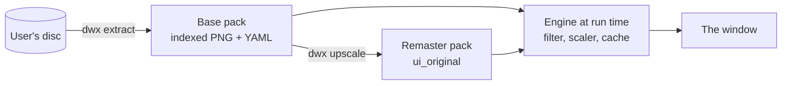

# High definition

How the game looks sharp on a modern screen: the engine filters and enlarges the prerendered backgrounds and the
models' textures **while it runs**, and one small offline tool, `dwx upscale`, enlarges a few indexed images with fixed
pixel art rules. Nothing here uses image models, AI services or the network, and the same input gives the same picture
on every machine. The project first planned a much larger offline pipeline and dropped it, because the maps and the
models already look good ([ADR 0025](../adr/0025-high-definition-in-the-engine.md)).

Read first the [asset pipeline](assets-pipeline.md), the [packs and the VFS](vfs.md) and the
[legal policy](../legal/assets.md).

## Summary



- **In the engine, at run time.** `map.slang` filters the field's background and depth layers at the window's
  resolution ("HD scenery"); the engine's own scaler doubles each background and each model texture once; the 3D scene
  is drawn with 4 samples per pixel. What the scaler makes is kept in a cache, so it is made once.
- **Offline, small.** `dwx upscale <recipe>` runs the built-in `index_scale` step on indexed images and writes a
  pack of the `remaster` layer. `dwx extract` runs one bundled recipe, `ui_original`, after the base pack.
- **Four settings for the player**, all on their best by default ([next section](#what-the-player-sees)).
- **The disc is a dependency.** Everything comes from the user's own disc. Nothing derived is in git or in a release.
- **The player's own images** are another way to get a sharper map: see [custom images](../guides/custom-images.md).

## What the player sees

| Setting | Values | Default | What it does |
|---|---|---|---|
| `hd_scenery` ("HD scenery") | on, off | on | The field's background and depth layers are filtered at the window's resolution; off, the original's exact pixels |
| `scenery_quality` ("Scenery quality") | `upscaled`, `smooth` | `upscaled` | With HD scenery on: the background doubled once per map by the engine's scaler and resampled, or only filtered |
| `antialiasing` ("Antialiasing") | on, off | on | The scene drawn with 4 samples per pixel: smooth model outlines |
| `texture_filter` ("Model textures") | `upscaled`, `smooth`, `nearest` | `upscaled` | The models' textures doubled and filtered with mipmaps, only filtered, or the original's texels ("Pixels") |

- They are rows of the "Graphics" tab of the options ([game](../modules/apps/game.md#hd-scenery)), in game and from the
  title, and apply at once. They are saved in the user's settings.
- `--graphics scenery=smooth|upscaled,aa=on|off,textures=nearest|smooth|upscaled` changes the last three for one run
  (`graphics_options.hpp`); the console and the routes have `hd_scenery("on"|"off")`, `scenery_quality("smooth")`,
  `antialiasing("off")` and `texture_filter("nearest")`.
- `texture_filter` reaches every model: the field and battle, and the 3D figures of the menus. With `upscaled`, a
  model that loads while the game runs gets its textures from a thread of its own (`TextureUpscaleJob`) and draws with
  plain ones until they are ready, so no frame waits for it.
- The same setting also decides how the movies are enlarged ([movies](movies.md#scaling)) and whether a skin's sheet
  marked `upscale: smooth` is smoothed with the models' texture scaler ([UI](ui.md#images)).

## Game constraints

What the original data is like, and where the engine and `dwx` take it into account:

- **Backgrounds are indexed and the palette is chosen while playing.** `dwx extract` composes the background's
  128 × 128 tiles into an indexed PNG per palette variant (`background_day`, `_dusk`, `_night`, `paletteN`), with the
  same indices in all of them and **no sidecar YAML**. The engine (`assets::loadMapImages`) reads the indices and the
  palettes; the render chooses and blends the palette according to the time (`map.slang: texelAt`, `lerp(from, to,
  push.fade)` over the palette texture). The camera works in background pixels (`MapCamera`,
  `backgroundSize = tiles × 128`; [ADR 0020](../adr/0020-map-camera-and-depth-layers.md)). That is why the filter
  works on colors after the palette is applied, and why `index_scale` stays in index space: every palette, the blend
  and `?palette=N` keep working.
- **Depth layers are crops of texture pages.** Each sprite is a crop of one of the map's texture pages (indexed, 256
  per side, several sprites per page: an atlas), placed at `inst.x, inst.y` in background pixels. With `clut` −1 it
  uses the palette of the background for the time of day. The sprites that are not cutouts of the background are
  filtered inside their own sheet rectangle (`rect`), so nothing from the neighboring sprite gets in.
- **Color 0 is transparent and alpha is a class.** Color `0x0000` is not drawn, and alpha stores **classes**: 0
  transparent, 128 STP, 255 opaque (`colorFromOriginal`), which `map.slang` separates with thresholds of 0.25 and 0.75
  ([maps](../formats/maps.md#depth-layers)). The scalers never interpolate between classes. For model textures
  `upscaleRgba` first gives the transparent texels the color of their opaque neighbors, so no dark fringe appears.
- **Seams.** The background is a single image (extraction already composes the tiles), so there are no tile seams, and
  the filter clamps its reads to it.
- **Model textures** are inside the `.glb`: one image per combination of texture and palette that some primitive uses,
  with UVs already divided by the image's width and height, a `NEAREST` filter and `alphaMode: MASK` for color 0
  ([models](../formats/models.md#textures)). Because the UVs are normalized, an image twice as large works without
  touching the mesh.
- **UI image limits.** Images of the UI are at most 4096 per side (`MaxUiImageSide`), 64 MiB of file
  (`MaxUiImageFileBytes`) and about 85.3 MiB decoded with all their levels (`MaxUiImageBytes`), in
  `packages/engine/ui/include/dwe/ui/image_reference.hpp`. The UI paints indexed images with `?palette=N` from
  `<id>_meta.yaml`, and asking a KTX2 for a palette is an error (`PaletteNeedsPng`; [UI](ui.md#images)); that is why the
  `ui_original` pack keeps indexed PNGs.

## High definition in the engine

The engine draws the field scenery in high definition itself, with no `remaster` pack and no external tool:
the "HD scenery" option ([game](../modules/apps/game.md#hd-scenery)),
on by default, changes how `map.slang` samples the prerendered background and its depth layers. It is
own code, written for dwe; from published work it takes only general ideas (gradient-oriented kernels,
structure tensor), nothing from GPL- or LGPL-licensed scalers.

**What was chosen and why.** Two possible paths:

| Path | How | Gains | Loses |
|---|---|---|---|
| **GPU filter at the window's resolution** (chosen) | `sampleSmooth` in `map.slang` reads the colors already with the time-of-day palette and filters them with a kernel that follows the edges, at each pixel of the window | No new extraction or memory (only one RGBA texture of the background); any window size, no integer factor; the palette blend and all variants work the same; nothing to validate in `_meta` | Per-pixel cost on the GPU (measured below) |
| Index scaling at extraction or at load (`index_scale` ×2/×4, `scale` in `_meta`, `pixelsPerTexel` per texture) | Pixel art scalers (AdvMAME family) decide by index **equality** | Stays indexed: palettes and blend for free | The backgrounds are 3D renders quantized to 256 colors with dithering: almost no neighbor is equal, so those scalers hardly change anything; ×4 costs 16 times the background's memory; it only gives finer steps, not clean edges |

Measured on the backgrounds of `twna01`, `trop01`, `leom01` and `frzl01`: a Scale2x applied twice (× 4) on the indices
changes only 6.8%, 8.5%, 7.4% and 6.4% of the pixels compared with enlarging without a filter, and leaves the dithering and jaggies
almost as they were; the GPU filter gives straight, clean edges and soft shadows on the same maps. They are not combined:
an index pre-scaling adds nothing the filter does not already do and would cost memory.

**The filter (`sampleSmooth`).** For each pixel of the window:

1. It reads 12 texels around the point (the 4 × 4 without the corners) in colors: the background arrives as an RGBA texture with
   the palette that is shown now (`MapRenderer::resolveBackgroundColors`, which rebuilds it on the CPU only when the palette
   changes: when changing variant and at each of the five steps of the blend), so each texel is one read.
   Sprites that follow the time of day (`clut` −1) are resolved the same way; the other sprites are already colors.
2. With the luma gradients of the four central texels (central differences) it forms a structure tensor,
   bilinearly mixed: it gives the edge's direction, its coherence and its contrast, measured relative to the local brightness
   so that the dark night palettes keep their edges like the day ones.
3. It weights the 12 texels with a radial bell (`(1 − x/4)² · (1 − lobe · x)`, `x` the squared distance) narrowed
   across the edge and stretched along it according to the edge's strength: lines come out straight and clean at
   any scale. The negative lobe is 1 on edges and with contrast (each texel keeps its color at its
   center: no detail is lost) and 0.75 in flat areas, where it blends the original's dithering into soft shadows.
4. It clamps the result between the minimum and the maximum of the four central texels: no halos or rings.
   Many pixels fall right at the center of a texel (at scale 3, one in three), where the 12 texels and the clamp
   pass to the next ones: the point is moved 1/512 of a texel right and down so that the rounding of how the frame was drawn
   does not decide (without that, two strips of the background pass gave different colors on those rows).
5. **Transparency and classes untouched**: transparent texels (class 0) carry no weight, so no black enters through the
   edges, and only those of the nearest texel's class (opaque or STP) are blended: STP ones blend with what is behind
   in their own pass and their colors, often dark, would stain the opaque ones (black dots appeared on the edges of
   `trop01`'s leaves). The alpha is that of the nearest texel, so what is drawn and what is STP remains the
   original's pixel.

**Blend and palettes.** The filter mixes colors after applying the palette, just as the blend mixes palettes
(`lerp(palette_a[i], palette_b[i], t)` at each texel is the same as mixing the two images; see [Game
constraints](#game-constraints)): all variants and the 1/6 to 1/2 steps of the blend look as before, only
finer. The RGBA texture is rebuilt with the same arithmetic as `snapshotPalette` (rounded to 8 bits; at most half a
level of difference from the floating-point mix of the index path). Depth layers now use the
same blend step as the background (`timeOfDayFadeShown`); before they used linear progress and during a blend their
colors were a little ahead of the background's.

**Aligned depth layers: cutouts.** Almost all the layers' sprites are crops of the background that are
drawn in front of the characters. `MapCutouts` (`<dwe/render/map_cutouts.hpp>`, CPU only) checks, per sprite and
position (and remembers it), whether it is a cutout: it follows the background's palettes (`clut` −1), is at an integer pixel and each
texel that some variant draws has the same background index underneath. A cutout is drawn in
`SamplingCutout` mode: its nearest texel says whether it is drawn and its class, and the **color comes from the filtered background underneath**,
so it matches the background pixel by pixel, with no seam, and characters passing behind are covered by the
same pixels as in the original. The other sprites (animated water, pieces that are not cutouts) are filtered on their own,
inside their sheet rectangle (`rect`), so that nothing from the atlas's neighboring sprite gets in.

**No seams.** The background is a single image (extraction already composes the 128 × 128 tiles), so there are no tile
edges inside it; the filter clamps its reads to the background (`rect`), and cutouts take their color from the same background.

**Geometry does not change.** The option only reaches `render::MapRenderer` (the sampling mode of each frame). The
camera, the background's window, the layers' positions, their depth, the choice of a click on the ground, the
collisions and the triggers do not see it: the field (`packages/game/field`) cannot even depend on `render` by the layer
rules of the modules. `hd_scenery_tests.cpp` ("HD scenery changes no collision, trigger, map change or camera of a
walk") walks through a room against a wall, over a trigger and to a jump with the option off and on, and each
tick gives the same: positions, turn, partner, triggers, map change, where the camera puts the player and what
a click there picks.

**The background pass.** With the option on, `MapRenderer::hdSceneryScene` gives a prior pass
(`FrameDesc::textureScenes`) that stores the filtered background in a texture the size of the window, unshaded and with
each pixel's class in the alpha. The background (`SamplingScreen`) and the cutouts (`SamplingCutoutScreen`) read it with a
single read per pixel, so a cutout no longer repeats the filter. The texture is not entirely filtered every frame: it stores the
background enlarged to the window's scale with its pixel `u` at `u` modulo the window size, so when
the camera scrolls what was already filtered stays where it was and the frame only filters the strip that the scroll
uncovers (`<dwe/render/hd_scenery_wrap.hpp>`; the pass draws on top of what was there, `TextureScene::keep`). It is filtered
entirely when the colors change (variant, blend steps, signs), the window size or the map, and again
in the next frame if the new colors did not fit in that frame's upload memory. The scroll is
rounded to window pixels: what is seen ends up at most half a window pixel from where the frame lands.
Without the pass (the first frame, the one after a size change) the background and the cutouts filter on the fly, with the
same result. A route that walks through `trop01` and then turns the option off and on (which filters everything again) gives the
same image, except for the characters that moved between the two captures.

**Cost.** On llvmpipe at 1280 × 720, measured as CPU time per frame (the sum of llvmpipe's threads; the
machine had other jobs, so loose fps figures are no good): the difference between a short route and another 30 s
longer divided by the difference in frames. On `trop01`, the worst because of its foliage layers, standing still: 142 to 152 ms
without the option and 107 to 109 with it; walking (the camera scrolls every frame): 146 to 147 without it and 110 to 115 with
it. With the option it costs less than without it because the unfiltered background reads index and palette in several samples per
pixel and the pass leaves a single read. A frame that filters everything (a color change) costs what the
version that filtered every frame cost, about 230 ms on llvmpipe, about 100 more than without the option; the
earlier versions, which filtered the background every frame (and the cutouts again underneath), ran from 166 to 290. On a real GPU
it is 12 reads per pixel and it is not noticeable. Memory: one RGBA texture the size of the background (5 MiB the largest, 1280 × 1024),
those of the sprites that follow the time of day and the pass's, the size of the window (3.5 MiB at 1280 × 720, 8 MiB at
1920 × 1080).

**What it does not cover.** 3D models, the UI and the dedicated screens (combat, minigames) do not go through `map.slang`;
models have their own definition improvements ([Sharpness](#sharpness)).

## Sharpness

The maps looked pixelated. Before changing anything, we measured where it came from: captures of `twna01`, `trop01`,
`leom01`, `frzl01`, `twnb01`, `tunn01` and `mgen06` at 1920 × 1080 and 1280 × 720, by day and by night, with "HD
scenery" on and off, and enlarged crops.

| Source | What was seen | What was done |
|---|---|---|
| Model textures | Sampled at the nearest texel: at 1080p a texel of a 256 × 128 texture covers several pixels and blocks are visible | `texture_filter` ([render](render.md#sharpness-edge-smoothing-and-model-textures)) |
| Model outlines | No smoothing: jaggies on every silhouette, which looked the most "pixelated" | `antialiasing`, 4 samples per pixel |
| 3D resolution | It is already the window's: there is no lower internal resolution to enlarge | Nothing |
| Background with the HD filter | Smooth, but with "brush strokes" in textured areas (the grass of `trop01` and `twna01`), wavy lines and red and blue fringes in the circuits of `mgen06`, and the original's color noise | `scenery_quality`: the enlarged background (below) |
| Dithering | Proportion of 2 × 2 checkerboard squares and of isolated pixels: `twna01` 2.34% and 1.50%, `trop01` 7.94% and 7.33% (ordered checkerboard in the dark, flat areas), `leom01` 0.91% and 0.58%, `frzl01` 1.04% and 0.45%, `twnb01` 1.38% and 0.48%, `tunn01` 2.67% and 1.58%, `mgen06` 0.48% and 0.07%. Almost all of it is 256-color quantization noise, not an ordered dither | It is blended with a contrast filter before enlarging |
| Background cutouts | The mask is the sprite's nearest texel: the edge of what covers the characters is a staircase | Unchanged (pending) |
| Interface | The original skin's HUD, the minimap polygon and the map name font are enlarged pixel art | Outside this improvement (UI) |

**The enlarged background** (`scenery_quality: upscaled`, the default). When a map loads, a thread doubles the background in each
palette variant with a scaler written for dwe (`<dwe/render/scenery_upscale.hpp>`; from published work it takes only
the idea of directional cubic interpolation, no code), and the HD background pass resamples the doubled result to the
window:

1. **Blended dithering.** Each texel becomes the (1 2 1) weighted average of its same-class neighbors whose guide color
   (luma plus mean chrominance) differs from its own by at most 10 levels out of 255: the checkerboard and the noise of two
   close colors give their tone; any change with more contrast stays the same.
2. **Edge-directed doubling.** Each new pixel is a cubic interpolation (−1, 9, 9, −1)/16 along the
   direction in which the image changes least: first the centers of each 2 × 2 (the two diagonals), then those of each
   row and column; if no direction dominates (less than 15%), the two are mixed with weights `1/(1 + d⁵)`. The
   result is clamped to the two middle samples, so there are no rings. Edges come out as lines, with no
   steps (a diagonal advances one pixel per row, not two every two rows).
3. **Adaptive sharpening.** A soft sharpening in the style of contrast-adaptive sharpening: each pixel moves away from
   its four neighbors the less the more contrast there already is, and never beyond the minimum and maximum of its luma
   around it (no halos). Strength 0.35 out of 1.
4. **Decisions are made once.** Direction, weights, blending and sharpening are decided on the first variant and
   applied the same to all: the doubled result is a linear mix of the original's texels, so mixing the doubled
   variants with the blend's weights gives the same as doubling the mixed palette (except for clamping and
   rounding, a few levels on some pixel and less than one on average). The GPU mixes up to three variants with the
   weights seen at each moment (the snapshot row of an interrupted blend stores its own).
5. **Classes are not mixed.** Transparent, STP and opaque texels are never interpolated with each other, and each new pixel
   has the class of the original texel at its top left: the pass takes what is drawn and what is STP from the nearest
   original texel and only mixes the doubled result of that class. Shapes, cutouts, layers and collisions do not change.
6. **On the GPU** (`SamplingUpscaledPrefilter` in `map.slang`): 4 × 4 Catmull-Rom over the doubled result, clamped to the
   four middle pixels. It goes in the HD background pass, which only filters the strip the scroll uncovers: the
   rest of the scene (the background, the seamless cutouts, the layers) reads it as before.

**Cache.** Each background is doubled once and the result is kept ([The cache](#the-cache)). While the thread works, and
if anything fails, the background looks with the usual filter; changing map, language (the signs) or the option cancels
the work in progress without waiting.

**Cost.** Doubling a 768 × 640 background in its three variants, built with optimization and on 8 threads: 300 to
430 ms depending on the machine's load (a 896 × 256 one with one variant, 100 to 170 ms), once per background; in the
development build with sanitizers, about 8 s, without stopping the game. Video memory: one RGBA texture of double the
side per variant (7.5 MiB for 768 × 640; 20 MiB for the largest, 1280 × 1024). Per frame: 16 reads per
variant and pixel, only in the strip the scroll uncovers.

**Why not another scaler.** The pixel art ones (xBR or ScaleFX families) decide by equality or distance of
colors between neighbors, and these backgrounds are quantized renders in which almost no neighbor is equal (see above
the Scale2x test). Neural network scalers give more detail, but they are third-party code and models
with their licenses and weights: none is included here; whoever wants a different look can bring their own images
([custom images](../guides/custom-images.md)).

**Models.** `texture_filter` and `antialiasing` are in [render](render.md#sharpness-edge-smoothing-and-model-textures):
the models' textures are doubled with the same scaler (no dithering or sharpening; interpolated alpha, transparent
texels filled with the color of their neighbors) and filtered with mipmaps, and the scene is drawn with 4
samples per pixel.

**What remains.** The cutouts' mask (steps over the characters), the UI and the minimap.

## The cache

The upscaler's results are kept so each background and each model texture is made once (`render::UpscaleCache`,
`<dwe/render/upscale_cache.hpp>`).

- **Where.** `<user data>/cache/upscale`, in the user's data folder, next to the settings. A run that does not keep settings
  (autotests) keeps nothing: the cache has no folder and every call upscales again.
- **What is stored.** One file per result, `<key>.bin`, compressed with zstd. The key is a 64-bit FNV-1a hash of
  everything the result depends on: the pixels, the palettes, the options and the upscaler's version
  (`SceneryUpscaleVersion` in `map_renderer.cpp`, `TextureUpscaleVersion` in `texture_upscale_job.cpp`; change the
  version when the output changes). Only doubled results are kept; a model texture that is only filtered is not.
- **It is never needed.** A missing, damaged or stale file is upscaled again. Each file is written under a temporary
  name and renamed, so several threads can use the folder.
- **Size.** The folder is kept below 512 MiB (`UpscaleCache::DefaultLimit`) by deleting the files used longest ago;
  loading a file updates its time. A 768 × 640 background takes 3 to 5 MiB per palette variant.
- **Content.** It is made from the user's disc, so it stays on the user's machine ([Legal](#legal)).

## `dwx upscale` and recipes

The offline part is deliberately small. `dwx upscale <recipe.yaml> <pack folder | content folder> -o <folder>`
([dwx page](../modules/apps/dwx.md#dwx-upscale-and-the-bundled-recipes)) grows the indexed images a recipe selects and
writes them, with their metadata, as a pack of the `remaster` layer named after the recipe. It has no providers, no
models and no network: the same bytes on every machine.

### Recipes

A recipe is a `<name>.recipe.yaml` file (`apps/dwx/src/upscale_recipe.*`). What `parseUpscaleRecipe` accepts:

```yaml
recipe: 1
id: ui_original        # also the id of the pack it writes: a-z, 0-9 and _, up to 64 characters
asset_type: ui         # ui or icon
select:
  include:             # asset ids without extension; the same id twice is an error
    - texture/etcdat/system_w
scale: 4
steps:                 # exactly one step, the built-in index_scale
  - id: upscale
    builtin: index_scale
    scale: 4           # optional; if given, equal to the recipe's scale
    params:
      mode: edge       # edge (default) or nearest
```

An unknown key, a recipe version other than 1, a step that is not `index_scale` or a scale the mode does not have is an
error. A recipe never contains commands, URLs, paths or keys: only asset ids and numbers. That makes recipes safe to
share; what they write is never shared ([Legal](#legal)).

### The bundled recipe

`content/enhance/ui_original.recipe.yaml` is built into `dwx` (`bundled_recipes.hpp.in`). `dwx extract` runs it after
it writes the base pack, and writes the `ui_original` pack next to the base one. It grows ×4 in `edge` mode the images
the original-look interface skin draws its icons from; an image the disc does not carry is skipped. The skin measures
its sprites in the original's pixels and sees them sharper at the same size on screen ([extract](../formats/extract.md),
[edit menus](../guides/edit-menus.md)). The two title pictures are not in it: the skin smooths them with the models'
texture scaler (`upscale: smooth` in `skin.yaml`).

Changing the recipe changes what `dwx extract` writes: bump `ExtractorVersion` in the same commit.

### The `index_scale` step

`apps/dwx/src/index_scale.*` grows an image by a whole factor from 1 to 8 **in palette-index space**: the palette is
the same, every new index is taken from the source, and the result depends only on the indices, the factor and the
mode.

- **`edge`:** the classic 2× and 3× pixel art neighbor rules (AdvMAME family) applied to the indices, with the edge
  pixel repeated outside the image. The factors 1, 2, 3, 4, 6 and 8 exist (4, 6 and 8 compose the 2× and 3× rules in a
  fixed order, 2 first); 5 and 7 have no rules.
- **`nearest`:** each pixel repeated n × n times (any factor from 1 to 8).
- **Limit on atlases.** The rules look at the 8 neighbors of each pixel without knowing where a sprite ends: in a sprite
  sheet, the edge pixels of a sprite that touches another with no gap may take the neighbor's index in the enlarged
  copy. A sprite with at least one pixel of gap (or of color 0 around it) is not affected.
- **Why indices.** It never mixes colors, so the result stays an indexed PNG and every palette of the image, the
  `?palette=N` of the UI and the blend between palettes keep working. It only gives sharper pixel art, not new detail.

How `dwx upscale` writes:

- It reads the packs in the folder it is given, not counting the output one, so repeating it always starts from the
  base.
- The images keep their asset ids, so the pack covers the base; the `_meta.yaml` gains `scale: k` (the PNG is `k`
  times width × height; `width`, `height` and the rects stay the original's; `content/schemas/image.schema.json`).
- It writes to `<output>.partial` and renames it. It only replaces a folder that is already a `remaster` pack with the
  recipe's id; any other is rejected without touching it. With no image to grow it writes nothing.
- An image the packs do not provide is an error in `dwx upscale` and is skipped in `dwx extract`.

## The `remaster` layer

`remaster` is the layer above `base` and below mods and the user ([packs and VFS](vfs.md), [content
layers](assets-pipeline.md#content-layers)). A pack that declares `layer: remaster` and depends on `base` sits there: a
mod still wins over it, and an asset it does not bring comes from the base.

### In the stack

- It is an **engine layer** (`assets::isEngineLayer`: `base` and `remaster`). A mod, that is, a pack from a mods folder
  or from `--mods`, can only declare `mods` or `user`; one that declares `remaster` is left out with the reason
  (`checkModLayer`). That is why `dwx upscale` and `dwx extract` write into the content folder, next to `base`.
- The code of an engine pack in these layers runs as the engine (`script::isEngineCode`); a `dwx upscale` pack only
  has images and their metadata.
- The images replace the base ones by id and are looked up by id without extension (a remaster's `.ktx2` can answer to
  the base's `.png`; [VFS](vfs.md)). A KTX2 has no palettes to pick from, so an image drawn with `?palette=N` has to stay
  an indexed PNG.

### What `dwx validate` checks

`dwx validate` has no check specific to this layer. Run on the pack with the base mounted
(`dwx validate --engine --with <content>/base <pack>`; without `--engine` a pack that declares an engine layer is
rejected), it applies what applies to any pack: `pack.yaml` against its schema, each `_meta.yaml` against
`image.schema.json` through the base's schema rules (`scale` is an integer from 1 to 8), a `<name>_meta` with its image
in the stack, and that the engine can load every asset ([asset pipeline](assets-pipeline.md#dwx-validate)). It does not
read `*.recipe.yaml`: `dwx upscale` checks the recipe when it reads it.

## Legal

Extension of the [legal policy](../legal/assets.md#enhanced-output-remaster). This is not legal advice. What the
engine or `dwx` makes from the disc is derived from the original: a scaled background, a doubled texture, the
`ui_original` pack and the cache are never distributed, only the code and the recipes are. They stay on the user's machine.

## Tests

- **`hd_scenery_tests.cpp`** (`apps/game`): HD scenery is on unless the player turned it off and the choice is saved;
  it changes no collision, trigger, map change or camera of a walk.
- **`scenery_upscale_tests.cpp`** (`packages/engine/render`): edges, diagonals without steps, gradients, fades,
  classes, dithering, the cache, a model texture's cut-out edge.
- **`map_cutouts_tests.cpp`**, **`texture_upscale_job_tests.cpp`**: which layer sprites are cutouts of the background,
  and the background thread of the model textures.
- **`index_scale_tests.cpp`**, **`upscale_tests.cpp`** (`apps/dwx`): the edge rules, the factors, the recipe, the
  pack `dwx upscale` writes and when it refuses to replace a folder.
- **Captures:** captures and routes read no saved settings, so `--graphics` sets them for a run and the same frame can
  be compared with each option.
