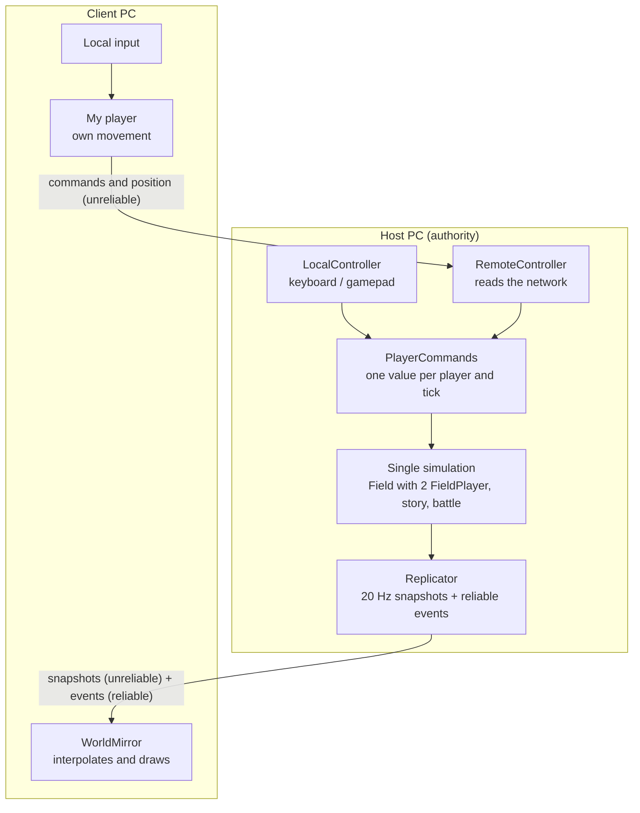

# Online co-op multiplayer (design document)

Status: **built, being polished** (2026-11-20). Rooms of up to four, the shared world, co-op battles with every
partner, co-op difficulty, item trades and joining a game in progress are in the game (§5.6 to §6.2); §6 says how each
game decision turned out and §10 what is left. Sections 1 to 4 and §7 are the plan this started from (2026-11-16), kept
for its reasoning: where they differ from §5 and §6, those win. The architecture decision is
[ADR 0024](../adr/0024-co-op-with-authoritative-host.md).

## 0. Purpose and scope

**Purpose:** let a second player connect over the internet to another player's game and play together in the same world:
walking, talking to NPCs, advancing the story and fighting.

**In scope:**

- up to four players online, a host and up to three guests (§5.9);
- a direct connection between PCs over WebRTC, with the signaling Worker used only for the first contact;
- the host's game world, with its story;
- the guest with their own player (and their partner, depending on decision 1 of §6).

**Out of scope:**

- versus, which already exists and is something else: a standalone lockstep battle ([versus](../modules/game/versus.md));
- local multiplayer on a single screen, which the project ruled out;
- dedicated servers and persistent games.

## 1. The idea in one sentence

Both players use **the same player data**. Only **who controls them** changes: the keyboard of the PC where it is
played, or the network. One PC, the **host**, simulates the whole world and is the authority. The other, the **client**, sends its
commands and draws what the host replicates to it. They connect over WebRTC, with the same transport and the same signaling
as versus.



## 2. What the code assumes today

A study of `main` at `aa27246b2`. It is what forces changes before anything is put on the network.

| Topic | Current state | Consequence |
|---|---|---|
| Player in the field | `game::field::Field` creates exactly one player and one partner (`player_`, `partner_`). The input, the click route, `playerFree`, the triggers, `cellSections` and `confirmSection` exist only once. `Body::who` fixes "0 = player, 1 = partner". | The per-player state has to be moved out to `FieldPlayer` (§4.4). A second `Field` will not do, because each `Field` owns the map, the NPCs and the fades. |
| Partner following | `PartnerFollow` and `Field::movePartner` follow the single player. The off-screen rescue uses the renderer's camera and an unsaved random (`FieldScene::gestureRandom_`). | Each partner follows its owner. The off-screen test moves into the simulation (§4.5). |
| Camera | `FieldCameraFollow` follows the player in the drawing, and `FieldScene::followPixel` returns `setCameraRest` to the simulation. | The render feeds the simulation. It has to be cut: one camera per screen, outside the simulation. |
| Input | `input::InputState` is an object with state and queries by name. `game.cpp` builds a `field::FieldInput` each tick (`stick`, `run`, `moveTarget`, `cancelTarget`, `confirm`), which is already a flat value. Dialogs, menus, battle, items and minigames read `InputState` directly (`pressStory`, `pressBattle`, …). | `FieldInput` is the basis of `PlayerCommands`. The rest becomes commands (§4.2). |
| Clock | Fixed tick of 1/60 s (`core::FixedStep`). The field gives "original frames" at 20 fps with a float accumulator; the story, one frame every 3 ticks; battle, its own `FixedStep` at 20 fps. | It works as is on the host. The client does not simulate the world, so it does not need the same clock. |
| Determinism | The field positions are glm floats: they give the same result in one binary, but it is not guaranteed across machines. There are randoms outside `ruleset::Random` (`std::minstd_rand` in effects and the gym, `gestureRandom_`). Battle is deterministic: integers, `checksum()`, "same seed, same battle". | The world is **replicated**, not synchronized in lockstep. The battle checksum remains as a diagnostic tool. |
| World state | `PlaySession`/`GameSession` own everything. `GameSession::saveFile()` gives a deterministic YAML `SaveFile` with about 30 sections, but it is only valid with the field free (`savesWait`/`busyWith`). Running scripts, the transient state of NPCs, battles and fades are not in the save. | The save serves for **joining at a safe point**, not for live replication. |
| Battle | `FighterId` is the index in `fighters`: partner 0, enemies 1 to 3. The enemy AI and the hits target `PartnerId`. Sickness, the bag, thrown items and reviving belong only to fighter 0. | Today there is room for **a single partner** per battle. Two partners force the sides to be redone (§6, decision 3). |
| Network | `net::PeerLink`/`RtcPeerLink` with two channels ("control" reliable and ordered, "inputs" without retransmission). `SignalClient` with 4-letter room codes over the signaling Worker. `ReliableChannel`, `WireWriter`/`WireReader`, the `Identity` handshake with `contentHash` and the message-type byte of the versus protocol. `Lockstep` is only for two sides. | Everything is reused except lockstep, which at most serves for battles. |
| Pauses | Menus pause the simulation according to the local visibility of the interface (`PlaySession::tickSystems`, `paused()`, `screenStops()`). The Start pause freezes everything. Scripts freeze the player, partner, clock and camera (`holdForScript`, `scriptPauseGame`). | In co-op, opening a menu cannot stop the other player's world (§6, decision 5). |
| Who moves an actor | There is no `Player`, `Controller` or `InputSource`. The closest: the autotest and the control socket inject keys into `InputState`; scripts move actors with `driveByScript`/`placeByScript`; battle and the partner have strategy registries (`BattleStrategies`, `PartnerStrategy`). | The controller is a new piece, but it follows the same pattern as the strategies. |

## 3. Principles

1. **A single world, a single authority.** The host simulates everything: map, NPCs, story, partners, battle, clock and
   randoms. The client never decides anything about the world.
2. **The player is data, the controller is the interface.** Both players are the same `FieldPlayer`. What changes
   is the `PlayerController` that gives them commands each tick.
3. **Everything goes through commands.** No game system reads the keyboard. They read `PlayerCommands`, whether they come from the keyboard, the
   network, an autotest or a replay.
4. **The simulation does not depend on the drawing.** The camera, the renderer and the interface belong to each screen. What the
   simulation needs from them is calculated inside the simulation.
5. **Reuse the versus network.** The same transport, the same signaling and the same handshake. Co-op only
   adds its protocol.
6. **Each step is useful without a network.** Phase C0 (§7) improves the single-player game: autotests, replays and
   cleaner input.

## 4. Pieces

### 4.1 `PlayerController`

The interface that gives a player's commands. One implementation per source:

| Implementation | Where it lives | What it does |
|---|---|---|
| `LocalController` | `apps/game` | Reads `InputState` and builds `PlayerCommands`. It replaces the code in `game.cpp` that today builds `FieldInput` and distributes the presses to each screen. |
| `RemoteController` | `game/coop` (host) | Takes the commands that arrive over the network out of a buffer. If a tick's command is missing, it repeats the last movement and does not repeat actions. |
| `ScriptedController` | `apps/game` (autotest) | Gives commands from a route or a replay. It allows testing two players without a network. |

The shape follows the strategies that already exist: a small interface with no game state. The controller does not touch the
simulation; it only produces values.

### 4.2 `PlayerCommands`

A flat value per player and tick, serializable with `WireWriter`:

- `field`: today's `FieldInput` (`stick`, `run`, `moveTarget`, `cancelTarget`, `confirm`).
- `actions`: a short list of discrete actions: advance or choose in a dialog, choose in a menu, battle command
  (`battle::Command`), use or throw an item, minigame buttons (`FishingButtons`, curling…).

The screens that today receive `InputState` (`pressStory`, `pressBattle`, `pressItemKeeper`, `pressPartnerMenu`,
`pressCurling`, `pressWorldMap`, `pressDestinationChoice`) will receive the actions of the player who is in charge on that
screen. The RmlUi interface keeps emitting `ui::UiCommand`. `LocalController` translates them into actions, instead of
calling `PlaySession::handle` directly.

### 4.3 `PlayerRegistry`

Lives in `GameSession`. One record per player:

- `id` (0 = host, 1 = guest), name and whether it is local or remote.
- its `PlayerController`.
- its partner: the host's is the `Partner` of `SessionState`. The guest's, according to decision 1 of §6.
- its connection state (connected, waiting for a safe point, disconnected).

The maximum size comes from the rules (`max_players: 2` in the first version), not from a constant in the code.

### 4.4 `FieldPlayer`

Everything that is unique in `Field` today and belongs to a player moves to a `FieldPlayer`:

- its entity and that of its partner (the `PlayerTag`/`PartnerTag` tags carry the player id);
- its `FieldInput`, its click route and target, `freeTick`, trail and last trigger;
- its `cellSections` and `confirmSection`;
- its `PartnerFollow` and its off-screen test.

These **stay with the world**: the map, the NPCs, the fades, the map change, the script pauses
(`holdForScript`, `holdForCare`, `holdForItem`) and the `StoryLock` exit filter. `Body::who` goes from "0/1" to
`{player, role}`.

The story scripts that talk about "the player" use **the player who triggered the event** (the one who stepped on the
tile or talked to the NPC). `StoryAdapter` receives that id with each tile section.

### 4.5 Camera and view

- Each screen has its own `FieldCameraFollow`, which follows **its** player. The host sees theirs; the client, theirs.
- The simulation keeps a "view rest" of its own per player (what today enters through `setCameraRest`), calculated with
  the same rules as the camera, but without going through the renderer.
- The partner's off-screen test uses that view rest, not the drawn camera.
- The script camera (`Field::scriptCamera`) and `holdCamera` in battle apply to all screens.

### 4.6 The `game/coop` package

A new package, next to `game/versus` and with the same shape:

| Piece | Side | What it does |
|---|---|---|
| `protocol` | both | Message types (one byte, in a range of their own, not stepping on those of versus or lockstep), handshake with `Identity` (protocol, game version and `contentHash`) and codecs with `WireWriter`/`WireReader`. |
| `CoopLink` | both | Handshake, heartbeat, timeouts and exit reasons, like `VersusLink`. |
| `CoopHost` + `Replicator` | host | Receives commands and gives them to `RemoteController`. Builds the snapshots and the events. |
| `CoopClient` + `WorldMirror` | client | Sends commands. Applies snapshots with interpolation and events in order. Draws with the game's same scenes, in mirror mode (with no simulation of its own of the world). |

The client's session is a `PlaySession` in **mirror mode**: it loads the maps and the models, and draws the interface,
but its systems do not advance; they only apply what the host sends.

### 4.7 Interfaces (sketch)

A sketch to fix the shape; the final names come out of the C0 review. It follows the code's conventions:
`std::expected`, no exceptions, designated initializers.

```cpp
namespace dwe::game {

using PlayerId = std::uint8_t;  // 0 = host, 1 = guest

struct PlayerAction {
  enum class Kind : std::uint8_t { TextAdvance, TextChoice, MenuChoice, BattleCommand, UseItem, ThrowItem, Minigame };
  Kind kind;
  std::int32_t value = 0;  // option, battle command, item…
};

struct PlayerCommands {
  std::uint32_t tick = 0;
  field::FieldInput field;
  std::vector<PlayerAction> actions;  // few per tick
};

class PlayerController {
public:
  virtual ~PlayerController() = default;
  // The player's commands for this tick. Never blocks: if there is nothing, an empty PlayerCommands.
  [[nodiscard]] virtual PlayerCommands next(std::uint32_t tick) = 0;
};

struct PlayerSlot {
  PlayerId id;
  std::string name;
  bool remote = false;
  std::unique_ptr<PlayerController> controller;
  enum class Link : std::uint8_t { Local, Joining, Connected, Dropped } link = Link::Local;
};

}  // namespace dwe::game

namespace dwe::game::field {

struct FieldPlayer {
  PlayerId id;
  entt::entity body;
  entt::entity partner;
  FieldInput input;
  PartnerFollow follow;
  // click route, freeTick, trail, last trigger, cellSections, confirmSection, view rest…
};

}  // namespace dwe::game::field
```

On the network, each command is encoded with `WireWriter`: the tick (u32), the packed `FieldInput` (stick in two i8,
flags in one byte, optional `moveTarget`) and the actions (u8 count, each one a u8 kind and an i32 value).

## 5. Network

### 5.1 Channels

| Flow | Direction | Channel | Rate | Content |
|---|---|---|---|---|
| Commands | client → host | "inputs" (unreliable) | every tick | `PlayerCommands` of the last 3 ticks (redundancy against losses), with their tick number. |
| Own position | client → host | "inputs" (unreliable) | 20 Hz | Position, heading and animation of the client's player (§5.2). |
| Snapshots | host → client | "inputs" (unreliable) | 20 Hz | Per visible entity: id, position, heading, animation and frame. Delta against the last confirmed snapshot. Plus the game clock and the state of the two partners that the HUD shows. |
| Events | host → client | "control" (reliable, ordered) | when they happen | Map change, dialog opened/advanced/closed, battle start and end, shared menu, game to join, disconnection. |
| Actions | client → host | "control" (reliable, ordered) | when they happen | The `actions` that cannot be lost (battle command, dialog choice); they also go in the commands, and the host discards duplicates per tick. |

Estimate: about 20 entities × ~20 bytes × 20 Hz ≈ **8 KB/s** download, and quite a bit less upload.

### 5.2 Movement authority

In the first version, **each client moves its own player** and sends the host its position.

- It is immediate on the client's screen and there is no need to correct positions when the reply arrives.
- The host checks that the position is possible (maximum speed and collision with the map). If it is not, it corrects it and
  tells the client, which jumps to the corrected position.
- Everything else belongs to the host: triggers, tiles, NPCs, story, partners and battle. The client stepping on an exit
  does not change the map until the host decides.
- Among friends, someone cheating is not a risk that justifies more complexity.

Later it can move to full host authority with prediction and reconciliation on the client, without changing the
rest of the pieces.

### 5.3 Joining a game

1. The host opens a room: a 4-letter code through the signaling Worker, same as versus.
2. The client enters with the code. Handshake with `Identity`: if the game version or the content does not match, it is cut
   off with a clear reason.
3. The host waits for the next **safe point** (field free, `savesWait` with no blocks). Meanwhile, the client sees
   "Waiting for the host…".
4. The host sends its `SaveFile` over the reliable channel, plus the map and the current positions.
5. The client loads the map in mirror mode and appears next to the host's player.
6. The snapshots begin.

Reconnection follows the same path (§5.10). If the guest leaves, their player and partner disappear at the next safe
point, and the host keeps playing alone.

### 5.4 Signaling, relay and rooms

The versus signaling Worker (`apps/versus-signal`) is used, with a new room type. The open-room cards
(#291 public directory, #292 explicit room state, #293 public games screen, #294 local
online profile and #295 TURN relay) serve co-op just as well, so they are **common ground**. Deploying the Worker or
enabling TURN still needs an OK.

### 5.5 Messages

A type byte at the start of each message, in the range `0x60–0x6F` (versus uses `0x10–0x14` and lockstep
`0x40/0x41`).

| Type | Name | Channel | Direction | Content |
|---|---|---|---|---|
| `0x60` | `Hello` | reliable | both | `Identity` (protocol, game version, `contentHash`), player name. |
| `0x61` | `Welcome` / `Refuse` | reliable | host → client | assigned id, or the reason for refusal (version, content, room full). |
| `0x62` | `JoinState` | reliable | host → client | The host's `SaveFile` at the safe point, map and positions. Split up if large. |
| `0x63` | `Commands` | unreliable | client → host | `PlayerCommands` of the last 3 ticks. |
| `0x64` | `OwnPose` | unreliable | client → host | Position, heading and animation of the client's player. |
| `0x65` | `PoseFix` | reliable | host → client | Corrected position when the client's is not possible. |
| `0x66` | `Snapshot` | unreliable | host → client | Tick, game clock, entities (delta against the last confirmed), HUD of the two partners. |
| `0x67` | `SnapshotAck` | unreliable | client → host | Last snapshot received, for the deltas. |
| `0x68` | `Event` | reliable | host → client | Map change, dialog, battle start and end, shared menu. |
| `0x69` | `Action` | reliable | client → host | An action that cannot be lost (it also goes in `Commands`; the host discards duplicates per tick). |
| `0x6A` | `Leave` | reliable | both | Exit reason. |

The heartbeat and the timeouts are those of `CoopLink` (§4.6), with the same values as versus.
A side busy with a long load (its frame loop stalled) keeps its links alive: the transport sends the
heartbeat on its own while the game does not poll it, for up to 90 s (`LinkTimeouts::busy`), so a load longer
than the 8 s of silence drops nobody, and a game hung past that is still dropped. A guest whose host goes quiet
shows "Waiting for" and its name instead of a frozen screen.

The snapshot's game clock above was never built: the world's clock reaches the guests with `WorldClock` (`0xC0`), and
who trains with `TrainingStatus` (`0xC1`), both from protocol 11 ([training in a shared world](coop-training.md), #365).

### 5.6 Saves in co-op

Co-op never changes or breaks either player's single-player saves. The rule:

- **Only a game the room starts is a co-op game.** The host's start (its own save, picked for the room) and the
  guest's start (the host's world) join the room. A game loaded from the title while a room is still open stays
  single-player: the guest is not added to it and it sends nothing (`PlayStart::coop`, `PlaySession::coopGame`).
- **The host saves its own game, as a single-player game.** The quick save, the save machine and the autosave write
  the host's slot as always. Nothing of the guest reaches that save: the guest's body and partner live only in the
  field, and no save section reads them. A save the host writes during co-op is the same file it would write alone,
  and it loads in single player like any other.
- **The guest's game saves nothing of the host's world.** Its game is a copy of the host's world in memory with the
  guest's **own** sections in it: its partner, the partner's moves, the species it raised and its bag with its bits
  (`CoopGuestOwnSections`, `hostWorldWithGuestPartner`). It has no save storage (no autosave, quick save or save
  machine) and the copy names no slot, so nothing can take a slot of the guest's disk as its own. The pause menu's
  save and quit say what happens, and a notice says it as the game starts (`online.coop.guest_not_saved`,
  `save.coop_guest`, `save.coop_guest_quit_confirm`).
- **The guest takes its own progress home (decision 4, phase C4).** Those four sections go back into the slot the
  guest brought its save from; the rest of that slot stays exactly as it was on disk.
- **The host's variant rules.** The copy keeps the host's game mode, so a guest plays the host's
  [game variant](game-variants.md) whatever its own save's. When the two differ, the guest's start notice says so, and
  the host hears which player brought the other one (`online.coop.player_other_variant`); both compare the saves they
  already exchange (`coopSaveMode`). The guest's progress still goes home when its save's variant takes everything the
  host's can give (Folder Mode from a Classic Enhanced world, `game::modes::takesProgressFrom`,
  `online.coop.guest_other_variant`); otherwise nothing goes home and the save stays as it was
  (`online.coop.guest_other_variant_kept`), so a Classic Enhanced save never takes in what Folder Mode's rules made.

**What goes home and what never does.**

| Goes home | Never goes home |
|---|---|
| The partner: stats, HP and MP, age, lifespan, lives, care (hunger, toilet, sleep, mood, sickness), evolution, its counters | The story, the triggers and variables, the medals and the player page's key items (story triggers) |
| The moves it knows and has equipped | The map, the place it stands, the clock and the weather |
| The species it raised (the evolution section) | The host's bag and bits: the guest never had them, its game played with its own |
| Its bag and its bits, as its game left them: what it bought with its own bits, picked up (a granted claim), got in a trade or used | The tamer's record, the cards, the shops' stock and everything else of the host's world |

The guest played with its own bag and bits from the start, so bringing them home is the bag it walked out with; the
host's money is never in it. Bits a battle on the host gives go to the host's world, as before (§6.1).

**When it is written** (`CoopGuestHome`, `apps/game/src/coop_guest_return.hpp`). The app looks at the guest's game
once a second at a safe point (nothing busy, no save waiting, no trade open: `PlaySession::coopGuestSave`), and keeps
the newest one:

- **the bag changed** (a trade, a claim, a purchase): written at once, so a crash cannot leave a traded item in two
  games;
- **only the partner changed** (a battle's growth, care): written at the next safe point 30 seconds after the last
  write (or the game's start), so a long game loses little to a crash without writing the slot every few seconds; a write that fails waits as
  long before the next try, and the game's end still tries;
- **the game ends**, whatever ends it: leaving to the title, the host closing the room, the link dropping (before
  going back to the seat), quitting from the pause menu or closing the window (`AppFlow::setBeforeEnd`). A game busy
  at its end (a battle) writes its last safe point: what a battle left unfinished does not go home.

**How it is written safely.** The slot is read again first and must still be the playthrough the guest brought (same
start time, tamer and ruleset); a slot another game took meanwhile is left alone and the guest is told
(`online.coop.home_failed`). The returned partner must be one a game can leave (`checkReturningPartner`: every stat
within its limit, 9999 for HP and MP and 999 for the rest, the limits the original game clamps a partner's stats
to; HP and MP not above them; no negative lives, lifetime, age or weight), and a battle's result from
the host is applied only when its values are ones a battle can leave (`game::coop::spoilsInRange`: HP, MP and gains within those limits, care changes within ±100, at most 99 lives
lost and a day of battle at most), so a tampered or
broken host cannot write garbage into the guest's save. The first write of a co-op game keeps the slot as it was
beside it (`slot_NN.yaml.before_coop`), and every write keeps the previous one as the slot's usual backup
(`.bak`). The written save carries a note (`coop_return` section: the host's name and the partner) that the game shows
once its field shows after the load (`online.coop.came_home`, "Back from {name}'s world...") and the next save drops
(`GameSession::takeUnreadSection`); as the guest's game ends the HUD says it too (`online.coop.went_home`).

**Anti-dupe.** The host is the authority over every item that enters the guest's bag from the world (claims, §5.8;
trades, §6.2): a refused claim gives nothing. A return replaces the slot's bag with the game's bag, it never adds to
it, so writing twice writes the same bag. A guest that drops and comes back to its seat (§5.10) brings the save it
took home (`CoopScreen::keepBrought`), not the one it brought first, so nothing it took home comes in twice; a guest
that restarts its game joins with the slot as it was last written.

- **The host's slot never sees the guest.** The host's slot holds its last save, which never had any guest state in
  it, and loads alone as before.

Tests: `packages/session/tests/coop_saves_tests.cpp` (a host's save with a guest in the field is the single-player
save, and loads at the host's place; the return's note is taken once), `apps/game/tests/coop_guest_profile_tests.cpp`
(the guest's copy names no slot), `apps/game/tests/coop_guest_return_tests.cpp` (what goes home and what never does,
another playthrough or a partner out of range left alone, when it is written, the backups, a rejoin bringing the save
it took home), `packages/game/coop/tests/battle_tests.cpp` (spoils out of range) and
`apps/game/tests/app_flow_tests.cpp` (a guest's game is never saved to a slot; only the room's games are co-op).

### 5.7 Shared world: authority, players and maps

What the first co-op builds of §5.2 and §5.3 do today (#353, #354, #355, #356, #358). It works for up to 4 players
(`game::coop::MaxPlayers`): player 0 is the host, guests are 1 to 3, and nothing names a fixed second player.

**Who decides what.** The host's `WorldAuthority` (`packages/game/coop`) holds the session: who is in it (the player
registry), the map the group is on and every player's newest valid transform.

| State | Owner | How the others learn it |
|---|---|---|
| Who is in the session, their partner species | host (`WorldAuthority`) | `Roster` on every change |
| The group's map, exits and arrivals | host | `PlayerCorrection` with the exit it came in by |
| A guest's own position | the guest, checked by the host | `PlayerState`, refused or corrected when impossible |
| The host's position, NPCs, story, clock, battles | host | snapshots (§5.1) and events |
| How a remote player is drawn | each game, locally | interpolation (below); it never writes the authority |
| What players change in the world (chests, triggers, doors, ground items) | host | `WorldChange`, `WorldSync`, `GroundItems` (§5.8) |

**Messages.** Three kinds join the table of §5.5 and take the place of its `OwnPose` and `PoseFix` sketch (protocol
version 4):

| Type | Name | Channel | Direction | Content |
|---|---|---|---|---|
| `0x70` | `PlayerState` | unreliable | client → host | Player id, sequence (the guest's tick), the correction epoch it follows, map, position, heading, motion. Every 3 ticks. |
| `0x71` | `PlayerCorrection` | reliable | host → client | Where the host puts that player: map, position, heading, the exit for a map change, and a new epoch. |
| `0x72` | `Roster` | reliable | host → client | Revision and, per player, id, name and partner species. |

**Transform sync.** The guest moves its own player and reports it. The host takes a state only when the link owns that
player, it is newer than the last one taken (late, duplicated and reordered packets are dropped), it carries the
newest correction's epoch (no state from before a correction or a previous map), it is on the group's map, and it
is reachable from the last valid pose at the player's top speed. A body that would stand in a wall on the host's map
is not driven there. After 3 refusals in a row the host sends the player back to its last valid pose, so both sides
agree again. A guest-side jump (a script's `place`) is one of those refusals: it is corrected, not adopted.

**Maps (decision 2 of §6).** The group goes where the host goes. The guest's own exits are held
(`Field::holdExits`); when the host changes map, every guest gets a correction with the new map, the exit and the
host's spawn spot, and arrives there exactly. States from the old map or epoch are refused, and the guest reports
nothing while it travels. Each player still has its own current map: a remote player on another map is neither drawn
nor driven, and is shown again when it arrives.

**Interpolation.** Remote players are drawn from a short buffer of timed states (`PoseTrack`): 100 ms behind the
newest one, blending between the two around that moment. Late states never move a track back, a short gap
extrapolates for at most 100 ms and then holds, a step longer than 800 units (a warp or a correction) is drawn as a
jump, and a sender whose clock paused is picked up again without a slow catch-up. The host draws guests this way,
and guests draw everyone from the host's snapshots, timed on the host's clock. Drawing is presentation only: it
never changes what the authority holds.

**Lifecycle.** A guest joins when its handshake completes: it gets the lowest free id, a body and partner in the
host's field next to the host, a correction to that spot and a new roster. It leaves on `Leave`, a dropped link or a
crash: its record, body, partner and buffers go on both sides, and the roster drops it. When a co-op game ends on
either side (return to title, quit), that side sends `Leave` and closes the room; a guest whose host left goes back
to the title. A player who comes back joins as new, with a clean state.

**Presence.** `WorldAuthority::playersOn(map)` (host) and `CoopGameplayBridge::playersOn(map)` (guest, from the
latest snapshot) say which players stand on a map, for systems that need the others nearby (battles, shared
objects).

Tests: `packages/game/coop/tests/authority_tests.cpp`, `apps/game/tests/coop_world_tests.cpp`,
`apps/game/tests/coop_snapshot_interpolation_tests.cpp`, `apps/game/tests/player_registry_tests.cpp` and the
co-op cases of `packages/game/field/tests/field_tests.cpp`.

### 5.8 Shared world interactions

Every game of the session runs its own copy of the host's world (§6.1), so what one player does to that world has to
reach the others' copies, or a chest one player opened stays full for the rest (#357). The host is the only one that
applies a shared interaction to the world; the others' games ask, and are told the result.

**What is shared and what is local.**

| Interaction | Kept as | Shared or local | How it travels |
|---|---|---|---|
| Story triggers set by any player: events played, NPCs recruited, shops opened, doors and mechanisms opened for good | story triggers | shared | `WorldAsk` → host → `WorldChange` |
| Story variables (counters a script keeps) | story variables | shared | same |
| Chests | their story trigger | shared: one player gets the item, and the chest shows taken (drawer out) in every game at once | a guest's take is an `ItemClaim`, answered by `ClaimAnswer`; then `WorldChange` |
| Items lying on the ground (the map's random items, battle drops) | the host's ground | shared on the host's map: every game there shows the host's ground, and an item goes to one player only | `GroundItems` from the host; a guest's pick-up is an `ItemClaim` |
| Doors and mechanisms a script moves while players watch | live map edits (object flags, closed cells) | shared with the players on that map; on the next visit the map's head script rebuilds them from the shared triggers | `WorldAsk` → host → `WorldChange` |
| Medals, raised species, the player page's key items (rods) | story triggers | local: each player's own | never sent |
| A script's freeze, the talk facing trigger, the next map's name | story variables and a trigger | local: they follow that player's own scripts | never sent |
| The bag, bits, the partner and its care, menus, dialogs on screen, the camera | session systems | local | never sent (battles: §6.1) |

The local facts come from the story rules (`StoryAdapter::playerOwnTrigger` and `playerOwnVariable`): a ruleset that
moves the freeze or the talk facing to another number moves them too.

**How it works.** After every tick each game compares its story with what it last agreed with the session
(`CoopStoryBaseline`): what its own scripts and systems changed is its news. The host's news only needs telling, as
its game is the world. A guest sends its news as a `WorldAsk`; the host's `WorldLedger` drops an ask it took already
(each guest numbers its asks), keeps only the shared part, takes map edits only for the map the session is on,
applies what changes its world, and sends every guest a
`WorldChange` with the next revision, the player whose interaction it was and the new values. A guest applies a change
once (`WorldReplica`: a revision not newer than the newest taken is dropped), and what it applies from the host is
never sent back as its own. Values are absolute (a trigger set, a variable's value), so applying one twice is applying
it once. When two players change the same fact at once the host's order decides, and every game ends up with the
host's value.

**Taking an item.** A chest or an item on the ground could be taken by two players at once, so a guest's take asks
first. When the guest confirms, its item notice stays up (a chest's drawer is already out) and its game sends an
`ItemClaim`: the chest's trigger, or the ground item's slot and id. The host answers each guest's claims in order and
once (a claim sent again is dropped): granted while the chest's trigger is unset or the item still lies there with that
id, and then it sets the trigger or takes the item off its ground and tells everyone as usual. Only on a granted
`ClaimAnswer` does the guest's game put the item in the bag; refused (or with no answer for ten seconds) the guest gets
nothing and the notice says another player took it (`online.coop.item_gone`). The host takes at once, as in single
player, so its take within the same round trip comes first; a take that finds the item gone while its notice was open
gets the same notice. On a map the host is not on, a guest's ground is its own and needs no claim. Single player never
claims.

**Joining late and changing map.** A guest that joins gets the whole shared story (`WorldSync`, in parts that fit a
datagram) and the host's ground; every guest gets them again when the host enters a map. The sync carries the host's
revision, so a change already in it is not applied again.

**Saves (§5.6).** The world is the host's: what a guest changes in it is in the host's next save, like anything the
host does. Nothing of the world goes into the guest's own save: only its partner and bag go home (§5.6).

**Messages** (protocol version 5, range `0x90–0x9F`):

| Type | Name | Channel | Direction | Content |
|---|---|---|---|---|
| `0x90` | `WorldAsk` | reliable | client → host | The guest's ask number, its map and the edits (trigger, variable, map object, closed cells). |
| `0x91` | `WorldChange` | reliable | host → client | Revision, the player it came from and its ask, the map, the edits. |
| `0x92` | `WorldSync` | reliable | host → client | Revision, part, and a run of triggers (bits) and variables. |
| `0x93` | `GroundItems` | reliable | host → client | The host's map and map load, and each item on the ground: id, slot, item, cell and place. |
| `0x94` | `ItemClaim` | reliable | client → host | The guest's claim number, chest or ground item, the chest's trigger or the item's slot and id, the map. |
| `0x95` | `ClaimAnswer` | reliable | host → client | The claim number and whether it was granted. |

**World changes shown at once.** A map's head section decides on load which characters stand on it, from the story's
triggers and variables (a recruited character is gone, its helper stands in its place, a shop keeper comes by day). The
scene that changes the fact also changes the screen in the game that ran it (the recruit scene takes its NPC away
itself), but the other games only get the fact. So `dwx extract` writes `field/npc_spawns`: every NPC the head
sections spawn, with the condition that leads to it (the same conditions as the script warps, plus the byte test of a
variable). When a shared fact changes, `CoopNpcPresence` compares each NPC's condition on the current map before and
after it: an NPC whose condition stops holding leaves (as the recruit scene does), and one whose condition starts
holding comes in (as the next load would place it). It waits for the map to finish loading and for any running script,
and drops what came before the current map load (that load already read the new facts). The head section is never run
again.

- **Another player's change** moves NPCs both ways. Some heads keep a count or roll a die while they place NPCs (File
  City's visitors: at most three, some picked at random), so whether such an NPC stood there on load is not known from
  the story alone (`section_writes`). Those still leave when they stand on the map and no way through the head places
  them any more; they never arrive at once, since the count or the roll could have left them out.
- **This game's own change** only brings newcomers, once its scene is over: the recruiter sees the helper come as the
  others do, and a shop opened in town gets its keeper at once. What the scene left standing stays until the next
  load, as in the original. Single player is unchanged: it never follows anything.
- **Mods.** A mod that changes a map head in Lua (`story/000.lua` or a story patch of script 0) writes the document
  again with `dwx script-warps --spawns <file>` ([script warps](script-warps.md#from-the-lua)), as it does for its map
  changes; without it the base pack's document stays in use.

Not covered: NPCs that a map's own scripts place or move (a scene's walk, the map's entry routine showing or hiding
objects), conditions the extraction cannot read (a forget or a loop in the section, a stat other than a variable byte),
and content extracted by an older dwx (the NPCs then follow on the next load, as before). Only the map's live edits
travel otherwise; anything else a script does on screen stays in the game that ran it.

Tests: `packages/game/coop/tests/world_state_tests.cpp`, `apps/game/tests/coop_world_state_tests.cpp` (a host and two
guests over encoded messages), `apps/game/tests/coop_npc_presence_tests.cpp` (a recruit on either side over a real
`CoopLink`, the recruiter's own helper and a visitor the count leaves undecided),
`packages/game/field/tests/npc_spawns_tests.cpp`, `apps/dwx/tests/script_warps_command_tests.cpp` (the spawns derived
from the Lua, a mod's patch included), the MAPHEAD case of
`packages/formats/tests/script_guarded_walk_tests.cpp`, the co-op case of
`packages/game/field/tests/field_items_tests.cpp` and of `packages/session/tests/story_adapter_tests.cpp`.
### 5.9 Rooms of four and the sync diagnostics

What #352 and #359 add (protocol version 7, kinds `0xA0`–`0xA2`).

**Rooms.** A co-op room seats the host and up to three guests. The signaling Worker keeps such a room open while the
host waits (`apps/versus-signal`, "Rooms of up to four"): the host holds one link waiting for the next guest, each
guest pairs with one of them, and the room never relays one pair's signals to another. In the game,
`CoopConnection` owns one `CoopLink` per guest, welcomes each with the lowest free id (1 to 3) and lets one guest
leave the lobby without closing the room. Once the game starts, a room of three or four keeps a seat waiting
(§5.10): late joiners and guests coming back get in while the others play on. Rooms of two (versus, older games)
work as before: the room takes nobody else once the game starts, and ends with its guest.

**Lobby.** `CoopScreen` keeps each guest's ready mark and save apart; the host starts once every guest in is ready,
and sends the same save to all of them. The host tells every guest who is in the room:

| Type | Name | Channel | Direction | Content |
|---|---|---|---|---|
| `0xA0` | `Lobby` | reliable | host → client | Capacity (2 to 4) and, per seat taken, id, name and state (connected or ready). |
| `0xA1` | `SyncWatch` | reliable | host → client | Whether the host watches the sync (#359). |
| `0xA2` | `SyncReport` | unreliable | client → host | While watched, twice a second: report sequence, the newest snapshot tick, snapshots lost and late, and where it holds every player. |

The rooms screen shows four rows in every skin: free, taken, the host with its crown, ready marks, and a guest whose
link is still connecting (`online.member.<n>.arriving`).

**Play.** On the host every guest has its own gameplay bridge, controller and body: its commands move its own player
(`GuestFieldIntent`), its states reach the authority under its id, corrections and rosters go only to it, and each
gets the snapshots with its own command acknowledgement. A guest draws everyone from the snapshots and tags each other
player (`coop_hud.tag.<n>.*`). Every guest's link carries its own battle messages: any guest can start a battle, and
every free player on that map fights in it ([co-op combat](coop-combat.md) §12).

**Sync diagnostics.** A developer tool behind the console (F1), which only opens with the developer tools on, so it
never runs in release builds. `coop_sync("on")` on the host tells every guest to report; `coop_sync("report")` prints
the whole picture once and `coop_sync("off")` stops it. While on, the log says when a player changes map, when
snapshots or commands are lost or come late, and when a guest holds a player somewhere else (another map, or farther
than 600 units) for more than two seconds, and again when it is back in sync. The report lists every player's place
on the host and, per guest, what it holds, how many world ticks it is behind and what it lost.
`coop_fell("<player>")` (same console, host only) fells that player's partner in the host's co-op battle, so the ally
countdown and the Aim of the bag can be checked without a long fight.

Tests: `packages/game/coop/tests/sync_watch_tests.cpp`, `apps/game/tests/coop_connection_tests.cpp` (four seats),
`apps/game/tests/coop_sync_tests.cpp` (2, 3 and 4 players headless over lossy links, converging) and the seat tests of
`apps/versus-signal/test`.

### 5.10 Joining and rejoining a game in progress

What #352 and #356 add (protocol version 10, no new kinds: fields on `Hello`, `Welcome` and `Lobby`).

**Seats while playing.** A room of three or four keeps one host link waiting for the next guest after the game
starts, as it does in the lobby. The host's room option "open to new players" (on by default, `online.set_open_to_join`)
decides who takes it: open, anyone with the code or the listing; closed, only a guest coming back to its seat (any
other gets `RejectReason::Closed`, `room_closed` on the guest's screen). The signaling Worker lists such a game as one
to join while it has a free seat and is open (`apps/versus-signal`, "Games in progress"); the rooms screen shows it
with its player count and the "game in progress" mode text.

**A late joiner** goes through the usual path: `Hello`, `Welcome` with the lowest free id, the lobby (`Lobby` says the
game is under way, `playing`) and its ready mark with its own save. The host then answers with the live world instead
of the start save: the field's current save (`PlaySession::reportSave`) as `HostSave` chunks and `JoinState`, so
the guest starts from where the game is now. On the host its gameplay bridge is attached only then, and
`CoopHostWorld` takes it in as a guest of any game: the world sync of §5.7/§5.8, the correction that puts it next to
the host and its partner spawned. The host sees a "joined" notice with its name.

**A returning guest.** The host hands every guest a seat key in its `Welcome` (`seatKey`, random per seat). A guest
keeps it with the room code; when its link drops (silence or disconnect, not the host closing the room), it goes back
to the rooms screen, rejoins the same code with the key in its `Hello` (`rejoinKey`) and readies again with the save it
brought before. Within the grace window (`CoopRejoinGrace`, 5 minutes) the host gives it the same player id and key
back. The key is the only proof: a guest without it (a restarted game, another machine) joins as a new player even
with the same name, so nobody who happens to share a name (the default "Player") takes a dropped seat. A guest whose
old link is still open (the host has not noticed the drop yet) takes its seat over with its key, and the old link is
closed. Past the grace window
it is a new player. A departed guest's id is held during the window, so a late joiner never takes it.

**Where they stand.** A guest who joins or comes back stands on the nearest free spot around the host
(`Field::addPlayerNearHost`: ring by ring, clear of the walls, the host pair, the NPCs and the other players and their
partners), the same search a map change uses to put everyone near the host, so three players who join one after the
other stand side by side instead of on one spot.

**In the game** (protocol version 12, UI API 0.27). The host's co-op settings live in the options' Game tab: "Open to
new players" (`coop_open_to_join`, on by default) is the room option above, kept in the host's settings: every room it
hosts starts with it, and switching it in the middle of a game applies at once (the Worker's listing follows with the
next seats notice). The room screen's own switch changes the option too. The host's `Lobby` also carries its co-op
difficulty (`difficulty`), so the room screen shows it to the guests before they ready (`online.current.coop_difficulty`).

**What is left out.** The returning guest plays from the host's world as any late joiner; its partner and bag are
the ones it took home when its link dropped (§5.6). Rooms of two keep closing their seat at
start (versus has no game to join).

Tests: `packages/game/coop/tests/protocol_tests.cpp` (fields round trip, admission through real `CoopLink`s),
`apps/game/tests/coop_connection_tests.cpp` (join at 2→3, drop and rejoin by key, no seat back without the key, taking a seat over, a closed game, the grace
window), `packages/engine/net/tests/signal_tests.cpp` and the game-in-progress tests of `apps/versus-signal/test`.

## 6. Game decisions

Proposed on 2026-11-16 with a recommendation each; this is how they were built.

| # | Question | As built |
|---|---|---|
| 1 | What does the guest bring? | Their character and **their partner** from their own save, as a visitor in the host's world (§5.6). |
| 2 | Shared map? | Yes: the group goes where the host goes. A guest's own exits are held and the host's map change takes everyone (§5.7). Each game still knows its own map, so a player who is still loading is simply not drawn. |
| 3 | Battle | **Every partner fights.** Whoever starts it, every free partner on that map joins, up to four (§6.1, [co-op combat](coop-combat.md) §12), and the enemies scale with how many fight ([co-op difficulty](coop-difficulty.md)). |
| 4 | Progress | The story, the triggers, the money and the world are **the host's**, saved in the host's own slot as single-player (§5.6). Every player's changes to that world go through the host (§5.8). The guest plays with its own partner, moves, raised species and bag with its bits, and takes them home to its own slot when it leaves and at safe points meanwhile (C4, §5.6); nothing of the host's world goes with them. |
| 5 | Pause and menus | Every game runs its own copy of the host's world, so a menu or the pause stops only that player's game; the others play on. A shared battle waits while the host has its menu open (§6.1). |
| 6 | Dialogs and scenes | A player's scripts run in that player's game: its dialogs and scenes are its own, and the others keep playing. What a scene changes in the world reaches the others through the host (§5.8), and the NPCs it brings or takes away show at once in every game. |

### 6.1 Battles (decision 3)

The guest runs its own copy of the host's world, so a battle both players share has to run in one place. It runs on
the **host's simulation**:

- **When it is shared (ticket #351).** Only while the other player stands on the same map. The guest hands its
  script's battles to the host only while the host's last snapshot names the guest's map (and no map change is under
  way); anywhere else the battle is the guest's own, solo, exactly as in single player, and nothing waits for the
  host. The host's battles are shown only to a guest on that map that is not in a solo battle of its own. Both sides
  ask the session's presence query (§5.7, `coopPlayerHere`): the host's authority, which also refuses an ask from a
  guest it does not place on its map, and the guest's newest snapshot.

- **Who fights.** The partner of the player whose map script started it (a wild enemy touched, an NPC talked to, a story
  fight). A battle the guest's script asks for goes to the host as `BattleAsk` (map, the enemies' NPC slots with the
  joiners already rolled, the fixed-fight and predefined flags, and the guest partner's fighter: species, stats, HP, MP,
  charge mode, equipped moves, condition, known moves). The host starts it with that visiting partner standing where the
  guest's partner stands in its field (`session::BattleRequest::visitor`); the host's own partner takes no part.
- **One battle at a time.** The shared world runs one battle, so one encounter never makes two. An ask while one
  runs is refused as busy (`BattleRefused`): the guest's script gets "not started", as when a battle cannot start in
  the original, and the guest is pulled into the running battle as its helper. An ask the host cannot take for any
  other reason (it left the map meanwhile, or it is in a screen, scene or script) is refused too, and the guest's game
  then runs that battle itself, solo. Every battle the host starts on the guest's map (its story's, a tournament's) is
  shown to the guest the same way.
- **What the other player sees.** The host sends `BattleBegin`, then a `BattleFrame` every 3 ticks (phase, current
  order, the orders available, whether the bag can be used, the fighters' HP and MP, and every held figure: place,
  heading, clip and its start), then `BattleEnd`. The guest's field holds and draws its own actors where the frames put
  them; the `coop_battle` screen shows the life bars, the starter's orders and the helper's help.
  A helper's camera turns to the battle when it begins and comes back when it ends.
- **What each player can do.** The starter gives the orders (the strip's commands, the finisher) and closes the end
  box; the others see whom they wait on in its place ("Waiting for <name> to continue...", `BattleMirror::waitingFor`)
  until the starter closes it. Both can throw an item **from their own bag** (the guest's item leaves its bag; the host's game lends one and
  throws it) and **cheer** (a press of the finisher's charge). On the host, a guest's battle blocks the host's strip and
  finisher button; its bag works. The screen's buttons take the mouse, or the arrows and confirm; the field's extra
  button calls the finisher for the starter and cheers for the helper.
- **Who touched it.** On the host, an enemy that walks into the guest's body is only blocked by it: the guest's own game
  runs that touch and asks for the battle, so the host's script never starts it with the host's partner.
- **Rewards and defeat (decision 4).** Bits and drops go to the host's world. What the battle leaves the fighting
  partner (HP, MP, stat gains, learned moves, care, lives lost, injury, counters) goes back to the guest in `BattleEnd`
  and the guest's game applies it as its own battle's result, defeat included (its lives and its scenes). The NPCs the
  battle took off the map go in `BattleEnd` too, so both fields drop them.
- **Disconnection.** If the guest drops in its own battle, its partner fights on alone on its last order (its own call
  from then on) and nothing is sent back; the host keeps watching and helping and can close the end box. If the host
  drops, the guest's waiting ask becomes a solo battle of its own game, and the battle on screen goes (its script gets
  "not started"); nothing is left holding.

**Both partners fight together** (protocol version 6, [co-op combat](coop-combat.md) §12). When the guest's partner is
on the map where the host's encounter starts and is not busy (the guest sends `BattleOffer` when that changes), it
joins the host's battle as an **ally**, after the enemies: the guest's role is `ally`, it orders its own partner and
throws at it, and its partner's result comes back in the spoils. A partner away or busy is left out and its player
helps as above. Each partner runs or is knocked out on its own; the team loses only when no partner is left.

Limits of this first version: the techniques' effects, the damage numbers and the status marks are drawn only on the
host; the guest sees the fighters move and the life bars. Tournament fighters that are not map NPCs are not drawn on
the guest. A helper's item is drawn thrown from the host's tamer. The enemies jump to the host's places when the battle
starts (each game simulates its own NPCs until then). Drops fall only in the host's world. While the host has its menu
open, the battle waits for both.

### 6.2 Item trades (#360)

Two players of the same co-op game hand each other items. Money, partners and the shops' trades stay out.

- **Asking.** A player walks up to another one on the same map (at most 500 units apart, five collision cells) and
  presses `trade` (T; the pad's right stick press). The hint under the other player's tag shows the key while it can be
  asked. The other one gets a box to accept or refuse; the asker can call the ask off. A player in a battle, a screen,
  a scene or another trade is busy; an ask for a player who cannot see it now waits and the HUD says so once.
- **The table.** The `coop_trade` screen (the item trader's three columns, in every skin) shows the player's own bag,
  what it gives and what the other gives, with amounts, and each side's ready mark. Confirm puts one more of the focused
  bag item on the table or takes one back; `tab_next` (E) says ready; `cancel` (Ctrl) calls it off. The mouse clicks
  the rows and buttons. Every change of either offer takes both ready marks back, and a ready names the offers'
  revision, so a ready for something older is ignored.
- **What can be given.** What the original lets the player throw away and sell (`droppable`); key items stay. At most
  8 kinds and 999 of each per offer.
- **Who referees.** The host runs `game::coop::TradeBroker` for the whole session: it numbers each trade, keeps the
  two players' offers, checks that both are still near, free and on one map, and closes a trade when one of them
  leaves. Each player's game keeps its own bag (`TradeParty` on every player, the host's own fed locally) and only that
  game changes it; the host never writes a guest's bag.
- **Doing it.** When both are ready on the same revision the trade freezes (no change or cancel is taken) and the
  broker asks both games to check their side (`TradePrepare`: what it gives, what it gets). Each answers with its bag's
  check (`Inventory::canSwap`: it has every item, and what it gets fits). Only when both are fine does the broker send
  `TradeCommit`; each game then swaps in one step (`Inventory::swap`, all or nothing, nothing lost to a full stack)
  and says so. A side that fails at that point, or a player who leaves after the commit, makes the broker send
  `TradeRevert` to whoever may have swapped, which swaps back (what the bag took meanwhile stays; only if that no
  longer fits does the bag go back to its slots before the swap). The reliable lane keeps the revert after the commit,
  and a commit or revert for a trade a game no longer holds is ignored, so no item is doubled or lost.
- **Only between bags.** A trade moves items from one player's bag to another's and never touches a chest or the
  ground: taking an item from the world still goes only through the host's claims (`ItemClaim`, §5.8), so a trade is
  no second way to take one.
- **History.** The broker keeps the last 32 closed trades and their outcome; a message for a closed trade id does
  nothing.
- **Saves.** The host's side is the host's game, saved as single-player (§5.6). The guest's bag is its own, and goes
  home to its slot right after the trade closes (§5.6), so a traded item is never in both games' saves.

**Messages** (protocol version 8):

| Type | Name | Direction | Content |
|---|---|---|---|
| `0xB0` | `TradeAsk` | client → host | The player asked. |
| `0xB1` | `TradeAnswer` | client → host | Trade id, accept or refuse. |
| `0xB2` | `TradeOffer` | client → host | Trade id and the whole offer (items and amounts). |
| `0xB3` | `TradeConfirm` | client → host | Trade id, the revision it confirms, ready or not. |
| `0xB4` | `TradeCancel` | client → host | Trade id. |
| `0xB5` | `TradeState` | host → client | Trade id, its two players, phase, revision, both offers and both ready marks. |
| `0xB6` | `TradePrepare` | host → client | Trade id, what this side gives and gets. |
| `0xB7` | `TradeCommit` | host → client | Trade id: swap now. |
| `0xB8` | `TradeRevert` | host → client | Trade id: undo the swap. |
| `0xB9` | `TradeReply` | client → host | Trade id, step (prepared or applied) and the bag's check. |
| `0xBA` | `TradeClosed` | host → client | Trade id, outcome (done, refused, cancelled, left, busy, apart, missing, untradeable, no room) and who caused it. |

All of them go on the reliable lane.

Any two players of a room of up to four trade, two guests included: the host's game reads each guest's trade messages
from that guest's own link (the link says who sent them) and sends the broker's mail on the link of the player it is
for (`CoopTradeLink`), so two guests trade through the host.

Limits: the host trusts a guest's check of its own bag (the guest's game is a copy it runs itself).

Tests: `packages/game/coop/tests/trade_tests.cpp` (the whole flow, ready marks and stale revisions, refusals, busy,
apart, full bags, missing and untradeable items, a failed swap reverted, players leaving before and after the commit,
four players in two trades, foreign messages and the codec), `packages/game/inventory/tests/bag_tests.cpp` (the swap)
and `apps/game/tests/coop_trades_tests.cpp`.

## 7. Phases

The plan as written on 2026-11-16. C0 to C3 are built (§5, §6.1; every partner fights since #377); of C4 the names
over the players (`coop_hud.tag`) and the guest's progress back to its own game (§5.6) are built.

| Phase | Content | Closing criterion | Time |
|---|---|---|---|
| **C0, no network** | `PlayerCommands` and the three controllers; screens by actions; `FieldPlayer`; camera and off-screen test outside the renderer; `PlayerRegistry`. | The single-player game does not change (story chain green). A test with two scripted players in the same `Field` (only in tests, never as a local mode). | 2–3 weeks |
| **C1, see each other walk** | `game/coop` with handshake, joining at a safe point, snapshots, `WorldMirror`, own movement validated by the host. | Two PCs on the same map see each other walk, each with their partner behind, with simulated losses. | ~2 weeks |
| **C2, interact** | NPCs and tiles per player, replicated dialogs, group map change, menus without pause, disconnection and reconnection. | A stretch of the story played between two PCs. | ~3 weeks |
| **C3, battle** | According to decision 3 (§6.1). **Done, first version:** host-run battles for both players when they share a map (solo otherwise, #351), the other player's view, help and orders, rewards back to the guest, disconnection in battle; then both partners (#374) and every partner (#377). | A story battle won in co-op. | 2–6 weeks |
| **C4, guest** | The guest's progress back to their game (**done:** §5.6), names over the players, latency indicator, polish. | The guest returns to their game with what they earned. | — |

### 7.1 Tests

| Level | What is tested | How |
|---|---|---|
| Unit | Message codecs (round trip), `RemoteController` buffer (losses, duplicates, disorder), validation of `OwnPose` | doctest in `game/coop` |
| Simulation | Two `FieldPlayer` in the same `Field` with `ScriptedController`: partners that follow their owner, per-player triggers, group map change | doctest in `game/field` and `session` |
| Local network | Host and client in the same process over `net::loopback`, with simulated loss and delay | doctest in `game/coop` |
| Game | Two instances of the game on the same PC (two virtual screens) joined by a room; autotest route in each | new script next to `story-chain.sh` |
| Regression | The single-player game does not change | Full story chain green after each phase |

## 8. Risks

- **Scripts that assume a single player.** Solved by passing the id of the player who triggered the event (§4.4) and
  reviewing the scenes that move the player.
- **Transient state that is not in the save** (NPCs halfway along, running scripts). That is why joining waits for a
  safe point, and the live state travels in the snapshots, not in the save.
- **The render feeds the simulation** (`setCameraRest`, off-screen test). It is cut in C0.
- **Randoms outside `ruleset::Random`.** They do not affect the replica (only the host simulates), but it is a good idea to move them to the
  session's random so that replays are exact.
- **Cost of phase C3** if two partners are chosen in battle.

## 9. Open questions

- How to check that a guest's game was not tampered with. Today the `contentHash` of the handshake is all, as in
  versus.
- What the others should see of a scene only one player runs (§6, decision 6): today each player sees only its own.
- Whether the guest should take what it earned back to its own save (decision 4), and how without breaking its story.

## 10. How to resume

What is built, by ticket (the issues #351 to #362 are the player stories; they stay open as reference):

| Area | Where |
|---|---|
| Saves never touched by co-op (#350) | §5.6 |
| Authority, players, maps, interpolation (#353 to #356, #358) | §5.7 |
| Shared world: triggers, chests, ground items, doors, NPCs shown at once (#357) | §5.8 |
| Rooms of four, sync diagnostics (#352, #359) | §5.9, [room browser](coop-browser-4p.md) |
| Joining and rejoining a game in progress (#352, #356) | §5.10 |
| Battles with every partner (#351, #362) and co-op difficulty (#361) | §6.1, [co-op combat](coop-combat.md), [co-op difficulty](coop-difficulty.md) |
| Item trades (#360) | §6.2 |
| The guest takes its partner and bag home (#355) | §5.6 |

What is left, as follow-ups:

- The guest's tamer record and cards stay in the host's world: only the partner, moves, raised species and bag go
  home (§5.6).
- One battle per map at once ([co-op combat](coop-combat.md) §12, task 12) and the optional battle mechanics of its §8.
- The NPCs that a map's own scripts place or move, and the spawns whose condition stays unknown (a random roll in the
  map head), still follow on the next load (§5.8, «World changes shown at once»).

To pick it up: the protocol's message kinds and what each version added are in
`packages/game/coop/include/dwe/game/coop/protocol.hpp`; the game side starts in `apps/game/src/coop_*.{hpp,cpp}`
(`coop_world.hpp` for the shared world, `coop_connection.hpp` for rooms and seats) and the tests named at the end of
each section. Two games on one PC are the loopback harness of the co-op tests in `apps/game/tests`.

## 11. Related documents

- [Controls](controls.md) and [ADR 0014](../adr/0014-gamepads-and-input.md): action map.
- [Saving and loading](save-and-load.md) and [save](save.md): the `SaveFile` used for joining.
- [World and space](world-space.md): field coordinates.
- [net](../modules/engine/net.md), [versus](../modules/game/versus.md) and
  [signaling](../modules/services/versus-signal.md): the network that is reused.
- [field](../modules/game/field.md), [battle](../modules/game/battle.md) and [session](../modules/apps/session.md): the
  modules that change.
- [Co-op combat](coop-combat.md) (#362): every partner on one side, the next step after the first co-op battles.
- [Co-op difficulty](coop-difficulty.md) (#361): enemy scaling and rewards by the number of players.
- [Training in a shared world](coop-training.md) (#365): one world clock, the host's, and training without moving it.
