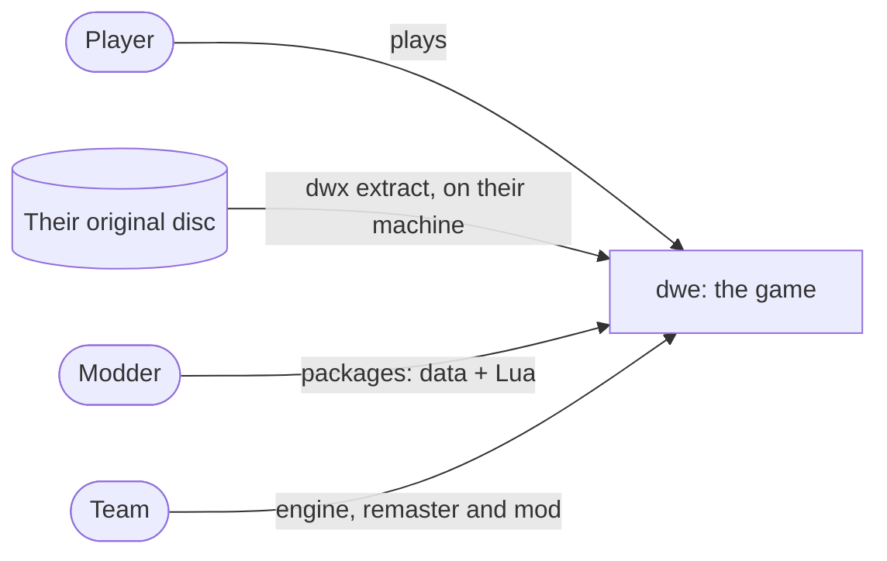
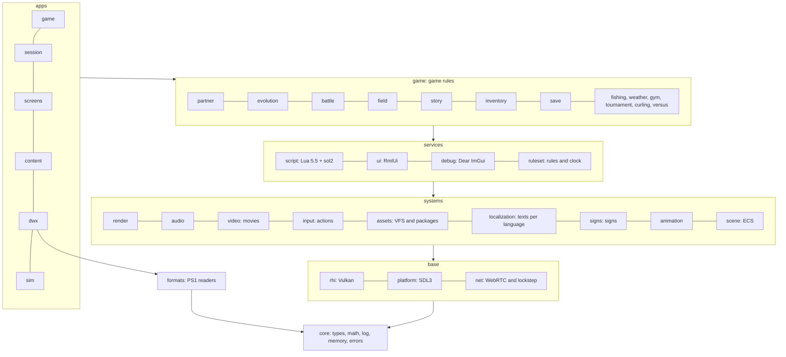

# Architecture overview

## Goal

A custom C++ engine that reproduces the original game **without the PS1 limitations** and lets us change its logic,
improve the menus, add minimaps, rewrite the story, give the characters depth and create new game modes.

**Target platform: PC (Windows and Linux, including Steam Deck).** The game is designed **as if it had been released
only on PC**, not as a console port ([ADR 0013](../adr/0013-native-pc-game.md)).

## Principles

1. **The decomp is the reference, not the product's code.** It is read to understand the formats and how each system
   worked; the game is reinvented in modern C++ ([ADR 0001](../adr/0001-native-reimplementation.md)).
2. **The game rules are data.** They are grouped into rulesets: the first one starts from the original's values, and
   the reinvention and each game mode bring their own ([ADR 0010](../adr/0010-own-rules-with-rulesets.md)).
3. **All content is data.** Open formats, IDs by name and no fixed-size tables
   ([ADR 0005](../adr/0005-asset-pipeline.md)).
4. **The runtime never reads PS1 formats.** Only the extractor understands them.
5. **Nothing original in the repositories.** Each user brings their own disc
   ([ADR 0011](../adr/0011-asset-legal-policy.md)).
6. **Mods only see the Lua API**, versioned and sandboxed ([ADR 0004](../adr/0004-lua-and-sol2.md)).

## Context (C4, level 1)

## Containers (C4, level 2)

| Container | What it is | Who uses it |
|---|---|---|
| `apps/game` | `dwe-game`, the game executable | Players |
| `apps/launcher` | The desktop launcher: installs the disc, chooses the settings, the mods and the custom images, and updates the game (Stable and Testing channels) | Players |
| `apps/dwx` | CLI: `extract`, `validate`, `cook`, `pack`, `export-images`, `evolution-guide`, `upscale`, `convert-script` | Team, modders and the launcher |
| `apps/sim` | `dwe-sim`: graphics-free simulations that play scenarios with seeds and report the balance ([simulations](../guides/simulations.md)) | Team and design |
| `apps/studio` | DWE Studio, a development workbench | Team |
| `apps/beta-gateway` | The gateway between the launcher and the published versions | The launcher |
| Content packages | Data and scripts in open formats (base, remaster, mods) | Loaded by the game |

## Layers

Each box is a CMake library. Dependencies only go down: a layer uses the ones below it and never the ones above it
(see [dependency rules](dependency-rules.md)).

| Layer | Modules | Responsibility |
|---|---|---|
| core | `core` | Types, math, log, memory, errors (`std::expected`) |
| base | `platform`, `rhi` | Window, input, files, threads and time (SDL3); GPU device, memory, pipelines and synchronization (Vulkan) |
| systems | `render`, `audio`, `video`, `input`, `assets`, `localization`, `signs`, `animation`, `scene` | Render graph, materials, skinning and backgrounds; mixing and synthesis; movies (reading and color); actions, contexts and profiles for keyboard, mouse and gamepads; virtual file system, packages and hot reload; the player's texts in their language; the translated signs on the maps; model clips; ECS world (EnTT) |
| services | `script`, `ui`, `debug`, `ruleset` | Lua VM, sandbox and bindings; menus, HUD and minimap; development tools (console, panels); the [ruleset](rulesets.md) format, its strategies and the game clock |
| game | `packages/game/*` | The rules: care, life and evolution, battle, field, story, inventory, saving, fishing, weather, gym, tournaments and curling |
| apps | `game`, `session`, `screens`, `content`, `dwx`, `sim` | The windowless game session, the screens' view models, package mounting and the entry points |
| separate | `formats` | Reading of the PS1 formats. **Only** `dwx` uses it |

## Where each improvement goes

| Improvement | Layer | How |
|---|---|---|
| Game logic | `packages/game/*` + rulesets | Each system is written in C++ and its rules and values live in a ruleset |
| Menus | `ui` | RmlUi at native resolution; the menus are edited without recompiling |
| Minimaps | `ui` + data | Generated from the collision, warps and NPCs of each map |
| Story | `story` + Lua | The original event scripts are translated to Lua, editable as text |
| Character depth | `story` + Lua + data | Dialogue trees, affinity and quests |
| Game modes | `modes` + rulesets + Lua | A mode combines the systems with its own rules |
| More Digimon and maps | Content packages | Adding a new ID does not require touching code |

## Technology

| Area | Choice | ADR |
|---|---|---|
| Language and build | C++26, CMake with presets, vcpkg | [0002](../adr/0002-cpp26.md) |
| Render and platform | Vulkan 1.3 (vk-bootstrap, VMA, bindless descriptors), shaders in Slang compiled in the build with vcpkg's `slangc`; SDL3 | [0003](../adr/0003-vulkan-and-sdl3.md), [0018](../adr/0018-slang-shaders-with-vcpkg.md), [0019](../adr/0019-bindless-descriptors.md) |
| Scripting | Lua 5.5 + sol2 | [0004](../adr/0004-lua-and-sol2.md) |
| Input | SDL3 (keyboard, mouse and gamepads), with actions and profiles | [0014](../adr/0014-gamepads-and-input.md) |
| Entities | EnTT | [0012](../adr/0012-ecs-with-entt.md) |
| Game UI | RmlUi | [0009](../adr/0009-rmlui.md) |
| Debug tools | Dear ImGui | — |
| Source formats | glTF 2.0, PNG, YAML, SF2 + MIDI, WAV; video in Y4M + WAV | [0005](../adr/0005-asset-pipeline.md) |
| YAML reading and writing | libyaml, wrapped in `core` | [0016](../adr/0016-yaml-with-libyaml.md) |
| Cooked formats | KTX2 (BC7), binary meshes, Opus; video AV1 + Opus | [0005](../adr/0005-asset-pipeline.md) |
| Tests | doctest, balance simulations, autotest routes that play the game | [0010](../adr/0010-own-rules-with-rulesets.md) |

## Repositories

| Repository | Contents |
|---|---|
| `dw-engine` (this one) | Code, tools, schemas, text packages and technical documentation |
| `Digimon-World-Project-Folder` | Game design: GDD, story and characters |
| `Digimon-World-Project-Folder-Assets` | The team's source art with Git LFS |

See [ADR 0006](../adr/0006-three-repositories.md).
