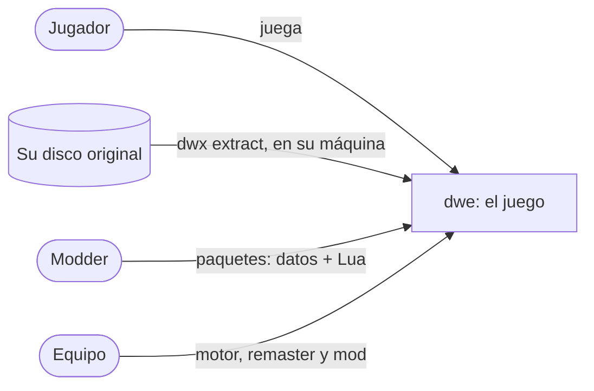
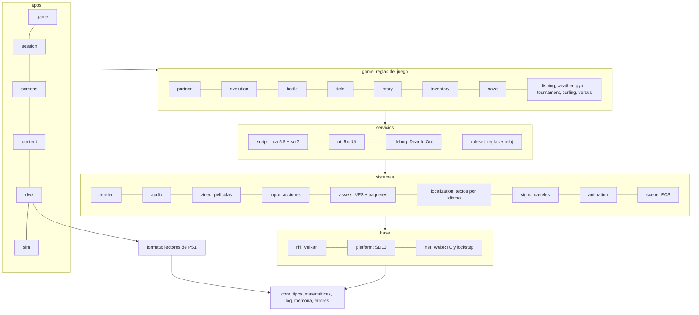

# Visión general de la arquitectura

## Objetivo

Un motor propio en C++ que reproduce el juego original **sin las limitaciones de PS1** y que permite cambiar su lógica,
mejorar los menús, añadir minimapas, reescribir la historia, dar profundidad a los personajes y crear modos de juego
nuevos.

**Plataforma objetivo: PC (Windows y Linux, incluida Steam Deck).** El juego se diseña **como si hubiera salido solo
en PC**, no como un port de consola ([ADR 0013](../adr/0013-juego-nativo-de-pc.md)).

## Principios

1. **El decomp es la referencia, no el código del producto.** Se lee para entender los formatos y cómo funcionaba
   cada sistema; el juego se reinventa en C++ moderno ([ADR 0001](../adr/0001-reimplementacion-nativa.md)).
2. **Las reglas del juego son datos.** Se agrupan en rulesets: el primero parte de los valores del original, y la
   reinvención y cada modo de juego traen el suyo ([ADR 0010](../adr/0010-reglas-propias-con-rulesets.md)).
3. **Todo el contenido es dato.** Formatos abiertos, IDs por nombre y ninguna tabla de tamaño fijo
   ([ADR 0005](../adr/0005-tuberia-de-assets.md)).
4. **El runtime nunca lee formatos de PS1.** Solo el extractor los entiende.
5. **Nada original en los repositorios.** Cada usuario aporta su disco ([ADR 0011](../adr/0011-politica-legal-de-assets.md)).
6. **Los mods solo ven la API de Lua**, versionada y en sandbox ([ADR 0004](../adr/0004-lua-y-sol2.md)).

## Contexto (C4, nivel 1)

## Contenedores (C4, nivel 2)

| Contenedor | Qué es | Quién lo usa |
|---|---|---|
| `apps/game` | `dwe-game`, el ejecutable del juego | Jugadores |
| `apps/launcher` | El lanzador de escritorio: instala el disco, elige los ajustes, los mods y las imágenes propias, y actualiza el juego (canales Estable y Pruebas) | Jugadores |
| `apps/dwx` | CLI: `extract`, `validate`, `cook`, `pack`, `export-images`, `evolution-guide`, `upscale`, `convert-script` | Equipo, modders y el launcher |
| `apps/sim` | `dwe-sim`: simulaciones sin gráficos que juegan escenarios con semillas e informan del balance ([simulaciones](../guides/simulaciones.md)) | Equipo y diseño |
| `apps/studio` | DWE Studio, banco de trabajo de desarrollo | Equipo |
| `apps/beta-gateway` | La pasarela entre el lanzador y las versiones publicadas | El lanzador |
| Paquetes de contenido | Datos y scripts en formatos abiertos (base, remaster, mods) | Los carga el juego |

## Capas

Cada caja es una librería de CMake. Las dependencias solo bajan: una capa usa las de abajo y nunca las de arriba
(ver [reglas de dependencias](dependency-rules.md)).

| Capa | Módulos | Responsabilidad |
|---|---|---|
| núcleo | `core` | Tipos, matemáticas, log, memoria, errores (`std::expected`) |
| base | `platform`, `rhi` | Ventana, input, ficheros, hilos y tiempo (SDL3); dispositivo de GPU, memoria, pipelines y sincronización (Vulkan) |
| sistemas | `render`, `audio`, `video`, `input`, `assets`, `localization`, `signs`, `animation`, `scene` | Grafo de render, materiales, skinning y fondos; mezcla y síntesis; películas (lectura y color); acciones, contextos y perfiles de teclado, ratón y mandos; sistema de ficheros virtual, paquetes y recarga en caliente; los textos del jugador en su idioma; los carteles de los mapas traducidos; clips de los modelos; mundo ECS (EnTT) |
| servicios | `script`, `ui`, `debug`, `ruleset` | VM de Lua, sandbox y bindings; menús, HUD y minimapa; herramientas de desarrollo (consola, paneles); el formato de [ruleset](rulesets.md), sus estrategias y el reloj de juego |
| juego | `packages/game/*` | Las reglas: cuidado, vida y evolución, batalla, campo, historia, inventario, guardado, pesca, clima, gimnasio, torneos y curling |
| apps | `game`, `session`, `screens`, `content`, `dwx`, `sim` | La partida sin ventana, los modelos de vista de las pantallas, el montaje de paquetes y los puntos de entrada |
| aparte | `formats` | Lectura de los formatos de PS1. **Solo** lo usa `dwx` |

## Dónde cae cada mejora

| Mejora | Capa | Cómo |
|---|---|---|
| Lógica del juego | `packages/game/*` + rulesets | Cada sistema se escribe en C++ y sus reglas y valores viven en un ruleset |
| Menús | `ui` | RmlUi a resolución nativa; los menús se editan sin recompilar |
| Minimapas | `ui` + datos | Se generan a partir de la colisión, los warps y los NPCs de cada mapa |
| Historia | `story` + Lua | Los scripts de eventos originales se traducen a Lua, editable como texto |
| Profundidad de personajes | `story` + Lua + datos | Árboles de diálogo, afinidad y misiones |
| Modos de juego | rulesets + Lua (todavía sin módulo propio) | Un modo combina los sistemas con sus propias reglas |
| Más Digimon y mapas | Paquetes de contenido | Añadir un ID nuevo no exige tocar código |

## Tecnología

| Área | Elección | ADR |
|---|---|---|
| Lenguaje y build | C++26, CMake con presets, vcpkg | [0002](../adr/0002-cpp26.md) |
| Render y plataforma | Vulkan 1.3 (vk-bootstrap, VMA, descriptores bindless), shaders en Slang compilados en el build con `slangc` de vcpkg; SDL3 | [0003](../adr/0003-vulkan-y-sdl3.md), [0018](../adr/0018-shaders-slang-con-vcpkg.md), [0019](../adr/0019-descriptores-bindless.md) |
| Scripting | Lua 5.5 + sol2 | [0004](../adr/0004-lua-y-sol2.md) |
| Entrada | SDL3 (teclado, ratón y mandos), con acciones y perfiles | [0014](../adr/0014-mandos-y-entrada.md) |
| Entidades | EnTT | [0012](../adr/0012-ecs-con-entt.md) |
| UI del juego | RmlUi | [0009](../adr/0009-rmlui.md) |
| Herramientas de depuración | Dear ImGui | — |
| Formatos fuente | glTF 2.0, PNG, YAML, SF2 + MIDI, WAV; vídeo en Y4M + WAV | [0005](../adr/0005-tuberia-de-assets.md) |
| Lectura y escritura de YAML | libyaml, envuelto en `core` | [0016](../adr/0016-yaml-con-libyaml.md) |
| Formatos cocinados | KTX2 (BC7), mallas binarias, Opus; vídeo **pendiente** de decisión (propuesta: AV1/WebM), no implementado | [0005](../adr/0005-tuberia-de-assets.md) |
| Tests | doctest, simulaciones de balance, rutas de autotest que juegan el juego | [0010](../adr/0010-reglas-propias-con-rulesets.md) |

## Repositorios

| Repositorio | Contenido |
|---|---|
| `dw-engine` (este) | Código, herramientas, esquemas, paquetes en texto y documentación técnica |
| `Digimon-World-Project-Folder` | Diseño del juego: GDD, historia y personajes |
| `Digimon-World-Project-Folder-Assets` | Arte fuente del equipo con Git LFS |

Ver [ADR 0006](../adr/0006-tres-repositorios.md).
