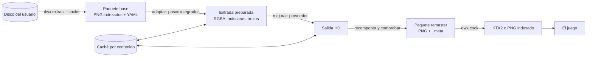

# Tubería del remaster

Cómo pasa el contenido del disco del usuario a la capa `remaster` con imágenes mejoradas (en HD), con cualquier
herramienta, sin repetir llamadas ni cobros y sin distribuir nunca nada derivado. Es un **diseño**: todavía no hay
código. Las decisiones están en el [ADR 0023](../adr/0023-tuberia-del-remaster.md); el plan de trabajo, al
[final](#plan-de-implementación).

Lee antes la [tubería de assets](assets-pipeline.md), los [paquetes y el VFS](vfs.md), la
[caché de desarrollo](assets-de-desarrollo.md#leer-el-disco-en-el-juego) y la [política legal](../legal/assets.md).

## Resumen



- **El disco es una dependencia.** Todo sale del paquete `base` del usuario (o de su imagen de disco, a través de la
  caché de `dwx extract`). Nada derivado está en git ni en una release.
- **Una receta por tipo de asset** (fondos, texturas de modelos, iconos, UI): una cadena de pasos con proveedor,
  modelo, parámetros, semilla y prompt. Las recetas sí se pueden distribuir; sus salidas, nunca.
- **Un solo interfaz de proveedor** para tres clases: un comando local, un servicio HTTP genérico y los pasos
  integrados del motor.
- **Caché obligatoria por contenido**, paso a paso: cambiar el paso N reutiliza los anteriores.
- **Por defecto, solo lo integrado** (ver [«Qué es por defecto»](#qué-es-por-defecto)). Un modelo local o un servicio
  remoto los configura cada usuario; el remoto, con su clave, bajo su responsabilidad y con confirmación en cada
  ejecución.
- **`dwe-enhance`**, un ejecutable aparte, escribe un paquete de la capa `remaster`. Solo él tiene proveedores y
  código de red; `dwx` sigue sin red y comprueba recetas y paquetes con `dwx validate`. Un panel de revisión compara
  antes y después; lo que rechazas no entra en el paquete y el juego usa la base.

## Términos

| Término | Qué es |
|---|---|
| **Receta** | Un YAML que dice qué assets mejorar y con qué cadena de pasos. Se puede compartir |
| **Paso** | Una operación sobre imágenes: integrada (`builtin`) o de un proveedor externo |
| **Proveedor** | Quien ejecuta un paso: un comando local, un servicio HTTP o el propio motor |
| **Configuración de proveedores** | `enhance-providers.yaml` en la carpeta de datos del usuario: comandos, endpoints, parámetros admitidos, claves (por referencia), precios y presupuestos. **Nunca se comparte ni va en una receta** |
| **Factor de escala `k`** | Píxeles de la salida por píxel del original, entero y el mismo en los dos ejes |
| **Unidades lógicas** | Píxeles del original. La geometría (cámara, sprites, UV, maquetación) siempre va en ellas |
| **Grupo de alineación** | Assets que tienen que mejorarse, revisarse y caer a la base juntos: las variantes de un fondo y sus capas de profundidad, las imágenes de un modelo, las piezas de un marco de la UI |
| **Remoto** | Un proveedor HTTP cuyo endpoint no es `127.0.0.1`, `::1` ni `localhost` |

## Qué es por defecto

- **Sin configuración, solo hay pasos integrados.** Si no existe `enhance-providers.yaml`, los únicos proveedores
  son los integrados, y el escalador por defecto es `index_scale`: sin red, sin GPU, sin pesos de terceros, bit a bit
  igual en todas las plataformas.
- **Las recetas de ejemplo del repositorio** (`content/enhance/`, en W10c) solo usan pasos integrados.
- **No hay ejecución implícita:** `dwe-enhance` sin `--recipe` no hace nada; ni el juego ni `dwx` lo ejecutan solos
  para mejorar (el juego solo lo llama para la revisión).
- **Opción del usuario, sin red:** un comando local (un modelo de aprendizaje automático instalado por ti) existe
  solo si lo defines en tu configuración, con el SHA-256 de sus pesos. Es la mejora recomendada.
- **Opción del usuario, con red:** un proveedor remoto existe solo si lo defines, con tu clave, `terms` y
  `uploads_extracted_art`, y cada ejecución que suba algo necesita `--confirm-upload` (y `--confirm-cost` si es de
  pago).

## Recetas

Una receta es un fichero `<nombre>.recipe.yaml`. Se escribe una por tipo de asset; `dwe-enhance` acepta varias y
junta sus salidas en un solo paquete. Dos recetas que eligen el mismo asset son un error.

### Ejemplo

```yaml
recipe: 1                       # versión del formato de receta
id: hd_backgrounds
asset_type: background          # background | model_texture | icon | ui
select:
  include: ["map/*/background_*"]
  exclude: []
scale: 4                        # k final; el producto de los factores de los pasos tiene que dar esto
variants: reference_transfer    # cómo se tratan las paletas que se eligen al jugar (ver «Imágenes indexadas»)
reference_variant: day
steps:
  - id: prepare
    builtin: split_alpha        # color por un lado, clases de alfa de cada variante por otro
  - id: upscale
    provider: local_upscaler    # un nombre de la configuración de proveedores del usuario, nunca un comando
    model:
      id: example-upscaler-x4
      version: "2.1"
      weights:
        sha256: "<64 cifras hexadecimales>"   # obligatorio con un comando local
        license: Apache-2.0     # identificador SPDX; uno desconocido se rechaza
    scale: 4
    seed: 1234
    prompt: null
    params:                     # solo los que el proveedor declara, con su tipo y rango
      tile: 512
      overlap: 32
  - id: merge
    builtin: merge_alpha
  - id: transfer
    builtin: palette_transfer   # deriva dusk y night de day sin otra llamada al proveedor
  - id: depth_layers
    builtin: recut_sprites      # las capas de profundidad salen del fondo mejorado
  - id: check
    builtin: alignment_check
    params:
      max_shift: 0.25           # en píxeles del original
      min_psnr: 30
output:
  cook: true                    # además del paquete fuente, cocinar con dwx cook
```

### Esquema (boceto)

Irá en `content/schemas/enhance_recipe.schema.json`, dentro del [subconjunto](json-schema.md) que comprueba el
motor. El subconjunto no tiene `oneOf` ni condicionales, así que tres reglas las comprueba el lector de recetas: un
paso tiene `builtin` o `provider`, no los dos; un paso con un comando local tiene `weights.sha256`; y cada parámetro
está declarado por su proveedor.

```json
{
  "$schema": "https://json-schema.org/draft/2020-12/schema",
  "type": "object",
  "required": ["recipe", "id", "asset_type", "select", "scale", "steps"],
  "additionalProperties": false,
  "properties": {
    "recipe": {"const": 1},
    "id": {"type": "string", "pattern": "^[a-z0-9_]{1,64}$"},
    "asset_type": {"enum": ["background", "model_texture", "icon", "ui"]},
    "select": {
      "type": "object", "required": ["include"], "additionalProperties": false,
      "properties": {
        "include": {"type": "array", "minItems": 1, "items": {"$ref": "#/$defs/idPattern"}},
        "exclude": {"type": "array", "items": {"$ref": "#/$defs/idPattern"}}
      }
    },
    "scale": {"type": "integer", "minimum": 1, "maximum": 8},
    "max_side": {"type": "integer", "minimum": 1, "maximum": 16384},
    "variants": {"enum": ["reference_transfer", "per_variant", "index_space"]},
    "reference_variant": {"type": "string", "pattern": "^[a-z0-9_]{1,32}$"},
    "steps": {"type": "array", "minItems": 1, "maxItems": 32, "items": {"$ref": "#/$defs/step"}},
    "output": {
      "type": "object", "additionalProperties": false,
      "properties": {"cook": {"type": "boolean"}}
    }
  },
  "$defs": {
    "idPattern": {"type": "string", "pattern": "^[a-z0-9_*/]{1,200}$"},
    "step": {
      "type": "object", "required": ["id"], "additionalProperties": false,
      "properties": {
        "id": {"type": "string", "pattern": "^[a-z0-9_]{1,64}$"},
        "builtin": {"enum": ["pad", "crop", "split_alpha", "merge_alpha", "dilate", "mask_reapply", "wrap_pad",
                             "index_scale", "resample", "quantize", "palette_transfer", "recut_sprites",
                             "glb_images", "uv_coverage", "alignment_check"]},
        "provider": {"type": "string", "pattern": "^[a-z0-9_]{1,64}$"},
        "model": {"$ref": "#/$defs/model"},
        "scale": {"type": "integer", "minimum": 1, "maximum": 8},
        "seed": {"type": ["integer", "null"], "minimum": 0, "maximum": 4294967295},
        "prompt": {"type": ["string", "null"], "maxLength": 2000, "pattern": "^[^-]"},
        "params": {
          "type": "object",
          "propertyNames": {"pattern": "^[a-z0-9_]{1,64}$"},
          "additionalProperties": {"type": ["string", "integer", "number", "boolean"]}
        }
      }
    },
    "model": {
      "type": "object", "required": ["id", "weights"], "additionalProperties": false,
      "properties": {
        "id": {"type": "string", "pattern": "^[A-Za-z0-9._][A-Za-z0-9._-]{0,127}$"},
        "version": {"type": "string", "maxLength": 64},
        "weights": {
          "type": "object", "required": ["license"], "additionalProperties": false,
          "properties": {
            "sha256": {"type": "string", "pattern": "^[0-9a-f]{64}$"},
            "license": {"type": "string", "pattern": "^[A-Za-z0-9.+-]{1,64}$"}
          }
        }
      }
    }
  }
}
```

Lo que una receta **no** puede tener, a propósito: un comando, una URL, una cabecera, una clave o una ruta de fichero.
Todo eso vive en la configuración de proveedores del usuario. Así una receta descargada de internet no puede
ejecutar nada en tu máquina ni mandar tu arte a otro sitio: solo nombra un proveedor que **tú** has definido, con
parámetros que ese proveedor declara.

## Proveedores

### Un interfaz

```cpp
// apps/enhance/include/dwe/enhance/image_provider.hpp (boceto)
struct ProviderIdentity {
    std::string kind;          // "builtin", "local_command" or "http"
    std::string name;          // the configured identity of the provider, or the built-in step's name
    std::string modelId;       // the model id the recipe configures
    std::string modelVersion;  // weights SHA-256 and tool version, the recipe's declared version, or BuiltinStepVersion
    bool deterministic = false;
    bool paid = false;
    bool remote = false;       // an http endpoint outside loopback
};

struct StepRequest {
    ImageFile input;           // a PNG in the step's workspace, plus its canonical pixel hash
    ModelSpec model;
    StepParams params;         // already checked against the provider's declared parameters
    std::optional<std::uint32_t> seed;
    std::string prompt;
    std::uint32_t scale = 1;
};

class ImageProvider {
public:
    virtual ~ImageProvider() = default;
    [[nodiscard]] virtual ProviderIdentity identity() const = 0;
    [[nodiscard]] virtual ProviderLimits limits() const = 0;  // max pixels in and out, fixed scales, alpha support
    [[nodiscard]] virtual std::string keyMaterial() const = 0; // what of its configuration changes the output
    [[nodiscard]] virtual core::Result<CostEstimate> estimate(const StepRequest& request) const = 0;
    virtual core::Result<StepOutput> run(const StepRequest& request, const StepWorkspace& workspace) = 0;
};
```

Las tres clases implementan lo mismo, así que la caché, el plan de coste, las comprobaciones y la revisión no saben
qué proveedor hay detrás.

### La configuración de proveedores

`enhance-providers.yaml`, en la carpeta de datos del usuario (la de `settings.yaml`) y con su propio esquema. La
escribe el usuario a mano; ninguna herramienta la crea ni la modifica.

```yaml
providers:
  local_upscaler:
    kind: local_command
    command: ["/opt/upscaler/bin/upscale.exe", "--weights", "{weights}", "--scale", "{scale}",
              "--seed", "{seed}", "--tile", "{param.tile}", "--overlap", "{param.overlap}",
              "-i", "{in}", "-o", "{out}"]
    weights: /opt/upscaler/models/x4.bin
    version_command: ["/opt/upscaler/bin/upscale.exe", "--version"]
    deterministic: true
    params:
      tile: {type: integer, minimum: 64, maximum: 2048}
      overlap: {type: integer, minimum: 0, maximum: 128}
    limits: {max_input_pixels: 4194304, scales: [4], alpha: false, pad_to_multiple: 8}
    run: {timeout_seconds: 900, concurrency: 1, max_output_bytes: 65536}   # se guardan los primeros 64 KiB

  cloud_image:
    kind: http
    identity: cloud_image_v1            # forma parte de la clave de caché; el endpoint no
    endpoint: https://api.example.invalid/v1/upscale
    auth: {header: Authorization, scheme: Bearer, key_ref: "env:DWE_ENHANCE_CLOUD_IMAGE"}
    params:
      style: {type: string, enum: [photo, painting]}
      strength: {type: number, minimum: 0, maximum: 1}
    request:
      format: multipart                 # multipart | json_base64 | binary
      image_field: image
      fields: {model: "{model}", scale: "{scale}", seed: "{seed}", prompt: "{prompt}",
               style: "{param.style}", strength: "{param.strength}"}
    response:
      format: json                      # json | binary
      image_path: output.image          # base64; o image_url_path para descargarla del mismo origen
      model_version_path: output.model_version   # se registra y se avisa si cambia; no entra en la clave
      cost_path: usage.cost             # opcional: el coste real, si el servicio lo dice
    pricing: {currency: credits, per_call: 0.02, per_input_megapixel: 0.01, per_output_megapixel: 0.002}
    limits: {max_input_pixels: 1048576, max_output_pixels: 16777216, scales: [2, 4], pad_to_multiple: 64,
             max_response_bytes: 67108864}
    run: {timeout_seconds: 120, concurrency: 2, requests_per_minute: 30, retries: 2}
    budget: {per_run: 10.0, per_month: 40.0}
    uploads_extracted_art: true         # lo escribe el usuario: sabe que sube arte extraído de su disco
    terms: {url: https://example.invalid/terms, reviewed_by_user_on: 2026-10-21}
```

Un proveedor HTTP tiene que tener `pricing` (con algún precio distinto de cero) o `paid: false` explícito; sin
ninguno de los dos, la configuración es un error. `budget` es obligatorio si es de pago.

### Parámetros declarados (todas las clases)

- Cada proveedor declara en `params` los parámetros que admite, con `type` (`integer`, `number`, `string`,
  `boolean`): los números con `minimum` y `maximum`, y cada `string` con un `enum`, o con `maxLength` y `pattern`
  (un `string` sin ninguno de los dos es un error de la configuración). Un parámetro de la receta que su proveedor no
  declara, o fuera de su tipo, lista, longitud, patrón o rango, es un error antes de ejecutar nada.
- Ningún valor sustituido (parámetro, prompt, id de modelo) puede **empezar por `-`** (no se cuela como opción) ni
  contener NUL, CR o LF.
- La sustitución es de **una sola pasada**: lo que entra por una plantilla nunca se vuelve a examinar, así que un
  valor `{in}` es texto, no otra plantilla.
- La misma lista y las mismas reglas valen para los `fields` de HTTP: solo pueden nombrar parámetros declarados, y
  los valores van como campos del formulario o como textos JSON correctamente codificados, nunca en la URL ni en
  una cabecera.

### a) Comando local

- `command` es una lista de argumentos. Las plantillas son `{in}`, `{out}`, `{scale}`, `{seed}`, `{model}`,
  `{weights}`, `{prompt}` y `{param.<nombre>}`, como argumentos enteros o partes de uno. Una plantilla desconocida
  es un error. Se ejecuta con `platform::runProcess`, **sin shell**.
- **Semilla nula.** Con `seed: null`, `{seed}` no tiene valor: una receta con `seed: null` para un proveedor cuyo
  `command` usa `{seed}` es un error al leerla (no se sustituye por `0` ni por nada, porque eso cambiaría lo que
  significa). En HTTP, un campo de `fields` cuya plantilla es exactamente `{seed}` se omite de la petición; si
  `{seed}` va dentro de otro texto, también es un error. En la clave de caché la semilla queda como `null`.
- `{in}` y `{out}` son PNG en una carpeta de trabajo temporal del paso. La salida tiene que existir, ser PNG,
  decodificarse con los lectores del motor y medir exactamente `k ×` la entrada; si no, el paso falla.
- `command[0]` tiene que ser una ruta absoluta (nada de buscar en el `PATH`). En Windows, además, tiene que acabar en
  `.exe` (lista de permitidos): así nunca es un `.bat` o `.cmd`, que `CreateProcess` pasa por `cmd.exe`.
- `weights` es obligatorio y la receta tiene que dar `weights.sha256`: se calcula el SHA-256 del fichero y, si no
  coincide, no se ejecuta. El hash se guarda en la caché por (ruta, tamaño, fecha de modificación), así unos pesos de
  varios GB no se vuelven a leer en cada ejecución; si cambia cualquiera de los tres, se recalcula. La versión de la
  herramienta es la salida de `version_command`.
- `runProcess` gana, de forma aditiva y como cambio en `main` previo a W10b:
  - **tiempo límite** con espera por sondeo (lee la salida en trozos y comprueba el reloj): pasado, mata el proceso;
  - **tope de salida** (`max_output_bytes`): se guardan los primeros N bytes y el resto se lee y se tira, sin matar
    la herramienta, que sigue hasta terminar o hasta el tiempo límite (pregunta 12, «Decidido por el manager,
    2026-10-21»: un modelo que escribe mucho progreso no es un fallo, y vaciar la tubería evita que se bloquee). Solo
    para `version_command`, cuya salida entra en la clave, pasar del tope es un fallo y mata el proceso;
  - **muerte del árbol entero:** en Windows, el proceso va en un Job Object con `KILL_ON_JOB_CLOSE`; en POSIX, en su
    propio grupo de procesos, y se mata el grupo. Un hijo que lance otros no deja huérfanos;
  - **entorno explícito:** **todo** proceso hijo de `dwe-enhance`, `dwx` incluido, recibe el entorno sin ninguna
    variable `DWE_ENHANCE_*`. Un test lanza un hijo que vuelca su entorno y comprueba que no está ninguna.

### b) HTTP genérico

Endpoint, autenticación y formato de petición y respuesta son configurables; ningún nombre de servicio está en el
código. Sirve igual para un servidor de inferencia en tu propia máquina (`http://127.0.0.1:<puerto>`). El transporte
es un interfaz (`HttpTransport`); el real usa libcurl, con estas reglas fijas, sin opciones para relajarlas:

- **Protocolos:** solo `https` (`CURLOPT_PROTOCOLS_STR` y `CURLOPT_REDIR_PROTOCOLS_STR`); `http` solo hacia
  loopback. `localhost` solo vale si resuelve a una dirección de loopback: se fija con `CURLOPT_RESOLVE` a
  `127.0.0.1` y nunca se pregunta al DNS. Con un endpoint de loopback se pone `CURLOPT_NOPROXY` a `*`, para que un
  proxy de las variables de entorno no saque fuera ese tráfico.
- **Loopback no es garantía de local.** Un endpoint de loopback puede ser un túnel o un reenvío hacia un servicio en
  la nube; `dwe-enhance` no lo puede saber, así que lo trata como local (sin `--confirm-upload`). Que un endpoint de
  loopback sea de verdad local es **responsabilidad del usuario** que lo configura.
- **TLS:** verificación de certificado y de nombre siempre activa. Almacén de CA del sistema: en Windows, Schannel con
  `CURLSSLOPT_NATIVE_CA`; en Linux, OpenSSL con el almacén del sistema (en el contenedor, el paquete de CA de la
  imagen). Las features del port de vcpkg se fijan en `vcpkg.json` (`ssl`, sin `http2` ni otros protocolos), con la
  versión del baseline.
- **Redirecciones:** `CURLOPT_FOLLOWLOCATION` apagado. Una redirección se trata a mano y solo se sigue si es al mismo
  origen (esquema, host y puerto).
- **Autenticación:** la clave va en una cabecera, nunca en la URL (las URL acaban en logs), y solo hacia el origen del
  endpoint. Las descargas de `image_url_path` (solo del mismo origen o de los `download_hosts` de la configuración)
  van **sin** autenticación.
- **Cabeceras:** un valor con CR o LF se rechaza antes de enviar.
- **Tamaño:** tope de respuesta (`max_response_bytes`) contado en la función de escritura, sin fiarse de
  `Content-Length`, más `CURLOPT_MAXFILESIZE_LARGE`.
- **Sin descompresión:** no se activa `CURLOPT_ACCEPT_ENCODING`; una respuesta con `Content-Encoding` se rechaza (nada
  de bombas de compresión).
- **JSON:** se lee con el tope de tamaño y una profundidad máxima de 32.
- **Imagen:** solo PNG. Antes de decodificar se leen las medidas de la cabecera (`assets::inspectPng`) y se
  comprueban contra `max_output_pixels` y contra `k ×` la entrada.
- **Tiempos:** de conexión, total y de velocidad mínima.
- **Asíncronos:** un bloque `poll` opcional (`job_id_path`, `status_path`, intervalo) para servicios que encolan
  trabajos. Entra en W10d si el primer servicio que se pruebe lo necesita; un reenvío cuenta como otro cobro.

### c) Pasos integrados

Son proveedores de clase `builtin`, deterministas y **con aritmética entera**: dan los mismos bytes en todas las
plataformas (a diferencia de los mipmaps del cocinado, que usan `pow`). Cada uno tiene su `BuiltinStepVersion`.

| Paso | Qué hace |
|---|---|
| `pad`, `crop` | Rellena hasta el múltiplo que pide un proveedor (`pad_to_multiple`) y recorta `k ×` ese relleno al volver |
| `split_alpha`, `merge_alpha` | Separa el color de las **clases de alfa** de **cada variante** (transparente, STP, opaco) y las vuelve a juntar |
| `dilate` | Extiende el color de los píxeles opacos sobre los transparentes, para que el proveedor no mezcle negro en los bordes |
| `mask_reapply` | Vuelve a aplicar, escalada `k ×` por vecino más cercano, una máscara exacta: el color 0, las celdas vacías del fondo |
| `wrap_pad` | Rellena con el borde opuesto de la propia pieza, para piezas que se repiten (mosaico) |
| `index_scale` | Escalado de pixel art **en el espacio de índices**, consciente de la paleta: la salida sigue indexada con sus paletas (ver abajo) |
| `resample` | Reduce por un factor entero con filtro de caja (un proveedor de ×4 para una receta de ×2) |
| `quantize` | Vuelve a una paleta dada (solo para `index_space`) |
| `palette_transfer` | Deriva las demás variantes de paleta desde la mejorada (ver «Imágenes indexadas») |
| `recut_sprites` | Recorta las capas de profundidad del fondo mejorado |
| `glb_images` | Saca las imágenes de un `.glb` y las vuelve a meter sin cambiar nada más (ver «Atlas y UV») |
| `uv_coverage` | Rasteriza las UV de un modelo para saber qué texels usa |
| `alignment_check` | Comprueba medidas exactas, desplazamiento y parecido con la entrada |
| `cook` | No es un paso de la cadena: con `output.cook`, `dwe-enhance` ejecuta `dwx cook` sobre el paquete escrito |

**`index_scale`** tiene dos modos:

- `mode: edge` (por defecto): reglas de vecinos de la familia del escalado de pixel art clásico (cada píxel se
  reparte en `n × n` según qué vecinos tienen el **mismo índice**; nunca se mezclan colores, así que la salida sigue
  indexada). Hay núcleos para `n = 2` y `n = 3`; los demás factores se componen en un orden fijo: 4 = 2·2, 6 = 2·3
  (primero 2), 8 = 2·2·2. **5 y 7 no existen en este modo:** son primos mayores que 3 y no hay núcleo de reglas para
  ellos ni forma de componerlos con 2 y 3. Una receta con `k = 5` o `7` y `mode: edge` es un error de
  `dwx validate --recipe`.
- `mode: nearest`: repetición de píxeles, para cualquier `k` de 1 a 8.

## La caché

Obligatoria: sin caché no hay `dwe-enhance`. Sigue el patrón de la caché de `dwx extract --cache`
([assets de desarrollo](assets-de-desarrollo.md#leer-el-disco-en-el-juego)).

### Claves por paso

Cada paso de cada asset tiene su clave, `<sha1>-v<EnhanceCacheVersion>`. El SHA-1 se calcula sobre una codificación
canónica (claves ordenadas, números normalizados, UTF-8) de:

- `EnhanceCacheVersion` (la versión del formato de la caché);
- la **identidad del paso**:
  - integrado: nombre + `BuiltinStepVersion`;
  - comando local: `identity` + id del modelo + SHA-256 de los pesos + versión de la herramienta + la **plantilla
    de `command`** tal como está en la configuración;
  - HTTP: `identity` + **id y versión del modelo tal como los configura la receta** + el formato de la petición y la
    plantilla de `fields`. La versión que el servicio dice en su respuesta **no** entra: no se conoce antes de
    llamar, y con ella el plan no podría saber qué acierta. Se guarda en el registro del paso, y si cambia entre
    dos llamadas del mismo paso, `dwe-enhance` avisa (el servicio cambió de modelo sin que cambiara la receta);
- los parámetros efectivos, la semilla, el prompt y el factor de escala;
- los **límites que cambian cómo se trocea o se rellena** la imagen: `max_input_pixels`, `pad_to_multiple`, `tile` y
  `overlap`;
- el **hash canónico de cada entrada**: medidas, píxeles decodificados y paleta, no los bytes del PNG (dos PNG con
  los mismos píxeles y otra compresión dan la misma clave).

Fuera de la clave queda lo que no cambia la salida: endpoint, autenticación, tiempos, concurrencia, precios,
presupuestos.

Como la clave de un paso depende del **contenido** de su entrada y no de la receta entera, cambiar el paso N deja
iguales las claves de los pasos anteriores a N: se reutilizan. Y si el paso N cambiado da la misma salida que antes,
el N+1 también acierta. Dos assets con los mismos píxeles (texturas repetidas) se mejoran una sola vez.

### Qué se guarda

- La salida de **todo paso de un proveedor externo**, siempre: es lo que cuesta tiempo o dinero.
- La salida final de cada asset.
- Los pasos integrados intermedios no se guardan por defecto: son baratos y deterministas, se recalculan.

### Disposición

```text
<caché del usuario>/enhance-cache/
├─ steps/<2 primeras cifras>/<clave>/
│  ├─ output.png
│  └─ enhance-step.yaml      # paso, proveedor, modelo, versión configurada y la que dijo el servicio,
│                            # parámetros, entradas, SHA-1 de la salida, coste estimado y real,
│                            # estado (ok | failed_check)
├─ .<clave>.partial-<aleatorio>/
└─ .<clave>.lock             # cerrojo de aviso del sistema, solo para pasos de pago

<datos del usuario>/enhance-ledger.yaml        # gasto por proveedor y ejecución; solo crece
<datos del usuario>/enhance-ledger.lock
```

- **Dónde** (pregunta 3, «Decidido por el manager, 2026-10-21»: una caché de varios GB no debe viajar con el perfil
  ni mezclarse con los datos): en Windows, `%LOCALAPPDATA%\indie-modding-games\dwe\enhance-cache\`; en Linux,
  `$XDG_CACHE_HOME/indie-modding-games/dwe/enhance-cache/` (`~/.cache/...` si no está definida). El libro de gastos
  no es caché: va en la carpeta de datos del usuario (la de `settings.yaml`), para que borrar la caché no borre lo
  gastado.
- Una entrada se escribe en su carpeta `.partial-`, se vuelca (`fsync`) y se **renombra**: una entrada que existe
  está completa. Si dos procesos escriben la misma, el que renombra segundo tira la suya.
- Al leer una entrada, se comprueba que `output.png` tiene el tamaño en bytes y el SHA-1 que dice su
  `enhance-step.yaml`, y que sus medidas (de la cabecera, antes de decodificar) son las esperadas; si no, se trata
  como un fallo de caché, con un aviso.
- Una entrada es una carpeta real con su `enhance-step.yaml`; la caché nunca sigue un enlace. Lo que tenga el nombre
  de una entrada sin serlo se borra y se recalcula, con un aviso (si era de pago, el plan lo cuenta como fallo de
  caché).
- **Cerrojos del sistema, no ficheros de marca:** `flock` en POSIX y `LockFileEx` en Windows, sobre el `.lock` de la
  clave (antes de llamar a un proveedor de pago) y sobre `enhance-ledger.lock` (para leer y añadir al libro). El
  sistema los suelta si el proceso muere, así que no quedan cerrojos viejos. Si el del libro no se puede tomar en un
  tiempo límite, **no se hace ninguna llamada de pago** (falla cerrado).
- Una salida de pago que no pasa las comprobaciones se guarda con estado `failed_check`: volver a ejecutar no la
  paga otra vez. `--retry-failed` la repite, y vuelve a pasar por la puerta de coste.
- Una petición que falla (red, error del servicio) no deja entrada en la caché; su cobro sí queda en el libro (ver
  «Coste y volumen»).

### Huellas y limpieza

- Igual que `ExtractorVersion`: un test aplica cada paso integrado a imágenes sintéticas y compara con una tabla de
  huellas **que solo crece**, una fila por versión. Si cambia la salida de un paso, falla con «bump the step version
  and update the fingerprint».
- Tras una ejecución, `dwe-enhance` borra las entradas de **pasos integrados** de versiones anteriores (se recalculan
  gratis). Las de proveedores externos **nunca se borran solas**: costaron dinero o tiempo.
- `dwe-enhance cache --report` dice tamaño, entradas y lo pagado. `dwe-enhance cache --prune --dry-run` lista lo que
  ninguna de las recetas dadas usa y lo que costó; sin `--dry-run` lo borra.
- Las carpetas `.partial-` de más de 24 horas salen en un aviso, como en la caché de extracción.

## `dwe-enhance`

Pregunta 4, «Decidido por el manager, 2026-10-21»: un **ejecutable aparte**, `dwe-enhance` (`apps/enhance`), tiene
los proveedores y todo el código de red; `dwx` sigue sin red. Motivo: menos superficie de ataque, `dwx` sigue siendo
determinista y sin conexión, y las claves nunca llegan a la herramienta que los modders ejecutan en su CI. **Esto se
aparta de la redacción original del usuario**, que hablaba de `dwx enhance --recipe <fichero>`.

```text
dwe-enhance --recipe <fichero>... (--base <paquete> | --disc <imagen>) --out <carpeta del paquete>
            [--plan] [--only <patrón de id>]... [--confirm-cost <importe>] [--confirm-upload <imágenes>]
            [--budget <importe>] [--retry-failed] [--verify]
dwe-enhance review --pack <remaster> (--list | --accept <id> | --reject <id> [--reason <texto>])
dwe-enhance cache (--report | --prune [--dry-run] --recipe <fichero>...)
dwx validate --recipe <fichero> [--providers <enhance-providers.yaml>]   # sin red, en dwx
dwx validate --engine --with <base> <remaster>                           # el paquete producido, sin red, en dwx
```

Los números de la línea de órdenes y de la salida del plan llevan **punto decimal** (`3.10`), sea cual sea el idioma
del sistema: se leen y escriben con `std::from_chars`/`std::to_chars`, que no dependen del locale.

`dwx` no ofrece `dwx enhance --plan`: el plan necesita la caché, la configuración de proveedores y ejecutar los pasos
integrados, que son de `dwe-enhance`, y un segundo dueño del plan sería duplicar código. `dwe-enhance --plan` no abre
ninguna conexión.

`dwe-enhance` usa `dwx` como programa, igual que el juego para la caché del disco (`platform::runProcess`, sin shell;
lo busca junto a su ejecutable y después en su carpeta del árbol de build): para extraer y para cocinar.

Cómo trabaja:

1. **Base.** Con `--disc`, ejecuta `dwx extract --cache` y usa esa entrada.
2. **Recetas y proveedores.** Las lee y las comprueba (esquema, parámetros declarados, licencias, secretos, términos).
3. **Selección.** Junta los assets de cada receta y forma los grupos de alineación.
4. **Plan.** Calcula las claves. Los pasos integrados que van antes del primer paso externo se ejecutan ya (son
   baratos), así la clave del paso externo es exacta y el plan sabe qué llamadas acierta la caché. Cuenta los trozos
   en que se partirá cada imagen. Después de un fallo de caché, lo que sigue cuenta como fallo: el plan es una
   **cota superior**.
5. **Puertas.** Si hay subidas a un proveedor remoto o llamadas de pago que fallan la caché, para salvo que se pasen
   `--confirm-upload` y `--confirm-cost` (ver «Coste y volumen»).
6. **Ejecución.** Con la concurrencia de cada proveedor, el cerrojo por clave y las comprobaciones de cada paso.
7. **Paquete.** Escribe el paquete fuente (abajo) y, con `output.cook`, lo cocina con `dwx cook`.

Salida: 0 todo bien; 1 algún asset falló (el resto se escribe y el que falla cae a la base); 2 no se pudo empezar;
3 hace falta confirmación de coste o de subida.

Con `--verify`, recalcula sin caché los pasos **deterministas y sin red** (integrados y comandos locales) y compara
con lo guardado: así se comprueba que una receta es reproducible en tu máquina. Nunca llama a un proveedor HTTP.

### El paquete que escribe

```text
<contenido>/remaster/
├─ pack.yaml                   # id remaster, layer: remaster, dependencies: base (solo de dwe-enhance)
├─ .enhance/                   # oculto para el VFS (empieza por punto), como .dwx-cook
│  ├─ manifest.yaml            # por asset: receta, claves de sus pasos, SHA-1 de la salida, grupo
│  └─ review.yaml              # pending | accepted | rejected, por grupo y SHA-1 de su salida
└─ map/<id>/
   ├─ background_day.png       # RGBA, k × el tamaño lógico; KTX2 tras cocinar (PngOnlyImages extendido)
   ├─ background_day_meta.yaml # los campos del lateral de la base (si lo hay) + scale, palette, color_space
   └─ ...
```

- Se escribe en la carpeta de contenido, junto a `base`, para que el juego lo encuentre en sus propias carpetas
  (`PackOrigin::Engine`; ver «Capas»).
- **El `_meta.yaml` de cada salida copia los campos del YAML lateral de la base** (`palettes`, `clut_rect`,
  `image_rect`, `source`...) y añade `scale`. Las salidas **indexadas** los copian todos, así el cocinado decide igual
  que para la base. Las salidas **RGBA** no copian `palettes` ni `clut_rect` (describen índices que ya no tienen) y
  añaden `color_space: srgb` y, los fondos, `palette`: con eso son RGBA para el cocinado y para la comprobación de
  contenido (ver «Cocinado»).
- Como `dwx cook`, se niega a escribir en una carpeta con ficheros que no escribió él, y al volver a ejecutar quita lo
  que ya no produce (un asset rechazado o fuera de la selección). Por eso este paquete es solo de `dwe-enhance`.
- Solo escribe imágenes, sus `_meta.yaml` y `.glb` de texturas: nunca Lua, RML, RCSS, tablas ni audio. La música HD
  va en **otro** paquete de la capa `remaster`, `remaster_audio` (ver «Capas»).

## Revisión

### El visor

Un **panel del overlay de depuración** de `dwe-game` (`apps/game`, en las vistas de desarrollo, junto al visor de
assets y la vista previa de mapas), no una aplicación nueva (pregunta 2, «Decidido por el manager, 2026-10-21»: reusa
el render, el VFS y la cámara real, y la fase 4 no tiene `apps/editor`):

- antes/después del mismo asset con una cortinilla deslizable, alternar con una tecla y vista de diferencias
  (`|después↓k − antes|` amplificada, que delata el desplazamiento);
- zoom 1:1 y ajustado, y **en contexto**: el mapa con la cámara real, sus capas de profundidad y la hora del día, que
  es donde se ve si algo no casa;
- lista de grupos pendientes; aceptar o rechazar un grupo con una tecla.

El panel no escribe la revisión: ejecuta `dwe-enhance review` con `platform::runProcess`, igual que el juego pide la
caché del disco a `dwx`. Así `review.yaml` tiene un solo dueño. `review` no abre ninguna conexión.

### Rechazos

- Se registran en `.enhance/review.yaml` por **grupo de alineación** y SHA-1 de su salida, con el motivo si lo das.
- Un grupo rechazado no se escribe en el paquete: el VFS da el asset de la base. Se rechaza el grupo entero (un fondo
  HD con sus capas de profundidad de la base no casaría en color ni en detalle).
- Si la receta cambia y el grupo sale distinto (otro SHA-1), vuelve a `pending`.
- `pending` se escribe en el paquete (para que lo veas en el juego); `rejected`, no.

## Restricciones del juego

Lo que hay hoy, del que sale cada regla:

- **Fondos:** `dwx extract` compone los tiles de 128 × 128 del fondo en un PNG indexado por variante de paleta
  (`background_day`, `_dusk`, `_night`, `paletteN`), con los mismos índices en todas y **sin YAML lateral**. El motor
  (`assets::loadMapImages`) lee los índices (`decodeIndexedPng`) y las paletas; las paletas de los fondos alimentan
  también a los sprites con `clut` −1 (`backgroundPalettes`). El render elige y funde la paleta según la hora
  (`map.slang: texelAt`, `lerp(from, to, push.fade)` sobre la textura de paletas, que es `Rgba8Unorm`:
  `engine/render/src/renderer.cpp:157`). La cámara trabaja en píxeles del fondo (`MapCamera`,
  `backgroundSize = tiles × 128`; [ADR 0020](../adr/0020-camara-de-mapa-y-capas-de-profundidad.md)).
- **Capas de profundidad:** cada sprite es un recorte de una página de textura del mapa (indexada, 256 de lado, varias
  sprites por página: un atlas), colocado en `inst.x, inst.y` en píxeles del fondo. Con `clut` −1 usa la paleta del
  fondo de la hora; el color `0x0000` no se dibuja; el alfa guarda **clases**: 0 transparente, 128 STP, 255 opaco
  (`colorFromOriginal`), que `map.slang` separa con umbrales de 0,25 y 0,75
  ([mapas](../formats/mapas.md#capas-de-profundidad)).
- **Muestreo del mapa:** `map.slang` lee siempre el **nivel 0** con `Load` (`map.slang:55`) y mezcla a mano los cuatro
  texels vecinos (`sampleSharp`, `map.slang:66-79`) con una nitidez `pixelsPerTexel` que hoy es la escala de la
  cámara para todas las texturas (`map_renderer.cpp:356`).
- **Texturas de modelos:** dentro del `.glb`, una imagen por combinación de textura y paleta que usa alguna primitiva,
  con UV ya divididas entre el ancho y el alto de la imagen, filtro `NEAREST` y `alphaMode: MASK` para el color 0
  ([modelos](../formats/modelos.md#texturas)).
- **Cocinado:** `planTexture` (`apps/dwx/src/texture_cooker.cpp:267-280`) solo deja pasar como PNG un PNG indexado
  cuyo lateral lista más de una paleta o tiene `clut_rect` con `source` `.MAP` (`paletteChosenAtRuntime`,
  `texture_cooker.cpp:245`); todo lo demás se convierte a KTX2. La UI pinta las indexadas con `?palette=N` desde
  `<id>_meta.yaml`, y pedir una paleta a una KTX2 es un error (`PaletteNeedsPng`; [UI](ui.md#imágenes)).
- **Límites:** KTX2 de 1 a 16384 texels de lado (`checkPlain2dKtx2`); imágenes de la UI de 4096 de lado como mucho
  (`MaxUiImageSide`), 64 MiB de fichero (`MaxUiImageFileBytes`) y unos 85,3 MiB decodificadas con todos sus niveles
  (`MaxUiImageBytes`, `checkUiImageBudget`), hoy en `engine/ui/include/dwe/ui/image_reference.hpp:29-78`.

### Cocinado

Hoy, un fondo de la base no tiene lateral, así que `planTexture` lo convierte a KTX2: pierde los índices y la paleta,
y `loadMapImages` (que solo lee PNG indexados) ya no puede leerlo, ni dar paletas a los sprites con `clut` −1. Lo
mismo le pasaría a cualquier salida indexada de una sola paleta. Reglas:

1. **Los fondos y las páginas de los mapas pasan siempre como PNG** al cocinar. Lo arregla en `main` la rama
   `p4-cook-maps` (737eb70) con una regla **por ID de asset**, no por el YAML lateral: `assets::PngOnlyImages`
   (`dwe/assets/png_only_images.hpp`) lista por patrón las imágenes que el juego lee de su PNG (`map/*/background_*`,
   `map/*/*/background_*` para los mapas de un mod con espacio de nombres, `map/*/texture8/*`, `map/*/texture4/*` y
   los atlas de la fuente). `planTexture` recibe el ID y las deja pasar diga lo que diga su lateral, y la comprobación
   de contenido (`dwx validate`, `dwe-game --check-content`) rechaza para esos IDs cualquier cosa que no sea un PNG
   indexado (`PngReading::Indexed`). Con un test que cocina y lee con `loadMapImages`. Es un **requisito previo de
   W10b**.
2. **W10b extiende `PngOnlyImages` y la comprobación de contenido.** Para los IDs de esa lista, una imagen cuyo
   `_meta.yaml` declara `scale` y `color_space` y **no tiene `palettes`** es **RGBA**: se cocina a KTX2 y la
   comprobación acepta PNG RGBA o KTX2. Sin esas claves sigue la regla de hoy: PNG indexado obligatorio. Los IDs nuevos
   `map/<id>/texture8/<página>_<variante>` caen en el patrón `map/*/texture8/*` y siguen la misma regla (siempre
   RGBA). Test de W10b: cocinar, después `dwe-game --check-content` y después `loadMapImages`, con fondos y páginas
   indexados y RGBA en el mismo paquete.
3. **Las salidas indexadas** (`index_space`, `index_scale`) llevan en su `_meta.yaml` todos los campos del lateral de
   la base más `scale`, sin `color_space`, así que siguen siendo indexadas para el cocinado y para la comprobación: un
   fondo indexado del remaster pasa por la regla 1.
4. **Solo lo RGBA se convierte a KTX2.** El color se fija: el remaster escribe `color_space: srgb` y el render de mapas
   crea sus texturas RGBA (BC7 o RGBA8) con formato **UNORM**, así que `Load` devuelve los valores codificados, en el
   mismo espacio que la textura de paletas `Rgba8Unorm`, y el fundido mezcla igual. Hay un test del fundido **sobre KTX2
   cocinadas** (posible solo con la regla 2): el fundido por imagen entre dos KTX2 cocinadas da, en cada paso del
   fundido, los mismos colores que el fundido de paletas de la base dentro del error de BC7 (como mucho 4/255 por
   canal), y las tres clases de alfa sobreviven a UASTC y BC7 (siguen al mismo lado de 0,25 y 0,75).

### Escala: unidades lógicas y `scale`

- **Entera y uniforme.** `k` de 1 a 8, el mismo en los dos ejes. Con `k` entero, el borde de cada tile, cada sprite y
  cada isla de UV cae en un borde de texel; con uno fraccionario caería en medio y aparecerían costuras.
- **La geometría nunca cambia.** Cámara, posiciones de sprites, rectángulos de página, UV y maquetación siguen en
  unidades lógicas. Cada textura dice su factor en su `_meta.yaml`: `scale: k` (falta = 1). El motor divide su tamaño
  en texels entre `k` para obtener el lógico, y comprueba que el resultado es **exactamente** el esperado (los tiles
  del mapa × 128, 256 en una página). Así cualquier mezcla de texturas de `k` distintos sigue alineada; solo cambia la
  nitidez.
- **Del `_meta` al KTX2.** El factor no va dentro del KTX2 (no hay una clave estándar para eso): va en el YAML
  lateral, que `dwx cook` copia tal cual junto a la KTX2, igual que hoy decide `color_space`. `checkPlain2dKtx2` no
  cambia.
- **En el render del mapa:** `pixelsPerTexel` pasa a ser **por textura**, `escala de la cámara / k` (hoy es la escala
  de la cámara para todas, `map_renderer.cpp:356`), para que la mezcla nítida de `sampleSharp` siga dando bordes de
  pixel art a cualquier `k`.
- **Consecuencia de leer solo el nivel 0:** los mipmaps de una KTX2 cocinada **no se usan** en los mapas. Mientras
  la escala de la cámara sea mayor o igual que `k` (con `k = 4`, una ventana de 1280 × 960 o mayor) la textura se
  amplía y no pasa nada. Si es menor, la textura se reduce sin mipmaps y aparecen dientes y parpadeo al desplazarse.
  W10b cambia el camino RGBA de `map.slang` para que, con `pixelsPerTexel < 1`, muestree con `SampleLevel` y un nivel
  `log2(k / escala)` (las texturas RGBA se pueden filtrar; las de índices no, y su camino no cambia). Un PNG RGBA sin
  cocinar no trae mipmaps: `loadMapImages` **construye la cadena** al cargarlo, con el mismo filtro de caja en luz
  lineal que el cocinado, así un paquete fuente y uno cocinado se ven igual (cuesta tiempo de carga; el paquete
  cocinado no lo paga).
- **Límites que aplica el plan** (antes de gastar nada) y `dwx validate` (después):
  - fondos: `k × lado lógico ≤ 16384`. Con el fondo más ancho de un disco completo (1280 píxeles), `k ≤ 12`;
  - UI: `k × lado ≤ MaxUiImageSide` y `rgbaBytesOverLevels(...) ≤ MaxUiImageBytes`. Una receta puede dar `max_side`:
    entonces el `k` de cada imagen es el mayor entero que cabe, en vez de un error;
  - memoria por mapa: con `k = 4`, el fondo mayor es de 5120 × 4096, unos 27 MiB en BC7 con sus mipmaps por
    variante; con tres variantes, unos 80 MiB. Con `k = 8` serían unos 320 MiB por mapa: `dwx validate` avisa por
    encima de `RemasterMapTextureBudgetBytes` = 128 MiB en BC7 por mapa, una constante con nombre declarada una vez
    en `apps/remaster_rules` (pregunta 9, «Decidido por el manager, 2026-10-21»: cabe `k = 4` con tres variantes y
    avisa antes de que un mapa dispare la memoria). `k = 4` es el valor recomendado.
- **Los límites de la UI se mudan a `engine/assets`.** `MaxUiImageSide`, `MaxUiImageFileBytes`, `MaxUiImageBytes`,
  `BytesPerRgbaPixel`, `rgbaBytesOverLevels` y `checkUiImageBudget` viven hoy en `engine/ui`, y `apps/remaster_rules`
  (que enlaza `dwx`) no puede depender de `ui`. Se mueven a `engine/assets` (`dwe/assets/image_budget.hpp`) sin cambiar
  su valor, como **requisito previo de W10b** (pregunta 13, «Decidido por el manager, 2026-10-21»: `remaster_rules` nace
  en W10b y ya los necesita, y así nunca existe una dependencia de `ui` que haya que deshacer); `ui` los usa desde allí.
- **Lo que cambia en el motor** (aditivo, en W10b y W10e): `PngOnlyImages` y la comprobación de contenido aceptan RGBA
  según la regla 2 de «Cocinado»; `loadMapImages` acepta fondos y páginas RGBA (PNG o KTX2) con `scale`; el render los
  funde por imagen; `pixelsPerTexel` por textura y `SampleLevel` en el camino RGBA; páginas de sprites con `scale`; la
  UI usa el tamaño lógico como tamaño intrínseco de una imagen.

### Capas de profundidad alineadas

El riesgo es la **deriva**: que el proveedor desplace, recorte o redimensione un poco la imagen, y los sprites
(recortes del fondo que se dibujan por delante de los personajes) dejen de casar con el fondo.

1. **Todo el grupo con la misma `k`**: las variantes del fondo y las páginas de sus sprites.
2. **Medidas exactas:** una salida que no mide exactamente `k ×` la entrada es un fallo, nunca se reescala para que
   encaje. Si el proveedor pide múltiplos (`pad_to_multiple`), `pad` rellena antes y `crop` quita `k ×` el relleno
   después, con el relleno anotado en el registro del paso.
3. **Recorte desde el fondo (`recut_sprites`).** Un sprite es casi siempre un recorte exacto del fondo. Para cada
   sprite se busca una instancia donde sus texels opacos coinciden, en la resolución original, con los del fondo en
   `inst.x, inst.y` (la comprobación es exacta y barata). Si la hay, el sprite HD se **recorta del fondo HD** en
   `k × (inst.x, inst.y)` con la máscara del sprite **de esa variante** escalada por vecino más cercano: coincide por
   construcción y hereda cada variante de hora. Si no la hay (agua animada, sprites que no son recortes), la página
   se mejora sola, con la misma `k` y las reglas de atlas.
4. **Comprobación (`alignment_check`):** ver «Determinismo de las comprobaciones». Si falla, el grupo queda en
   `failed_check` y cae a la base.
5. Las páginas recortadas de un sprite con `clut` −1 dan una imagen RGBA por variante: `<id de la página>_<variante>`
   (`map/<id>/texture8/000_day`), que cae en el patrón `map/*/texture8/*` de `PngOnlyImages` y es RGBA por la regla 2
   de «Cocinado». Es la única clase de ID **nuevo** que puede añadir un remaster (ver «Capas»;
   pregunta 6, «Decidido por el manager, 2026-10-21»: el remaster sustituye y no inventa contenido, salvo lo que el
   recorte por variante necesita).

### Imágenes indexadas con paleta elegida al jugar

Es la decisión de más peso. Opciones:

| Estrategia | Cómo | Gana | Pierde |
|---|---|---|---|
| **`index_space`** | Escalar los índices con un escalador de pixel art consciente de la paleta (`index_scale`) | Sigue indexada: todas las paletas, `?palette=N` y el fundido funcionan sin tocar el motor; exacta y gratis | Ningún modelo de aprendizaje automático trabaja con índices: solo da pixel art nítido, no detalle nuevo |
| **`per_variant`** | Aplicar la paleta de cada variante y mejorar cada RGBA por separado | Colores exactos de cada variante | `n` llamadas en vez de una; un modelo generativo inventa detalles distintos en cada variante y el fundido entre ellas se ve doble |
| **`quantize`** (re-cuantizar) | Mejorar una variante y volver a la paleta de 256 colores para tener índices HD | El motor no cambia | Pierde casi toda la ganancia (bandas) y una paleta no es biyectiva entre variantes |
| **`reference_transfer`** | Mejorar una variante de referencia (`day`) y derivar las demás con `palette_transfer` | Una llamada; todas las variantes tienen **la misma geometría**, así que el fundido es limpio | Las demás variantes son una aproximación donde el cambio de paleta no es suave (luces que se encienden de noche) |

**`reference_transfer` por defecto (con un proveedor externo)** (pregunta 1, «Decidido por el manager, 2026-10-21»: una
llamada por mapa y un fundido limpio porque todas las variantes comparten geometría), `index_space` para pixel art y
para las imágenes que la UI pinta con `?palette=`, y `per_variant` disponible para modelos deterministas cuando la
fidelidad de color importe más.

`palette_transfer`: para cada variante `v`, la diferencia de color en baja resolución
`Δv = variante_v − referencia` (aplicando cada paleta a los mismos índices) se sube a `k ×` con un **escalado
bilateral conjunto** guiado por la referencia HD (los bordes de la referencia HD deciden dónde para la mezcla), y
`variante_v,HD = referencia_HD + Δv↑`. Solo transfiere **color**: el alfa de cada variante sale de su propia máscara
(ver «Transparencia del color 0»).

Por qué funciona el fundido: hoy el render mezcla dos paletas, `lerp(paleta_a[i], paleta_b[i], t)`, en cada píxel de
índice `i`. Eso es exactamente `lerp(imagen_a(p), imagen_b(p), t)` en cada píxel, así que un fundido entre dos
imágenes RGBA **alineadas** da el mismo resultado que el de paletas, con los mismos escalones de 1/6, 1/5, 1/4, 1/3 y
1/2, siempre que se lean en el mismo espacio que las paletas (UNORM; ver «Cocinado»). Con `per_variant` y un modelo
generativo no estarían alineadas; con `reference_transfer` lo están por construcción.

Los sprites con `clut` −1 que no se pueden recortar del fondo leen la paleta de la hora: por eso el `_meta.yaml` del
fondo RGBA lleva la paleta original de su variante (`palette`), que el remaster copia de la base en la máquina del
usuario (pregunta 5, «Decidido por el manager, 2026-10-21»: el paquete remaster se basta solo y `dwx extract` no
cambia).

### Determinismo de las comprobaciones

Qué se promete exactamente:

- **`palette_transfer`** es una función determinista de sus entradas (la referencia HD y la imagen indexada con sus
  paletas): los pesos espacial y de rango del filtro bilateral son tablas de enteros de 16 bits fijadas como
  constantes en el código (nunca `exp` en tiempo de ejecución), la suma va en enteros de 64 bits y el redondeo es
  «mitad hacia arriba». Con la misma entrada da los mismos bytes en todas las plataformas. Su salida es tan
  reproducible como la referencia HD que recibe: bit a bit si el proveedor lo es, «equivalente» si no.
- **`alignment_check`** no produce imagen: da un veredicto, y el veredicto es determinista y entero:
  - **medidas:** exactamente `k ×` la entrada;
  - **desplazamiento:** reduce la salida `k ×` con filtro de caja (enteros) y busca, en desplazamientos enteros de
    la salida dentro de `±k`, el que minimiza la suma de diferencias absolutas con la entrada escalada por vecino más
    cercano. Pasa si el mejor está dentro de `±floor(max_shift · k)` píxeles de la salida (con `k = 4` y
    `max_shift: 0.25`, ±1). Los empates se resuelven por el desplazamiento de menor módulo y después por orden fijo;
  - **parecido:** el error cuadrático (entero) entre la salida reducida y la entrada tiene que ser como mucho una
    cota entera que se calcula **una vez**, al leer la receta, a partir de `min_psnr` (redondeada hacia abajo, y
    guardada en el registro). La comparación es entre enteros.
  Con las mismas imágenes, el veredicto es el mismo en todas las plataformas. Si la salida del proveedor varía entre
  plataformas («equivalente»), el veredicto puede variar en un caso límite; queda anotado en el registro del paso.

### Atlas y UV

- **`k` uniforme.** Las UV de un `.glb` ya están normalizadas (divididas entre el tamaño de la imagen), así que una
  imagen `k ×` mayor sirve sin tocar la malla. Un factor distinto por eje cambiaría la densidad de texel por eje: se
  rechaza.
- **Contexto entero.** Se mejora la página entera, no isla por isla: el proveedor ve el contexto y no aparecen bordes
  nuevos dentro de una isla.
- **Sangrado.** `uv_coverage` rasteriza las UV de todas las primitivas que usan la imagen: los texels fuera de toda
  isla se rellenan con `dilate` desde la isla más cercana (relleno de 2 × `k` texels como mínimo y hasta donde haya
  hueco), para que el muestreo bilineal y los mipmaps no mezclen colores ajenos. Dos islas que se tocan en el original
  siguen tocándose: el sangrado entre ellas en los niveles de mipmap pequeños es el mismo que tendría la base al mismo
  tamaño en pantalla, así que no es una regresión. Se mantiene la cadena de mipmaps completa, sin una clave para
  limitarla (pregunta 8, «Decidido por el manager, 2026-10-21»: no hay regresión frente a la base y el cocinado no
  cambia).
- **Filtro.** El `.glb` de la base usa `NEAREST`; el remaster puede cambiar `magFilter` y `minFilter` de los
  samplers. Es el único cambio permitido fuera de las imágenes.
- **Igualdad comprobable de `glb_images`.** Se comparan el `.glb` de la base y el del remaster así, y tienen que
  cumplirse las tres cosas:
  1. el JSON de los dos es igual como valor JSON después de quitar `images`, las `bufferViews` que solo usan
     imágenes, `magFilter`/`minFilter` de los `samplers` y `byteLength` de `buffers`, y después de renumerar las
     `bufferViews` que quedan en orden y quitar su `byteOffset`;
  2. cada accessor lee **los mismos bytes** en los dos (comparado accessor por accessor, no por posición en el
     fichero);
  3. hay el mismo número de imágenes, en el mismo orden, cada una con `k ×` las medidas de la de la base.
  `glb_images` escribe así: copia todo lo demás tal cual y pone las imágenes nuevas al final del bloque binario.

### Transparencia del color 0

- El alfa del original no es un alfa continuo: son tres **clases** (transparente, STP, opaco). Se separa antes de
  mejorar (`split_alpha`), se escala por vecino más cercano y se vuelve a juntar (`merge_alpha`). Nunca se interpola:
  un 64 no significa nada para el render del mapa.
- **Una máscara por variante.** Con los mismos índices, cada paleta puede dar otras clases: un índice que es
  `0x0000` en una paleta y no en otra, o un color con STP solo de noche. `split_alpha` calcula las clases de **cada
  variante** con su propia paleta, `merge_alpha` aplica a cada variante la suya, y `palette_transfer` y
  `recut_sprites` usan la de la variante que escriben.
- Antes de mandar el color a un proveedor, `dilate` rellena los píxeles transparentes con el color de sus vecinos
  opacos (si no, el negro del color 0 oscurece los bordes: halos).
- Bordes suaves: la máscara escalada por vecino más cercano da escalones de `k` píxeles. Para los modelos (`MASK` con
  corte en 0,5) se puede pedir `params: {edge: smooth}`: la máscara se sube con un filtro y se vuelve a umbralizar en
  0,5, lo que suaviza la escalera sin crear alfas intermedios. Para los sprites del mapa la máscara es siempre la de
  vecino más cercano, porque tiene que coincidir con el fondo.
- `mask_reapply` vuelve a aplicar la máscara exacta al final, por si el proveedor tocó los píxeles transparentes.

### Costuras entre tiles y piezas

- **Fondos:** la extracción ya compone los tiles de 128 en una sola imagen, así que se mejora entera y no hay
  costuras de tile. Las **celdas vacías** de la rejilla (negro, índice 0) se marcan como máscara y `mask_reapply` las
  vuelve a dejar en negro exacto: así el proveedor no inventa contenido en ellas ni difumina el borde.
- **Trozos por límite del proveedor:** si la imagen pasa de `max_input_pixels`, se parte en trozos con **solape**
  (`tile`, `overlap`; el solape tiene que ser al menos el campo receptivo del modelo, 32 píxeles por defecto). Al
  recomponer se queda la parte central de cada trozo y en el solape se mezcla con un peso lineal entero. La partición
  es determinista y forma parte de la clave; cada trozo es una llamada y así cuenta en el plan.
- **Piezas que se repiten** (bordes de marcos de la UI que hacen mosaico, fondos de paneles): `wrap_pad` las rellena
  con su borde opuesto antes de mejorar y recorta después, así la pieza HD empalma consigo misma.
- **Piezas de un marco de 9 cortes** o de una hoja de sprites de la UI: son un grupo de alineación y se mejoran juntas
  en su hoja, como un atlas.
- **La fuente de mapa de bits** queda fuera por defecto: ya hay una fuente moderna, y el atlas de glifos tiene celdas
  sin margen.

### Reglas por tipo de asset

| Tipo | Qué se elige | Estrategia de paleta | Grupo de alineación | Notas |
|---|---|---|---|---|
| `background` | `map/*/background_*` y las páginas de sus sprites | `reference_transfer` (o `per_variant`, `index_space`) | El mapa: variantes del fondo + páginas recortadas | `recut_sprites`, celdas vacías, límite 16384 |
| `model_texture` | Las imágenes de cada `.glb` | `reference_transfer` entre las paletas de una misma textura, con los índices del PNG de la base | El modelo | `glb_images`, `uv_coverage`, `MASK` |
| `icon` | Cartas, objetos, texturas sueltas | Una sola paleta: RGBA; varias: `index_space` | La imagen | KTX2 si son RGBA; PNG si siguen indexadas |
| `ui` | `texture/**` y hojas de sprites de los aspectos | `index_space` si algún aspecto la pide con `?palette=`; si no, RGBA | La hoja | Límites de la UI, `wrap_pad`, 9 cortes |

## Legal

Ampliación de la [política legal](../legal/assets.md#salida-mejorada-remaster). Esto no es asesoría legal.

- **La salida mejorada es derivada.** Un fondo escalado sigue siendo el fondo del original. Se distribuyen **solo
  recetas** (y la configuración de ejemplo con marcadores neutros), nunca salidas, cachés ni paquetes `remaster`
  generados. El arte original del equipo (pintado desde cero, con `provenance.yaml`) no es salida de esta tubería.
- **Música.** «La música HD rehecha a partir de la original es obra derivada: solo se distribuyen recetas o deltas. La música del juego original nunca se distribuye. La música nueva compuesta por el equipo, o con licencia, declara autor, licencia y origen en provenance.yaml. Decidido por el coordinador (2026-10-21).»
- **Reproducible** quiere decir: los mismos pesos (mismo SHA-256), la misma herramienta (misma versión), la misma
  semilla, los mismos parámetros y el mismo prompt dan la misma salida. Dos niveles:
  - **bit a bit**: además, la misma plataforma y el mismo camino de cálculo (CPU, mismo conjunto de instrucciones,
    mismos hilos si importan). Los pasos integrados son bit a bit en todas las plataformas;
  - **equivalente**: en otra GPU, otro controlador u otro sistema, los flotantes pueden diferir. Se acepta como
    equivalente si como mucho difiere en 2/255 por canal en el 99,9 % de los píxeles y el PSNR es de 45 dB o más.
    `dwe-enhance --verify` lo mide.
  Una receta con un proveedor local determinista y pesos fijados es reproducible: compartirla equivale a compartir el
  resultado sin distribuirlo.
- **La nube no es reproducible.** El servicio puede cambiar el modelo sin avisar, muestrear con ruido o filtrar. Por
  eso un proveedor HTTP remoto es una **opción de cada usuario**, con su propia clave y bajo su responsabilidad. La
  receta se marca como no reproducible (`dwx validate --recipe` lo dice); la caché local hace que **tu** resultado
  sea estable.
- **Por defecto, solo lo integrado** ([«Qué es por defecto»](#qué-es-por-defecto)). Ningún ejemplo ni receta del
  repositorio usa un proveedor externo.
- **Términos de servicio al subir arte extraído.** Subir imágenes del disco a un tercero es copiar arte con copyright
  a otro sitio; muchos servicios exigen que tengas derechos sobre lo que subes y se reservan usarlo. El proyecto no lo
  recomienda. Un proveedor remoto solo funciona si **tú** escribes en tu configuración `uploads_extracted_art: true` y
  `terms` con la URL de los términos y la fecha en que los leíste, y **cada ejecución** que suba algo necesita
  `--confirm-upload`, sea de pago o gratis. El plan dice cuántas imágenes y cuántos bytes se subirán.
- **Licencias de los pesos.** Cada paso con modelo declara `weights.license` con un identificador SPDX. El módulo
  tiene una lista de licencias conocidas en tres clases: permisivas (se aceptan), con restricciones como «no
  comercial» (se aceptan con un aviso: el proyecto no tiene ánimo de lucro, pero la restricción viaja con la
  receta) y el resto. Una licencia desconocida, propietaria o `LicenseRef-*` se **rechaza**, salvo que tú la añadas a
  `allowed_weight_licenses` en tu configuración de proveedores. Una receta no puede saltarse esto.
- **Nadie acepta términos por ti.** Ni `dwe-enhance`, ni `dwx`, ni el juego, ni un agente escriben
  `uploads_extracted_art`, `terms` ni `allowed_weight_licenses`, ni guardan una clave, ni pasan `--confirm-cost` o
  `--confirm-upload`. No existe una opción `--accept`.

## Coste y volumen

### Volumen de un disco completo

Medido sobre una extracción completa (recuentos y megapíxeles agregados, sin datos del juego):

| Qué | Imágenes | Megapíxeles de entrada |
|---|---|---|
| Fondos de mapa (≈240 mapas, 1 a 3 variantes) | ≈510 | ≈220 (≈0,41 por variante) |
| Páginas de textura de los mapas | ≈580 | ≈42 |
| Texturas de modelos, efectos, cartas y sueltas | ≈440 PNG + las de ≈250 `.glb` | ≈11 |

Con `k = 4` (×16 píxeles), sin trocear:

| Receta | Llamadas | MP de entrada | MP de salida |
|---|---|---|---|
| Fondos, `reference_transfer` | ≈240 | ≈100 | ≈1600 |
| Fondos, `per_variant` | ≈510 | ≈220 | ≈3500 |
| Páginas de mapa no recortables (peor caso: todas) | ≤580 | ≤42 | ≤680 |
| Texturas | ≈440 + imágenes de los `.glb` | ≈11 | ≈180 |

Con un proveedor de `max_input_pixels` de 1 MP, casi ningún fondo se trocea (el mayor, de 1,3 MP, se parte en 2); con
uno de 0,25 MP, un fondo medio son 2 trozos y el mayor, 6 o más con el solape. El plan cuenta los trozos.

Disco: un PNG RGBA de salida ocupa del orden de 2 bytes por píxel, así que los fondos con `per_variant` y `k = 4`
son unos 7 GB en la caché y otros tantos en el paquete fuente; cocinados a KTX2, del orden de 1 byte por texel.

### El plan, antes de cualquier ejecución de pago o con subidas

`dwe-enhance --plan` (y cualquier ejecución que vaya a pagar o a subir) escribe, por receta y por paso:

```text
receta hd_backgrounds, paso upscale (cloud_image, remoto, de pago)
  assets 242 · aciertos de caché 180 · trozos sin caché 71 · llamadas 71 (+ hasta 142 reintentos)
  entrada 25.4 MP (subida ≈ 61 MB en 71 imágenes) · salida 406 MP
  coste estimado 71 × per_call + 25.4 × per_input_megapixel + 406 × per_output_megapixel = 2.49 credits
  peor caso con reintentos 7.47 credits
  presupuesto: run 10.00 · mes 40.00, gastado 12.40 (reservado sin liquidar 0.00)
para continuar: dwe-enhance ... --confirm-upload 71 --confirm-cost 7.47
```

- El coste se calcula con los precios de **tu** configuración. Es una estimación: si el servicio devuelve el coste
  real (`cost_path`), el libro guarda los dos.
- **Subida confirmada en cada ejecución:** cualquier paso HTTP remoto, cueste lo que cueste (también con
  `paid: false`), necesita `--confirm-upload <imágenes>` mayor o igual que el número de imágenes que el plan va a
  subir. Si no, no sube nada y sale con 3.
- **Coste confirmado:** sin `--confirm-cost <importe>`, una ejecución con llamadas de pago que fallan la caché no
  llama a nada y sale con 3. Con él, solo sigue si el **peor caso** (con reintentos) es menor o igual que el importe:
  si las recetas o la caché cambiaron y el plan sube, vuelve a parar. No hay confirmación interactiva que se pueda
  pulsar sin leer.
- **Topes:** `budget.per_run` y `budget.per_month` del proveedor (obligatorios en uno de pago) y `--budget` en la
  línea de órdenes (el menor gana). Antes de cada llamada se suma lo gastado, lo reservado sin liquidar y la
  estimación de la siguiente; si pasa de un tope, no se hace y la ejecución termina ordenada (lo hecho queda en la
  caché).
- **Contabilidad pesimista:** antes de enviar una petición de pago se **reserva** su estimación en el libro (con el
  cerrojo del libro); al terminar se liquida con el coste real o con la estimación. Una reserva que no llegó a
  liquidarse (el proceso murió con la petición en vuelo) cuenta como gastada. Cada reintento y cada reenvío de un
  trabajo asíncrono es un cobro más, con su reserva.
- **Sin repetir:** la caché es obligatoria, los assets con los mismos píxeles se piden una vez, el cerrojo por clave
  evita la misma llamada en dos procesos y una salida pagada que falla las comprobaciones no se vuelve a pagar
  (`--retry-failed` vuelve a pasar por el plan y por las dos confirmaciones).
- Una segunda ejecución sin cambios hace **cero** llamadas; cambiar un paso posterior al de pago (por ejemplo, los
  parámetros de `palette_transfer`) también. `--verify` nunca llama a un proveedor HTTP.

## Secretos

- **Dónde:** solo en el entorno o en el almacén de credenciales del sistema. Nunca en git, nunca en una receta,
  nunca en la caché ni en el paquete.
- **Referencias:** la configuración de proveedores nombra la clave, no la contiene:
  `key_ref: "env:DWE_ENHANCE_<NOMBRE>"` o `key_ref: "store:<nombre>"`. Solo valen variables con el prefijo
  `DWE_ENHANCE_`: una configuración copiada de otro sitio no puede mandar tus otras variables a su endpoint.
- **Primero el entorno** (pregunta 7, «Decidido por el manager, 2026-10-21»: el entorno no necesita dependencias, y
  el almacén solo entra si no obliga a instalar nada en el host). W10d da `env:`. El almacén del sistema
  (`CredentialStore`, `store:`) entra en W10d **solo si** su port de vcpkg compila dentro de nuestra cadena de Docker
  sin instalar nada en el host; si no, es un trabajo posterior y `store:` es un error claro hasta entonces:
  - en Windows, el Administrador de credenciales (`CredReadW`, credencial genérica con destino
    `dwe-enhance/<nombre>`);
  - en Linux, el Secret Service (libsecret, atributos `service=dwe-enhance`, `provider=<nombre>`);
  - `dwe-enhance key set <proveedor>` lee la clave de la entrada estándar sin eco y la guarda; nunca la acepta como
    argumento (los argumentos se ven en la lista de procesos).
- **Redacción** (`SecretRedactor`): al leer una clave se registra su valor, y sus formas en base64 y codificada para
  URL. Todo texto que sale de la capa HTTP (errores, logs, cuerpos de error del servicio que la repitan) pasa por el
  redactor, que la cambia por `«secreto:<referencia>»`. Las cabeceras nunca se registran ni se guardan en
  `enhance-step.yaml`. Un test pasa una clave falsa por todos los caminos de error y comprueba que no aparece.
- **Procesos hijos:** ninguno recibe variables `DWE_ENHANCE_*`, tampoco `dwx` (ver «Comando local»).
- **`dwx validate --recipe`** rechaza una receta con algo con forma de clave:
  - cualquier clave del YAML, a cualquier profundidad, que se llame como un secreto (`key`, `api_key`, `token`,
    `secret`, `password`, `authorization`, `bearer`, `credential`): el esquema ya no las admite, y el escáner da un
    mensaje que dice por qué;
  - cualquier texto (también un `prompt` o un parámetro) con forma de secreto: un bloque `-----BEGIN ... KEY-----`,
    tres segmentos base64url separados por puntos (un token firmado), un prefijo típico de clave seguido de 16 o más
    caracteres, o una racha de 24 o más caracteres `[A-Za-z0-9_-]` con más de 3,5 bits de entropía por carácter;
  - una URL con credenciales (`usuario:contraseña@`) o con parámetros de consulta que parezcan claves.
  **Excepción:** un texto que es entero hexadecimal en minúsculas de 40 o 64 caracteres (un SHA-1 o un SHA-256, como
  `weights.sha256`) no cuenta como secreto: es lo que las recetas tienen que llevar. El precio es que una clave que
  fuera exactamente así no se detectaría por su forma; la regla de los nombres de clave sigue valiendo.
  El mismo escáner corre sobre `enhance-providers.yaml` al cargarlo: una clave escrita en claro, en vez de una
  referencia, es un error.

## Capas, origen y `dwx validate`

### En la pila

- El paquete del remaster declara `layer: remaster` y depende de `base`: queda por encima de la base y por debajo de
  los mods y del usuario. Un mod sigue ganando a un fondo HD; un asset sin versión HD (o rechazado) sale de la base.
- `remaster` es una **capa del motor** (`isEngineLayer`): solo la puede declarar un paquete de origen
  `PackOrigin::Engine`, es decir, encontrado en las carpetas del propio motor. Por eso `dwe-enhance` escribe en la
  carpeta de contenido (junto a `base`), nunca en una carpeta de mods. Un paquete `remaster` en una carpeta de mods se
  deja fuera, como hoy.
- El código de un paquete de origen `Engine` en las capas `base` o `remaster` corre como el motor
  (`script::isEngineCode`). Por eso **el montaje rechaza** (en `engine/assets`, al montar, no solo `dwx validate`) un
  paquete con `layer: remaster` que tenga Lua, RML, RCSS o cualquier YAML que no sea `pack.yaml` o un `_meta.yaml`:
  con la confianza del motor, solo puede traer datos. Lo permitido: imágenes (`.png`, `.ktx2`) con sus `_meta.yaml`,
  `.glb`, y audio. Lo que escribe `dwe-enhance` es aún más estrecho (sin audio), y `dwx validate` lo exige.
- **La música HD va en su propio paquete** (pregunta 11, «Decidido por el manager, 2026-10-21»: el paquete de
  `dwe-enhance` es solo suyo, porque se niega a escribir junto a ficheros que no escribió y borra lo que ya no produce).
  Ese paquete es `remaster_audio`, con `layer: remaster` y `dependencies: base`, en la carpeta de contenido; no lo toca
  `dwe-enhance`.
- **Audio en la capa `remaster`** (pregunta 10, «Decidido por el manager, 2026-10-21»: la música en HD va en esta
  capa según la [tubería de assets](assets-pipeline.md#capas-de-contenido), y el audio es dato, no código):
  - solo en los formatos cocinados o extraídos que el motor ya acepta (`.opus` y `.ogg` en Ogg Opus, `.wav`, `.sf2`,
    `.mid`). No hay decodificadores nuevos;
  - **al montar** solo se comprueban la extensión, el tamaño y la cabecera (la página Ogg con `OpusHead`, y las
    cabeceras de WAV, SF2 y MIDI): montar no decodifica nada. La decodificación entera queda en `dwx validate` y
    `dwe-game --check-content` (`assets::checkContent`, como para la base);
  - es una comprobación de cabecera; el lector de reproducción llega con el módulo de audio, con las mismas reglas
    para la base, los mods y el remaster. Los futuros lectores de SF2 y MIDI se diseñan para **entrada no confiable**
    (un mod los puede traer): límites de tamaño y de recuento en cada bloque, sin confiar en ningún tamaño declarado;
  - **un tope por formato**, como constantes con nombre en `engine/assets`: `MaxRemasterOpusFileBytes` = 64 MiB
    (`.opus` y `.ogg`), `MaxRemasterWavFileBytes` = 128 MiB, `MaxRemasterSf2FileBytes` = 128 MiB y
    `MaxRemasterMidiFileBytes` = 1 MiB, cada uno con su test de montaje. Un fichero que pasa de su tope, con otra
    extensión o con una cabecera que no es la de su formato hace que el montaje rechace el paquete. No hay tope total
    por paquete; queda como trabajo futuro;
  - el resto de la regla no cambia: Lua, RML, RCSS y tablas se rechazan al montar.

### Qué comprueba `dwx validate`

Sobre un paquete `remaster` (con `--engine` y `--with <base>`), además de lo de siempre:

1. Solo imágenes (`.png`, `.ktx2`), `_meta.yaml` y `.glb` en lo que escribió `dwe-enhance` (lo que el montaje
   permite, en un paquete `remaster` del equipo).
2. Cada ID sustituye un ID de la base, salvo los `<id de página>_<variante>` de `recut_sprites`, cuya página y variante
   existen en la base.
3. `scale` entero de 1 a 8; tamaño en texels = tamaño lógico de la base × `scale`, exacto; la misma `scale` en todo un
   grupo de alineación; los grupos, completos o ausentes; cada `_meta.yaml` tiene los campos del lateral de la base.
4. Límites: 16384 de lado para una KTX2; los de la UI para lo que referencian los documentos; el aviso de
   `RemasterMapTextureBudgetBytes`.
5. `.glb`: la igualdad comprobable de «Atlas y UV» y el contrato del modelo.
6. `.enhance/manifest.yaml` coincide con los ficheros (SHA-1) y ningún grupo `rejected` está en el paquete.

`dwx` no tiene red y no la necesita para nada de esto. Sobre una receta (`dwx validate --recipe`): el esquema; un
paso con `builtin` o con `provider`, no los dos; nombres de pasos integrados conocidos; el producto de los factores de
los pasos igual a `scale`; `index_scale` en modo `edge` sin `k = 5` ni `7`; la licencia de los pesos; el escáner de
secretos; los patrones de `select` encajan con el `asset_type`; y escribe si la receta es reproducible. La
configuración de proveedores **solo** se lee si se da con `--providers <fichero>`: así el resultado no depende de la
máquina (en la CI de un modder no hay ninguna). Sin ella, la licencia se comprueba solo con la lista del módulo, y no
se comprueban ni los parámetros declarados ni la clase del proveedor (`weights.sha256` obligatorio); con ella, sí.

## Módulos y aplicaciones

| Dónde | Qué | Dependencias |
|---|---|---|
| `apps/remaster_rules` (nueva librería de app `dwe::remaster_rules`, sin red, README en español) | Lectura de recetas y de la configuración de proveedores, parámetros declarados, escáner de secretos, lista de licencias, reglas del paquete remaster y `RemasterMapTextureBudgetBytes` | `assets`, `core` |
| `apps/enhance` (nuevo: librería `dwe::enhance` y ejecutable `dwe-enhance`, README en español) | `ImageProvider` y sus tres clases, pasos integrados, caché, plan de coste y libro de gastos, revisión, `CredentialStore`, `SecretRedactor`, línea de órdenes; ejecuta `dwx` para extraer y cocinar | `remaster_rules`, `assets`, `platform`, `core` |
| `apps/enhance` (target `dwe::enhance_curl`) | La única implementación real de `HttpTransport` | `enhance`; libcurl (vcpkg), solo aquí |
| `apps/dwx` | Las reglas nuevas de `dwx validate` (recetas y paquete remaster); nada de red | + `remaster_rules` |
| `apps/game` | El panel de revisión del overlay de depuración (ejecuta `dwe-enhance review`) | Sin dependencias nuevas |
| `engine/assets` | `scale` en `_meta`, fondos y páginas RGBA, `PngOnlyImages` extendido, rechazo al montar de lo que no son datos en `remaster` (con los topes de audio por formato), y los límites de imagen que hoy están en `ui` (antes de W10b) | Sin dependencias nuevas |
| `engine/render`, `engine/ui` | Fundido por imagen, `pixelsPerTexel` por textura y `SampleLevel` en el camino RGBA; tamaño lógico en la UI | Sin dependencias nuevas |
| `engine/platform` | `runProcess` con tiempo límite, tope de salida (se guarda el principio), muerte del árbol y entorno explícito (aditivo, en `main` antes de W10b) | — |
| `content/schemas` | `enhance_recipe.schema.json`, `enhance_providers.schema.json`; `scale`, `palette` y `color_space` en el esquema de `_meta` | — |

- Librerías de app y no módulos de `engine/`: el runtime no las necesita, y así la red y las credenciales nunca
  entran en el juego. El juego solo ejecuta `dwx` y `dwe-enhance` como programas.
- `dwx` sigue sin red y sin `platform`: solo gana `remaster_rules`, que no tiene red. La tabla de
  [dependencias](dependency-rules.md) gana en W10b las filas de `apps/remaster_rules` y `apps/enhance`, y
  `remaster_rules` en la de `apps/dwx`. La regla 2 no cambia: ninguna de las dos usa `formats`; trabajan sobre el
  paquete `base`, nunca sobre el disco.
- Dónde busca el juego `dwe-enhance`: como `dwx`, junto a su ejecutable y después en su carpeta del árbol de build.

## Windows

- **Rutas:** las recetas solo tienen IDs de asset. Las rutas de la configuración se leen como UTF-8 y se convierten
  con los helpers de `core` (nunca `path::string()`, que es ANSI). Los ficheros temporales `{in}`/`{out}` van en la
  caché con nombres cortos (`<clave>/in.png`) para no pasar de 260 caracteres; si hace falta, prefijo `\\?\`.
- **Procesos:** `platform::runProcess` usa `SDL_CreateProcessWithProperties`, que en Windows convierte los argumentos
  UTF-8 a UTF-16 y los entrecomilla; no hay shell. Solo se ejecutan `.exe` (lista de permitidos). El árbol de
  procesos va en un Job Object. La salida de `version_command` se normaliza (`\r\n` → `\n`) antes de entrar en la
  clave.
- **Renombrado:** en Windows no se puede renombrar sobre un destino que existe: si la entrada ya está, la otra copia
  ganó y la nuestra se tira (como en la caché del disco). Un antivirus puede bloquear un fichero recién escrito: el
  renombrado se reintenta unas pocas veces con espera corta.
- **Cerrojos:** `LockFileEx` sobre los `.lock`; el sistema los suelta al morir el proceso.
- **Ficheros de texto:** recetas, configuración, registros, libro y `review.yaml` se leen y escriben en binario, con
  `\n`.
- **Carpeta de la caché:** `%LOCALAPPDATA%\indie-modding-games\dwe\enhance-cache\`, no `%APPDATA%` como la caché del
  disco: varios GB no deben viajar con el perfil itinerante (ver «La caché»).
- **TLS:** Schannel con el almacén de certificados del sistema (`CURLSSLOPT_NATIVE_CA`).
- **Credenciales:** Administrador de credenciales (`wincred.h`, `advapi32`), con la condición de la pregunta 7.
- **Mayúsculas:** los IDs son minúsculas y las claves de caché, hexadecimal en minúsculas: no hay choques en NTFS.
- **Números:** punto decimal en la línea de órdenes sea cual sea la configuración regional.

## Pruebas

**Sin red en ningún test**, y se hace cumplir así: la única implementación real de `HttpTransport` está en el target
`dwe::enhance_curl`, que solo enlaza el ejecutable `dwe-enhance`; un test de CMake comprueba que ningún target de
test enlaza `dwe::enhance_curl` ni `CURL::libcurl`. Los tests solo ven el transporte falso, que no abre sockets.

- **Proveedor local falso:** un ejecutable de test (`dwe-fake-upscaler`) que escala por vecino más cercano `k ×`, con
  una semilla que añade ruido determinista, y que se puede configurar para fallar (salida de otro tamaño, código de
  salida, cuelgue para el tiempo límite, salida enorme para el tope (se guarda el principio y la herramienta
  termina bien; con `version_command`, se mata), un nieto que sigue vivo para la muerte del árbol,
  desplazamiento de un píxel). Cuenta sus ejecuciones en un fichero, así los tests comprueban: segunda ejecución con
  cero llamadas; cambiar el paso N no llama a los anteriores; dos assets iguales, una llamada; `alignment_check`
  atrapa el desplazamiento. Con `--dump-env` escribe su entorno: el test comprueba que no hay `DWE_ENHANCE_*`.
- **Transporte HTTP falso:** `HttpTransport` de test que guarda las peticiones y devuelve respuestas preparadas
  (bien, error, imagen enorme, cabecera PNG con medidas enormes, `Content-Encoding`, JSON demasiado profundo,
  redirección a otro origen, eco de la clave en el error). Comprueba formatos de petición y respuesta, parámetros no
  declarados, reintentos cobrados, topes, reservas, cerrojo, `failed_check` y la redacción. Las reglas de libcurl
  (protocolos, redirecciones, `localhost`) se prueban sobre la configuración que el transporte real le pasaría, sin
  ejecutarlo.
- **Disco sintético:** el de los tests de los extractores da un paquete `base` con fondos de varias variantes,
  páginas con sprites (recortes y no recortes), color 0 y STP distintos por paleta, celdas vacías y un `.glb` con dos
  paletas. Pasa por `dwe-enhance` con el proveedor falso y con `index_scale`, `dwx validate --engine`, `dwx cook` y
  los lectores del motor (`loadMapImages` con `scale`, `loadModel`, `loadImage` de la UI).
- **Alineación y fundido:** un test del render comprueba que con `k = 1` y `k = 4` los quads del fondo y de los
  sprites salen en las mismas posiciones de ventana, y el test del fundido sobre KTX2 cocinadas (ver «Cocinado»).
- **Montaje:** un paquete `remaster` con un `.lua`, un `.rml` o una tabla no se monta; `remaster_audio` con un
  `.opus` válido sí; uno con un audio de cabecera falsa, con otra extensión o que pasa de su tope (un test por cada
  uno de los cuatro topes) no.
- **Cocinado y comprobación:** cocinar, después `--check-content` y después `loadMapImages`, con fondos y páginas
  indexados y RGBA (ver «Cocinado»).
- **Huellas:** la tabla que solo crece de los pasos integrados (también `index_scale` en sus factores válidos) y la de
  `EnhanceCacheVersion`.
- **Secretos y licencias:** el escáner con casos positivos y negativos (sin falsos positivos con hashes SHA-1 y
  SHA-256); licencias conocidas, con restricciones y desconocidas.
- **Disco del usuario** (lento, «the user's disc, extracted: ...»): unos pocos mapas con `index_scale` y el proveedor
  falso, validados, cocinados y cargados.
- **Windows:** rutas con espacios y no ASCII en la configuración, `\r\n` en `version_command`, rechazo de lo que no
  es `.exe`, Job Object, punto decimal con una configuración regional de coma.

## Plan de implementación

**Requisitos previos en `main`:** el paso de los fondos y páginas de mapa como PNG al cocinar (`PngOnlyImages`, rama
`p4-cook-maps`, con su test de cocinar y leer con `loadMapImages`); el cambio de `runProcess` (tiempo límite, tope de
salida que guarda el principio, muerte del árbol, entorno explícito); y los límites de imagen de la UI movidos a
`engine/assets`.

### W10b: proveedor local, caché y `dwe-enhance` para fondos

- `apps/remaster_rules` y `apps/enhance` (con `dwe-enhance`) con sus README; recetas y configuración de proveedores
  con sus esquemas y parámetros declarados; `ImageProvider`; comando local (`.exe` en Windows, `weights.sha256`
  obligatorio); la caché (claves completas, `.partial-`, registros, cerrojos del sistema, huella de
  `EnhanceCacheVersion`, limpieza, `cache --report/--prune`, carpetas de caché de Windows y Linux); `dwe-enhance`
  (plan y ejecución, `--base` y `--disc`) para `background` con `per_variant`; el paquete con
  `.enhance/manifest.yaml` y los `_meta.yaml` con los campos de la base.
- Motor: `scale`, `palette` y `color_space` en `_meta`; `PngOnlyImages` y la comprobación de contenido extendidos a
  RGBA; `loadMapImages` con fondos RGBA (y su cadena de mipmaps si vienen en PNG); texturas RGBA del mapa en UNORM;
  fundido por imagen; `pixelsPerTexel` por textura y `SampleLevel` en el camino RGBA; el rechazo al montar de lo que no
  son datos en `remaster`, con los topes de audio. Los sprites siguen con sus páginas de la base (alineados por unidades
  lógicas).
- `dwx validate`: reglas 1 a 4 y 6 sobre el paquete remaster; `--recipe` con `--providers` opcional.

**Aceptación:** con el proveedor falso, sobre el disco sintético, `dwe-enhance` escribe un paquete remaster que
`dwx validate --engine` acepta y el juego monta y dibuja; la segunda ejecución hace cero llamadas; cambiar el paso N no
llama a los anteriores; cambiar la plantilla de `command` o `pad_to_multiple` cambia la clave; una salida de otro tamaño
cae a la base; el proveedor falso colgado o con un nieto vivo se mata entero; con salida enorme, se guarda el principio
y termina bien; el volcado de entorno de cualquier hijo, `dwx` incluido, no tiene `DWE_ENHANCE_*`; un parámetro no
declarado o que empieza por `-` se rechaza antes de ejecutar; el test de alineación, el del fundido sobre KTX2 cocinadas
y el de cocinar, `--check-content` y `loadMapImages` pasan; un `remaster` con Lua no se monta; los cuatro tests de topes
de audio pasan; `remaster_rules` no depende de `ui`; tabla de dependencias actualizada; `dwx` no enlaza `platform` ni
nada de red; check-full, Windows y rutas en verde.

### W10c: pasos integrados y visor

- Todos los pasos integrados de la tabla con su huella; `index_scale` (`edge` con 2, 3, 4, 6 y 8; `nearest` con
  cualquiera) como proveedor por defecto; `reference_transfer` e `index_space`; máscaras por variante;
  `recut_sprites` y páginas por variante; `alignment_check` entero; trozos con solape; celdas vacías; recetas de
  ejemplo solo con pasos integrados.
- Revisión: `dwe-enhance review`, `review.yaml`, grupos y caída a la base; el panel del overlay con cortinilla,
  diferencias y vista en contexto.

**Aceptación:** con `index_scale`, un mapa del disco sintético sale bit a bit igual en Linux y en el build de Windows
(misma huella, comprobada en la CI de Windows); `palette_transfer` y el veredicto de `alignment_check` también; con el
proveedor falso desplazado, `alignment_check` lo rechaza; un sprite recortable sale idéntico al fondo HD bajo su
máscara de cada variante; un índice transparente en una sola paleta queda transparente solo en esa variante;
rechazar un grupo lo quita del paquete en la siguiente ejecución sin ninguna llamada; el panel funciona con teclado y
ratón.

### W10d: proveedor HTTP, opción del usuario y puertas de coste y subida

- `HttpTransport` y `dwe::enhance_curl` con todas las reglas de «HTTP genérico» y las features de vcpkg fijadas;
  formatos de petición y respuesta; `pricing` o `paid: false` obligatorio; referencias de clave `env:`;
  `CredentialStore` (Windows y Linux) y `dwe-enhance key set` solo si los ports compilan en el contenedor sin instalar
  nada en el host (si no, trabajo posterior); `SecretRedactor`; escáner de secretos (con la excepción de los hashes)
  en `dwx validate --recipe` y al cargar la configuración; licencias de pesos; `uploads_extracted_art` y `terms`;
  plan de coste con trozos y reintentos, `--confirm-cost`, `--confirm-upload`, topes, libro con reservas,
  `failed_check`.

**Aceptación**, con el transporte falso:

- sin `--confirm-upload`, ningún paso remoto envía nada, aunque sea `paid: false`; sin `--confirm-cost`, ninguna
  llamada de pago, y sale con 3; con un importe menor que el peor caso, tampoco;
- (a) cada reintento cuenta como un cobro en el plan y en el libro;
- (b) una petición en vuelo cuando el proceso muere queda en el libro como gastada (reserva sin liquidar), y la
  siguiente ejecución la cuenta;
- (c) `--retry-failed` vuelve a pasar por el plan y por las confirmaciones;
- (d) la estimación cuenta los trozos de `max_input_pixels`;
- (e) si el cerrojo del libro no se puede tomar, no hay llamadas de pago (falla cerrado), también con dos procesos a
  la vez;
- (f) `--verify` no hace ninguna petición HTTP;
- (g) cada reenvío de un trabajo asíncrono cuenta como un cobro;
- un tope corta antes de pasarse; ninguna clave aparece en logs, errores, registros ni paquete; una receta con una
  clave escrita, una licencia desconocida o un proveedor sin `terms` o sin `pricing`/`paid: false` se rechaza; una
  redirección a otro origen, una respuesta comprimida, demasiado grande o demasiado profunda, o un PNG con medidas
  fuera de límites se rechazan antes de decodificar; ningún test enlaza libcurl.

### W10e: texturas, atlas, iconos y UI

- `model_texture` (`glb_images`, `uv_coverage`, `dilate`, transferencia entre paletas con los índices de la base,
  bordes suaves de `MASK`); `icon`; `ui` (`index_space` para lo que se pinta con `?palette=`, `wrap_pad`, grupos de 9
  cortes, `max_side`); tamaño lógico en la UI; regla 5 de
  `dwx validate`, los límites de la UI y el aviso de `RemasterMapTextureBudgetBytes`.

**Aceptación:** un `.glb` del disco sintético mejorado cumple las tres condiciones de la igualdad comprobable y pasa
el contrato; los texels fuera de las islas tienen el color de la isla más cercana, nunca el negro del color 0; una
imagen de la UI con `?palette=3` sigue pintándose con la paleta 3 después de cocinar; un documento de la UI se
maqueta igual con `k = 1` y `k = 4`; una imagen que pasaría de `MaxUiImageBytes` se rechaza en el plan, antes de
gastar.

## Decisiones del manager

Las preguntas abiertas del diseño, «Decidido por el manager, 2026-10-21»:

| # | Pregunta | Decisión | Motivo |
|---|---|---|---|
| 1 | Estrategia por defecto de los fondos | `reference_transfer` | Una llamada por mapa y fundido limpio entre variantes alineadas |
| 2 | Dónde vive el visor | Panel del overlay en las vistas de desarrollo de `dwe-game` | Reusa render, VFS y cámara real; sin `apps/editor` |
| 3 | Carpeta de la caché | `%LOCALAPPDATA%` en Windows, `$XDG_CACHE_HOME` en Linux | Varios GB no deben viajar con el perfil ni mezclarse con los datos |
| 4 | Red dentro de `dwx` | Ejecutable aparte, `dwe-enhance`; `dwx` sin red. **Distinto de la redacción original del usuario** (`dwx enhance`) | Menos superficie de ataque, `dwx` determinista y sin conexión, claves lejos de la CI de los modders |
| 5 | Paletas de los sprites con `clut` −1 | Copiadas en el `_meta.yaml` del fondo RGBA | El remaster se basta solo y `dwx extract` no cambia |
| 6 | IDs nuevos en el remaster | Solo `<id de página>_<variante>` | El remaster sustituye; solo añade lo que el recorte por variante necesita |
| 7 | Almacén de credenciales | Entorno primero (W10d); el almacén del sistema solo si su port compila en Docker sin instalar nada en el host | Sin dependencias en el host |
| 8 | Mipmaps de los atlas | Cadena completa | Sin regresión frente a la base y sin cambiar el cocinado |
| 9 | Aviso de memoria por mapa | 128 MiB en BC7, constante con nombre `RemasterMapTextureBudgetBytes` | Cabe `k = 4` con tres variantes |
| 10 | Audio en la capa `remaster` al montar | Se admite, solo en los formatos que el motor ya acepta; al montar, extensión, tamaño y cabecera; decodificación entera en `dwx validate` y `--check-content`; topes por formato (Opus/Ogg 64 MiB, WAV 128 MiB, SF2 128 MiB, MIDI 1 MiB); código y tablas se siguen rechazando | La música HD va en esa capa y el audio es dato, no código; montar no debe decodificar |
| 11 | Dónde va la música HD | En su propio paquete `remaster_audio` (`layer: remaster`), no en el de `dwe-enhance` | El paquete de `dwe-enhance` rechaza ficheros que no escribió y borra lo que ya no produce |
| 12 | Tope de salida de un comando local | Se guardan los primeros N bytes y se tira el resto; la herramienta sigue. Solo se mata con `version_command` y por tiempo límite | Mucho progreso no es un fallo; vaciar la tubería evita bloqueos |
| 13 | Cuándo se mueven los límites de imagen de la UI | A `engine/assets`, como requisito previo de W10b (no en W10e) | `remaster_rules` nace en W10b y los necesita sin depender de `ui` |
