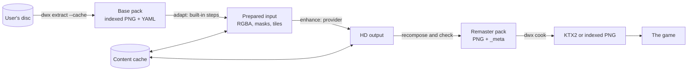

# Remaster pipeline

How content goes from the user's disc to the `remaster` layer with enhanced (HD) images, with any
tool, without repeating calls or charges and without ever distributing anything derived. It is a **design**, with one part
done: the index scaling of `dwx upscale` ([what already exists](#what-already-exists-dwx-upscale)) and the enlarged field
background (`scenery_quality`); the providers, the step cache and `dwe-enhance` do not exist yet. The decisions are in
[ADR 0023](../adr/0023-remaster-pipeline.md); the work plan is at the [end](#implementation-plan).

Read first the [asset pipeline](assets-pipeline.md), the [packs and the VFS](vfs.md), the
[development cache](development-assets.md#reading-the-disc-in-the-game) and the [legal policy](../legal/assets.md).

## Summary



- **The disc is a dependency.** Everything comes from the user's `base` pack (or from their disc image, through the
  `dwx extract` cache). Nothing derived is in git or in a release.
- **One recipe per asset type** (backgrounds, model textures, icons, UI): a chain of steps with provider,
  model, parameters, seed and prompt. Recipes can be distributed; their outputs never.
- **A single provider interface** for three classes: a local command, a generic HTTP service and the engine's
  built-in steps.
- **Mandatory content cache**, step by step: changing step N reuses the previous ones.
- **By default, only built-in steps** (see ["What is the default"](#what-is-the-default)). A local model or a remote
  service is configured by each user; the remote one, with their key, under their responsibility and with confirmation on every
  run.
- **`dwe-enhance`**, a separate executable, writes a pack of the `remaster` layer. Only it has providers and
  network code; `dwx` still has no network and checks recipes and packs with `dwx validate`. A review panel compares
  before and after; what you reject does not go into the pack and the game uses the base.

## Terms

| Term | What it is |
|---|---|
| **Recipe** | A YAML that says which assets to enhance and with which chain of steps. It can be shared |
| **Step** | An operation on images: built-in (`builtin`) or from an external provider |
| **Provider** | Whoever runs a step: a local command, an HTTP service or the engine itself |
| **Provider configuration** | `enhance-providers.yaml` in the user's data folder: commands, endpoints, accepted parameters, keys (by reference), prices and budgets. **It is never shared and never goes in a recipe** |
| **Scale factor `k`** | Output pixels per original pixel, an integer and the same on both axes |
| **Logical units** | Pixels of the original. Geometry (camera, sprites, UVs, layout) always goes in them |
| **Alignment group** | Assets that have to be enhanced, reviewed and fall back to the base together: the variants of a background and its depth layers, the images of a model, the pieces of a UI frame |
| **Remote** | An HTTP provider whose endpoint is not `127.0.0.1`, `::1` or `localhost` |

## What is the default

- **Without configuration, there are only built-in steps.** If `enhance-providers.yaml` does not exist, the only providers
  are the built-in ones, and the default scaler is `index_scale`: no network, no GPU, no third-party weights, bit for bit
  the same on every platform.
- **The repository's example recipes** (`content/enhance/`, in W10c) only use built-in steps.
- **There is no implicit execution:** `dwe-enhance` without `--recipe` does nothing; neither the game nor `dwx` runs it on their own
  to enhance (the game only calls it for the review).
- **User option, no network:** a local command (a machine learning model installed by you) exists
  only if you define it in your configuration, with the SHA-256 of its weights. It is the recommended enhancement.
- **User option, with network:** a remote provider exists only if you define it, with your key, `terms` and
  `uploads_extracted_art`, and every run that uploads something needs `--confirm-upload` (and `--confirm-cost` if it is
  paid).

## Recipes

A recipe is a `<name>.recipe.yaml` file. One is written per asset type; `dwe-enhance` accepts several and
merges their outputs into a single pack. Two recipes that pick the same asset are an error.

### Example

```yaml
recipe: 1                       # recipe format version
id: hd_backgrounds
asset_type: background          # background | model_texture | icon | ui
select:
  include: ["map/*/background_*"]
  exclude: []
scale: 4                        # final k; the product of the steps' factors must equal this
variants: reference_transfer    # how the palettes chosen while playing are handled (see "Indexed images")
reference_variant: day
steps:
  - id: prepare
    builtin: split_alpha        # color on one side, each variant's alpha classes on the other
  - id: upscale
    provider: local_upscaler    # a name from the user's provider configuration, never a command
    model:
      id: example-upscaler-x4
      version: "2.1"
      weights:
        sha256: "<64 hexadecimal digits>"   # mandatory with a local command
        license: Apache-2.0     # SPDX identifier; an unknown one is rejected
    scale: 4
    seed: 1234
    prompt: null
    params:                     # only the ones the provider declares, with their type and range
      tile: 512
      overlap: 32
  - id: merge
    builtin: merge_alpha
  - id: transfer
    builtin: palette_transfer   # derives dusk and night from day without another provider call
  - id: depth_layers
    builtin: recut_sprites      # the depth layers come from the enhanced background
  - id: check
    builtin: alignment_check
    params:
      max_shift: 0.25           # in original pixels
      min_psnr: 30
output:
  cook: true                    # besides the source pack, cook with dwx cook
```

### Schema (sketch)

It will go in `content/schemas/enhance_recipe.schema.json`, within the [subset](json-schema.md) that the
engine checks. The subset has no `oneOf` or conditionals, so three rules are checked by the recipe reader: a
step has `builtin` or `provider`, not both; a step with a local command has `weights.sha256`; and each parameter
is declared by its provider.

```json
{
  "$schema": "https://json-schema.org/draft/2020-12/schema",
  "type": "object",
  "required": ["recipe", "id", "asset_type", "select", "scale", "steps"],
  "additionalProperties": false,
  "properties": {
    "recipe": {"const": 1},
    "id": {"type": "string", "pattern": "^[a-z0-9_]{1,64}$"},
    "asset_type": {"enum": ["background", "model_texture", "icon", "ui"]},
    "select": {
      "type": "object", "required": ["include"], "additionalProperties": false,
      "properties": {
        "include": {"type": "array", "minItems": 1, "items": {"$ref": "#/$defs/idPattern"}},
        "exclude": {"type": "array", "items": {"$ref": "#/$defs/idPattern"}}
      }
    },
    "scale": {"type": "integer", "minimum": 1, "maximum": 8},
    "max_side": {"type": "integer", "minimum": 1, "maximum": 16384},
    "variants": {"enum": ["reference_transfer", "per_variant", "index_space"]},
    "reference_variant": {"type": "string", "pattern": "^[a-z0-9_]{1,32}$"},
    "steps": {"type": "array", "minItems": 1, "maxItems": 32, "items": {"$ref": "#/$defs/step"}},
    "output": {
      "type": "object", "additionalProperties": false,
      "properties": {"cook": {"type": "boolean"}}
    }
  },
  "$defs": {
    "idPattern": {"type": "string", "pattern": "^[a-z0-9_*/]{1,200}$"},
    "step": {
      "type": "object", "required": ["id"], "additionalProperties": false,
      "properties": {
        "id": {"type": "string", "pattern": "^[a-z0-9_]{1,64}$"},
        "builtin": {"enum": ["pad", "crop", "split_alpha", "merge_alpha", "dilate", "mask_reapply", "wrap_pad",
                             "index_scale", "resample", "quantize", "palette_transfer", "recut_sprites",
                             "glb_images", "uv_coverage", "alignment_check"]},
        "provider": {"type": "string", "pattern": "^[a-z0-9_]{1,64}$"},
        "model": {"$ref": "#/$defs/model"},
        "scale": {"type": "integer", "minimum": 1, "maximum": 8},
        "seed": {"type": ["integer", "null"], "minimum": 0, "maximum": 4294967295},
        "prompt": {"type": ["string", "null"], "maxLength": 2000, "pattern": "^[^-]"},
        "params": {
          "type": "object",
          "propertyNames": {"pattern": "^[a-z0-9_]{1,64}$"},
          "additionalProperties": {"type": ["string", "integer", "number", "boolean"]}
        }
      }
    },
    "model": {
      "type": "object", "required": ["id", "weights"], "additionalProperties": false,
      "properties": {
        "id": {"type": "string", "pattern": "^[A-Za-z0-9._][A-Za-z0-9._-]{0,127}$"},
        "version": {"type": "string", "maxLength": 64},
        "weights": {
          "type": "object", "required": ["license"], "additionalProperties": false,
          "properties": {
            "sha256": {"type": "string", "pattern": "^[0-9a-f]{64}$"},
            "license": {"type": "string", "pattern": "^[A-Za-z0-9.+-]{1,64}$"}
          }
        }
      }
    }
  }
}
```

What a recipe can **not** have, on purpose: a command, a URL, a header, a key or a file path.
All of that lives in the user's provider configuration. That way a recipe downloaded from the internet cannot
run anything on your machine or send your art elsewhere: it only names a provider that **you** have defined, with
parameters that the provider declares.

## Providers

### One interface

```cpp
// apps/enhance/include/dwe/enhance/image_provider.hpp (sketch)
struct ProviderIdentity {
    std::string kind;          // "builtin", "local_command" or "http"
    std::string name;          // the configured identity of the provider, or the built-in step's name
    std::string modelId;       // the model id the recipe configures
    std::string modelVersion;  // weights SHA-256 and tool version, the recipe's declared version, or BuiltinStepVersion
    bool deterministic = false;
    bool paid = false;
    bool remote = false;       // an http endpoint outside loopback
};

struct StepRequest {
    ImageFile input;           // a PNG in the step's workspace, plus its canonical pixel hash
    ModelSpec model;
    StepParams params;         // already checked against the provider's declared parameters
    std::optional<std::uint32_t> seed;
    std::string prompt;
    std::uint32_t scale = 1;
};

class ImageProvider {
public:
    virtual ~ImageProvider() = default;
    [[nodiscard]] virtual ProviderIdentity identity() const = 0;
    [[nodiscard]] virtual ProviderLimits limits() const = 0;  // max pixels in and out, fixed scales, alpha support
    [[nodiscard]] virtual std::string keyMaterial() const = 0; // what of its configuration changes the output
    [[nodiscard]] virtual core::Result<CostEstimate> estimate(const StepRequest& request) const = 0;
    virtual core::Result<StepOutput> run(const StepRequest& request, const StepWorkspace& workspace) = 0;
};
```

The three classes implement the same thing, so the cache, the cost plan, the checks and the review do not know
which provider is behind them.

### The provider configuration

`enhance-providers.yaml`, in the user's data folder (the one with `settings.yaml`) and with its own schema. The
user writes it by hand; no tool creates or modifies it.

```yaml
providers:
  local_upscaler:
    kind: local_command
    command: ["/opt/upscaler/bin/upscale.exe", "--weights", "{weights}", "--scale", "{scale}",
              "--seed", "{seed}", "--tile", "{param.tile}", "--overlap", "{param.overlap}",
              "-i", "{in}", "-o", "{out}"]
    weights: /opt/upscaler/models/x4.bin
    version_command: ["/opt/upscaler/bin/upscale.exe", "--version"]
    deterministic: true
    params:
      tile: {type: integer, minimum: 64, maximum: 2048}
      overlap: {type: integer, minimum: 0, maximum: 128}
    limits: {max_input_pixels: 4194304, scales: [4], alpha: false, pad_to_multiple: 8}
    run: {timeout_seconds: 900, concurrency: 1, max_output_bytes: 65536}   # the first 64 KiB are kept

  cloud_image:
    kind: http
    identity: cloud_image_v1            # part of the cache key; the endpoint is not
    endpoint: https://api.example.invalid/v1/upscale
    auth: {header: Authorization, scheme: Bearer, key_ref: "env:DWE_ENHANCE_CLOUD_IMAGE"}
    params:
      style: {type: string, enum: [photo, painting]}
      strength: {type: number, minimum: 0, maximum: 1}
    request:
      format: multipart                 # multipart | json_base64 | binary
      image_field: image
      fields: {model: "{model}", scale: "{scale}", seed: "{seed}", prompt: "{prompt}",
               style: "{param.style}", strength: "{param.strength}"}
    response:
      format: json                      # json | binary
      image_path: output.image          # base64; or image_url_path to download it from the same origin
      model_version_path: output.model_version   # it is recorded and a warning is given if it changes; not part of the key
      cost_path: usage.cost             # optional: the actual cost, if the service reports it
    pricing: {currency: credits, per_call: 0.02, per_input_megapixel: 0.01, per_output_megapixel: 0.002}
    limits: {max_input_pixels: 1048576, max_output_pixels: 16777216, scales: [2, 4], pad_to_multiple: 64,
             max_response_bytes: 67108864}
    run: {timeout_seconds: 120, concurrency: 2, requests_per_minute: 30, retries: 2}
    budget: {per_run: 10.0, per_month: 40.0}
    uploads_extracted_art: true         # written by the user: they know it uploads art extracted from their disc
    terms: {url: https://example.invalid/terms, reviewed_by_user_on: 2026-10-21}
```

An HTTP provider must have `pricing` (with some nonzero price) or an explicit `paid: false`; with
neither of the two, the configuration is an error. `budget` is mandatory if it is paid.

### Declared parameters (all classes)

- Each provider declares in `params` the parameters it accepts, with `type` (`integer`, `number`, `string`,
  `boolean`): numbers with `minimum` and `maximum`, and each `string` with an `enum`, or with `maxLength` and `pattern`
  (a `string` with neither is a configuration error). A recipe parameter that its provider does not
  declare, or that is outside its type, list, length, pattern or range, is an error before anything runs.
- No substituted value (parameter, prompt, model id) can **start with `-`** (so it cannot sneak in as an option) or
  contain NUL, CR or LF.
- Substitution is **single-pass**: what enters through a template is never examined again, so a
  `{in}` value is text, not another template.
- The same list and the same rules apply to the HTTP `fields`: they can only name declared parameters, and
  the values go as form fields or as correctly encoded JSON text, never in the URL or in
  a header.

### a) Local command

- `command` is a list of arguments. The templates are `{in}`, `{out}`, `{scale}`, `{seed}`, `{model}`,
  `{weights}`, `{prompt}` and `{param.<name>}`, as whole arguments or parts of one. An unknown template
  is an error. It runs with `platform::runProcess`, **without a shell**.
- **Null seed.** With `seed: null`, `{seed}` has no value: a recipe with `seed: null` for a provider whose
  `command` uses `{seed}` is an error when it is read (it is not replaced by `0` or anything else, because that would change what
  it means). In HTTP, a `fields` entry whose template is exactly `{seed}` is omitted from the request; if
  `{seed}` is inside other text, it is also an error. In the cache key the seed stays as `null`.
- `{in}` and `{out}` are PNGs in a temporary working folder of the step. The output has to exist, be a PNG,
  decode with the engine's readers and measure exactly `k ×` the input; otherwise the step fails.
- `command[0]` has to be an absolute path (no searching the `PATH`). On Windows, it also has to end in
  `.exe` (allowlist): that way it is never a `.bat` or `.cmd`, which `CreateProcess` passes through `cmd.exe`.
- `weights` is mandatory and the recipe has to give `weights.sha256`: the file's SHA-256 is computed and, if it does not
  match, it does not run. The hash is stored in the cache by (path, size, modification date), so weights of
  several GB are not read again on every run; if any of the three changes, it is recomputed. The tool's version
  is the output of `version_command`.
- `runProcess` gains, additively and as a change in `main` prior to W10b:
  - **time limit** with polling wait (it reads the output in chunks and checks the clock): once exceeded, it kills the process;
  - **output cap** (`max_output_bytes`): the first N bytes are kept and the rest is read and discarded, without killing
    the tool, which continues until it finishes or until the time limit (question 12, "Decided by the manager,
    2026-10-21": a model that writes a lot of progress output is not a failure, and draining the pipe keeps it from blocking). Only
    for `version_command`, whose output goes into the key, exceeding the cap is a failure and kills the process;
  - **killing the whole tree:** on Windows, the process goes into a Job Object with `KILL_ON_JOB_CLOSE`; on POSIX, in its
    own process group, and the group is killed. A child that launches others leaves no orphans;
  - **explicit environment:** **every** child process of `dwe-enhance`, `dwx` included, receives the environment without any
    `DWE_ENHANCE_*` variable. A test launches a child that dumps its environment and checks that none is there.

### b) Generic HTTP

Endpoint, authentication and request and response format are configurable; no service name is in the
code. It works the same for an inference server on your own machine (`http://127.0.0.1:<port>`). The transport
is an interface (`HttpTransport`); the real one uses libcurl, with these fixed rules, with no options to relax them:

- **Protocols:** only `https` (`CURLOPT_PROTOCOLS_STR` and `CURLOPT_REDIR_PROTOCOLS_STR`); `http` only toward
  loopback. `localhost` is only valid if it resolves to a loopback address: it is pinned with `CURLOPT_RESOLVE` to
  `127.0.0.1` and DNS is never asked. With a loopback endpoint, `CURLOPT_NOPROXY` is set to `*`, so that a
  proxy from the environment variables does not send that traffic out.
- **Loopback is not a guarantee of local.** A loopback endpoint can be a tunnel or a forward to a cloud
  service; `dwe-enhance` cannot know, so it treats it as local (without `--confirm-upload`). Making sure a loopback
  endpoint is truly local is the **responsibility of the user** who configures it.
- **TLS:** certificate and name verification always on. System CA store: on Windows, Schannel with
  `CURLSSLOPT_NATIVE_CA`; on Linux, OpenSSL with the system store (in the container, the image's CA
  bundle). The vcpkg port's features are pinned in `vcpkg.json` (`ssl`, without `http2` or other protocols), with the
  baseline's version.
- **Redirects:** `CURLOPT_FOLLOWLOCATION` off. A redirect is handled by hand and is only followed if it goes to the same
  origin (scheme, host and port).
- **Authentication:** the key goes in a header, never in the URL (URLs end up in logs), and only toward the endpoint's
  origin. Downloads from `image_url_path` (only from the same origin or from the configuration's `download_hosts`)
  go **without** authentication.
- **Headers:** a value with CR or LF is rejected before sending.
- **Size:** response cap (`max_response_bytes`) counted in the write function, without trusting
  `Content-Length`, plus `CURLOPT_MAXFILESIZE_LARGE`.
- **No decompression:** `CURLOPT_ACCEPT_ENCODING` is not enabled; a response with `Content-Encoding` is rejected (no
  compression bombs).
- **JSON:** it is read with the size cap and a maximum depth of 32.
- **Image:** PNG only. Before decoding, the header's dimensions are read (`assets::inspectPng`) and
  checked against `max_output_pixels` and against `k ×` the input.
- **Timeouts:** connection, total and minimum speed.
- **Asynchronous:** an optional `poll` block (`job_id_path`, `status_path`, interval) for services that queue
  jobs. It enters in W10d if the first service tested needs it; a resend counts as another charge.

### c) Built-in steps

They are providers of the `builtin` class, deterministic and **with integer arithmetic**: they give the same bytes on every
platform (unlike the cook's mipmaps, which use `pow`). Each has its `BuiltinStepVersion`.

| Step | What it does |
|---|---|
| `pad`, `crop` | Pads up to the multiple a provider asks for (`pad_to_multiple`) and crops `k ×` that padding on the way back |
| `split_alpha`, `merge_alpha` | Separates the color from the **alpha classes** of **each variant** (transparent, STP, opaque) and puts them back together |
| `dilate` | Extends the color of opaque pixels over transparent ones, so the provider does not blend black into the edges |
| `mask_reapply` | Reapplies, scaled `k ×` by nearest neighbor, an exact mask: color 0, the background's empty cells |
| `wrap_pad` | Pads with the opposite edge of the piece itself, for pieces that repeat (tiling) |
| `index_scale` | Pixel art scaling **in index space**, palette-aware: the output stays indexed with its palettes (see below) |
| `resample` | Reduces by an integer factor with a box filter (a ×4 provider for a ×2 recipe) |
| `quantize` | Goes back to a given palette (only for `index_space`) |
| `palette_transfer` | Derives the other palette variants from the enhanced one (see "Indexed images") |
| `recut_sprites` | Recuts the depth layers of the enhanced background |
| `glb_images` | Pulls the images out of a `.glb` and puts them back without changing anything else (see "Atlases and UVs") |
| `uv_coverage` | Rasterizes a model's UVs to know which texels it uses |
| `alignment_check` | Checks exact dimensions, shift and similarity to the input |
| `cook` | Not a step of the chain: with `output.cook`, `dwe-enhance` runs `dwx cook` on the written pack |

**`index_scale`** has two modes:

- `mode: edge` (default): neighbor rules from the classic pixel art scaling family (each pixel is
  split into `n × n` depending on which neighbors have the **same index**; colors are never blended, so the output stays
  indexed). There are kernels for `n = 2` and `n = 3`; other factors are composed in a fixed order: 4 = 2·2, 6 = 2·3
  (2 first), 8 = 2·2·2. **5 and 7 do not exist in this mode:** they are primes greater than 3 and there is no rule kernel for
  them nor a way to compose them with 2 and 3. A recipe with `k = 5` or `7` and `mode: edge` is an error from
  `dwx validate --recipe`.
- `mode: nearest`: pixel repetition, for any `k` from 1 to 8.

### What already exists: `dwx upscale`

`index_scale` already exists in `dwx` (`apps/dwx/src/index_scale.cpp`), with the two modes above: in `edge`, the 2×
and 3× rules of classic pixel art scaling (AdvMAME family) applied to palette indices, with the edge pixel
repeated outside the image. `dwx upscale` runs a subset of recipes: one `index_scale` step and nothing else
(no providers or cache), and writes a `remaster` pack with the recipe's id
([dwx page](../modules/apps/dwx.md#dwx-upscale-and-the-bundled-recipes)). `dwx extract` runs the recipes
included in `content/enhance/` when it finishes the base pack: today `ui_original`, ×4 in `edge`, for the sprites of the
UI's original look (Decided by the manager (2026-10-21): the recipe is included and `dwx extract` runs it,
×4 `edge`; `dwx upscale` remains available by hand).

**`edge` limit on atlases.** The rules look at the 8 neighbors of each pixel without knowing where a sprite ends: in
a sprite sheet, the edge pixels of a sprite that touches another with no gap may take the neighbor's index
in the enlarged copy. A sprite with at least one pixel of gap (or of color 0 around it) is not affected. The original UI's
sheets almost always leave that gap; where they do not, the look accepts it or the sprite is cropped by a pixel. A mode
that respects the sprites' rectangles would be future work.

## The cache

Mandatory: without a cache there is no `dwe-enhance`. It follows the pattern of the `dwx extract --cache` cache
([development assets](development-assets.md#reading-the-disc-in-the-game)).

### Keys per step

Each step of each asset has its key, `<sha1>-v<EnhanceCacheVersion>`. The SHA-1 is computed over a canonical encoding
(sorted keys, normalized numbers, UTF-8) of:

- `EnhanceCacheVersion` (the cache format version);
- the **step's identity**:
  - built-in: name + `BuiltinStepVersion`;
  - local command: `identity` + model id + SHA-256 of the weights + tool version + the **`command`
    template** as it is in the configuration;
  - HTTP: `identity` + **model id and version as the recipe configures them** + the request format and the
    `fields` template. The version the service reports in its response does **not** enter: it is not known before
    calling, and with it the plan could not know what will hit. It is saved in the step's record, and if it changes between
    two calls of the same step, `dwe-enhance` warns (the service changed model without the recipe changing);
- the effective parameters, the seed, the prompt and the scale factor;
- the **limits that change how the image is split or padded**: `max_input_pixels`, `pad_to_multiple`, `tile` and
  `overlap`;
- the **canonical hash of each input**: dimensions, decoded pixels and palette, not the PNG's bytes (two PNGs with
  the same pixels and different compression give the same key).

What does not change the output stays out of the key: endpoint, authentication, timeouts, concurrency, prices,
budgets.

Since a step's key depends on its input's **content** and not on the whole recipe, changing step N leaves
the keys of the steps before N unchanged: they are reused. And if the changed step N gives the same output as before,
N+1 hits too. Two assets with the same pixels (repeated textures) are enhanced only once.

### What is stored

- The output of **every step of an external provider**, always: it is what costs time or money.
- The final output of each asset.
- Intermediate built-in steps are not stored by default: they are cheap and deterministic, they are recomputed.

### Layout

```text
<user cache>/enhance-cache/
├─ steps/<first 2 digits>/<key>/
│  ├─ output.png
│  └─ enhance-step.yaml      # step, provider, model, configured version and the one the service reported,
│                            # parameters, inputs, SHA-1 of the output, estimated and actual cost,
│                            # status (ok | failed_check)
├─ .<key>.partial-<random>/
└─ .<key>.lock               # system advisory lock, only for paid steps

<user data>/enhance-ledger.yaml        # spend per provider and run; it only grows
<user data>/enhance-ledger.lock
```

- **Where** (question 3, "Decided by the manager, 2026-10-21": a multi-GB cache should not travel with the profile
  or mix with the data): on Windows, `%LOCALAPPDATA%\indie-modding-games\dwe\enhance-cache\`; on Linux,
  `$XDG_CACHE_HOME/indie-modding-games/dwe/enhance-cache/` (`~/.cache/...` if it is not defined). The spend ledger
  is not a cache: it goes in the user's data folder (the one with `settings.yaml`), so deleting the cache does not delete
  what was spent.
- An entry is written in its `.partial-` folder, flushed (`fsync`) and **renamed**: an entry that exists
  is complete. If two processes write the same one, the one that renames second throws its own away.
- When reading an entry, it is checked that `output.png` has the size in bytes and the SHA-1 that its
  `enhance-step.yaml` says, and that its dimensions (from the header, before decoding) are the expected ones; if not, it is treated
  as a cache miss, with a warning.
- An entry is a real folder with its `enhance-step.yaml`; the cache never follows a link. Anything that has the name
  of an entry without being one is deleted and recomputed, with a warning (if it was paid, the plan counts it as a cache
  miss).
- **System locks, not marker files:** `flock` on POSIX and `LockFileEx` on Windows, on the key's `.lock`
  (before calling a paid provider) and on `enhance-ledger.lock` (to read and append to the ledger). The
  system releases them if the process dies, so no stale locks are left. If the ledger's cannot be taken within a
  time limit, **no paid call is made** (it fails closed).
- A paid output that does not pass the checks is stored with status `failed_check`: running again does not
  pay for it a second time. `--retry-failed` repeats it, and it goes through the cost gate again.
- A request that fails (network, service error) leaves no entry in the cache; its charge does remain in the ledger (see
  "Cost and volume").

### Fingerprints and cleanup

- Like `ExtractorVersion`: a test applies each built-in step to synthetic images and compares with a table of
  fingerprints **that only grows**, one row per version. If a step's output changes, it fails with "bump the step version
  and update the fingerprint".
- After a run, `dwe-enhance` deletes the **built-in step** entries of earlier versions (they are recomputed
  for free). The ones from external providers are **never deleted on their own**: they cost money or time.
- `dwe-enhance cache --report` says size, entries and what was paid. `dwe-enhance cache --prune --dry-run` lists what
  none of the given recipes uses and what it cost; without `--dry-run` it deletes it.
- `.partial-` folders older than 24 hours show up in a warning, as in the extraction cache.

## `dwe-enhance`

Question 4, "Decided by the manager, 2026-10-21": a **separate executable**, `dwe-enhance` (`apps/enhance`), has
the providers and all the network code; `dwx` still has no network. Reason: less attack surface, `dwx` remains
deterministic and offline, and the keys never reach the tool that modders run in their CI. **This
departs from the user's original wording**, which spoke of `dwx enhance --recipe <file>`.

```text
dwe-enhance --recipe <file>... (--base <pack> | --disc <image>) --out <pack folder>
            [--plan] [--only <id pattern>]... [--confirm-cost <amount>] [--confirm-upload <images>]
            [--budget <amount>] [--retry-failed] [--verify]
dwe-enhance review --pack <remaster> (--list | --accept <id> | --reject <id> [--reason <text>])
dwe-enhance cache (--report | --prune [--dry-run] --recipe <file>...)
dwx validate --recipe <file> [--providers <enhance-providers.yaml>]   # no network, in dwx
dwx validate --engine --with <base> <remaster>                        # the produced pack, no network, in dwx
```

Numbers on the command line and in the plan's output use a **decimal point** (`3.10`), whatever the system's
language: they are read and written with `std::from_chars`/`std::to_chars`, which do not depend on the locale.

`dwx` does not offer `dwx enhance --plan`: the plan needs the cache, the provider configuration and running the built-in
steps, which belong to `dwe-enhance`, and a second owner of the plan would be duplicated code. `dwe-enhance --plan` opens
no connection.

`dwe-enhance` uses `dwx` as a program, like the game does for the disc cache (`platform::runProcess`, no shell;
it looks for it next to its executable and then in its folder of the build tree): to extract and to cook.

How it works:

1. **Base.** With `--disc`, it runs `dwx extract --cache` and uses that entry.
2. **Recipes and providers.** It reads and checks them (schema, declared parameters, licenses, secrets, terms).
3. **Selection.** It gathers the assets of each recipe and forms the alignment groups.
4. **Plan.** It computes the keys. The built-in steps that come before the first external step run right away (they are
   cheap), so the external step's key is exact and the plan knows which calls the cache hits. It counts the tiles
   each image will be split into. After a cache miss, what follows counts as a miss: the plan is an
   **upper bound**.
5. **Gates.** If there are uploads to a remote provider or paid calls that miss the cache, it stops unless
   `--confirm-upload` and `--confirm-cost` are passed (see "Cost and volume").
6. **Execution.** With each provider's concurrency, the per-key lock and each step's checks.
7. **Pack.** It writes the source pack (below) and, with `output.cook`, cooks it with `dwx cook`.

Exit codes: 0 all good; 1 some asset failed (the rest is written and the one that fails falls back to the base); 2 it could not start;
3 cost or upload confirmation is needed.

With `--verify`, it recomputes without cache the **deterministic, network-free** steps (built-in and local commands) and compares
with what is stored: that is how you check that a recipe is reproducible on your machine. It never calls an HTTP provider.

### The pack it writes

```text
<content>/remaster/
├─ pack.yaml                   # id remaster, layer: remaster, dependencies: base (only from dwe-enhance)
├─ .enhance/                   # hidden from the VFS (starts with a dot), like .dwx-cook
│  ├─ manifest.yaml            # per asset: recipe, its steps' keys, SHA-1 of the output, group
│  └─ review.yaml              # pending | accepted | rejected, per group and SHA-1 of its output
└─ map/<id>/
   ├─ background_day.png       # RGBA, k × the logical size; KTX2 after cooking (extended PngOnlyImages)
   ├─ background_day_meta.yaml # the base's sidecar fields (if there is one) + scale, palette, color_space
   └─ ...
```

- It is written in the content folder, next to `base`, so the game finds it in its own folders
  (`PackOrigin::Engine`; see "Layers").
- **Each output's `_meta.yaml` copies the fields of the base's sidecar YAML** (`palettes`, `clut_rect`,
  `image_rect`, `source`...) and adds `scale`. **Indexed** outputs copy all of them, so cooking decides the same
  as for the base. **RGBA** outputs do not copy `palettes` or `clut_rect` (they describe indices that no longer exist) and
  add `color_space: srgb` and, for backgrounds, `palette`: with that they are RGBA for cooking and for the content
  check (see "Cooking").
- Like `dwx cook`, it refuses to write into a folder with files it did not write, and when run again it removes what
  it no longer produces (a rejected asset or one outside the selection). That is why this pack belongs only to `dwe-enhance`.
- It only writes images, their `_meta.yaml` and texture `.glb` files: never Lua, RML, RCSS, tables or audio. HD music
  goes in **another** pack of the `remaster` layer, `remaster_audio` (see "Layers").

## Review

### The viewer

A **panel of `dwe-game`'s debug overlay** (`apps/game`, in the development views, next to the asset viewer and the
map preview), not a new application (question 2, "Decided by the manager, 2026-10-21": it reuses
the render, the VFS and the real camera, and phase 4 has no `apps/editor`):

- before/after of the same asset with a sliding wipe, toggling with a key, and a difference view
  (`|after↓k − before|` amplified, which gives away any shift);
- 1:1 and fit zoom, and **in context**: the map with the real camera, its depth layers and the time of day, which
  is where you see whether something does not fit;
- list of pending groups; accept or reject a group with a key.

The panel does not write the review: it runs `dwe-enhance review` with `platform::runProcess`, like the game asks `dwx` for the
disc cache. That way `review.yaml` has a single owner. `review` opens no connection.

### Rejections

- They are recorded in `.enhance/review.yaml` per **alignment group** and SHA-1 of its output, with the reason if you give one.
- A rejected group is not written into the pack: the VFS gives the base's asset. The whole group is rejected (an HD
  background with the base's depth layers would not match in color or in detail).
- If the recipe changes and the group comes out different (another SHA-1), it goes back to `pending`.
- `pending` is written into the pack (so you can see it in the game); `rejected` is not.

## Game constraints

What exists today, from which each rule comes:

- **Backgrounds:** `dwx extract` composes the background's 128 × 128 tiles into an indexed PNG per palette variant
  (`background_day`, `_dusk`, `_night`, `paletteN`), with the same indices in all of them and **no sidecar YAML**. The engine
  (`assets::loadMapImages`) reads the indices (`decodeIndexedPng`) and the palettes; the backgrounds' palettes also
  feed the sprites with `clut` −1 (`backgroundPalettes`). The render chooses and blends the palette according to the time
  (`map.slang: texelAt`, `lerp(from, to, push.fade)` over the palette texture, which is `Rgba8Unorm`). The camera works in background pixels (`MapCamera`,
  `backgroundSize = tiles × 128`; [ADR 0020](../adr/0020-map-camera-and-depth-layers.md)).
- **Depth layers:** each sprite is a crop of one of the map's texture pages (indexed, 256 per side, several
  sprites per page: an atlas), placed at `inst.x, inst.y` in background pixels. With `clut` −1 it uses the palette of the
  background for the time of day; color `0x0000` is not drawn; alpha stores **classes**: 0 transparent, 128 STP, 255 opaque
  (`colorFromOriginal`), which `map.slang` separates with thresholds of 0.25 and 0.75
  ([maps](../formats/maps.md#depth-layers)).
- **Map sampling:** `map.slang` always reads **level 0** with `Load` and blends the four neighboring
  texels by hand (`sampleSharp`) with a sharpness `pixelsPerTexel` that today is the camera's scale
  for all textures.
- **Model textures:** inside the `.glb`, one image per combination of texture and palette that some primitive uses,
  with UVs already divided by the image's width and height, a `NEAREST` filter and `alphaMode: MASK` for color 0
  ([models](../formats/models.md#textures)).
- **Cooking:** `planTexture` (`apps/dwx/src/texture_cooker.cpp`) lets through as PNG the ids of `PngOnlyImages` and an indexed PNG
  whose sidecar lists more than one palette or has a `clut_rect` with `source` `.MAP` (`paletteChosenAtRuntime`); everything else is converted to KTX2. The UI paints indexed images with `?palette=N` from
  `<id>_meta.yaml`, and asking a KTX2 for a palette is an error (`PaletteNeedsPng`; [UI](ui.md#images)).
- **Limits:** KTX2 from 1 to 16384 texels per side (`checkPlain2dKtx2`); UI images at most 4096 per side
  (`MaxUiImageSide`), 64 MiB of file (`MaxUiImageFileBytes`) and about 85.3 MiB decoded with all their levels
  (`MaxUiImageBytes`, `checkUiImageBudget`), today in `packages/engine/ui/include/dwe/ui/image_reference.hpp`.

### Cooking

A base background has no sidecar, so without a rule `planTexture` would convert it to KTX2: it would lose the indices and the
palette, and `loadMapImages` (which only reads indexed PNGs) could no longer read it, nor give palettes to the sprites with `clut` −1. The same
would happen to any single-palette indexed output. Rules:

1. **Backgrounds and the maps' pages always pass as PNG** when cooking. This is already in `main`, with a rule
   **by asset ID**, not by the sidecar YAML: `assets::PngOnlyImages`
   (`dwe/assets/png_only_images.hpp`) lists by pattern the images that the game reads from their PNG (`map/*/background_*`,
   `map/*/*/background_*` for the maps of a namespaced mod, `map/*/texture8/*`, `map/*/texture4/*`, their
   `map/*/*/...` equivalents and the font atlases, `font/*`). `planTexture` receives the ID and lets them through whatever
   their sidecar says, and the content check (`dwx validate`, `dwe-game --check-content`) rejects for those
   IDs anything that is not a PNG its reader reads: indexed for the map ones (`PngReading::Indexed`); exact-pixel
   PNG for the font (`PngReading::ExactPixels`). It has a test that cooks and reads with `loadMapImages`.
2. **W10b extends `PngOnlyImages` and the content check.** For the IDs on that list, an image whose
   `_meta.yaml` declares `scale` and `color_space` and **has no `palettes`** is **RGBA**: it is cooked to KTX2 and the
   check accepts RGBA PNG or KTX2. Without those keys the current rule stays: indexed PNG mandatory. The new IDs
   `map/<id>/texture8/<page>_<variant>` fall into the `map/*/texture8/*` pattern and follow the same rule (always
   RGBA). W10b test: cook, then `dwe-game --check-content` and then `loadMapImages`, with indexed and RGBA
   backgrounds and pages in the same pack.
3. **Indexed outputs** (`index_space`, `index_scale`) carry in their `_meta.yaml` all the sidecar fields of
   the base plus `scale`, without `color_space`, so they remain indexed for cooking and for the check: an
   indexed remaster background goes through rule 1.
4. **Only RGBA is converted to KTX2.** Color is pinned down: the remaster writes `color_space: srgb` and the map render
   creates its RGBA textures (BC7 or RGBA8) with a **UNORM** format, so `Load` returns the encoded values, in the
   same space as the `Rgba8Unorm` palette texture, and the blend mixes the same way. There is a test of the blend **on cooked
   KTX2** (possible only with rule 2): the per-image blend between two cooked KTX2s gives, at each step of the
   blend, the same colors as the base's palette blend within BC7's error (at most 4/255 per
   channel), and the three alpha classes survive UASTC and BC7 (they stay on the same side of 0.25 and 0.75).

### Scale: logical units and `scale`

- **Integer and uniform.** `k` from 1 to 8, the same on both axes. With an integer `k`, the edge of each tile, each sprite and
  each UV island falls on a texel edge; with a fractional one it would fall in the middle and seams would appear.
- **Geometry never changes.** Camera, sprite positions, page rectangles, UVs and layout stay in
  logical units. Each texture states its factor in its `_meta.yaml`: `scale: k` (missing = 1). The engine divides its size
  in texels by `k` to get the logical one, and checks that the result is **exactly** the expected one (the map's tiles
  × 128, 256 in a page). That way any mix of textures with different `k` stays aligned; only the
  sharpness changes.
- **From `_meta` to KTX2.** The factor does not go inside the KTX2 (there is no standard key for that): it goes in the sidecar
  YAML, which `dwx cook` copies as is next to the KTX2, the same way `color_space` is decided today. `checkPlain2dKtx2` does not
  change.
- **In the map render:** `pixelsPerTexel` becomes **per texture**, `camera scale / k` (today it is the camera's scale
  for all of them), so that `sampleSharp`'s sharp blend keeps giving pixel art edges at
  any `k`.
- **Consequence of reading only level 0:** the mipmaps of a cooked KTX2 are **not used** in maps. As long as
  the camera scale is greater than or equal to `k` (with `k = 4`, a window of 1280 × 960 or larger) the texture is
  enlarged and nothing happens. If it is smaller, the texture is reduced without mipmaps and jaggies and flicker appear when scrolling.
  W10b changes `map.slang`'s RGBA path so that, with `pixelsPerTexel < 1`, it samples with `SampleLevel` and a level
  `log2(k / scale)` (RGBA textures can be filtered; index ones cannot, and their path does not change). An uncooked RGBA PNG
  brings no mipmaps: `loadMapImages` **builds the chain** when loading it, with the same box filter in linear
  light as cooking, so a source pack and a cooked one look the same (it costs load time; the cooked
  pack does not pay it).
- **Limits applied by the plan** (before spending anything) and `dwx validate` (afterwards):
  - backgrounds: `k × logical side ≤ 16384`. With the widest background of a full disc (1280 pixels), `k ≤ 12`;
  - UI: `k × side ≤ MaxUiImageSide` and `rgbaBytesOverLevels(...) ≤ MaxUiImageBytes`. A recipe can give `max_side`:
    then each image's `k` is the largest integer that fits, instead of an error;
  - memory per map: with `k = 4`, the largest background is 5120 × 4096, about 27 MiB in BC7 with its mipmaps per
    variant; with three variants, about 80 MiB. With `k = 8` it would be about 320 MiB per map: `dwx validate` warns above
    `RemasterMapTextureBudgetBytes` = 128 MiB in BC7 per map, a named constant declared once
    in `apps/remaster_rules` (question 9, "Decided by the manager, 2026-10-21": `k = 4` fits with three variants and
    it warns before a map blows up memory). `k = 4` is the recommended value.
- **The UI limits move to `packages/engine/assets`.** `MaxUiImageSide`, `MaxUiImageFileBytes`, `MaxUiImageBytes`,
  `BytesPerRgbaPixel`, `rgbaBytesOverLevels` and `checkUiImageBudget` live today in `packages/engine/ui`, and `apps/remaster_rules`
  (which links `dwx`) cannot depend on `ui`. They move to `packages/engine/assets` (`dwe/assets/image_budget.hpp`) without changing
  their value, as a **prerequisite of W10b** (question 13, "Decided by the manager, 2026-10-21": `remaster_rules` is born
  in W10b and already needs them, and that way there is never a dependency on `ui` that has to be undone); `ui` uses them from there.
- **What changes in the engine** (additive, in W10b and W10e): `PngOnlyImages` and the content check accept RGBA
  according to rule 2 of "Cooking"; `loadMapImages` accepts RGBA backgrounds and pages (PNG or KTX2) with `scale`; the render
  blends them per image; `pixelsPerTexel` per texture and `SampleLevel` in the RGBA path; sprite pages with `scale`; the
  UI uses the logical size as an image's intrinsic size.

### Aligned depth layers

The risk is **drift**: the provider shifting, cropping or resizing the image a little, and the sprites
(crops of the background that are drawn in front of the characters) no longer matching the background.

1. **The whole group with the same `k`**: the background's variants and its sprites' pages.
2. **Exact dimensions:** an output that does not measure exactly `k ×` the input is a failure, it is never rescaled to
   fit. If the provider asks for multiples (`pad_to_multiple`), `pad` pads before and `crop` removes `k ×` the padding
   afterwards, with the padding noted in the step's record.
3. **Recut from the background (`recut_sprites`).** A sprite is almost always an exact crop of the background. For each
   sprite, an instance is searched for where its opaque texels match, at the original resolution, those of the background at
   `inst.x, inst.y` (the check is exact and cheap). If there is one, the HD sprite is **cropped from the HD background** at
   `k × (inst.x, inst.y)` with the sprite's mask **of that variant** scaled by nearest neighbor: it matches by
   construction and inherits each time-of-day variant. If there is none (animated water, sprites that are not crops), the page
   is enhanced on its own, with the same `k` and the atlas rules.
4. **Check (`alignment_check`):** see "Determinism of the checks". If it fails, the group stays in
   `failed_check` and falls back to the base.
5. The cropped pages of a sprite with `clut` −1 give one RGBA image per variant: `<page id>_<variant>`
   (`map/<id>/texture8/000_day`), which falls into `PngOnlyImages`'s `map/*/texture8/*` pattern and is RGBA by rule 2
   of "Cooking". It is the only class of **new** ID that a remaster may add (see "Layers";
   question 6, "Decided by the manager, 2026-10-21": the remaster replaces and does not invent content, except what the
   per-variant cut needs).

### Indexed images with a palette chosen while playing

This is the most weighty decision. Options:

| Strategy | How | Gains | Loses |
|---|---|---|---|
| **`index_space`** | Scale the indices with a palette-aware pixel art scaler (`index_scale`) | Stays indexed: all palettes, `?palette=N` and the blend work without touching the engine; exact and free | No machine learning model works with indices: it only gives sharp pixel art, not new detail |
| **`per_variant`** | Apply each variant's palette and enhance each RGBA separately | Exact colors of each variant | `n` calls instead of one; a generative model invents different details in each variant and the blend between them looks doubled |
| **`quantize`** (re-quantize) | Enhance one variant and go back to the 256-color palette to get HD indices | The engine does not change | Loses almost all of the gain (banding) and a palette is not bijective between variants |
| **`reference_transfer`** | Enhance a reference variant (`day`) and derive the others with `palette_transfer` | One call; all variants have **the same geometry**, so the blend is clean | The other variants are an approximation where the palette change is not smooth (lights that turn on at night) |

**`reference_transfer` by default (with an external provider)** (question 1, "Decided by the manager, 2026-10-21": one
call per map and a clean blend because all variants share geometry), `index_space` for pixel art and
for the images the UI paints with `?palette=`, and `per_variant` available for deterministic models when
color fidelity matters more.

`palette_transfer`: for each variant `v`, the color difference at low resolution
`Δv = variant_v − reference` (applying each palette to the same indices) is scaled up to `k ×` with a **joint
bilateral upscale** guided by the HD reference (the HD reference's edges decide where the blending stops), and
`variant_v,HD = reference_HD + Δv↑`. It only transfers **color**: each variant's alpha comes from its own mask
(see "Transparency of color 0").

Why the blend works: today the render mixes two palettes, `lerp(palette_a[i], palette_b[i], t)`, at each pixel of
index `i`. That is exactly `lerp(image_a(p), image_b(p), t)` at each pixel, so a blend between two **aligned** RGBA
images gives the same result as the palette one, with the same steps of 1/6, 1/5, 1/4, 1/3 and
1/2, as long as they are read in the same space as the palettes (UNORM; see "Cooking"). With `per_variant` and a
generative model they would not be aligned; with `reference_transfer` they are by construction.

Sprites with `clut` −1 that cannot be cropped from the background read the palette of the time of day: that is why the
RGBA background's `_meta.yaml` carries its variant's original palette (`palette`), which the remaster copies from the base on the
user's machine (question 5, "Decided by the manager, 2026-10-21": the remaster pack is self-sufficient and `dwx extract` does not
change).

### Determinism of the checks

What exactly is promised:

- **`palette_transfer`** is a deterministic function of its inputs (the HD reference and the indexed image with its
  palettes): the bilateral filter's spatial and range weights are tables of 16-bit integers fixed as
  constants in the code (never `exp` at run time), the sum goes in 64-bit integers and rounding is
  "half up". With the same input it gives the same bytes on every platform. Its output is as
  reproducible as the HD reference it receives: bit for bit if the provider is, "equivalent" if not.
- **`alignment_check`** produces no image: it gives a verdict, and the verdict is deterministic and integer:
  - **dimensions:** exactly `k ×` the input;
  - **shift:** it reduces the output `k ×` with a box filter (integers) and searches, among integer shifts of
    the output within `±k`, for the one that minimizes the sum of absolute differences with the input scaled by nearest
    neighbor. It passes if the best is within `±floor(max_shift · k)` output pixels (with `k = 4` and
    `max_shift: 0.25`, ±1). Ties are resolved by the shift of smallest magnitude and then by a fixed order;
  - **similarity:** the (integer) squared error between the reduced output and the input must be at most an
    integer bound that is computed **once**, when the recipe is read, from `min_psnr` (rounded down, and
    stored in the record). The comparison is between integers.
  With the same images, the verdict is the same on every platform. If the provider's output varies between
  platforms ("equivalent"), the verdict may vary in a borderline case; it is noted in the step's record.

### Atlases and UVs

- **Uniform `k`.** A `.glb`'s UVs are already normalized (divided by the image size), so an
  image `k ×` larger works without touching the mesh. A different factor per axis would change the texel density per axis: it is
  rejected.
- **Whole context.** The whole page is enhanced, not island by island: the provider sees the context and no new edges
  appear inside an island.
- **Bleed.** `uv_coverage` rasterizes the UVs of all the primitives that use the image: texels outside every
  island are filled with `dilate` from the nearest island (padding of at least 2 × `k` texels and as far as there is
  room), so bilinear sampling and mipmaps do not mix in foreign colors. Two islands that touch in the original
  keep touching: the bleed between them at small mipmap levels is the same the base would have at the same
  size on screen, so it is not a regression. The full mipmap chain is kept, with no key to
  limit it (question 8, "Decided by the manager, 2026-10-21": there is no regression against the base and cooking does not
  change).
- **Filter.** The base's `.glb` uses `NEAREST`; the remaster may change the samplers' `magFilter` and `minFilter`. It is the only change allowed outside the images.
- **Checkable equality of `glb_images`.** The base's `.glb` and the remaster's are compared like this, and all three
  things must hold:
  1. the JSON of the two is equal as a JSON value after removing `images`, the `bufferViews` that only images use,
     the `samplers`' `magFilter`/`minFilter` and the `buffers`' `byteLength`, and after renumbering the
     remaining `bufferViews` in order and removing their `byteOffset`;
  2. each accessor reads **the same bytes** in both (compared accessor by accessor, not by position in the
     file);
  3. there is the same number of images, in the same order, each with `k ×` the dimensions of the base's.
  `glb_images` writes like this: it copies everything else as is and puts the new images at the end of the binary block.

### Transparency of color 0

- The original's alpha is not a continuous alpha: it is three **classes** (transparent, STP, opaque). It is separated before
  enhancing (`split_alpha`), scaled by nearest neighbor and put back together (`merge_alpha`). It is never interpolated:
  a 64 means nothing to the map render.
- **One mask per variant.** With the same indices, each palette may give other classes: an index that is
  `0x0000` in one palette and not in another, or a color with STP only at night. `split_alpha` computes the classes of **each
  variant** with its own palette, `merge_alpha` applies to each variant its own, and `palette_transfer` and
  `recut_sprites` use that of the variant they write.
- Before sending the color to a provider, `dilate` fills the transparent pixels with the color of their opaque
  neighbors (otherwise color 0's black darkens the edges: halos).
- Soft edges: the mask scaled by nearest neighbor gives steps of `k` pixels. For models (`MASK` with a
  cutoff at 0.5) you can ask for `params: {edge: smooth}`: the mask is scaled up with a filter and thresholded again at
  0.5, which smooths the staircase without creating intermediate alphas. For map sprites the mask is always nearest
  neighbor, because it has to match the background.
- `mask_reapply` reapplies the exact mask at the end, in case the provider touched the transparent pixels.

### Seams between tiles and pieces

- **Backgrounds:** extraction already composes the 128 tiles into a single image, so it is enhanced whole and there are no
  tile seams. The grid's **empty cells** (black, index 0) are marked as a mask and `mask_reapply` puts them
  back to exact black: that way the provider does not invent content in them or blur the edge.
- **Tiles because of provider limits:** if the image exceeds `max_input_pixels`, it is split into tiles with **overlap**
  (`tile`, `overlap`; the overlap has to be at least the model's receptive field, 32 pixels by default). When
  recomposing, the central part of each tile is kept and in the overlap it is blended with an integer linear weight. The split
  is deterministic and part of the key; each tile is a call and counts as such in the plan.
- **Pieces that repeat** (borders of UI frames that tile, panel backgrounds): `wrap_pad` pads them
  with their opposite edge before enhancing and crops afterwards, so the HD piece joins with itself.
- **Pieces of a 9-slice frame** or of a UI sprite sheet: they are an alignment group and are enhanced together
  in their sheet, like an atlas.
- **The bitmap font** is left out by default: there is already a modern font, and the glyph atlas has cells
  with no margin.

### High definition in the engine

Without a `remaster` pack or an external tool, the engine draws the field scenery in high definition itself:
the "HD scenery" option ([game](../modules/apps/game.md#hd-scenery)),
on by default, changes how `map.slang` samples the prerendered background and its depth layers. It is
own code, written for dwe; from published work it takes only general ideas (gradient-oriented kernels,
structure tensor), nothing from GPL- or LGPL-licensed scalers.

**What was chosen and why.** Two possible paths:

| Path | How | Gains | Loses |
|---|---|---|---|
| **GPU filter at the window's resolution** (chosen) | `sampleSmooth` in `map.slang` reads the colors already with the time-of-day palette and filters them with a kernel that follows the edges, at each pixel of the window | No new extraction or memory (only one RGBA texture of the background); any window size, no integer factor; the palette blend and all variants work the same; nothing to validate in `_meta` | Per-pixel cost on the GPU (measured below) |
| Index scaling at extraction or at load (`index_scale` ×2/×4, `scale` in `_meta`, `pixelsPerTexel` per texture) | Pixel art scalers (AdvMAME family) decide by index **equality** | Stays indexed: palettes and blend for free | The backgrounds are 3D renders quantized to 256 colors with dithering: almost no neighbor is equal, so those scalers hardly change anything; ×4 costs 16 times the background's memory; it only gives finer steps, not clean edges |

Measured on the backgrounds of `twna01`, `trop01`, `leom01` and `frzl01`: a Scale2x applied twice (× 4) on the indices
changes only 6.8%, 8.5%, 7.4% and 6.4% of the pixels compared with enlarging without a filter, and leaves the dithering and jaggies
almost as they were; the GPU filter gives straight, clean edges and soft shadows on the same maps. They are not combined:
an index pre-scaling adds nothing the filter does not already do and would cost memory.

**The filter (`sampleSmooth`).** For each pixel of the window:

1. It reads 12 texels around the point (the 4 × 4 without the corners) in colors: the background arrives as an RGBA texture with
   the palette that is shown now (`MapRenderer::resolveBackgroundColors`, which rebuilds it on the CPU only when the palette
   changes: when changing variant and at each of the five steps of the blend), so each texel is one read.
   Sprites that follow the time of day (`clut` −1) are resolved the same way; the other sprites are already colors.
2. With the luma gradients of the four central texels (central differences) it forms a structure tensor,
   bilinearly mixed: it gives the edge's direction, its coherence and its contrast, measured relative to the local brightness
   so that the dark night palettes keep their edges like the day ones.
3. It weights the 12 texels with a radial bell (`(1 − x/4)² · (1 − lobe · x)`, `x` the squared distance) narrowed
   across the edge and stretched along it according to the edge's strength: lines come out straight and clean at
   any scale. The negative lobe is 1 on edges and with contrast (each texel keeps its color at its
   center: no detail is lost) and 0.75 in flat areas, where it blends the original's dithering into soft shadows.
4. It clamps the result between the minimum and the maximum of the four central texels: no halos or rings.
   Many pixels fall right at the center of a texel (at scale 3, one in three), where the 12 texels and the clamp
   pass to the next ones: the point is moved 1/512 of a texel right and down so that the rounding of how the frame was drawn
   does not decide (without that, two strips of the background pass gave different colors on those rows).
5. **Transparency and classes untouched**: transparent texels (class 0) carry no weight, so no black enters through the
   edges, and only those of the nearest texel's class (opaque or STP) are blended: STP ones blend with what is behind
   in their own pass and their colors, often dark, would stain the opaque ones (black dots appeared on the edges of
   `trop01`'s leaves). The alpha is that of the nearest texel, so what is drawn and what is STP remains the
   original's pixel.

**Blend and palettes.** The filter mixes colors after applying the palette, just as the blend mixes palettes
(`lerp(palette_a[i], palette_b[i], t)` at each texel is the same as mixing the two images; see "Indexed images with a
palette chosen while playing"): all variants and the 1/6 to 1/2 steps of the blend look as before, only
finer. The RGBA texture is rebuilt with the same arithmetic as `snapshotPalette` (rounded to 8 bits; at most half a
level of difference from the floating-point mix of the index path). Depth layers now use the
same blend step as the background (`timeOfDayFadeShown`); before they used linear progress and during a blend their
colors were a little ahead of the background's.

**Aligned depth layers: cutouts.** Almost all the layers' sprites are crops of the background that are
drawn in front of the characters. `MapCutouts` (`<dwe/render/map_cutouts.hpp>`, CPU only) checks, per sprite and
position (and remembers it), whether it is a cutout: it follows the background's palettes (`clut` −1), is at an integer pixel and each
texel that some variant draws has the same background index underneath. A cutout is drawn in
`SamplingCutout` mode: its nearest texel says whether it is drawn and its class, and the **color comes from the filtered background underneath**,
so it matches the background pixel by pixel, with no seam, and characters passing behind are covered by the
same pixels as in the original. The other sprites (animated water, pieces that are not cutouts) are filtered on their own,
inside their sheet rectangle (`rect`), so that nothing from the atlas's neighboring sprite gets in.

**No seams.** The background is a single image (extraction already composes the 128 × 128 tiles), so there are no tile
edges inside it; the filter clamps its reads to the background (`rect`), and cutouts take their color from the same background.

**Geometry does not change.** The option only reaches `render::MapRenderer` (the sampling mode of each frame). The
camera, the background's window, the layers' positions, their depth, the choice of a click on the ground, the
collisions and the triggers do not see it: the field (`packages/game/field`) cannot even depend on `render` by the layer
rules of the modules. `hd_scenery_tests.cpp` ("HD scenery changes no collision, trigger, map change or camera of a
walk") walks through a room against a wall, over a trigger and to a jump with the option off and on, and each
tick gives the same: positions, turn, partner, triggers, map change, where the camera puts the player and what
a click there picks.

**The background pass.** With the option on, `MapRenderer::hdSceneryScene` gives a prior pass
(`FrameDesc::textureScenes`) that stores the filtered background in a texture the size of the window, unshaded and with
each pixel's class in the alpha. The background (`SamplingScreen`) and the cutouts (`SamplingCutoutScreen`) read it with a
single read per pixel, so a cutout no longer repeats the filter. The texture is not entirely filtered every frame: it stores the
background enlarged to the window's scale with its pixel `u` at `u` modulo the window size, so when
the camera scrolls what was already filtered stays where it was and the frame only filters the strip that the scroll
uncovers (`<dwe/render/hd_scenery_wrap.hpp>`; the pass draws on top of what was there, `TextureScene::keep`). It is filtered
entirely when the colors change (variant, blend steps, signs), the window size or the map, and again
in the next frame if the new colors did not fit in that frame's upload memory. The scroll is
rounded to window pixels: what is seen ends up at most half a window pixel from where the frame lands.
Without the pass (the first frame, the one after a size change) the background and the cutouts filter on the fly, with the
same result. A route that walks through `trop01` and then turns the option off and on (which filters everything again) gives the
same image, except for the characters that moved between the two captures.

**Cost.** On llvmpipe at 1280 × 720, measured as CPU time per frame (the sum of llvmpipe's threads; the
machine had other jobs, so loose fps figures are no good): the difference between a short route and another 30 s
longer divided by the difference in frames. On `trop01`, the worst because of its foliage layers, standing still: 142 to 152 ms
without the option and 107 to 109 with it; walking (the camera scrolls every frame): 146 to 147 without it and 110 to 115 with
it. With the option it costs less than without it because the unfiltered background reads index and palette in several samples per
pixel and the pass leaves a single read. A frame that filters everything (a color change) costs what the
version that filtered every frame cost, about 230 ms on llvmpipe, about 100 more than without the option; the
earlier versions, which filtered the background every frame (and the cutouts again underneath), ran from 166 to 290. On a real GPU
it is 12 reads per pixel and it is not noticeable. Memory: one RGBA texture the size of the background (5 MiB the largest, 1280 × 1024),
those of the sprites that follow the time of day and the pass's, the size of the window (3.5 MiB at 1280 × 720, 8 MiB at
1920 × 1080).

**What it does not cover.** 3D models, the UI and the dedicated screens (combat, minigames) do not go through `map.slang`;
models have their own definition improvements ([Sharpness](#sharpness)).

### Sharpness

The maps looked pixelated. Before changing anything, we measured where it came from: captures of `twna01`, `trop01`,
`leom01`, `frzl01`, `twnb01`, `tunn01` and `mgen06` at 1920 × 1080 and 1280 × 720, by day and by night, with "HD
scenery" on and off, and enlarged crops.

| Source | What was seen | What was done |
|---|---|---|
| Model textures | Sampled at the nearest texel: at 1080p a texel of a 256 × 128 texture covers several pixels and blocks are visible | `texture_filter` ([render](render.md#sharpness-edge-smoothing-and-model-textures)) |
| Model outlines | No smoothing: jaggies on every silhouette, which looked the most "pixelated" | `antialiasing`, 4 samples per pixel |
| 3D resolution | It is already the window's: there is no lower internal resolution to enlarge | Nothing |
| Background with the HD filter | Smooth, but with "brush strokes" in textured areas (the grass of `trop01` and `twna01`), wavy lines and red and blue fringes in the circuits of `mgen06`, and the original's color noise | `scenery_quality`: the enlarged background (below) |
| Dithering | Proportion of 2 × 2 checkerboard squares and of isolated pixels: `twna01` 2.34% and 1.50%, `trop01` 7.94% and 7.33% (ordered checkerboard in the dark, flat areas), `leom01` 0.91% and 0.58%, `frzl01` 1.04% and 0.45%, `twnb01` 1.38% and 0.48%, `tunn01` 2.67% and 1.58%, `mgen06` 0.48% and 0.07%. Almost all of it is 256-color quantization noise, not an ordered dither | It is blended with a contrast filter before enlarging |
| Background cutouts | The mask is the sprite's nearest texel: the edge of what covers the characters is a staircase | Unchanged (pending) |
| Interface | The original skin's HUD, the minimap polygon and the map name font are enlarged pixel art | Outside this improvement (UI) |

**The enlarged background** (`scenery_quality: upscaled`, the default). When a map loads, a thread doubles the background in each
palette variant with a scaler written for dwe (`<dwe/render/scenery_upscale.hpp>`; from published work it takes only
the idea of directional cubic interpolation, no code), and the HD background pass resamples the doubled result to the
window:

1. **Blended dithering.** Each texel becomes the (1 2 1) weighted average of its same-class neighbors whose guide color
   (luma plus mean chrominance) differs from its own by at most 10 levels out of 255: the checkerboard and the noise of two
   close colors give their tone; any change with more contrast stays the same.
2. **Edge-directed doubling.** Each new pixel is a cubic interpolation (−1, 9, 9, −1)/16 along the
   direction in which the image changes least: first the centers of each 2 × 2 (the two diagonals), then those of each
   row and column; if no direction dominates (less than 15%), the two are mixed with weights `1/(1 + d⁵)`. The
   result is clamped to the two middle samples, so there are no rings. Edges come out as lines, with no
   steps (a diagonal advances one pixel per row, not two every two rows).
3. **Adaptive sharpening.** A soft sharpening in the style of contrast-adaptive sharpening: each pixel moves away from
   its four neighbors the less the more contrast there already is, and never beyond the minimum and maximum of its luma
   around it (no halos). Strength 0.35 out of 1.
4. **Decisions are made once.** Direction, weights, blending and sharpening are decided on the first variant and
   applied the same to all: the doubled result is a linear mix of the original's texels, so mixing the doubled
   variants with the blend's weights gives the same as doubling the mixed palette (except for clamping and
   rounding, a few levels on some pixel and less than one on average). The GPU mixes up to three variants with the
   weights seen at each moment (the snapshot row of an interrupted blend stores its own).
5. **Classes are not mixed.** Transparent, STP and opaque texels are never interpolated with each other, and each new pixel
   has the class of the original texel at its top left: the pass takes what is drawn and what is STP from the nearest
   original texel and only mixes the doubled result of that class. Shapes, cutouts, layers and collisions do not change.
6. **On the GPU** (`SamplingUpscaledPrefilter` in `map.slang`): 4 × 4 Catmull-Rom over the doubled result, clamped to the
   four middle pixels. It goes in the HD background pass, which only filters the strip the scroll uncovers: the
   rest of the scene (the background, the seamless cutouts, the layers) reads it as before.

**Cache.** The result is stored compressed with zstd in `<user data>/cache/upscale`, with a key that
includes the indices, the palettes, the settings and the scaler's version: each background is doubled once. The folder
is kept below 512 MiB by deleting what was used longest ago (a 768 × 640 background takes 3 to 5 MiB per
variant). The self-tests do not use it. While the thread works, and if anything fails, the background looks with the usual
filter; changing map, language (the signs) or the option cancels the work in progress without waiting.

**Cost.** Doubling a 768 × 640 background in its three variants, built with optimization and on 8 threads: 300 to
430 ms depending on the machine's load (a 896 × 256 one with one variant, 100 to 170 ms), once per background; in the
development build with sanitizers, about 8 s, without stopping the game. Video memory: one RGBA texture of double the
side per variant (7.5 MiB for 768 × 640; 20 MiB for the largest, 1280 × 1024). Per frame: 16 reads per
variant and pixel, only in the strip the scroll uncovers.

**Why not another scaler.** The pixel art ones (xBR or ScaleFX families) decide by equality or distance of
colors between neighbors, and these backgrounds are quantized renders in which almost no neighbor is equal (see above
the Scale2x test). Neural network scalers give more detail, but they are third-party code and models
with their licenses and weights: none is included here; whoever wants them can make a `remaster` pack with the
pipeline of this document.

**Models.** `texture_filter` and `antialiasing` are in [render](render.md#sharpness-edge-smoothing-and-model-textures):
the models' textures are doubled with the same scaler (no dithering or sharpening; interpolated alpha, transparent
texels filled with the color of their neighbors) and filtered with mipmaps, and the scene is drawn with 4
samples per pixel.

**What remains.** The cutouts' mask (steps over the characters), the UI and the minimap.

### Rules by asset type

| Type | What is chosen | Palette strategy | Alignment group | Notes |
|---|---|---|---|---|
| `background` | `map/*/background_*` and its sprites' pages | `reference_transfer` (or `per_variant`, `index_space`) | The map: background variants + cropped pages | `recut_sprites`, empty cells, 16384 limit |
| `model_texture` | The images of each `.glb` | `reference_transfer` between the palettes of the same texture, with the base PNG's indices | The model | `glb_images`, `uv_coverage`, `MASK` |
| `icon` | Cards, items, loose textures | A single palette: RGBA; several: `index_space` | The image | KTX2 if they are RGBA; PNG if they stay indexed |
| `ui` | `texture/**` and the skins' sprite sheets | `index_space` if some skin asks for it with `?palette=`; otherwise RGBA | The sheet | UI limits, `wrap_pad`, 9-slice |

## Legal

Extension of the [legal policy](../legal/assets.md#enhanced-output-remaster). This is not legal advice.

- **The enhanced output is derived.** A scaled background is still the original's background. **Only recipes** are
  distributed (and the example configuration with neutral placeholders), never outputs, caches or generated `remaster`
  packs. The team's original art (painted from scratch, with `provenance.yaml`) is not an output of this pipeline.
- **Music.** "HD music remade from the original is a derived work: only recipes or deltas are distributed. The original game's music is never distributed. New music composed by the team, or licensed, declares author, license and origin in provenance.yaml. Decided by the coordinator (2026-10-21)."
- **Reproducible** means: the same weights (same SHA-256), the same tool (same version), the same
  seed, the same parameters and the same prompt give the same output. Two levels:
  - **bit for bit**: additionally, the same platform and the same compute path (CPU, same instruction set,
    same threads if they matter). Built-in steps are bit for bit on all platforms;
  - **equivalent**: on another GPU, another driver or another system, floats may differ. It is accepted as
    equivalent if it differs by at most 2/255 per channel on 99.9% of pixels and the PSNR is 45 dB or more.
    `dwe-enhance --verify` measures it.
  A recipe with a deterministic local provider and pinned weights is reproducible: sharing it is equivalent to sharing the
  result without distributing it.
- **The cloud is not reproducible.** The service may change the model without notice, sample with noise or filter. That is
  why a remote HTTP provider is an **option of each user**, with their own key and under their responsibility. The
  recipe is marked as non-reproducible (`dwx validate --recipe` says so); the local cache makes **your** result
  stable.
- **By default, only built-in steps** (["What is the default"](#what-is-the-default)). No example or recipe in the
  repository uses an external provider.
- **Terms of service when uploading extracted art.** Uploading the disc's images to a third party is copying copyrighted art
  somewhere else; many services require that you have rights over what you upload and reserve the right to use it. The project does not
  recommend it. A remote provider only works if **you** write `uploads_extracted_art: true` and
  `terms` in your configuration, with the URL of the terms and the date you read them, and **every run** that uploads something needs
  `--confirm-upload`, paid or free. The plan says how many images and how many bytes will be uploaded.
- **Weight licenses.** Each step with a model declares `weights.license` with an SPDX identifier. The module
  has a list of known licenses in three classes: permissive (accepted), with restrictions such as "non-commercial"
  (accepted with a warning: the project is not for profit, but the restriction travels with the
  recipe) and the rest. An unknown, proprietary or `LicenseRef-*` license is **rejected**, unless you add it to
  `allowed_weight_licenses` in your provider configuration. A recipe cannot skip this.
- **Nobody accepts terms for you.** Neither `dwe-enhance`, nor `dwx`, nor the game, nor an agent writes
  `uploads_extracted_art`, `terms` or `allowed_weight_licenses`, nor stores a key, nor passes `--confirm-cost` or
  `--confirm-upload`. There is no `--accept` option.

## Cost and volume

### Volume of a full disc

Measured on a full extraction (aggregated counts and megapixels, no game data):

| What | Images | Input megapixels |
|---|---|---|
| Map backgrounds (≈240 maps, 1 to 3 variants) | ≈510 | ≈220 (≈0.41 per variant) |
| Map texture pages | ≈580 | ≈42 |
| Textures of models, effects, cards and loose ones | ≈440 PNG + those of ≈250 `.glb` | ≈11 |

With `k = 4` (×16 pixels), without splitting into tiles:

| Recipe | Calls | Input MP | Output MP |
|---|---|---|---|
| Backgrounds, `reference_transfer` | ≈240 | ≈100 | ≈1600 |
| Backgrounds, `per_variant` | ≈510 | ≈220 | ≈3500 |
| Non-croppable map pages (worst case: all of them) | ≤580 | ≤42 | ≤680 |
| Textures | ≈440 + the `.glb` images | ≈11 | ≈180 |

With a provider whose `max_input_pixels` is 1 MP, almost no background is split into tiles (the largest, 1.3 MP, is split in 2); with
0.25 MP, an average background is 2 tiles and the largest, 6 or more with the overlap. The plan counts the tiles.

Disk: an output RGBA PNG takes on the order of 2 bytes per pixel, so backgrounds with `per_variant` and `k = 4`
are about 7 GB in the cache and as much again in the source pack; cooked to KTX2, on the order of 1 byte per texel.

### The plan, before any paid run or one with uploads

`dwe-enhance --plan` (and any run that is going to pay or upload) writes, per recipe and per step:

```text
recipe hd_backgrounds, step upscale (cloud_image, remote, paid)
  assets 242 · cache hits 180 · tiles without cache 71 · calls 71 (+ up to 142 retries)
  input 25.4 MP (upload ≈ 61 MB in 71 images) · output 406 MP
  estimated cost 71 × per_call + 25.4 × per_input_megapixel + 406 × per_output_megapixel = 2.49 credits
  worst case with retries 7.47 credits
  budget: run 10.00 · month 40.00, spent 12.40 (reserved unsettled 0.00)
to continue: dwe-enhance ... --confirm-upload 71 --confirm-cost 7.47
```

- The cost is computed with the prices from **your** configuration. It is an estimate: if the service returns the actual
  cost (`cost_path`), the ledger stores both.
- **Upload confirmed on every run:** any remote HTTP step, whatever it costs (also with
  `paid: false`), needs `--confirm-upload <images>` greater than or equal to the number of images the plan is going to
  upload. If not, it uploads nothing and exits with 3.
- **Cost confirmed:** without `--confirm-cost <amount>`, a run with paid calls that miss the cache calls
  nothing and exits with 3. With it, it only continues if the **worst case** (with retries) is less than or equal to the amount:
  if the recipes or the cache changed and the plan goes up, it stops again. There is no interactive confirmation that can
  be pressed without reading.
- **Caps:** the provider's `budget.per_run` and `budget.per_month` (mandatory on a paid one) and `--budget` on the
  command line (the lowest wins). Before each call, what was spent, what is reserved unsettled and the
  next one's estimate are added up; if it exceeds a cap, it is not made and the run ends in an orderly way (what was done stays in the
  cache).
- **Pessimistic accounting:** before sending a paid request, its estimate is **reserved** in the ledger (with the
  ledger lock); when it finishes it is settled with the actual cost or with the estimate. A reservation that never got
  settled (the process died with the request in flight) counts as spent. Each retry and each resend of an
  asynchronous job is one more charge, with its reservation.
- **No repeats:** the cache is mandatory, assets with the same pixels are requested once, the per-key lock
  prevents the same call in two processes, and a paid output that fails the checks is not paid for again
  (`--retry-failed` goes through the plan and both confirmations again).
- A second run without changes makes **zero** calls; changing a step after the paid one (for example the
  parameters of `palette_transfer`) also does. `--verify` never calls an HTTP provider.

## Secrets

- **Where:** only in the environment or in the system's credential store. Never in git, never in a recipe,
  never in the cache or in the pack.
- **References:** the provider configuration names the key, it does not contain it:
  `key_ref: "env:DWE_ENHANCE_<NAME>"` or `key_ref: "store:<name>"`. Only variables with the `DWE_ENHANCE_`
  prefix are valid: a configuration copied from elsewhere cannot send your other variables to its endpoint.
- **Environment first** (question 7, "Decided by the manager, 2026-10-21": the environment needs no dependencies, and
  the store only enters if it does not force installing anything on the host). W10d gives `env:`. The system store
  (`CredentialStore`, `store:`) enters in W10d **only if** its vcpkg port builds inside our Docker toolchain
  without installing anything on the host; if not, it is later work and `store:` is a clear error until then:
  - on Windows, the Credential Manager (`CredReadW`, generic credential with target
    `dwe-enhance/<name>`);
  - on Linux, the Secret Service (libsecret, attributes `service=dwe-enhance`, `provider=<name>`);
  - `dwe-enhance key set <provider>` reads the key from standard input without echo and stores it; it never accepts it as an
    argument (arguments are visible in the process list).
- **Redaction** (`SecretRedactor`): when a key is read, its value is registered, and its base64 and URL-encoded forms.
  Any text leaving the HTTP layer (errors, logs, service error bodies that repeat it) goes through the
  redactor, which replaces it with `«secret:<reference>»`. Headers are never logged or stored in
  `enhance-step.yaml`. A test passes a fake key through all error paths and checks that it does not appear.
- **Child processes:** none receives `DWE_ENHANCE_*` variables, not even `dwx` (see "Local command").
- **`dwx validate --recipe`** rejects a recipe with anything shaped like a key:
  - any YAML key, at any depth, named like a secret (`key`, `api_key`, `token`,
    `secret`, `password`, `authorization`, `bearer`, `credential`): the schema no longer admits them, and the scanner gives a
    message that says why;
  - any text (also a `prompt` or a parameter) shaped like a secret: a `-----BEGIN ... KEY-----` block,
    three base64url segments separated by dots (a signed token), a typical key prefix followed by 16 or more
    characters, or a run of 24 or more `[A-Za-z0-9_-]` characters with more than 3.5 bits of entropy per character;
  - a URL with credentials (`user:password@`) or with query parameters that look like keys.
  **Exception:** a text that is entirely lowercase hexadecimal of 40 or 64 characters (a SHA-1 or a SHA-256, like
  `weights.sha256`) does not count as a secret: it is what recipes have to carry. The price is that a key that
  were exactly like that would not be detected by its shape; the key-name rule still applies.
  The same scanner runs over `enhance-providers.yaml` when it loads: a key written in the clear, instead of a
  reference, is an error.

## Layers, origin and `dwx validate`

### In the stack

- The remaster pack declares `layer: remaster` and depends on `base`: it sits above the base and below
  mods and the user. A mod still wins over an HD background; an asset without an HD version (or rejected) comes from the base.
- `remaster` is an **engine layer** (`isEngineLayer`): it can only be declared by a pack of origin
  `PackOrigin::Engine`, that is, found in the engine's own folders. That is why `dwe-enhance` writes into the
  content folder (next to `base`), never into a mods folder. A `remaster` pack in a mods folder is
  left out, as today.
- The code of a pack of `Engine` origin in the `base` or `remaster` layers runs like the engine
  (`script::isEngineCode`). That is why **mounting rejects** (in `packages/engine/assets`, when mounting, not only `dwx validate`) a
  pack with `layer: remaster` that has Lua, RML, RCSS or any YAML that is not `pack.yaml` or a `_meta.yaml`:
  with the engine's trust, it can only bring data. What is allowed: images (`.png`, `.ktx2`) with their `_meta.yaml`,
  `.glb`, and audio. What `dwe-enhance` writes is even narrower (no audio), and `dwx validate` requires it.
- **HD music goes in its own pack** (question 11, "Decided by the manager, 2026-10-21": `dwe-enhance`'s pack is only
  its own, because it refuses to write next to files it did not write and deletes what it no longer produces).
  That pack is `remaster_audio`, with `layer: remaster` and `dependencies: base`, in the content folder; `dwe-enhance`
  does not touch it.
- **Audio in the `remaster` layer** (question 10, "Decided by the manager, 2026-10-21": HD music goes in this
  layer according to the [asset pipeline](assets-pipeline.md#content-layers), and audio is data, not code):
  - only in the cooked or extracted formats the engine already accepts (`.opus` and `.ogg` in Ogg Opus, `.wav`, `.sf2`,
    `.mid`). There are no new decoders;
  - **when mounting**, only the extension, the size and the header are checked (the Ogg page with `OpusHead`, and the
    WAV, SF2 and MIDI headers): mounting decodes nothing. Full decoding stays in `dwx validate` and
    `dwe-game --check-content` (`assets::checkContent`, as for the base);
  - it is a header check; the playback reader arrives with the audio module, with the same rules
    for the base, mods and the remaster. The future SF2 and MIDI readers are designed for **untrusted input**
    (a mod can bring them): size and count limits on every block, trusting no declared size;
  - **one cap per format**, as named constants in `packages/engine/assets`: `MaxRemasterOpusFileBytes` = 64 MiB
    (`.opus` and `.ogg`), `MaxRemasterWavFileBytes` = 128 MiB, `MaxRemasterSf2FileBytes` = 128 MiB and
    `MaxRemasterMidiFileBytes` = 1 MiB, each with its mount test. A file that exceeds its cap, has another
    extension or a header that is not its format's makes mounting reject the pack. There is no total cap
    per pack; it remains future work;
  - the rest of the rule does not change: Lua, RML, RCSS and tables are rejected when mounting.

### What `dwx validate` checks

On a `remaster` pack (with `--engine` and `--with <base>`), besides the usual:

1. Only images (`.png`, `.ktx2`), `_meta.yaml` and `.glb` in what `dwe-enhance` wrote (what mounting
   allows, in a team `remaster` pack).
2. Each ID replaces a base ID, except the `<page id>_<variant>` of `recut_sprites`, whose page and variant
   exist in the base.
3. Integer `scale` from 1 to 8; size in texels = the base's logical size × `scale`, exact; the same `scale` across an
   alignment group; groups, complete or absent; each `_meta.yaml` has the fields of the base's sidecar.
4. Limits: 16384 per side for a KTX2; the UI's for what documents reference; the
   `RemasterMapTextureBudgetBytes` warning.
5. `.glb`: the checkable equality of "Atlases and UVs" and the model contract.
6. `.enhance/manifest.yaml` matches the files (SHA-1) and no `rejected` group is in the pack.

`dwx` has no network and needs none for any of this. On a recipe (`dwx validate --recipe`): the schema; a
step with `builtin` or with `provider`, not both; known built-in step names; the product of the steps' factors equal to
`scale`; `index_scale` in `edge` mode without `k = 5` or `7`; the weights' license; the secrets scanner; `select` patterns
matching the `asset_type`; and it writes whether the recipe is reproducible. The provider
configuration is **only** read if given with `--providers <file>`: that way the result does not depend on the
machine (a modder's CI has none). Without it, the license is checked only against the module's list, and neither the declared parameters nor the
provider's class (`weights.sha256` mandatory) are checked; with it, they are.

## Modules and applications

| Where | What | Dependencies |
|---|---|---|
| `apps/remaster_rules` (new app library `dwe::remaster_rules`, no network, with its page in `docs/modules/`) | Reading recipes and the provider configuration, declared parameters, secrets scanner, license list, remaster pack rules and `RemasterMapTextureBudgetBytes` | `assets`, `core` |
| `apps/enhance` (new: library `dwe::enhance` and executable `dwe-enhance`, with its page in `docs/modules/`) | `ImageProvider` and its three classes, built-in steps, cache, cost plan and spend ledger, review, `CredentialStore`, `SecretRedactor`, command line; runs `dwx` to extract and cook | `remaster_rules`, `assets`, `platform`, `core` |
| `apps/enhance` (target `dwe::enhance_curl`) | The only real implementation of `HttpTransport` | `enhance`; libcurl (vcpkg), only here |
| `apps/dwx` | The new `dwx validate` rules (recipes and remaster pack); no network | + `remaster_rules` |
| `apps/game` | The review panel in the debug overlay (runs `dwe-enhance review`) | No new dependencies |
| `packages/engine/assets` | `scale` in `_meta`, RGBA backgrounds and pages, extended `PngOnlyImages`, rejecting at mount what is not data in `remaster` (with the per-format audio caps), and the image limits that are in `ui` today (before W10b) | No new dependencies |
| `packages/engine/render`, `packages/engine/ui` | Per-image blend, `pixelsPerTexel` per texture and `SampleLevel` in the RGBA path; logical size in the UI | No new dependencies |
| `packages/engine/platform` | `runProcess` with time limit, output cap (the beginning is kept), tree kill and explicit environment (additive, in `main` before W10b) | — |
| `content/schemas` | `enhance_recipe.schema.json`, `enhance_providers.schema.json`; `scale`, `palette` and `color_space` in the `_meta` schema | — |

- App libraries and not modules of `packages/engine/`: the runtime does not need them, and that way the network and credentials never
  enter the game. The game only runs `dwx` and `dwe-enhance` as programs.
- `dwx` still has no network and no `platform`: it only gains `remaster_rules`, which has no network. The
  [dependencies](dependency-rules.md) table gains in W10b the rows for `apps/remaster_rules` and `apps/enhance`, and
  `remaster_rules` in that of `apps/dwx`. Rule 2 does not change: neither uses `formats`; they work on the
  `base` pack, never on the disc.
- Where the game looks for `dwe-enhance`: like `dwx`, next to its executable and then in its folder of the build tree.

## Windows

- **Paths:** recipes only have asset IDs. The configuration's paths are read as UTF-8 and converted
  with `core`'s helpers (never `path::string()`, which is ANSI). The temporary `{in}`/`{out}` files go in the
  cache with short names (`<key>/in.png`) so as not to exceed 260 characters; if needed, a `\\?\` prefix.
- **Processes:** `platform::runProcess` uses `SDL_CreateProcessWithProperties`, which on Windows converts the UTF-8
  arguments to UTF-16 and quotes them; there is no shell. Only `.exe` files are run (allowlist). The process
  tree goes in a Job Object. `version_command`'s output is normalized (`\r\n` → `\n`) before entering the
  key.
- **Renaming:** on Windows you cannot rename onto an existing destination: if the entry is already there, the other copy
  won and ours is thrown away (as in the disc cache). An antivirus may lock a freshly written file: the
  rename is retried a few times with a short wait.
- **Locks:** `LockFileEx` on the `.lock` files; the system releases them when the process dies.
- **Text files:** recipes, configuration, records, ledger and `review.yaml` are read and written in binary, with
  `\n`.
- **Cache folder:** `%LOCALAPPDATA%\indie-modding-games\dwe\enhance-cache\`, not `%APPDATA%` like the disc
  cache: several GB should not travel with the roaming profile (see "The cache").
- **TLS:** Schannel with the system certificate store (`CURLSSLOPT_NATIVE_CA`).
- **Credentials:** Credential Manager (`wincred.h`, `advapi32`), under the condition of question 7.
- **Case:** IDs are lowercase and cache keys are lowercase hexadecimal: there are no clashes on NTFS.
- **Numbers:** decimal point on the command line whatever the regional settings.

## Tests

**No network in any test**, and it is enforced like this: the only real implementation of `HttpTransport` is in the target
`dwe::enhance_curl`, which only the `dwe-enhance` executable links; a CMake test checks that no test
target links `dwe::enhance_curl` or `CURL::libcurl`. Tests only see the fake transport, which opens no sockets.

- **Fake local provider:** a test executable (`dwe-fake-upscaler`) that scales `k ×` by nearest neighbor, with
  a seed that adds deterministic noise, and that can be configured to fail (output of another size, exit
  code, hang for the time limit, huge output for the cap (the beginning is kept and the tool
  ends fine; with `version_command`, it is killed), a grandchild that stays alive for the tree kill,
  one-pixel shift). It counts its runs in a file, so tests check: second run with
  zero calls; changing step N does not call the previous ones; two equal assets, one call; `alignment_check`
  catches the shift. With `--dump-env` it writes its environment: the test checks there is no `DWE_ENHANCE_*`.
- **Fake HTTP transport:** a test `HttpTransport` that stores the requests and returns prepared responses
  (good, error, huge image, PNG header with huge dimensions, `Content-Encoding`, too-deep JSON,
  redirect to another origin, key echoed in the error). It checks request and response formats, undeclared parameters,
  charged retries, caps, reservations, lock, `failed_check` and redaction. libcurl's rules
  (protocols, redirects, `localhost`) are tested on the configuration the real transport would pass to it, without
  running it.
- **Synthetic disc:** the one from the extractors' tests gives a `base` pack with backgrounds of several variants,
  pages with sprites (cutouts and non-cutouts), color 0 and STP different per palette, empty cells and a `.glb` with two
  palettes. It goes through `dwe-enhance` with the fake provider and with `index_scale`, `dwx validate --engine`, `dwx cook` and
  the engine's readers (`loadMapImages` with `scale`, `loadModel`, the UI's `loadImage`).
- **Alignment and blend:** a render test checks that with `k = 1` and `k = 4` the quads of the background and the
  sprites come out at the same window positions, and the blend test on cooked KTX2 (see "Cooking").
- **Mounting:** a `remaster` pack with a `.lua`, a `.rml` or a table does not mount; `remaster_audio` with a valid
  `.opus` does; one with audio with a fake header, with another extension or that exceeds its cap (one test for each
  of the four caps) does not.
- **Cooking and checking:** cook, then `--check-content` and then `loadMapImages`, with indexed and RGBA
  backgrounds and pages (see "Cooking").
- **Fingerprints:** the ever-growing table of built-in steps (also `index_scale` at its valid factors) and the one for
  `EnhanceCacheVersion`.
- **Secrets and licenses:** the scanner with positive and negative cases (no false positives with SHA-1 and
  SHA-256 hashes); known, restricted and unknown licenses.
- **User's disc** (slow, "the user's disc, extracted: ..."): a few maps with `index_scale` and the fake
  provider, validated, cooked and loaded.
- **Windows:** paths with spaces and non-ASCII in the configuration, `\r\n` in `version_command`, rejection of what is not
  `.exe`, Job Object, decimal point with a comma regional setting.

## Implementation plan

**Prerequisites in `main`:** passing map backgrounds and pages as PNG when cooking (`PngOnlyImages`) is already done. Still
to do: the `runProcess` change (time limit, output cap that keeps the beginning, tree kill, explicit environment); and the
UI's image limits moved to `packages/engine/assets`.

### W10b: local provider, cache and `dwe-enhance` for backgrounds

- `apps/remaster_rules` and `apps/enhance` (with `dwe-enhance`) with their pages in `docs/modules/`; recipes and provider configuration
  with their schemas and declared parameters; `ImageProvider`; local command (`.exe` on Windows, `weights.sha256`
  mandatory); the cache (full keys, `.partial-`, records, system locks, `EnhanceCacheVersion`
  fingerprint, cleanup, `cache --report/--prune`, Windows and Linux cache folders); `dwe-enhance`
  (plan and execution, `--base` and `--disc`) for `background` with `per_variant`; the pack with
  `.enhance/manifest.yaml` and the `_meta.yaml` files with the base's fields.
- Engine: `scale`, `palette` and `color_space` in `_meta`; `PngOnlyImages` and the content check extended to
  RGBA; `loadMapImages` with RGBA backgrounds (and their mipmap chain if they come as PNG); map RGBA textures in UNORM;
  per-image blend; `pixelsPerTexel` per texture and `SampleLevel` in the RGBA path; rejecting at mount what is not
  data in `remaster`, with the audio caps. Sprites keep their pages from the base (aligned by logical
  units).
- `dwx validate`: rules 1 to 4 and 6 on the remaster pack; `--recipe` with optional `--providers`.

**Acceptance:** with the fake provider, on the synthetic disc, `dwe-enhance` writes a remaster pack that
`dwx validate --engine` accepts and the game mounts and draws; the second run makes zero calls; changing step N does not
call the previous ones; changing the `command` template or `pad_to_multiple` changes the key; an output of another size
falls back to the base; the fake provider hung or with a live grandchild is killed entirely; with huge output, the beginning is kept
and it ends fine; the environment dump of any child, `dwx` included, has no `DWE_ENHANCE_*`; an undeclared parameter or
one that starts with `-` is rejected before running; the alignment test, the blend test on cooked KTX2
and the cook, `--check-content` and `loadMapImages` test pass; a `remaster` with Lua does not mount; the four audio cap tests
pass; `remaster_rules` does not depend on `ui`; dependency table updated; `dwx` does not link `platform` or
anything network; check-full, Windows and paths green.

### W10c: built-in steps and viewer

- All the built-in steps in the table with their fingerprint; `index_scale` (`edge` with 2, 3, 4, 6 and 8; `nearest` with
  any) as the default provider; `reference_transfer` and `index_space`; per-variant masks;
  `recut_sprites` and per-variant pages; integer `alignment_check`; tiles with overlap; empty cells; example
  recipes with built-in steps only.
- Review: `dwe-enhance review`, `review.yaml`, groups and fall back to the base; the overlay panel with wipe,
  differences and in-context view.

**Acceptance:** with `index_scale`, a map of the synthetic disc comes out bit for bit the same on Linux and in the Windows build
(same fingerprint, checked in the Windows CI); `palette_transfer` and the `alignment_check` verdict too; with the
fake provider shifted, `alignment_check` rejects it; a croppable sprite comes out identical to the HD background under its
mask of each variant; a transparent index in a single palette stays transparent only in that variant;
rejecting a group removes it from the pack on the next run without any call; the panel works with keyboard and
mouse.

### W10d: HTTP provider, user option, and cost and upload gates

- `HttpTransport` and `dwe::enhance_curl` with all the rules from "Generic HTTP" and the vcpkg features pinned;
  request and response formats; `pricing` or `paid: false` mandatory; `env:` key references;
  `CredentialStore` (Windows and Linux) and `dwe-enhance key set` only if the ports build in the container without installing
  anything on the host (if not, later work); `SecretRedactor`; secrets scanner (with the hash exception)
  in `dwx validate --recipe` and when loading the configuration; weight licenses; `uploads_extracted_art` and `terms`;
  cost plan with tiles and retries, `--confirm-cost`, `--confirm-upload`, caps, ledger with reservations,
  `failed_check`.

**Acceptance**, with the fake transport:

- without `--confirm-upload`, no remote step sends anything, even if it is `paid: false`; without `--confirm-cost`, no paid
  call, and it exits with 3; with an amount lower than the worst case, neither;
- (a) each retry counts as a charge in the plan and in the ledger;
- (b) a request in flight when the process dies stays in the ledger as spent (unsettled reservation), and the
  next run counts it;
- (c) `--retry-failed` goes through the plan and the confirmations again;
- (d) the estimate counts the tiles from `max_input_pixels`;
- (e) if the ledger lock cannot be taken, there are no paid calls (it fails closed), also with two processes at
  once;
- (f) `--verify` makes no HTTP request;
- (g) each resend of an asynchronous job counts as a charge;
- a cap cuts before being exceeded; no key appears in logs, errors, records or pack; a recipe with a
  written key, an unknown license or a provider without `terms` or without `pricing`/`paid: false` is rejected; a
  redirect to another origin, a compressed, too large or too deep response, or a PNG with dimensions
  out of limits are rejected before decoding; no test links libcurl.

### W10e: textures, atlases, icons and UI

- `model_texture` (`glb_images`, `uv_coverage`, `dilate`, transfer between palettes with the base's indices,
  soft `MASK` edges); `icon`; `ui` (`index_space` for what is painted with `?palette=`, `wrap_pad`, 9-slice
  groups, `max_side`); logical size in the UI; rule 5 of
  `dwx validate`, the UI's limits and the `RemasterMapTextureBudgetBytes` warning.

**Acceptance:** an enhanced `.glb` of the synthetic disc meets the three conditions of the checkable equality and passes
the contract; texels outside the islands have the nearest island's color, never color 0's black; a
UI image with `?palette=3` is still painted with palette 3 after cooking; a UI document
lays out the same with `k = 1` and `k = 4`; an image that would exceed `MaxUiImageBytes` is rejected in the plan, before
spending.

## The manager's decisions

The design's open questions, "Decided by the manager, 2026-10-21":

| # | Question | Decision | Reason |
|---|---|---|---|
| 1 | Default strategy for backgrounds | `reference_transfer` | One call per map and a clean blend between aligned variants |
| 2 | Where the viewer lives | Overlay panel in `dwe-game`'s development views | Reuses render, VFS and the real camera; no `apps/editor` |
| 3 | Cache folder | `%LOCALAPPDATA%` on Windows, `$XDG_CACHE_HOME` on Linux | Several GB should not travel with the profile or mix with the data |
| 4 | Network inside `dwx` | Separate executable, `dwe-enhance`; `dwx` without network. **Different from the user's original wording** (`dwx enhance`) | Less attack surface, `dwx` deterministic and offline, keys away from modders' CI |
| 5 | Palettes of sprites with `clut` −1 | Copied into the RGBA background's `_meta.yaml` | The remaster is self-sufficient and `dwx extract` does not change |
| 6 | New IDs in the remaster | Only `<page id>_<variant>` | The remaster replaces; it only adds what the per-variant cut needs |
| 7 | Credential store | Environment first (W10d); the system store only if its port builds in Docker without installing anything on the host | No dependencies on the host |
| 8 | Atlas mipmaps | Full chain | No regression against the base and no change to cooking |
| 9 | Memory warning per map | 128 MiB in BC7, named constant `RemasterMapTextureBudgetBytes` | `k = 4` fits with three variants |
| 10 | Audio in the `remaster` layer at mount | Allowed, only in the formats the engine already accepts; at mount, extension, size and header; full decoding in `dwx validate` and `--check-content`; caps per format (Opus/Ogg 64 MiB, WAV 128 MiB, SF2 128 MiB, MIDI 1 MiB); code and tables are still rejected | HD music goes in that layer and audio is data, not code; mounting should not decode |
| 11 | Where HD music goes | In its own pack `remaster_audio` (`layer: remaster`), not in `dwe-enhance`'s | `dwe-enhance`'s pack rejects files it did not write and deletes what it no longer produces |
| 12 | Output cap of a local command | The first N bytes are kept and the rest discarded; the tool continues. It is only killed with `version_command` and by time limit | A lot of progress output is not a failure; draining the pipe avoids blocking |
| 13 | When the UI's image limits move | To `packages/engine/assets`, as a prerequisite of W10b (not in W10e) | `remaster_rules` is born in W10b and needs them without depending on `ui` |
