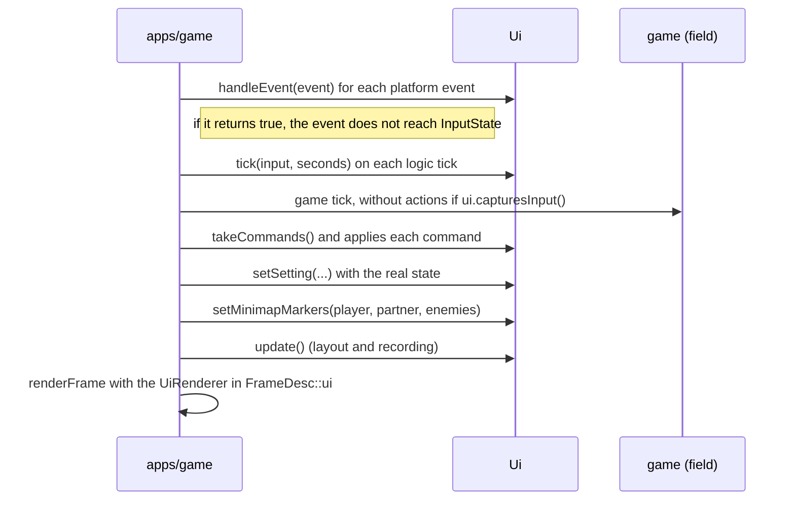

# UI

The game's UI (menus and HUD) lives in `packages/engine/ui`, in the services layer, on top of RmlUi
([ADR 0009](../adr/0009-rmlui.md)). The debug tools stay on Dear ImGui (`packages/engine/debug`).

## Parts

| Part | What it does |
|---|---|
| `Ui` | The facade the app uses: loads documents, shows them, receives events and actions, returns commands and draws |
| RmlUi interfaces (`src/rml_interfaces.*`) | Clock and log (`SystemInterface`), files by asset id (`FileInterface`), paths relative to the document and generated images (`generated:<name>`) |
| `UiRenderer` | A `render::Drawer` of the UI pass: draws what RmlUi recorded in `update()` with its own pipeline (`shaders/rml.slang`, premultiplied alpha) |
| Render bridge (`src/render_bridge.*`) | RmlUi's `RenderInterface`: creates the textures in the `Renderer` and records each draw call for the `UiRenderer`; without a renderer (tests) it only gives texture sizes |
| Scripts (`src/scripting.*`) | The UI's own `ScriptVm`, the Lua API and the RmlUi instancers: each `<body>` is a `ScriptedDocument` with its Lua environment, and each `on*` attribute a handler in Lua |
| `Navigation` | Converts a tick's actions into navigation steps, with repetition when a direction is held |
| `promptControl`, `promptLabel` | The control that triggers an action on the last device used (`key:enter`, `gamepad:south`) and its name for the player, in the game's language (`localization/<language>/prompt.yaml`) |
| Texts | Texts come from the `localization::Catalog` the app provides (`UiDesc::texts`; without it, the UI loads English): `text-key` in RML, `t()` in Lua, and `refreshTexts()` when the language changes ([localization](localization.md)) |
| Menu sounds (`UiCue`, `takeCues`) | Confirm and cancel always sound, and move sounds when the cursor moves, in the modal document on top. A `<body own-sounds="true">` makes no sound: its game plays its own sounds (the egg box, `DOO2_tickEggInput`). `ui.cue` in Lua sounds the same |
| `FontEngine` (`src/font_engine.*`), `BitmapFont` | RmlUi's font engine with the `original-look` family on top: it draws with the original's bitmap font or with the modern one, according to the `text_font` setting (see [Original look](#original-look)); the other families go to RmlUi's engine (FreeType) |
| Skins (`SkinCatalog`, `src/skin_styler.*`) | The skins that packs offer (`ui/skins/<id>/skin.yaml`) and the stylesheets that each one puts on each document; see [Skins](#skins) |
| Images (`image_reference.*`) | What an RCSS or RML image names: an asset without an extension and, if requested, a palette (`?palette=N`) and a tone (`tone=grey`, joined with `&`) |
| `buildMinimap` | Draws the minimap from a grid of cells (`MinimapGrid`) and gives the `MinimapLayout` that places world positions on the image |

`ui` does not know the game: it receives plain values (the minimap grid, the markers' positions, the
settings) and returns named commands. The app acts as glue.

## Frame cycle



## Startup

```cpp
auto uiRenderer = ui::UiRenderer::create(renderer);           // after the Renderer
auto ui = ui::Ui::create({.files = &vfs, .renderer = uiRenderer->get(), .texts = &catalog, .width = w,
                          .height = h, .scale = 1.0F, .hotReload = true, .clock = {}, .scripts = {}});
ui->loadDocument("hud", hudId);                                // ui/hud/document
ui->loadDocument("pause_menu", menuId);                        // ui/pause_menu/document
ui->loadDocument("main_menu", mainMenuId);                     // ui/main_menu/document
ui->setMenuDocument("pause_menu");
ui->show("hud");
ui->show("main_menu", true);                                   // at startup
ui->setMinimap(ui::minimapGridOf(map), nameKey);               // on each map change: main.map_names.0003
ui->refreshTexts();                                            // after catalog.setLanguage(...)
```

They are destroyed in reverse: `Ui` (releases its textures in the renderer), `UiRenderer`, `Renderer`.

### Screens and the default interface

The game requests **screens** (`hud`, `pause_menu`, `partner_menu`...) and the active interface decides which document
shows them. The default interface is described in `content/packs/game/ui/addon.yaml` (schema
`content/schemas/ui_addon.schema.json`): it names each screen's document, and the game loads it under the
screen's name (`ui::readUiAddon` + `loadDocument`). A test checks that every `ui/<folder>/document.rml` in the pack is
there, except `ui/dev_assets`, which loads `DevAssetsBanner`.

`Ui::requestScreen`, `closeScreen` and `isScreenOpen` request a screen by its name. `Ui::mapScreen(screen,
document)` makes that screen show another loaded document (that of an interface addon); the ones that are not mapped
continue with the document of their name, and `clearScreenMap` goes back to the default interface. `show`, `hide`,
`isVisible`, the calls that read or change elements of a document, the menu key and the scripts' `ui.show`
read the name the same way: first as a screen, then as a document. That way the ~180 game calls that already use
the screen's name do not change.

### Interface addons

An interface addon is a folder `ui/addons/<id>/` with its `addon.yaml` (`docs/modding/ui-addons.md`). They come from
two places: from any mounted pack and from the user's data folder,
`<user data>/indie-modding-games/dwe/ui/addons/`, which `content::UserUiAddonsFileSystem` mounts as a
synthetic pack of the `user` layer (`user_ui_addons`) that only serves that folder. A `.zip` in that folder is read in place
(`content::ZipArchive`, deflate with lodepng and the launcher's limits): its files come out as
`ui/addons/<id>/...`, with the `id` from its `addon.yaml`, and an unsafe one or one with the `id` of a folder is left out
(`GameContent::leftOutUiAddonArchives`). `ui::findUiAddons` looks for them in the VFS and discards those that cannot be read or whose
`id` is not their folder's name.

`Ui::useUiAddon` checks that it is of type `ui`, that its `ui_api` range contains the current version and that it only covers
screens the game has; it loads its documents as `<id>.<screen>` and maps the screens. If anything fails it
changes nothing and returns why. The screens visible at the time of the change are shown again in the new document.
`useDefaultUi` unloads the addon's documents.

A **plugin** (`type: plugin`) does not cover screens: `Ui::addUiPlugin` loads its documents as
`<id>.<dotted path>` and shows them, non-modal and without taking focus, over whichever interface is set, also when
it is changed. `removeUiPlugins` removes them all. The game turns them all on or off together (`ui_plugins`).

The addon's code runs isolated: `CodeTrust::allowAddon` lets the documents, templates and scripts of its
folder run, and its Lua environment has a `ui.send` that only lets through the commands and options its contract declares
(`Ui::setAddonCommandFilter`, `app::addonMaySend`); any other raises a Lua error. Its copies of the API
namespaces (`battle`, `bag`...) call the API functions as the addon (`Scripting::callApiAsAddon`): what
these send with the global `ui.send` goes through the same filter. An addon template inside an engine document
is rejected.

In the game, `UiAddonChanger` (`apps/game/src/ui_addon_setting.hpp`) publishes `ui_addon`, `ui_addons`,
`ui_addon.name.<id>`, `ui_addon.safe`, `ui_addon.problem`, `ui_plugins` and `ui_plugins.count`; the "Interface" and
"Plugins" rows of Options → Interface send `ui_addon` and `ui_plugins`, which are stored in the user's settings and
applied when the menu closes. The console and the routes use `ui_addon("id")`. If the addon cannot be set,
the game's interface returns and `ui/ui_notice` shows a notice for a few seconds. **Safe mode:** `--safe-ui` or Shift held at
startup leave the game's interface and do not mount the user's addons folder.

## Drawing

RmlUi draws in two steps. `Ui::update()` does the layout and calls RmlUi's `Render()` outside the frame: the
`RenderInterface` creates the missing textures (`Renderer::queueTexture`, with premultiplied alpha; file
images are premultiplied when loaded) and records each `RenderGeometry` with its translation, texture, scissor
and transformation. The geometry is uploaded only once, when RmlUi compiles it (`CompileGeometry`), to two GPU buffers
(`rhi::Buffer::createMapped`), which are released with the device's deferred destruction when RmlUi releases it, so
frames in flight can keep drawing it. If there is no memory for an element's geometry, that element
is not drawn (with a warning in the log) and the rest of the UI is. Then, in `renderFrame`, `UiRenderer::draw` only
binds those buffers and draws each call. The scissor is fitted to the target. RmlUi's clip
masks (`EnableClipMask`) are not implemented: they are only needed to clip transformed elements.

## Input

- **Mouse:** movement, buttons and wheel go to RmlUi in physical pixels. A click or a wheel turn stays in the UI if
  there is a modal document or if the pointer is over an element that accepts the pointer. The HUD declares
  `pointer-events: none`, so it never steals clicks from the game. With a menu open, focus follows the pointer when
  it enters another entry; a still pointer (or one trembling over the same entry) does not take focus away from
  the keyboard or gamepad, nor does the position the window reports after a resize or when regaining focus, which
  the player did not move. Right click goes back, like `cancel`.
- **Window focus loss** (`FocusLost`): mouse buttons pressed over the UI are released without
  clicking, because the window will not see when they are really released.
- **Keyboard and gamepad:** keys are not read, but `InputState`'s actions: `move_up/down/left/right` (keys, D-pad
  and stick), `confirm`, `cancel` and `menu`. Each step goes first to the modal document's `on_action`; if it does not handle it,
  directions move focus with RmlUi's `nav` properties, `confirm` clicks the focused element and
  `cancel`/`menu` close the document.
- **Without a menu**, only `menu` does anything: it opens the menu document (`setMenuDocument`). During the tick in which the UI
  uses an action, `capturesInput()` is true, so the same press does not also reach the game.
- **Button prompts:** `ui.prompt(action)` gives the control's name according to the last device and the gamepad
  family (`Enter`/`Ctrl`, `A`/`B`, `Cross`/`Circle`, `B`/`A` on Nintendo). The engine only names the control
  (`key:enter`, `mouse:left`, `gamepad:south`, `gamepad:left_stick`); the text comes from the game's language `prompt` table
  (`localization/<language>/prompt.yaml`): `prompt.key.enter`, `prompt.gamepad.south`, and
  `prompt.family.<family>.<button>` for the buttons each family names its own way. Letters, digits and
  F1–F12 without an entry are shown as they are. When the device changes, visible documents receive `on_device`;
  when the language changes, `on_language`. The key that is shown is the action's first one: confirm is Space
  (also Enter).
- **Button glyphs:** prompts are not text but the drawing of the last device's control, and they change live
  when another is touched (`on_device`). `element:set_prompt(action)` (`promptGlyph`, `promptClasses` and `promptMarkup` of
  `prompts.hpp`) puts on the element the control's classes and its parts: `glyph-key` (key, with its name on a
  key drawn by the skin), `glyph-mouse`, `glyph-button` (Start, triggers, D-pad) and `glyph-face` for the
  four face buttons, with the family's style: `family-letters` (their letters, from `prompt.family.*`: some
  families have the A at the bottom and others on the right), `family-shapes` (cross, circle, square and triangle, the original's
  gamepad, with `shape-cross`…) or `family-positions` for a gamepad the game does not know (four dots with the one in the
  position filled). The parts are `.glyph-label` (the name), `.glyph-char` (the character from the original's font
  for a shape, which the classic skin draws), `.glyph-art` (the shape or position drawn by the engine in white,
  that of the modern skin, whose font has no ○ □ △) and, with `set_prompt(action, true)`, the three
  `.glyph-frame` drawings of the classic skin's animated button. All the art is ours: `glyph_art.hpp` draws in code the
  routes `/glyph/classic/button|cap/<symbol>/<drawing>` (a round 16 x 12 button or a 12-high key in the
  original's style, with its top part sinking one pixel per drawing, and our own 3 x 5 letter) and
  `/glyph/modern/<symbol>` (64 x 64, smoothed: the four shapes, the four positions and the arrows `@left`,
  `@right`, `@up` and `@down`), never manufacturers' logos. A classic cap shows what the player's hardware prints:
  a keyboard's short names come from the texts (`prompt.cap.*`: `STRG` and `ENTF` in German, `SUPR` in Spanish, or a
  drawn mark such as `@shift`), and a pad's Start, Back and Home show its own marks (`@menu`, `@view`, `@home`,
  `OPTIONS`, `L3`…), the same in every language; a mouse button is drawn (`@mouse_left`). Test `every language draws
  every cap whole` checks that no language leaves a cap with a letter the 3 x 5 font lacks.
- **Markers in texts:** `element:set_prompt_text(text)` replaces each `{prompt:<action>}` in the text with that action's
  glyph (`promptText`); with `set_prompt_text(text, true)`, for an original text, also its button characters
  and its "X button": the cross (which extraction writes as "△", font cell 77) is `confirm`, the triangle
  ("×", cell 78) `menu` (the game menu and the original's cancel), the circle `alt` and the square `extra`, the
  buttons the game assigns them to. The story box's rows, the curling help and the
  texts with `{key}` in our menus (`pause_menu.settings_hint`, the title screen's "Press …") use it. A translation writes
  the marker where English names a button with words (`scripts/translation.sh` does not count it as a tag).
- **Virtual gamepad:** `Platform::attachVirtualGamepad` connects a software gamepad that goes through the same path as a
  real one. The `platform` tests and the demo (`--virtual-gamepad`) use it.

## Scale

The context measures the window in pixels. RCSS measures are in `dp`; a dp is one pixel at 720 lines, and the
ratio is `min(height/720, width/960)` (between 0.5 and 8) times the scale the player chooses (`setScale`), which is
limited to `[Ui::MinScale, Ui::MaxScale]` = [0.5, 3]; a value that is not a number is ignored. On a high-density
screen the window has more pixels and the ratio grows with them: the HUD and menus take up the same space.

The boxes that go in the original's place (the `story_textbox` dialog box, at dp 486 to 663 of 720, and the
notices that use its box: `field_item_notice` and `award_notice`) do not leave the window at a large scale:
`ui/common/screen_fit.lua` measures the box and the window on each tick and, if the box does not fit with a 6 dp margin, draws it
just as much smaller as needed and tucks it in from the edge it crosses (`transform`, without touching its layout). A box that fits is
drawn as is, so at the default scale nothing changes. Before, at 115% in a 16:10 window (or 130% in a
16:9 one) the dialog box went past the bottom edge and cut off its last row. The pointer uses `Ui::elementDrawnRect`
(the drawn rectangle, with transformations) to choose an option in the box. Test: `screen_fit_tests.cpp`
(16:10 at 115%, 16:9 at 130% and at 150%, 4:3 and an 800 × 600 window at 200%, in both skins).

The partner menu (the status page, the technique and the bag) uses the same: in the original skin the whole 960 × 720 dp
stage (the panel, its notices and the bag's boxes beside it) is drawn smaller around the
panel with `screen_fit.apply_around`, which puts the transformation on `#scrim`; in the modern one only the panel, because its
boxes are centered dialogs. The pointer follows what is drawn (RmlUi projects the click with the transformation). The options
page does not shrink: with less than 700 dp of height (original skin) or 660 dp (modern) the options list
scrolls in fewer rows (`@media (max-height: …)` rules of each skin), so the description and the actions
below stay in the window. Tests: `screen_fit_tests.cpp` (status page) and `in_game_options_tests.cpp`
(options over the title and in game at 1680 × 1050 at 115% and at 1920 × 1080 and 1280 × 720 at 130%). The
text check (`overflowingTexts`) does not count the boxes of rows that the list has scrolled out of its
box: they are not drawn.

## Minimap

`MinimapGrid` is the map's grid with three cell classes: blocked (transparent), walkable and exit.
`minimapGridOf(mapDocument)` builds it from the `MapDocument`: cells with the `0x80` bit are blocked and those with value 110–119 are the
exits of warps 0–9 that lead to some map (`tamer.c`). A grid cell covers 100 units; the cell
`(column, row)` starts at `x = (column − 50) · 100`, `z = (row − 50) · 100` of the world (`map_collision.c:
getTileTrigger`, with `world-space.md`).

`buildMinimap` crops the image to the rectangle of the walkable cells plus a margin, fills the cells (translucent light
blue), draws a light border where they touch a wall and paints the exits in orange. The image is registered
as `generated:minimap/<n>`.

The HUD shows it as a **round minimap** (an improvement, on by default with both skins): a disc of the
map around the player, with north (−Z) up, the map name above and the day and time below. It is drawn by the
`minimap-disc` decorator (`packages/engine/ui/src/minimap_disc.*`), which fills the box of `#minimap-frame` with a fan of
triangles whose texture coordinates are the disc's window over the image (`minimapDiscView`: centered on the
player, radius `minimapViewRadius`, half the map's longer side between 800 and 1800 units) and draws the ring outside that
box: `plain` is a ring with an outward glow and an inward shadow (the modern skin), `original`
is four one-pixel stripes from the original with the colors of its windows' border (black, light cyan, dark cyan and
black, `ui.c: renderUIBoxBorder`). Outside the image the sampler takes the color of its edge, which is blocked cells
and therefore transparent.

**Why north up and not rotating:** the original's cameras are fixed per map and change angle within
a single map; a minimap that rotated with the camera would jump at every cut, and one that rotated with the player would not
match the fixed screen. With north up each map always has the same shape.

The player's marker is always at the disc's center and turns according to where it faces; the partner's goes where it
is relative to the player (`locateOnDisc`) and, if it is out of view, at the edge (at 90% of the radius) in its
direction, with the `pinned` class. `setMinimapMarkers` is called every frame, but the UI keeps the markers'
elements and what they show: it only looks them up again when documents are loaded, and only changes their properties
when the marker has moved; the decorator rebuilds the fan only when the window changes. The calculation
(`minimapViewRadius`, `minimapDiscView`, `locateOnDisc`, `minimapHeading`) is in `dwe/ui/minimap.hpp`, with nothing from the
HUD, so that another view of the map (a large map) can use it the same way.

### HUD contract

The UI fills these ids in any document that has them (constants in `dwe::ui::hud`, in `ui.hpp`). A mod's HUD
can place them and style them however it likes, but with these ids and these roles:

| Id | Constant | What the UI does |
|---|---|---|
| `minimap-frame` | `hud::MinimapFrame` | The disc: a skin puts `decorator: minimap-disc(...)` on it and the UI gives it the map's window; the markers go inside, in percent of its box |
| `minimap-name` | `hud::MinimapName` | Its text is the map's name, the text of the key `setMinimap` gives, in the game's language |
| `minimap-player`, `minimap-partner` | `hud::MinimapPlayer`, `hud::MinimapPartner` | The markers: `left`, `top` (in percent of the disc; the player always at 50%), `transform: rotate(...)`, the `pinned` class on the partner when out of view, and `display: none` without a marker |
| `minimap-enemies` | `hud::MinimapEnemies` | The enemies' layer, inside the disc and before the partner's and player's markers (which stay on top): the UI creates for it one `` child per enemy (`hud::MinimapEnemyPrefix`, image `generated:minimap_enemy`: a white disc with a dark border that the skin tints with `image-color`), with `left`, `top` like the partner, and `display: none` on the spare ones or those out of view |
| `minimap-items` | `hud::MinimapItems` | The layer of items on the ground, inside the disc and before the enemies' (which stays on top): like the enemies' one, one `` child per item (`hud::MinimapItemPrefix`, image `generated:minimap_item`: a white diamond with a dark border that the skin tints with `image-color`), with `left`, `top` and `display: none` on the spare ones or those out of view |

The HUD script (`ui/hud/view.lua`) also writes the day and time in `#minimap-day` and `#minimap-time`, and the
north mark is the text `hud.minimap.north` of `#minimap-north`.

**The minimap is an optional difference: the original has no minimap.** The `minimap` setting is `on` (at
start) or `off`; it is changed by the "Show minimap" row of the in-game options (`ui/common/game_options.lua`), the
"Minimap" page of the pause menu and the title's options, and it applies immediately. With `off` the HUD puts the `hidden` class
on `#minimap`; it also puts it in a battle (`battle.active`) and while the game does not let it be seen
(`hud.minimap_allowed` false: scenes, chats, menus, fades and minigames; [game.md](../modules/apps/game.md#round-minimap)).
It replaces the old `auto` ("according to the skin") and the boolean `minimap_visible`: a stored `auto` and any unknown
value are read as `on` (the latter is warned about in the log), and the old command is still accepted, with `true`
as `on` and `false` as `off` (`minimapModeOf`, `apps/game/src/minimap_setting.hpp`). The choice is stored in the
`settings.yaml` of the user's data, like `ui_skin` and `text_font` (key `minimap`, `MinimapChanger`; the
self-tests do not touch it), and the next game starts with it (`startMinimapMode`).

The map's enemies are another option: `setMinimapMarkers` also receives the list of enemies (empty with the setting
`minimap_enemies` at `false`, row "Enemies on minimap"), which the game takes from the map's characters that
can fight ([game.md](../modules/apps/game.md#enemies-on-the-minimap)). Each one goes where it is relative to the
player (`locateOnDisc`, up to 92% of the radius, `MinimapEnemyRim`); one out of view is hidden. The disc
has north up and the dots are round, so they do not rotate. Like the other markers, the UI only changes their
properties when they move.

Objects dropped on the ground are a third list of `setMinimapMarkers`, with its own option (`minimap_items`,
row "Items on minimap", [game.md](../modules/apps/game.md#items-on-the-minimap)): they are placed like the
enemies, in their `minimap-items` layer, with diamonds instead of dots.

A layer only counts inside the disc (`#minimap-frame`): the options page gives its rows the id of their option, and
the "Items on minimap" (`minimap-items`) and "Enemies on minimap" (`minimap-enemies`) rows are named the same as
the layers. Before, the UI took them for layers and hid their text in game. Test: `in_game_options_tests.cpp`.

## Field status

The HUD shows in the field the game time and the partner's status. The data and its drawing are kept separate: a data
model that knows nothing about skins, and each skin is a view of it (the modern one now; the original-look skin
draws the same data with its own document).

- **Model:** `FieldHudView` (`packages/screens`: `field_hud_view.hpp`), only numbers and booleans. It is built by
  `fieldHudViewOf(time, partner, shown)` from `GameSession::clock().time()` (`ruleset::GameTime`) and
  `GameSession::partnerView()` (`packages/session`: `partner_view.cpp: viewOf`), without deciding any rule: the ranges
  come from the ruleset (`care.yaml`: `limits`) and the needs are the conditions the partner already has.
- **Link:** `FieldHud` (`apps/game/src/field_hud.*`) publishes the labels once when created
  (`fieldHudLabelSettings`) and, on every frame, builds the view and compares it with the last one it published. Only if
  it changed does it convert it into settings (`settingsOf`) and publish it with `screens::publish`, which changes only the settings that
  change and then raises `hud.revision` by one. A frame in which nothing changes builds no text and does not touch
  the UI.
- **View:** the document redraws the whole status when `hud.revision` changes (`on_setting`), so it never reads half a
  view; the labels, when a `*.label` setting changes and when the language changes (`on_language`). The modern
  skin's document is `ui/hud/document` with its `logic.lua`; one of another skin (`screens.hud.document` in
  `skin.yaml`) reads the same settings and puts its own ids.

**Data contract.** These settings are the contract between the game and any view of the field status (a
skin of the game or of a mod). The names are constants in `field_hud_view.hpp`; numbers go as `double`
with an integer value.

| Setting | Value | What it is |
|---|---|---|
| `hud.revision` | number | Goes up by one every time any value below changes; the document redraws with it |
| `hud.shown` | boolean | `false` while the field is stopped: a menu (pause, main, partner), a battle, a script scene or chat, a fade or a map change, or no game. The original takes the clock and the bars off the screen when it stops the game time (`clock.c: renderGameClock`, `stopGameTime`) |
| `hud.clock.hour`, `hud.clock.minute` | 0–23, 0–59 | The game time. One game minute lasts 20 frames of the original, one real second at normal speed (`clock.c: tickGameClock`; `clock` section of the ruleset) |
| `hud.clock.day`, `hud.clock.year` | from 1 | The day of the year (1–30 with `days_per_year: 30`) and the year, counted from 1 as the original's menu shows them (`game_menu.c: renderDateDigits`: `DAY + 1`, `YEAR + 1`); the clock stores them from 0 |
| `hud.meter.<i>.{value,min,max}` | numbers | Happiness (0) and discipline (1), with their ruleset range: −100 to 100 and 0 to 100 in `original` (`partner_impl.c: tickConditionBoundaries`) |
| `hud.meter.<i>.{label,two_tone}` | key, boolean | Once: the keys `partner_menu.happiness` and `partner_menu.discipline`, and `true`: both are two-tone bars, which fill from the minimum to the middle of the range and again, in another color, from the middle to the maximum (`partner_impl.c: renderStatusBars`) |
| `hud.need.<i>.active` | boolean | Hunger (0), sleep (1), potty (2), tiredness (3), wound (4) and sickness (5): whether the partner has that need now, that is, the condition `hungry`, `sleepy`, `needs_toilet`, `tired`, `injured` or `sick` (see below for when) |
| `hud.need.<i>.urgency` | 0–6 | How urgent each need it has is, among those it has: 1 the one that soonest does lasting harm if nobody tends to it, then 2 and following; 0 if it does not have it. It is computed by `fieldHudViewOf` (`packages/screens`) from `game::partner::needDeadlinesOf` (see "Several needs at once", below); those without a deadline go behind those with one, and ties follow the original bubble's order. Only the stacked bubble (improvement) uses it |
| `hud.need.<i>.label` | key | Once: `hud.need.hunger`, `hud.need.sleep`, `hud.need.toilet`, `hud.need.tired`, `hud.need.injured`, `hud.need.sick` |
| `hud.pool.<i>.{value,max}` | numbers | HP (0) and MP (1): what it has left and its maximum |
| `hud.pool.<i>.label` | key | Once: the original's labels, `main.stat_labels.0000` (HP) and `.0001` (MP) |
| `hud.partner.area` | 0, 1, 2 | What the partner thinks of the map it is on, with the original's numbers (`MAP_TILE_DATA.partnerAreaResponse`): 0 nothing special, 1 likes it, 2 dislikes it. It goes with `hud.revision`, like the rest of the status. The original computes it when loading the map (`map.c: loadMapSetup`): it walks at the same time, tile by tile, the map's two lists of regions (`regions.a` and `regions.b` of `map/<id>/data.yaml`) and the first tile of either list that has the species' favored region (`favored_region` of `data/raise`) decides: list `a` gives 1 and list `b` gives 2. The session computes it the same way on entering each map (`packages/game/partner`: `areaResponseOf`; `GameSession::areaResponse`), and the care rules also use it (`CareContext::area`, `SleepContext::area`) |
| `hud.partner.revision` | number | Goes up by one every time any of the three below changes. It is separate from `hud.revision` because it changes while the partner walks, and that way the rest of the status is not redrawn with it |
| `hud.partner.x`, `hud.partner.y` | 0–100, tenths | Where the original's bubble sits over the partner, in percent of the window's width and height from the top-left corner, rounded to tenths (less than a pixel in a 1000 window). The bubble is born at the species' height minus 20 units over the partner's position (`bubble.c: addConditionBubble`; the height is `height` of `data/digimon`) and in its first 10 frames rises 65 more, where it stays (`bubble.c: tickConditionBubble`); that is the published point (`BubbleDrop` and `BubbleRise` in `apps/game/src/game.cpp: partnerBubbleOf`). Its 12-unit up-and-down sway around it is a skin animation and is not published |
| `hud.partner.visible` | boolean | `false` with the field stopped (like `hud.shown`; the original does not draw bubbles in a menu), except while the evolution balloon comes out, in a care scene (`handleConditionBubble` only runs in the partner's normal state) or with the point outside the window or behind the camera; then `x` and `y` are 0 |
| `hud.partner.evolving` | 0–51 | The evolution balloon's frame (`bubble.c: CONDITION_ICON_EVOLVING`, which `main/evl.c: tickEvoSequenceLoading` creates when the scene's `ready` clip starts), from 1 to 51 (the burst); 0 without a balloon (`apps/game: evolving_bubble.hpp`) |

**When a need counts.** In the original a need either is or is not: there are no degrees of urgency. It is there from
when its condition is set until it is tended to or its deadline runs out, and while it is there the original shows it with a
bubble over the partner (`bubble.c`; by priority, sleep, tiredness, hunger, potty, wound and sickness:
`partner_impl.c: handleConditionBubble`), not in a HUD.

| Need | Starts | Ends on its own (lack of care) |
|---|---|---|
| Hunger | When the next-meal counter reaches 0 (`partner_impl.c: tickHungerMechanics`) | After 90 game minutes without eating |
| Sleep | On entering its sleep window (`partner_impl.c: tickSleepMechanics`) | At wake-up time |
| Potty | When the potty counter reaches 0 (`partner_impl.c: tickPoopingMechanic`) | After `(discipline + 20) × 0.6` game minutes, doing it where it stands |
| Tiredness | When tiredness reaches 80 (the ruleset's `tired_threshold`; `partner_impl.c: tickTirednessMechanics`) | It does not end on its own: tiredness goes down by resting or sleeping, and the condition goes away on dropping below 80 |
| Wound | By chance at the end of a battle (`Partner::applyBattle`) | It does not end on its own: it is cured with medicine, and after 12 game hours it becomes sickness (`partner_impl.c: tickSicknessMechanics`) |
| Sickness | From lack of sleep, from a map it dislikes, from an uncured wound or from food (`partner_impl.c: tickSicknessMechanics`) | It does not end on its own: it is cured with medicine or at the hospital; after 12 game hours it loses a life |

These deadlines are partner rules (`packages/game/partner`, ruleset `original`); the contract only publishes whether the need
is there.

**What the original draws in the field**, as a reference for the views (`clock.c: renderGameClock`,
`partner_impl.c: renderStatusBars`), on the 320×240 screen:

- Top left, a dial clock: a minute hand that makes one turn per hour and a dot that makes one
  turn per day along a 24-hour ring (hour 0 at the top), with a sun or a moon above it (moon with the time before
  6 or from 17). No digits and no day.
- Bottom right, only the happiness and discipline bars, each with its icon (happiness: happy face at
  0 or more, sad below; discipline: one icon at 50 or more and another below). Each bar is 25 squares of
  2 pixels: 4 points per square for happiness and 2 for discipline, in two tones as above.
- Clock and bars slide in and out (50 pixels per frame) when the game time runs or stops: the clock
  to the left (`clock.c: renderGameClock`, `CLOCK_OFFSET_X` between -135 and -220) and the bars to the right
  (`partner_impl.c: renderStatusBars`, `STATUS_UI_OFFSET_X` between 75 and 240). The sun and moon go through their four
  frames, one every 4 frames (`(CURRENT_FRAME % 16) / 4`). HP, MP, the day and the needs are not seen in the field:
  HP and MP are in the partner menu and the day in the tamer menu.

**The happiness icon's blinking.** In a zone the partner likes or dislikes, the original alternates
the happiness icon with another face: while `PLAYTIME_FRAMES % 10 < 5`, 5 out of every 10 frames, it draws the face that
is 11 pixels to the left in SYSTEM_W if it likes it and 11 to the right if not (`partner_impl.c: renderStatusBars`);
the other 5 frames, the usual one. The script puts the class `area-liked` or `area-disliked` on `#field-status` according to
`hud.partner.area`, and the original-look skin alternates the face with a 0.5 s animation: the other face the first half
and the usual one the second.

**Known visible difference: the blink's phase.** The animation starts when the class is set (on entering the
zone or when the face changes), not on the beat of the original's game frame counter (`PLAYTIME_FRAMES`): the rhythm
is the same, but the phase may be shifted by up to 0.25 s. The contract does not publish that counter because publishing it
would force redrawing the field status 20 times per second (see the original-look skin's table of choices).

**The shared view.** All the game's skins draw the field status with the same document
(`ui/hud/document.rml`) and the same `logic.lua`, and only their RCSS sheets change. What the script leaves for each
skin to draw its own way:

| Element or class | What the script does | What for |
|---|---|---|
| class `shown` on `#field-status` | Sets it with `hud.shown` and removes it without it | Each skin decides how the panel goes away: the modern one removes it (`display: none`); the original may slide it, like `clock.c` (50 pixels per frame) |
| HUD layout `bars: pips` (`skin.yaml`, `layout: hud:`) | With it the fill goes in 25 steps of 4%, rounding down, with the same two-tone rule; the bars' `pips` class (`#field-meter-<i>-bar`, `#field-pool-<i>-bar`) is only its style | The 25 squares of `partner_impl.c: renderStatusBars` (4 points per square for happiness, 2 for discipline) |
| class `area-liked` or `area-disliked` on `#field-status` | Sets `area-liked` with `hud.partner.area` at 1, `area-disliked` with 2, and neither with 0 | The happiness face that alternates with another in a zone the partner likes or dislikes (see above); the modern one does not use it |
| class `low` on `#field-meter-<i>` | Sets it if the value is below the middle of its range (`(min + max) / 2`) and removes it if not | The bar's icon: the happiness face turns sad below 0 and the discipline one changes below 50 (`partner_impl.c: renderStatusBars`); the modern one does not use it |
| `#field-partner-bubble` | `left` and `top` from `hud.partner.x` and `hud.partner.y` (redraws with `hud.partner.revision`); the `shown` class only with `hud.partner.visible` and some need; and a single need class, `hunger`, `sleep`, `toilet`, `tired`, `injured` or `sick`; a need class on each `#field-partner-bubble-icon-<i>` that shows it (0 to 4, the most urgent first by `hud.need.<i>.urgency`; with only one, the 0); with several needs and `need_bubble_stack`, `stack-2` to `stack-5` instead of the bubble's need class, and a `margin-left` that tucks it into the window if it would stick out on a side; and `frame-<n>` (1 to 60), the original's frame the bubble is at; with `hud.partner.evolving`, the `evolving` class on the bubble and on `#field-partner-bubble-icon-0`, no need nor `stack-<n>`, and `frame-<n>` with the frame the game gives | The original's bubble over the partner (`bubble.c`). It hangs from the center of its bottom edge (`ui/hud/structure.rcss`), so the skin only gives it size and drawing; the modern one does not show it because it already has the needs panel |
| `#field-clock-minute-hand` | `transform: rotate(minute × 6deg)` | The minute hand of `clock.c: renderGameClock`, one turn per hour |
| `#field-clock-hour-dot` | `left` and `top` in percent on a circle, 15° per hour, hour 0 at the top | The hour dot on the 24-hour ring |
| class `night` on `#field-clock` | Sets it with the time before 6 or from 17 | The moon instead of the sun |

**Which bubble.** The original chooses the need by priority, from highest to lowest sleep, tiredness, hunger and potty
(`partner_impl.c: handleConditionBubble` looks at them from lowest to highest and the last one wins), and when a bubble has run 50
of its frames (at 20 per second, 2.5 s) it switches to the highest of the other needs it has, if there is any: with two
needs they take turns, and a third waits for one of them to go away. The script does the same with its `on_tick`
(`bubble_priority`, `bubble_swap_frames`), and time only counts while the bubble is visible (the original neither draws
nor counts it in a menu).

**The bubble's frames (Same).** The original counts each bubble's frames (`bubble.c: tickConditionBubble`)
and draws it in frames 1 to 51: it grows from nothing to its size in the first 10 (scale (k − 1) / 10), at 51 it bursts
(`CONDITION_SPRITES[10]` at 2.5 times, with its center 23 pixels from the balloon above the anchor) and disappears; with a single
need it creates it again at 60 frames (`partner_impl.c: handleConditionBubble`, `CONDITION_BUBBLE_TIMER`; measured:
180 vblanks), and with another need it switches it at 50 without a burst (measured: 150). Inside, each need animates by the
same counter (`renderConditionBubble`): the food goes through its four drawings every 19 frames
(`CONDITION_HUNGRY_FRAMES`, 3 pixels higher the frame before each change), the potty through three every 13, the wound
through three every 20, sickness alternates two every 20, tiredness's drop falls in 13 frames (`CONDITION_TIRED_FRAME_U`
and `CONDITION_TIRED_FRAME_MY`: from 1 pixel above the balloon's top edge to 8 below, changing drawing) and sleep shows its
three "Z"s one by one (`CONDITION_ICON_SLEEPY`: frames 11 to 14 the low one, 15 to 18 two, 19 to 26 all three, 27 the two high ones,
28 the highest, 29 none, and it starts again at 30). The low "Z" is hourglass-shaped in the original's own
drawing (measured in DuckStation: frames 12, 17, 23 and 28). The script counts the frames and publishes
`frame-<n>`; the original-look skin draws each frame with class rules (growth with `transform`, each
need's drawing and place with `decorator` per frame, the burst and the gap from 52 to 60 with `visibility`), with no RCSS
animations, so there is no offset between the script and the drawing. The 12-unit sway is not imitated. The modern one
does not show the bubble. Test: `ui_tests` "the need bubble plays the original's frames: growth, the need's animation,
burst, gap".

**Wound and sickness.** They go below potty in priority (`partner_impl.c: handleConditionBubble`: bits
`0x20` and `0x40` of the condition, bubbles 6 and 2: the bandage of `CONDITION_SPRITES[8]` and the syringe of
`CONDITION_SPRITES[7]`, with their frames like the others). On becoming sick, the original also
stops the time and opens the awards box with the partner's name and `main.partner_impl_is_sick.0000`
(`partner_impl.c: tickSicknessMechanics`; see `award_notice` in the game).

**Improvement (option): several needs at once.** The `need_bubble_stack` setting (row "Several needs" of the
options; on by default, stored in the user's settings; it changes no rule)
gathers up to five needs in a single balloon, side by side, in a row, with the most urgent on the left; with
a single need the bubble is the original's, and off the original comes back whole (one at a time, by its
fixed priority, the two highest taking turns). With all six at once the sixth, the least urgent, waits.

*Order by urgency.* Urgency is how long until the need does lasting harm if nobody tends to it,
measured with the same counters the care rules already run (`packages/game/partner`:
`need_deadlines.hpp`, `needDeadlinesOf`; `partner_tick.cpp`), in clock frames from now:

| Need | Harm | Deadline (`original` rules) |
|---|---|---|
| Potty | It does it on the floor: care mistake, virus gauge, tamer level (`tickPoop`) | `urgeFrames`, one per frame: (discipline + 20) × 1200 / 100, from 240 to 1440 frames (12 to 72 game minutes); 0 if the pile is already waiting for its scene |
| Hunger | The window closes without eating: care mistake (`tickHunger`) | `windowSteps` steps of 10 frames: 90 minutes from when it gets hungry |
| Sleep | Wake-up time arrives without having put it to bed: care mistake (`tickSleep`: `missSleep`) | Until wake-up time (`wakeHour`), hours |
| Wound | After 12 hours wounded it gets sick (`tickSickness`: `injuredHours`) | (`injury_hours` − hours wounded) hours; no deadline if it is already sick, because it cannot get sick again |
| Sickness | After 12 hours uncured it loses a life (`tickSickness`: `sickHours`) | (`untreated_hours` − hours sick) hours |
| Tiredness | No deadline: it only subtracts happiness from time to time and makes it hungry sooner (`tickTiredness`, `tired_hunger_*`); sleeping or resting removes it | None: it goes behind those with a deadline |

`fieldHudViewOf` sorts them by that deadline and publishes each one's rank in `hud.need.<i>.urgency`; ties (and
those without a deadline among themselves) follow the original bubble's order (sleep, tiredness, hunger, potty, wound,
sickness). Since all deadlines go down at the same rate, the order only changes when a need enters or leaves or the
game restarts a counter, so it is not published again on every frame. What a counter holds back for a while does not count
(the tamer busy, the protected hour on waking). In practice potty almost always comes first, then
hunger, sleep, and wound and sickness, which give half a day. Time until harm was chosen over a fixed
priority because it is what decides what to tend to first; the original's fixed order stays in the bubble without the option.

*Drawing.* The original-look skin widens the balloon from 32 pixels to 50 (two), 68 (three), 86 (four) or 104 (five) with its
own pieces, without stretching anything: each half is its round edge, a column of its body repeated
(`tiled-horizontal`) and its half of the center with the tip, which ends up in the middle (`need-bubble-left` … `need-bubble-right`
in `skin.yaml`). Each icon goes in its 16-pixel slot with 2 between them and 8 at the edges, like the original's single
one, at the height the original gives it and with its animation on the same frames. One row was chosen and not two
(3 + 2) because it keeps the original balloon's height and tip and reads in order of urgency; at five it takes up a
third of the original's screen, and the script tucks it into the window (`margin-left`, which its transformations do not touch)
when the partner is near an edge; the original's bubble does not move. The modern skin does not draw the
bubble: its needs panel already shows them all. The wide balloon was chosen and not taking turns because the user asked to
see them at once, and the balloon's pieces widen it without breaking its drawing (a pill is left with the original's ends and tip). Tests: `need_deadlines_tests.cpp` (each deadline is the frame at which the rule does the harm), `screens`
"the field HUD ranks the partner's needs by how soon they do harm...", `ui_tests` "the need bubble shows several needs
side by side, most urgent first, unless turned off" (with the option off, also "the need bubble shows the need
the original's bubble would ...") and `hud_fit_tests` "the stacked need bubble keeps five needs in one row inside the
window at every UI scale", "the original's need bubble stays over the partner's head...".

The constants (25 squares, 6° per minute, 15° per hour, 6 and 17) are named at the top of the
script, with their reference to `clock.c` or `partner_impl.c`. When the skin changes (the `ui_skin` setting) the script redraws
the status and the bubble without waiting for another revision, because the new skin may change its layout
(`bars: pips`). The modern skin hides the dial (`#field-clock-dial`) and does not fill in squares.

**How a skin sets a class.** RCSS sheets cannot set classes, so a skin sets `pips`, and any other
class on the shared document's elements, with the `document_classes` field of its `skin.yaml`: by document and
element id, the classes the game puts on it when loading the document and changes when the skin changes. The mechanism
arrives with the original-look skin. The script does not read those classes: what changes its calculation it asks with `ui.layout`.

**The modern skin** (bottom left, `ui/skins/modern/hud/style.rcss`) draws the whole contract. What
changes compared to the original is presentation only and is optional, because it belongs to the skin: with the original-look skin you
see what the original shows. The differences, all of the modern skin:

| Difference | Why |
|---|---|
| The time in digits (`HH:MM`, 24 hours) instead of the dial, with the `digital_time` option (on by default; the original-look skin puts it in a box under the dial, see [game](../modules/apps/game.md#time-in-digits)) | It reads at a glance at any scale |
| The day and year in the field | The original only shows them in the tamer menu |
| The bars fill continuously, with their number, instead of squares | More legible on large screens |
| The needs in a panel, always in view, highlighted when present | The original only has the bubble over the partner, which gets lost if you do not see it |
| HP and MP with their bar (what is left over the maximum) | The original only shows them in the partner menu |
| On a map change the panel fades out with `screen_fade`, like the rest of the HUD, instead of sliding | The same as the other HUD panels (decision of 2026-10-20 in the original-look skin's table) |

## Commands and settings

Menus send commands with `ui.send(name, value)` and the app applies them. The first menu uses:

| Command | Value | Setting the app publishes afterwards |
|---|---|---|
| `quit` | — | — |
| `play` | — | — (on the title screen: starts a new game; see [save-and-load.md](save-and-load.md)) |
| `minimap` | `auto`, `on`, `off` | `minimap` |
| `minimap_size` | `small`, `medium`, `large` | `minimap_size` |
| `fullscreen` | boolean | `fullscreen` |
| `ui_scale` | number (0.75–2) | `ui_scale` |
| `vsync` | boolean | `vsync` |
| `language` | language code (`en`, `es`) | `language` (and the UI puts all its texts back) |
| `text_font` | `modern`, `original` | `text_font` (and the UI recomposes the documents with the font) |
| `ui_skin` | id of a skin (`modern`, ...) | `ui_skin` (and the UI changes the style of all documents on the spot) |
| `sleep` | — | — (in game: the pause menu puts the partner to bed if it is sleepy; see [save-and-load.md](save-and-load.md#36-sleep)) |
| `sleep_only`, `sleep_and_save` | — | `save.last_result` with `sleep_and_save` (the sleep menu: keep sleeping, or save to the game's slot first) |
| `to_title` | — | — (in game: asks and returns to the title screen without saving; see [save-and-load.md](save-and-load.md#38-save-return-to-the-title-screen-and-quit-the-game)) |

The battle screen (`ui/battle`) sends `battle_command` (the command's number, `game::battle::Command`),
`battle_charge` (each press that charges the finishing blow), `battle_close` (closes the end box),
`battle_end_count` and `battle_end_counted` (that box's count: each point or bit counted, and the bits already added; the game
plays its sounds),
`battle_bag_open` and `battle_bag_close` (the tamer's bag, which the `menu` action opens; the game then shows
`ui/partner_menu` on its items page with `partner_menu.context = battle`, and its `bag_use` throws the item) and
`battle_throw` (the number of the slot whose item is thrown at the partner, for the console and tests). The pause
menu opens the partner's with `open_partner_menu`, and this one (`ui/partner_menu`) sends `bag_use`, `bag_drop` (the
slot number), `bag_move` (`"<from> <to>"`), `bag_sort` (the order, 0 to 2), `partner_praise` and
`partner_scold`. What they draw is published by the game as settings with the prefix `battle.` (and `battle.phase`: `intro`,
`fight`, `victory` or `end`), `partner.` and `bag.`; the contract is in the [packages/screens page](../modules/apps/screens.md).

In the debug console (and in the autotests' `script` steps), `battle("")` starts a battle against the
first NPC on the map that can fight, or against the NPCs it is given (`battle("0,2")`), and `give_item("meat 3")` puts
items in the bag. `evolve("species_b")` makes the partner evolve to that form as a map script does
(`EvolutionAdapter::evolveByScript`). They are debug aids: the original starts battles from the NPCs' scripts (`script_interp.c`: the `START_BATTLE`
operation), which the story interpreter now runs, and a new game starts with an empty bag. `use_item("medicine")` uses one from the bag
on the partner, and `toilet("")`, `sleep("")`, `save_machine("")` (the save machine), `gym("hp")` (a gym course, only on its map), `scold("")`, `train("trn brain")` and `clock_speed("600")` call the
session's care commands and speed up the clock; the list is in [the vertical slice
guide](../guides/vertical-slice.md). Decision by the design lead (2026-10-21): `toilet`, `sleep`, `train`, `scold` and
`clock_speed` remain as debug aids.

**CONTRACT CHANGE (additive):** the commands `sleep`, `sleep_only` and `sleep_and_save`, the settings
`pause_menu.sleep_enabled` and `save.last_result` and the `sleep_menu` document; the command `to_title` and the pause menu's `#to-title` button. A mod that
replaces `pause_menu` has no "Sleep" until it adds it: a `#sleep` button that sends `sleep` and is grayed out
when `pause_menu.sleep_enabled` is false.

Other settings are published by the game without a menu asking for them:

| Setting | Value | What it is |
|---|---|---|
| `screen_fade` | number from 0 to 1 | How much the map-change fade removes from the screen, which the render subtracts from the scene under the UI; the HUD fades its panels with it |
| `pause_menu.sleep_enabled` | boolean | Whether the partner can sleep now: the pause menu grays out "Sleep" if not |
| `save.last_result` | `saved`, `failed`, `not_saved` | How the last save the player requested in game ended |
| `map_title_key` | text key | The key of the name of the map the map change leads to (`main.map_names.NNNN`) while the original shows it (frames 10 to 20 of the exit fade); empty the rest of the time or if the map has no name. The HUD puts its text in the player's language (`t()`) in the center, in front of the fade, and rewrites it when the language changes |

## Skins

A **skin** is the style of the whole UI: colors, typefaces, sizes, frames and images of each screen. There is
a single global setting, `ui_skin`, which applies to all screens and is changed live; by default, the original-look
skin (`original`), and the modern one (`modern`) is an option under "Interface style". Mods can add
skins: this is their contract, and it is stable.

**CONTRACT CHANGE: the game looks like the original by default.** Decided by the user (2026-10-21). Until
now `ui/ui_skin.yaml` said `default: modern`; now it says `default: original` with `fallback: modern`. What
changes and what does not:

- A player who already chose a skin keeps it: the `ui_skin` stored in `settings.yaml` takes precedence over that of the
  packs. Only someone who has not chosen any (no stored `ui_skin`) starts with the original. This is tested by
  `apps/game/tests/ui_skin_setting_tests.cpp` (both cases) and `packages/engine/ui/tests/skin_switch_tests.cpp`.
- The original needs the images that `dwx extract` extracts since version 2 of the extractor (the
  `ui_original` pack and the base images it enlarges). With content extracted earlier, or without it (the tests without a
  disc), the original is not offered and the game starts with the modern one, the fallback, with a warning in the log.
- `--ui-skin` and the console stay the same. Autotest routes do not read the player's settings, so they run with
  the original unless they ask for another; `route-skins.yaml` now starts on the original and goes to the test one and the modern one.
- A mod that replaces `ui/ui_skin.yaml` still takes precedence over the `game` pack's.

The change arrived with the complete original-look skin (all the screens there were; the text box, `story_textbox`,
came later with the story interpreter and also has its sheet in the original-look skin), as requested.

**What belongs to each document and what belongs to the skin.** A document (`ui/<screen>/document.rml`) only links
structure sheets, what does not depend on the skin: `ui/common/base.rcss` (the default `display` values, the size of the
`body`, `.hidden`, which elements take focus and `.original-look`) and, if the screen needs it, its
`ui/<screen>/structure.rcss` with that screen's own behavior (the lists of the main and pause menus
wrap around with `nav-up` and `nav-down`). Everything else (the font, colors, sizes, the position of
the panels) is set by the skin. The exception is the development assets notice (`ui/dev_assets`): it is a notice
for whoever develops, not part of the game's skin, so all its style is in its `structure.rcss` and it looks
the same with all skins.

**A skin does not change how you navigate.** It is a convention, also for mods' skins: neither their RCSS nor
their replacement RML write `nav-*` properties (`nav-up`, `nav-down`, `nav-left`, `nav-right`). A screen's
navigation is in its `structure.rcss`, which is the same with all skins. A test (`skin_switch_tests.cpp`)
walks through the skins of the `game` pack and of `tests/mods` and fails if any writes `nav-`. The elements' ids, the classes the scripts use, the scripts
and the settings and commands they read and send are the contract with the game and do not change with the skin.

Spatial navigation (`nav: auto`) still reads the skin's boxes: RmlUi only moves right to a box whose left edge is past
the current one's right edge, and the same the other way. Where a skin's boxes may overlap, the screen moves the focus
itself. The battle's command strip does: left and right go to the nearest icon whose middle stands that way on screen
(`ui/battle/logic.lua`), and past the last icon the default navigation goes on. The pixel skin's tiles are wider than
the gap between two icons, and without this the keyboard and the gamepad could not leave the hovered command, so a wild
battle could not be fled (`battle_flee_tests.cpp` gives Run with the keys in every skin).

**`ui/skins/<id>/skin.yaml`** (schema `ui_skin`, registered in `pack.yaml`):

```yaml
id: framed                          # same as the folder's name
name: framed.skin_name              # the key of the name that menus show
extends: modern                     # optional: the skin this one adds to
theme: [ui/skins/framed/theme]      # sheets for all documents
cursor: cursor                      # optional: PNG image the game installs as the cursor
cursor_hotspot: [4, 4]              # optional: the point that clicks (x, y in image pixels)
screens:                            # per screen, with the name the document is loaded under
  main_menu:
    styles: [ui/skins/framed/main_menu/style]
    document: ui/skins/framed/main_menu/document   # optional: another RML for that screen
sprite_sheets:                      # optional: sprite sheets for RCSS
  - name: frames
    image: texture/stddat/time      # asset, without an extension
    palette: 3                      # optional: another palette of the indexed image
    original_size: [66, 29]         # optional: the original's size, for scaled copies
    dp_per_pixel: 3                 # optional: how many dp one pixel of the original takes (1 by default)
    upscale: smooth                 # optional: smoothed by the texture upscaler (see below)
    mirror_sides: [100, 26]         # optional: mirrored columns on the left and right (see below)
    sprites:
      corner: [0, 0, 8, 8]          # x, y, width, height in original pixels
document_classes:                   # optional: classes it puts on elements of the shared documents
  hud:                              # the name the document is loaded under
    field-meter-0-bar: [pips]       # element id: its classes
layout:                             # optional: layout options that scripts read (ui.layout)
  pause_menu: {menu: original, box: original}
```

| Part | What it does |
|---|---|
| `parseSkin`, `parseSkinChoice` (`skin.hpp`) | Read `skin.yaml` and `ui/ui_skin.yaml` (`default` and, optionally, `fallback`; schema `ui_skin_choice`): the skin the game starts with is pack data |
| `SkinCatalog` (`skin_catalog.hpp`) | The skins of all mounted packs, by id. One whose id is not its folder, that names an asset that is missing or that extends one that is not there (or in a loop) is left out with a warning in the log |
| `SkinStyler` (`src/skin_styler.*`) | Each screen's sheet with the current skin: its sprite sheets and those of `theme` and `screens.<screen>.styles` of each skin in the chain, the base skin first, on top of the document's own sheets |
| `spriteSheetRcss` (`sprite_sheet_rcss.hpp`) | Writes the RCSS `@spritesheet` of a sprite sheet. If the image is an integer multiple of `original_size` (a scaled copy from the remaster), it multiplies the rectangles and adjusts `resolution`, so the sprites take up the same dp. From the image file it only reads the header, for its size (`imageSize`) |

- **Ids relative to the skin's folder.** `theme`, `screens.<screen>.styles`, `screens.<screen>.document` and
  `cursor` can be written without the `ui/skins/<id>/` prefix (`theme: [theme]`, `styles: [pause_menu/style]`,
  `cursor: cursor`): `parseSkin` puts it in front when reading them. An id that already starts with `ui/skins/` is left
  as is, so skins written with the absolute path remain valid. The `sprite_sheets` are **not** made relative:
  they name assets of the base layers. To create a skin without starting from scratch, `python scripts/new_skin.py fork <id>
  --from <skin>` copies an existing one (`.rcss` and `cursor.png`), rewrites its paths and leaves an empty sheet per screen
  (`--flatten` dissolves `extends:` into a self-contained skin). Guide for modders:
  [modding/skins](../modding/skins.md).

- **The mouse cursor is set by the skin.** With `cursor: <image>` (a PNG with straight alpha, not premultiplied) and
  `cursor_hotspot: [x, y]` (the point that clicks, in pixels from the top-left corner), the engine installs
  that image as the **system cursor** while the skin is set (`SkinCatalog::cursorOf` walks the `extends:` chain
  and the nearest wins; `apps/game` applies it via `platform::Platform::setColorCursor`). It is not an RmlUi
  sheet: it is Windows/macOS/Linux's own cursor, so it always stays on top, also over modal menus
  and the HUD, without fighting the stacking. If a skin does not declare `cursor`, the system arrow stays;
  changing skin restores it with `clearColorCursor`. To redraw the arrow from the skin's own art,
  use `scripts/make_cursor.py <skin>/cursor.png`.

- **Smoothed images (`upscale: smooth`).** A sheet that says so is drawn, with the "upscaled" texture filter
  (`Ui::setSmoothPictures`, which the game calls when publishing the graphics options), passed through the same
  upscaler as the models' textures (`render::upscaleRgba`): it is doubled up to 2560 pixels wide (three times
  at most; `smoothDoublings`), so an image that covers a 1440-line window has at least as many texels as
  pixels it takes up and does not look blurry; alpha is interpolated like a color and filtered instead of drawn sharp. The
  result stays in the upscaler's cache (`Ui::setUpscaleCache`). The image's reference then carries
  `&upscale=smooth`, so when the filter changes RmlUi loads it again. This is how the two images of the
  original-look skin's title screen are drawn; an extraction earlier than version 14 brings its ×4 copy from `index_scale`, which is doubled
  once and drawn filtered.
- **Mirrored sides (`mirror_sides: [left, right]`).** A sheet that says so draws its image wider: each
  side continues as a mirror of its edge columns (the edge one repeated, so the seam is not seen when filtering or
  smoothing; `withMirroredSides`). The reference carries `&mirror_left=N&mirror_right=M`; the numbers are pixels of
  the game's image (that of the first pack), so a larger copy (from a remaster or the player's) mirrors the same
  piece of drawing, and `original_size` counts them (TITLE2 with `[100, 26]` measures `[446, 240]`). The mirroring is done before the
  upscaler, which smooths the whole image at once. The original-look skin uses it so the title screen fills windows
  wider than 16:9 ([Widescreen images](../modules/apps/game.md#widescreen-pictures)).
- **Live change:** `Ui::setSkin(id)` changes the sheet of each open document without reloading it: scripts,
  their state, focus and what is visible stay the same. Only a document whose RML changes (`document`) is loaded
  again, and is shown where it was. `Ui::skins()` gives the catalog, `Ui::skin()` the current skin. From Lua,
  `ui.skins()` gives the ids and `ui.skin_name_key(id)` the key of its name.
- **Document classes (`document_classes`).** A skin can mark elements of a document that all skins
  share without copying it: by document (the name it is loaded under) and by element id, a list of
  classes. The `SkinStyler` sets them when loading the document and, on a skin change, removes from its elements all
  the classes that any skin in the catalog names and sets those of the new one; with `extends` those of the chain are added.
  Scripts read them (`has_class`) but must not set or remove them themselves: the skin change would remove them.
  An id the document does not have is a warning in the log when giving it the skin, and so is a document the game does not load
  (`Ui::checkSkinDocuments`, which the game calls when loading its documents and which repeats on each change). The
  original-look skin uses it to put `pips` on the four bars of the field status. Additive contract change:
  earlier `skin.yaml` files remain valid (Decided by the manager (2026-10-21): a generic mechanism instead of
  copying the HUD's document or a setting of the original-look skin's own).
- **Layout options (`layout`).** Screens that share a document and script between skins change
  arrangement according to named options, not according to the skin's id or its classes: per document, an option and its
  value (`pause_menu: {menu: original}`). The screen's script reads them with `ui.layout(option)`, which gives the value or
  `nil`; the `SkinStyler` also puts the class `layout-<option>-<value>` on the document's `<body>` for the sheets.
  With `extends`, the nearest skin that sets an option wins (`SkinCatalog::layoutOf`). The options and their
  values are fixed by the `ui_skin` schema (a typo is an error when loading the pack):

  | Option | Screens | Values |
  |---|---|---|
  | `menu` | `pause_menu`, `partner_menu`, `battle`, `main_menu`, `save_slots`, `new_game_rules` | `modern`; `original`, the original's arrangement (the icon grid and the player page of the pause menu, the partner's status and technique pages, the battle strip that slides in, the original's title screen and slots) |
  | `box` | `pause_menu`, `partner_menu`, `egg_box`, `field_item_notice` | `modern`; `original`, the boxes that grow from a gray outline (`common/original_box.lua`) |
  | `pages` | `partner_menu` | `modern`; `original`, the status, technique and bag pages like the original's full screens (the page classes of `#scrim`); `compact`, a single partner page with its status and techniques, no row of tabs, the bag as "Bag" and Cancel going back to the pause menu (the `new-partner` and `compact-partner` classes of `#scrim`) |
  | `pool` | `partner_menu` | `maximum` (without the option, the same), the HP and MP bar of the maximum against the cap, like the original; `current`, the bar of what is left against the maximum |
  | `tabs` | `pause_menu` | `all` (without the option, the same), the original's player tabs plus the town; `minimal`, only Player, Tree and Prosperity (the town), which Q and E (the gamepad's triggers) cycle through from anywhere on the page, with their keys at the sides and a "Back" tab |
  | `medals` | `pause_menu` | `page` (without the option, the same), the medals on their page; `profile`, in a profile box, without their tab |
  | `picture` | `main_menu`, `save_slots`, `new_game_rules` | `modern`; `original`, with "widescreen images" the boxes and the logo go to their places from the original over the widened image (`common/title_picture.lua`) |
  | `bars` | `hud` | `continuous` (by default); `pips`, the field status bars fill in the original's 25 squares |
  | `heading` | `save_machine` | `original` (or unset), the machine's title only over the record and the slots, like the original; `always`, also over the save question |

  The modern skin declares its own, and the original (and the pixel one, which extends it) those of the original. `pages: compact`, `pool`,
  `tabs` and `medals` are only set by the DevVago skin; without them each screen does what it always did (`tabs`, `medals` and
  `pool` only change something with the original arrangement of the pause menu or in the partner menu). The `document_classes`
  classes are left for styling (`skin-original`, `title-original`, `slots-original`, `pips`): no
  script reads them (a test checks it). The HUD fills the bars in squares with the `hud: {bars: pips}` layout.
- **The fallback skin (`fallback`).** `ui/ui_skin.yaml` can name, besides `default`, a `fallback`: the
  skin the game starts with if the `default` one is not offered. The original needs images that `dwx extract` extracts from the
  user's disc; without them it stays out of the catalog and the game starts with the modern one. A
  `default` that is not there, with no `fallback` that is, leaves the UI without a skin, with a warning, as before. Additive contract
  change (Decided by the manager (2026-10-21)).
- **Inheritance:** with `extends`, the base skin's sheets go first and the new one's afterwards, so a
  small skin only writes what changes. If several name `document` for a screen, the nearest wins. With
  sprite sheets the nearest also wins: a sheet with the name of one from the base skin replaces it, and if
  two sheets give a sprite with the same name, the nearest one's is kept, with a warning in the log (RmlUi would
  keep the first one it reads).
- **If it fails:** the change goes in two steps. First, the documents whose RML the new skin changes are loaded, hidden; if any cannot be loaded, all are discarded, the UI goes back to the skin it had and `setSkin` returns
  the error. Up to there no document has changed, so going back cannot fail, and nothing is loaded twice nor
  receives `on_show` twice. The discarded replacement documents have already run the scripts that execute
  on load (the top-level code of their `logic.lua`), so those scripts must not have effects outside
  their document. If all load, each takes its predecessor's place (visible, in the same place of the modal stack and with
  its `on_show`) and the other documents take the skin without reloading. The menu keeps showing the skin that is really
  there.
- **The `ui_skin` setting** follows `text_font`'s path: at startup `--ui-skin <id>` takes precedence, then the one stored in
  `settings.yaml` and then that of the packs (`ui/ui_skin.yaml`); an id that does not exist leaves the packs' with
  a warning. The options page (from the title or from the pause menu) has the "Interface style" row
  (`ui/common/ui_skin_choice.lua`, shared), which walks `ui.skins()` and sends the `ui_skin` command; the app
  applies it, stores it and publishes it. In the debug console, `ui_skin("modern")`.
- **A mod that adds a skin** brings `ui/skins/<id>/skin.yaml`, its sheets and the name in its own texts
  file (`localization/<language>/<mod>.yaml`): a file with the name of one from the game (`ui_skin.yaml`) replaces it
  entirely. The minimal example is `tests/mods/ui_skin/test_contrast`, which extends `modern` and changes colors
  on all screens.
- **A mod's skin brings no scripts:** its `skin.yaml`, RML and RCSS are loaded, but its scripts are not. An
  external `<script src>` only runs if the script file comes from the base or remaster layers, also from
  a mod's document; an inline script only runs in documents of the base or remaster layers. So, a mod's replacement RML
  links its screen's script from the `game` pack by its path
  (`<script src="/ui/<screen>/logic.lua">`) and keeps its ids, and the logic stays the game's. Changing
  skin and the menus' entry are the engine's and the `game` pack's (`ui/common/ui_skin_choice.lua`); no
  skin needs its own scripts.
- **Hot reload:** with `hotReload`, a skin's RCSS sheets are watched like the document's: when
  one is saved, the documents that use it are loaded again with the current skin. The files of
  `ui/skins/<id>/` (`skin.yaml` included) and `ui/ui_skin.yaml` are watched too: when one changes, the catalog is read
  again and every document is loaded again in the current skin; a catalog that no longer offers the current skin
  (a broken edit) is not taken.

### Images

RCSS and RML images (`decorator: image(...)`, ``, `@spritesheet`) are read by asset id, ignoring the
extension: `texture/x.png` finds `texture/x.ktx2` if a remaster replaces it, so skins can
always write `.png`. PNG (`decodePng`) and KTX2 (`decodeKtx2`: it transcodes all levels and the UI
keeps the first) are read. A KTX2 has to carry Basis Universal data (UASTC or ETC1S, as `dwx cook` writes them);
a KTX2 with uncompressed texels is not read.

Before decoding, reserving or decompressing anything, a UI image passes these limits:

- its file is at most `MaxUiImageFileBytes` (64 MiB), checked without reading it (`VirtualFileSystem::size`);
- it is at most `MaxUiImageSide` (4096) pixels per side, according to its header;
- decoded to RGBA it takes at most `MaxUiImageBytes`, adding all its levels (`checkUiImageBudget`): what a
  4096 square takes with its full mip chain (13 levels, about 85.3 MiB), which is what `dwx cook` writes,
  so a cooked 4096x4096 image loads;
- a KTX2 additionally passes `checkPlain2dKtx2` (from `packages/engine/assets`, the same check that any KTX2 load
  does): a single 2D image (no layers, no cube faces, depth 1), no more levels than its
  size gives, Basis Universal data without supercompression or with BasisLZ or Zstd, and no level that once loaded takes up more
  than fits in a level of its size (so a Zstd "bomb" is rejected before inflating).

Pending: there is no total texture budget per skin. Each image has its limits, but a skin with
many large sprite sheets has no joint cap.

An extracted indexed image carries its palette 0; the others are in `<image>_meta.yaml` (`palettes`, 16-bit
colors). `texture/x.png?palette=3` draws it with palette 3, with `dwx`'s transparency rule (`0x0000`
transparent, the rest opaque). Asking an image without metadata for a palette is an error in the log. Asking one
whose file is a KTX2 is too (`PaletteNeedsPng`): it happens when a remaster replaces the indexed PNG with
a KTX2, which no longer has palettes, so a skin that uses `?palette=` of that image is left without it; the
remaster has to provide the variants it needs as images of their own.

`?tone=grey` (or `&tone=grey` after the palette) draws any image, PNG or KTX2, as a light gray silhouette: each pixel
takes a gray from its luminance (Rec. 601) between `GreyToneDarkest` (64) and `GreyToneLightest` (176) and keeps its alpha,
so the shape and shading are recognizable and it never shines as much as in color. It is applied once, when loading the
image (`applyImageTone`); the same image in color and in gray are two textures, and an option that is not known is an
error in the log (`BadImageOption`).

### Type scale

The modern skin uses five font sizes for its own texts, and no more (`ui/skins/modern/theme.rcss`).
Each size is a text role, not a screen: the same role has the same size in the pause menu, in the partner's
and in the HUD.

| Size | Role |
|---|---|
| 14dp | Captions: button hints and their keys, help, small HUD labels, section and column headings, badges (lives, partner states), the date subtitle |
| 18dp | Body: menu entries, tabs, page rows (label and value), descriptions, messages |
| 22dp | Rows of long lists (bag, shops, the original's lists), the HUD's time |
| 30dp | Titles: a panel's, the partner's name in its status, the map name |
| 48dp | Big numbers |

Weight: bold for titles, values and the chosen entry or tab; regular for the rest. A single family (Noto Sans)
in the modern menus, also for the texts that in the original-look skin use its typeface (see "Modern look of the
menus").

Texts with the original's typeface (the `original-look` family, also those that the "Original-look text" option
draws that way in the modern skin) stay at integer multiples of its 11-pixel cell (22dp, 33dp), the only
sizes it draws sharp. The lists of the original's screens that the modern skin does not style separately (card
shop, item keeper, merit shop, dropping items, bird transport, jukebox) take 22dp for their rows
(`ui/skins/modern/original_lists/style.rcss`) instead of the original's 33dp with the modern typeface. Battle
keeps its sizes for now. The original-look skin does not change: its sizes are the original's.

Uppercase: the modern skin does not put texts in uppercase with `text-transform`; a text comes out as written in
the language's texts. The uppercase of the labels copied from the original in English (`POWER`, `RANG`, `SPEC`…) is
the original's and stays.

### Modern look of the menus

The pause menu (`ui/skins/modern/pause_menu/style.rcss`) and the partner's
(`ui/skins/modern/partner_menu/style.rcss`) share their own style, which only changes the look: the keys, the order
of the entries and what each does are the same as in the original-look skin (Tab opens the menu, arrows move,
Enter chooses, Ctrl goes back).

- Panel: nearly opaque dark card (`#121922`) with a thin border (`#263243`) and 12dp corners, centered over a dark
  veil; the pause one is 440dp wide and the partner's 760dp. Inside, lighter cards (`#1a2330`, 10dp corners)
  group the portrait, the parameters, the status and an item's description.
- Colors by role: titles and values `#e9eef5`, body `#c9d3de`, labels and captions `#9aa8ba`, what cannot be
  chosen `#5d6a7c`; amber `#f2a93b` marks focus and money. The bars use one color per measure (parameters
  amber, life green, energy blue, tiredness violet) on a 6dp `#263243` background.
- Focus: the focused entry carries a 3dp amber bar on the left and an amber background tint, and its text turns
  white; the chosen tab is bold with a 2dp amber underline. The mouse only lightens the row.
- Motion: the panel appears with a 0.14 s fade (`ui/common/panel_enter.lua` sets the `panel-enter` class for two
  frames when the document opens); focus changes color with a 0.1 s transition. There are no other animations.
- Typeface: Noto Sans across the whole panel, also the names of items, techniques and the partner, which the original-look skin
  draws with its typeface; the "Original-look text" option still applies to the map name, the story
  box, battle and the shops.

The original-look skin inherits the modern one's sheets (`extends: modern`), so it sets the `skin-original` class on the
`#panel` of each document that shares this panel (`ui/skins/original/skin.yaml`), and the modern skin's own rules are
written as `#panel:not(.skin-original) …`. That way the original-look skin keeps drawing its boxes pixel-exact without having to
undo each modern rule; a new screen that uses `#panel` needs that class in the original-look skin.

### The Pixel art skin (id `pixel`)

The player sees it as "Pixel art" (`ui_skin.pixel` in the texts). It was the `new` skin until its id and folder
were renamed; a saved choice of `new` still starts it (the game maps it to `pixel` on the way in, as it does the
older `legacy`), and `--ui-skin` names it by its current id.

`ui/skins/pixel` is the interface concept's mockup brought into the game: it inherits from the original-look skin
(`extends: original`), so it keeps its arrangement, its screens and its sprites, and each screen only adds a
skin sheet (`<screen>/style.rcss`) that changes colors, typeface, frames and, where the mockup moves or resizes a
box, its place. The shared sheets are `theme.rcss` (typeface, `.original-box` window, button focus, keys),
`panel/style.rcss` (the pause menu's panel and that of the screens that share it) and `title/style.rcss` (the title
screen's background and logo, also behind the games list, the rules, the game mode and the save machine).

- Windows: nearly opaque navy blue with a double light-blue line and, on the main windows, gold corner brackets on
  two corners. They are ninepatches from `assets/frames.png` (`nb-frames` sheet, two pixels per dp): `nb-box` (window),
  `nb-half` (semi-transparent), `nb-over` (opaque, on top of another), `nb-thin` (small boxes), `nb-row` (focused
  row), `nb-ocur` (four-corner cursor), `nb-key` (key), `nb-tab`/`nb-tab-on` (tabs); and as images the
  brackets `nb-brk-tl`/`nb-brk-br`, the cursor `nb-cursor` (▶), arrows, bar fills and hearts.
- Focus: the golden ▶ outside the row and a golden line around it (the row has `margin-left: -26dp` and a
  transparent 26dp left border where the ▶ is painted, so the text does not move); on grids and tabs, the
  four-corner cursor.
- Typeface: two pixel fonts, "Pixel Body" at 30dp for all text and "Pixel Small" at 26dp for keys, notices,
  descriptions and small labels (`ui/fonts/pixel_body.ttf`, `pixel_small.ttf`; Latin-1 plus "…").
- Colors: ink `#050c1a`, navy `#181f2c`, light blue `#b6e4f7`, blue `#7cb6e2`, gold `#efc63c`, cream
  `#f2f0e1` (text), muted `#93a6bc`, dimmed `#5f6f82`, green `#5fd36a`, red `#e2483d`.
- Button prompts: as keys (`nb-key`), also that of the story box while it waits, instead of the original's
  animated icon.
- HUD: without the dial clock on the left; the time goes in the box under the minimap, with the icon of the part of the
  day (morning, day, evening, night) in front. The original and modern skins keep their clock.

Like the original-look skin, it needs the sprites that `dwx extract` takes from the player's disc; without them it is left out and
the game starts with the fallback skin. RmlUi has no free shadows, outlines or gradients in this engine, so
what the mockup draws with them goes in the ninepatches. Of the original's arrangement only the image of the
title screen, the games list and the rules changes (`layout: {picture: modern}`): the mockup puts its own 4:3 background and
not the wide image. What still differs from the mockup depends on changes in the documents or their logic.

### The DevVago skin (id `devvago`)

The design is by **DevVago**, who brought it in #308 as the skin then named `new`; when `new` became the mockup's "Pixel
art" — today `pixel` — (#310), his design stayed as a skin of its own with his name ("DevVago" in the menus,
`ui_skin.devvago`), in Options → Interface and in the skin box of the first startups.

- `ui/skins/devvago` extends the modern one (`extends: modern`): each screen puts its sheet on top of the modern one's, as
  in his version, which carried a copy of the modern one in `new/_base`. Of that copy only what he added remains (the colors
  of the original's lists, `original_lists/style.rcss`). It sets `skin-original` on the `#panel` of the screens that
  share the pause menu's panel, so the modern skin's `#panel:not(.skin-original)` rules do not touch it.
- Own images: the unbranded title screen (`assets/hero_title.png`, that of #309), its background, its field menu icons
  (`assets/menu_icons.png`, sheet `new-field-icons`), those of the part of the day next to the minimap's time
  (`assets/icon_sources/`) and its cursor. The original's sprite sheets are copied in its `skin.yaml`, with the
  unbranded names, so, like the original, it needs what `dwx extract` takes from the player's disc.
- Arrangement (`layout`): the title screen, the slot list, the new game rules and the pause menu like those of the
  original (`menu: original`;
  boxes open at once and the title screen is not widened); the modern partner menu, but compact
  (`pages: compact`) and with HP and MP bars of what is left (`pool: current`); the player page with
  minimal tabs (`tabs: minimal`) and the medals in the profile (`medals: profile`, which places the cells in the profile
  box from `pause_menu/logic.lua: refresh_medals`). Battle and the rest, like the modern one.
- What did not return: the partner menu's "Evolutions" tab, which led to the pause menu's tree and came back.
  It needed a command and a setting of the game's own (`open_evolutions`, `pause_menu.evolutions`), which the interface
  API removed in its 0.2.0. That is why the tree has its "Tree" tab in the minimal strip, between Player and
  Prosperity; the Cards one is not offered, as in his version.
- Fixes over his version: the minimal strip cycles through its tabs without the `nil + 1` from when the open page
  was not in it (`index_of(...) or 1`); the techniques' message is not cleared when focus moves; the HP and MP bars
  of the other skins remain those of the maximum; and the names of the town ("Prosperity") and of the partner's
  pages are written on each refresh, so a live skin change leaves the right name. His document classes from then
  (`player-minimal-tabs`, `player-medals-on-profile`, `partner-compact`, `new-partner`) are
  now the `layout` options above and the `layout-*` classes of the `<body>`; no rule in his sheet depends on
  a class the code no longer sets. A card's boxes (`card-detail`, `card-count-box`) also close
  without the original's animation (`menu: original` with `box: modern`), and the rules for ids that no longer
  exist were removed (the gym's `#balance`, the Evolutions tab's key, the title screen's `.on-options`).
- Fixes to his design: the title screen's menu uses 22dp type, because "Continue game" stuck out of the box, and
  "New game" is only filled yellow under the cursor (before there were two marked rows); the favorite food is
  one more row of the partner's profile, not the large text above the portrait and the parameters; in the technique
  editor, the equipped techniques go under the grid and not behind it; and in a wide window the shop moves to the
  right of the money box, which it covered.

## Original look

Text that imitates the original (for now, the map name on a map change) uses the `.original-look` class of
`ui/common/base.rcss`, which sets the `original-look` family and the ink color of the original's font (`#d6d6d6`,
color 1 of its CLUT, `0x6B5A`). Any document can use it for other text with that look.

- **The family** is described by the `game` pack's `ui/fonts/original_look.yaml` (schema `ui_text_font`): its name, the
  modern font (`Noto Sans`), the default choice and the bitmap font (`font/main.png` and
  `font/main_meta.yaml` of the base pack, which `dwx extract` writes; see [texts](../formats/texts.md#font)), with its
  baseline and the size of the modern one that draws what it lacks. The game only reads that PNG and that YAML, never the disc.
  **The atlas has to be in `font/`** (`font/<name>`; the schema and `parseOriginalLook` require it, since
  2026-10-21): the font reads the PNG's exact pixels, and `dwx cook` only leaves as PNG the images in `font/`
  (`assets::PngOnlyImages`); outside there it would convert it to KTX2. A mod that pointed to an atlas in another folder has
  to move it to `font/`.
- **`FontEngine`** is installed on top of RmlUi's engine when the UI starts and passes it all the families except
  `original-look`. With `original`, that family draws each glyph from the atlas: a glyph answers to its character
  (`Ａ`) and to its ASCII equivalent (`A`), the ink is white and is tinted by the RCSS `color`, and it grows in integer multiples
  (at 720 high, `round(size / 11)`, at least 1; at another height that multiple times the pixels per dp,
  rounded down, so the text does not grow more than its boxes) with pixels at integer coordinates, so it looks sharp at any
  resolution. Each glyph falls on the original's 4-pixel grid from the start of its text (`font.c: drawGlyph`
  puts the glyph into the 4-bit text area at `x / 4`), rounding down, while the pen advances as much as each
  glyph says: after a 5-pixel one (`,` `.` `!`) the next one falls up to 3 pixels earlier. That only moves the drawing; the
  widths the layout measures do not change.
- **Accented letters and the signs the original lacks** are composed when loading the font
  (`src/composed_glyphs.cpp`) with its own glyphs, in new cells below those of the atlas: the base letter with a mark
  (acute, grave, circumflex, diaeresis, tilde, cedilla) one pixel thick centered over its ink with one free row
  in between (the i loses its dot); a capital letter, which reaches the top of the cell, is squeezed by merging the
  neighboring rows that change least (the long strokes first) so that the mark fits in the line; `¡` and `¿` are `!` and `?`
  turned upside down; `«` `»` `º` `ª` `…` `·` are small engine drawings; `“ ‘ − – —` use `” ’ -`. It covers the vowels
  with accents, `ñ`, `ç` and `ý ÿ` in lowercase and uppercase, so a word like "ánimo" does not mix two fonts.
  None of that comes from the game's data: the marks and drawings are in the code, and the bases are read from the player's
  atlas. A letter the font already has is left as it is, and without the base letter nothing is composed. What is still
  missing (parentheses, other alphabets...) is drawn on the same baseline by `fallback_family` (`Pixel Small`) with
  its em `fallback_pixels` (13) of the bitmap font's pixels, so its pixels land on the same grid, and through its
  fallback chain (see [Fonts](#fonts)); without those keys, by the modern one at the size of the bitmap line given by
  `fallback_size`. The original's substitution glyph is never drawn. Without the extracted font,
  `original` draws with the modern one (with a warning in the log).
- **The dialogue family** (`dialogue_family: original-look-dialogue`, the `.original-dialogue` class next to
  `.original-look`) is the same font with the spacing of the script's text windows and its item lists
  (`script_textbox.c: drawString2`): there a space does not use its own width (4 pixels) but advances as much as the
  previous glyph did (it erases the cell and leaves the last glyph's advance), so after a lowercase letter it measures 8, after a
  capital 12 and after `,` or `.` 5. Measured on the original (DuckStation, the first dialogues of the arrival in the
  city: their lines fall on the pixel with that advance and the grid; with 4-wide spaces, they do not). Outside that (`drawString`: menus, battle) the
  space measures 4. It is used by the dialogue box (`story_textbox`) and the conversation and the rows of the shops and item
  menus of the script (`trade_menu`, `bird_transport`, `item_keeper`, `merit_shop`, `jukebox`, `card_shop`,
  `discard_menu`). The layout measures each word with the previous character, so line wrapping counts
  those widths.
- **The `text_font` setting** (`modern` or `original`) belongs to the player: `Ui::setTextFont` changes it and recomposes and
  redraws all open documents on the spot (`Rml::ReleaseFontResources`). The default value is data
  (`default` in `original_look.yaml`). The player chooses it in the main menu: the "Original-look text"
  entry, with the values "Yes" and "No", next to the language (it was called "Text font" until the original-look skin
  arrived, as decided on 2026-10-21), with the texts `main_menu.text_font`, `main_menu.text_font.modern` and
  `main_menu.text_font.original` of `localization/<language>/main_menu.yaml`. The entry sends the `text_font` command;
  the app stores it next to the language in the user data's `settings.yaml` and publishes it as the `text_font` setting.
  It is also set by `--text-font` (autotests, which neither read nor write the player's settings) and
  `text_font("original")` in the debug console.

Design lead's decisions about the map name (see the [field sheet](../reference/field.md)):

| Decision | What the engine does |
|---|---|
| The map name's font is a player setting: the original's bitmap one or the modern one. By default, the bitmap one since the menu review (QA-M08, 2026-10-30): the original-look skin writes all its windows with it; until then, the modern one (decision of 2026-10-20) | `text_font` setting; `default: original` in `original_look.yaml` |
| The engine's HUD fades with alpha during the map change. The original has no fixed HUD in the field: what it draws (characters, status bars from `partner_impl.c: renderStatusBars`, windows) stays behind the fade rectangle (layer 1 of the order, `fade.c: renderFade`) and is darkened by subtracting the same gray; only the map name goes in front (layer 0). Approved deviation (design lead's decision, 2026-10-20) | `screen_fade` in the HUD, which lowers its panels' opacity |
| The map name is centered exactly, without imitating the original's offset of a few pixels (`x = 12 − (length / 2) × 8` with the padding spaces), and with no option to imitate it (design lead's decision, 2026-10-20) | `text-align: center` on `#map-title` |

### The `original` skin

`content/packs/game/ui/skins/original/` extends the modern one and redraws each screen with the original's arrangement, colors
and proportions, sharp at any resolution: one pixel of the original is 3dp (its 240 lines over
the UI's 720dp), so each measure is an integer number of pixels times 3. The primitives (frames, bars,
gradients, fills) are RCSS; icons and sprites come from the images that `dwx extract` extracts and that its included
recipe `ui_original` enlarges (×4, `index_scale` in `edge` mode, on the player's machine), by their asset ids and
palettes, with no original art in the repository. Each constant in the sheets cites its origin in a comment: the
decompilation's function (`clock.c: renderGameClock`, `partner_impl.c: renderStatusBars`,
`game_menu.c: renderDigimonStatsView`, `inventory.c: renderInventoryTop`, `command_menu.c: BTL_renderCommandMenu`,
`main_menu.c: renderInitialMenu`, `ui.c: renderUIBoxBorder`, `bubble.c`, `map.c: renderMapName`) or the reference
capture in which it was measured.

Those images (the indexed ones drawn with one of their palettes, `?palette=n`; `isPixelArt` in
`image_reference.hpp`) are sampled sharp: each texel is a flat square and only the screen pixel that crosses its
edge blends the two texels (`rml.slang: sharpUv`). With plain linear sampling, each edge is smeared; with plain nearest,
at a ratio that is not an integer (3dp per original pixel, at 1.5 or 2 pixels per dp, draw a texel of the ×4
copy at 1.125 or 1.5 pixels) the texels come out one or two pixels wide in turns and the image shakes when moving or when the
bubble grows. It was checked with captures at 1920 × 1080 (1.5) and 2560 × 1440 (2), kept outside the repository because they carry art
from the disc; the rest of the UI images are still filtered.

| Screen | What it draws | Source |
|---|---|---|
| Title screen | The "Press Start" screen, the start menu, the slot lists, the battle mode question, the options and the language box ([The title screen](#the-original-skins-title-screen)) | `main.c: runLandingScreen`, `main_menu.c`; title captures |
| Pause menu | An original box (cyan border, SYSTEM_W corners, #2D3840 fill at half opacity) over the field without darkening | `ui.c: renderUIBoxBorder`, `game_menu.c: renderGameMenu` |
| Partner menu | The sheet (opaque box, sunken panels, parameter icons, happiness, discipline and virus bars) and the bag (two columns of 18-pixel rows, the selector light on top and dark below, the options box, those for order and for dropping) | `game_menu.c: renderDigimonStatsView`, `inventory.c`; captures of the sheet and the bag |
| Field HUD | The dial clock (dial, bells, hammer, minute hand and hour dot), the happiness and discipline bars in squares (`pips`) with their icons, the need bubble over the partner and the map name | `clock.c`, `partner_impl.c`, `bubble.c`, `map.c`; field captures |
| Battle | The anger mark and the "BATTLE" banner of the opening, the partner's HP and MP bars (BI_IN), the letters of "FINISH!!" and the finisher's "PUSH" prompt, the strip of command icons (BTLCOMND), the enemies' bars and the end boxes | `btl.c`, `battle_hud.c`, `command_menu.c`; captures of battle and its end boxes |
| Minimap | With the `minimap` setting at `on` (default): the round minimap with the modern one's arrangement and the original's drawing: name and time in their windows, `original` ring, N and player in yellow, without the day (the original has no minimap) | Optional difference |

**Capture versus decompilation.** In the reference captures the field comes out 6 lines lower than the
decompilation's coordinates and battle 6 higher; the sheets use what is seen (the capture) and say so. Measured
again with the menus (2026-11-03, captures from `dw-original` and from `_work/ref-duckstation/ref`): the captures
stretch vertically the 228 visible lines to 240 (×1.053 relative to the center of the screen) and do not touch the
horizontal. With that correction, the edges of the menu box (40 to 150), of the sheet and the player (31 to 221) and of
the bag (16 to 126 and 197 to 225) fall where the decompilation says (`createMenuBox`, `createInventoryView`) and where
the skin draws them, within one pixel; without it they look 5 or 6 pixels higher. To compare, the capture is shrunk to 228
lines and centered before measuring. The sheet's figures (HP, MP and the parameters, the age and the weight) go to the right of
their fields, as `renderNumber` writes them in the partner's sheet (`game_menu.c`): a one-digit age sits in
the second cell; measured against the capture, the last digit ends on the same pixel (before, 9 pixels to the right
for HP and MP, 5 for the others and the age 8 to the left). The
bag's grid with several rows comes from the decompilation (`createInventoryView`) and its measures from the capture with
one item.

**On a wide screen** each panel keeps its distance from the original's edge (the clock on the left, the bars on the
right); menus go in a 960 × 720dp stage in the center.

**Order of decorators.** RmlUi draws an element's decorators with the first in the list on top
(checked with the field bubble): the one that covers goes first. Their alignment only accepts px, % or keywords, not dp:
positions inside an element go in %.

**Documented choices** (differences from the original, all on purpose):

| Difference | Why |
|---|---|
| Box borders lose the outer and inner black lines: the cyan (the right one, #4A9FC5) remains | RCSS without shaders gives a single color per side |
| The start menu's four-corner gradient is a vertical one of the averages (#000060 to #000020) | The same |
| The selector is 12 pixels high instead of 14 | With 14 it overlaps neighboring rows and the keyboard cannot move from one to the other |
| The pause menu is wider (184 pixels) and lists options with text | It has more entries than the original's, with values in the player's language |
| The partner menu has four tabs; the HP and MP bars of its sheet are 82 pixels instead of 104 | The menu has more pages; the "800 / 800" values need room |
| The finishing blow is chosen in the "PUSH" box, which is its list entry; it has no icon in the strip, like the original | The original launches it with a button of its own; here it is one more command for keyboard, gamepad and mouse |
| With the modern skin, the battle bag has an "Items" entry after the strip's last icon (a PC addition); with the original's it does not appear, as in the game, and the bag opens with the menu action (Tab or North) | The original only draws the commands' icons; the modern skin's entry serves the mouse |
| The anger mark does not tilt toward its enemy, does not change size with distance and its face is not semi-transparent | The contract publishes where the mark is, not the battle camera |
| The flee marks of the other Digimon on the screen do not appear, nor does the tamer walk back to his place before the banner; the banner waits 60 frames in place | The field is still during battle; those movements will arrive with the battle scene |
| The last two "FINISH!!" marks appear as soon as the gauge fills, not 3 and 5 frames later | The contract publishes whether the gauge is full, not how long it has been full |
| The enemies' bars go in a column at the top center | Battle does not publish where each enemy is on the screen |
| The end's gains say "+n" instead of the blue arrow; "Continue" closes the third box | The original advances with a button with nothing on screen |
| The HUD's menu button, while the field runs (in battles, scenes and menus it is hidden, like the other HUD panels); the menus' button prompts | The game is also used with keyboard and mouse; battle does not carry them, like the original |
| The happiness face's blink starts when the partner enters a zone it likes or dislikes (or when the face changes), not on the beat of the original's game time counter (`PLAYTIME_FRAMES % 10`): the rhythm is the same, 5 frames and 5 frames, but the phase may be shifted up to 0.25 s | The skin's animation (RCSS) starts when the class is set; the contract does not publish the frame counter, and publishing it every frame would force redrawing the field status 20 times per second |
| The bubble does not do its 12-unit up-and-down sway | The contract publishes where the bubble sits and its frame, not the sway |

#### The original skin's title screen

The same `main_menu` document serves both skins: the original declares `layout: main_menu: {menu: original}` and
`logic.lua` changes arrangement when reading it (`ui.layout("menu")`), also when changing skin on the fly; the
`title-original` class of `#panel` is left for its sheets. `save_slots` does the same with `slots-original`. The modern skin
keeps its usual menu.

| Screen | What it is like | Source |
|---|---|---|
| "Press Start" | TITLE256 down to row 206 (without the copyright line) over black, and the line in green, centered on the original's, which blinks 30 out of 60 frames; after pressing it alternates every frame until black. 40-frame fade from black on entering and to black on leaving. Start, confirm or a click continue | `main.c: runLandingScreen`, `main.c: renderPressStartToContinue`, `fade.c` |
| Menu | NEW GAME, CONTINUE GAME, DELETE GAME, BATTLE MODE, OPTIONS in the box at (72, 50) over TITLE2. Continue and delete grayed out without games: the cursor stops on them and confirming does nothing. The cursor does not wrap; the menu remembers the entry on return | `main_menu.c: renderInitialMenu`, `main_menu.c: tickMainMenu`, `main_menu.c: tickMenuInput` |
| Lists | "CONTINUE/DELETE SLOT n" and any old autosaves that remain, one row per slot, in the box at (60, 50) ([save-and-load.md](save-and-load.md#35-continue)) | `main_menu.c: renderSelectCardSlot` |
| Battle mode | Title box, message box and Yes/No box with "No" focused; "No" returns to the menu and "Yes" opens the online versus (an addition: the original's battle mode is two players on one console) | `main_menu.c: renderConfirmVSSlot` |
| Options | The same tabbed options page as in game (Game, Graphics, Sound, Interface; Q/E, ←/→, description of each row), over the title image and without the menu's box; its bar only has "Quit game". Back returns to the menu with the cursor on OPTIONS ([From the title](../modules/apps/game.md#from-the-title)) | Added |
| Language | Tall box in the center, with the small "LANGUAGE - IDIOMA" heading at the top left, one row per pack language with its flag and its name in its language and in uppercase (`language.native.<code>`), and "START" / "COMENZAR" at the bottom center. It appears before the "Press Start" screen until the player has chosen a language (none saved and no `--lang`; `asksLanguage`), with the cursor on the current one (the system's): a confirm chooses and goes on, with a fade, to "Press Start" (when starting the game, first to the skin box, below). In OPTIONS the language is one more row of the Interface tab. Choosing changes all texts on the spot and is saved in the settings, so later startups and returns to the title go straight to "Press Start" | Capture 12 (a remaster) |
| Skin | At the game's startups until a skin is chosen, right after the language and before "Press Start": a box with the title "Interface" ("Interfaz" in Spanish), in the language just chosen, and one row per skin that the packs offer (the list and order of OPTIONS → Interface), its name and a one-line hint (`<name key>.hint` in `ui_skin.yaml`) in that language. When the language is chosen, the fade to black leads to this box instead of to "Press Start" (the menu sends `title_skin_picker` and the game hides it meanwhile); without a language box (a skin with the modern menu or a route without `language_first`) it appears as soon as the title screen starts. Moving the cursor sets the skin on the spot without saving it (`ui_skin_preview`); confirming saves it like the OPTIONS row (`ui_skin`) and goes on to "Press Start" without asking the language again (`skin_picker_done`). No cancel. It appears once per run, with the cursor on the packs' skin, while none is saved, `--ui-skin` does not name one and there is more than one; once chosen, later startups skip it and OPTIONS → Interface changes it; going back to the title screen later in the same run does not ask again; never in a run without a settings file (the control channel's); an autotest only if its route says `skin_first: true` (`ui/skin_picker`, `TitleScreen::setAsksSkin`, `asksUiSkin`) | Added |

**Flags.** Each language names its own with `language.flag.<code>`, the asset id of an image, the same in the
texts of all languages (like `language.native.<code>`); without a key, the row goes without a flag. The `en` and `es` ones
(`ui/flags/en.png`, `ui/flags/es.png`, 144 × 96, at 72 × 48dp) are our own drawing, flat shapes without coats of arms, generated
by `scripts/art/make_flags.py` (Python standard library only). A new language brings its image and its key.

The sounds are the original's: move 2, confirm 3, cancel 4 (`ui_sounds.yaml`, `main_menu.c: tickMenuInput`).
The game publishes `title.boot` (the title screen starts at "Press Start": at startup, after the movie and when returning from a
game) and `title.language_first` (the language box goes first, until a language is chosen; an autotest only sees it if its
route says `language_first: true`). At startup the game also publishes `title.skin_first` (after the language box the menu
asks for the skin box with `title_skin_picker`; only the first time in each run) and, when returning from it, `title.after_skin_picker` (straight to "Press
Start", without asking the language again). The title screen's questions
carry `dialog.at_title`, and the original-look skin draws them with its box over the list.

**Documented improvements** (optional, on purpose): with saved games the cursor starts on CONTINUE GAME
(`FocusContinueWhenSaved` in `logic.lua`; the original starts on NEW GAME); Escape and cancel go back one level
(the original's menu has no "back"); Start is also accepted during the fade-in; the language box
before "Press Start", until the player has chosen a language (our addition, like the remaster of
capture 9; the original does not have it); the summary box of the focused game and moving eight rows at a time with
left and right; the mouse focuses on hover and confirms with a click, and the gamepad does the same as the keyboard.

**Differences and gaps:** the "Press Start" line is text in the player's language, not the original's image, and is
our adaptation to the PC: it names what follows with the device in use, with the names of the button prompts
(`ui.prompt`): "PULSA INTRO" / "PRESS ENTER" with the keyboard (the controls' confirm key), "PULSA" and the
Start button with the gamepad, "HAZ CLIC" / "CLICK" if the mouse moved last (the engine merges keyboard and mouse into one
device, so the document tells them apart); the original says "Press Start Button"; without the
copyright line; boxes grow to the right with longer texts than the original's (Spanish); there are no
button prompts in these boxes, as in the original; the battle mode question's "Yes" opens the online versus; the title screen's options are those of in-game, and the ones that only a game applies are saved
for the next one; the movie's restart on inactivity stays as it was.

The text box (`ui/story_textbox`) arrived with the story interpreter and the original-look skin draws it
(`ui/skins/original/story_textbox`).

## Fonts

Every skin draws the nine languages (en, es, pt, fr, de, ru, zh, ko, ja). The families the documents name
(`Noto Sans`, `Pixel Body`, `Pixel Small`, `original-look`) cover Latin with its accents, Greek and Cyrillic
themselves; Chinese, Japanese and Korean come from **fallback chains**.

- **The chains** are data: the `game` pack's `ui/fonts/fallbacks.yaml` (schema `ui_font_fallbacks`) gives each family
  the faces that draw what it lacks, in order, each with an optional `language` and `scale`. `FontEngine` builds one
  chained face per family and size: it splits each text into runs, each run drawn by the first face that has its
  characters (spaces stay in the run they are in), and measures, draws and gives the line metrics of the family's own
  face, so a line keeps its height whatever it holds. The faces with a `language` go first for that language within
  their group (a group ends where a language comes again): Japanese draws its Han characters with the Japanese face, Chinese with the Simplified Chinese one and
  Korean with the Korean one. The UI sets the language on the chains and on every document (`lang` attribute) when
  the player changes it.
- **The faces**, under `ui/fonts/cjk/`: `noto_sans_cjk_{sc,jp,kr}.otf` (Noto Sans CJK) for `Noto Sans`, and
  `pixel_cjk_{sc,jp,kr}.otf` (Fusion Pixel 12px, built on Ark Pixel) for the pixel families, at 0.8 of `Pixel Body`
  and 0.923 of `Pixel Small` so their 12-pixel em sits on those families' grids; after them the smooth faces and
  `Noto Sans` catch anything else. The original look's bitmap font falls back to `Pixel Small` (see
  [Original look](#original-look)), so it gets the same chain. `pixel_body.ttf` and `pixel_small.ttf` gained
  Latin Extended-A, Greek and Cyrillic from the same misc-fixed sources as their ASCII. Both bold cells drew
  Cyrillic «м» with a full row between its stems, like «н», so `make_fonts.py` draws that letter again in both faces
  (its `PIXEL_REDRAWN` table, which replaces a glyph the source has; `--fusion` is only needed for the CJK faces), and
  `cyrillic_glyphs_tests.cpp` checks every Cyrillic letter is in each UI font, drawn apart from the others in the pixel
  faces, with no «н» bar in «м». All are under the SIL Open Font Licence; `cjk/cjk_fonts_license.txt` and `pixel_fonts_license.txt` name the sources and versions.
- **Size.** The faces are subsets, not the full fonts: the GB 2312 set for Chinese, JIS X 0208 for Japanese, the
  2,350 syllables of KS X 1001 for Korean, their punctuation and full-width forms, plus every character the repo's
  texts use. About 5.4 MB in all (the full fonts are about 60 MB). They load with the UI like the other fonts; a
  separate download per language would save little and add a failure mode. A character outside the subsets is drawn
  by the next face of the chain or, with none, not at all (never a box): the naming box only takes characters the
  fonts draw (`Ui::fontsDraw`). `scripts/art/make_fonts.py` (run with `uv run`) rebuilds them from the downloaded
  sources, and its `check` command lists any character of the texts that no face covers.
- **Line breaking.** RmlUi breaks lines only at spaces; our port (`tooling/vcpkg-ports/rmlui`, a patch over 6.3) also
  breaks between Chinese and Japanese characters, keeping the closing punctuation (`。` `、` `」` small kana, `ー`)
  off the start of a line and the opening ones (`「` `（`) off its end (kinsoku). Korean keeps breaking at spaces,
  as it is written with them. The same patch makes `text-transform: uppercase` and `lowercase` know the accented
  Latin, Greek and Cyrillic letters; Lua has `ui.upper` and `ui.lower` for the same.
- **Longer texts.** German, Russian and French run longer than English; the boxes that hold a label grow with it,
  and the language box switches to compact rows past six languages. Fixed-height rows take the family's own line
  height, so a CJK line is as tall as a Latin one.

## Scripts

- **Environments:** each document has its own Lua environment with its own copies of the libraries (`string`, `table`,
  `math`, `utf8`, `coroutine`) and of the `ui` table; `_G` is the environment itself and `getmetatable` only shows those of
  tables. A document cannot change what another sees.
- **Budget:** each UI call into Lua (a handler, an `on_*`, `callScript`) has the instruction budget of
  `UiDesc::scripts`. What that call triggers (the handlers of the elements it `click()`s, the `on_show` of what it shows) runs
  inside it and spends from the same budget, so a loop of
  clicks also stops.
- **Limits:** the names a script passes (ids, classes, documents, commands, settings) are at most 256
  bytes and texts 64 KiB; the queue holds 256 commands between two `takeCommands()`. Going over is a Lua error in
  the script.
- **Lua and C++ errors:** Lua raises its errors with `longjmp`, which skips C++ destructors. Calls into
  Lua convert their arguments inside an `lua_pcall`, and API functions take strings as views of
  Lua's and return their results in a protected call after which only plain values remain: running out of
  memory in the middle leaves nothing unreleased (there is a test with LeakSanitizer). What remains outside are sol2's references
  created when loading a document.

## Hot reload

With `hotReload`, the UI checks every half second the files of each document (the RML, its styles and its scripts).
If any changed, it loads the document again and only replaces the old one if the load worked: a broken edit
leaves the old one working (with an error in the log) until the next edit. A visible document is shown
again in its place: if it was modal, the documents that were above it stay above.

The game enables this reload with `--tuning`. It allows adjusting RML, RCSS and Lua on the open game;
C++ changes require rebuilding and restarting the instance. Changing the text
catalog requires reloading it, not only the document.

## Demo

`dwe-game --ui-demo [--lang <language>] [--map <id>] [--size <width>x<height>] [--virtual-gamepad <file>]` opens the HUD with the map's
minimap (by default `twna01`; a test one if there is no extracted content) with a player and a partner who walk around
on their own, and the pause menu with its commands applied (`quit`, full window, scale, minimap). It logs
each command and each change of the menu's focus. With `--virtual-gamepad`, it reads from the file, as it grows, commands for a virtual
gamepad: `attach playstation`, `tap dpad_down`, `press south`, `release south`, `axis left_y 0.8`.

It also accepts `--ui-skin original --text-font original` to review layout, icons and typography without repeating
a game's introduction. The demo publishes the chosen skin to Lua, like the game; its fictitious data
do not validate the partner's state or actions in a real game. The header uses a fictitious date Year 1 / Day 1.
`--ui-demo-player` opens Player directly, without going through the main one or injecting keys. The fixture publishes CODEX, level 0, Bits 0 and 7h42m; the rank is looked up by level in the local content's titles table. These values belong to the demo, not to a game. This entry allows reviewing Player's reconstruction separately and documenting its pending differences.

In the original-look skin, Player uses its frame and 3D portrait independent of the field. Tab opens the engine's utilities in a separate panel; Ctrl returns to the profile. The demo shows Raised 1 and 0 medals as a fixture; the game puts those of the game. Chart consumes [position, icon and detail metadata](../formats/evolution-tree.md) from the local copy and the story's raised forms. Its view, detail and transitions are implemented, with demo scenarios, and the pause menu opens it in the game. Med. and Card are also there:
the game's medals and cards. `--lang` allows explicitly checking the demo's language without modifying the player's preferences.

`--ui-demo-fishing` enables the menu variant with FISH and SLEEP at the same time to review its seven entries
without starting a game or moving to a fishing zone. The demo allows opening ITEM from the main one
with an empty bag of ten positions; it checks presentation, options and return, without validating its effects on a session. With --ui-demo-bag-size, Move/Sort/Drop do modify
the preview's isolated inventory; Use is still not simulated.

## Tests

`dwe_ui_tests` runs without a GPU: it loads the `game` pack's real documents from the source tree, walks the
menu with keyboard, gamepad and mouse, checks the prompts, the minimap and its markers, original-look text with a test bitmap font (the on-the-spot font change and the missing characters), scale (also at
high density), the Lua environments, the shared budget, the limits, running out of memory and hot
reload. `skin_tests`, `skin_switch_tests` and `image_reference_tests` check reading `skin.yaml`, the
catalog with the test pack `tests/mods/ui_skin/test_contrast`, the live change on all documents
(new style, focus and state intact), changing a screen's RML and going back if it does not load, sprite
sheets along `extends`, hot reload of a skin sheet, the menus' entry, palettes
and the KTX2 that answers to a `.png`. `dwe_game_tests` (`apps/game/tests`, which compiles the game's
settings sources) checks the startup order of `ui_skin` and that the setting is saved and read back.

The demo logs every few seconds what the UI costs on the CPU per frame (markers, layout and recording of the
calls) and how many draw calls it makes.

### The demo's inventory scenario

`--ui-demo-bag-size 10|20|30` prepares a bag with items, names and icons from the user's local packs,
through ItemTable, Inventory and BagView. It allows reviewing quantities, descriptions and the five/nine-row window
without going through a game. The quantities are fictitious. DemoBag keeps ItemTable and Inventory and applies Move/Sort/Drop through the model's
methods, refreshing BagView. There is no session or saves and Use is only logged. Without this option the empty
ten-position bag is kept. The logs also include the partner menu's focus to review navigation.

The original inventory shows a proportional position bar, without arrows or browser scrollbar. The nine-row window
publishes its scroll in the rail; cancelling Move restores the focus and window of the origin even if
it has gone off screen. These behaviors are reviewed in the demo without starting a game.
