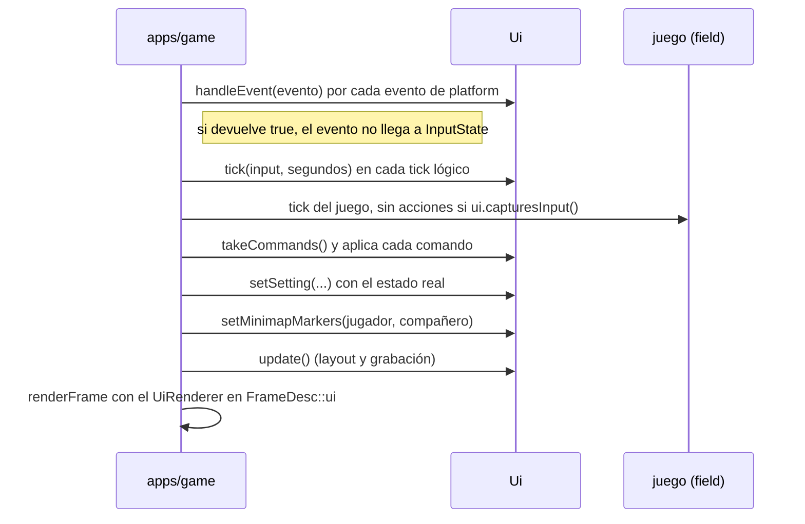

# UI

La UI del juego (menús y HUD) vive en `engine/ui`, en la capa de servicios, sobre RmlUi
([ADR 0009](../adr/0009-rmlui.md)). Las herramientas de depuración siguen con Dear ImGui (`engine/debug`).

## Piezas

| Pieza | Qué hace |
|---|---|
| `Ui` | La fachada que usa la app: carga documentos, los muestra, recibe eventos y acciones, devuelve comandos y dibuja |
| Interfaces de RmlUi (`src/rml_interfaces.*`) | Reloj y log (`SystemInterface`), ficheros por asset id (`FileInterface`), rutas relativas al documento y las imágenes generadas (`generated:<nombre>`) |
| `UiRenderer` | Un `render::Drawer` del pase de UI: dibuja lo que RmlUi grabó en `update()` con un pipeline propio (`shaders/rml.slang`, alfa premultiplicado) |
| Puente de render (`src/render_bridge.*`) | La `RenderInterface` de RmlUi: crea las texturas en el `Renderer` y graba cada llamada de dibujo para el `UiRenderer`; sin renderer (tests) solo da tamaños de textura |
| Scripts (`src/scripting.*`) | El `ScriptVm` propio de la UI, la API de Lua y los instanciadores de RmlUi: cada `<body>` es un `ScriptedDocument` con su entorno de Lua, y cada atributo `on*` un manejador en Lua |
| `Navigation` | Convierte las acciones de un tick en pasos de navegación, con repetición al mantener una dirección |
| `promptControl`, `promptLabel` | El control que dispara una acción en el último dispositivo usado (`key:enter`, `gamepad:south`) y su nombre para el jugador, en el idioma del juego (`localization/<idioma>/prompt.yaml`) |
| Textos | Los textos salen del `localization::Catalog` que da la app (`UiDesc::texts`; sin él, la UI carga el inglés): `text-key` en el RML, `t()` en Lua, y `refreshTexts()` al cambiar de idioma ([localización](localizacion.md)) |
| `FontEngine` (`src/font_engine.*`), `BitmapFont` | El motor de fuentes de RmlUi con la familia `original-look` encima: dibuja con la fuente de mapa de bits del original o con la moderna, según el ajuste `text_font` (ver [Aspecto original](#aspecto-original)); el resto de familias va al motor de RmlUi (FreeType) |
| Aspectos (`SkinCatalog`, `src/skin_styler.*`) | Los aspectos que ofrecen los paquetes (`ui/skins/<id>/skin.yaml`) y las hojas de estilo que cada uno pone sobre cada documento; ver [Aspectos](#aspectos) |
| Imágenes (`image_reference.*`) | Lo que nombra una imagen de RCSS o RML: un asset sin extensión y, si se pide, una paleta (`?palette=N`) |
| `buildMinimap` | Dibuja el minimapa desde una rejilla de celdas (`MinimapGrid`) y da el `MinimapLayout` que sitúa posiciones del mundo en la imagen |

`ui` no conoce el juego: recibe valores planos (la rejilla del minimapa, las posiciones de los marcadores, los
ajustes) y devuelve comandos con nombre. La app hace de pegamento.

## Ciclo de un frame



## Arranque

```cpp
auto uiRenderer = ui::UiRenderer::create(renderer);           // después del Renderer
auto ui = ui::Ui::create({.files = &vfs, .renderer = uiRenderer->get(), .texts = &catalog, .width = w,
                          .height = h, .scale = 1.0F, .hotReload = true, .clock = {}, .scripts = {}});
ui->loadDocument("hud", hudId);                                // ui/hud/document
ui->loadDocument("pause_menu", menuId);                        // ui/pause_menu/document
ui->loadDocument("main_menu", mainMenuId);                     // ui/main_menu/document
ui->setMenuDocument("pause_menu");
ui->show("hud");
ui->show("main_menu", true);                                   // al arrancar
ui->setMinimap(ui::minimapGridOf(map), claveDelNombre);        // en cada cambio de mapa: main.map_names.0003
ui->refreshTexts();                                            // tras catalog.setLanguage(...)
```

Se destruyen al revés: `Ui` (suelta sus texturas en el renderer), `UiRenderer`, `Renderer`.

## Dibujo

RmlUi dibuja en dos tiempos. `Ui::update()` hace el layout y llama a `Render()` de RmlUi fuera del frame: la
`RenderInterface` crea las texturas que falten (`Renderer::queueTexture`, con alfa premultiplicado; las imágenes de
fichero se premultiplican al cargarlas) y graba cada `RenderGeometry` con su traslación, textura, recorte (scissor) y
transformación. La geometría se sube una sola vez, cuando RmlUi la compila (`CompileGeometry`), a dos buffers de GPU
(`rhi::Buffer::createMapped`), que se liberan con la destrucción diferida del dispositivo cuando RmlUi la suelta, así
que los frames en vuelo pueden seguir dibujándola. Si no hay memoria para la geometría de un elemento, ese elemento
no se dibuja (con un aviso en el log) y el resto de la UI sí. Después, en `renderFrame`, `UiRenderer::draw` solo
enlaza esos buffers y dibuja cada llamada. El recorte se ajusta al target. Las máscaras de
recorte de RmlUi (`EnableClipMask`) no están implementadas: solo hacen falta para recortar elementos transformados.

## Entrada

- **Ratón:** movimiento, botones y rueda van a RmlUi en píxeles físicos. Un clic o una rueda se quedan en la UI si
  hay un documento modal o si el puntero está sobre un elemento que acepta el puntero. El HUD declara
  `pointer-events: none`, así que nunca roba clics al juego. Con un menú abierto el foco sigue al puntero cuando
  este entra en otra entrada; un puntero quieto (o que tiembla sobre la misma entrada) no le quita el foco al
  teclado ni al mando, y tampoco la posición que da la ventana tras un cambio de tamaño o al recuperar el foco, que
  el jugador no ha movido. El clic derecho vuelve atrás, como `cancel`.
- **Pérdida del foco de la ventana** (`FocusLost`): los botones del ratón pulsados sobre la UI se sueltan sin hacer
  clic, porque la ventana no verá cuándo se sueltan de verdad.
- **Teclado y mando:** no se leen teclas, sino las acciones de `InputState`: `move_up/down/left/right` (teclas, cruceta
  y stick), `confirm`, `cancel` y `menu`. Cada paso va primero al `on_action` del documento modal; si no lo atiende,
  las direcciones mueven el foco con las propiedades `nav` de RmlUi, `confirm` hace clic en el elemento con el foco y
  `cancel`/`menu` cierran el documento.
- **Sin menú**, solo `menu` hace algo: abre el documento de menú (`setMenuDocument`). Durante el tick en que la UI
  usa una acción, `capturesInput()` es true, así que la misma pulsación no llega también al juego.
- **Avisos de botones:** `ui.prompt(acción)` da el nombre del control según el último dispositivo y la familia del
  mando (`Intro`/`Esc`, `A`/`B`, `Cruz`/`Círculo`, `B`/`A` en Nintendo). El motor solo nombra el control
  (`key:enter`, `mouse:left`, `gamepad:south`, `gamepad:left_stick`); el texto sale de la tabla `prompt` del idioma
  del juego (`localization/<idioma>/prompt.yaml`): `prompt.key.enter`, `prompt.gamepad.south`, y
  `prompt.family.<familia>.<botón>` para los botones que cada familia nombra a su manera. Las letras, cifras y
  F1–F12 sin entrada se muestran tal cual. Cuando cambia el dispositivo, los documentos visibles reciben `on_device`;
  cuando cambia el idioma, `on_language`.
- **Mando virtual:** `Platform::attachVirtualGamepad` conecta un mando de software que pasa por el mismo camino que uno
  real. Lo usan los tests de `platform` y la demo (`--virtual-gamepad`).

## Escala

El contexto mide la ventana en píxeles. Las medidas de RCSS van en `dp`; un dp es un píxel a 720 líneas, y la
proporción es `min(alto/720, ancho/960)` (entre 0,5 y 8) por la escala que elige el jugador (`setScale`), que se
limita a `[Ui::MinScale, Ui::MaxScale]` = [0,5, 3]; un valor que no es un número se ignora. En una pantalla de alta
densidad la ventana tiene más píxeles y la proporción crece con ellos: el HUD y los menús ocupan lo mismo.

## Minimapa

`MinimapGrid` es la rejilla del mapa con tres clases de celda: bloqueada (transparente), transitable y salida.
`minimapGridOf(mapDocument)` la construye desde el `MapDocument`: las celdas con el bit `0x80` están bloqueadas y las de valor 110–119 son las
salidas de los warps 0–9 que llevan a algún mapa (`tamer.c`). Una celda de rejilla cubre 100 unidades; la celda
`(columna, fila)` empieza en `x = (columna − 50) · 100`, `z = (fila − 50) · 100` del mundo (`map_collision.c:
getTileTrigger`, con `world-space.md`).

`buildMinimap` recorta la imagen al rectángulo de las celdas transitables más un margen, rellena las celdas, dibuja
un borde donde tocan una pared y pinta las salidas de otro color. La imagen se registra como `generated:minimap/<n>`
y se muestra en los elementos del contrato del HUD. Los marcadores se colocan en porcentaje sobre el marco y giran
según la dirección en la que mira cada uno (arriba es −Z). `setMinimapMarkers` se llama en cada frame, pero la UI
guarda los elementos de los marcadores y lo que muestran: solo los vuelve a buscar cuando se cargan documentos, y
solo les cambia las propiedades cuando el marcador se ha movido.

### Contrato del HUD

La UI rellena estos ids en cualquier documento que los tenga (constantes en `dwe::ui::hud`, en `ui.hpp`). Un HUD de
un mod puede colocarlos y darles estilo como quiera, pero con estos ids y estos papeles:

| Id | Constante | Qué hace la UI |
|---|---|---|
| `minimap-image` | `hud::MinimapImage` | Un ``: le pone como `src` la imagen del minimapa del mapa actual |
| `minimap-frame` | `hud::MinimapFrame` | La caja que contiene la imagen y los marcadores: le da `width`, `height`, `left` y `top` en porcentaje para mantener la proporción del mapa dentro de su panel cuadrado |
| `minimap-name` | `hud::MinimapName` | Su texto es el nombre del mapa, el texto de la clave que da `setMinimap`, en el idioma del juego |
| `minimap-player`, `minimap-partner` | `hud::MinimapPlayer`, `hud::MinimapPartner` | Los marcadores: `left`, `top` (en porcentaje del marco), `transform: rotate(...)`, y `display: none` sin marcador |

**El minimapa es una diferencia opcional: el original no tiene minimapa.** El ajuste `minimap` vale `auto` (al
empezar), `on` u `off`, y el menú de pausa lo cambia (entrada «Mostrar minimapa»: «Según el aspecto», «Siempre»,
«Nunca»). Con `auto` el HUD pone la clase `auto` en `#minimap` y cada aspecto decide en su RCSS: el moderno lo enseña
y el de aspecto original lo esconde (`#minimap.auto`); con `off` lo esconde (`hidden`) y con `on` lo enseña con
cualquier aspecto. Sustituye al booleano `minimap_visible`: el comando antiguo todavía se acepta, con `true` como
`on` y `false` como `off`, y cualquier otro valor (o ninguno) es `auto` (`minimapModeOf`, `apps/game/src/
minimap_setting.hpp`). La elección se guarda en el `settings.yaml` de los datos del usuario, como `ui_skin` y
`text_font` (clave `minimap`, `MinimapChanger`; las autopruebas no lo tocan), y la partida siguiente empieza con ella
(`startMinimapMode`): sin clave es `auto`, y un valor que no es un modo se avisa en el log y también es `auto`.
`minimap_visible` nunca se guardó, así que no hay ajustes que migrar.

## Estado del campo

El HUD enseña en el campo la hora del juego y el estado del compañero. Los datos y su dibujo van separados: un modelo
de datos que no sabe nada de aspectos, y cada aspecto es una vista de él (el moderno ahora; el de aspecto original
dibuja los mismos datos con su propio documento).

- **Modelo:** `FieldHudView` (`apps/screens`: `field_hud_view.hpp`), solo números y booleanos. Lo construye
  `fieldHudViewOf(hora, compañero, shown)` desde `GameSession::clock().time()` (`ruleset::GameTime`) y
  `GameSession::partnerView()` (`apps/session`: `partner_view.cpp: viewOf`), sin decidir ninguna regla: los rangos
  salen del ruleset (`care.yaml`: `limits`) y las necesidades son las condiciones que ya tiene el compañero.
- **Enlace:** `FieldHud` (`apps/game/src/field_hud.*`) publica las etiquetas una vez al crearse
  (`fieldHudLabelSettings`) y, en cada frame, construye la vista y la compara con la última que publicó. Solo si
  cambió la convierte en ajustes (`settingsOf`) y la publica con `screens::publish`, que cambia solo los ajustes que
  cambian y después sube `hud.revision` en uno. Un frame en el que no cambia nada no construye ningún texto ni toca
  la UI.
- **Vista:** el documento redibuja el estado entero cuando cambia `hud.revision` (`on_setting`), así nunca lee media
  vista; las etiquetas, cuando cambia un ajuste `*.label` y al cambiar de idioma (`on_language`). El documento del
  aspecto moderno es `ui/hud/document` con su `logic.lua`; uno de otro aspecto (`screens.hud.document` en
  `skin.yaml`) lee los mismos ajustes y pone sus propios ids.

**Contrato de datos.** Estos ajustes son el contrato entre el juego y cualquier vista del estado del campo (un
aspecto del juego o de un mod). Los nombres son constantes de `field_hud_view.hpp`; los números van como `double`
con valor entero.

| Ajuste | Valor | Qué es |
|---|---|---|
| `hud.revision` | número | Sube en uno cada vez que cambia algún valor de abajo; el documento redibuja con él |
| `hud.shown` | booleano | `false` mientras el campo está parado: un menú (pausa, principal, compañero) o un combate, o sin partida. El original saca el reloj y las barras de la pantalla cuando para la hora del juego (`clock.c: renderGameClock`, `stopGameTime`) |
| `hud.clock.hour`, `hud.clock.minute` | 0–23, 0–59 | La hora del juego. Un minuto de juego dura 20 frames del original, un segundo real a velocidad normal (`clock.c: tickGameClock`; sección `clock` del ruleset) |
| `hud.clock.day`, `hud.clock.year` | desde 1 | El día del año (1–30 con `days_per_year: 30`) y el año, contados desde 1 como los enseña el menú del original (`game_menu.c: renderDateDigits`: `DAY + 1`, `YEAR + 1`); el reloj los guarda desde 0 |
| `hud.meter.<i>.{value,min,max}` | números | Felicidad (0) y disciplina (1), con su rango del ruleset: −100 a 100 y 0 a 100 en `original` (`partner_impl.c: tickConditionBoundaries`) |
| `hud.meter.<i>.{label,two_tone}` | clave, booleano | Una vez: las claves `partner_menu.happiness` y `partner_menu.discipline`, y `true`: las dos son barras de dos tonos, que se llenan del mínimo a la mitad del rango y otra vez, en otro color, de la mitad al máximo (`partner_impl.c: renderStatusBars`) |
| `hud.need.<i>.active` | booleano | Hambre (0), sueño (1), baño (2) y cansancio (3): si el compañero tiene ahora esa necesidad, es decir, la condición `hungry`, `sleepy`, `needs_toilet` o `tired` (ver abajo cuándo) |
| `hud.need.<i>.label` | clave | Una vez: `hud.need.hunger`, `hud.need.sleep`, `hud.need.toilet`, `hud.need.tired` |
| `hud.pool.<i>.{value,max}` | números | HP (0) y MP (1): lo que le queda y su máximo |
| `hud.pool.<i>.label` | clave | Una vez: las etiquetas del original, `main.stat_labels.0000` (HP) y `.0001` (MP) |
| `hud.partner.area` | 0, 1, 2 | Lo que le parece al compañero el mapa en el que está, con los números del original (`MAP_TILE_DATA.partnerAreaResponse`): 0 nada en especial, 1 le gusta, 2 no le gusta. Va con `hud.revision`, como el resto del estado. El original lo calcula al cargar el mapa (`map.c: loadMapSetup`): recorre a la vez, casilla a casilla, las dos listas de regiones del mapa (`regions.a` y `regions.b` de `map/<id>/data.yaml`) y la primera casilla de cualquiera de las dos que tenga la región favorita de la especie (`favored_region` de `data/raise`) decide: la lista `a` da 1 y la `b` da 2. La sesión lo calcula igual al entrar en cada mapa (`game/partner`: `areaResponseOf`; `GameSession::areaResponse`), y lo usan también las reglas del cuidado (`CareContext::area`, `SleepContext::area`) |
| `hud.partner.revision` | número | Sube en uno cada vez que cambia alguno de los tres de abajo. Va aparte de `hud.revision` porque cambia mientras el compañero anda, y así el resto del estado no se redibuja con él |
| `hud.partner.x`, `hud.partner.y` | 0–100, décimas | Dónde se asienta la burbuja del original sobre el compañero, en porcentaje del ancho y el alto de la ventana desde la esquina de arriba a la izquierda, redondeado a décimas (menos de un píxel en una ventana de 1000). La burbuja nace a la altura de la especie menos 20 unidades sobre la posición del compañero (`bubble.c: addConditionBubble`; la altura es `height` de `data/digimon`) y en sus 10 primeros frames sube 65 más, donde se queda (`bubble.c: tickConditionBubble`); ese es el punto publicado (`BubbleDrop` y `BubbleRise` en `apps/game/src/game.cpp: partnerBubbleOf`). Su vaivén de 12 unidades arriba y abajo alrededor de él es animación del aspecto y no se publica |
| `hud.partner.visible` | booleano | `false` con el campo parado (como `hud.shown`; el original no dibuja las burbujas en un menú) o con el punto fuera de la ventana o detrás de la cámara; entonces `x` e `y` valen 0 |

**Cuándo cuenta una necesidad.** En el original una necesidad está o no está: no hay grados de urgencia. Está desde
que se pone su condición y hasta que se atiende o se acaba su plazo, y mientras está el original lo enseña con una
burbuja sobre el compañero (`bubble.c`; por prioridad, sueño, cansancio, hambre, baño, herida y enfermedad:
`partner_impl.c: handleConditionBubble`), no en un HUD.

| Necesidad | Empieza | Acaba sola (falta de cuidado) |
|---|---|---|
| Hambre | Cuando el contador de la siguiente comida llega a 0 (`partner_impl.c: tickHungerMechanics`) | A los 90 minutos de juego sin comer |
| Sueño | Al entrar en su franja de sueño (`partner_impl.c: tickSleepMechanics`) | A la hora de despertar |
| Baño | Cuando el contador del baño llega a 0 (`partner_impl.c: tickPoopingMechanic`) | Tras `(disciplina + 20) × 0,6` minutos de juego, haciéndolo donde está |
| Cansancio | Cuando el cansancio llega a 80 (`tired_threshold` del ruleset; `partner_impl.c: tickTirednessMechanics`) | No acaba sola: el cansancio baja descansando o durmiendo, y la condición se va al bajar de 80 |

Estos plazos son reglas del compañero (`game/partner`, ruleset `original`); el contrato solo publica si la necesidad
está.

**Lo que dibuja el original en el campo**, como referencia para las vistas (`clock.c: renderGameClock`,
`partner_impl.c: renderStatusBars`), en la pantalla de 320×240:

- Arriba a la izquierda, un reloj de esfera: una aguja de minutos que da una vuelta por hora y un punto que da una
  vuelta al día por un anillo de 24 horas (la hora 0 arriba), con un sol o una luna encima (luna con la hora antes de
  las 6 o desde las 17). Sin cifras y sin el día.
- Abajo a la derecha, solo las barras de felicidad y disciplina, cada una con su icono (felicidad: cara contenta con
  0 o más, triste por debajo; disciplina: un icono con 50 o más y otro por debajo). Cada barra son 25 cuadritos de
  2 píxeles: 4 puntos por cuadrito en la felicidad y 2 en la disciplina, en dos tonos como arriba.
- Reloj y barras entran y salen deslizándose (50 píxeles por frame) cuando la hora del juego anda o se para: el reloj
  hacia la izquierda (`clock.c: renderGameClock`, `CLOCK_OFFSET_X` entre -135 y -220) y las barras hacia la derecha
  (`partner_impl.c: renderStatusBars`, `STATUS_UI_OFFSET_X` entre 75 y 240). El sol y la luna pasan por sus cuatro
  cuadros, uno cada 4 frames (`(CURRENT_FRAME % 16) / 4`). HP, MP, el día y las necesidades no se ven en el campo:
  HP y MP están en el menú del compañero y el día en el menú del domador.

**El parpadeo del icono de la felicidad.** En una zona que al compañero le gusta o le disgusta, el original alterna
el icono de la felicidad con otra cara: mientras `PLAYTIME_FRAMES % 10 < 5`, 5 de cada 10 frames, dibuja la cara que
está 11 píxeles a la izquierda en SYSTEM_W si le gusta y 11 a la derecha si no (`partner_impl.c: renderStatusBars`);
los otros 5 frames, la de siempre. El script pone en `#field-status` la clase `area-liked` o `area-disliked` según
`hud.partner.area`, y el aspecto original alterna la cara con una animación de 0,5 s: la otra cara la primera mitad
y la de siempre la segunda.

**Diferencia visible conocida: la fase del parpadeo.** La animación empieza cuando se pone la clase (al entrar en la
zona o al cambiar la cara), no al compás del contador de frames de juego del original (`PLAYTIME_FRAMES`): el ritmo
es el mismo, pero la fase puede ir desplazada hasta 0,25 s. El contrato no publica ese contador porque publicarlo
obligaría a redibujar el estado del campo 20 veces por segundo (ver la tabla de elecciones del aspecto original).

**La vista compartida.** Todos los aspectos del juego dibujan el estado del campo con el mismo documento
(`ui/hud/document.rml`) y el mismo `logic.lua`, y solo cambian sus hojas RCSS. Lo que el script deja para que cada
aspecto lo dibuje a su manera:

| Elemento o clase | Qué hace el script | Para qué |
|---|---|---|
| clase `shown` en `#field-status` | La pone con `hud.shown` y la quita sin él | Cada aspecto decide cómo se va el panel: el moderno lo quita (`display: none`); el original puede deslizarlo, como `clock.c` (50 píxeles por frame) |
| clase `pips` en una barra (`#field-meter-<i>-bar`, `#field-pool-<i>-bar`) | Si el aspecto se la pone (en su `skin.yaml`, ver abajo), el relleno va en 25 pasos del 4 %, redondeando hacia abajo, con la misma regla de dos tonos | Los 25 cuadritos de `partner_impl.c: renderStatusBars` (4 puntos por cuadrito en la felicidad, 2 en la disciplina) |
| clase `area-liked` o `area-disliked` en `#field-status` | Pone `area-liked` con `hud.partner.area` a 1, `area-disliked` con 2, y ninguna con 0 | La cara de la felicidad que alterna con otra en una zona que le gusta o le disgusta al compañero (ver arriba); el moderno no la usa |
| clase `low` en `#field-meter-<i>` | La pone si el valor está por debajo de la mitad de su rango (`(min + max) / 2`) y la quita si no | El icono de la barra: la cara de la felicidad se pone triste por debajo de 0 y el de la disciplina cambia por debajo de 50 (`partner_impl.c: renderStatusBars`); el moderno no la usa |
| `#field-partner-bubble` | `left` y `top` desde `hud.partner.x` y `hud.partner.y` (redibuja con `hud.partner.revision`); la clase `shown` solo con `hud.partner.visible` y alguna necesidad; y una sola clase de necesidad, `hunger`, `sleep`, `toilet` o `tired` | La burbuja del original sobre el compañero (`bubble.c`). Cuelga del centro de su borde de abajo (`ui/hud/structure.rcss`), así que el aspecto solo le da tamaño y dibujo; el moderno no la enseña porque ya tiene el panel de necesidades |
| `#field-clock-minute-hand` | `transform: rotate(minuto × 6deg)` | La aguja de minutos de `clock.c: renderGameClock`, una vuelta por hora |
| `#field-clock-hour-dot` | `left` y `top` en porcentaje sobre un círculo, 15° por hora, la hora 0 arriba | El punto de las horas en el anillo de 24 horas |
| clase `night` en `#field-clock` | La pone con la hora antes de las 6 o desde las 17 | La luna en vez del sol |

**Qué burbuja.** El original elige la necesidad por prioridad, de mayor a menor sueño, cansancio, hambre y baño
(`partner_impl.c: handleConditionBubble` las mira de menor a mayor y gana la última), y cuando una burbuja lleva 50
de sus frames (a 20 por segundo, 2,5 s) cambia a la necesidad más alta de las demás que tenga, si hay alguna: con dos
necesidades se turnan, y una tercera espera a que se vaya una de ellas. El script hace lo mismo con su `on_tick`
(`bubble_priority`, `bubble_swap_seconds`), y el tiempo solo cuenta mientras la burbuja se ve. Lo que no imita es el
parpadeo: el original quita la burbuja cuando pasa de 50 frames (`bubble.c: tickConditionBubble`) y la vuelve a
crear unos 10 frames después, así que en cada 60 frames no se ve durante unos 10 (y crece durante los 10 primeros).
El contrato no lo publica: `shown` sigue puesta mientras dura la necesidad, y el hueco lo dibuja el aspecto. El
original lo hace con una animación RCSS (`need-bubble-blink`, 3 s: 0,5 s creciendo, 2 s quieta, 0,5 s sin verse);
el moderno no enseña la burbuja.

**Hueco conocido: herida y enfermedad.** El original tiene también burbujas para un compañero herido y uno enfermo,
por debajo del baño en la prioridad (`partner_impl.c: handleConditionBubble`: bits `0x20` y `0x40` de la condición,
burbujas 6 y 2). El compañero ya tiene esas condiciones (`injured`, `sick`), pero el contrato no las publica como
necesidades, así que la burbuja compartida no las enseña: con solo una de ellas no sale burbuja, y con ellas y una
necesidad sale la necesidad. Queda pendiente decidir cómo publicarlas.

Las constantes (25 cuadritos, 6° por minuto, 15° por hora, las 6 y las 17) están con nombre al principio del
script, con su referencia a `clock.c` o `partner_impl.c`. Al cambiar de aspecto (el ajuste `ui_skin`) el script vuelve a
dibujar el estado y la burbuja sin esperar a otra revisión, porque el aspecto nuevo puede poner o quitar clases que
lee (`pips`). El aspecto moderno esconde la esfera
(`#field-clock-dial`) y no pone `pips`.

**Cómo pone un aspecto una clase.** Las hojas RCSS no pueden poner clases, así que un aspecto pone `pips`, y cualquier
otra clase en los elementos del documento compartido, con el campo `document_classes` de su `skin.yaml`: por documento e
id de elemento, las clases que el juego le pone al cargar el documento y cambia al cambiar de aspecto. El mecanismo
llega con el aspecto original; hasta entonces ningún aspecto pone `pips` y las barras se llenan de forma continua. El
script solo lee la clase (`has_class`), así que no cambia cuando llega.

**El aspecto moderno** (abajo a la izquierda, `ui/skins/modern/hud/style.rcss`) dibuja todo el contrato. Lo que
cambia frente al original es solo de presentación y es opcional, porque es del aspecto: con el aspecto original se
ve lo que enseña el original. Las diferencias, todas del aspecto moderno:

| Diferencia | Por qué |
|---|---|
| La hora en cifras (`HH:MM`, 24 horas) en vez de la esfera | Se lee de un vistazo a cualquier escala |
| El día y el año en el campo | El original solo los enseña en el menú del domador |
| Las barras se llenan de forma continua, con su número, en vez de cuadritos | Más legible en pantallas grandes |
| Las necesidades en un panel, siempre a la vista, resaltadas cuando están | El original solo tiene la burbuja sobre el compañero, que se pierde si no se le ve |
| HP y MP con su barra (lo que queda sobre el máximo) | El original solo los enseña en el menú del compañero |
| Al cambiar de mapa el panel se desvanece con `screen_fade`, como el resto del HUD, en vez de deslizarse | Igual que los otros paneles del HUD (decisión de 2026-10-20 en la tabla del aspecto original) |

## Comandos y ajustes

Los menús envían comandos con `ui.send(nombre, valor)` y la app los aplica. El primer menú usa:

| Comando | Valor | Ajuste que la app publica después |
|---|---|---|
| `quit` | — | — |
| `play` | — | — (en la portada: empieza una partida nueva; ver [guardar-y-cargar.md](guardar-y-cargar.md)) |
| `minimap` | `auto`, `on`, `off` | `minimap` |
| `minimap_size` | `small`, `medium`, `large` | `minimap_size` |
| `fullscreen` | booleano | `fullscreen` |
| `ui_scale` | número (0,75–2) | `ui_scale` |
| `vsync` | booleano | `vsync` |
| `language` | código de idioma (`en`, `es`) | `language` (y la UI vuelve a poner todos sus textos) |
| `text_font` | `modern`, `original` | `text_font` (y la UI vuelve a componer los documentos con la fuente) |
| `ui_skin` | id de un aspecto (`modern`, ...) | `ui_skin` (y la UI cambia el estilo de todos los documentos en el momento) |
| `sleep` | — | — (en partida: el menú de pausa acuesta al compañero si tiene sueño; ver [guardar-y-cargar.md](guardar-y-cargar.md#36-dormir)) |
| `sleep_only`, `sleep_and_save` | — | `save.last_result` con `sleep_and_save` (el menú de dormir: seguir durmiendo, o guardar en la ranura de la partida antes) |

La pantalla de combate (`ui/battle`) envía `battle_command` (el número del comando, `game::battle::Command`),
`battle_charge` (cada pulsación que carga el golpe final), `battle_close` (cierra la caja del final),
`battle_bag_open` y `battle_bag_close` (la bolsa del domador, que también abre y cierra la acción `cancel`) y
`battle_throw` (el número de la ranura cuyo objeto se lanza al compañero). El menú de
pausa abre el del compañero con `open_partner_menu`, y este (`ui/partner_menu`) envía `bag_use`, `bag_drop` (el
número de la ranura), `bag_move` (`"<desde> <hasta>"`), `bag_sort` (el orden, 0 a 2), `partner_praise` y
`partner_scold`. Lo que dibujan lo publica el juego como ajustes con prefijo `battle.` (y `battle.phase`: `fight` o
`end`), `partner.` y `bag.`; el contrato está en el [README de apps/screens](../../apps/screens/README.md).

En la consola de depuración (y en los pasos `script` de los autotests), `battle("")` empieza un combate contra el
primer NPC del mapa que puede luchar, o contra los NPC que se le den (`battle("0,2")`), y `give_item("meat 3")` mete
objetos en la bolsa. `evolve("species_b")` hace evolucionar al compañero a esa forma como lo hace un guion de mapa
(`EvolutionAdapter::evolveByScript`). Son ayudas de depuración hasta que corran los scripts de los mapas y existan cofres y tiendas:
el original empieza los combates desde los scripts de los NPC (`script_interp.c`: la operación `START_BATTLE`) y la
partida nueva empieza con la bolsa vacía. Decisión del responsable de diseño (2026-10-21): hasta que corran los guiones
de los mapas en la fase 4, `battle("")` es el único disparador de combates. `use_item("medicine")` usa uno de la bolsa
con el compañero, y `toilet("")`, `sleep("")`, `scold("")`, `train("trn brain")` y `clock_speed("600")` llaman a los
comandos de cuidado de la sesión y aceleran el reloj, hasta que existan los baños, las camas, las pantallas de
entrenamiento y las opciones del reloj (fase 4); la lista está en [la guía de la prueba
vertical](../guides/prueba-vertical.md). Decisión del responsable de diseño (2026-10-21): `toilet`, `sleep`, `train`, `scold` y
`clock_speed` se quedan como ayudas de depuración.

**CAMBIO DE CONTRATO (aditivo):** los comandos `sleep`, `sleep_only` y `sleep_and_save`, los ajustes
`pause_menu.sleep_enabled` y `save.last_result` y el documento `sleep_menu` (fase 4, tramo 5a). Un mod que
reemplaza `pause_menu` no tiene «Dormir» hasta que lo añade: un botón `#sleep` que envía `sleep` y se pone en gris
cuando `pause_menu.sleep_enabled` es falso.

Otros ajustes los publica el juego sin que un menú los pida:

| Ajuste | Valor | Qué es |
|---|---|---|
| `screen_fade` | número de 0 a 1 | Cuánto quita de la pantalla el fundido del cambio de mapa, que el render resta de la escena debajo de la UI; el HUD desvanece con él sus paneles |
| `pause_menu.sleep_enabled` | booleano | Si el compañero puede dormir ahora: el menú de pausa pone «Dormir» en gris si no |
| `save.last_result` | `saved`, `failed`, `not_saved` | Cómo acabó el último guardado que pidió el jugador en partida |
| `map_title_key` | clave de texto | La clave del nombre del mapa al que lleva el cambio de mapa (`main.map_names.NNNN`) mientras el original lo enseña (fotogramas 10 a 20 del fundido de salida); vacía el resto del tiempo o si el mapa no tiene nombre. El HUD pone su texto en el idioma del jugador (`t()`) en el centro, delante del fundido, y lo reescribe al cambiar de idioma |

## Aspectos

Un **aspecto** (skin) es el estilo de toda la UI: colores, tipos, tamaños, marcos e imágenes de cada pantalla. Hay
un solo ajuste global, `ui_skin`, que vale para todas las pantallas y se cambia en vivo; por defecto, el aspecto
original (`original`), y el moderno (`modern`) es una opción en «Aspecto de la interfaz». Los mods pueden añadir
aspectos: este es su contrato, y es estable.

**CAMBIO DE CONTRATO: el juego se ve como el original por defecto.** Decidido por el usuario (2026-10-21). Hasta
ahora `ui/ui_skin.yaml` decía `default: modern`; ahora dice `default: original` con `fallback: modern`. Lo que
cambia y lo que no:

- Un jugador que ya eligió un aspecto lo conserva: el `ui_skin` guardado en `settings.yaml` manda sobre el de los
  paquetes. Solo quien no ha elegido ninguno (sin `ui_skin` guardado) empieza con el original. Lo prueban
  `apps/game/tests/ui_skin_setting_tests.cpp` (los dos casos) y `engine/ui/tests/skin_switch_tests.cpp`.
- El original necesita las imágenes que extrae `dwx extract` desde la versión 2 del extractor (el paquete
  `ui_original` y las imágenes de la base que agranda). Con un contenido extraído antes, o sin él (los tests sin
  disco), el original no se ofrece y el juego empieza con el moderno, el de reserva, con un aviso en el log.
- `--ui-skin` y la consola siguen igual. Las rutas de autotest no leen los ajustes del jugador, así que corren con
  el original salvo que pidan otro; `route-skins.yaml` empieza ahora en el original y pasa al de prueba y al moderno.
- Un mod que reemplaza `ui/ui_skin.yaml` sigue mandando sobre el del paquete `game`.

El cambio llegó con el aspecto original completo (todas las pantallas que hay hoy; el cuadro de texto llegará con el
intérprete de historia), como se pidió.

**Lo que es de cada documento y lo que es del aspecto.** Un documento (`ui/<pantalla>/document.rml`) solo enlaza
hojas de estructura, lo que no depende del aspecto: `ui/common/base.rcss` (los `display` por defecto, el tamaño del
`body`, `.hidden`, qué elementos toman el foco y `.original-look`) y, si la pantalla lo necesita, su
`ui/<pantalla>/structure.rcss` con el comportamiento propio de esa pantalla (las listas de los menús principal y de
pausa dan la vuelta con `nav-up` y `nav-down`). Todo lo demás (la fuente, los colores, los tamaños, la posición de
los paneles) lo pone el aspecto. La excepción es el aviso de los assets de desarrollo (`ui/dev_assets`): es un aviso
para quien desarrolla, no parte del aspecto del juego, así que todo su estilo está en su `structure.rcss` y se ve
igual con todos los aspectos.

**Un aspecto no cambia cómo se navega.** Es una convención, también para los aspectos de los mods: ni sus RCSS ni
sus RML de reemplazo escriben propiedades `nav-*` (`nav-up`, `nav-down`, `nav-left`, `nav-right`). La navegación
de una pantalla está en su `structure.rcss`, que es igual con todos los aspectos. Un test (`skin_switch_tests.cpp`)
recorre los aspectos del paquete `game` y de `tests/mods` y falla si alguno escribe `nav-`. Los ids de los elementos, las clases que usan los scripts, los scripts
y los ajustes y comandos que leen y envían son el contrato con el juego y no cambian con el aspecto.

**`ui/skins/<id>/skin.yaml`** (esquema `ui_skin`, registrado en `pack.yaml`):

```yaml
id: framed                          # igual que el nombre de la carpeta
name: framed.skin_name              # la clave del nombre que enseñan los menús
extends: modern                     # opcional: el aspecto al que este añade
theme: [ui/skins/framed/theme]      # hojas para todos los documentos
screens:                            # por pantalla, con el nombre con el que se carga el documento
  main_menu:
    styles: [ui/skins/framed/main_menu/style]
    document: ui/skins/framed/main_menu/document   # opcional: otro RML para esa pantalla
sprite_sheets:                      # opcional: hojas de sprites para RCSS
  - name: frames
    image: texture/stddat/time      # asset, sin extensión
    palette: 3                      # opcional: otra paleta de la imagen indexada
    original_size: [66, 29]         # opcional: el tamaño del original, para copias escaladas
    dp_per_pixel: 3                 # opcional: cuántos dp ocupa un píxel del original (1 por defecto)
    sprites:
      corner: [0, 0, 8, 8]          # x, y, ancho, alto en píxeles del original
document_classes:                   # opcional: clases que pone en elementos de los documentos compartidos
  hud:                              # el nombre con el que se carga el documento
    field-meter-0-bar: [pips]       # id del elemento: sus clases
```

| Pieza | Qué hace |
|---|---|
| `parseSkin`, `parseSkinChoice` (`skin.hpp`) | Leen `skin.yaml` y `ui/ui_skin.yaml` (`default` y, opcional, `fallback`; esquema `ui_skin_choice`): el aspecto con el que arranca el juego es dato del paquete |
| `SkinCatalog` (`skin_catalog.hpp`) | Los aspectos de todos los paquetes montados, por id. Uno cuyo id no es su carpeta, que nombra un asset que falta o que extiende uno que no está (o en bucle) se queda fuera con un aviso en el log |
| `SkinStyler` (`src/skin_styler.*`) | La hoja de cada pantalla con el aspecto actual: sus hojas de sprites y las de `theme` y `screens.<pantalla>.styles` de cada aspecto de la cadena, el aspecto base primero, encima de las hojas propias del documento |
| `spriteSheetRcss` (`sprite_sheet_rcss.hpp`) | Escribe el `@spritesheet` de RCSS de una hoja de sprites. Si la imagen es un múltiplo entero de `original_size` (una copia escalada del remaster), multiplica los rectángulos y ajusta `resolution`, así que los sprites ocupan los mismos dp. Del archivo de la imagen solo lee la cabecera, para su tamaño (`imageSize`) |

- **Cambio en vivo:** `Ui::setSkin(id)` cambia la hoja de cada documento abierto sin volver a cargarlo: los scripts,
  su estado, el foco y lo que está visible siguen igual. Solo un documento cuyo RML cambia (`document`) se carga de
  nuevo, y se muestra donde estaba. `Ui::skins()` da el catálogo, `Ui::skin()` el aspecto actual. Desde Lua,
  `ui.skins()` da los ids y `ui.skin_name_key(id)` la clave de su nombre.
- **Clases de documento (`document_classes`).** Un aspecto puede marcar elementos de un documento que comparten
  todos los aspectos sin copiarlo: por documento (el nombre con el que se carga) y por id de elemento, una lista de
  clases. El `SkinStyler` las pone al cargar el documento y, en un cambio de aspecto, quita de sus elementos todas
  las clases que nombra cualquier aspecto del catálogo y pone las del nuevo; con `extends` se suman las de la cadena.
  Los scripts las leen (`has_class`) pero no deben ponerlas ni quitarlas ellos: el cambio de aspecto las quitaría.
  Un id que el documento no tiene es un aviso en el log al darle el aspecto, y un documento que el juego no carga
  también (`Ui::checkSkinDocuments`, que el juego llama al cargar sus documentos y que repite cada cambio). El
  aspecto original lo usa para poner `pips` en las cuatro barras del estado del campo. Cambio de contrato aditivo:
  los `skin.yaml` de antes siguen valiendo (Decidido por el manager (2026-10-21): un mecanismo genérico en vez de
  copiar el documento del HUD o de un ajuste propio del aspecto original).
- **El aspecto de reserva (`fallback`).** `ui/ui_skin.yaml` puede nombrar, además de `default`, un `fallback`: el
  aspecto con el que arranca el juego si el de `default` no se ofrece. El original necesita imágenes que extrae
  `dwx extract` del disco del usuario; sin ellas se queda fuera del catálogo y el juego arranca con el moderno. Un
  `default` que no está, sin `fallback` que esté, deja la UI sin aspecto, con un aviso, como antes. Cambio de
  contrato aditivo (Decidido por el manager (2026-10-21)).
- **Herencia:** con `extends`, las hojas del aspecto base van primero y las del nuevo después, así que un aspecto
  pequeño solo escribe lo que cambia. Si varios nombran `document` para una pantalla, gana el más cercano. Con las
  hojas de sprites también gana el más cercano: una hoja con el nombre de una del aspecto base la reemplaza, y si
  dos hojas dan un sprite con el mismo nombre, se queda el de la más cercana, con un aviso en el log (RmlUi se
  quedaría con el primero que lee).
- **Si falla:** el cambio va en dos pasos. Primero se cargan, ocultos, los documentos que el aspecto nuevo cambia
  de RML; si alguno no se puede cargar, se descartan todos, la UI vuelve al aspecto que tenía y `setSkin` devuelve
  el error. Hasta ahí ningún documento ha cambiado, así que volver no puede fallar, y nada se carga dos veces ni
  recibe `on_show` dos veces. Los documentos de reemplazo descartados sí han corrido ya los scripts que se ejecutan
  al cargarse (el código de nivel superior de su `logic.lua`), así que esos scripts no deben tener efectos fuera de
  su documento. Si todos cargan, cada uno ocupa el sitio del suyo (visible, en el mismo lugar de la pila modal y con
  su `on_show`) y los demás documentos toman el aspecto sin recargarse. El menú sigue enseñando el aspecto que hay
  de verdad.
- **El ajuste `ui_skin`** sigue el camino de `text_font`: al arrancar manda `--ui-skin <id>`, luego el guardado en
  `settings.yaml` y luego el de los paquetes (`ui/ui_skin.yaml`); un id que no existe deja el de los paquetes con
  un aviso. Los menús principal y de pausa (opciones) tienen la entrada «Aspecto de la interfaz»
  (`ui/common/ui_skin_choice.lua`, compartido), que recorre `ui.skins()` y manda el comando `ui_skin`; la app lo
  aplica, lo guarda y lo publica. En la consola de depuración, `ui_skin("modern")`.
- **Un mod que añade un aspecto** trae `ui/skins/<id>/skin.yaml`, sus hojas y el nombre en un archivo de textos
  propio (`localization/<idioma>/<mod>.yaml`): un archivo con el nombre de uno del juego (`ui_skin.yaml`) lo
  reemplaza entero. El ejemplo mínimo es `tests/mods/ui_skin/test_contrast`, que extiende `modern` y cambia colores
  en todas las pantallas.
- **Un aspecto de un mod no trae scripts:** se cargan su `skin.yaml`, sus RML y sus RCSS, pero sus scripts no. Un
  `<script src>` externo solo se ejecuta si el archivo del script viene de las capas base o remaster, también desde
  un documento de un mod; un script en línea solo se ejecuta en documentos de las capas base o remaster. Así, un RML
  de reemplazo de un mod enlaza el script de su pantalla del paquete `game` por su ruta
  (`<script src="/ui/<pantalla>/logic.lua">`) y conserva sus ids, y la lógica sigue siendo la del juego. Cambiar de
  aspecto y la entrada de los menús son del motor y del paquete `game` (`ui/common/ui_skin_choice.lua`); ningún
  aspecto necesita scripts propios.
- **Recarga en caliente:** con `hotReload`, las hojas RCSS de un aspecto se vigilan como las del documento: al
  guardar una, los documentos que la usan se cargan de nuevo con el aspecto actual. `skin.yaml`, `ui/ui_skin.yaml` y
  las imágenes de las hojas de sprites no se vigilan: el catálogo se lee al arrancar, y un cambio en ellos necesita
  reiniciar el juego. Decisión del responsable de diseño (2026-10-21): la recarga de `skin.yaml` llega más tarde,
  con la documentación de modding.

### Imágenes

Las imágenes de RCSS y RML (`decorator: image(...)`, ``, `@spritesheet`) se leen por asset id, sin mirar la
extensión: `texture/x.png` encuentra `texture/x.ktx2` si un remaster lo reemplaza, así que los aspectos pueden
escribir siempre `.png`. Se leen PNG (`decodePng`) y KTX2 (`decodeKtx2`: transcodifica todos los niveles y la UI
se queda con el primero). Una KTX2 tiene que llevar datos Basis Universal (UASTC o ETC1S, como los escribe
`dwx cook`); una KTX2 con texeles sin comprimir no se lee.

Antes de decodificar, reservar o descomprimir nada, una imagen de la UI pasa estos límites:

- su archivo tiene como mucho `MaxUiImageFileBytes` (64 MiB), mirado sin leerlo (`VirtualFileSystem::size`);
- tiene como mucho `MaxUiImageSide` (4096) píxeles de lado, según su cabecera;
- decodificada a RGBA ocupa como mucho `MaxUiImageBytes`, sumando todos sus niveles (`checkUiImageBudget`): lo que
  ocupa un cuadrado de 4096 con su cadena de mips completa (13 niveles, unos 85,3 MiB), que es lo que escribe
  `dwx cook`, así que una imagen cocinada de 4096x4096 se carga;
- una KTX2 pasa además `checkPlain2dKtx2` (de `engine/assets`, la misma comprobación que hace cualquier carga de
  una KTX2): una sola imagen 2D (sin capas, sin caras de cubo, profundidad 1), no más niveles de los que da su
  tamaño, datos Basis Universal sin supercompresión o con BasisLZ o Zstd, y ningún nivel que al cargarse ocupe más
  de lo que cabe en un nivel de su tamaño (así una «bomba» Zstd se rechaza antes de inflarse).

Pendiente: no hay un presupuesto total de textura por aspecto. Cada imagen tiene sus límites, pero un aspecto con
muchas hojas de sprites grandes no tiene un tope conjunto.

Una imagen indexada extraída lleva su paleta 0; las demás están en `<imagen>_meta.yaml` (`palettes`, colores de
16 bits). `texture/x.png?palette=3` la dibuja con la paleta 3, con la regla de transparencia de `dwx` (`0x0000`
transparente, el resto opaco). Pedir una paleta a una imagen sin metadatos es un error en el log. Pedírsela a una
imagen cuyo archivo es una KTX2 también (`PaletteNeedsPng`): pasa cuando un remaster reemplaza la PNG indexada con
una KTX2, que ya no tiene paletas, así que un aspecto que use `?palette=` de esa imagen se queda sin ella; el
remaster tiene que dar las variantes que necesite como imágenes propias.

## Aspecto original

El texto que imita al original (de momento, el nombre del mapa del cambio de mapa) usa la clase `.original-look` de
`ui/common/base.rcss`, que pone la familia `original-look` y el color de la tinta de la fuente del original (`#d6d6d6`,
el color 1 de su CLUT, `0x6B5A`). Cualquier documento puede usarla para otro texto con ese aspecto.

- **La familia** la describe `ui/fonts/original_look.yaml` del paquete `game` (esquema `ui_text_font`): su nombre, la
  fuente moderna (`Noto Sans`), la elección por defecto y la fuente de mapa de bits (`font/main.png` y
  `font/main_meta.yaml` del paquete base, que escribe `dwx extract`; ver [textos](../formats/textos.md#fuente)), con su
  línea base y el tamaño de la moderna que dibuja lo que le falta. El juego solo lee ese PNG y ese YAML, nunca el disco.
  **El atlas tiene que estar en `font/`** (`font/<nombre>`; lo exigen el esquema y `parseOriginalLook`, desde
  2026-10-21): la fuente lee los píxeles exactos del PNG, y `dwx cook` solo deja como PNG las imágenes de `font/`
  (`assets::PngOnlyImages`); fuera de ahí lo convertiría a KTX2. Un mod que apuntaba a un atlas en otra carpeta tiene
  que moverlo a `font/`.
- **`FontEngine`** se instala sobre el motor de RmlUi al arrancar la UI y le pasa todas las familias menos
  `original-look`. Con `original`, esa familia dibuja cada glifo desde el atlas: un glifo responde a su carácter
  (`Ａ`) y a su equivalente ASCII (`A`), la tinta es blanca y la tiñe el `color` de RCSS, y crece en múltiplos enteros
  (`round(tamaño / 11)`, al menos 1) con los píxeles en coordenadas enteras, así que se ve nítida a cualquier
  resolución. Los caracteres que no tiene (ñ, á, ¿, ¡, paréntesis...) los dibuja la moderna en la misma línea base,
  al tamaño de la línea de mapa de bits por `fallback_size`; nunca se dibuja el glifo de sustitución del original.
  Sin la fuente extraída, `original` dibuja con la moderna (con un aviso en el log).
- **El ajuste `text_font`** (`modern` u `original`) es del jugador: `Ui::setTextFont` lo cambia y vuelve a componer y
  dibujar en el momento todos los documentos abiertos (`Rml::ReleaseFontResources`). El valor por defecto es dato
  (`default` en `original_look.yaml`). El jugador lo elige en el menú principal: la entrada «Texto con aspecto
  original», con los valores «Sí» y «No», junto al idioma (se llamaba «Fuente del texto» hasta que llegó el aspecto
  original, como se decidió el 2026-10-21), con los textos `main_menu.text_font`, `main_menu.text_font.modern` y
  `main_menu.text_font.original` de `localization/<idioma>/main_menu.yaml`. La entrada manda el comando `text_font`;
  la app lo guarda junto al idioma en `settings.yaml` de los datos del usuario y lo publica como ajuste `text_font`.
  También lo ponen `--text-font` (autotests, que no leen ni escriben los ajustes del jugador) y
  `text_font("original")` en la consola de depuración.

Decisiones del responsable de diseño sobre el nombre del mapa (ver la [ficha del campo](../reference/campo.md)):

| Decisión | Qué hace el motor |
|---|---|
| La fuente del nombre del mapa es un ajuste del jugador: la de mapa de bits del original o la moderna. Por defecto, la moderna (decisión del responsable de diseño, 2026-10-20) | Ajuste `text_font`; `default: modern` en `original_look.yaml` |
| El HUD del motor se desvanece con alfa durante el cambio de mapa. El original no tiene HUD fijo en el campo: lo que dibuja (personajes, barras de estado de `partner_impl.c: renderStatusBars`, ventanas) queda detrás del rectángulo del fundido (capa 1 del orden, `fade.c: renderFade`) y se oscurece restándole el mismo gris; solo el nombre del mapa va delante (capa 0). Desviación aprobada (decisión del responsable de diseño, 2026-10-20) | `screen_fade` en el HUD, que baja la opacidad de sus paneles |
| El nombre del mapa va centrado exacto, sin imitar el desvío de unos píxeles del original (`x = 12 − (largo / 2) × 8` con los espacios de relleno), y sin opción para imitarlo (decisión del responsable de diseño, 2026-10-20) | `text-align: center` en `#map-title` |

### El aspecto `original`

`content/packs/game/ui/skins/original/` extiende el moderno y redibuja cada pantalla con la disposición, los colores
y las proporciones del original, nítida a cualquier resolución: un píxel del original son 3dp (sus 240 líneas sobre
los 720dp de la UI), así que cada medida es un número entero de píxeles por 3. Las primitivas (marcos, barras,
degradados, rellenos) son RCSS; los iconos y sprites salen de las imágenes que extrae `dwx extract` y agranda su
receta incluida `ui_original` (×4, `index_scale` en modo `edge`, en la máquina del jugador), por sus asset ids y
paletas, sin arte original en el repositorio. Cada constante de las hojas cita su origen en un comentario: la
función de la descompilación (`clock.c: renderGameClock`, `partner_impl.c: renderStatusBars`,
`game_menu.c: renderDigimonStatsView`, `inventory.c: renderInventoryTop`, `command_menu.c: BTL_renderCommandMenu`,
`main_menu.c: renderInitialMenu`, `ui.c: renderUIBoxBorder`, `bubble.c`, `map.c: renderMapName`) o la captura de
referencia en la que se midió.

Esas imágenes (las indexadas que se dibujan con una de sus paletas, `?palette=n`; `isPixelArt` en
`image_reference.hpp`) se muestrean nítidas: cada texel es un cuadrado plano y solo el píxel de pantalla que cruza su
borde mezcla los dos texels (`rml.slang: sharpUv`). Con muestreo lineal sin más, cada borde se emborrona; con el más
cercano sin más, a una proporción que no es entera (3dp por píxel del original, a 1,5 o 2 píxeles por dp, dibujan un texel de la copia
×4 de 1,125 o 1,5 píxeles) los texels salen de uno o dos píxeles a turnos y la imagen tiembla al moverse o al crecer
la burbuja. Se comprobó con capturas a 1920 × 1080 (1,5) y 2560 × 1440 (2), fuera del repositorio porque llevan arte
del disco; el resto de imágenes de la UI se siguen filtrando.

| Pantalla | Qué dibuja | Fuente |
|---|---|---|
| Menú principal | La portada (TITLE2) en 4:3 en el centro, sobre negro, y el cuadro del menú de inicio con su degradado y el selector amarillo de 1 píxel | `main_menu.c: renderInitialMenu`, captura del título |
| Menú de pausa | Un cuadro del original (borde cian, esquinas de SYSTEM_W, relleno #2D3840 a media opacidad) sobre el campo sin oscurecer | `ui.c: renderUIBoxBorder`, `game_menu.c: renderGameMenu` |
| Menú del compañero | La ficha (cuadro opaco, recuadros hundidos, iconos de parámetros, barras de felicidad, disciplina y virus) y la bolsa (dos columnas de filas de 18 píxeles, el selector claro arriba y oscuro abajo, el cuadro de opciones, los de orden y de tirar) | `game_menu.c: renderDigimonStatsView`, `inventory.c`; capturas de la ficha y de la bolsa |
| HUD del campo | El reloj de esfera (esfera, campanas, martillo, minutero y punto de la hora), las barras de felicidad y disciplina a cuadritos (`pips`) con sus iconos, la burbuja de la necesidad sobre el compañero y el nombre del mapa | `clock.c`, `partner_impl.c`, `bubble.c`, `map.c`; capturas del campo |
| Combate | Las barras de HP y MP del compañero (BI_IN), los segmentos del remate, la tira de órdenes, las barras de los enemigos y los cuadros del final | `command_menu.c`; capturas del combate y de sus cuadros finales |
| Minimapa | Solo con el ajuste `minimap` en `on`: un cuadro del original. Con `auto` no se ve (el original no tiene) | Diferencia opcional |

**Captura frente a descompilación.** En las capturas de referencia el campo sale 6 líneas más abajo que las
coordenadas de la descompilación y el combate 6 más arriba; las hojas usan lo que se ve (la captura) y lo dicen. La
rejilla de la bolsa con varias filas sale de la descompilación (`createInventoryView`) y sus medidas de la captura con
un objeto.

**En pantalla ancha** cada panel guarda su distancia al borde del original (el reloj a la izquierda, las barras a la
derecha); los menús van en un escenario de 960 × 720dp en el centro.

**Orden de los decoradores.** RmlUi dibuja los decoradores de un elemento con el primero de la lista encima
(comprobado con la burbuja del campo): el que tapa va antes. Su alineación solo admite px, % o palabras clave, no dp:
las posiciones dentro de un elemento van en %.

**Elecciones documentadas** (diferencias con el original, todas a propósito):

| Diferencia | Por qué |
|---|---|
| Los bordes de los cuadros pierden las líneas negras de fuera y de dentro: queda el cian (la derecha, #4A9FC5) | RCSS sin shaders da un solo color por lado |
| El degradado de cuatro esquinas del menú de inicio es uno vertical de los promedios (#000060 a #000020) | Lo mismo |
| El selector mide 12 píxeles de alto en vez de 14 | Con 14 se solapa con las filas vecinas y el teclado no puede pasar de una a otra |
| El menú de pausa es más ancho (184 píxeles) y lista opciones con texto | Tiene más entradas que el del original, con valores en el idioma del jugador |
| El menú del compañero tiene cuatro pestañas; las barras de HP y MP de su ficha miden 82 píxeles en vez de 104 | El menú tiene más páginas; los valores «800 / 800» necesitan sitio |
| Las órdenes del combate son texto, no los iconos de BTLCOMND | Los ajustes del combate nombran el texto de una orden, no su icono |
| Las barras de los enemigos van en columna arriba en el centro | El combate no publica dónde está cada enemigo en la pantalla |
| Las filas de la bolsa dejan el hueco del icono vacío | Los ajustes de los objetos no dicen qué icono tiene cada uno |
| Las ganancias del final dicen «+n» en vez de la flecha azul; «Continuar» cierra el tercer cuadro | El original avanza con un botón sin nada en pantalla |
| Los avisos de botones y el botón del menú del HUD | El juego también se usa con teclado y ratón |
| El parpadeo de la cara de la felicidad empieza cuando el compañero entra en una zona que le gusta o le disgusta (o cuando cambia la cara), no al compás del contador de tiempo de juego del original (`PLAYTIME_FRAMES % 10`): el ritmo es el mismo, 5 frames y 5 frames, pero la fase puede ir hasta 0,25 s desplazada | La animación del aspecto (RCSS) empieza al ponerse la clase; el contrato no publica el contador de frames, y publicarlo cada frame obligaría a redibujar el estado del campo 20 veces por segundo |
| La burbuja parpadea con su propio reloj de 3 s, no con el de la burbuja del original, y sin su vaivén de 12 unidades; solo se dibuja el primer cuadro de la animación de cada necesidad y la «Z» baja del sueño | El contrato no publica los frames de la burbuja; el vaivén y los cuadros son animación opcional |

**Pendiente:** el cuadro de texto llega con el intérprete de historia, que lo trae; el aspecto lo dibujará entonces
(`docs/plan/fase-4-contenido-y-modos.md`).

## Scripts

- **Entornos:** cada documento tiene su entorno de Lua con copias propias de las bibliotecas (`string`, `table`,
  `math`, `utf8`, `coroutine`) y de la tabla `ui`; `_G` es el propio entorno y `getmetatable` solo enseña las de
  tablas. Un documento no puede cambiar lo que ve otro.
- **Presupuesto:** cada llamada de la UI a Lua (un manejador, un `on_*`, `callScript`) tiene el presupuesto de
  instrucciones de `UiDesc::scripts`. Lo que esa llamada provoca (los manejadores de los elementos a los que hace
  `click()`, los `on_show` de lo que muestra) corre dentro de ella y gasta del mismo presupuesto, así que un bucle de
  clics también se para.
- **Límites:** los nombres que pasa un script (ids, clases, documentos, comandos, ajustes) tienen como mucho 256
  bytes y los textos 64 KiB; en la cola caben 256 comandos entre dos `takeCommands()`. Pasarse es un error de Lua en
  el script.
- **Errores de Lua y C++:** Lua lanza sus errores con `longjmp`, que se salta los destructores de C++. Las llamadas a
  Lua convierten sus argumentos dentro de un `lua_pcall`, y las funciones de la API toman las cadenas como vistas de
  las de Lua y devuelven sus resultados en una llamada protegida tras la que solo quedan valores planos: quedarse sin
  memoria en medio no deja nada sin liberar (hay un test con LeakSanitizer). Lo que queda fuera son las referencias
  de sol2 que se crean al cargar un documento.

## Recarga en caliente

Con `hotReload`, la UI mira cada medio segundo los ficheros de cada documento (el RML, sus estilos y sus scripts).
Si alguno cambió, carga el documento de nuevo y solo lo cambia por el viejo si la carga funcionó: una edición rota
deja el viejo funcionando (con un error en el log) hasta la siguiente edición. Un documento visible se vuelve a
mostrar en su sitio: si era modal, los documentos que estaban encima siguen encima.

## Demo

`dwe-game --ui-demo [--map <id>] [--size <ancho>x<alto>] [--virtual-gamepad <fichero>]` abre el HUD con el minimapa
del mapa (por defecto `twna01`; uno de prueba si no hay contenido extraído) con un jugador y un compañero que pasean
solos, y el menú de pausa con sus comandos aplicados (`quit`, ventana completa, escala, minimapa). Registra en el log
cada comando y cada cambio de foco del menú. Con `--virtual-gamepad`, lee del fichero, según crece, órdenes para un
mando virtual: `attach playstation`, `tap dpad_down`, `press south`, `release south`, `axis left_y 0.8`.

## Tests

`dwe_ui_tests` funciona sin GPU: carga los documentos reales del paquete `game` desde el árbol de fuentes, recorre el
menú con teclado, con mando y con ratón, comprueba los avisos, el minimapa y sus marcadores, el texto con aspecto original con una fuente de mapa de bits de
prueba (el cambio de fuente en el momento y los caracteres que faltan), la escala (también en
alta densidad), los entornos de Lua, el presupuesto compartido, los límites, la falta de memoria y la recarga en
caliente. `skin_tests`, `skin_switch_tests` e `image_reference_tests` comprueban la lectura de `skin.yaml`, el
catálogo con el paquete de prueba `tests/mods/ui_skin/test_contrast`, el cambio en vivo en todos los documentos
(estilo nuevo, foco y estado intactos), el cambio de RML de una pantalla y la vuelta atrás si no carga, las hojas
de sprites a lo largo de `extends`, la recarga en caliente de una hoja del aspecto, la entrada de los menús, las
paletas y la KTX2 que responde a un `.png`. `dwe_game_tests` (`apps/game/tests`, que compila los fuentes de los
ajustes del juego) comprueba el orden de arranque de `ui_skin` y que el ajuste se guarda y se vuelve a leer.

La demo registra cada pocos segundos lo que cuesta la UI en la CPU por frame (marcadores, layout y grabación de las
llamadas) y cuántas llamadas de dibujo hace.
