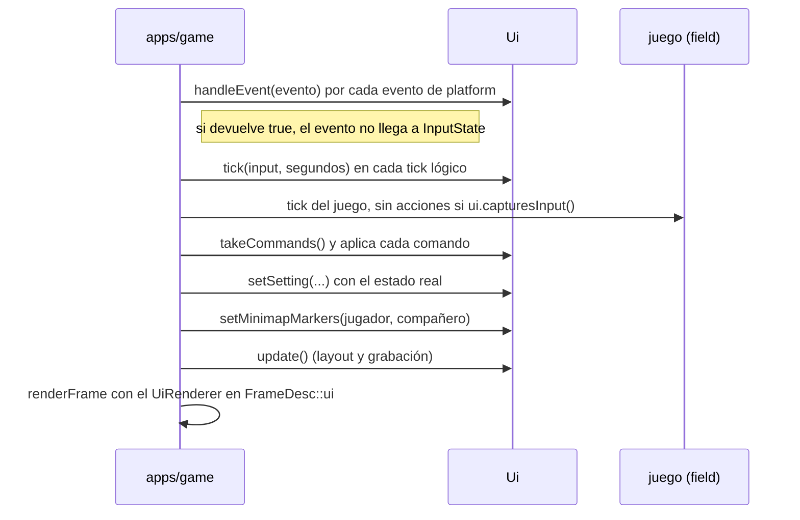

# UI

La UI del juego (menús y HUD) vive en `engine/ui`, en la capa de servicios, sobre RmlUi
([ADR 0009](../adr/0009-rmlui.md)). Las herramientas de depuración siguen con Dear ImGui (`engine/debug`).

## Piezas

| Pieza | Qué hace |
|---|---|
| `Ui` | La fachada que usa la app: carga documentos, los muestra, recibe eventos y acciones, devuelve comandos y dibuja |
| Interfaces de RmlUi (`src/rml_interfaces.*`) | Reloj y log (`SystemInterface`), ficheros por asset id (`FileInterface`), rutas relativas al documento y las imágenes generadas (`generated:<nombre>`) |
| `UiRenderer` | Un `render::Drawer` del pase de UI: dibuja lo que RmlUi grabó en `update()` con un pipeline propio (`shaders/rml.slang`, alfa premultiplicado) |
| Puente de render (`src/render_bridge.*`) | La `RenderInterface` de RmlUi: crea las texturas en el `Renderer` y graba cada llamada de dibujo para el `UiRenderer`; sin renderer (tests) solo da tamaños de textura |
| Scripts (`src/scripting.*`) | El `ScriptVm` propio de la UI, la API de Lua y los instanciadores de RmlUi: cada `<body>` es un `ScriptedDocument` con su entorno de Lua, y cada atributo `on*` un manejador en Lua |
| `Navigation` | Convierte las acciones de un tick en pasos de navegación, con repetición al mantener una dirección |
| `promptControl`, `promptLabel` | El control que dispara una acción en el último dispositivo usado (`key:enter`, `gamepad:south`) y su nombre para el jugador, en el idioma del juego (`localization/<idioma>/prompt.yaml`) |
| Textos | Los textos salen del `localization::Catalog` que da la app (`UiDesc::texts`; sin él, la UI carga el inglés): `text-key` en el RML, `t()` en Lua, y `refreshTexts()` al cambiar de idioma ([localización](localizacion.md)) |
| `FontEngine` (`src/font_engine.*`), `BitmapFont` | El motor de fuentes de RmlUi con la familia `original-look` encima: dibuja con la fuente de mapa de bits del original o con la moderna, según el ajuste `text_font` (ver [Aspecto original](#aspecto-original)); el resto de familias va al motor de RmlUi (FreeType) |
| `buildMinimap` | Dibuja el minimapa desde una rejilla de celdas (`MinimapGrid`) y da el `MinimapLayout` que sitúa posiciones del mundo en la imagen |

`ui` no conoce el juego: recibe valores planos (la rejilla del minimapa, las posiciones de los marcadores, los
ajustes) y devuelve comandos con nombre. La app hace de pegamento.

## Ciclo de un frame



## Arranque

```cpp
auto uiRenderer = ui::UiRenderer::create(renderer);           // después del Renderer
auto ui = ui::Ui::create({.files = &vfs, .renderer = uiRenderer->get(), .texts = &catalog, .width = w,
                          .height = h, .scale = 1.0F, .hotReload = true, .clock = {}, .scripts = {}});
ui->loadDocument("hud", hudId);                                // ui/hud/document
ui->loadDocument("pause_menu", menuId);                        // ui/pause_menu/document
ui->loadDocument("main_menu", mainMenuId);                     // ui/main_menu/document
ui->setMenuDocument("pause_menu");
ui->show("hud");
ui->show("main_menu", true);                                   // al arrancar
ui->setMinimap(ui::minimapGridOf(map), claveDelNombre);        // en cada cambio de mapa: main.map_names.0003
ui->refreshTexts();                                            // tras catalog.setLanguage(...)
```

Se destruyen al revés: `Ui` (suelta sus texturas en el renderer), `UiRenderer`, `Renderer`.

## Dibujo

RmlUi dibuja en dos tiempos. `Ui::update()` hace el layout y llama a `Render()` de RmlUi fuera del frame: la
`RenderInterface` crea las texturas que falten (`Renderer::queueTexture`, con alfa premultiplicado; las imágenes de
fichero se premultiplican al cargarlas) y graba cada `RenderGeometry` con su traslación, textura, recorte (scissor) y
transformación. La geometría se sube una sola vez, cuando RmlUi la compila (`CompileGeometry`), a dos buffers de GPU
(`rhi::Buffer::createMapped`), que se liberan con la destrucción diferida del dispositivo cuando RmlUi la suelta, así
que los frames en vuelo pueden seguir dibujándola. Si no hay memoria para la geometría de un elemento, ese elemento
no se dibuja (con un aviso en el log) y el resto de la UI sí. Después, en `renderFrame`, `UiRenderer::draw` solo
enlaza esos buffers y dibuja cada llamada. El recorte se ajusta al target. Las máscaras de
recorte de RmlUi (`EnableClipMask`) no están implementadas: solo hacen falta para recortar elementos transformados.

## Entrada

- **Ratón:** movimiento, botones y rueda van a RmlUi en píxeles físicos. Un clic o una rueda se quedan en la UI si
  hay un documento modal o si el puntero está sobre un elemento que acepta el puntero. El HUD declara
  `pointer-events: none`, así que nunca roba clics al juego. Con un menú abierto el foco sigue al puntero cuando
  este entra en otra entrada; un puntero quieto (o que tiembla sobre la misma entrada) no le quita el foco al
  teclado ni al mando, y tampoco la posición que da la ventana tras un cambio de tamaño o al recuperar el foco, que
  el jugador no ha movido. El clic derecho vuelve atrás, como `cancel`.
- **Pérdida del foco de la ventana** (`FocusLost`): los botones del ratón pulsados sobre la UI se sueltan sin hacer
  clic, porque la ventana no verá cuándo se sueltan de verdad.
- **Teclado y mando:** no se leen teclas, sino las acciones de `InputState`: `move_up/down/left/right` (teclas, cruceta
  y stick), `confirm`, `cancel` y `menu`. Cada paso va primero al `on_action` del documento modal; si no lo atiende,
  las direcciones mueven el foco con las propiedades `nav` de RmlUi, `confirm` hace clic en el elemento con el foco y
  `cancel`/`menu` cierran el documento.
- **Sin menú**, solo `menu` hace algo: abre el documento de menú (`setMenuDocument`). Durante el tick en que la UI
  usa una acción, `capturesInput()` es true, así que la misma pulsación no llega también al juego.
- **Avisos de botones:** `ui.prompt(acción)` da el nombre del control según el último dispositivo y la familia del
  mando (`Intro`/`Esc`, `A`/`B`, `Cruz`/`Círculo`, `B`/`A` en Nintendo). El motor solo nombra el control
  (`key:enter`, `mouse:left`, `gamepad:south`, `gamepad:left_stick`); el texto sale de la tabla `prompt` del idioma
  del juego (`localization/<idioma>/prompt.yaml`): `prompt.key.enter`, `prompt.gamepad.south`, y
  `prompt.family.<familia>.<botón>` para los botones que cada familia nombra a su manera. Las letras, cifras y
  F1–F12 sin entrada se muestran tal cual. Cuando cambia el dispositivo, los documentos visibles reciben `on_device`;
  cuando cambia el idioma, `on_language`.
- **Mando virtual:** `Platform::attachVirtualGamepad` conecta un mando de software que pasa por el mismo camino que uno
  real. Lo usan los tests de `platform` y la demo (`--virtual-gamepad`).

## Escala

El contexto mide la ventana en píxeles. Las medidas de RCSS van en `dp`; un dp es un píxel a 720 líneas, y la
proporción es `min(alto/720, ancho/960)` (entre 0,5 y 8) por la escala que elige el jugador (`setScale`), que se
limita a `[Ui::MinScale, Ui::MaxScale]` = [0,5, 3]; un valor que no es un número se ignora. En una pantalla de alta
densidad la ventana tiene más píxeles y la proporción crece con ellos: el HUD y los menús ocupan lo mismo.

## Minimapa

`MinimapGrid` es la rejilla del mapa con tres clases de celda: bloqueada (transparente), transitable y salida.
`minimapGridOf(mapDocument)` la construye desde el `MapDocument`: las celdas con el bit `0x80` están bloqueadas y las de valor 110–119 son las
salidas de los warps 0–9 que llevan a algún mapa (`tamer.c`). Una celda de rejilla cubre 100 unidades; la celda
`(columna, fila)` empieza en `x = (columna − 50) · 100`, `z = (fila − 50) · 100` del mundo (`map_collision.c:
getTileTrigger`, con `world-space.md`).

`buildMinimap` recorta la imagen al rectángulo de las celdas transitables más un margen, rellena las celdas, dibuja
un borde donde tocan una pared y pinta las salidas de otro color. La imagen se registra como `generated:minimap/<n>`
y se muestra en los elementos del contrato del HUD. Los marcadores se colocan en porcentaje sobre el marco y giran
según la dirección en la que mira cada uno (arriba es −Z). `setMinimapMarkers` se llama en cada frame, pero la UI
guarda los elementos de los marcadores y lo que muestran: solo los vuelve a buscar cuando se cargan documentos, y
solo les cambia las propiedades cuando el marcador se ha movido.

### Contrato del HUD

La UI rellena estos ids en cualquier documento que los tenga (constantes en `dwe::ui::hud`, en `ui.hpp`). Un HUD de
un mod puede colocarlos y darles estilo como quiera, pero con estos ids y estos papeles:

| Id | Constante | Qué hace la UI |
|---|---|---|
| `minimap-image` | `hud::MinimapImage` | Un ``: le pone como `src` la imagen del minimapa del mapa actual |
| `minimap-frame` | `hud::MinimapFrame` | La caja que contiene la imagen y los marcadores: le da `width`, `height`, `left` y `top` en porcentaje para mantener la proporción del mapa dentro de su panel cuadrado |
| `minimap-name` | `hud::MinimapName` | Su texto es el nombre del mapa, el texto de la clave que da `setMinimap`, en el idioma del juego |
| `minimap-player`, `minimap-partner` | `hud::MinimapPlayer`, `hud::MinimapPartner` | Los marcadores: `left`, `top` (en porcentaje del marco), `transform: rotate(...)`, y `display: none` sin marcador |

## Comandos y ajustes

Los menús envían comandos con `ui.send(nombre, valor)` y la app los aplica. El primer menú usa:

| Comando | Valor | Ajuste que la app publica después |
|---|---|---|
| `quit` | — | — |
| `minimap_visible` | booleano | `minimap_visible` |
| `minimap_size` | `small`, `medium`, `large` | `minimap_size` |
| `fullscreen` | booleano | `fullscreen` |
| `ui_scale` | número (0,75–2) | `ui_scale` |
| `vsync` | booleano | `vsync` |
| `language` | código de idioma (`en`, `es`) | `language` (y la UI vuelve a poner todos sus textos) |
| `text_font` | `modern`, `original` | `text_font` (y la UI vuelve a componer los documentos con la fuente) |

La pantalla de combate (`ui/battle`) envía `battle_command` (el número del comando, `game::battle::Command`),
`battle_charge` (cada pulsación que carga el golpe final) y `battle_close` (cierra la caja del final). El menú de
pausa abre el del compañero con `open_partner_menu`, y este (`ui/partner_menu`) envía `bag_use`, `bag_drop` (el
número de la ranura), `bag_move` (`"<desde> <hasta>"`), `bag_sort` (el orden, 0 a 2), `partner_praise` y
`partner_scold`. Lo que dibujan lo publica el juego como ajustes con prefijo `battle.` (y `battle.phase`: `fight` o
`end`), `partner.` y `bag.`; el contrato está en el [README de apps/screens](../../apps/screens/README.md).

En la consola de depuración (y en los pasos `script` de los autotests), `battle("")` empieza un combate contra el
primer NPC del mapa que puede luchar, o contra los NPC que se le den (`battle("0,2")`), y `give_item("meat 3")` mete
objetos en la bolsa. Son ayudas de depuración hasta que corran los scripts de los mapas y existan cofres y tiendas:
el original empieza los combates desde los scripts de los NPC (`script_interp.c`: la operación `START_BATTLE`) y la
partida nueva empieza con la bolsa vacía. Decisión del responsable de diseño (2026-10-21): hasta que corran los guiones
de los mapas en la fase 4, `battle("")` es el único disparador de combates.

Otros ajustes los publica el juego sin que un menú los pida:

| Ajuste | Valor | Qué es |
|---|---|---|
| `screen_fade` | número de 0 a 1 | Cuánto quita de la pantalla el fundido del cambio de mapa, que el render resta de la escena debajo de la UI; el HUD desvanece con él sus paneles |
| `map_title_key` | clave de texto | La clave del nombre del mapa al que lleva el cambio de mapa (`main.map_names.NNNN`) mientras el original lo enseña (fotogramas 10 a 20 del fundido de salida); vacía el resto del tiempo o si el mapa no tiene nombre. El HUD pone su texto en el idioma del jugador (`t()`) en el centro, delante del fundido, y lo reescribe al cambiar de idioma |

## Aspecto original

El texto que imita al original (de momento, el nombre del mapa del cambio de mapa) usa la clase `.original-look` de
`ui/common/theme.rcss`, que pone la familia `original-look` y el color de la tinta de la fuente del original (`#d6d6d6`,
el color 1 de su CLUT, `0x6B5A`). Cualquier documento puede usarla para otro texto con ese aspecto.

- **La familia** la describe `ui/fonts/original_look.yaml` del paquete `game` (esquema `ui_text_font`): su nombre, la
  fuente moderna (`Noto Sans`), la elección por defecto y la fuente de mapa de bits (`font/main.png` y
  `font/main_meta.yaml` del paquete base, que escribe `dwx extract`; ver [textos](../formats/textos.md#fuente)), con su
  línea base y el tamaño de la moderna que dibuja lo que le falta. El juego solo lee ese PNG y ese YAML, nunca el
  disco.
- **`FontEngine`** se instala sobre el motor de RmlUi al arrancar la UI y le pasa todas las familias menos
  `original-look`. Con `original`, esa familia dibuja cada glifo desde el atlas: un glifo responde a su carácter
  (`Ａ`) y a su equivalente ASCII (`A`), la tinta es blanca y la tiñe el `color` de RCSS, y crece en múltiplos enteros
  (`round(tamaño / 11)`, al menos 1) con los píxeles en coordenadas enteras, así que se ve nítida a cualquier
  resolución. Los caracteres que no tiene (ñ, á, ¿, ¡, paréntesis...) los dibuja la moderna en la misma línea base,
  al tamaño de la línea de mapa de bits por `fallback_size`; nunca se dibuja el glifo de sustitución del original.
  Sin la fuente extraída, `original` dibuja con la moderna (con un aviso en el log).
- **El ajuste `text_font`** (`modern` u `original`) es del jugador: `Ui::setTextFont` lo cambia y vuelve a componer y
  dibujar en el momento todos los documentos abiertos (`Rml::ReleaseFontResources`). El valor por defecto es dato
  (`default` en `original_look.yaml`). El jugador lo elige en el menú principal (entrada «Fuente del texto», junto al
  idioma, con los textos `main_menu.text_font`, `main_menu.text_font.modern` y `main_menu.text_font.original` de
  `localization/<idioma>/main_menu.yaml`), que manda el comando `text_font`; la app lo guarda junto al idioma en
  `settings.yaml` de los datos del usuario y lo publica como ajuste `text_font`. También lo ponen `--text-font`
  (autotests, que no leen ni escriben los ajustes del jugador) y `text_font("original")` en la consola de depuración.

Decisiones del responsable de diseño sobre el nombre del mapa (ver la [ficha del campo](../reference/campo.md)):

| Decisión | Qué hace el motor |
|---|---|
| La fuente del nombre del mapa es un ajuste del jugador: la de mapa de bits del original o la moderna. Por defecto, la moderna (decisión del responsable de diseño, 2026-10-20) | Ajuste `text_font`; `default: modern` en `original_look.yaml` |
| El HUD del motor se desvanece con alfa durante el cambio de mapa. El original no tiene HUD fijo en el campo: lo que dibuja (personajes, barras de estado de `partner_impl.c: renderStatusBars`, ventanas) queda detrás del rectángulo del fundido (capa 1 del orden, `fade.c: renderFade`) y se oscurece restándole el mismo gris; solo el nombre del mapa va delante (capa 0). Desviación aprobada (decisión del responsable de diseño, 2026-10-20) | `screen_fade` en el HUD, que baja la opacidad de sus paneles |
| El nombre del mapa va centrado exacto, sin imitar el desvío de unos píxeles del original (`x = 12 − (largo / 2) × 8` con los espacios de relleno), y sin opción para imitarlo (decisión del responsable de diseño, 2026-10-20) | `text-align: center` en `#map-title` |

## Scripts

- **Entornos:** cada documento tiene su entorno de Lua con copias propias de las bibliotecas (`string`, `table`,
  `math`, `utf8`, `coroutine`) y de la tabla `ui`; `_G` es el propio entorno y `getmetatable` solo enseña las de
  tablas. Un documento no puede cambiar lo que ve otro.
- **Presupuesto:** cada llamada de la UI a Lua (un manejador, un `on_*`, `callScript`) tiene el presupuesto de
  instrucciones de `UiDesc::scripts`. Lo que esa llamada provoca (los manejadores de los elementos a los que hace
  `click()`, los `on_show` de lo que muestra) corre dentro de ella y gasta del mismo presupuesto, así que un bucle de
  clics también se para.
- **Límites:** los nombres que pasa un script (ids, clases, documentos, comandos, ajustes) tienen como mucho 256
  bytes y los textos 64 KiB; en la cola caben 256 comandos entre dos `takeCommands()`. Pasarse es un error de Lua en
  el script.
- **Errores de Lua y C++:** Lua lanza sus errores con `longjmp`, que se salta los destructores de C++. Las llamadas a
  Lua convierten sus argumentos dentro de un `lua_pcall`, y las funciones de la API toman las cadenas como vistas de
  las de Lua y devuelven sus resultados en una llamada protegida tras la que solo quedan valores planos: quedarse sin
  memoria en medio no deja nada sin liberar (hay un test con LeakSanitizer). Lo que queda fuera son las referencias
  de sol2 que se crean al cargar un documento.

## Recarga en caliente

Con `hotReload`, la UI mira cada medio segundo los ficheros de cada documento (el RML, sus estilos y sus scripts).
Si alguno cambió, carga el documento de nuevo y solo lo cambia por el viejo si la carga funcionó: una edición rota
deja el viejo funcionando (con un error en el log) hasta la siguiente edición. Un documento visible se vuelve a
mostrar en su sitio: si era modal, los documentos que estaban encima siguen encima.

## Demo

`dwe-game --ui-demo [--map <id>] [--size <ancho>x<alto>] [--virtual-gamepad <fichero>]` abre el HUD con el minimapa
del mapa (por defecto `twna01`; uno de prueba si no hay contenido extraído) con un jugador y un compañero que pasean
solos, y el menú de pausa con sus comandos aplicados (`quit`, ventana completa, escala, minimapa). Registra en el log
cada comando y cada cambio de foco del menú. Con `--virtual-gamepad`, lee del fichero, según crece, órdenes para un
mando virtual: `attach playstation`, `tap dpad_down`, `press south`, `release south`, `axis left_y 0.8`.

## Tests

`dwe_ui_tests` funciona sin GPU: carga los documentos reales del paquete `game` desde el árbol de fuentes, recorre el
menú con teclado, con mando y con ratón, comprueba los avisos, el minimapa y sus marcadores, el texto con aspecto original con una fuente de mapa de bits de
prueba (el cambio de fuente en el momento y los caracteres que faltan), la escala (también en
alta densidad), los entornos de Lua, el presupuesto compartido, los límites, la falta de memoria y la recarga en
caliente.

La demo registra cada pocos segundos lo que cuesta la UI en la CPU por frame (marcadores, layout y grabación de las
llamadas) y cuántas llamadas de dibujo hace.
