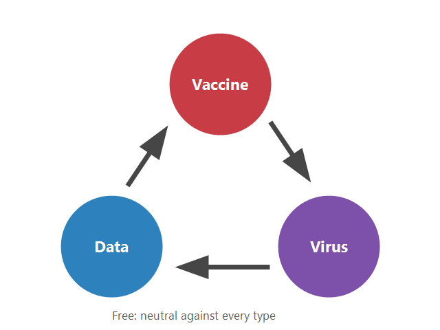

# Diseño del sistema de combate

> Documento de diseño del sistema de combate de Digimon World Project Folder (DWPF). Las propuestas aún no validadas se identifican como **provisionales** o **pendientes de balance**.

---


# 1. Visión y filosofía de combate

## 1.1 Visión general

DWPF busca conservar la esencia de Digimon World: los Digimon combaten de manera autónoma mientras el entrenador interviene mediante órdenes y decisiones tácticas. El sistema amplía las opciones del jugador sin convertir el combate en control directo, acción manual ni una rotación tradicional de habilidades.

La profundidad debe surgir de la preparación, las técnicas, las estadísticas, el posicionamiento, el comportamiento, la lectura del combate y la cooperación entre jugadores.

## 1.2 Principios

- **Autonomía:** el Digimon ejecuta sus acciones y se adapta al contexto.
- **Control táctico:** el entrenador decide las acciones importantes, especialmente qué técnica utilizar y contra quién.
- **Preparación:** atributos, arsenal y configuración previa importan.
- **Identidad:** los Digimon deben diferenciarse por capacidades, dimensiones, técnicas y comportamiento.
- **Cooperación:** varios jugadores pueden generar oportunidades tácticas y complementarse.
- **Posicionamiento:** alcance, terreno, obstáculos, hitboxes y tamaño influyen en el combate.
- **Accesibilidad:** el jugador debe poder tomar decisiones útiles sin gestionar constantemente una multitud de menús.

## 1.3 Papel del entrenador

El entrenador dirige el combate mediante órdenes. Entre sus acciones se contemplan:


- Seleccionar una técnica.
- Seleccionar o cambiar un objetivo, cuando corresponda.
- Utilizar objetos.
- Coordinar acciones con otros jugadores.
- Tomar decisiones tácticas ante cambios en el combate.

El jugador no controla directamente cada movimiento. Su habilidad se expresa principalmente en la lectura de la situación, la elección de acciones, el momento de utilizarlas y la coordinación.

## 1.4 Experiencia buscada

Los combates deben permitir situaciones emergentes. Un Digimon puede destacar por el daño, otro por su capacidad para resistir o controlar espacio, y otro por mantener al equipo mediante soporte. Estas diferencias deben surgir de sus características y configuración, no de clases rígidas.

---

# 2. Sistema de órdenes

## 2.1 Filosofía

El entrenador selecciona la acción estratégica; el Digimon conserva autonomía para ejecutarla. La orden define **qué hacer**, mientras la IA determina **cómo hacerlo** dadas las condiciones actuales.

El sistema busca reducir la aleatoriedad de la selección de técnicas sin eliminar toda incertidumbre del combate. Variaciones de daño, aplicación de efectos u otros elementos podrán seguir siendo probabilísticos.

## 2.2 Órdenes principales

La propuesta contempla:

- **Técnica:** seleccionar una técnica aprendida y equipada.
- **Objetivo:** seleccionar un objetivo cuando la acción lo requiera.
- **Objeto:** utilizar un recurso válido.
- **Cambios tácticos:** emitir una nueva orden o modificar el objetivo.
- **Movimiento:** fijar la postura que define cómo se posiciona el Digimon entre órdenes (2.9).

La lista definitiva de órdenes, accesibilidad y distribución en la interfaz queda pendiente de diseño.

## 2.3 Selección de técnicas

El entrenador selecciona directamente una técnica del arsenal disponible. Ejemplos: Mega Flame, Thunder Justice, Dynamite Kick, Heal, Speed Charge, Defense Charge, Counter o Poison Powder.

La selección no obliga a ejecutarla instantáneamente: el Digimon valida las condiciones, se posiciona y la realiza cuando sea posible. La IA **no sustituye la técnica ordenada por otra elegida autónomamente**.

## 2.4 Selección de objetivos

Cuando una orden requiere objetivo, el entrenador establece la referencia. El Digimon puede seguir su movimiento y recalcular el posicionamiento, pero no cambia arbitrariamente a otro enemigo.

Si el objetivo queda derrotado, inaccesible o deja de ser válido, la orden deberá resolverse mediante un estado definido (por ejemplo, cancelación, espera o retorno a una condición segura). El comportamiento exacto es pendiente de implementación y pruebas.

## 2.5 Responsabilidades

| Entrenador | Digimon |
|---|---|
| Selecciona la técnica | Valida y ejecuta la técnica ordenada |
| Selecciona el objetivo | Se orienta, aproxima o mantiene distancia |
| Decide el momento y la prioridad | Adapta el movimiento al entorno |
| Utiliza objetos y recursos | Gestiona la ejecución de la orden |
| Coordina con otros jugadores | Reacciona a interrupciones y cambios de estado |
| Define la postura de movimiento | Ajusta el posicionamiento a la postura activa |

## 2.6 Ejemplo

El entrenador selecciona Mega Flame y un enemigo. El Digimon procesa la orden, comprueba las condiciones, se orienta, busca una posición válida según el alcance, ejecuta la técnica y entra en recuperación. Si el objetivo se mueve, podrá ajustar su posición; si la orden deja de ser válida, deberá resolverla sin cambiar de técnica por iniciativa propia ni quedar atrapado en intentos repetitivos.

## 2.7 Multiplayer

La selección directa permite planificar acciones entre jugadores: control mientras otro prepara daño, recuperación mientras un compañero mantiene presión, ataques coordinados o distribución de objetivos. El cooperativo deberá evitar ser una simple acumulación de órdenes y daño.

## 2.8 Decisiones

- Existe una cola de ordenes sencilla de máximo 2 acciones, la velocidad con la que pueden ser reemplazadas depende de la velocidad de ejecución de la acción, lo que permite que digimons mas inteligentes respondan mas rápido, la interfaz debería reflejar que esta encolado y que no

- Las órdenes recibidas durante una ejecución o recuperación, simplemente se encolan hasta estar disponibles de realizarse.

- Si el MP insuficiente el digi no ya no ejecuta habilidades, simplemente ejecuta acciones de movimiento, las condiciones inválidas simplemente cancelan la acción y el digimon reintenta repetirla o si fue sobre escrita, entonces ejecuta la nueva acción.

- No todos los ataques de área dañan a tus aliados, pero en general estos siempre lo hacen, todas las demás técnicas ofensivas no deben tener fuego amigo, auto objetivo y soporte siempre funcionan siempre que estén a rango.

- En multiplayer todas las órdenes ocurren en paralelo y cada digi tiene su cola.

## 2.9 Órdenes de movimiento

**Propuesta provisional.** Las órdenes de movimiento no sustituyen técnicas ni se encolan como acciones: fijan una **postura**, un contexto continuo que la IA usa para resolver el posicionamiento mientras ejecuta las órdenes. La última postura emitida es la activa y se mantiene hasta ser reemplazada.

| Postura | Comportamiento buscado |
|---|---|
| **Agresiva** | Aproximarse siempre al objetivo actual hasta **quemarropa**, aunque la técnica podría usarse desde más lejos: presionar de forma constante y buscar aperturas. Es la postura por defecto al empezar el combate. |
| **Mantener posición** | Conservar la posición actual. Solo se mueve si la técnica ordenada lo exige o para evitar un peligro evidente. |
| **Alejarse** | Mantener la separación en el **rango máximo** de la técnica equipada, más allá del alcance de la amenaza más peligrosa. Retrocede si es acorralado. |
| **Protegerse** | Priorizar la defensa: reducir exposición, confiar en bloqueo y mitigación y permanecer cerca del aliado al que se protege. |

Interacción con el resto del sistema:

- Una técnica ordenada siempre resuelve su propio posicionamiento: la postura ajusta la distancia preferida en la ejecución, pero nunca impide la técnica si sus condiciones exigen otra distancia.
- La Defensa siempre mitiga: al daño, después de aplicar todos los modificadores, se le resta la Defensa plana (§6.2). Con la postura **Protegerse** activa, esa resta se aplica doble (×2 DEF). El resultado puede quedar en 0: cubrirse anula por completo el daño cuando la defensa lo absorbe todo.
- En las posturas que no son **Protegerse** existe una probabilidad de cubrirse pasivamente basada en la Defensa: `DEF / 1000 × 30 %` (con DEF 1000, un 30 %; máximo 30 %). Si se cumple, ese golpe se resuelve como si estuvieras cubriéndote (×2 DEF); si no, se aplica el daño normal (×1 DEF).
- **Agotamiento y rotura de defensa:** cada golpe recibido suma su daño final a una **barra de defensa** cuya capacidad es `6 × DEF` usando siempre la **defensa actual**, recalculada de forma continua. Cuando la barra se llena, la defensa **se rompe**: el Digimon sufre los debuffs **−50 % ATK, −50 % VEL y −50 % DEF** durante **4 segundos**, no puede cubrirse (sin mitigación doble de Protegerse ni cobertura pasiva) y su postura pasa por defecto a **Mantener posición** mientras dura la rotura, salvo que una técnica ordenada exija otro posicionamiento.
- La barra se vacía con el descanso: sin recibir daño, vuelve hacia 0 en unos **6 segundos** desde llena. El mismo modificador VEL/DEF (hasta 30 % conjunto) puede acelerar el vaciado hasta ≈ 4,2 segundos. Durante la rotura la barra **baja de forma ininterrumpida** y se representa igual, con un **área roja** que indica el estado roto: la cobertura no se recupera hasta que desaparece el debuff de defensa rota.
- La inhabilitación se reduce de forma **proporcional** según VEL y DEF, hasta un **15 % cada estadística y un 30 % conjunto** (con ambas en 1000, "el límite", que puede cambiar; 4 s quedan en ≈ 2,8 s). La reducción usa los valores base: los debuffs de la rotura no alteran el cálculo de recuperación, pero sí el comportamiento.
- La interfaz debe mostrar la barra de defensa y el estado **Defensa rota** (capítulo 10) para que el jugador entienda la mecánica.
- Con MP insuficiente el Digimon no ejecuta técnicas y solo realiza movimiento: la postura define qué movimiento hace (regla de §2.8).
- Cambiar de postura no corta una ejecución o recuperación en curso: se aplica desde el siguiente momento en que se resuelve posicionamiento.
- La postura es del Digimon propio y no reemplaza el objetivo seleccionado. En multiplayer cada jugador emite la postura de su propio Digimon.

**Pendiente:** tolerancias y reglas de navegación por postura (capítulo 7) y si el soporte necesita una postura propia (permanecer cerca de quien debe ayudar). Está **decidido** (§6.2, §2.9, §3.8, §7.4): la resta efectiva `(Daño + Modificador de atributo + Modificador elemental) − Defensa − (Defensa adicional si se cubre; puede quedar en 0)`, con modificadores acumulados aditivamente sobre el daño base: elementales en pasos de 20 % con estructura 1 a 1 (ventaja, resistencia y STAB) y tipo Vaccine/Data/Virus ±25 % con Free neutro (§3.8); la cobertura pasiva `DEF / 1000 × 30 %` fuera de Protegerse; la barra con capacidad `6 × DEF` sobre la defensa actual, que se vacía en unos 6 s de descanso, acelerable hasta 30 % por VEL/DEF, y que durante la rotura baja de forma ininterrumpida mostrándose con un área roja; la rotura de 4 s, reducible de forma proporcional hasta 30 % (15 % por estadística), con debuffs −50 % ATK, −50 % VEL y −50 % DEF que no afectan al cálculo de recuperación; durante la rotura la postura pasa por defecto a Mantener posición y la cobertura vuelve al desaparecer el debuff; las posturas usan como distancia preferida el rango máximo de la técnica equipada, salvo Agresiva, que siempre busca quemarropa; el daño no atenúa con la distancia; y solo existe un atributo de velocidad (VEL, §6.2). Pendientes: la escala del modificador de atributo y el bonus de probabilidad de bloqueo por distancia (§6.2, §7.4).

---

# 3. Técnicas y arsenal

## 3.1 Filosofía

Las técnicas deben ofrecer herramientas ofensivas, defensivas, de soporte y control. No deben limitarse a variantes de daño: cada una necesita una función, una ventaja situacional o una interacción que justifique su existencia.

El catálogo parte de las **56 técnicas originales de Digimon World**, que se revisarán y adaptarán. Se plantea alcanzar **100 o más técnicas**, incorporando opciones de otros juegos y técnicas nuevas cuando aporten mecánicas relevantes. La cifra es un objetivo, no una obligación de contenido redundante.

## 3.2 Funciones

Las funciones no son excluyentes: una técnica puede pertenecer a más de una.

| Función | Propósito | Ejemplos de propiedades |
|---|---|---|
| Ofensiva | Infligir daño | Impacto, proyectil, elemental, área, multiimpacto |
| Defensiva | Evitar, reducir o gestionar daño | Escudo, mitigación, evasión, intercepción, protección |
| Soporte | Mejorar o recuperar capacidades | Curación, regeneración, buffs, recuperación de recursos, limpieza de estados |
| Control | Alterar capacidades o posición enemiga | Stun, confusión, veneno, slow, derribo, desplazamiento, interrupción |

Las funciones describen utilidad; no constituyen clases ni restringen qué Digimon puede aprender una técnica.

## 3.3 Especialidades

Las especialidades originales servirán de organización inicial. No determinarán por sí solas la función de una técnica.

| Especialidad | Identidad aproximada |
|---|---|
| Fire | Fuego y calor |
| Battle | Combate físico y técnicas directas |
| Air | Electricidad, viento y ataques aéreos |
| Earth | Naturaleza, insectos y efectos orgánicos |
| Ice | Hielo y frío |
| Mech | Tecnología, energía y ataques mecánicos |
| Filth | Suciedad y técnicas peculiares |
| Holy *(propuesta)* | Energía sagrada, protección, recuperación o daño de temática sagrada |
| Dark *(propuesta)* | Energía oscura, debilitamiento, corrupción u otros efectos de temática oscura |

Holy y Dark se consideran especialidades nuevas en evaluación, no funciones de soporte o control.

## 3.4 Ampliación y adaptación

Se investigarán técnicas de Digimon World 2, Digimon World 3, Next Order, Dawn/Dusk y otros títulos. Sus valores originales no se trasladarán automáticamente: cada técnica deberá adaptarse a tiempo real, órdenes, alcance, recuperación, efectos y multiplayer.

Criterios de adaptación:
- Aportar una mecánica o uso distinguible.
- Mantener una identidad reconocible.
- Ser compatible con el sistema de órdenes.
- Tener alcance, ejecución y recuperación comprensibles.
- Tener coste y riesgo justificados.
- Interactuar de forma razonable con otras técnicas.
- Ser útil en escenarios individuales y cooperativos, cuando corresponda.

Se priorizará la variedad funcional sobre la cantidad.

## 3.5 Técnicas distintivas

Cada Digimon podrá contar con una técnica distintiva que refuerce su identidad. No constituye una categoría genérica de técnicas únicas: su diseño, comportamiento, animación o efecto será propio del Digimon.

## 3.6 Efectos

Los efectos se definen como propiedades de una técnica y pueden combinarse:

- Stun o alteración de acciones.
- Confusión.
- Veneno y daño persistente.
- Ralentización.
- Buffs y debuffs.
- Derribo y desplazamiento.
- Interrupción.
- Recuperación y regeneración.
- Protección o escudos.

Duración, probabilidad, resistencia, acumulación y posibilidad de reaplicación deberán balancearse según el impacto real.

### Definiciones: buff y debuff

- **Buff:** modificador que aumenta un atributo, otorga protección o mejora el rendimiento de una acción mientras está activo. Ejemplos: ATK +20 % durante 10 s, regeneración, escudos.
- **Debuff:** modificador que reduce un atributo, impone un estado alterado o restringe acciones. Ejemplos: el debuff de rotura −50 % ATK / −50 % VEL / −50 % DEF (§2.9), ralentización, veneno.

Los estados alterados son un subtipo de debuff. Un modificador numérico se expresa como porcentaje sobre el atributo correspondiente, salvo que la regla indique un valor plano (como la resta de Defensa, §6.2). El apilamiento, la duración, la inmunidad y la disipación de buffs y debuffs quedan pendientes de balance. Donde el catálogo original (`tecnicas.md`) indique SPD, se interpreta como VEL.
## 3.7 Interrupciones y contraataques

La interrupción es una propiedad de ciertas técnicas o interacciones, no una categoría obligatoria del arsenal. Su fuerza dependerá del impacto, tipo de ataque, resistencia del objetivo, estado de la acción y otras condiciones.

Los contraataques podrán funcionar mediante estados o ventanas condicionadas en tiempo real: el Digimon adopta una postura y responde si ocurre una agresión válida dentro de las condiciones. No se plantea convertirlos en una mecánica por turnos.
## 3.8 Atributos elementales y afinidades

El sistema tiene dos capas de ventaja: los atributos elementales de las técnicas (§3.3) y el tipo Vaccine, Data o Virus de los Digimon.

### Atributos elementales: ventaja, resistencia y STAB

Cada técnica posee un atributo elemental y cada Digimon posee hasta tres atributos elementales. La escala de «quién vence a quién» sigue la estructura **1 a 1** de los Digimon modernos: cada atributo vence a exactamente uno y pierde contra exactamente uno. Los enfrentamientos no listados son neutrales (0 %):

| Atributo | Vence a | Pierde contra |
|---|---|---|
| Fire | Earth | Air |
| Earth | Air | Fire |
| Air | Fire | Earth |
| Ice | Filth | Battle |
| Filth | Mech | Ice |
| Mech | Battle | Filth |
| Battle | Ice | Mech |
| Holy | Dark | Dark |
| Dark | Holy | Holy |

Fire > Earth > Air > Fire forma un triángulo; Ice > Filth > Mech > Battle > Ice forma un cuadrado; Holy y Dark son un **par mutuo**, como Luz y Oscuridad en los juegos modernos: se golpean con ventaja y la reciben en ambos sentidos. Cuatro vínculos están respaldados por el ×2 de la tabla original de PS1 (Fire > Earth, Earth > Air, Ice > Filth, Filth > Mech); los demás se adaptaron para cerrar la estructura 1 a 1.

Los modificadores quedan **decididos** y valen siempre 20 %:

| Situación | Modificador |
|---|---|
| El atributo de la técnica vence a un atributo del objetivo | Daño **+20 %** |
| El atributo de la técnica vence a dos atributos del objetivo | Daño **+40 %** |
| Un atributo del objetivo resiste (vence) al de la técnica | Daño **−20 %** |
| Ventajas y desventajas cruzadas | se suman algebraicamente (ej. +20 % − 20 % = 0 %) |
| **STAB:** el Digimon que usa la técnica posee ese atributo elemental | **+20 %** adicional, una sola vez |

Los porcentajes se calculan sobre el daño base y entran en la fórmula (§6.2) como término de modificador elemental, acumulándose **de forma aditiva** entre sí y con la capa de tipo.

### Vaccine, Data, Virus y Free

Ciclo clásico (decidido):
**Vaccine > Virus > Data > Vaccine**


- Cuando el tipo del atacante vence al del defensor: **+25 % de daño adicional** sobre el conjunto de modificadores.
- Cuando el tipo del defensor vence al del atacante: se aplica el mismo 25 % en sentido inverso como reducción, de forma **simétrica** (decidido).
- **Free** es neutro contra todos: no aplica ni recibe modificador de tipo.

| Atacante ↓ \ Defensor → | Vaccine | Virus | Data | Free |
|---|---|---|---|---|
| **Vaccine** | 0 % | **+25 %** | −25 % | 0 % |
| **Virus** | −25 % | 0 % | **+25 %** | 0 % |
| **Data** | **+25 %** | −25 % | 0 % | 0 % |
| **Free** | 0 % | 0 % | 0 % | 0 % |

Esta capa se suma a la elemental (±20 % y STAB) dentro del mismo término de la fórmula (§6.2), acumulándose de forma aditiva: las tres fuentes de afinidad pueden componerse en un mismo golpe. Como antes: sin inmunidades absolutas ni resultados automáticos; ninguna capa debe sustituir estadísticas, técnicas, posicionamiento, composición o decisiones tácticas.
## 3.9 Balance y consumo de MP

Los costes originales de MP no son definitivos. El coste debe reflejar el rendimiento de la técnica, no solamente el daño.

| Variable | Impacto en el balance |
|---|---|
| Potencia | Daño potencial |
| Alcance | Seguridad y oportunidades de ejecución |
| Área | Cantidad y distribución de objetivos afectados |
| Ejecución | Exposición y posibilidad de reacción antes del impacto |
| Recuperación | Tiempo hasta poder actuar de nuevo |
| Control | Alteración de capacidades o comportamiento enemigo |
| Interrupción | Capacidad para cancelar acciones |
| Efectos | Valor adicional de la técnica |
| Coste MP | Frecuencia de utilización y gestión de recursos |
| Riesgo | Vulnerabilidad durante la ejecución |
| Condiciones | Requisitos específicos para usarla |

Una técnica de bajo daño puede justificar un coste alto si ofrece control significativo. Una técnica de alto daño puede compensarse mediante ejecución lenta, recuperación, riesgo o condiciones exigentes.

### Documentos complementarios

- [Sistema de costes de técnicas](costo-mp.md) — Fórmula de cálculo del MP, incluyendo daño, efectos, distancia, área y técnicas de soporte.
- [Catálogo de técnicas](tecnicas.md) — Las 56 técnicas originales de Digimon World con sus valores, y los candidatos Holy y Dark para la ampliación del arsenal.

## 3.10 Datos de una técnica

La estructura deberá ser extensible y no exigir todos los campos a todas las técnicas.

| Campo | Descripción |
|---|---|
| Nombre | Nombre de la técnica |
| Origen | Juego o fuente de referencia |
| Especialidad | Rama temática |
| Funciones | Ofensiva, defensiva, soporte, control o combinación |
| Tipo de daño | Tipo de daño o elemento, si aplica |
| Potencia | Valor base de daño |
| Coste MP | Consumo de recursos |
| Alcance | Distancia válida de ejecución |
| Área | Área de efecto, definida siempre en píxeles de distancia; puede ser «global» (§7.5) |
| Ejecución | Tiempo de preparación o ejecución |
| Recuperación | Tiempo posterior a la acción |
| Efectos | Propiedades adicionales y parámetros |
| Interrupción | Capacidad y nivel, si aplica |
| Desplazamiento | Movimiento impuesto o generado, si aplica |
| Resistencia | Protección durante la ejecución, si aplica |
| Objetivos | Usuario, aliados, enemigos, múltiples o selección especial |
| Condiciones | Requisitos o restricciones |
| Particularidades | Comportamientos adicionales |

## 3.11 Incorporación de técnicas

Antes de incorporar una técnica se evaluará:
- ¿Qué función cumple y qué la distingue?
- ¿Tiene una situación en la que resulta especialmente útil?
- ¿Su coste está justificado?
- ¿Qué riesgo, condición o limitación presenta?
- ¿Añade una posibilidad táctica?
- ¿Interactúa con el multiplayer?
- ¿Existe otra técnica que haga exactamente lo mismo?

Las técnicas redundantes podrán descartarse, fusionarse o modificarse.
## 3.12 Objetivo del arsenal

El objetivo es disponer de un arsenal amplio y variado, con alternativas útiles durante distintas etapas y composiciones. Superar las 100 técnicas es una referencia de contenido; no se añadirá una técnica solo para alcanzar esa cifra.

---

# 4. Comportamiento y ciclo de ejecución

> Este capítulo define **el flujo de una orden y sus estados de ejecución**. Las estadísticas que modifican ese flujo se especifican en el capítulo 6; el movimiento y la geometría, en el capítulo 7; y la arquitectura de IA, en el capítulo 11.

## 4.1 Principio

El Digimon conserva autonomía para ejecutar y adaptar la orden del entrenador. No elige una técnica sustituta ni cambia de objetivo por iniciativa propia.
## 4.2 Ciclo de una orden

El flujo general propuesto es:

1. **Recepción:** la orden llega al Digimon.
2. **Procesamiento:** interpreta técnica, objetivo y parámetros.
3. **Validación:** comprueba recursos, disponibilidad y condiciones.
4. **Preparación:** resuelve orientación y posicionamiento necesarios.
5. **Ejecución:** realiza la técnica o acción ordenada.
6. **Recuperación:** aplica el estado posterior a la ejecución.
7. **Finalización:** la orden termina y queda disponible para otra.

Este ciclo es conceptual; algunas técnicas podrán omitir estados o utilizar fases especiales.
## 4.3 Estados de ejecución

**Propuesta de estados:**

| Estado | Propósito |
|---|---|
| Idle | No tiene una orden activa; permanece disponible |
| Processing | Interpreta la orden y evalúa condiciones |
| Positioning | Se mueve u orienta para cumplir condiciones |
| Preparing | Realiza preparación previa, si la técnica la requiere |
| Executing | Ejecuta la acción |
| Recovering | Cumple recuperación o restricción posterior |
| Interrupted | La acción ha sido interrumpida y debe resolverse |
| Failed/Invalid | No puede continuar con la orden actual |
| Cancelled | La orden fue cancelada o reemplazada |

La lista, transición y nombres definitivos deberán ajustarse a la implementación. No todos los estados necesitan ser visibles al jugador.
## 4.4 Adaptación durante una orden

Durante una orden, el Digimon puede:
- Reorientarse hacia el objetivo.
- Actualizar su posición si el objetivo se mueve.
- Recalcular la ruta si hay obstáculos.
- Ajustar distancia para cumplir el alcance.
- Reaccionar ante daño, interrupción o pérdida de condiciones.

La adaptación modifica la ejecución, no la intención de la orden.
## 4.5 Interrupción, cancelación y reemplazo

Estas situaciones deben distinguirse:
- **Interrupción:** un evento externo altera o detiene una acción en curso.
- **Cancelación:** la orden deja de ser válida o se cancela mediante una regla del sistema.
- **Reemplazo:** el entrenador emite una nueva orden que sustituye la anterior, según las reglas de prioridad.

El tratamiento de animaciones, recuperación, coste de MP, penalizaciones y posibilidad de retomar queda pendiente de especificación por técnica y pruebas. Decidido por ahora (folder-battle.md, "Interrumpida por un golpe"): un golpe interrumpe una técnica solo hasta que se compromete, en el punto de compromiso del original (cuando su efecto ya lanzó la parte que golpea); el daño continuo como el veneno nunca interrumpe.
## 4.6 Orden inválida o imposible

Si una orden no puede ejecutarse (MP insuficiente, técnica no disponible, objetivo inválido, bloqueo, alcance imposible u otra condición), el Digimon deberá salir del intento y entrar en un estado válido. No deberá repetir indefinidamente el mismo movimiento, cambiar de técnica ni escoger un objetivo alternativo sin autorización.

La respuesta exacta (esperar, cancelar, avisar o permitir nueva orden) se definirá junto con la interfaz.
## 4.7 Objetivo de diseño

El comportamiento debe sentirse autónomo, pero predecible en sus reglas: el jugador entiende qué orden emitió y por qué el Digimon está intentando ejecutarla. La adaptación evita movimientos rígidos; la consistencia evita que la IA contradiga la orden.

---

# 5. Roles de combate

> Los roles son etiquetas descriptivas para entender las contribuciones de un Digimon; no son clases ni restricciones.

| Rol | Función | Ejemplos de capacidades |
|---|---|---|
| Ofensivo | Concentrar daño o presión | Daño, ejecución, multiobjetivo |
| Defensivo | Resistir o proteger espacio y aliados | Mitigación, protección, intercepción |
| Control | Alterar el desarrollo del combate | Stun, desplazamiento, interrupción, debilitamientos |
| Soporte | Mantener o mejorar al equipo | Curación, buffs, recuperación, protección |
| Versátil | Adaptarse a diferentes situaciones | Combinación de capacidades |

Los roles no son exclusivos. Un Digimon puede cumplir varios según sus estadísticas, técnicas y configuración. No se restringirá el arsenal por rol ni se hará depender la IA de una etiqueta rígida.

---

# 6. Estadísticas y atributos

> Este capítulo centraliza la definición de atributos y sus efectos. Los demás capítulos solo los referencian para evitar duplicar fórmulas.

## 6.1 Principios

Las estadísticas deben crear diferencias perceptibles entre Digimon y ofrecer decisiones de preparación, sin invalidar técnicas, órdenes, posicionamiento o cooperación. Los valores y fórmulas aquí descritos son referencias de diseño; deberán validarse mediante pruebas.

## 6.2 Atributos de combate

La propuesta contempla las estadísticas tradicionales y los atributos específicos del sistema:

| Atributo | Función propuesta |
|---|---|
| HP | Capacidad de recibir daño antes de quedar derrotado |
| MP | Recurso utilizado para ejecutar técnicas |
| ATK | Influencia en el daño de determinadas acciones ofensivas |
| DEF | Mitigación plana del daño: `Daño final = (Daño + Modificador de atributo + Modificador elemental) − DEF − (DEF adicional si se cubre; puede quedar en 0)` (§2.9), donde el modificador elemental se calcula sobre el daño base según §3.8 (±20 %, STAB y tipo +25 %). En las demás posturas, DEF otorga cobertura pasiva con probabilidad `DEF / 1000 × 30 %`. DEF define también la capacidad de la barra de agotamiento (`6 × DEF` sobre la defensa actual), participa, con VEL, en la reducción proporcional de la rotura (15 % cada una) y recibe su propio debuff −50 % mientras la defensa está rota (§2.9). Estructura decidida; la escala del modificador de atributo queda pendiente de balance |
| SPD | Estadística original que **deja de existir como atributo separado**: se integra en VEL (ver la decisión bajo la tabla) |
| VEL | Único atributo de velocidad del sistema: movimiento físico, reacción física, velocidad de ejecución de técnicas y destino de los efectos de «velocidad» de buffs, debuffs y rotura |
| INT | Procesamiento de órdenes, evaluación de condiciones y adaptación |

**Decidido:** solo existe un atributo de velocidad, **VEL**. La SPD original se integra en él y no se conserva como estadística independiente; todos los efectos, buffs, debuffs y textos que hablen de «velocidad» (incluido el debuff −50 % de la rotura, §2.9) se aplican sobre VEL.
## 6.3 Rango de INT y VEL

Para las fórmulas de referencia se utiliza un rango de **0 a 1000**. Si el juego utiliza otro rango en la progresión, deberá normalizarse antes de aplicar los multiplicadores.
## 6.4 VEL — Movimiento y ejecución

VEL representa capacidad física y velocidad: desplazamiento, reacción física y ejecución de técnicas.

### Movimiento

```text
MovementMultiplier = 0.75 + 0.5 × (VEL / 1000)
```

El multiplicador propuesto va de 0.75x a 1.25x de la velocidad base.

| VEL | Multiplicador |
|---:|---:|
| 0 | 0.75x |
| 200 | 0.85x |
| 400 | 0.95x |
| 600 | 1.05x |
| 800 | 1.15x |
| 1000 | 1.25x |

### Ejecución de técnicas

```text
ExecutionMultiplier = 1.0 - 0.4 × (VEL / 1000)
```

La propuesta reduce el tiempo de ejecución hasta un 40%.

| VEL | Tiempo relativo |
|---:|---:|
| 0 | 100% |
| 200 | 92% |
| 400 | 84% |
| 600 | 76% |
| 800 | 68% |
| 1000 | 60% |

Ejemplo, para una técnica con 2 segundos base:

| VEL | Tiempo resultante |
|---:|---:|
| 0 | 2.00 s |
| 200 | 1.84 s |
| 400 | 1.68 s |
| 600 | 1.52 s |
| 800 | 1.36 s |
| 1000 | 1.20 s |

VEL no aumenta directamente el daño. El efecto sobre recuperación, animaciones, interrupciones y otras acciones físicas deberá definirse por separado; no se asumirá que todos los tiempos se reducen con la misma fórmula.
## 6.5 INT — Procesamiento y adaptación

INT representa la capacidad de procesar órdenes, evaluar condiciones y responder a cambios tácticos. No aumenta la velocidad física ni permite seleccionar técnicas por cuenta propia.

```text
ResponseMultiplier = 1.0 - 0.5 × (INT / 1000)
```

La propuesta reduce el tiempo de procesamiento hasta un 50%.

| INT | Tiempo relativo |
|---:|---:|
| 0 | 100% |
| 200 | 90% |
| 400 | 80% |
| 600 | 70% |
| 800 | 60% |
| 1000 | 50% |

Ejemplo para un tiempo base de procesamiento de 0.8 segundos:

| INT | Tiempo resultante |
|---:|---:|
| 0 | 0.80 s |
| 200 | 0.72 s |
| 400 | 0.64 s |
| 600 | 0.56 s |
| 800 | 0.48 s |
| 1000 | 0.40 s |

INT podrá influir en el procesamiento de nuevas órdenes, evaluación de condiciones, detección de cambios, actualización de rutas, respuesta a interrupciones y resolución de órdenes inválidas. La implementación deberá evitar que INT provoque comprobaciones excesivas o reevaluaciones innecesarias.
## 6.6 Atributos y afinidades

El capítulo 3.8 define dos capas con valores y tablas ya decididos: los atributos elementales en estructura **1 a 1** (triángulo, cuadrado y par mutuo Holy-Dark) con pasos de ±20 % y STAB, y el tipo Vaccine, Data, Virus con **±25 %** simétricos (Free neutro). Ninguna capa debe sustituir las estadísticas del Digimon.
## 6.7 Principios de balance de atributos

- Ningún atributo debe ser obligatorio para que una estrategia sea viable.
- Los atributos no deben anular la toma de decisiones.
- Los efectos deben ser perceptibles, pero no extremos.
- No duplicar estadísticas: solo existe un atributo de velocidad (VEL; la SPD original queda integrada, §6.2) y ningún parámetro derivado debe reproducir su efecto.
- Los multiplicadores deberán probarse en los extremos y en valores intermedios.
- La progresión debe mantener utilidad en diferentes etapas del juego.

---

# 7. Posicionamiento y geometría

## 7.1 Filosofía

La posición, el tamaño y la forma de los combatientes deben tener consecuencias reales. La geometría no es solo decoración: determina alcance, acceso, espacio ocupado, colisiones, orientación y oportunidades de ataque.
## 7.2 Factores espaciales

El sistema deberá considerar:
- Distancia entre combatientes y alcance de técnicas.
- Hitboxes y dimensiones de cada Digimon.
- Orientación y dirección del ataque.
- Obstáculos y navegación.
- Espacio disponible alrededor del objetivo.
- Ataques que ocupen o atraviesen zonas.
- Posibles colisiones entre aliados y enemigos.
## 7.3 Tamaño y presencia física

El tamaño puede afectar el espacio ocupado, la facilidad de rodear al objetivo, bloqueo de rutas y oportunidades de intercepción. No debe traducirse automáticamente en ventaja de daño o resistencia.

Un Digimon grande podrá controlar espacio o bloquear una ruta de forma natural, mientras uno pequeño puede tener mayor facilidad para ocupar posiciones estrechas. Estas consecuencias deberán emerger de la geometría y no de bonificaciones arbitrarias.
## 7.4 Alcance y posicionamiento

Las técnicas definirán sus condiciones de distancia y área. La IA buscará una posición válida para ejecutar la orden, pero el jugador no necesita microgestionar cada movimiento.

Está **decidido** que la unidad de distancia y de área es el **píxel**: todo alcance y toda área de efecto se define en píxeles de distancia.

Está también **decidido** que la distancia **no atenúa el daño**: todos los objetivos dentro del rango reciben el mismo daño, estén en el borde del alcance o a quemarropa. Como contrapeso, el modificador de probabilidad de bloqueo recibe un **bonus según la distancia** entre atacante y objetivo (propuesta: cuanto más cerca, más fácil de bloquear; dirección final y magnitud pendientes de balance). La distancia preferida de las posturas se resuelve contra el rango máximo de la técnica, salvo Agresiva (§2.9).

**Pendiente:** medición de alcance, tolerancias, reglas de navegación, colisión, prioridad de espacio y tratamiento de terreno inaccesible.
## 7.5 Áreas de efecto

Todas las técnicas deben tener un área de efecto definida en píxeles de distancia. Las áreas deberán especificar forma, tamaño, punto de origen, orientación y reglas de impacto. Se admiten áreas **«globales»**: afectan a todos los objetivos válidos sin límite de distancia dentro del combate. El comportamiento ante aliados dentro del área, obstáculos y objetivos que se mueven durante la ejecución queda pendiente por técnica o familia de técnicas.
## 7.6 Objetivo de diseño

La geometría debe generar decisiones tácticas y diferencias entre Digimon sin provocar bloqueos constantes, navegación frustrante o ventajas injustas por tamaño.

---

# 8. Sistema de combate cooperativo

## 8.1 Objetivos

El cooperativo debe permitir que varios jugadores aporten decisiones y capacidades diferentes. La dificultad, distribución de objetivos y espacios de combate deben adaptarse al número de participantes sin limitarse a inflar HP y daño.
## 8.2 Coordinación

Se contemplan oportunidades como:
- Un jugador aplica control y otro concentra daño.
- Un jugador interrumpe mientras otro prepara una técnica.
- Un Digimon mantiene presión mientras otro recupera o protege.
- Los jugadores distribuyen objetivos.
- Se combinan ataques de área o efectos compatibles.
## 8.3 Interferencias entre aliados

El sistema deberá reducir interferencias frustrantes:
- Bloqueo accidental de rutas.
- Ocupación redundante del mismo espacio.
- Interrupción de posicionamiento de aliados.
- Ataques de área que afecten aliados, si el diseño contempla daño aliado.
- Múltiples Digimon intentando alcanzar una posición incompatible.

La solución no deberá eliminar completamente la interacción física. El posicionamiento compartido es parte de la táctica, pero debe ser legible y manejable.
## 8.4 Escalado de dificultad

**Propuesta pendiente de pruebas:** la dificultad por número de jugadores podrá ajustar composición, cantidad, capacidades, presión, patrones o recursos de los enemigos. No se asumirá que aumentar estadísticas es la única solución.

El escalado deberá considerar:
- Número de jugadores activos.
- Capacidad de control y curación del grupo.
- Cantidad de objetivos y espacio disponible.
- Duración del combate.
- Riesgo de que los enemigos pierdan capacidad de respuesta ante control simultáneo.
- Rendimiento y sincronización de la simulación.
## 8.5 Sincronización

Las órdenes, cambios de objetivo, estados, interrupciones, recursos y resultados de técnicas deben ser consistentes entre jugadores. La arquitectura y autoridad de red se definirán en el documento técnico de multiplayer.
## 8.6 Principios

- La cooperación debe premiar coordinación, no solo cantidad de jugadores.
- Cada jugador conserva control de las órdenes de su Digimon.
- La IA no debe tomar decisiones estratégicas que contradigan órdenes individuales.
- Evitar que la cantidad de jugadores trivialice el control o bloquee la simulación.
- La dificultad debe adaptarse de forma que preserve el ritmo y la identidad del combate.

---

# 9. Objetos y recursos

## 9.1 Filosofía

Los objetos deben ampliar las opciones tácticas y la preparación sin sustituir las técnicas ni convertirse en una obligación de uso constante.
## 9.2 Categorías propuestas

| Categoría | Función |
|---|---|
| Recuperación | Restaurar HP o MP, si el objeto lo permite |
| Curación de estados | Eliminar o reducir estados alterados |
| Mejora temporal | Modificar capacidades durante un periodo limitado |
| Utilidad | Resolver situaciones específicas o apoyar la estrategia |
| Revitalización | Recuperar a un Digimon derrotado, si se incorpora esta mecánica |

Estas categorías son propuestas y deberán contrastarse con los objetos disponibles y la economía del juego.
## 9.3 Uso durante el combate

Pendiente de definir:
- Quién puede utilizar objetos y bajo qué condiciones.
- Tiempo de uso y posibilidad de interrupción.
- Coste, cantidad y restricciones.
- Si el objeto afecta al Digimon propio, aliado o a un área.
- Cómo se comunica el resultado en la interfaz.
- Reglas de uso en cooperativo y sincronización.
## 9.4 Recursos

MP es el recurso central para las técnicas. Sus costes se documentan en `costo-mp.md`. HP, MP, consumibles y cualquier recurso adicional deberán tener funciones diferenciadas para evitar sistemas redundantes.
## 9.5 Principios

- Los objetos no deben invalidar el coste de MP ni la elección de técnicas.
- Su uso debe tener oportunidad, coste o limitación comprensible.
- La interfaz debe mostrar claramente su efecto y disponibilidad.
- El multiplayer debe evitar duplicaciones o resultados inconsistentes.

---

# 10. Interfaz de combate

## 10.1 Objetivos

La interfaz debe comunicar el estado del combate y permitir que el entrenador emita órdenes con rapidez. Debe minimizar la navegación por menús y hacer visibles las decisiones relevantes.
## 10.2 Información prioritaria

Propuesta de información:
- HP y MP del Digimon propio.
- Técnica seleccionada y técnicas disponibles.
- Coste y disponibilidad de MP.
- Objetivo actual.
- Estados alterados relevantes.
- Estado de ejecución (procesando, posicionándose, ejecutando, recuperándose o impedido).
- Barra de agotamiento de defensa; durante la rotura, la misma barra con un **área roja** indicando el estado **Defensa rota** (§2.9).
- Información relevante de aliados, cuando el multiplayer lo requiera.
## 10.3 Selección de órdenes

La interfaz deberá permitir seleccionar técnicas y objetivos, emitir órdenes, reemplazar o cancelar acciones según las reglas definitivas. Las técnicas no disponibles deben mostrar una razón clara, si es posible.
## 10.4 Feedback

El jugador deberá poder entender:
- Qué orden emitió.
- Si el Digimon la recibió.
- Si está intentando posicionarse.
- Si está ejecutando o recuperándose.
- Por qué no puede continuar, cuando sea relevante.
- Si la orden fue cancelada, interrumpida o reemplazada.

El feedback debe ser informativo sin saturar la pantalla.
## 10.5 Multiplayer

La interfaz deberá distinguir la información propia de la de aliados y permitir interpretar sus acciones sin duplicar innecesariamente todos los datos. El diseño visual y los controles definitivos quedan pendientes de prototipo.

---

# 11. IA y toma de decisiones

## 11.1 Responsabilidad

La IA es responsable de ejecutar órdenes de forma consistente y autónoma. No decide qué técnica estratégica utilizar ni selecciona técnicas sustitutas.

Este capítulo describe criterios de implementación y comportamiento; el ciclo visible de una orden se encuentra en el capítulo 4.
## 11.2 Prioridades

Propuesta de prioridades de procesamiento:
1. Mantener un estado válido (derrota, incapacitación u otra condición crítica).
2. Resolver interrupciones y eventos que invaliden la ejecución.
3. Procesar órdenes nuevas conforme a las reglas de prioridad.
4. Validar recursos, objetivo y condiciones.
5. Resolver posicionamiento y navegación.
6. Ejecutar la acción ordenada.
7. Gestionar recuperación y finalización.

La prioridad exacta y los estados especiales deberán definirse en implementación.
## 11.3 Consistencia

La IA deberá:
- Evitar seleccionar técnicas no ordenadas.
- Evitar cambiar de objetivo sin autorización o regla explícita.
- Evitar repetir intentos imposibles.
- Evitar oscillación de posición o rutas.
- Respetar hitboxes, obstáculos y alcance.
- Resolver órdenes canceladas o reemplazadas.
- Mantener un estado válido ante interrupciones y eventos simultáneos.
- Evitar conflictos de espacio con aliados cuando exista alternativa válida.
## 11.4 INT y VEL

INT y VEL modifican el procesamiento y el desempeño físico según las fórmulas del capítulo 6. La IA debe aplicar esos modificadores sin duplicarlos en otras capas del sistema.
## 11.5 Arquitectura

**Propuesta técnica pendiente:** separar al menos la recepción de órdenes, validación, navegación/posicionamiento, ejecución de técnica, reacción a eventos y recuperación. Las técnicas deben exponer datos que el sistema pueda consultar de manera uniforme, en lugar de implementar lógica ad hoc para cada habilidad.
## 11.6 Multiplayer

La IA debe producir resultados compatibles con la sincronización de red, evitar decisiones divergentes por información desactualizada y respetar la autoridad definida por el sistema multiplayer. La arquitectura de red no se especifica en este documento.

---

# 12. Balance y pruebas

## 12.1 Objetivo

El balance debe evaluar el combate como un sistema completo: atributos, técnicas, costes, posicionamiento, comportamiento, objetos, afinidades y cooperación. Ninguna técnica o estadística debe dominar por sí sola todas las situaciones.
## 12.2 Métricas

Propuesta de métricas de prueba:
- Duración promedio y distribución de duración de combates.
- Daño infligido y recibido.
- Frecuencia de uso por técnica.
- Coste MP y eficiencia por uso.
- Porcentaje de técnicas interrumpidas.
- Tiempo fuera de alcance o buscando ruta.
- Frecuencia de órdenes inválidas o fallidas.
- Uso de curación, soporte y objetos.
- Incidencia de estados alterados.
- Contribución relativa en grupos cooperativos.
- Frecuencia de bloqueos, colisiones y loops de IA.
## 12.3 Escenarios

Se deberán probar:
- Combate individual contra enemigo simple.
- Enemigos múltiples y objetivos móviles.
- Técnicas de corto, medio y largo alcance.
- Técnicas de área y efectos de control.
- Digimon con diferencias extremas de VEL e INT.
- Diferentes tamaños y hitboxes.
- Obstáculos y espacios estrechos.
- Interrupciones y órdenes reemplazadas.
- MP insuficiente y objetivos inválidos.
- Cooperativo con varios Digimon y órdenes simultáneas.
## 12.4 Casos extremos

- VEL e INT mínimos y máximos.
- Técnicas con ejecución o recuperación muy larga.
- Objetivo que se mueve continuamente o queda inaccesible.
- Orden nueva durante preparación, ejecución o recuperación.
- Interrupciones consecutivas.
- Varios aliados intentando ocupar una misma posición.
- Efectos de control encadenados.
- Recursos agotados.
## 12.5 Criterios de aceptación

Un sistema o técnica estará listo para continuar cuando:
- La orden tenga un resultado comprensible y consistente.
- No existan loops de ejecución o navegación conocidos.
- El coste y el efecto sean razonables frente a alternativas.
- Las estadísticas produzcan diferencias perceptibles sin romper el balance.
- El comportamiento no contradiga las órdenes del entrenador.
- La interacción cooperativa sea estable y legible.
- Las situaciones inválidas se resuelvan sin estados bloqueados.
## 12.6 Iteración

Los valores y fórmulas iniciales son hipótesis. El balance se realizará mediante pruebas, ajustes y comparación entre escenarios, documentando cambios para evitar que una modificación aislada rompa otras partes del sistema.

---

# Principios generales del sistema

- El entrenador decide la intención táctica; el Digimon conserva autonomía de ejecución.
- La IA no reemplaza técnicas ni objetivos por iniciativa propia.
- Las estadísticas deben tener funciones diferenciadas y no solaparse.
- Las técnicas deben aportar utilidad real y variedad funcional.
- Las clases rígidas no forman parte del diseño; los roles son referencias flexibles.
- El posicionamiento y la geometría deben tener consecuencias tácticas.
- La cooperación debe generar coordinación e interacción, no solo multiplicar estadísticas.
- El sistema debe ser accesible, consistente y capaz de resolver situaciones inválidas.
- Los valores provisionales deberán validarse mediante pruebas antes de considerarse definitivos.
