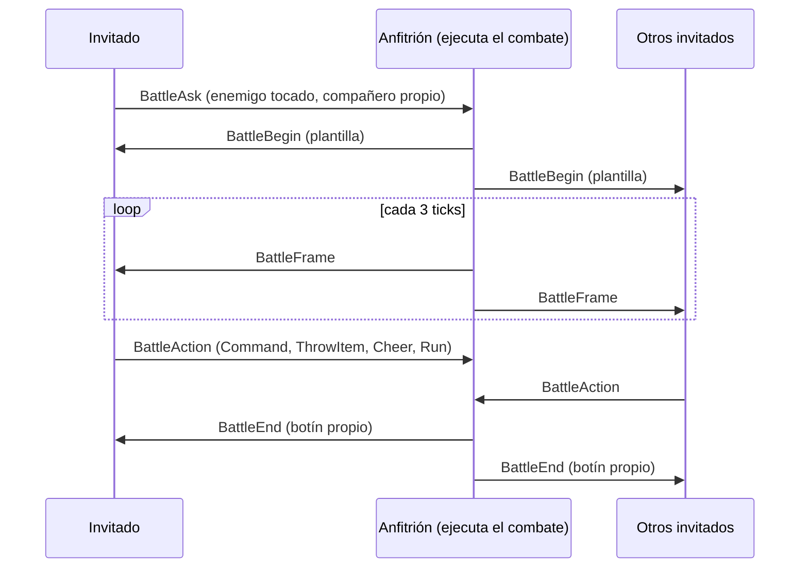

# Combate cooperativo con todos los compañeros (documento de diseño)

Estado: **implementado en parte** (2026-11-20, #351, #361). Propuesto el 2026-11-19 (ticket #362) como el paso
siguiente a la primera versión de los combates cooperativos (#351, PR #363), donde solo pelea el compañero de quien
inicia el combate. La sección 12 dice qué está hecho. Se apoya en el [cooperativo en línea](multiplayer.md), el [ADR
0024](../adr/0024-co-op-with-authoritative-host.md), las sesiones de hasta cuatro jugadores (#352, [navegador de salas y
cuatro jugadores](coop-browser-4p.md)) y el escalado de la [dificultad
cooperativa](coop-difficulty.md).

**Base de diseño:** la base de toda la documentación de combate del proyecto es el
[Diseño del sistema de combate](combat-design.md) —el sistema DWPF al que se llega: órdenes y cola, técnicas y arsenal,
INT/VEL, posicionamiento, cooperativo y balance—, con sus complementos [costes de técnicas](costo-mp.md) y
[catálogo de técnicas](tecnicas.md). Este documento especifica el cooperativo sobre el ruleset `original` ya
implementado; para el rediseño, el capítulo 8 de la base es la referencia.

**Regla cero:** con un solo compañero del lado de los jugadores, el combate es exactamente el de hoy: la misma
disposición de luchadores, la misma IA, las mismas órdenes, los mismos resultados. Todo lo nuevo solo se activa con dos
o más compañeros, y cada mecánica extra de §8 es una mejora opcional y documentada.

## 1. El combate original

Fuentes: las funciones del decomp que se nombran abajo y el port de dwe en `packages/game/battle`
([módulo de combate](../modules/game/battle.md), [referencia del combate](../reference/battle.md)).

### 1.1 Forma

- **Un compañero contra uno a tres enemigos**, en tiempo real a 20 ticks por segundo (`BTL_battleMain`: IA del
  compañero, IA enemiga, estados de los luchadores, golpes, estados alterados). `COMBAT_DATA.fighter[4]`: la ranura 0
  es el compañero, la 1–3 los enemigos.
- **El domador no es un luchador.** Se queda en el borde, grita el texto de la orden (`BTL_drawCommandShout`) y lanza
  objetos. Nadie puede golpearlo.
- **Finales:** victoria (todos los enemigos caídos), huida (Huir, 41 ticks), derrota (compañero a 0 HP más una cuenta
  atrás de 171 ticks, que un objeto de revivir lanzado cancela).

### 1.2 Órdenes: control indirecto

El jugador nunca elige una técnica directamente hasta Inteligencia 500. Órdenes (`handleCommands`): 1 Huir, 2 Atacar,
3 A tu modo, 4 Moderado, 5 Distancia, 6 Defensa, 7 Cambiar de objetivo, 8–10 técnica 1–3, 11 Remate. El menú crece
con la Inteligencia:

| Inteligencia | Órdenes |
|---|---|
| < 100 | Remate, Huir, A tu modo |
| 100+ | + Atacar |
| 200+ | + Moderado |
| 300+ | + Cambiar, Distancia |
| 400+ | + Defensa |
| 500+ | las tres técnicas (Atacar y Moderado desaparecen) |

Por debajo de 301 de Inteligencia el compañero puede ignorar las órdenes durante 100 ticks, con una probabilidad de
`70 − disciplina` %. Las órdenes se aplican al instante (el código de retraso del original está muerto).

### 1.3 Remate

La barra se llena hacia `3000 − Velocidad`: +1 por tick y una bonificación por cada ataque, bloqueo o golpe bloqueado.
Cuando está llena, el botón de remate lo lanza; durante su aura de 0x50 ticks, machacar L1/R1 suma 2 por pulsación a
la carga (hasta 80), que multiplica el daño hasta ×2. Un remate congela todo lo demás (`NO_AI_FLAG`) y siempre acierta.
Los enemigos lanzan los suyos por su cuenta.

### 1.4 Elección de objetivo

- **Los enemigos solo apuntan al compañero** (dwe: `selectTarget` en `ai_ticks.cpp`, por defecto `PartnerId`). Una
  excepción: un enemigo alcanzado por la técnica de área de otro enemigo se vuelve contra él el 71 % de las veces.
- **El compañero** (`BTL_selectFighterTarget`, en dwe `original_partner_ai.cpp` y `targeting.cpp`): con Inteligencia
  ≥ 300 prefiere un enemigo con un estado alterado; con ≥ 150, el más débil (HP y una puntuación de Defensa y tipo) y
  lo mantiene; por debajo, el más cercano. Al recibir un golpe cambia al atacante con un 70/40/30 % (según el modo)
  menos la disciplina.
- Las técnicas se eligen por sorteo ponderado; no hay enfriamiento por técnica, pero sí 40 ticks tras cualquier ataque
  (80 sin MP), una energía que rellena la Velocidad y 110 ticks entre técnicas de área. Potenciadores:
  `inteligencia/100 + 1` por combate, como mucho 5.

### 1.5 Objetos

La bolsa se abre con Triángulo. El objeto siempre se lanza **al compañero**: vuela 24 pasos y se aplica al compañero
(`startThrowingItem`). Ningún objeto apunta a un enemigo. Un objeto en el aire pausa la cuenta atrás de la derrota.

## 2. Qué bloquea hoy el cooperativo

| Suposición | Original | dwe hoy |
|---|---|---|
| Un compañero | `fighter[0]`, `PARTNER_ENTITY` | `PartnerId = 0` en `state.hpp`, usado 57 veces en 14 archivos del combate; `partner()` = `fighters.front()`; `enemyCount() = fighters.size() − 1` |
| Un menú de órdenes | `currentCommand[0]` | Un solo `CommandState commands` en `BattleState` |
| Un remate | `finisherChargeup[0]` | Un solo `FinisherState` (un `fighter`, una `charge`) |
| Una bolsa, un lanzamiento | Los objetos caen sobre el compañero | `bagOpen`, un `std::optional<ThrownItemState>`, siempre a `PartnerId` |
| Un domador | Retirada al huir y cámara | Un solo `Point tamer` |
| Los enemigos persiguen un objetivo | Solo el compañero | `selectTarget` por defecto `PartnerId`; `enemyTurnsToAttacker` |
| Ajustes de daño | — | `damageOf` escala con `partner_dealt_percent` / `partner_taken_percent` según `PartnerId` |
| Un resultado | Las ganancias de un compañero, una vida, una bolsa | `settleBattle` y `BattleResult` (`partnerHp`, `partnerSpecies`, `statGains`) |
| Límite de luchadores | 4 | `limits.max_enemies: 3`; en la red del PR #363, `MaxBattleFighters = 4` |

Reutilizable tal cual: el `Battle` determinista y sin pantalla que corre en el anfitrión; las estrategias de IA por
luchador; el rival del versus (`VersusRival`), que ya da a un segundo luchador su propio `CommandState` y busca las
órdenes por luchador (`commanded(id)`, `commandsOf(id)`). Ese es el modelo para más compañeros.

## 3. Punto de partida: PR #363

- El combate corre en la simulación del anfitrión, uno a la vez, solo cuando los jugadores comparten mapa.
- Pelea el compañero de quien inicia el combate (el compañero de un invitado entra como visitante,
  `session::BattleRequest::visitor`); el compañero del propio anfitrión se queda fuera.
- El otro jugador es un **ayudante**: ve el combate (`BattleFrame` cada 3 ticks), lanza objetos de su propia bolsa y
  anima (una pulsación de carga del remate).
- Los Bits y los objetos soltados se quedan en el mundo del anfitrión; el botín del compañero que pelea vuelve al
  invitado (`BattleEnd`).
- Un invitado que se desconecta deja a su compañero peleando en A tu modo.

El paso siguiente, este documento, es **que todos los compañeros presentes peleen en un mismo lado**.

## 4. Diseño

### 4.1 Lados y ranuras de luchador

- El lado de los jugadores tiene 1–4 compañeros y el de los enemigos 1–3 enemigos: hasta 7 luchadores.
- Disposición: **primero los compañeros, después los enemigos**. La ranura 0 es el compañero de quien inicia el
  combate, así que con un compañero la disposición es la de hoy (0 compañero, 1–3 enemigos).
- Cada luchador lleva un `side` (`Players`, `Enemies`) y, en el lado de los jugadores, su `owner` (`PlayerId`).
- `PartnerId` se sustituye por consultas: `isPlayerSide(id)`, `partnerOf(PlayerId)`, `partners()`, `enemies()`. Con un
  compañero, `partnerOf(starter) == 0`.
- Quién entra: todo compañero cuyo jugador esté en el mapa del combate y no esté ocupado (en un menú que no se puede
  cerrar, en una escena). Los jugadores que no pueden entrar son ayudantes, como en el PR #363.
- Colocación: cada compañero empieza donde está en el campo (el PR #363 ya lo hace con el visitante), limitado al área
  del combate; los enemigos, como en el original.

### 4.2 Objetivo de los enemigos

| Momento | Regla | Con un compañero |
|---|---|---|
| Inicio | El enemigo tocado apunta al compañero de quien inicia el combate; cada uno que se suma apunta al compañero más cercano | Todos apuntan al compañero (original) |
| Golpeado por un compañero | Cambia a ese compañero con la regla de giro del original (`Obedience::enemyTurnsToAttacker`) | La misma regla, con un solo candidato |
| Golpeado por la técnica de área de un enemigo | El 71 % original de volverse contra ese enemigo | Igual |
| Objetivo fuera de combate | El compañero en pie más cercano | El combate está terminando |
| El objetivo huyó o se fue | El compañero en pie más cercano | — |

Los domadores siguen sin poder ser objetivo. Las técnicas de área alcanzan a todos los compañeros dentro del área, por
geometría, como ya hacen con los luchadores. Así se mantiene el comportamiento del original de «atraer al que golpea»
y aparece un papel natural: el compañero que más golpea atrae a los enemigos.

### 4.3 IA de los compañeros

Cada compañero ejecuta su propia `PartnerAi` (elección de técnica y de objetivo, Inteligencia, disciplina,
potenciadores) exactamente igual que en solitario. Las funciones auxiliares de objetivo (`weakestOther`,
`nearestOther`, `afflictedOthers`) solo miran el **lado de los enemigos**. Los compañeros nunca se golpean entre sí:
sus técnicas de área ignoran a los aliados (los enemigos conservan el fuego amigo del original entre ellos).

### 4.4 Órdenes por jugador

- Cada jugador da órdenes **solo a su propio compañero**, con el menú de su compañero (según su Inteligencia) y su
  desobediencia (según su disciplina). Las mismas teclas que en solitario ([controles](controls.md)).
- Cada compañero tiene su propio `CommandState`; el combate busca las órdenes por luchador (`commandsOf(id)`), como
  hace el versus.
- Cambiar de objetivo (orden 7) rota el objetivo de ese compañero entre los enemigos.
- Nadie puede dar órdenes al compañero de otro jugador. Un compañero cuyo jugador se desconectó pasa a A tu modo.

### 4.5 Remate y ánimos

- Cada compañero tiene su propia barra, meta (`3000 − Velocidad`) y carga: `FinisherState` pasa a ser uno por
  compañero.
- Un remate sigue congelando el combate (identidad). Los remates nunca se solapan: si dos están listos, se lanzan uno
  tras otro; el compañero listo espera con su aura.
- **Ánimos** (del PR #363): cualquier otro jugador que pulse el botón de carga del remate durante el aura de un aliado
  suma a la carga de ese aliado a la mitad de ritmo (1 por pulsación); el dueño mantiene 2 por pulsación. El tope sigue
  en 80, así que un remate con ánimos nunca golpea más fuerte que el mejor en solitario, solo llega ahí con más
  facilidad.

### 4.6 Objetos y bolsas

- Cada jugador lanza desde **su propia bolsa**, desde su propio domador. Las bolsas nunca se juntan.
- Objetivo: su propio compañero por defecto; izquierda y derecha en la bolsa eligen un compañero aliado (su tarjeta se
  ilumina). Los objetos de revivir pueden apuntar a un aliado en la cuenta atrás de la derrota.
- La bolsa no pausa el combate en cooperativo (decisión 5 de [multijugador](multiplayer.md) §6).
- Un objeto en vuelo por jugador (`ThrownItemState` por jugador); cualquier objeto en vuelo hacia un compañero pausa la
  cuenta atrás de ese compañero, como en el original.

### 4.7 Huir

Huir es por compañero: ese compañero se retira (los 41 ticks del original) y deja el combate; recibe las penalizaciones
de huida del original. El combate sigue para los demás y el escalado se recalcula ([dificultad
cooperativa](coop-difficulty.md) §4). Cuando todos los compañeros se han ido, el combate termina como huida. Los
combates fijos (disparador 1) siguen sin Huir.

### 4.8 Fuera de combate y derrota

- Un compañero a 0 HP inicia la cuenta atrás original de 171 ticks; un objeto de revivir de **cualquier** jugador la
  cancela.
- Cuando se agota, el compañero queda **fuera**: se tumba, no puede ser objetivo ni revivir en este combate y sigue
  contando para el escalado (así quedar fuera de combate nunca debilita a los enemigos).
- **El combate solo se pierde cuando todos los compañeros han caído** (a 0 HP sin ningún objeto en vuelo hacia ellos).
  Entonces cada compañero pierde como en solitario: una vida, felicidad −30, disciplina −20, y la bolsa de cada jugador
  pierde el 30 % de sus ranuras ocupadas.
- **Si el equipo gana**, un compañero fuera no pierde una vida: termina con 1 HP, felicidad −10 y sin ganancias de
  atributos (no terminó la pelea). Opción `strict_knockout`: un compañero fuera pierde como en una derrota en solitario
  incluso si se gana.

### 4.9 Jugadores que llegan con el combate empezado

Un jugador que entra en el mapa del combate mientras este sigue en marcha se convierte en ayudante. Con la opción
`join_running`, y si el combate no es fijo y hay una ranura libre, su compañero puede sumarse (entra desde el borde) y
el escalado se recalcula.

### 4.10 HUD para 2–4 jugadores

- Las barras de los enemigos arriba, como hoy.
- Una **tarjeta por compañero** a lo largo de la parte inferior: color y nombre del jugador, nombre del compañero,
  barras de HP y MP, barra de remate, el icono de la orden actual y la cuenta atrás cuando ha caído. La tarjeta del
  jugador local es la más grande y contiene la tira de órdenes.
- El grito de orden del domador aparece sobre cada domador, en el color de su jugador.
- Cámara: la vista de cada jugador sigue a su propio compañero y a su objetivo como la cámara de combate del original,
  y se aleja para encuadrar al grupo cuando los compañeros se separan (opción `group_camera`).
- Skins: la tarjeta es un bloque nuevo del documento `battle`; la skin original muestra una tarjeta por compañero con
  el estilo de marco del original.

## 5. Alternativas para la participación simultánea

| Alternativa | Cómo se juega | A favor | En contra | Veredicto |
|---|---|---|---|---|
| A. Un luchador más ayudantes (PR #363) | Pelea el compañero de quien inicia el combate; los demás lanzan objetos y animan | Ya hecho; sin cambios en el combate | Los ayudantes apenas juegan; su compañero no gana nada | Se mantiene como respaldo (combates fijos, jugadores ocupados) |
| **B. Todos los compañeros en un lado, en tiempo real** | §4 | Todos juegan todo el tiempo; el control indirecto del original escala bien (las órdenes son escasas, así que no hay esperas) | Hay que rehacer los lados del combate; hacen falta HUD y escalado | **Elegida** |
| C. Relevos | Un compañero a la vez, entrando y saliendo | Cambio pequeño en el combate | Tres de cuatro jugadores esperan | No |
| D. Pausa por orden (por turnos) | El combate se detiene mientras alguien elige | Justo con los jugadores lentos | No es la identidad en tiempo real del original; cuatro jugadores pausando rompen el ritmo | No |
| E. Combates paralelos | Cada jugador pelea su propia copia del encuentro | Sin reglas de combate nuevas | No es jugar juntos; el anfitrión simula hasta cuatro combates; las recompensas se duplican | No (pero un combate por mapa, ver la tarea 12) |

Por qué B encaja en este juego: lo que el jugador hace en combate es escaso (unas pocas órdenes y un remate por
pelea), así que cuatro jugadores nunca se esperan entre sí, y la autonomía de los compañeros hace la pelea. Ningún
jugador puede acaparar las decisiones porque cada uno solo da órdenes a su propio compañero.

## 6. Órdenes, objetivos y resultados en el estado del combate

- `BattleState` guarda por compañero: `CommandState`, `FinisherState`, `ThrownItemState`, cuenta atrás, `owner`.
  `commanded(id)` y `commandsOf(id)` cubren por igual a los compañeros y al rival del versus.
- Órdenes simultáneas: las acciones de cada jugador se encolan y se aplican al inicio del tick siguiente, en orden de
  `PlayerId`. El combate sigue siendo determinista con las mismas entradas.
- Mejora opcional **marcar objetivo**: un jugador señala un enemigo; los compañeros aliados con Inteligencia ≥ 150 lo
  prefieren la próxima vez que eligen (su IA sigue decidiendo). Desactivada por defecto.
- `BattleResult` recibe una entrada por compañero (`PartnerResult`: HP, MP, ganancias de atributos, técnicas
  aprendidas, cuidados, vidas perdidas, herida, contadores, huida o fuera) más la parte compartida (bits, objetos
  soltados por receptor, NPCs retirados). Con un compañero contiene una entrada con los valores de hoy.
- `damageOf` aplica `partner_dealt_percent` y `partner_taken_percent` según `isPlayerSide`, así que el nivel Fácil
  sigue funcionando para todos los compañeros (con el ajuste del anfitrión).

## 7. Arquitectura multijugador

### 7.1 Autoridad

- Una única instancia compartida del combate, **solo en el anfitrión**. Los invitados nunca ejecutan el combate; lo
  dibujan a partir de los frames. Es el modelo del [ADR 0024](../adr/0024-co-op-with-authoritative-host.md) y del PR
  #363.
- El anfitrión valida cada acción: un `Command` solo para el compañero propio del remitente, un objeto solo de la bolsa
  del remitente (la copia de la bolsa del invitado que llegó con su perfil; el invitado quita el objeto cuando el
  anfitrión confirma el lanzamiento), un ánimo solo durante el aura de un aliado.

### 7.2 Qué se replica

| Mensaje | Cambio respecto al PR #363 |
|---|---|
| `BattleBegin` | Plantilla: ranura → lado, `PlayerId` del dueño, especie |
| `BattleFrame` (cada 3 ticks) | Cada luchador (hasta 7): HP, HP máximo, MP, estado, orden actual, barra y aura del remate, cuenta atrás; las figuras como hoy (posición, orientación, clip y su inicio) |
| `BattleAction` | `Command` (el compañero propio va implícito en el remitente), `ThrowItem` con la ranura objetivo, `Cheer` con la ranura del aliado, `Run`, `Join` (con `join_running`), `CloseEnd` |
| `BattleEnd` | Un bloque de botín por jugador (el `PartnerResult` de su compañero y los objetos soltados que recibió) |

Límites: `MaxBattleFighters` 4 → 7. `ProtocolVersion` sube.

### 7.3 Latencia

- La orden de un invitado llega al anfitrión en medio viaje de ida y vuelta más hasta un tick: unos 2 ticks a 100 ms.
  Las órdenes son escasas y el original las aplica a través de la propia IA del compañero, así que no se nota.
- La tira del invitado muestra la orden elegida al instante (eco local) y la confirma cuando un frame la trae.
- Frames cada 3 ticks (150 ms); los invitados reproducen el clip de cada figura desde su tick de inicio e interpolan
  las posiciones entre frames. Tráfico estimado: menos de 2 KB/s por invitado con 7 luchadores.
- Las pulsaciones de carga del remate se cuentan en el invitado y se envían como un recuento por ventana de frame, así
  que machacar el botón no depende de la latencia.

### 7.4 Desconexión

- **Se desconecta un invitado:** su compañero sigue peleando en A tu modo hasta el final; su botín se descarta (el
  guardado propio del invitado no se toca, como en el PR #363). Sigue contando para el escalado.
- **Se desconecta el anfitrión:** la sesión termina (ADR 0024); el combate de cada invitado termina sin resultado y el
  invitado vuelve a su propia partida.

### 7.5 Mundo compartido

- Un combate por mundo del anfitrión (PR #363). Los jugadores de otros mapas siguen jugando; sus propios contactos con
  enemigos salvajes esperan como hoy («ocupado», después ayudante). Varios combates a la vez en mapas distintos es la
  tarea 12.
- Cuando empieza un combate, los actores de campo de sus compañeros y enemigos salen del campo en todos los clientes;
  cuando termina, los enemigos retirados por el combate salen de todos los campos (el PR #363 ya los envía).

## 8. Mecánicas cooperativas (mejoras opcionales)

Cada una es un interruptor en las opciones del cooperativo, desactivado en un jugador por construcción.

| Mecánica | Qué hace | Por defecto en cooperativo |
|---|---|---|
| Objetos y revivir a aliados | §4.6: lanzar a cualquier compañero aliado | Activada (núcleo) |
| Ánimos | §4.5: ayudar a cargar el remate de un aliado | Activada (PR #363) |
| Golpe enlazado | Un golpe a un enemigo que un aliado golpeó en los últimos 10 ticks hace +10 %, con una pequeña marca | Desactivada |
| Remate doble | Si una segunda barra se llena durante el aura de un remate, ambos se lanzan en la misma congelación, +15 % cada uno | Desactivada |
| Guardia | Un compañero en Defensa atrae los ataques: los enemigos que apuntan a un aliado dentro de su alcance cambian a él el 30 % de las veces por cada golpe recibido | Desactivada |
| Marcar objetivo | §6 | Desactivada |

Reutilizan órdenes y técnicas existentes; ninguna es una técnica nueva (fuera del alcance de #362).

## 9. Equilibrio

- Más compañeros significan más daño y ataques enemigos repartidos: la [dificultad cooperativa](coop-difficulty.md) §5
  escala los HP, MP, Ataque y frecuencia de remate de los enemigos según el número de compañeros que pelean, y trata
  aparte los combates fijos.
- Los ánimos no pueden subir el daño por encima del máximo en solitario (tope 80).
- Las mecánicas opcionales de §8 añaden daño (+10 % el enlazado, +15 % el remate doble): el equilibrio se mide con
  ellas activadas y desactivadas (dificultad §10), y sus números viven en el ruleset.
- Grupos desiguales: un compañero fuerte atrae a los enemigos (se vuelven hacia quien los golpea), lo que protege a
  los aliados más débiles; las ganancias de atributos de los compañeros que van a remolque se tratan en dificultad §7.

## 10. Compatibilidad con un jugador

- Un compañero = ranura 0, la disposición del original; cada estructura por compañero tiene una entrada; la elección de
  objetivo tiene un candidato; `BattleResult` contiene una entrada. La cadena de la historia y las comparaciones con el
  original ([traza de estado](../guides/state-trace.md)) deben quedar idénticas.
- El versus mantiene su propio camino (`VersusRival`).
- Los torneos siguen siendo 1 contra 1 (dificultad §8).

## 11. Riesgos

| Riesgo | Mitigación |
|---|---|
| `PartnerId` se usa por todo el combate | Renombrado mecánico a consultas en una sola tarea, antes de cualquier cambio de comportamiento, con las pruebas en solitario sin cambios |
| Remates que congelan demasiado a menudo con cuatro compañeros | Uno a la vez; medido en simulación; remate doble opcional |
| Ruido visual con siete luchadores | Tarjetas en vez de barras flotantes para los compañeros; la cámara se aleja |
| Invitados tramposos | El anfitrión valida cada acción; `contentHash` del perfil como en el versus |
| Entradas y salidas tardías | El escalado conserva la fracción de HP; sumarse desactivado por defecto |
| Duración del combate con grupos débiles | Tablas de escalado y objetivos de dwe-sim en dificultad §10 |

## 12. Tareas de implementación

Listas para convertirse en issues, en orden; cada una deja el modo de un jugador sin cambios y se prueba por separado.

**Hecho (2026-11-20, versión 6 del protocolo, API de la interfaz 0.20.0).** Cuando el compañero del invitado está en el
mapa donde empieza el encuentro del anfitrión y no está ocupado, pelea junto al compañero del anfitrión en el combate
del anfitrión; si no, el invitado ayuda como en el PR #363, y a solas el combate es el original. Lo que entró, por
tarea:

- Tareas 1–3, en parte: el segundo compañero es un **aliado** (`BattleSetup::allies`, `AllySetup` con su dueño)
  colocado **después de los enemigos**, no antes como dice §4.1: el hueco 0 sigue siendo el compañero de quien inicia y
  los enemigos conservan sus números, así que la disposición en solitario y cada índice de enemigo no cambian.
  `isPlayerSide` y `foes` responden las preguntas de bando; `PartnerId` sigue para quien inicia. Cada aliado tiene sus
  órdenes, bolsa, objeto lanzado, huida y cuenta atrás propios (`AllyState`); el progreso del remate ya era por
  luchador.
- Tareas 4–6: los enemigos apuntan a cualquier compañero y se giran hacia quien les pega; los compañeros nunca se
  golpean entre sí; huir y la cuenta atrás del K.O. son por compañero (`Departure`); el combate acaba cuando los
  enemigos caen con algún compañero en pie o cuando no queda ninguno (huida si alguno huyó; si no, derrota). Un
  compañero fuera de combate en una victoria acaba con 1 PV y felicidad −10.
- Tarea 7: `Battle::allyResults` da a cada aliado su propio resultado; los bits, los objetos soltados y los reclutas se
  quedan en el mundo del anfitrión (el resultado del propio combate). El invitado aplica el resultado de su aliado (las
  subidas de estadísticas sin tope) mediante el botín, que ahora lleva la salida.
- Tareas 8–9: `BattleOffer` (0x80) avisa al anfitrión de que el compañero del invitado puede unirse; `BattleBegin.allies`
  nombra a los aliados; `BattleFrame` lleva a todos los luchadores (hasta `MaxBattleEnemies + MaxPlayers`); el invitado
  solo da órdenes a su propio compañero (rol `ally`) y el anfitrión comprueba el rol de cada acción. Si el invitado se
  cae, su compañero sigue por su cuenta.
- Tarea 10, en parte: la pantalla de combate muestra las tarjetas de los aliados (`battle.allies`, PV y PM) en todas las
  pieles; el panel `coop_battle` del invitado muestra los PV de todos los luchadores, los PM de los compañeros y marca
  el suyo; las órdenes van al compañero propio.

**Hecho (2026-11-20, versión 9 del protocolo, API de la interfaz 0.23.0): todos los compañeros pelean.** Cualquier
invitado puede empezar un combate, y cada jugador de ese mapa cuyo compañero está libre pelea en él (hasta tres aliados
junto al compañero de quien inicia): en los combates del anfitrión, todo invitado libre; en el de un invitado, el
anfitrión y los demás invitados libres. El enlace de cada invitado lleva sus propias peticiones, ofertas y acciones; el
anfitrión manda a cada uno sus propios fotogramas (la tira, la bolsa y el remate de su compañero) y su propio final, con
botín solo para el invitado cuyo compañero peleó. Si un invitado se cae, su compañero sigue por su cuenta; los demás
siguen jugando.

- Tarea 10, más: la tarjeta de un aliado caído cuenta atrás hasta que se levanta (`battle.ally.<n>.revive_seconds`), y
  el panel del invitado enseña la cuenta atrás de cada compañero caído. Cada jugador elige a qué compañero van sus
  objetos (el botón Apuntar del panel; `BattleAction.value` lleva el objetivo), y el objeto que lanza un invitado sale
  del cuerpo de ese jugador en la pantalla del anfitrión, con la animación de lanzar. Cada aliado suena como su especie
  (los bancos de sonido de los aliados en las ranuras 16–18; el compañero visitante conserva su especie en las del
  compañero).
- Tarea 11: la dificultad cooperativa, ver [dificultad cooperativa](coop-difficulty.md) §9.
- Tarea 10, la pantalla del invitado (versión 12 del protocolo): el `BattleFrame` del anfitrión lleva los objetos
  lanzados (`throws`: quién lo lanzó, el objeto, en la mano, en vuelo con su punto, o caído sobre un luchador), y la
  pantalla del invitado los dibuja como la del anfitrión: la animación de lanzar en el cuerpo de quien lanza, el objeto
  en vuelo y el brillo sobre el luchador donde cae (`CoopThrowFollower` empieza cada uno una sola vez aunque un
  fotograma se repita). Cada cuerpo suena con el banco de su propia especie: los enemigos desde las ranuras del
  original, los compañeros de los demás jugadores desde las de los aliados, 16–18 (`coopBattleSoundsOf`). En la
  consola de desarrollo, `coop_fell("<jugador>")` derriba al compañero de ese jugador en el combate del anfitrión, para
  probar la cuenta atrás y Apuntar sin un combate largo. Detalles:
  - La animación es la de lanzar del jugador en el original (clip 6), con el objeto en el nodo 9 de la mano hasta que
    sale.
  - Un lanzamiento caído sigue en los fotogramas durante 20 fotogramas de combate, así un fotograma perdido no pierde
    su brillo.
  - Un lanzamiento que se ve por primera vez ya caído enseña su brillo pero no reproduce la animación.
  - Los fotogramas perdidos no frenan los brillos: el invitado los avanza según los fotogramas que pasaron.
  - Ranuras de sonido: el compañero de este juego conserva la ranura 4 y los enemigos toman de la 5 en adelante, como
    en el original; cada otro compañero toma la siguiente ranura de aliado. Pasadas las tres de aliados, un cuerpo suena
    desde la del compañero de este juego.
- Falta: la tarea 12 (un combate por mapa: mientras uno sigue, otro en otro mapa se rechaza), las mecánicas opcionales
  de §8 y un grito por domador.

1. **Refactorización de los lados del combate:** sustituir `PartnerId` por `side`, `owner` y las consultas
   `isPlayerSide`, `partnerOf`, `partners`, `enemies`; primero los compañeros, después los enemigos. Sin cambios de
   comportamiento (pruebas en solitario y cadena de la historia en verde).
2. **Estado por compañero:** `CommandState`, `FinisherState`, objeto lanzado y cuenta atrás por compañero;
   `commandsOf(id)` para los compañeros y el rival del versus.
3. **Varios compañeros en `BattleSetup`:** lista `partners` con dueños; `BattleAdapter::start` construye visitantes
   para cada jugador presente; colocación desde el campo.
4. **Objetivo de los enemigos con varios compañeros:** objetivo inicial, volverse hacia el atacante, cambio de
   objetivo cuando el suyo queda fuera de combate o se va (§4.2).
5. **IA de los compañeros solo sobre el lado de los enemigos** y sin fuego amigo entre compañeros (§4.3).
6. **Reglas de fuera de combate y derrota** (§4.8) y Huir por compañero (§4.7).
7. **Resultados por compañero:** `PartnerResult`, `settleBattle` por compañero, `BattleAdapter::finish` y
   `giveRewards` por jugador; los objetos soltados van a quien dio el último golpe.
8. **Protocolo:** plantilla en `BattleBegin`, hasta 7 luchadores en `BattleFrame`, nuevos tipos de `BattleAction`,
   `BattleEnd` por jugador; `MaxBattleFighters` 7; subida de versión; pruebas de ida y vuelta del códec.
9. **Validación en el anfitrión y eco local en el invitado** de órdenes, objetos y ánimos (§7.1, §7.3).
10. **HUD para 2–4:** tarjetas de compañero, tira local, grito por domador, objetivo aliado para objetos, en todas las
    skins.
11. **Escalado de la dificultad cooperativa** ([dificultad cooperativa](coop-difficulty.md) §9).
12. **Un combate por mapa:** permitir que el anfitrión ejecute combates en mapas distintos a la vez.
13. **Mecánicas opcionales** (§8): golpe enlazado, remate doble, guardia, marcar objetivo, cada una con su interruptor.
14. **Pasada de equilibrio:** escenario `battle` de dwe-sim con varios compañeros; ajustar los números del ruleset.
15. **Prueba de juego:** de dos a cuatro PCs, los escenarios de dificultad §10.3 más una pelea salvaje con cuatro
    compañeros y una desconexión en un jefe.

Prototipo: no hace falta antes de la tarea 1. El rival del versus ya demuestra que un segundo luchador con órdenes
funciona en el mismo `Battle`; la tarea 2 lo extiende al lado de los jugadores.

## 13. Documentos relacionados

- [Diseño del sistema de combate](combat-design.md) —la base del combate—, [costes de técnicas](costo-mp.md) y
  [catálogo de técnicas](tecnicas.md).
- [Multijugador cooperativo en línea](multiplayer.md), [ADR 0024](../adr/0024-co-op-with-authoritative-host.md) y
  [navegador de salas y cuatro jugadores](coop-browser-4p.md).
- [Dificultad cooperativa](coop-difficulty.md).
- [Módulo de combate](../modules/game/battle.md), [referencia del combate](../reference/battle.md),
  [versus](../modules/game/versus.md).
