# Entrenar en un mundo compartido (documento de diseño)

Estado: **hecho** (2026-11-20, ticket #365; auditado y completado el 2026-11-27, ver la [auditoría de #365](audits/365-audit.md)). Se apoya en el [cooperativo en línea](multiplayer.md) (§5.7 mundo
compartido, §6 decisiones 4 y 5), el [ADR 0024](../adr/0024-co-op-with-authoritative-host.md) y las pantallas del
gimnasio del módulo [partner](../modules/game/partner.md).

**Regla cero:** el juego de un jugador no cambia. A solas (o en versus), una sesión de entrenamiento adelanta el reloj
una hora exactamente como el original, y ningún camino de código difiere del de antes. Todo lo de abajo aplica solo
mientras corre una partida cooperativa.

## 1. Cómo entrena el original

`TRN_advanceTrainingTime` (`trn_reward.c`) corre una vez por sesión, después de la animación y la recompensa del curso:

- **El compañero paga:** cansancio + el coste del curso, energía − coste, felicidad − coste. Con cansancio de 70 o más
  (sobreentrenamiento) además felicidad − 3 y disciplina − 3.
- **El reloj salta una hora:** se pone en la hora de inicio de la sesión + 1200 frames (20 frames por minuto de juego).
  Mientras corre el curso el reloj está quieto, así que una sesión es siempre exactamente una hora de juego.
- **Los cuidados de esa hora se pagan de una vez:** la comprobación de vida infeliz cuando la nueva hora es múltiplo de
  4; el sueño (contador de enfermedad + 1, horas de sueño perdidas + 1); el hambre (temporizador de inanición − 120 y un
  error de cuidado si la energía es muy baja, si no nivel de comida − 60); energía − el consumo de la especie; el baño
  (temporizador − 1200, si no nivel − 6); vida − 1, temporizador de evolución + 1, temporizadores de heridas y
  enfermedad.
- **Una sesión que cruza la medianoche** suma un día: edad + 1, el contador de días y el disparador diario. Los cambios
  de momento del día (16:00, 20:00, 6:00) salen del reloj.

Un minuto de juego es un segundo real (20 frames por segundo), así que una hora de juego es un minuto real. Un jugador
que entrena diez sesiones seguidas adelanta el mundo diez horas en unos pocos minutos reales; es el ritmo del original,
y a solas está bien.

El resto de una sesión, según el [módulo gym](../modules/game/gym.md) y la [ficha de cuidados](../reference/care.md#training):

- **Inicio.** Un curso empieza en la casilla de confirmar del gimnasio: el script ofrece Empezar, Explicar o Salir,
  luego Normal o Intento extra, pone las variables 254 (el curso) y 246 (la ruleta) y llama a la rutina 7 (script 108
  en el gimnasio del pueblo). El script no mira antes al compañero: uno cansado o con hambre entrena y lo paga (la
  penalización por sobreentrenamiento de arriba).
- **Final.** Una sesión corre los frames de su curso (1200 en casi todos, un minuto de juego) o termina con el botón de
  cancelar mantenido, con lo ganado; con la ruleta, los rodillos deciden cuándo termina. Luego el recuadro cuenta las
  ganancias.
- **Ganancias.** Una base por gimnasio por la aptitud de la especie, su nivel, un gimnasio mejorado, el bono de
  práctica, el manual de entrenamiento y el bono de una comida; la ruleta multiplica el resultado entre 0,5 y 10; cada
  sesión suma uno al temporizador de evolución.
- **Descanso y recuperación.** El cansancio solo baja descansando, durmiendo y con algunas comidas; nada del gimnasio
  lo repone.
- **Lo que el cooperativo debe conservar:** la fórmula de ganancias y sus topes, los costes de la hora, la penalización
  por sobreentrenamiento, la duración de la sesión, la ruleta y el recuadro de estadísticas, y el orden en que pasan.
  Solo cambia quién mueve el reloj.

## 2. Qué hacía el cooperativo antes de este ticket

Medido en el código (`GameSession::advanceGameTime`, `Partner::passTrainingHour`, el puente cooperativo):

| Qué | Antes | Por qué se rompe |
|---|---|---|
| El reloj del mundo | Cada partida de una sala corría **su propio** `GameClock`, copiado del guardado del anfitrión al unirse. Nada lo enviaba después (el reloj de la instantánea de §5.5 nunca se hizo). | Dos jugadores ven distinta hora, tiendas y horarios de NPC a los pocos minutos. |
| El anfitrión entrena | El curso retiene el campo (`holdForScript`), lo que para su reloj; luego la sesión lo salta una hora. | El compañero del anfitrión y los invitados viven horas distintas; diez sesiones del anfitrión saltan diez horas del mundo compartido pero no las de los invitados. |
| Un invitado entrena | Solo salta su propio reloj. | El reloj del invitado se aleja del anfitrión y nada lo trae de vuelta. |
| Varios entrenan a la vez | Cada sesión salta su reloj. | Con cuatro jugadores el mundo saltaría cuatro horas por minuto si fuera compartido; con relojes propios simplemente se desfasa. |
| Los demás lo ven | Nada dice a los demás que un jugador entrena. | Un intercambio o una petición de aliado de combate llega a un jugador sentado en el gimnasio. |

## 3. Opciones

| | A. Sesiones en paralelo | B. Sesiones sincronizadas | C. Hora propia del compañero |
|---|---|---|---|
| Idea | Cada jugador entrena cuando quiere, solo, mientras el mundo sigue. | Las sesiones empiezan juntas; todos esperan un "listo" y el reloj salta una hora para todos. | La hora del compañero es suya: paga los costes de la hora y el reloj del mundo no se mueve. |
| Esperas | Ninguna. | Todos esperan al más lento; nadie puede entrenar solo. | Ninguna. |
| Reloj | Hay que decidir quién lo mueve. | Un salto por ronda, acordado. | Ninguna sesión lo salta. |
| Fidelidad | Igual por sesión si va con C. | Misma hora por sesión. | Mismos costes por sesión; el día lo pone el mundo. |
| Coste | Bajo. | Un estado de sala, "listos", tiempos límite y reglas de cancelación. | Bajo: un indicador en la petición de la sesión. |

**Elegida: A + C sobre un único reloj del mundo, el del anfitrión.** Los jugadores entrenan en paralelo sin esperar a
nadie (A); una sesión le cuesta a su compañero exactamente la hora que cobra el original, pero en cooperativo nunca
mueve el reloj del mundo (C). B se descartó: convierte el entrenamiento en una actividad de grupo, justo lo que el
ticket no quiere ("sin esperarlos"), y además salta el mundo para quienes no entrenan.

## 4. El modelo

### 4.1 Un reloj, el del anfitrión

- El reloj del anfitrión es el del mundo. Corre con el tiempo real (un minuto de juego por segundo real) y solo lo
  mueve lo que ya lo movía a solas: su propio sueño, los saltos de tiempo de sus scripts, los comandos de depuración.
  Una sesión de entrenamiento ya no lo mueve.
- El anfitrión dice su reloj a cada invitado con `WorldClock` (`0xC0`, anfitrión → invitados, fiable): frames
  transcurridos, si corre y su velocidad en milésimas. Lo dice enseguida al invitado que se une, luego más o menos cada
  segundo, y enseguida cuando el reloj se para, arranca, cambia de velocidad o salta más de un segundo
  (`session::WorldClockTeller`).
- La sesión de un invitado (`ClockShare::Guest`) lo sigue (`session::WorldClockFollower`): entre dos avisos hace correr
  el mundo a la velocidad del anfitrión durante dos segundos como mucho, y luego espera el siguiente aviso. En cada tick
  compara su reloj con el del mundo:
  - **una diferencia pequeña** (menos de una hora) se juega como frames, así que el compañero la vive como siempre;
  - **horas enteras** (el anfitrión durmió o saltó tiempo) son un salto: el compañero las paga con `skipHours`, como un
    salto de tiempo de script, y el reloj se pone en el del mundo;
  - **un invitado un poco adelantado** (menos de cinco minutos) espera al mundo;
  - **un invitado muy adelantado** (su propio sueño o salto) vuelve a la hora del mundo. Su compañero ya vivió esas
    horas, así que no las vive otra vez: la sesión recuerda hasta dónde vivió y no le da frames hasta que el mundo pase
    ese punto.
- Antes del primer aviso del anfitrión, un invitado corre su propio reloj como antes.

### 4.2 La hora del compañero

`TrainingRequest::sharedClock` (lo pone la sesión en cooperativo, anfitrión o invitado) hace que
`Partner::passTrainingHour` pague todos los costes de §1 **sin** el salto del reloj y sin el cambio de día:

- las ganancias, los costes, la penalización por sobreentrenamiento, el hambre, sueño, baño, vida y temporizador de
  evolución de la hora: sin cambios, así que diez sesiones dan el mismo compañero que diez sesiones a solas;
- la comprobación de vida infeliz y el sueño usan la hora a la que habría llegado la sesión (la hora del reloj + 1);
- la edad, el contador de días y el disparador diario salen solo de las medianoches del mundo, tal como el compañero
  las vive en el reloj compartido. Una sesión a las 23:30 no suma un día; la medianoche del mundo sí.

Mientras corre un curso en cooperativo el reloj del mundo sigue, pero los cuidados del compañero se retienen (ni hambre
ni energía), igual que el reloj del original se queda quieto para él. Al terminar el curso el compañero vuelve a vivir
el tiempo del mundo. La retención es `GameSession::holdForCourse`, que pone el puerto de campo del gimnasio junto a la
retención del campo.

**Una sesión dura su hora del reloj del mundo (#411).** Una sesión completa son 1200 frames de curso, un minuto real,
así que el reloj del mundo ya corre más o menos una hora durante ella (medido: 1241 frames del inicio del curso a su
último recuadro, frente al salto de 1200 a solas). Una sesión cortada corría solo segundos: cancelar, o parar pronto la
ruleta del intento extra, cobraba una hora al compañero mientras el mundo avanzaba un minuto o dos (medido: 41 frames),
así que un jugador que saltaba diez sesiones no veía pasar el tiempo para nadie. Ahora, en cooperativo, el curso
retiene a sus actores tras el recuadro de estadísticas hasta que el reloj del mundo ha corrido una hora desde el inicio
del curso (`GameSession::courseHourRuns`, `GymPorts::hourRuns`; el curso espera antes de `TRAINING_COMPLETE`). Los
cuidados del compañero siguen retenidos mientras tanto, así que paga justo la hora que se le cobró, la etiqueta del
jugador sigue diciendo **Entrenando** y la siguiente sesión de una tanda empieza después. Las sesiones de varios
jugadores se solapan sobre la misma hora del mundo; ninguna mueve el reloj. A solas nada espera: el salto de la sesión
es el del original.

### 4.3 Quién entrena

`TrainingStatus` (`0xC1`, en ambos sentidos, fiable) lleva un jugador y un id de curso (32 caracteres como mucho, vacío
cuando deja de entrenar). Un invitado dice al anfitrión su curso cuando cambia; el anfitrión toma el id de jugador del
enlace, nunca el del mensaje, y dice a cada invitado los cursos de los demás cuando cambian.

- La etiqueta cooperativa sobre un jugador muestra **Entrenando** (`coop_hud.tag.training`,
  `coop_hud.tag.<n>.training`, API de UI 0.25.0).
- Un jugador que entrena está ocupado para intercambios y no se ofrece como aliado de combate; a un jugador en el
  gimnasio no se le puede meter en un combate.
- El primer curso de un jugador en una partida cooperativa muestra un aviso una vez: el tiempo del mundo sigue
  corriendo, cada sesión dura una hora de ese tiempo y una sesión saltada espera el resto de su hora
  (`online.coop.training_clock`).

### 4.4 Flujo

```mermaid
sequenceDiagram
  participant H as Sesión del anfitrión
  participant N as Enlace
  participant G as Sesión del invitado
  H->>N: WorldClock (al unirse, cada segundo, al parar/saltar)
  N->>G: WorldClock
  G->>G: seguir: frames / saltar horas / esperar / volver
  G->>N: TrainingStatus(curso)
  N->>H: TrainingStatus (jugador = el del enlace)
  H->>N: TrainingStatus a los demás invitados
  Note over H,G: cada sesión cobra una hora a su compañero; ningún reloj salta
```

La sesión de un jugador en cooperativo, de la casilla de confirmar al siguiente paso libre:

```mermaid
stateDiagram-v2
  [*] --> Script: casilla de confirmar (el reloj del mundo sigue; el compañero de quien lee se queda quieto, T7)
  Script --> Curso: rutina 7; holdForCourse(true), se guarda el inicio
  Curso --> Premio: se acaban los frames, cancelar mantenido o paran los rodillos
  Premio --> Cuenta: se cobra una hora al compañero (sharedClock, sin salto)
  Cuenta --> EsperaHora: recuadro cerrado, el mundo corrió menos de una hora
  Cuenta --> Hecho: el mundo ya corrió su hora
  EsperaHora --> Hecho: el reloj del mundo llega al inicio + 1 hora
  Hecho --> [*]: holdForCourse(false), TRAINING_COMPLETE, el script sigue
  Curso --> [*]: enlace perdido en un invitado (vuelve al título)
```



### 4.5 Dormir en un mundo compartido (#424, #411)

Dormir salta la noche, y la noche es del mundo. Las reglas:

- **Solo el anfitrión mueve el reloj del mundo.** El sueño del anfitrión lleva el mundo a la mañana de su compañero;
  cada invitado salta esas horas (§4.1).
- **El sueño de un invitado no mueve el mundo, y el mundo no lo deshace.** El compañero duerme como a solas (el
  descanso de la noche, las horas de vida y de evolución, su siguiente hora de dormir), y luego la pantalla del
  invitado queda a oscuras hasta que el reloj del mundo llega a esa mañana (`SleepScreen` espera mientras
  `GameSession::aheadOfWorld`), con un aviso que lo dice (`online.coop.sleep_wait`). Si el anfitrión duerme entretanto
  el invitado despierta al momento. El reloj del invitado nunca vuelve a la noche y el compañero nunca vive esas horas
  dos veces.
- **Nadie está obligado a dormir.** Los demás siguen jugando; el mundo nunca se retiene por quien duerme.
- **Dormir a destiempo no da ventaja.** Un invitado no puede descansar y aun así usar la noche: su partida espera con
  su compañero. Solo puede dormir cuando su compañero tiene sueño, como a solas.
- **Los eventos del mundo y los cambios de día** siguen solo el reloj del mundo (§5): el sueño de un invitado no cambia
  el día de nadie.

### 4.6 De dos a cuatro jugadores

Las mismas reglas valen para cualquier tamaño de sala; nada escala con el número de jugadores.

| Jugadores | Quién mueve el reloj | Quién puede entrenar | Qué ven los demás |
|---|---|---|---|
| 1 (a solas) | El salto de la sesión, como el original | El jugador | — |
| 2 | El reloj del anfitrión, solo tiempo real | Los dos, a la vez o no, en cualquier gimnasio | La etiqueta **Entrenando** del otro y los clips de su compañero en la máquina |
| 3 | Igual | Los tres, por separado | Las etiquetas y clips de los demás, a través del anfitrión |
| 4 | Igual | Los cuatro, por separado | Igual; cuatro sesiones a la vez siguen corriendo el mundo una hora por minuto real (probado) |

- **Una sesión por jugador.** La partida de un jugador corre un curso a la vez (`GymScreen::start` no hace nada mientras
  corre uno); una tanda corre sus sesiones una tras otra, cada una esperando su hora.
- **La misma máquina.** Cada partida corre el gimnasio en su propia copia del mapa, así que dos jugadores pueden usar la
  misma máquina a la vez. En cada pantalla, un segundo compañero en un curso en una máquina usada se dibuja un paso (300
  unidades) al lado del primero, a uno u otro lado, hasta cuatro (`machineSpotBeside`, T8): el anfitrión lo hace con los
  compañeros de los invitados en su campo, así que sus instantáneas lo llevan, y cada invitado con los compañeros que
  dibuja junto al suyo. Solo se aparta un compañero que reproduce un clip de curso; fuera del curso está donde su partida
  lo tiene. Solo la pantalla de cada jugador mueve los objetos de la máquina (la roca, el tronco).
- **Entrenar y explorar.** Un jugador en un curso está ocupado: sin intercambios, sin ofertas de aliado, no se le mete
  en un combate. Los demás siguen explorando, luchando e intercambiando; el mundo nunca se retiene por quien entrena.

### 4.7 Resultados y autoridad

- **Las ganancias de cada compañero son de su partida.** La partida de quien entrena corre el curso, tira la ruleta con
  el estado aleatorio de su compañero y aplica ganancias, costes y la hora (`GameSession::train`). Ningún resultado
  viaja por sí solo: los demás ven la etiqueta y los clips.
- **El anfitrión no valida las ganancias de un invitado**, igual que no valida sus cuidados: el cooperativo confía a cada
  partida su propio compañero ([ADR 0024](../adr/0024-co-op-with-authoritative-host.md)). Una sesión la aplica una sola
  vez una sola partida, así que no puede contarse dos veces.
- **La hora se comprueba contra el mundo.** La retención del curso dura hasta que el reloj del mundo corrió la hora que
  cobró (§4.2), así que ni el anfitrión ni un invitado pueden encadenar sesiones más rápido que el tiempo del mundo.
- **El progreso vuelve a casa.** El compañero entrenado de un invitado vuelve a su propio guardado con el resto de su
  progreso (#383, [multijugador](multiplayer.md), «Qué vuelve a casa»).

### 4.8 El anfitrión retenido por su propio script o pantalla (T7, T9)

Un script del anfitrión solo retiene a su jugador (decisión 6 de [multijugador](multiplayer.md)), y lo mismo una
pantalla completa suya. Ninguno de los dos para ya el reloj del mundo:

- **Qué retiene.** En el anfitrión en cooperativo, el reloj del mundo sigue mientras un script retiene su campo (una
  charla, el menú del gimnasio, una escena) y mientras una pantalla suya corre en lugar del campo: las tiendas (objetos,
  cartas, méritos), el guardaobjetos, el menú de tirar, la gramola, las pantallas de intercambio y del pájaro, el
  horario, el mapa del mundo, el menú de depuración, la pesca, el juego de piedras, el aviso de premio, las escenas de
  cuidado del compañero (montón, retrete, comida, elogio y regaño) y su evolución. Lo que aún lo para: un cambio de mapa
  (se lleva a todos los jugadores), el sueño del anfitrión (su salto mueve el mundo), un torneo, las escenas de muerte y
  de final, y un combate.
- **El compañero del anfitrión se queda quieto mientras tanto,** como a solas, y vive ese tiempo cuando su jugador queda
  libre, igual que el compañero de un invitado se pone al día con el mundo tras su propio diálogo (§4.1): las horas
  enteras como un salto de tiempo (`skipHours`), el resto frame a frame en el reloj del mundo
  (`GameSession::liveStoodTime`). Así una charla larga le cuesta los mismos cuidados que el mismo tiempo en el campo, y
  ningún tiempo se vive dos veces: un salto de tiempo o de depuración durante la retención no cuenta, y el menú del
  gimnasio se vive al empezar el curso, así que la hora del curso no.
- **Los invitados** siguen jugando: el anfitrión dice su reloj en marcha y ellos lo siguen.
- **A solas nada cambia:** el script o la pantalla paran el reloj, como en el original. **Los scripts y pantallas propios
  de un invitado** siguen como antes: su reloj se para con ellos y luego se pone al día con el mundo.

Las piezas: `GameSession::hostHeldByOwnScript` (una retención de script que no es un cambio de mapa),
`runWorldPastHeldPlayer` (el reloj corre y los frames se guardan en `stoodFrames_`) y `tickHeldPlayer`, que
`PlaySession::tickSystems` llama en los ticks en que una pantalla propia del jugador corre en lugar del tick de la
sesión (no hace nada a solas ni en un invitado).

## 5. Desconexiones y casos límite

- **Un invitado se va:** el anfitrión borra su curso (`CoopTraining::playerLeft`) y se lo dice a los demás; si vuelve,
  oye otra vez el reloj y todos los cursos.
- **El anfitrión se va:** el invitado vuelve al título como antes; nada de este ticket sobrevive a la partida.
- **Cambio de día y eventos:** solo la medianoche del mundo cambia el día, para todos a la vez (un invitado que la
  saltó la paga en `skipHours`). Los momentos del día siguen el reloj compartido.
- **Menús, scripts y pantallas del anfitrión:** nada de lo que el anfitrión lee o abre retiene ya el reloj del mundo:
  ni sus menús ni la pausa de Start (#415), ni sus scripts (una charla, el menú del gimnasio, T7), ni sus propias
  pantallas completas (una tienda, el guardaobjetos, la pesca, una escena de cuidado, una evolución, T9). Ver §4.8.
- **Un invitado duerme:** su compañero duerme y su pantalla espera a oscuras la mañana del mundo (§4.5); ya no vuelve
  a la noche.
- **El anfitrión duerme:** los invitados saltan esas horas (§4.1), como un salto de tiempo de script.
- **Combates:** un combate sigue parando el reloj de su jugador mientras dura; un invitado se pone al día después con
  frames o un salto.

Los casos que lista el issue:

| Caso | Qué pasa |
|---|---|
| Un jugador termina antes que los demás | Queda libre al momento (tras su hora); las sesiones de los demás siguen, ninguna espera a otra. |
| Un jugador empieza mientras otro entrena | Se puede, en cualquier gimnasio, incluso en la misma máquina (§4.6). Al reloj le da igual. |
| Un invitado se desconecta en mitad de un curso | Su partida vuelve al título y conserva su último punto seguro (#383); el anfitrión borra su curso y su etiqueta. |
| El anfitrión se va en mitad de un curso | Todos los invitados vuelven al título con su último punto seguro (#383); una sesión en curso puede perderse. |
| El compañero no tiene energía | El script del gimnasio no se niega: la sesión corre y se aplican el hambre de la hora y el error de cuidado, como a solas. |
| Cambia el día durante una sesión | Solo la medianoche del mundo cambia el día; una sesión nunca suma uno (§4.2). |
| Salta un evento con hora durante una sesión | Los eventos del mundo siguen el reloj del mundo; en la partida de quien entrena el curso retiene el campo, así que un evento que lo necesita empieza tras el curso, como a solas. |
| Un jugador intenta varias sesiones a la vez | Un curso por partida; una tanda las corre seguidas, cada una dura su hora. |
| Latencia o pérdida de paquetes | `WorldClock` y `TrainingStatus` son fiables; un invitado corre como mucho dos segundos más allá del último aviso y luego espera; un aviso tardío se juega como frames o un salto. Un curso que espera su hora espera más mientras el reloj del anfitrión está parado (un cambio de mapa o un combate del anfitrión). |

## 6. Código

| Pieza | Dónde |
|---|---|
| La hora del compañero sin salto | `packages/game/partner` (`TrainingRequest::sharedClock`, `Partner::passTrainingHour`) |
| Compartir, seguir y decir el reloj | `packages/session` (`shared_clock.hpp`, `GameSession::shareClock`, `hearWorldClock`, `worldTime`, `holdForCourse`, `courseHourRuns`) |
| El curso espera su hora | `packages/game/gym` (`GymPorts::hourRuns`, `CourseRun::finish`), `packages/session` (`GymFieldPorts::hourRuns`) |
| Mensajes `0xC0`, `0xC1`, protocolo 11 | `packages/game/coop` (`protocol.hpp`, `link.cpp` `directionAllowed`) |
| Enrutado y bucle del juego | `apps/game` (`coop_gameplay_bridge`, `coop_training`, `game.cpp`, `play_session`) |
| El anfitrión retenido por su propio script o pantalla | `packages/session` (`GameSession::hostHeldByOwnScript`, `runWorldPastHeldPlayer`, `liveStoodTime`, `tickHeldPlayer`), `apps/game` (`PlaySession::tickSystems`) |
| Un segundo compañero junto a una máquina usada | `apps/game` (`coop_machine_spot.hpp`, `CoopHostWorld::showHeld`, `presentCoopPlayers`) |
| La etiqueta | `content/packs/game/ui/coop_hud`, API de UI 0.25.0 |

## 7. Límites y pendientes

- **El sueño en cooperativo** (§4.5): un invitado que duerme mientras el anfitrión sigue despierto espera hasta una
  noche en tiempo real (unos diez minutos); al anfitrión no se le avisa de que un invitado duerme.
- **Lo que aún para el reloj del mundo** para todos: los cambios de mapa del anfitrión, sus combates, un torneo y las
  escenas de muerte y de final (§4.8).
- **Un compañero del anfitrión retenido mucho rato** vive ese tiempo de golpe al quedar libre: más de una hora de charla
  es para él un salto de tiempo, como para un invitado.
- **Un curso espera la hora del mundo (#411)**: una sesión que el jugador salta retiene a sus actores hasta un minuto real
  en cooperativo.
- **Compañeros lado a lado (T8)** es solo dibujo: cada partida sigue corriendo el curso en su sitio. Un compañero que va
  o vuelve de la máquina pasando junto a otro en un curso puede apartarse un momento.
- **La animación de entrenamiento del compañero remoto** se dibuja en las otras máquinas desde el protocolo 14 (#420):
  los clips del curso y el sitio del compañero en la máquina viajan en las instantáneas y en los estados del invitado
  ([multijugador](multiplayer.md) §5.7, «Lo que reproduce un script»).

## 8. Pruebas

- `packages/session/tests/gym_course_tests.cpp`: un curso entero en un campo real retenido por la historia, a solas (el
  reloj se queda quieto y luego salta 1200 frames, saltado o no) y en cooperativo como anfitrión e invitado (el mundo
  corre de 1200 a 1300 frames, saltado o no).
- `packages/game/gym/tests/course_flow_tests.cpp`: una sesión cortada retiene a sus actores hasta que acaba la hora.
- `packages/game/partner/tests/training_tests.cpp`: una sesión con reloj compartido no mueve el reloj y paga las mismas
  ganancias y costes que a solas; una a las 23:30 no suma edad.
- `packages/session/tests/shared_clock_tests.cpp`: seguir (diferencia, salto, esperar, volver), el aviso, a solas
  frente a cooperativo, cuatro jugadores entrenando cada segundo durante diez segundos, la retención del curso, el salto
  propio de un invitado sin vivirlo dos veces, el sueño del anfitrión.
- `packages/game/coop/tests/training_tests.cpp`: ida y vuelta, rechazos y las reglas de sentido con un `CoopLink` real.
- `apps/game/tests/coop_training_tests.cpp`: un anfitrión y tres invitados en enlaces loopback entrenando a la vez.
- `apps/game/tests/coop_replication_tests.cpp`: el curso de un invitado dibujado en el campo del anfitrión y en su
  instantánea, y soltado al acabar; un segundo compañero en la misma máquina dibujado junto al primero, y el sitio libre
  a uno u otro lado.
- `apps/game/tests/coop_host_clock_tests.cpp`: un anfitrión y un invitado en un `CoopPair`: un script y una pantalla del
  anfitrión dejan correr el reloj del mundo para el invitado mientras el compañero del anfitrión se queda quieto, y luego
  lo vive como lo habría jugado; a solas un script para el reloj; la charla propia de un invitado para su reloj y luego
  se pone al día; el menú del gimnasio se vive antes del curso y la hora del curso no se vive dos veces.

## 9. Tickets

Lo que se construyó y lo que queda, como tickets de implementación. Todos mantienen la regla cero: a solas nada cambia.

| Ticket | Alcance | Estado |
|---|---|---|
| T1. Un reloj del mundo | `WorldClock`, el seguidor y el que avisa, `ClockShare` | Hecho (#381) |
| T2. La hora del compañero sin salto | `TrainingRequest::sharedClock`, `Partner::passTrainingHour` | Hecho (#381) |
| T3. Quién entrena | `TrainingStatus`, la etiqueta **Entrenando**, ocupado para intercambios y combates | Hecho (#381) |
| T4. Clips de entrenamiento remotos | Clips y sitio del compañero en instantáneas y estados del invitado | Hecho (#420) |
| T5. Dormir en cooperativo | El sueño de un invitado espera la mañana del mundo | Hecho (#424) |
| T6. Una sesión dura su hora | El curso espera la hora del mundo antes de terminar | Hecho (#411) |
| T7. Diálogos del anfitrión y el reloj del mundo | El reloj del mundo corre mientras un script propio del anfitrión lo retiene; su compañero vive ese tiempo al quedar libre (§4.8) | Hecho |
| T8. Máquinas compartidas | Un segundo compañero en un curso en una máquina usada se dibuja junto al primero (§4.6) | Hecho |
| T9. Pantallas locales del anfitrión | Las tiendas y otras pantallas completas propias del anfitrión dejan correr el reloj del mundo (`GameSession::tickHeldPlayer`, §4.8) | Hecho |
| T10. Validación de ganancias por el anfitrión | Opcional: el anfitrión comprueba las ganancias de un invitado contra los límites de la fórmula | Abierto, solo si importan las trampas |
