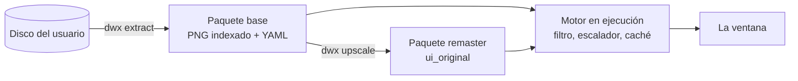

# Alta definición

Cómo se ve nítido el juego en una pantalla moderna: el motor filtra y amplía los fondos prerenderizados y las texturas de
los modelos **mientras corre**, y una herramienta pequeña fuera de línea, `dwx upscale`, amplía unas pocas imágenes
indexadas con reglas fijas de pixel art. Nada de esto usa modelos de imagen, servicios de IA ni red, y la misma entrada
da la misma imagen en todas las máquinas. El proyecto planeó antes una tubería mucho mayor fuera de línea y la dejó,
porque los mapas y los modelos ya se ven bien ([ADR 0025](../adr/0025-high-definition-in-the-engine.md)).

Lee antes la [tubería de assets](assets-pipeline.md), los [paquetes y el VFS](vfs.md) y la
[política legal](../legal/assets.md).

## Resumen



- **En el motor, al ejecutar.** `map.slang` filtra el fondo y las capas de profundidad del campo a la resolución de la
  ventana («HD scenery»); el escalador propio del motor duplica una vez cada fondo y cada textura de modelo; la escena 3D
  se dibuja con 4 muestras por píxel. Lo que hace el escalador se guarda en una caché, así que se hace una sola vez.
- **Fuera de línea, pequeño.** `dwx upscale <receta>` ejecuta el paso integrado `index_scale` sobre imágenes indexadas y
  escribe un paquete de la capa `remaster`. `dwx extract` ejecuta una receta incluida, `ui_original`, después del paquete
  base.
- **Cuatro ajustes para el jugador**, todos en su mejor valor por defecto ([siguiente sección](#lo-que-ve-el-jugador)).
- **El disco es una dependencia.** Todo sale del disco del propio usuario. Nada derivado está en git ni en un release.
- **Las imágenes propias del jugador** son otra forma de tener un mapa más nítido: ver
  [imágenes propias](../guides/custom-images.md).

## Lo que ve el jugador

| Ajuste | Valores | Por defecto | Qué hace |
|---|---|---|---|
| `hd_scenery` («HD scenery») | on, off | on | El fondo y las capas de profundidad del campo se filtran a la resolución de la ventana; apagado, los píxeles exactos del original |
| `scenery_quality` («Calidad de escenarios») | `upscaled`, `smooth` | `upscaled` | Con HD scenery encendido: el fondo duplicado una vez por mapa con el escalador del motor y remuestreado, o solo filtrado |
| `antialiasing` («Suavizado de bordes») | on, off | on | La escena dibujada con 4 muestras por píxel: contornos de modelos suaves |
| `texture_filter` («Texturas de modelos») | `upscaled`, `smooth`, `nearest` | `upscaled` | Las texturas de los modelos duplicadas y filtradas con mipmaps, solo filtradas, o los texels del original («Píxeles») |

- Son filas de la pestaña «Gráficos» de las opciones ([game](../modules/apps/game.md#escenarios-en-alta-definición)), en
  partida y desde el título, y se aplican al instante. Se guardan en los ajustes del usuario.
- `--graphics scenery=smooth|upscaled,aa=on|off,textures=nearest|smooth|upscaled` cambia los tres últimos para una
  ejecución (`graphics_options.hpp`); la consola y las rutas tienen `hd_scenery("on"|"off")`,
  `scenery_quality("smooth")`, `antialiasing("off")` y `texture_filter("nearest")`.
- `texture_filter` llega a todos los modelos: el campo y el combate, y las figuras 3D de los menús. Con `upscaled`, un
  modelo que se carga con el juego en marcha recibe sus texturas de un hilo propio (`TextureUpscaleJob`) y se dibuja con
  las normales hasta que están listas, así que ningún fotograma lo espera.
- El mismo ajuste decide también cómo se amplían las películas ([películas](movies.md#escalado)) y si una hoja de un
  aspecto marcada con `upscale: smooth` se suaviza con el escalador de texturas de los modelos ([UI](ui.md#imágenes)).

## Restricciones del juego

Cómo son los datos del original, y dónde los tienen en cuenta el motor y `dwx`:

- **Los fondos son indexados y la paleta se elige al jugar.** `dwx extract` compone los tiles de 128 × 128 del fondo en un
  PNG indexado por variante de paleta (`background_day`, `_dusk`, `_night`, `paletteN`), con los mismos índices en todas y
  **sin YAML de acompañamiento**. El motor (`assets::loadMapImages`) lee los índices y las paletas; el render elige y
  mezcla la paleta según la hora (`map.slang: texelAt`, `lerp(from, to, push.fade)` sobre la textura de paletas). La
  cámara trabaja en píxeles de fondo (`MapCamera`, `backgroundSize = tiles × 128`;
  [ADR 0020](../adr/0020-map-camera-and-depth-layers.md)). Por eso el filtro trabaja con los colores ya con la paleta
  aplicada, y por eso `index_scale` se queda en el espacio de índices: todas las paletas, el fundido y `?palette=N`
  siguen funcionando.
- **Las capas de profundidad son recortes de páginas de textura.** Cada sprite es un recorte de una de las páginas de
  textura del mapa (indexadas, de 256 por lado, varios sprites por página: un atlas), puesto en `inst.x, inst.y` en
  píxeles de fondo. Con `clut` −1 usa la paleta del fondo de la hora. Los sprites que no son recortes del fondo se
  filtran dentro de su propio rectángulo de la hoja (`rect`), para que no entre nada del sprite vecino.
- **El color 0 es transparente y el alfa es una clase.** El color `0x0000` no se dibuja, y el alfa guarda **clases**: 0
  transparente, 128 STP, 255 opaco (`colorFromOriginal`), que `map.slang` separa con umbrales de 0,25 y 0,75
  ([mapas](../formats/maps.md#capas-de-profundidad)). Los escaladores nunca interpolan entre clases. En las texturas de
  modelos `upscaleRgba` da antes a los texels transparentes el color de sus vecinos opacos, para que no entre un borde
  oscuro.
- **Costuras.** El fondo es una sola imagen (la extracción ya compone los tiles), así que no hay costuras de tiles, y el
  filtro acota sus lecturas a ella.
- **Las texturas de modelos** van dentro del `.glb`: una imagen por cada combinación de textura y paleta que usa alguna
  primitiva, con UV ya divididas por el ancho y el alto de la imagen, filtro `NEAREST` y `alphaMode: MASK` para el
  color 0 ([modelos](../formats/models.md#texturas)). Como las UV están normalizadas, una imagen del doble de tamaño
  funciona sin tocar la malla.
- **Límites de imagen de la UI.** Las imágenes de la UI miden como mucho 4096 por lado (`MaxUiImageSide`), 64 MiB de
  archivo (`MaxUiImageFileBytes`) y unos 85,3 MiB descomprimidas con todos sus niveles (`MaxUiImageBytes`), en
  `packages/engine/ui/include/dwe/ui/image_reference.hpp`. La UI pinta las imágenes indexadas con `?palette=N` desde
  `<id>_meta.yaml`, y pedir una paleta a un KTX2 es un error (`PaletteNeedsPng`; [UI](ui.md#imágenes)); por eso el
  paquete `ui_original` conserva PNG indexados.

## Alta definición en el motor

El motor dibuja los escenarios del campo en alta definición él mismo, sin paquete `remaster` ni herramienta externa:
la opción «Escenarios en alta definición» («HD scenery»; [game](../modules/apps/game.md#escenarios-en-alta-definición)),
encendida por defecto, cambia cómo `map.slang` muestrea el fondo prerenderizado y sus capas de profundidad. Es código
propio, escrito para dwe; de los trabajos publicados solo toma ideas generales (núcleos orientados por el gradiente,
tensor de estructura), nada de escaladores con licencia GPL o LGPL.

**Qué se eligió y por qué.** Dos caminos posibles:

| Camino | Cómo | Gana | Pierde |
|---|---|---|---|
| **Filtro en la GPU a la resolución de la ventana** (elegido) | `sampleSmooth` en `map.slang` lee los colores ya con la paleta de la hora y los filtra con un núcleo que sigue los bordes, en cada píxel de la ventana | Sin extracción nueva ni memoria (solo una textura RGBA del fondo); cualquier tamaño de ventana, sin factor entero; el fundido de paletas y todas las variantes funcionan igual; nada que validar en `_meta` | Coste por píxel en la GPU (medido abajo) |
| Escalado de índices al extraer o al cargar (`index_scale` ×2/×4, `scale` en `_meta`, `pixelsPerTexel` por textura) | Los escaladores de pixel art (familia AdvMAME) deciden por **igualdad** de índices | Sigue indexado: paletas y fundido gratis | Los fondos son renders 3D cuantizados a 256 colores con tramado: casi ningún vecino es igual, así que esos escaladores apenas cambian nada; ×4 cuesta 16 veces la memoria del fondo; solo da escalones más finos, no bordes limpios |

Medido en los fondos de `twna01`, `trop01`, `leom01` y `frzl01`: un Scale2x aplicado dos veces (× 4) sobre los índices
cambia solo el 6,8 %, 8,5 %, 7,4 % y 6,4 % de los píxeles respecto a ampliar sin filtro, y deja el tramado y los dientes
casi como estaban; el filtro en la GPU da bordes rectos y limpios y sombras suaves en los mismos mapas. No se combinan:
un pre-escalado de índices no añade nada que el filtro no haga ya y gastaría memoria.

**El filtro (`sampleSmooth`).** Por cada píxel de la ventana:

1. Lee 12 texels alrededor del punto (el 4 × 4 sin las esquinas) en colores: el fondo llega como una textura RGBA con
   la paleta que se ve ahora (`MapRenderer::resolveBackgroundColors`, que la rehace en la CPU solo cuando la paleta
   cambia: al cambiar de variante y en cada uno de los cinco escalones del fundido), así que cada texel es una lectura.
   Los sprites que siguen la hora (`clut` −1) se resuelven igual; los demás sprites ya son colores.
2. Con los gradientes de luma de los cuatro texels centrales (diferencias centrales) forma un tensor de estructura,
   mezclado bilinealmente: da la dirección del borde, su coherencia y su contraste, medido respecto al brillo local
   para que las paletas oscuras de la noche conserven sus bordes como las del día.
3. Pesa los 12 texels con una campana radial (`(1 − x/4)² · (1 − lóbulo · x)`, `x` la distancia al cuadrado) estrechada
   a través del borde y estirada a lo largo de él según la fuerza del borde: las líneas salen rectas y limpias a
   cualquier escala. El lóbulo negativo es 1 en los bordes y con contraste (cada texel conserva su color en su
   centro: no se pierde detalle) y 0,75 en las zonas planas, donde funde el tramado del original en sombras suaves.
4. Sujeta el resultado entre el mínimo y el máximo de los cuatro texels centrales: sin halos ni anillos.
   Muchos píxeles caen justo en el centro de un texel (a escala 3, uno de cada tres), donde los 12 texels y la sujeción
   pasan a los siguientes: el punto se mueve 1/512 de texel a la derecha y abajo para que el redondeo de cómo se dibujó
   el cuadro no decida (sin eso, dos franjas del pase del fondo daban colores distintos en esas filas).
5. **Transparencia y clases sin tocar**: los texels transparentes (clase 0) no pesan, así que no entra negro por los
   bordes, y solo se mezclan los de la clase del texel más cercano (opaco o STP): los STP se mezclan con lo de detrás
   en su propio pase y sus colores, a menudo oscuros, mancharían los opacos (salían puntos negros en los bordes de
   las hojas de `trop01`). El alfa es el del texel más cercano, así que qué se dibuja y qué es STP sigue siendo el
   píxel del original.

**Fundido y paletas.** El filtro mezcla colores después de aplicar la paleta, igual que el fundido mezcla paletas
(`lerp(paleta_a[i], paleta_b[i], t)` en cada texel es lo mismo que mezclar las dos imágenes; ver [Restricciones
del juego](#restricciones-del-juego)): todas las variantes y los escalones de 1/6 a 1/2 del fundido se ven como antes, solo más
finos. La textura RGBA se rehace con la misma cuenta que `snapshotPalette` (redondeada a 8 bits; como mucho medio
nivel de diferencia con la mezcla en coma flotante del camino de índices). Las capas de profundidad usan ahora el
mismo escalón del fundido que el fondo (`timeOfDayFadeShown`); antes usaban el progreso lineal y durante un fundido sus
colores se adelantaban un poco a los del fondo.

**Capas de profundidad alineadas: recortes.** Casi todos los sprites de las capas son recortes del fondo que se
dibujan delante de los personajes. `MapCutouts` (`<dwe/render/map_cutouts.hpp>`, solo CPU) comprueba, por sprite y
posición (y lo recuerda), si es un recorte: sigue las paletas del fondo (`clut` −1), está en un píxel entero y cada
texel que alguna variante dibuja tiene debajo el mismo índice del fondo. Un recorte se dibuja en modo
`SamplingCutout`: su texel más cercano dice si se dibuja y su clase, y el **color sale del fondo filtrado debajo**,
así que coincide con el fondo píxel a píxel, sin costura, y los personajes que pasan detrás quedan tapados por los
mismos píxeles que en el original. Los demás sprites (agua animada, piezas que no son recortes) se filtran solos,
dentro de su rectángulo de la hoja (`rect`), para que no entre nada del sprite vecino del atlas.

**Sin costuras.** El fondo es una sola imagen (la extracción ya compone los tiles de 128 × 128), así que no hay bordes
de tile dentro de él; el filtro sujeta sus lecturas al fondo (`rect`), y los recortes toman el color del mismo fondo.

**La geometría no cambia.** La opción solo llega a `render::MapRenderer` (el modo de muestreo de cada cuadro). La
cámara, la ventana del fondo, las posiciones de las capas, su profundidad, la elección del clic en el suelo, las
colisiones y los disparadores no la ven: el campo (`packages/game/field`) ni siquiera puede depender de `render` por las reglas
de capas de los módulos. `hd_scenery_tests.cpp` («HD scenery changes no collision, trigger, map change or camera of a
walk») anda por una sala contra una pared, sobre un disparador y a un salto con la opción apagada y encendida, y cada
tick da lo mismo: posiciones, giro, compañero, disparadores, cambio de mapa, dónde la cámara pone al jugador y qué
elige un clic ahí.

**El pase del fondo.** Con la opción encendida, `MapRenderer::hdSceneryScene` da un pase previo
(`FrameDesc::textureScenes`) que guarda el fondo filtrado en una textura del tamaño de la ventana, sin sombrear y con
la clase de cada píxel en el alfa. El fondo (`SamplingScreen`) y los recortes (`SamplingCutoutScreen`) la leen con una
sola lectura por píxel, así que un recorte ya no repite el filtro. La textura no se filtra entera cada frame: guarda el
fondo ampliado a la escala de la ventana con su píxel `u` en `u` módulo el tamaño de la ventana, así que al
desplazarse la cámara lo ya filtrado sigue donde estaba y el frame solo filtra la franja que el desplazamiento
descubre (`<dwe/render/hd_scenery_wrap.hpp>`; el pase dibuja encima de lo que había, `TextureScene::keep`). Se filtra
entera al cambiar los colores (variante, escalones del fundido, carteles), el tamaño de la ventana o el mapa, y otra
vez en el frame siguiente si los colores nuevos no cupieron en la memoria de subidas del suyo. El desplazamiento se
redondea a píxeles de la ventana: lo que se ve queda como mucho a medio píxel de la ventana de donde cae el cuadro.
Sin el pase (el primer frame, el que sigue a un cambio de tamaño) el fondo y los recortes filtran al vuelo, con el
mismo resultado. Una ruta que anda por `trop01` y luego apaga y enciende la opción (que lo filtra todo de nuevo) da la
misma imagen, salvo los personajes que se movieron entre las dos capturas.

**Coste.** En llvmpipe a 1280 × 720, medido como tiempo de CPU por fotograma (la suma de los hilos de llvmpipe; la
máquina tenía otros trabajos, así que los fps sueltos no sirven): la diferencia entre una ruta corta y otra 30 s más
larga dividida por la diferencia de fotogramas. En `trop01`, el peor por sus capas de follaje, quieto: 142 a 152 ms
sin la opción y 107 a 109 con ella; andando (la cámara se desplaza cada frame): 146 a 147 sin ella y 110 a 115 con
ella. Con la opción cuesta menos que sin ella porque el fondo sin filtro lee índice y paleta en varias muestras por
píxel y el pase deja una sola lectura. Un frame que lo filtra todo (un cambio de colores) cuesta lo que costaba la
versión que filtraba en cada frame, unos 230 ms en llvmpipe, unos 100 más que sin la opción; las versiones
anteriores, que filtraban el fondo cada frame (y los recortes otra vez debajo), iban de 166 a 290. En una GPU de verdad
son 12 lecturas por píxel y no se nota. Memoria: una textura RGBA del tamaño del fondo (5 MiB el mayor, 1280 × 1024),
las de los sprites que siguen la hora y la del pase, del tamaño de la ventana (3,5 MiB a 1280 × 720, 8 MiB a
1920 × 1080).

**Lo que no cubre.** Los modelos 3D, la UI y las pantallas propias (combate, minijuegos) no pasan por `map.slang`;
los modelos tienen sus propias mejoras de definición ([Nitidez](#nitidez)).

## Nitidez

Los mapas se veían pixelados. Antes de cambiar nada se midió de dónde venía: capturas de `twna01`, `trop01`,
`leom01`, `frzl01`, `twnb01`, `tunn01` y `mgen06` a 1920 × 1080 y 1280 × 720, de día y de noche, con «Escenarios en
alta definición» encendida y apagada, y recortes ampliados.

| Fuente | Qué se vio | Qué se hizo |
|---|---|---|
| Texturas de los modelos | Muestreadas al texel más cercano: a 1080p un texel de una textura de 256 × 128 ocupa varios píxeles y se ven bloques | `texture_filter` ([render](render.md#nitidez-suavizado-de-bordes-y-texturas-de-modelos)) |
| Contornos de los modelos | Sin suavizado: dientes en cada silueta, lo que más «pixelado» parecía | `antialiasing`, 4 muestras por píxel |
| Resolución del 3D | Ya es la de la ventana: no hay una resolución interna menor que ampliar | Nada |
| Fondo con el filtro HD | Suave, pero con «pinceladas» en las zonas con textura (la hierba de `trop01` y `twna01`), líneas onduladas y flecos rojos y azules en los circuitos de `mgen06`, y el ruido de colores del original | `scenery_quality`: el fondo ampliado (abajo) |
| Tramado | Proporción de cuadros de 2 × 2 en damero y de píxeles aislados: `twna01` 2,34 % y 1,50 %, `trop01` 7,94 % y 7,33 % (damero ordenado en las zonas oscuras y planas), `leom01` 0,91 % y 0,58 %, `frzl01` 1,04 % y 0,45 %, `twnb01` 1,38 % y 0,48 %, `tunn01` 2,67 % y 1,58 %, `mgen06` 0,48 % y 0,07 %. Casi todo es ruido de la cuantización a 256 colores, no un tramado ordenado | Se funde con un filtro por contraste antes de ampliar |
| Recortes del fondo | La máscara es el texel más cercano del sprite: el borde de lo que tapa a los personajes va en escalera | Sin cambiar (pendiente) |
| Interfaz | El HUD de la piel original, el polígono del minimapa y la fuente del nombre del mapa son pixel art ampliado | Fuera de esta mejora (UI) |

**El fondo ampliado** (`scenery_quality: upscaled`, por defecto). Al cargar un mapa, un hilo dobla el fondo en cada
variante de paleta con un escalador escrito para dwe (`<dwe/render/scenery_upscale.hpp>`; de lo publicado solo toma
la idea de la interpolación cúbica direccional, nada de código), y el pase del fondo HD remuestrea lo doblado a la
ventana:

1. **Tramado fundido.** Cada texel pasa a ser la media ponderada (1 2 1) de sus vecinos de su clase cuyo color guía
   (luma más media crominancia) difiere del suyo como mucho 10 niveles de 255: el damero y el ruido de dos colores
   cercanos dan su tono; cualquier cambio con más contraste queda igual.
2. **Doblado dirigido por bordes.** Cada píxel nuevo es una interpolación cúbica (−1, 9, 9, −1)/16 a lo largo de la
   dirección en que la imagen cambia menos: primero los centros de cada 2 × 2 (las dos diagonales), luego los de cada
   fila y columna; si ninguna dirección domina (menos de un 15 %), se mezclan las dos con pesos `1/(1 + d⁵)`. El
   resultado se sujeta a las dos muestras del medio, así que no hay anillos. Los bordes salen como líneas, sin
   escalones (una diagonal avanza un píxel por fila, no dos cada dos filas).
3. **Enfoque adaptativo.** Un enfoque suave al estilo del enfoque adaptativo al contraste: cada píxel se aleja de
   sus cuatro vecinos tanto menos cuanto más contraste hay ya, y nunca más allá del mínimo y el máximo de su luma
   alrededor (sin halos). Fuerza 0,35 de 1.
4. **Las decisiones se toman una vez.** Dirección, pesos, fundido y enfoque se deciden sobre la primera variante y
   se aplican igual a todas: lo doblado es una mezcla lineal de los texels del original, así que mezclar las
   variantes dobladas con los pesos del fundido da lo mismo que doblar la paleta mezclada (salvo la sujeción y el
   redondeo, unos pocos niveles en algún píxel y menos de uno de media). La GPU mezcla hasta tres variantes con los
   pesos que se ven en cada momento (la fila de la instantánea de un fundido interrumpido guarda los suyos).
5. **Las clases no se mezclan.** Los texels transparentes, STP y opacos nunca se interpolan entre sí, y cada píxel
   nuevo tiene la clase del texel original de arriba a la izquierda: el pase toma qué se dibuja y qué es STP del
   texel original más cercano y solo mezcla lo doblado de esa clase. Formas, recortes, capas y colisiones no cambian.
6. **En la GPU** (`SamplingUpscaledPrefilter` en `map.slang`): Catmull-Rom 4 × 4 sobre lo doblado, sujeto a los
   cuatro píxeles del medio. Va en el pase del fondo HD, que solo filtra la franja que descubre el desplazamiento: el
   resto de la escena (el fondo, los recortes sin costuras, las capas) lo lee como antes.

**Caché.** Cada fondo se dobla una vez y el resultado se guarda ([La caché](#la-caché)). Mientras el hilo trabaja, y si
algo falla, el fondo se ve con el filtro de siempre; cambiar de mapa, de idioma (los carteles) o la opción cancela el
trabajo en curso sin esperar.

**Coste.** Doblar un fondo de 768 × 640 en sus tres variantes, compilado con optimización y en 8 hilos: de 300 a
430 ms según la carga de la máquina (de 896 × 256 con una variante, de 100 a 170 ms), una sola vez por fondo; en la
compilación de desarrollo con sanitizers, unos 8 s, sin parar el juego. Memoria de vídeo: una textura RGBA del doble
de lado por variante (7,5 MiB para 768 × 640; 20 MiB para el mayor, 1280 × 1024). Por fotograma: 16 lecturas por
variante y píxel, solo en la franja que el desplazamiento descubre.

**Por qué no otro escalador.** Los de pixel art (familias xBR o ScaleFX) deciden por igualdad o distancia de
colores entre vecinos, y estos fondos son renders cuantizados en los que casi ningún vecino es igual (ver arriba
la prueba con Scale2x). Los escaladores con redes neuronales dan más detalle, pero son código y modelos de terceros
con sus licencias y pesos: aquí no se incluye ninguno; quien quiera otro aspecto puede traer sus propias imágenes
([imágenes propias](../guides/custom-images.md)).

**Modelos.** `texture_filter` y `antialiasing` están en [render](render.md#nitidez-suavizado-de-bordes-y-texturas-de-modelos):
las texturas de los modelos se doblan con el mismo escalador (sin tramado ni enfoque; el alfa interpolado, los
texels transparentes rellenados con el color de sus vecinos) y se filtran con mipmaps, y la escena se dibuja con 4
muestras por píxel.

**Lo que queda.** La máscara de los recortes (escalones sobre los personajes), la UI y el minimapa.

## La caché

Los resultados del escalador se guardan para que cada fondo y cada textura de modelo se haga una sola vez
(`render::UpscaleCache`, `<dwe/render/upscale_cache.hpp>`).

- **Dónde.** `<datos del usuario>/cache/upscale`, en la carpeta de datos del usuario, junto a los ajustes. Una ejecución
  que no guarda ajustes (autotests) no guarda nada: la caché no tiene carpeta y cada llamada vuelve a ampliar.
- **Qué se guarda.** Un archivo por resultado, `<clave>.bin`, comprimido con zstd. La clave es un hash FNV-1a de 64 bits
  de todo aquello de lo que depende el resultado: los píxeles, las paletas, las opciones y la versión del escalador
  (`SceneryUpscaleVersion` en `map_renderer.cpp`, `TextureUpscaleVersion` en `texture_upscale_job.cpp`; hay que cambiar
  la versión cuando cambia la salida). Solo se guardan los resultados duplicados; una textura de modelo que solo se
  filtra no.
- **Nunca hace falta.** Un archivo que falta, está dañado o es viejo se vuelve a ampliar. Cada archivo se escribe con un
  nombre temporal y se renombra, así que varios hilos pueden usar la carpeta.
- **Tamaño.** La carpeta se mantiene por debajo de 512 MiB (`UpscaleCache::DefaultLimit`) borrando lo usado hace más
  tiempo; al cargar un archivo se actualiza su fecha. Un fondo de 768 × 640 ocupa de 3 a 5 MiB por variante de paleta.
- **Contenido.** Se hace a partir del disco del usuario, así que se queda en la máquina del usuario ([Legal](#legal)).

## `dwx upscale` y recetas

La parte fuera de línea es pequeña a propósito. El comando
`dwx upscale <receta.yaml> <paquete o carpeta de contenido> -o <carpeta>`
([página de dwx](../modules/apps/dwx.md#dwx-upscale-y-las-recetas-incluidas)) amplía las imágenes indexadas
que elige una receta y las escribe, con sus metadatos, como un paquete de la capa `remaster` con el nombre de la receta.
No tiene proveedores, ni modelos, ni red: los mismos bytes en todas las máquinas.

### Recetas

Una receta es un archivo `<nombre>.recipe.yaml` (`apps/dwx/src/upscale_recipe.*`). Lo que acepta `parseUpscaleRecipe`:

```yaml
recipe: 1
id: ui_original        # también el id del paquete que escribe: a-z, 0-9 y _, hasta 64 caracteres
asset_type: ui         # ui o icon
select:
  include:             # ids de asset sin extensión; el mismo id dos veces es un error
    - texture/etcdat/system_w
scale: 4
steps:                 # exactamente un paso, el integrado index_scale
  - id: upscale
    builtin: index_scale
    scale: 4           # opcional; si se da, igual al de la receta
    params:
      mode: edge       # edge (por defecto) o nearest
```

Una clave desconocida, una versión de receta distinta de 1, un paso que no sea `index_scale` o una escala que el modo no
tiene es un error. Una receta nunca lleva comandos, URL, rutas ni claves: solo ids de asset y números. Por eso las
recetas se pueden compartir; lo que escriben nunca se comparte ([Legal](#legal)).

### La receta incluida

`content/enhance/ui_original.recipe.yaml` va dentro de `dwx` (`bundled_recipes.hpp.in`). `dwx extract` la ejecuta después
de escribir el paquete base, y escribe el paquete `ui_original` junto al base. Amplía ×4 en modo `edge` las imágenes de
las que el aspecto de interfaz original dibuja sus iconos; una imagen que el disco no trae se omite. El aspecto mide sus
sprites en píxeles del original y los ve más nítidos al mismo tamaño en pantalla ([extract](../formats/extract.md),
[editar menús](../guides/edit-menus.md)). Las dos imágenes del título no están: el aspecto las suaviza con el escalador de
texturas de los modelos (`upscale: smooth` en `skin.yaml`).

Cambiar la receta cambia lo que escribe `dwx extract`: hay que subir `ExtractorVersion` en el mismo commit.

### El paso `index_scale`

`apps/dwx/src/index_scale.*` amplía una imagen por un factor entero de 1 a 8 **en el espacio de índices de paleta**: la
paleta es la misma, cada índice nuevo se toma de la fuente, y el resultado depende solo de los índices, el factor y el
modo.

- **`edge`:** las reglas clásicas de vecinos 2× y 3× del pixel art (familia AdvMAME) aplicadas a los índices, con el
  píxel del borde repetido fuera de la imagen. Existen los factores 1, 2, 3, 4, 6 y 8 (4, 6 y 8 componen las reglas 2× y
  3× en un orden fijo, primero la 2×); 5 y 7 no tienen reglas.
- **`nearest`:** cada píxel repetido n × n veces (cualquier factor de 1 a 8).
- **Límite en los atlas.** Las reglas miran los 8 vecinos de cada píxel sin saber dónde acaba un sprite: en una hoja de
  sprites, los píxeles del borde de un sprite que toca a otro sin hueco pueden tomar el índice del vecino en la copia
  ampliada. Un sprite con al menos un píxel de hueco (o de color 0 alrededor) no se ve afectado.
- **Por qué índices.** Nunca mezcla colores, así que el resultado sigue siendo un PNG indexado y todas las paletas de la
  imagen, el `?palette=N` de la UI y el fundido entre paletas siguen funcionando. Solo da pixel art más nítido, no
  detalle nuevo.

Cómo escribe `dwx upscale`:

- Lee los paquetes de la carpeta que se le da, sin contar el de salida, así que repetirlo parte siempre de la base.
- Las imágenes conservan sus ids de asset, así que el paquete cubre a la base; el `_meta.yaml` gana `scale: k` (el PNG
  mide `k` veces ancho × alto; `width`, `height` y los rects siguen siendo los del original;
  `content/schemas/image.schema.json`).
- Escribe en `<salida>.partial` y lo renombra. Solo reemplaza una carpeta que ya es un paquete `remaster` con el id de la
  receta; cualquier otra se rechaza sin tocarla. Si no hay ninguna imagen que ampliar, no escribe nada.
- Una imagen que los paquetes no dan es un error en `dwx upscale` y se omite en `dwx extract`.

## La capa `remaster`

`remaster` es la capa por encima de `base` y por debajo de los mods y el usuario ([paquetes y VFS](vfs.md), [capas de
contenido](assets-pipeline.md#capas-de-contenido)). Un paquete que declara `layer: remaster` y depende de `base` queda
ahí: un mod sigue ganándole, y un asset que no trae sale de la base.

### En la pila

- Es una **capa del motor** (`assets::isEngineLayer`: `base` y `remaster`). Un mod, es decir, un paquete de una carpeta
  de mods o de `--mods`, solo puede declarar `mods` o `user`; el que declara `remaster` se deja fuera con el motivo
  (`checkModLayer`). Por eso `dwx upscale` y `dwx extract` escriben en la carpeta de contenido, junto a `base`.
- El código de un paquete del motor en estas capas corre como el motor (`script::isEngineCode`); un paquete de
  `dwx upscale` solo trae imágenes y sus metadatos.
- Las imágenes reemplazan a las de la base por id y se buscan por id sin extensión (un `.ktx2` de un remaster puede
  responder al `.png` de la base; [VFS](vfs.md)). Un KTX2 no tiene paletas entre las que elegir, así que una imagen que
  se dibuja con `?palette=N` tiene que seguir siendo un PNG indexado.

### Qué comprueba `dwx validate`

`dwx validate` no tiene ninguna comprobación propia de esta capa. Ejecutado sobre el paquete con la base montada
(`dwx validate --engine --with <contenido>/base <paquete>`; sin `--engine` se rechaza un paquete que declara una capa del
motor), aplica lo que se aplica a cualquier paquete: `pack.yaml` contra su esquema, cada `_meta.yaml` contra
`image.schema.json` por las reglas de esquema de la base (`scale` es un entero de 1 a 8), un `<nombre>_meta` con su imagen
en la pila, y que el motor pueda cargar todos los assets ([tubería de assets](assets-pipeline.md#dwx-validate)). No lee
`*.recipe.yaml`: `dwx upscale` comprueba la receta al leerla.

## Legal

Extensión de la [política legal](../legal/assets.md#salida-mejorada-remaster). No es asesoría legal. Lo que el motor o
`dwx` hacen a partir del disco es derivado del original: un fondo ampliado, una textura duplicada, el paquete
`ui_original` y la caché no se distribuyen nunca, solo el código y las recetas. Se quedan en la máquina del usuario.

## Pruebas

- **`hd_scenery_tests.cpp`** (`apps/game`): HD scenery está encendido salvo que el jugador lo apagara y la elección se
  guarda; no cambia ninguna colisión, disparador, cambio de mapa ni cámara de un paseo.
- **`scenery_upscale_tests.cpp`** (`packages/engine/render`): bordes, diagonales sin escalones, degradados, fundidos,
  clases, tramado, la caché, el borde recortado de una textura de modelo.
- **`map_cutouts_tests.cpp`**, **`texture_upscale_job_tests.cpp`**: qué sprites de capa son recortes del fondo, y el hilo
  de fondo de las texturas de modelos.
- **`index_scale_tests.cpp`**, **`upscale_tests.cpp`** (`apps/dwx`): las reglas de borde, los factores, la receta, el
  paquete que escribe `dwx upscale` y cuándo se niega a reemplazar una carpeta.
- **Capturas:** las capturas y las rutas no leen ajustes guardados, así que `--graphics` los fija para una ejecución y se
  puede comparar el mismo fotograma con cada opción.
