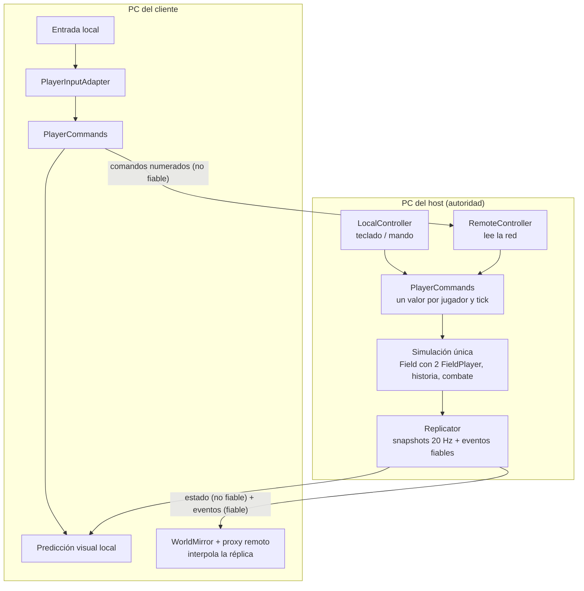
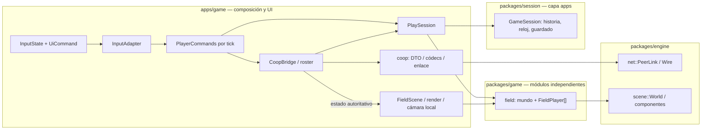

# Multijugador cooperativo en línea (documento de diseño)

Estado: **sala y arranque cooperativo implementados; sincronización del mundo parcial** (2026-11-16). El anfitrión inicia con un guardado propio; el invitado envía su guardado para importar solo su compañero. El cliente carga el mundo del host en memoria y no escribe sobre el guardado local. El host simula el campo y recibe comandos del invitado; el cliente presenta el avatar del host. NPCs, historia, interacciones y reconciliación del movimiento todavía no están replicados íntegramente. Consulta la [prueba manual de la sala](#prueba-manual-de-la-sala) antes de probar.
> La ampliación del navegador de salas a cuatro participantes está especificada en el [plan de implementación del navegador y cuatro jugadores](../../architecture/coop-browser-4p.md). La implementación debe avanzar por sus puertas; el runtime actual sigue siendo de dos participantes.

## 0. Propósito y alcance

La portada ofrece **Cooperativo** en ambos diseños del menú. Desde ahí se puede crear una sala o unirse con el código;
la app usa WebRTC y completa el saludo cooperativo. Al volver atrás conserva la conexión para cargar la misma partida
en ambos equipos; las órdenes del invitado ya controlan el segundo cuerpo simulado por el host. La vista del invitado
dibuja el avatar del host desde snapshots, pero no recibe NPCs, historia ni progreso, y su movimiento local todavía no
se reconcilia. La entrada es distinta del versus en línea existente.

**Propósito:** que un segundo jugador se conecte por internet a la partida de otro y jueguen juntos en el mismo mundo:
caminar, hablar con NPCs, avanzar la historia y pelear.

**Dentro del alcance:**

- dos jugadores en línea, un host y un invitado;
- conexión directa entre PCs por WebRTC, con el Worker de señalización solo para el primer contacto;
- el mundo de la partida del host, con su historia;
- el invitado con su propio jugador (y su compañero, según la decisión 1 de §6).

**Fuera del alcance:**

- el versus, que ya existe y es otra cosa: un combate suelto en lockstep ([versus](../modules/game/versus.md));
- el multijugador local en una misma pantalla, que el proyecto descartó;
- más de dos jugadores (el diseño no lo cierra, pero no se prueba);
- servidores dedicados y partidas persistentes.

### Prueba manual de la sala

1. Abre dos instancias con la misma versión y contenido. El anfitrión crea sala y comparte el código.
2. El invitado se une, pulsa **Listo** y elige su guardado. Solo se usa para importar la identidad, modelo y estado actual de su compañero.
3. El anfitrión pulsa **Iniciar** y elige su guardado. Ese guardado aporta el mundo y el progreso compartido.
4. El invitado debe cargar el mapa del anfitrión con su compañero y sin sobrescribir su guardado local. Ambos verifican movimiento y cámara local.

El protocolo de sala y transferencia sí permite hacer esta prueba de arranque. La sincronización en vivo todavía es parcial: el host recibe comandos de campo del invitado y simula un segundo jugador; el cliente recibe/presenta el avatar del host. NPCs, historia, interacciones y progreso no se replican íntegramente, y el movimiento local del invitado aún no se reconcilia con snapshots. Los cambios de mapa los inicia solo el anfitrión.
## 1. Idea en una frase

Los dos jugadores usan **los mismos datos de jugador** y los mismos sistemas de juego. Cada instancia combina una
fuente local de entrada con una representación remota del otro jugador. El **host** recibe comandos de ambos,
simula el mundo compartido y es la única autoridad de estado. El **cliente** manda comandos, predice solo la respuesta
visual inmediata de su jugador y presenta la réplica del host. La predicción nunca activa historia, colisiones
autoritativas ni cambios de mapa. Se conectan por WebRTC, con el mismo transporte y señalización que el versus.

El primer diagrama describe el flujo local de control: fuentes → adaptador → instancias de jugador → sistemas
compartidos. El segundo añade el límite de red: cada instancia tiene su jugador local y un proxy de presentación del
jugador remoto; los comandos entran a la simulación del host y los estados autoritativos vuelven a ambos clientes. El
proxy no es una segunda simulación del mundo. La conexión de red se integra con juego/sesión desde la app: las reglas
de módulos impiden que `game/coop` importe directamente `game/field` o `game/versus`.



## 2. Lo que el código asume hoy

Estudio sobre `main` en `aa27246b2`. Es lo que obliga a cambiar cosas antes de poner nada en la red.

| Tema | Estado actual | Consecuencia |
|---|---|---|
| Jugador en el campo | `Field` conserva un solo mapa y sus sistemas compartidos. `FieldPlayer` ya representa al anfitrión y al invitado y mueve ambos cuerpos de forma independiente; las interacciones, rutas por clic y asociaciones de compañeros siguen migrando desde los campos únicos. | Completar el estado por jugador sin duplicar mapa, NPCs, scripts ni transiciones. |
| Seguimiento del compañero | `PartnerFollow` y `Field::movePartner` siguen al único jugador. El rescate fuera de pantalla usa la cámara del renderer y un aleatorio sin guardar (`FieldScene::gestureRandom_`). | Cada compañero sigue a su dueño. La prueba de fuera de pantalla pasa a la simulación (§4.5). |
| Cámara | `FieldCameraFollow` sigue al jugador en el dibujo, y `FieldScene::followPixel` entrega `setCameraRest` al campo. | La cámara de seguimiento permanece local; las pocas reglas que necesitan conocer la vista reciben un `PlayerViewState` explícito validado por el host. El campo no consulta directamente al renderer. |
| Entrada | `input::InputState` es un objeto con estado y consultas por nombre. `game.cpp` arma cada tick un `field::FieldInput` (`stick`, `run`, `moveTarget`, `cancelTarget`, `confirm`), que ya es un valor plano. Los diálogos, menús, combate, objetos y minijuegos leen `InputState` directamente (`pressStory`, `pressBattle`, …). | `FieldInput` es la base de `PlayerCommands`. Lo demás se convierte en comandos (§4.2). |
| Reloj | Tick fijo de 1/60 s (`core::FixedStep`). El campo da «frames del original» a 20 fps con un acumulador float; la historia, un frame cada 3 ticks; el combate, su propio `FixedStep` a 20 fps. | Sirve tal cual en el host. El cliente no simula el mundo, así que no necesita el mismo reloj. |
| Determinismo | Las posiciones del campo son floats de glm: dan lo mismo en un binario, pero no está garantizado entre máquinas. Hay aleatorios fuera de `ruleset::Random` (`std::minstd_rand` en efectos y gimnasio, `gestureRandom_`). El combate sí es determinista: enteros, `checksum()`, «misma semilla, mismo combate». | El mundo se **replica**, no se sincroniza en lockstep. El checksum del combate queda como herramienta de diagnóstico. |
| Estado del mundo | `PlaySession`/`GameSession` son dueños de todo. `GameSession::saveFile()` da un `SaveFile` YAML determinista con unas 30 secciones, pero solo vale con el campo libre (`savesWait`/`busyWith`). Los scripts en curso, el estado pasajero de los NPCs, los combates y los fundidos no van en el guardado. | El guardado sirve para **unirse en un punto seguro**, no para replicar en vivo. |
| Combate | `FighterId` es el índice en `fighters`: compañero 0, enemigos del 1 al 3. La IA enemiga y los golpes apuntan a `PartnerId`. La enfermedad, la bolsa, los objetos lanzados y el revivir son solo del luchador 0. | Hoy cabe **un solo compañero** por combate. Dos compañeros obligan a rehacer los lados (§6, decisión 3). |
| Red | `net::PeerLink`/`RtcPeerLink` con dos canales («control» fiable y ordenado, «inputs» sin retransmisión). `SignalClient` con códigos de sala de 4 letras sobre el Worker de señalización. `ReliableChannel`, `WireWriter`/`WireReader`, y un saludo cooperativo con semántica compatible con `Identity`/`contentHash`. `Lockstep` es solo de dos lados. | Se reutiliza transporte, señalización y primitivas wire; no se importa el módulo `versus` desde `game/coop`, por la regla de independencia entre módulos de juego. El lockstep sirve como mucho para combates. |
| Pausas | Los menús pausan la simulación según la visibilidad local de la interfaz (`PlaySession::tickSystems`, `paused()`, `screenStops()`). La pausa de Start lo congela todo. Los scripts congelan jugador, compañero, reloj y cámara (`holdForScript`, `scriptPauseGame`). | En cooperativo, abrir un menú no puede parar el mundo del otro (§6, decisión 5). |
| Quién mueve un actor | No hay `Player`, `Controller` ni `InputSource`. Lo más parecido: el autotest y el socket de control inyectan teclas en `InputState`; los scripts mueven actores con `driveByScript`/`placeByScript`; el combate y el compañero tienen registros de estrategias (`BattleStrategies`, `PartnerStrategy`). | El controlador es una pieza nueva, pero sigue el mismo patrón que las estrategias. |

## 3. Principios

1. **Un solo mundo, una sola autoridad.** El host simula todo: mapa, NPCs, historia, compañeros, combate, reloj y
   aleatorios. El cliente nunca decide nada del mundo.
2. **El jugador es datos, el controlador es la interfaz.** Los dos jugadores son el mismo `FieldPlayer`. Lo que cambia
   es el `PlayerController` que les da comandos cada tick.
3. **Todo pasa por comandos.** Ningún sistema de juego lee el teclado. Leen `PlayerCommands`, vengan del teclado, de la
   red, de un autotest o de una repetición.
4. **La simulación no depende del dibujo.** La cámara, el renderer y la interfaz son de cada pantalla. Lo que la
   simulación necesita de ellos se calcula dentro de la simulación.
5. **Reutilizar la base de red del versus.** El mismo transporte, la misma señalización y las mismas reglas de
   identidad/contenido. El cooperativo conserva DTOs y protocolo propios para respetar las capas de módulos.
6. **Cada paso sirve sin red.** La fase C0 (§7) mejora el juego de un jugador: autotests, repeticiones y entrada más
   limpia.

## 4. Piezas

### 4.1 `PlayerController`

La interfaz que da los comandos de un jugador. Una implementación por fuente:

| Implementación | Dónde vive | Qué hace |
|---|---|---|
| `LocalController` | `apps/game` | Lee `InputState` y arma `PlayerCommands`. Sustituye el código de `game.cpp` que hoy arma `FieldInput` y reparte las pulsaciones a cada pantalla. |
| `NetworkFieldController` | `apps/game` (host runtime) | Convierte `Commands` a `PlayerCommands`, acepta secuencias nuevas y neutraliza el movimiento tras 250 ms. `PlaySession::tick` pasa esa entrada como segundo `FieldInput` al mismo `Field`. |
| `ScriptedController` | `apps/game` (autotest) | Da comandos desde una ruta o una repetición. Permite probar dos jugadores sin red. |

La forma sigue a las estrategias que ya existen: una interfaz pequeña y sin estado de juego. El controlador no toca la
simulación; solo produce valores. El transporte y el puente se instancian desde el loop de la app al entrar en una partida.

### 4.2 `PlayerCommands`

Un valor plano por jugador y tick, serializable con `WireWriter`:

- `field`: el `FieldInput` de hoy (`stick`, `run`, `moveTarget`, `cancelTarget`, `confirm`).
- `actions`: lista corta de acciones discretas no críticas, procesables en su tick, como botones de movimiento de
  campo o minijuego. Acciones que deben entregarse exactamente una vez (elecciones, órdenes de combate, uso de
  objetos) usan el mensaje fiable `Action` (§5.5), con id monotónico; no se incluyen también en `PlayerCommands`.

Las APIs que hoy reciben `InputState` se revisan una por una. Solo las decisiones que cambian estado compartido del
juego se convierten en acciones de jugador. Navegación de interfaz, opciones gráficas y otros comandos personales de
RmlUi siguen locales y no se serializan. La app convierte los comandos de gameplay al tipo neutral; `game/coop`
traduce ese tipo a su propio DTO de protocolo, sin compartir headers entre módulos de juego.

### 4.3 `PlayerRegistry`

Vive inicialmente en el runtime de `apps/game`, que compone entrada local y enlace. Un registro por jugador:

- `id` (0 = host, 1 = invitado), nombre y si es local o remoto.
- su `PlayerController`.
- su compañero: el del host es el `Partner` de `SessionState`. El del invitado, según la decisión 1 de §6.
- su estado de conexión (conectado, esperando punto seguro, desconectado).

La primera versión admite exactamente dos jugadores. No hacer configurable `max_players` hasta que exista un caso de
uso para más participantes: el modelo de dos pares y una simulación host no define por sí mismo multijugador mayor.

### 4.4 `FieldPlayer`

Todo lo que hoy es único en `Field` y pertenece a un jugador pasa a un `FieldPlayer`:

- su entidad y, cuando se suministra el perfil invitado acordado, la de su compañero (las etiquetas
  `PlayerTag`/`PartnerTag` llevan el id del jugador);
- su `FieldInput`, su ruta y objetivo de clic, `freeTick`, rastro y último trigger;
- sus `cellSections` y `confirmSection`;
- su `PartnerFollow` y su prueba de fuera de pantalla.

Siguen siendo **del mundo**: el mapa, los NPCs, los fundidos, el cambio de mapa, las pausas de script
(`holdForScript`, `holdForCare`, `holdForItem`) y el filtro de salidas de `StoryLock`. `Body::who` pasa de «0/1» a
`{jugador, papel}`.

Los scripts de la historia que hablan de «el jugador» usan **el jugador que disparó el evento** (el que pisó la
casilla o habló con el NPC). `StoryAdapter` recibe ese id con cada sección de casilla.

### 4.5 Cámara y vista

- Cada pantalla tiene su `FieldCameraFollow`, que sigue a **su** jugador. El host y el cliente dibujan la misma
  réplica de mundo, cada uno con su encuadre local.
- **Propuesta para el rescate del compañero:** cada pantalla calcula un `PlayerViewState` lógico: rectángulo visible
  del fondo en coordenadas de píxel del mapa, id de mapa y secuencia. El rectángulo ya representa viewport,
  encuadre, scroll y shake efectivos. El cliente lo envía al host cuando cambia y como refresco, hasta 20 Hz; el host
  invalida la vista tras 500 ms sin actualización. No contiene
  la posición del jugador ni órdenes de movimiento. El host conserva la vista más reciente de cada jugador y la usa
  para el rescate de su compañero. Si ese jugador inicia una escena compartida, el host deriva el punto de reposo
  desde el centro de la vista y la cámara fija del mapa; si la vista caducó, usa la posición del jugador como ancla.
- El host valida que el rectángulo sea finito, corresponda al mapa/versión activos, tenga ancho/alto positivos, no
  exceda el fondo y tenga dimensiones compatibles con un viewport permitido. La vista se invalida tras 500 ms sin
  actualización. El centro debe estar dentro del rango que permite el seguimiento de cámara para ese jugador.
  Si falta o caduca, el host no usa la prueba visual y conserva el seguimiento por distancia/atasco hasta recibir una
  vista válida. Las posiciones, colisiones, triggers e historia
  siguen siendo siempre autoritativas del host.
- `Field` ya recibe `setOffScreenTest` como función inyectada desde `FieldScene`; se puede extender el puerto para
  consultar por `PlayerId`, sin que `game/field` dependa de `render`. `makeRoomForPlayer` usa `cameraView_` derivado
  de la cámara fija del mapa, no del viewport local, así que esa regla puede seguir siendo común al mundo.
- La cámara de script (`Field::scriptCamera`) y `holdCamera` en combate se aplican a las dos vistas. Si un invitado
  inicia la escena, el host toma el ancla de su último `PlayerViewState` válido y replica el evento/recorrido de cámara;
  cada cliente lo presenta con su viewport local. La cámara de seguimiento fuera de escenas sigue siendo local.

### 4.6 Paquete `game/coop`

Paquete nuevo, al lado de `game/versus` y con la misma forma:

| Pieza | Lado | Qué hace |
|---|---|---|
| `protocol` | los dos | DTOs de mensaje con rango propio, saludo cooperativo con campos/versiones equivalentes a `Identity` (sin depender del módulo `versus`) y códecs `WireWriter`/`WireReader`. |
| `CoopLink` | los dos | Implementado: saludo, validación de identidad, dirección permitida por rol, 10 s para responder, 8 s de silencio y salida sobre un `PeerLink` inyectado. |
| `RemoteCommandBuffer` | host | Implementado: acepta secuencias nuevas con rollover y entrega entrada neutral tras 250 ms sin comandos. |
| `ProfileAssembler` | host / cliente | Implementado: reensambla `ProfileChunk` desordenados con límite de tamaño y reintentos idénticos. |
| `CoopGameplayBridge` | los dos | Integrado al loop para enviar comandos del invitado, recibirlos en el controlador del host y enviar snapshots a 20 Hz. El cliente interpola y presenta el avatar remoto del host; el resto de entidades aún no se replica visualmente. La transferencia de perfiles está implementada, pero todavía no se transfiere ni carga el guardado autoritativo del host. |
| `CoopSnapshotBuilder` | host | Implementado para jugador host, compañero host e invitado; la captura de NPCs y aplicación del espejo cliente siguen pendientes. |
| `CoopGuestPartnerProfile` | host | Implementado en `apps/game`: valida y parsea el guardado completo (máximo 128 KiB), migra solo `partner` y extrae especie, apodo y estado. No carga otras secciones; conectar el `ProfileAssembler` al flujo de unión y crear/replicar el actor del compañero invitado sigue pendiente. |
| `CoopHost` / `CoopClient` | los dos | Pendiente: ciclo de vida de sesión, replicación del mundo y aplicación de snapshots, sin acoplar transporte a Field. |
| `Replicator` / `WorldMirror` | host / cliente | El DTO/serializador puede estar en `game/coop`; la captura y aplicación de estado del mundo viven en `apps/game`, donde se permite componer `Field`, `PlaySession` y `FieldScene`. |

La representación del cliente carga mapas y modelos y dibuja la interfaz, pero no avanza sistemas de mundo; solo
aplica el estado recibido. Si se implementa con `PlaySession` o con una vista de presentación separada queda sujeto al
spike de §7.1.5.

### 4.7 Interfaces (boceto)

Boceto para fijar la forma; los nombres finales salen de la revisión de C0. Sigue las convenciones del código:
`std::expected`, sin excepciones, inicializadores designados.

```cpp
namespace dwe::app {

using PlayerId = std::uint8_t;  // 0 = host, 1 = invitado

struct PlayerAction {
  enum class Kind : std::uint8_t { TextAdvance, TextChoice, MenuChoice, BattleCommand, UseItem, ThrowItem, Minigame };
  Kind kind;
  std::int32_t value = 0;  // opción, orden de combate, objeto…
};

struct PlayerCommands {
  std::uint32_t sequence = 0;  // monotónica por emisor; no presupone reloj compartido
  game::field::FieldInput field;
  std::vector<PlayerAction> transientActions;  // solo acciones tolerantes a pérdida, p. ej. botones de minijuego
};

struct PlayerViewState {
  std::uint32_t sequence = 0;
  std::string mapId;
  // izquierda, arriba, ancho, alto en píxeles enteros del fondo prerenderizado del mapa
  std::array<std::int32_t, 4> backgroundRect{};
};

struct ReliableAction {
  std::uint64_t actionId = 0;
  std::uint32_t sourceSequence = 0;
  PlayerAction action;
};

class PlayerController {
public:
  virtual ~PlayerController() = default;
  // Los comandos del jugador para este tick. Nunca bloquea: si no hay nada, un PlayerCommands vacío.
  [[nodiscard]] virtual PlayerCommands next(std::uint64_t tick) = 0;
};

struct PlayerSlot {
  PlayerId id;
  std::string name;
  bool remote = false;
  std::unique_ptr<PlayerController> controller;
  enum class Link : std::uint8_t { Local, Joining, Connected, Dropped } link = Link::Local;
};

}  // namespace dwe::app

namespace dwe::game::field {

struct FieldPlayer {
  PlayerId id;
  entt::entity body;
  entt::entity partner;
  FieldInput input;
  PartnerFollow follow;
  // ruta del clic, freeTick, rastro, último trigger, cellSections, confirmSection, reposo de vista…
};

}  // namespace dwe::game::field
```

El tipo de comando de la app no depende de transporte. El puente lo convierte al DTO `Commands`, codificado con
`WireWriter`: secuencia del emisor (u32), `FieldInput` empaquetado (stick en dos i8, flags en un byte, `moveTarget` opcional) y
acciones transitorias acotadas. Cada `ReliableAction` se codifica en su mensaje separado con id de sesión, id de
acción, secuencia de origen y payload tipado.

## 5. Red

### 5.1 Canales

| Flujo | Dirección | Canal | Ritmo | Contenido |
|---|---|---|---|---|
| Comandos | cliente → host | «inputs» (no fiable) | cada tick local | `PlayerCommands` con secuencia monotónica por emisor y los últimos 3 comandos (redundancia contra pérdidas). El host es el único que los aplica a la simulación. |
| Vista del jugador | cliente → host | «inputs» (no fiable) | al cambiar, refresco máximo 20 Hz | `PlayerViewState`: rectángulo visible lógico del fondo, mapa y secuencia. Informa el rescate visual del compañero; el ancla de cámara se deriva en el host. |
| Snapshots | host → cliente | «inputs» (no fiable) | 20 Hz | Tick de simulación del host, secuencia del snapshot y última secuencia de comandos aplicada por jugador. Incluye estado autoritativo de entidades visibles (id, posición, rumbo, animación y frame), reloj y HUD. |
| Eventos | host → cliente | «control» (fiable, ordenado) | cuando pasan | Cambio de mapa, diálogo abierto/avanzado/cerrado, inicio y fin de combate, menú compartido, partida para unirse, desconexión. |
| Acciones críticas | cliente → host | «control» (fiable, ordenado) | cuando pasan | No se duplican en otro canal: cada acción lleva id monotónico de sesión y secuencia de origen. El host confirma o rechaza el id; reintentos conservan el mismo id. |
| Resultado de acción | host → cliente | «control» (fiable, ordenado) | al procesarse | `ActionResult` devuelve el id y aceptación/rechazo para que la UI local cierre la espera sin inferir el resultado. |

En la primera versión los snapshots son **estados completos**, no deltas. Así, perder un paquete no invalida los siguientes y no se necesita ACK para elegir una base. La tasa se medirá con capturas reales antes de optimizar; la estimación de 8 KB/s es orientativa y no incluye overhead, entidades fuera del campo ni eventos.

### 5.2 Autoridad del movimiento

El cliente **envía comandos de movimiento**, nunca una posición aceptada como verdad. El host ejecuta el mismo sistema
de movimiento y colisión para ambos jugadores. Para reducir la latencia percibida, el cliente puede predecir el dibujo
de su propio jugador usando sus comandos pendientes; al recibir snapshots reconcilia esa vista con el estado del host.
La predicción no escribe en el mundo espejo ni ejecuta triggers, interacciones, scripts, cambios de mapa o combate.
Todos esos efectos ocurren solo cuando los confirma la simulación del host. El host limita e invalida comandos fuera
de secuencia, demasiado antiguos o con valores fuera de rango; tras pérdida sostenida el controlador remoto vuelve a
entrada neutral. No se envía `OwnPose` ni `PoseFix` en esta versión.

### 5.3 Unirse a una partida

1. El host abre sala: código de 4 letras por el Worker de señalización, igual que el versus.
2. El cliente entra con el código. Saludo cooperativo con campos equivalentes a `Identity`: si la versión del juego o el contenido no coinciden, se corta
   con un motivo claro.
3. El host espera al siguiente **punto seguro**: campo libre, sin script, diálogo, combate, transición ni fundido;
   `savesWait` no debe indicar bloqueos. El `JoinState` incluirá un snapshot inicial completo de entidades dinámicas
   (posición, rumbo y animación actuales), así que el estado pasajero de NPCs que el cliente necesita dibujar no se
   infiere del guardado. Mientras tanto, el cliente ve «Esperando al anfitrión…».
4. El host manda un `JoinState` versionado: `SaveFile` del mundo del host, id/hash de mapa, tick de simulación y estado
   inicial de entidades necesarias. El cliente prepara su jugador/compañero visitante desde su perfil local, sujeto a
   la decisión 1 de §6; ese perfil no reemplaza ni modifica el guardado del host.
5. El cliente carga el mapa en modo espejo, instancia el jugador visitante y recibe el estado inicial autoritativo
   antes de habilitar controles.
6. Empiezan los snapshots.

La reconexión vuelve a ejecutar el saludo y a recibir un `JoinState` actual; no se reanuda un búfer viejo. Si el
invitado se va, su jugador y su compañero desaparecen en el siguiente punto seguro, y el host sigue jugando solo. El
protocolo distingue una desconexión temporal de una salida definitiva antes de borrar el estado del visitante.

### 5.4 Señalización, relay y salas

Se usa el Worker de señalización del versus (`apps/versus-signal`) con un tipo de sala nuevo. Las tarjetas de salas
abiertas (#291 directorio público, #292 estado explícito de sala, #293 pantalla de partidas públicas, #294 perfil
online local y #295 relay TURN) sirven igual para el cooperativo, así que son **base común**. Desplegar el Worker o
activar TURN sigue necesitando OK.

### 5.5 Mensajes

Un byte de tipo al principio de cada mensaje, en el rango `0x60–0x6F` (el versus usa `0x10–0x14` y el lockstep
`0x40/0x41`).

| Tipo | Nombre | Canal | Dirección | Contenido |
|---|---|---|---|---|
| `0x60` | `Hello` | fiable | los dos | Campos de identidad (versión de protocolo, versión del juego, `contentHash`) y nombre del jugador; DTO cooperativo propio. |
| `0x61` | `Welcome` / `Refuse` | fiable | host → cliente | id asignado, o motivo del rechazo (versión, contenido, sala llena). |
| `0x62` | `JoinState` | fiable | host → cliente | DTO versionado con mapa, tick, entidades dinámicas y referencia (id/cantidad) a los fragmentos del `SaveFile` del host. La asociación y aplicación del guardado se orquesta en la app. |
| `0x63` | `Commands` | no fiable | cliente → host | Un comando cuantizado con secuencia. El buffer acepta solo secuencias nuevas con rollover y lo vuelve neutral tras 250 ms; repetición de las últimas 3 secuencias queda pendiente. |
| `0x64` | reservado | — | — | Sin mensaje de posición del cliente. |
| `0x65` | reservado | — | — | Sin mensaje de corrección; se reconcilia con snapshots. |
| `0x66` | `Snapshot` | no fiable | host → cliente | Tick, ACK de comando y hasta 48 entidades cuantizadas. El capturador actual incluye jugador host, compañero host e invitado. El tamaño se limita a 1200 bytes; NPCs, HUD, recepción e interpolación del cliente siguen pendientes. |
| `0x67` | reservado | — | — | No se requiere ACK para snapshots completos. |
| `0x68` | `Event` | fiable | host → cliente | Reservado en el protocolo actual; planificado para cambio de mapa, diálogo e inicio/fin de combate. |
| `0x69` | `Action` | fiable | cliente → host | Reservado; planificado para acciones críticas con id monotónico y secuencia de origen. |
| `0x6A` | `Leave` | fiable | los dos | Motivo de salida. |
| `0x6B` | `ActionResult` | fiable | host → cliente | Reservado; resultado y deduplicación de acciones quedan pendientes. |
| `0x6C` | `ViewState` | no fiable | cliente → host | Límites del rectángulo visible en píxeles del fondo, mapa y secuencia; metadatos de vista validados por el host. |
| `0x6D` | `ProfileChunk` | fiable | ambos sentidos | Fragmento de perfil acotado a 128 KiB, con tipo `GuestSave` o `HostSave`. El ensamblador tolera orden variable y reintentos idénticos y rechaza duplicados conflictivos; la app valida e interpreta el guardado completo del invitado. |

`CoopLink` aplica 10 s para la respuesta inicial y 8 s de silencio tras recibir tráfico; el protocolo no añade un
mensaje de latido propio. El buffer neutraliza el comando actual tras 250 ms sin uno nuevo.

No se comparten relojes de simulación: cada emisor numera sus comandos localmente; solo el host numera ticks de mundo.
El host descarta secuencias repetidas o atrasadas, aplica el comando válido más reciente según la política de buffer
definida, y tras el timeout usa entrada neutral. Los snapshots confirman la última secuencia aplicada para que el
cliente descarte comandos pendientes al reconciliar su vista. Una `Action` fiable lleva `actionId` y
`sourceSequence`; se aplica al estado actual del host si sigue siendo válida o se rechaza como caducada. El host
conserva los ids procesados durante la sesión y responde con el mismo resultado a un reintento. Al reconectar empieza
una sesión nueva con otro identificador; no se reenvían acciones pendientes de la sesión vieja.

### 5.6 Guardado en cooperativo

El cooperativo nunca cambia ni rompe las partidas guardadas de un jugador de ninguno de los dos. La regla:

- **Solo una partida que arranca la sala es cooperativa.** El arranque del anfitrión (su propio guardado, elegido para
  la sala) y el del invitado (el mundo del anfitrión) se unen a la sala. Una partida cargada desde la portada con una
  sala todavía abierta sigue siendo de un jugador: el invitado no se añade y no envía nada (`PlayStart::coop`,
  `PlaySession::coopGame`).
- **El anfitrión guarda su propia partida, como partida de un jugador.** El guardado rápido, la máquina de guardado y
  el autoguardado escriben la ranura del anfitrión como siempre. Nada del invitado llega a ese guardado: el cuerpo y
  el compañero del invitado solo existen en el campo y ninguna sección del guardado los lee. Un guardado que el
  anfitrión escribe en cooperativo es el mismo archivo que escribiría jugando solo, y se carga en un jugador como
  cualquier otro.
- **El invitado no guarda nada.** Su partida es una copia del mundo del anfitrión en memoria, con el compañero del
  invitado. No tiene almacenamiento de guardado (ni autoguardado, ni guardado rápido, ni máquina de guardado) y la
  copia no nombra ninguna ranura (`hostWorldWithGuestPartner`), así que nada puede tomar como propia una ranura del
  disco del invitado. El guardado propio del invitado solo se lee, para enviar su compañero. El guardar del menú de
  pausa lo avisa, su salir cierra sin guardar y un aviso lo dice al empezar la partida
  (`online.coop.guest_not_saved`, `save.coop_guest`, `save.coop_guest_quit_confirm`).
- **Salir, desconectarse o un cierre inesperado no cambian nada en disco.** El invitado no ha escrito nada; la ranura
  del anfitrión guarda su último guardado, que nunca tuvo estado del invitado.

Lo que gana el invitado todavía no vuelve a su propia partida (decisión 4 de §6, fase C4).

Pruebas: `packages/session/tests/coop_saves_tests.cpp` (el guardado del anfitrión con un invitado en el campo es el
guardado de un jugador y se carga en el lugar del anfitrión), `apps/game/tests/coop_guest_profile_tests.cpp` (la copia
del invitado no nombra ranura) y `apps/game/tests/app_flow_tests.cpp` (la partida del invitado nunca se guarda en una
ranura; solo las partidas de la sala son cooperativas).

### 5.7 Mundo compartido: autoridad, jugadores y mapas

Lo que hacen hoy las primeras piezas del cooperativo de §5.2 y §5.3 (#353, #354, #355, #356, #358). Funciona con
hasta 4 jugadores (`game::coop::MaxPlayers`): el jugador 0 es el anfitrión, los invitados son del 1 al 3, y nada
nombra un segundo jugador fijo.

**Quién decide qué.** El `WorldAuthority` del anfitrión (`packages/game/coop`) guarda la sesión: quién está en ella
(el registro de jugadores), el mapa en el que está el grupo y la última transformación válida de cada jugador.

| Estado | Dueño | Cómo lo saben los demás |
|---|---|---|
| Quién está en la sesión, la especie de su compañero | anfitrión (`WorldAuthority`) | `Roster` en cada cambio |
| El mapa del grupo, salidas y llegadas | anfitrión | `PlayerCorrection` con la salida por la que entró |
| La posición propia de un invitado | el invitado, revisada por el anfitrión | `PlayerState`, rechazado o corregido si es imposible |
| La posición del anfitrión, NPCs, historia, reloj, batallas | anfitrión | instantáneas (§5.1) y eventos |
| Cómo se dibuja un jugador remoto | cada partida, en local | interpolación (abajo); nunca escribe la autoridad |
| Lo que los jugadores cambian en el mundo (cofres, triggers, puertas, objetos del suelo) | anfitrión | `WorldChange`, `WorldSync`, `GroundItems` (§5.8) |

**Mensajes.** Tres tipos se suman a la tabla de §5.5 y ocupan el lugar de su esbozo `OwnPose` y `PoseFix` (versión 4
del protocolo):

| Tipo | Nombre | Canal | Dirección | Contenido |
|---|---|---|---|---|
| `0x70` | `PlayerState` | no fiable | cliente → anfitrión | Id del jugador, secuencia (el tick del invitado), la época de corrección que sigue, mapa, posición, orientación, movimiento. Cada 3 ticks. |
| `0x71` | `PlayerCorrection` | fiable | anfitrión → cliente | Dónde pone el anfitrión a ese jugador: mapa, posición, orientación, la salida en un cambio de mapa y una época nueva. |
| `0x72` | `Roster` | fiable | anfitrión → cliente | Revisión y, por jugador, id, nombre y especie del compañero. |

**Sincronización de la transformación.** El invitado mueve su propio jugador y lo informa. El anfitrión acepta un
estado solo si el enlace es dueño de ese jugador, es más nuevo que el último aceptado (los paquetes tardíos,
duplicados o desordenados se descartan), lleva la época de la última corrección (ningún estado de antes de una
corrección ni de un mapa anterior), está en el mapa del grupo y se alcanza desde la última pose válida a la velocidad
máxima del jugador. Un cuerpo que quedaría dentro de una pared en el mapa del anfitrión no se lleva allí. Tras 3
rechazos seguidos el anfitrión devuelve al jugador a su última pose válida, y los dos lados vuelven a coincidir. Un
salto del lado del invitado (un `place` de un script) es uno de esos rechazos: se corrige, no se adopta.

**Mapas (decisión 2 de §6).** El grupo va adonde va el anfitrión. Las salidas propias del invitado quedan retenidas
(`Field::holdExits`); cuando el anfitrión cambia de mapa, cada invitado recibe una corrección con el mapa nuevo, la
salida y el punto de aparición del anfitrión, y llega justo allí. Los estados del mapa o la época anteriores se
rechazan, y el invitado no informa nada mientras viaja. Cada jugador sigue teniendo su propio mapa actual: un jugador
remoto en otro mapa no se dibuja ni se mueve, y vuelve a mostrarse cuando llega.

**Interpolación.** Los jugadores remotos se dibujan desde un búfer corto de estados con hora (`PoseTrack`): 100 ms por
detrás del más nuevo, mezclando los dos que rodean ese momento. Los estados tardíos nunca hacen retroceder una pista,
un hueco corto se extrapola como mucho 100 ms y luego se queda quieto, un paso de más de 800 unidades (un salto de
mapa o una corrección) se dibuja como salto, y un emisor cuyo reloj se pausó se retoma sin una recuperación lenta. El
anfitrión dibuja así a los invitados, y los invitados dibujan a todos desde las instantáneas del anfitrión, con la
hora del reloj del anfitrión. Dibujar es solo presentación: nunca cambia lo que guarda la autoridad.

**Ciclo de vida.** Un invitado entra cuando termina su saludo: recibe el id libre más bajo, un cuerpo y un compañero
en el campo del anfitrión junto a él, una corrección a ese sitio y un roster nuevo. Sale con `Leave`, con un enlace
caído o con un cierre inesperado: su registro, cuerpo, compañero y búferes desaparecen en los dos lados, y el roster
lo quita. Cuando una partida cooperativa termina en cualquiera de los lados (volver a la portada, salir), ese lado
envía `Leave` y cierra la sala; un invitado cuyo anfitrión se fue vuelve a la portada. Un jugador que vuelve entra
como nuevo, con un estado limpio.

**Presencia.** `WorldAuthority::playersOn(map)` (anfitrión) y `CoopGameplayBridge::playersOn(map)` (invitado, desde la
última instantánea) dicen qué jugadores están en un mapa, para los sistemas que necesitan a los demás cerca
(batallas, objetos compartidos).

Pruebas: `packages/game/coop/tests/authority_tests.cpp`, `apps/game/tests/coop_world_tests.cpp`,
`apps/game/tests/coop_snapshot_interpolation_tests.cpp`, `apps/game/tests/player_registry_tests.cpp` y los casos
cooperativos de `packages/game/field/tests/field_tests.cpp`.

### 5.8 Interacciones del mundo compartido

Cada partida de la sesión corre su propia copia del mundo del anfitrión (§6.1), así que lo que un jugador hace en ese
mundo tiene que llegar a las copias de los demás, o un cofre que un jugador abrió sigue lleno para el resto (#357). El
anfitrión es el único que aplica una interacción compartida al mundo; las partidas de los demás piden, y se les cuenta
el resultado.

**Qué se comparte y qué es local.**

| Interacción | Se guarda como | Compartida o local | Cómo viaja |
|---|---|---|---|
| Triggers de historia que pone cualquier jugador: eventos jugados, NPCs reclutados, tiendas abiertas, puertas y mecanismos abiertos para siempre | triggers de historia | compartida | `WorldAsk` → anfitrión → `WorldChange` |
| Variables de historia (contadores que lleva un script) | variables de historia | compartida | igual |
| Cofres | su trigger de historia | compartida: un solo jugador recibe el objeto, y el cofre se ve tomado (cajón fuera) en todas las partidas al momento | lo que toma un invitado es un `ItemClaim`, que responde un `ClaimAnswer`; luego `WorldChange` |
| Objetos en el suelo (los objetos al azar del mapa, lo que sueltan las batallas) | el suelo del anfitrión | compartida en el mapa del anfitrión: toda partida allí muestra el suelo del anfitrión, y un objeto es de un solo jugador | `GroundItems` desde el anfitrión; la recogida de un invitado es un `ItemClaim` |
| Puertas y mecanismos que un script mueve mientras los jugadores miran | ediciones en vivo del mapa (flags de objetos, celdas cerradas) | compartida con los jugadores de ese mapa; en la siguiente visita el script de cabecera del mapa las reconstruye desde los triggers compartidos | `WorldAsk` → anfitrión → `WorldChange` |
| Medallas, especies criadas, los objetos clave de la página del jugador (cañas) | triggers de historia | local: de cada jugador | nunca se envían |
| La congelación de un script, el trigger de encarar en una charla, el nombre del mapa siguiente | variables de historia y un trigger | local: siguen los scripts propios de ese jugador | nunca se envían |
| La bolsa, los bits, el compañero y sus cuidados, los menús, los diálogos en pantalla, la cámara | sistemas de la sesión | local | nunca se envían (batallas: §6.1) |

Los hechos locales salen de las reglas de la historia (`StoryAdapter::playerOwnTrigger` y `playerOwnVariable`): un
ruleset que mueve la congelación o el encarar a otro número los mueve también.

**Cómo funciona.** Tras cada tick cada partida compara su historia con lo último que acordó con la sesión
(`CoopStoryBaseline`): lo que cambiaron sus propios scripts y sistemas es su novedad. La novedad del anfitrión solo hay
que contarla, porque su partida es el mundo. Un invitado envía su novedad como `WorldAsk`; el `WorldLedger` del
anfitrión descarta una petición que ya tomó (cada invitado numera sus peticiones), se queda solo con la parte
compartida, acepta ediciones del mapa solo para el mapa en el que está la sesión, aplica lo que cambia su mundo, y
envía a cada invitado un `WorldChange` con la revisión
siguiente, el jugador cuya interacción fue y los valores nuevos. Un invitado aplica un cambio una sola vez
(`WorldReplica`: una revisión que no es más nueva que la última tomada se descarta), y lo que aplica del anfitrión nunca
lo devuelve como propio. Los valores son absolutos (un trigger puesto, el valor de una variable), así que aplicar uno
dos veces es aplicarlo una. Cuando dos jugadores cambian el mismo hecho a la vez decide el orden del anfitrión, y todas
las partidas terminan con el valor del anfitrión.

**Tomar un objeto.** Un cofre o un objeto del suelo lo podrían tomar dos jugadores a la vez, así que lo que toma un
invitado pregunta antes. Cuando el invitado confirma, su aviso del objeto sigue en pantalla (el cajón de un cofre ya
está fuera) y su partida envía un `ItemClaim`: el trigger del cofre, o la ranura y el id del objeto del suelo. El
anfitrión responde las reclamaciones de cada invitado en orden y una sola vez (una reclamación enviada otra vez se
descarta): concedida mientras el trigger del cofre no está puesto o el objeto sigue en el suelo con ese id, y entonces
pone el trigger o quita el objeto de su suelo y se lo cuenta a todos como siempre. Solo con un `ClaimAnswer` concedido
mete la partida del invitado el objeto en la bolsa; rechazada (o sin respuesta en diez segundos) el invitado no recibe
nada y el aviso dice que otro jugador lo tomó (`online.coop.item_gone`). El anfitrión toma al momento, como en la
partida de un jugador, así que si toma dentro del mismo viaje de ida y vuelta va primero; si al tomar el objeto ya no
está porque otro lo tomó con el aviso abierto, recibe el mismo aviso. En un mapa en el que no está el anfitrión, el
suelo de un invitado es suyo y no hace falta reclamar. La partida de un jugador nunca reclama.

**Entrar tarde y cambiar de mapa.** Un invitado que entra recibe toda la historia compartida (`WorldSync`, en partes
que caben en un datagrama) y el suelo del anfitrión; todos los invitados los reciben otra vez cuando el anfitrión entra
en un mapa. La sincronización lleva la revisión del anfitrión, así que un cambio que ya está en ella no se aplica otra
vez.

**Guardado (§5.6).** El mundo es del anfitrión: lo que un invitado cambia en él está en el siguiente guardado del
anfitrión, como cualquier cosa que haga el anfitrión. El invitado sigue sin guardar nada, y su propio guardado nunca se
escribe.

**Mensajes** (versión 5 del protocolo, rango `0x90–0x9F`):

| Tipo | Nombre | Canal | Dirección | Contenido |
|---|---|---|---|---|
| `0x90` | `WorldAsk` | fiable | cliente → anfitrión | El número de petición del invitado, su mapa y las ediciones (trigger, variable, objeto del mapa, celdas cerradas). |
| `0x91` | `WorldChange` | fiable | anfitrión → cliente | Revisión, el jugador del que vino y su petición, el mapa, las ediciones. |
| `0x92` | `WorldSync` | fiable | anfitrión → cliente | Revisión, parte, y un tramo de triggers (bits) y variables. |
| `0x93` | `GroundItems` | fiable | anfitrión → cliente | El mapa del anfitrión y su carga, y cada objeto del suelo: id, ranura, objeto, celda y lugar. |
| `0x94` | `ItemClaim` | fiable | cliente → anfitrión | El número de reclamación del invitado, cofre u objeto del suelo, el trigger del cofre o la ranura y el id del objeto, el mapa. |
| `0x95` | `ClaimAnswer` | fiable | anfitrión → cliente | El número de reclamación y si se concedió. |

**Límites.** Un NPC que otro jugador reclutó se va del mapa de esta partida en su siguiente carga, no al momento (su trigger llega
al momento, pero el NPC en pantalla sigue los scripts propios de esta partida hasta que el mapa vuelve a cargar). Solo
viajan las ediciones en vivo del mapa; cualquier otra cosa que un script haga en pantalla (una escena, el paseo de un
personaje) se queda en la partida que lo corrió.

Pruebas: `packages/game/coop/tests/world_state_tests.cpp`, `apps/game/tests/coop_world_state_tests.cpp` (un anfitrión
y dos invitados con mensajes codificados), el caso cooperativo de `packages/game/field/tests/field_items_tests.cpp` y
el de `packages/session/tests/story_adapter_tests.cpp`.

## 6. Decisiones de juego (pendientes)

| # | Pregunta | Recomendación | Alternativa |
|---|---|---|---|
| 1 | ¿Qué trae el invitado? | **Confirmado:** se transfiere su partida completa y se extraen solo identidad, modelo y estado actual del compañero; historia, mapa y progreso compartido siguen bajo el host. | Importar al mundo host el resto de la partida del invitado: descartado. |
| 2 | ¿Quién inicia cambio de mapa? | **Confirmado:** solo el anfitrión inicia el cambio compartido. Si el invitado llega a un warp, se detiene allí hasta que el host cambie el mapa. | Que el invitado cambie el mapa por sí mismo: descartado. |
| 3 | Combate | **Decidida (C3, primera versión):** pelea el compañero de **quien empieza el combate**; el otro ayuda con objetos de su propia bolsa y ánimos, y ve el combate. Un combate a la vez. Más adelante, los dos compañeros juntos. Ver §6.1. | Los dos compañeros desde el principio: hay que rehacer los lados del combate (IA enemiga, golpes, comandos, HUD). |
| 4 | Progreso | La historia, los flags, el dinero y el mundo son **del host**. El invitado se lleva a su partida su compañero (stats, edad, técnicas) y los objetos que consiga. | Progreso compartido en las dos partidas: rompe la historia del invitado. |
| 5 | Pausa y menús | Los menús personales son locales y **no pausan** el mundo. Solo el host puede solicitar pausa global con Start; el host confirma el cambio de reloj y lo replica a ambos. | Pausa para los dos con cualquier menú: corta el juego del otro a cada rato. |
| 6 | Diálogos y escenas | Congelan a los dos jugadores. **Avanza quien los abrió**; el otro ve el mismo cuadro. | Cualquiera avanza: más rápido, pero se saltan textos del otro. |

### 6.1 La decisión 3 tal como está hecha (C3)

El invitado ejecuta su propia copia del mundo del anfitrión, así que un combate que comparten los dos jugadores tiene
que correr en un solo sitio. Corre en la **simulación del anfitrión**:

- **Cuándo se comparte (ticket #351).** Solo mientras el otro jugador está en el mismo mapa. El invitado pasa los
  combates de su script al anfitrión solo mientras la última instantánea del anfitrión nombra el mapa del invitado (y
  no hay un cambio de mapa en curso); en cualquier otro sitio el combate es del propio invitado, en solitario, igual que
  en un jugador, y nada espera al anfitrión. Los combates del anfitrión solo se muestran a un invitado en ese mapa que no
  esté en un combate propio en solitario. Los dos lados preguntan a la consulta de presencia de la sesión (§5.7,
  `coopPlayerHere`): la autoridad del anfitrión, que además rechaza la petición de un invitado que no sitúa en su mapa,
  y la última instantánea del invitado.

- **Quién pelea.** El compañero del jugador cuyo script de mapa lo empezó (un enemigo salvaje tocado, un NPC con el que
  se habló, un combate de la historia). Un combate que pide el script del invitado va al anfitrión como `BattleAsk`
  (mapa, las ranuras de NPC de los enemigos con los que se suman ya sorteados, las marcas de combate fijo y predefinido,
  y el luchador del compañero del invitado: especie, stats, PV, PM, modo de carga, técnicas equipadas, condición,
  técnicas conocidas). El anfitrión lo empieza con ese compañero visitante donde está el compañero del invitado en su
  campo (`session::BattleRequest::visitor`); el compañero del anfitrión no participa.
- **Un combate a la vez.** El mundo compartido corre un combate, así que un encuentro nunca crea dos. Una petición
  mientras corre uno se rechaza por ocupado (`BattleRefused`): el script del invitado recibe «no empezó», como cuando
  un combate no puede empezar en el original, y el invitado entra al combate en curso como ayudante. Una petición que el
  anfitrión no puede aceptar por otro motivo (se fue del mapa entretanto, o está en una pantalla, escena o script)
  también se rechaza, y entonces el juego del invitado corre ese combate él mismo, en solitario. Cada combate que empieza
  el anfitrión en el mapa del invitado (el de su historia, el de un torneo) se le muestra al invitado igual.
- **Qué ve el otro jugador.** El anfitrión envía `BattleBegin`, luego un `BattleFrame` cada 3 ticks (fase, orden
  actual, órdenes disponibles, si se puede usar la bolsa, PV y PM de los luchadores y cada figura retenida: sitio,
  orientación, clip y su inicio) y luego `BattleEnd`. El campo del invitado se detiene y dibuja sus propios actores
  donde los ponen los frames; la pantalla `coop_battle` muestra las barras de vida, las órdenes del que empezó y la
  ayuda del ayudante. La cámara del ayudante se gira hacia el combate cuando empieza y vuelve cuando termina.
- **Qué puede hacer cada jugador.** El que empezó da las órdenes (los comandos de la tira, el remate) y cierra el
  cuadro final. Los dos pueden lanzar un objeto **de su propia bolsa** (el objeto del invitado sale de su bolsa; el
  juego del anfitrión presta uno y lo lanza) y **animar** (una pulsación de la carga del remate). En el anfitrión, un
  combate del invitado bloquea la tira y el botón del remate del anfitrión; su bolsa funciona.
  Los botones de la pantalla se usan con el ratón o con las flechas y confirmar; el botón extra del campo pide el
  remate al que empezó y anima en el ayudante.
- **Quién lo tocó.** En el anfitrión, un enemigo que choca con el cuerpo del invitado solo queda bloqueado: el propio
  juego del invitado procesa ese toque y pide el combate, así que el guion del anfitrión nunca lo empieza con el
  compañero del anfitrión.
- **Recompensas y derrota (decisión 4).** Los bits y los objetos que caen van al mundo del anfitrión. Lo que el combate
  deja al compañero que peleó (PV, PM, subidas de stats, técnicas aprendidas, cuidados, vidas perdidas, lesión,
  contadores) vuelve al invitado en `BattleEnd` y su juego lo aplica como el resultado de su propio combate, derrota
  incluida (sus vidas y sus escenas). Los NPC que el combate quitó del mapa también van en `BattleEnd`, para que los dos
  campos los quiten.
- **Desconexión.** Si el invitado se cae en su propio combate, su compañero sigue peleando solo con su última orden (a
  su aire desde entonces) y no se envía nada de vuelta; el anfitrión sigue mirando y ayudando y puede cerrar el cuadro
  final. Si se cae el anfitrión, la petición pendiente del invitado pasa a ser un combate en solitario de su propio
  juego, y el combate en pantalla se va (su script recibe «no empezó»); nada queda detenido.

Siguiente paso: los dos compañeros peleando juntos. El protocolo ya lleva quién empezó y la especie de cada luchador, y
las acciones del ayudante pasan por el mismo `BattleAction`; lo que falta es un segundo lado de compañero en el propio
combate (los objetivos de la IA enemiga, los golpes, la bolsa y el HUD suponen solo al luchador 0, §2).

Límites de esta primera versión: los efectos de las técnicas, los números de daño y las marcas de estado solo se dibujan
en el anfitrión; el invitado ve moverse a los luchadores y las barras de vida. Los luchadores de torneo que no son NPC
del mapa no se dibujan en el invitado. El objeto del ayudante se dibuja lanzado desde el domador del anfitrión. Los
enemigos saltan a los sitios del anfitrión cuando empieza el combate (hasta entonces cada juego simula sus propios
NPC). Los objetos que caen solo aparecen en el mundo del anfitrión. Mientras el anfitrión tiene su menú abierto, el
combate espera para los dos.

## 7. Fases

| Fase | Contenido | Criterio de cierre | Tiempo |
|---|---|---|---|
| **C0, sin red** | `PlayerCommands` y los tres controladores; pantallas por acciones; `FieldPlayer`; cámara y prueba de fuera de pantalla fuera del renderer; `PlayerRegistry`. | El juego de un jugador no cambia (cadena de la historia en verde). Un test con dos jugadores scriptados en el mismo `Field` (solo en tests, nunca como modo local). | 2–3 semanas |
| **C1, verse caminar** | `game/coop` con saludo, unión en punto seguro, snapshots completos, `WorldMirror`, simulación de movimiento autoritativa en host y predicción visual local reconciliada. | Dos PCs en el mismo mapa se ven caminar, cada uno con su compañero detrás; el host resuelve colisiones y triggers con pérdidas simuladas. | ~2 semanas |
| **C2, interactuar** | NPCs y casillas por jugador, diálogos replicados, cambio de mapa en grupo, menús sin pausa, desconexión y reconexión. | Un tramo de la historia jugado entre dos PCs. | ~3 semanas |
| **C3, combate** | Según la decisión 3 (§6.1). **Hecha, primera versión:** combates en el anfitrión para los dos jugadores cuando comparten mapa (en solitario si no, #351), la vista del otro jugador, ayuda y órdenes, recompensas de vuelta al invitado, desconexión en combate. Falta: los dos compañeros en un combate. | Un combate de la historia ganado en cooperativo. | 2–6 semanas |
| **C4, invitado** | Progreso del invitado de vuelta a su partida, nombres sobre los jugadores, indicador de latencia, pulido. | El invitado vuelve a su partida con lo ganado. | — |

### 7.1 Corte de arquitectura y orden de implementación

El código actual tiene límites de paquete que conviene conservar. `packages/game/field` no depende de entrada,
UI, render ni transporte (recibe mapas por `assets`); `packages/session` es una librería de capa apps que conduce historia, reloj y sistemas y observa
el `Field` adjunto; `apps/game` compone `InputState`, `PlaySession`, `FieldScene` y las pantallas;
`packages/engine/net` ofrece un `PeerLink` no bloqueante con carril fiable y no fiable. Las reglas prohíben
dependencias directas entre módulos `packages/game/*`, así que `game/coop` no puede importar `field` ni `versus`.
Los adaptadores de dispositivo/UI y el puente de integración viven en `apps/game`; `game/coop` puede alojar DTOs,
códecs y estado de enlace que dependan de `core`/`net`, pero no de módulos superiores o pares.



Orden recomendado, con una puerta de diseño al final de cada etapa:

1. **Inventario de lectores y escritores (antes de C0).** Clasificar cada acceso a `field.player()`, `partner()`,
   `InputState` y `FieldScene::followPixel` como entrada, estado simulado, sistema de sesión o presentación. Separar
   acciones personales de UI (no salen del dispositivo) de acciones de juego compartidas (sí se serializan). No
   convertir cada tecla/UI command en un mensaje de red.
2. **C0a, comandos en el borde de la app.** Introducir los tipos planos de comando inicialmente en `apps/game`, sin
   dependencias de `InputState` ni `ui::UiCommand`; añadir un adaptador local; mover primero el armado de `FieldInput` y después las
   acciones de historia/combate que hoy llaman a métodos `press*`. Conservar temporalmente adaptadores de
   compatibilidad para autotest y para pantallas no incluidas. Extraer el orden actual del tick a una función de
   aplicación que recibe comandos, sin cambiar todavía la cardinalidad del campo.
3. **C0b, jugador explícito en `Field`.** Crear `FieldPlayer` para los datos por jugador identificados en §4.4 y
   mantener mapa/NPCs/warps/estado de scripts como estado del mundo. Migrar cada campo único por grupos pequeños:
   entrada y ruta; entidades y seguimiento; triggers/confirmación; handoff y rescate; cámara/reposo. Mantener
   `player()`/`partner()` como accesores del jugador local o id 0 durante la migración, si permite preservar
   compilación y tests. Las etiquetas globales `scene::PlayerTag`/`PartnerTag` ya llevan el id del propietario
   (id 0 por defecto para consumidores existentes); sus consumidores fueron revisados antes del cambio.
4. **C0c, entrada por jugador y regresión.** Consumir un vector/registro de comandos por tick en `PlaySession` y
   `FieldScene`; resolver qué APIs de sesión son realmente por jugador. Mantener un único `StoryRunner` inicialmente:
   antes de C2 decidir cómo se arbitran dos triggers simultáneos y asegurar que el script recibe el jugador que lo
   inició. Implementar la propuesta de §4.5: recibir en el host la vista lógica por jugador y mantener el test de
   fuera de pantalla como puerto inyectado. Acordar límites de tamaño/aspecto y expiración de `PlayerViewState` antes
   de habilitar rescates remotos. No leer la cámara del renderer directamente desde `Field`.
5. **Spike de modo espejo (puerta previa a C1).** `FieldScene` hoy posee y avanza un `Field`; el cliente necesita
   cargar mapas/modelos y dibujar sin ejecutar esos sistemas. Probar una separación mínima `FieldView`/datos de
   presentación que acepte estados de réplica, o documentar una alternativa concreta. No construir `PlaySession` en
   modo espejo hasta demostrar que reloj, scripts, NPCs, `finishTick` y transiciones no avanzan localmente.
6. **C1a, protocolo puro.** Definir DTO de `Commands`, `JoinState`, `Snapshot`, `Event` y `Action`; decodificar con
   límites de longitud/cantidad/rangos y exigir `WireReader::done()`. Definir cuantización entera/fixed-point para
   cada `glm::vec*` (movimiento, vista y snapshots): `WireWriter` escribe enteros/texto/bytes, no floats. Añadir
   secuencias y tick, deduplicación fiable, timeout, versión de protocolo y pruebas round-trip/mensajes truncados. El transporte se inyecta como `PeerLink`;
   la lógica de coop no crea sockets ni depende de una sala real en unit tests.
7. **C1b, host/cliente sobre transporte inyectado.** `CoopBridge` en `apps/game` drena mensajes antes de cada tick;
   el host compone comando local y remoto, y ejecuta exactamente un tick autoritativo. Si un comando no llega: neutral tras el límite definido;
   nunca repetir acción discreta. El cliente aplica snapshots completos en una cola temporal para interpolar y
   predice el dibujo local por separado. Medir ancho de banda y latencia antes de optimizar o introducir deltas.
8. **C2+, sesión compartida.** Integrar eventos de historia, mapas, menús compartidos y combates uno a uno. Resolver
   antes de implementarlos quién puede iniciar/avanzar diálogo, resolver dos interacciones en el mismo tick, qué UI
   es local, qué pausa el reloj y cómo se serializa el perfil visitante. No usar `SaveFile` del host como contenedor
   de datos del invitado.

### 7.2 Responsabilidad por módulo

| Módulo actual/nuevo | Responsabilidad propuesta | Evitar |
|---|---|---|
| `packages/game/field` | `FieldPlayer` y evolución de APIs para operar por `PlayerId`; simulación única del mapa compartido; movimiento, colisión, triggers y seguimiento. | Conocer teclado, RmlUi, render, sockets o serialización de red. |
| `packages/session` (capa apps) | Historia/estado del mundo y adaptadores de sesión. Conservar un solo dueño del mundo y aclarar qué comandos requieren autoría del jugador. | Ser dueño de `InputState`, `PeerLink` o la cámara. No asumir dos `Partner` de combate mientras la decisión 3 no esté cerrada. |
| `apps/game` | `InputAdapter`, `CoopBridge`, roster/runtime, cámara de pantalla, UI personal y composición del tick. Aquí se convierten comandos en llamadas a `PlaySession`/`FieldScene`, porque la app puede depender de todos ellos. | Enviar estado ECS directamente o hacer que el renderer valide movimiento. |
| `packages/game/coop` | DTOs/códecs, máquina de estados de enlace y políticas neutrales al juego que usan `core`/`net`. Inyectar `PeerLink`; no depender de UI. | Depender de `field`, `session` o `versus` (regla entre módulos); mantener otra simulación del campo. Reutilizar transporte/primitivas wire, no tipos de otro módulo de juego. |
| `packages/engine/net` | Transporte fiable/no fiable, señalización y wire primitives ya existentes. | Incluir semántica de jugador, mapa, historia o snapshots de juego. |

El roster/controlador debe pertenecer al runtime de `apps/game` mientras lleve referencias a `InputState`,
`PlaySession` o enlace. `PlayerId` puede estar en un header neutral de la app al principio; no crear un módulo común
solo por anticipación. Si otra app necesita el mismo roster, extraer entonces una abstracción sin dependencias hacia
arriba y registrar esa decisión en un ADR.

Archivos candidatos, sujetos al inventario del paso 1 (no significa que todos deban tocarse):

| Área | Archivos de entrada | Cambio probable |
|---|---|---|
| Estado del campo | `packages/game/field/include/dwe/game/field/field.hpp`, `src/field.cpp`, `src/partner_follow.cpp`, `src/field_positions.cpp`, `src/player_trail.cpp`, `src/npcs.cpp` | Separar datos/operaciones por jugador manteniendo un solo mapa y una sola colección de NPCs; conservar envoltorios de id 0 mientras migra la app. |
| Integración de escena | `apps/game/src/field_scene.hpp/.cpp`, `field_camera_follow.hpp`, `field_scene_npcs.cpp` | Preparar vista local por jugador y cerrar el ciclo actual donde `followPixel` escribe el reposo de cámara en `Field`; evaluar vista espejo en spike aislado. |
| Bucle de entrada/sesión | `apps/game/src/game.cpp`, `play_session.hpp/.cpp` | Adaptador de comandos y tick host que recoge entradas antes de avanzar; mantener UI personal local. |
| Historia/sesión | `packages/session/src/story_adapter*.cpp`, `game_session.cpp` y cabeceras públicas correspondientes | Pasar el jugador iniciador por los puertos de historia y decidir arbitraje; tocar solo tras inventariar consumidores, ya que `session` junta muchos módulos. |
| Cooperativo | `packages/game/CMakeLists.txt`, nuevo `packages/game/coop/{CMakeLists.txt,include,src,tests}` y `apps/game/CMakeLists.txt` | Añadir módulo de protocolo independiente (solo `core`/`net`) y composición en la app; no hacer que el paquete de juego coop enlace `field` o `versus`. |
| Regresión | `packages/game/field/tests/field_tests.cpp`, `route_tests.cpp`, `packages/session/tests/`, `apps/game/tests/` | Extender pruebas cercanas a cada dueño; sumar luego loopback y dos procesos de juego. |

### 7.3 Plan de pruebas y puertas de salida

No sustituir pruebas existentes; añadirlas cerca de la responsabilidad que verifican. Ejecutar las pruebas enfocadas
tras cada cambio y la regresión amplia solo al cerrar cada fase.

| Puerta | Pruebas requeridas | Criterio para avanzar |
|---|---|---|
| C0a | Unitarias del adaptador: mismo `InputState` produce los mismos `FieldInput`/acciones; UI personal no se convierte en acción remota. Cadena autotest de historia de referencia. | Sin cambios de controles ni de orden observable en el juego de un jugador. |
| C0b | Tests actuales de `field`; nuevos tests de dos jugadores en un mismo mapa: movimiento independiente, colisión mutua, compañero correcto, rutas, handoff, triggers, mapa compartido, `PlayerViewState` válido/atrasado/malformado y rescate limitado al compañero dueño de esa vista. | Todo estado por jugador aislado; los sistemas del mundo siguen ejecutándose una vez por tick; vista inválida no mueve actores ni cambia progreso. |
| C0c | Tests `session` + `apps/game`: jugador iniciador viaja hasta StoryAdapter; diálogo/confirmación conserva comportamiento individual; dos triggers simultáneos cubren la política decidida. Cámara no cambia resultados simulados. | Cadena de historia y guardado/carga existente en verde; cero consultas de dispositivo dentro de paquetes de juego/sesión. |
| Spike espejo | Test que alimenta estados de réplica y confirma que en cliente no avanzan NPC, reloj, scripts, RNG, transiciones, items ni historia. Captura/render smoke test. | El cliente solo presenta y no crea efectos de mundo por tick local. Si falla, revisar el límite de `FieldScene` antes de C1. |
| C1 protocolo | Round-trip con tolerancia de cuantización, truncamiento, versiones incompatibles, exceso de acciones/entidades/tamaño, valores no finitos/fuera de rango, secuencias viejas, duplicados y reordenamiento. | Mensajes inválidos se rechazan sin mutar mundo ni bloquear el loop. |
| C1 red | `net::loopback` con latencia/pérdida/duplicación/reordenamiento; autoridad, predicción/reconciliación, neutral al faltar input, snapshots perdidos y reconexión con estado nuevo. | Mismo estado host para igual secuencia aceptada; cliente converge al estado del host sin activar triggers localmente. |
| C2/C3 | Dos instancias del juego, historia de referencia con mapa compartido, diálogos, pausa, salida, desconexión; combate como suite separada. | Criterios de fase §7 y decisión de combate aprobada antes de expandir lados. |

#### Decisiones que bloquean implementación de red

- C0 puede comenzar con jugador local y el refactor de entrada, pero **no** inventar aún la propiedad de `PlayerRegistry`
  ni convertir todos los menús en acciones de gameplay.
- El diseño actual deja dos movimientos incompatibles; la propuesta revisada en §5.2 fija movimiento por comandos y
  autoridad host. C1 depende de confirmar esta decisión porque cambia predicción, validación y pruebas.
- La combinación “cliente sin simulación” + `FieldScene` que posee `Field` sigue siendo un riesgo arquitectónico
  comprobable, no una solución ya existente. Resolver en el spike de 7.1.5.
- El rescate del compañero usa hoy visibilidad de cámara; se propone llevar una descripción lógica de vista por
  jugador al host (§4.5). Acordar validación, timeout y fallback por distancia/atasco antes de C0b.
- Historia, combate, UI compartida y salida/reconexión necesitan decisiones de propiedad y arbitraje antes de C2/C3;
  no deben inferirse desde que el campo admita dos `FieldPlayer`.

### 7.4 Pruebas originales de fase

| Nivel | Qué se prueba | Cómo |
|---|---|---|
| Unidad | Códecs de mensajes (ida y vuelta), búfer de `RemoteController` (pérdidas, duplicados, desorden), deduplicación de acciones fiables y validación/rango de comandos | doctest en `game/coop` |
| Simulación | Dos `FieldPlayer` en el mismo `Field` con `ScriptedController`: compañeros que siguen a su dueño, triggers por jugador, cambio de mapa en grupo | doctest en `game/field` y `session` |
| Red local | Host y cliente en el mismo proceso sobre `net::loopback`, con pérdida y retraso simulados | doctest en `game/coop` |
| Juego | Dos instancias del juego en el mismo PC (dos pantallas virtuales) unidas por sala; ruta de autotest en cada una | script nuevo junto a `story-chain.sh` |
| Regresión | El juego de un jugador no cambia | Cadena de la historia completa en verde tras cada fase |

## 8. Riesgos

- **Scripts que asumen un solo jugador.** Se resuelve pasando el id del jugador que disparó el evento (§4.4) y
  revisando las escenas que mueven al jugador.
- **Estado pasajero que no está en el guardado** (NPCs a medio camino, scripts en curso). Por eso la unión espera a un
  punto seguro, y el estado en vivo viaja en los snapshots, no en el guardado.
- **El render entrega datos al campo** (`setCameraRest`, prueba de fuera de pantalla). En C0 se limita y hace explícito
  el puerto: cámara local; `PlayerViewState` validado solo para las reglas que necesitan la vista.
- **Aleatorios fuera de `ruleset::Random`.** No afectan a la réplica (solo simula el host), pero conviene pasarlos al
  aleatorio de la sesión para que las repeticiones sean exactas.
- **Coste de la fase C3** si se eligen dos compañeros en combate.

## 9. Preguntas abiertas

- Las seis decisiones de §6.
- Si el invitado trae compañero: cómo se valida que su partida no está manipulada (probablemente no se valida, igual
  que en el versus, y basta con el `contentHash`).
- Qué ve el invitado durante una escena de la historia que solo el host dispara (cámara de script para los dos, según
  §4.5, pero falta revisar escena por escena).
- Si `ScriptedController` sustituye del todo a la inyección de teclas del autotest o convive con ella.
- Fijar el rango de viewport y de centro que permite el seguimiento de cámara. Queda acordado refrescar como máximo a 20 Hz y caducar tras 500 ms. La regla propuesta es aceptar rectángulos válidos dentro del fondo activo y no usar vistas caducadas; esto bloquea rescates remotos en C0b hasta fijar esos límites geométricos.

## 10. Cómo retomarlo

1. Releer este documento y el [ADR 0024](../adr/0024-co-op-with-authoritative-host.md).
2. Cerrar las decisiones de §6 y apuntarlas aquí (pasar el estado de «propuesta» a «aprobado» y el ADR a
   «Aceptada»).
3. Crear las tarjetas en el tablero, una por fase de §7, empezando por C0. Esa fase no toca la red, así que puede
   empezar en paralelo con las tarjetas de salas (#291–#294).
4. Primer paso de C0: `PlayerCommands` y `LocalController`. Mover a `LocalController` el código de `apps/game/src/game.cpp`
   que hoy arma `FieldInput` y reparte `InputState` a las pantallas, sin cambiar el comportamiento. Después,
   `FieldPlayer` en `packages/game/field`.
5. Los archivos de partida: `packages/game/field/{include/dwe/game/field/field.hpp,src/field.cpp}`,
   `apps/game/src/{game.cpp,play_session.cpp,field_scene.cpp,field_camera_follow.hpp}`,
   `packages/session/include/dwe/session/game_session.hpp`, `packages/engine/net/` y `packages/game/versus/` (la red
   que se reutiliza).

## 11. Documentos relacionados

- [Controles](controls.md) y [ADR 0014](../adr/0014-gamepads-and-input.md): mapa de acciones.
- [Guardar y cargar](save-and-load.md) y [save](save.md): el `SaveFile` que se usa para unirse.
- [Mundo y espacio](world-space.md): coordenadas del campo.
- [net](../modules/engine/net.md), [versus](../modules/game/versus.md) y
  [señalización](../modules/services/versus-signal.md): la red que se reutiliza.
- [field](../modules/game/field.md), [battle](../modules/game/battle.md) y [session](../modules/apps/session.md): los
  módulos que cambian.
- [Combate cooperativo](coop-combat.md) (#362): todos los compañeros en un mismo lado, el paso siguiente a los primeros
  combates cooperativos.
- [Dificultad cooperativa](coop-difficulty.md) (#361): escalado de los enemigos y recompensas según el número de jugadores.
