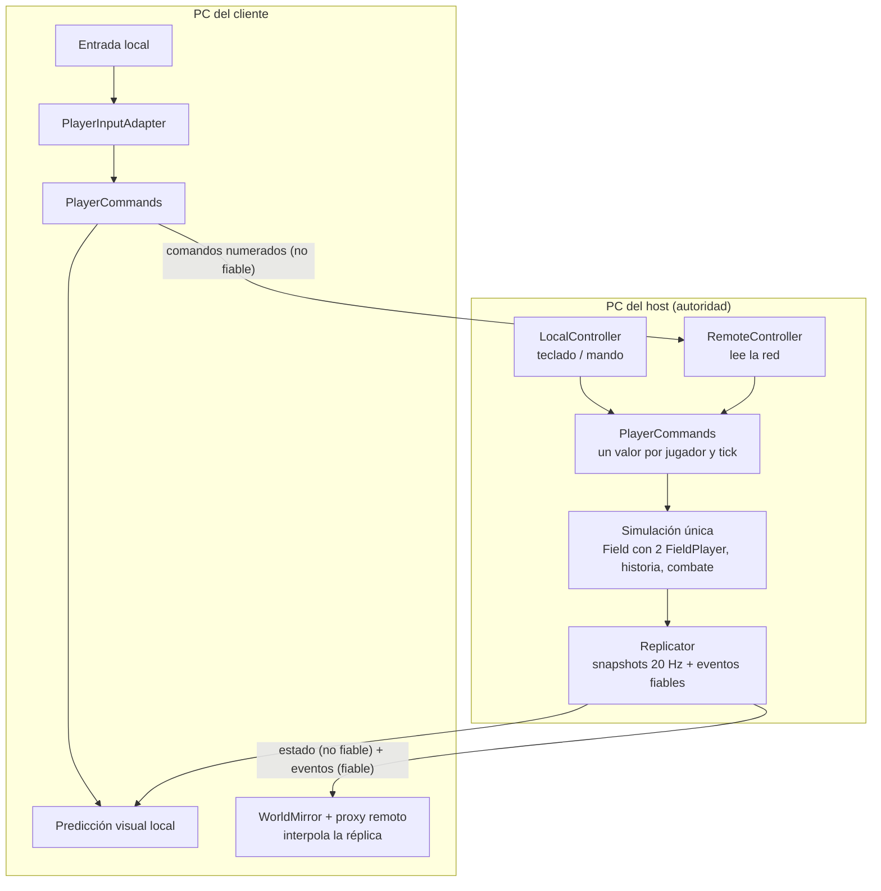
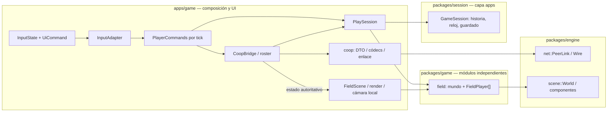

# Multijugador cooperativo en línea (documento de diseño)

Estado: **hecho, en pulido** (2026-11-20). Las salas de hasta cuatro, el mundo compartido, los combates cooperativos
con todos los compañeros, la dificultad cooperativa, el intercambio de objetos y unirse a una partida en curso están
en el juego (§5.6 a §6.2); §6 dice cómo quedó cada decisión de juego y §10 qué falta. Las secciones 1 a 4 y §7 son el
plan del que se partió (2026-11-16), que se conserva por su razonamiento: donde difieren de §5 y §6, mandan estas. La
decisión de arquitectura está en el [ADR 0024](../adr/0024-co-op-with-authoritative-host.md).

## 0. Propósito y alcance

La portada ofrece **Multijugador** y, dentro, el cooperativo: buscar salas, crear una o unirse con el código. Usa
WebRTC y es distinto del versus en línea.

**Propósito:** que un segundo jugador se conecte por internet a la partida de otro y jueguen juntos en el mismo mundo:
caminar, hablar con NPCs, avanzar la historia y pelear.

**Dentro del alcance:**

- hasta cuatro jugadores en línea, un anfitrión y hasta tres invitados (§5.9);
- conexión directa entre PCs por WebRTC, con el Worker de señalización solo para el primer contacto;
- el mundo de la partida del host, con su historia;
- el invitado con su propio jugador (y su compañero, según la decisión 1 de §6).

**Fuera del alcance:**

- el versus, que ya existe y es otra cosa: un combate suelto en lockstep ([versus](../modules/game/versus.md));
- el multijugador local en una misma pantalla, que el proyecto descartó;
- servidores dedicados y partidas persistentes.

### Prueba manual de la sala

1. Abre dos instancias con la misma versión y contenido. El anfitrión crea sala y comparte el código.
2. El invitado se une, pulsa **Listo** y elige su guardado. Solo se usa para importar la identidad, modelo y estado actual de su compañero.
3. El anfitrión pulsa **Iniciar** y elige su guardado. Ese guardado aporta el mundo y el progreso compartido.
4. El invitado debe cargar el mapa del anfitrión con su compañero y sin sobrescribir su guardado local. Ambos verifican movimiento y cámara local.

Con tres o cuatro instancias se prueba igual una sala de cuatro (§5.9); un invitado que entra con la partida en curso
sigue el mismo camino (§5.10).

## 1. Idea en una frase

Los dos jugadores usan **los mismos datos de jugador** y los mismos sistemas de juego. Cada instancia combina una
fuente local de entrada con una representación remota del otro jugador. El **host** recibe comandos de ambos,
simula el mundo compartido y es la única autoridad de estado. El **cliente** manda comandos, predice solo la respuesta
visual inmediata de su jugador y presenta la réplica del host. La predicción nunca activa historia, colisiones
autoritativas ni cambios de mapa. Se conectan por WebRTC, con el mismo transporte y señalización que el versus.

El primer diagrama describe el flujo local de control: fuentes → adaptador → instancias de jugador → sistemas
compartidos. El segundo añade el límite de red: cada instancia tiene su jugador local y un proxy de presentación del
jugador remoto; los comandos entran a la simulación del host y los estados autoritativos vuelven a ambos clientes. El
proxy no es una segunda simulación del mundo. La conexión de red se integra con juego/sesión desde la app: las reglas
de módulos impiden que `game/coop` importe directamente `game/field` o `game/versus`.



## 2. Lo que el código asume hoy

Estudio sobre `main` en `aa27246b2`. Es lo que obliga a cambiar cosas antes de poner nada en la red.

| Tema | Estado actual | Consecuencia |
|---|---|---|
| Jugador en el campo | `Field` conserva un solo mapa y sus sistemas compartidos. `FieldPlayer` ya representa al anfitrión y al invitado y mueve ambos cuerpos de forma independiente; las interacciones, rutas por clic y asociaciones de compañeros siguen migrando desde los campos únicos. | Completar el estado por jugador sin duplicar mapa, NPCs, scripts ni transiciones. |
| Seguimiento del compañero | `PartnerFollow` y `Field::movePartner` siguen al único jugador. El rescate fuera de pantalla usa la cámara del renderer y un aleatorio sin guardar (`FieldScene::gestureRandom_`). | Cada compañero sigue a su dueño. La prueba de fuera de pantalla pasa a la simulación (§4.5). |
| Cámara | `FieldCameraFollow` sigue al jugador en el dibujo, y `FieldScene::followPixel` entrega `setCameraRest` al campo. | La cámara de seguimiento permanece local; las pocas reglas que necesitan conocer la vista reciben un `PlayerViewState` explícito validado por el host. El campo no consulta directamente al renderer. |
| Entrada | `input::InputState` es un objeto con estado y consultas por nombre. `game.cpp` arma cada tick un `field::FieldInput` (`stick`, `run`, `moveTarget`, `cancelTarget`, `confirm`), que ya es un valor plano. Los diálogos, menús, combate, objetos y minijuegos leen `InputState` directamente (`pressStory`, `pressBattle`, …). | `FieldInput` es la base de `PlayerCommands`. Lo demás se convierte en comandos (§4.2). |
| Reloj | Tick fijo de 1/60 s (`core::FixedStep`). El campo da «frames del original» a 20 fps con un acumulador float; la historia, un frame cada 3 ticks; el combate, su propio `FixedStep` a 20 fps. | Sirve tal cual en el host. El cliente no simula el mundo, así que no necesita el mismo reloj. |
| Determinismo | Las posiciones del campo son floats de glm: dan lo mismo en un binario, pero no está garantizado entre máquinas. Hay aleatorios fuera de `ruleset::Random` (`std::minstd_rand` en efectos y gimnasio, `gestureRandom_`). El combate sí es determinista: enteros, `checksum()`, «misma semilla, mismo combate». | El mundo se **replica**, no se sincroniza en lockstep. El checksum del combate queda como herramienta de diagnóstico. |
| Estado del mundo | `PlaySession`/`GameSession` son dueños de todo. `GameSession::saveFile()` da un `SaveFile` YAML determinista con unas 30 secciones, pero solo vale con el campo libre (`savesWait`/`busyWith`). Los scripts en curso, el estado pasajero de los NPCs, los combates y los fundidos no van en el guardado. | El guardado sirve para **unirse en un punto seguro**, no para replicar en vivo. |
| Combate | `FighterId` es el índice en `fighters`: compañero 0, enemigos del 1 al 3. La IA enemiga y los golpes apuntan a `PartnerId`. La enfermedad, la bolsa, los objetos lanzados y el revivir son solo del luchador 0. | Hoy cabe **un solo compañero** por combate. Dos compañeros obligan a rehacer los lados (§6, decisión 3). |
| Red | `net::PeerLink`/`RtcPeerLink` con dos canales («control» fiable y ordenado, «inputs» sin retransmisión). `SignalClient` con códigos de sala de 4 letras sobre el Worker de señalización. `ReliableChannel`, `WireWriter`/`WireReader`, y un saludo cooperativo con semántica compatible con `Identity`/`contentHash`. `Lockstep` es solo de dos lados. | Se reutiliza transporte, señalización y primitivas wire; no se importa el módulo `versus` desde `game/coop`, por la regla de independencia entre módulos de juego. El lockstep sirve como mucho para combates. |
| Pausas | Los menús pausan la simulación según la visibilidad local de la interfaz (`PlaySession::tickSystems`, `paused()`, `screenStops()`). La pausa de Start lo congela todo. Los scripts congelan jugador, compañero, reloj y cámara (`holdForScript`, `scriptPauseGame`). | En cooperativo, abrir un menú no puede parar el mundo del otro (§6, decisión 5). |
| Quién mueve un actor | No hay `Player`, `Controller` ni `InputSource`. Lo más parecido: el autotest y el socket de control inyectan teclas en `InputState`; los scripts mueven actores con `driveByScript`/`placeByScript`; el combate y el compañero tienen registros de estrategias (`BattleStrategies`, `PartnerStrategy`). | El controlador es una pieza nueva, pero sigue el mismo patrón que las estrategias. |

## 3. Principios

1. **Un solo mundo, una sola autoridad.** El host simula todo: mapa, NPCs, historia, compañeros, combate, reloj y
   aleatorios. El cliente nunca decide nada del mundo.
2. **El jugador es datos, el controlador es la interfaz.** Los dos jugadores son el mismo `FieldPlayer`. Lo que cambia
   es el `PlayerController` que les da comandos cada tick.
3. **Todo pasa por comandos.** Ningún sistema de juego lee el teclado. Leen `PlayerCommands`, vengan del teclado, de la
   red, de un autotest o de una repetición.
4. **La simulación no depende del dibujo.** La cámara, el renderer y la interfaz son de cada pantalla. Lo que la
   simulación necesita de ellos se calcula dentro de la simulación.
5. **Reutilizar la base de red del versus.** El mismo transporte, la misma señalización y las mismas reglas de
   identidad/contenido. El cooperativo conserva DTOs y protocolo propios para respetar las capas de módulos.
6. **Cada paso sirve sin red.** La fase C0 (§7) mejora el juego de un jugador: autotests, repeticiones y entrada más
   limpia.

## 4. Piezas

### 4.1 `PlayerController`

La interfaz que da los comandos de un jugador. Una implementación por fuente:

| Implementación | Dónde vive | Qué hace |
|---|---|---|
| `LocalController` | `apps/game` | Lee `InputState` y arma `PlayerCommands`. Sustituye el código de `game.cpp` que hoy arma `FieldInput` y reparte las pulsaciones a cada pantalla. |
| `NetworkFieldController` | `apps/game` (host runtime) | Convierte `Commands` a `PlayerCommands`, acepta secuencias nuevas y neutraliza el movimiento tras 250 ms. `PlaySession::tick` pasa esa entrada como segundo `FieldInput` al mismo `Field`. |
| `ScriptedController` | `apps/game` (autotest) | Da comandos desde una ruta o una repetición. Permite probar dos jugadores sin red. |

La forma sigue a las estrategias que ya existen: una interfaz pequeña y sin estado de juego. El controlador no toca la
simulación; solo produce valores. El transporte y el puente se instancian desde el loop de la app al entrar en una partida.

### 4.2 `PlayerCommands`

Un valor plano por jugador y tick, serializable con `WireWriter`:

- `field`: el `FieldInput` de hoy (`stick`, `run`, `moveTarget`, `cancelTarget`, `confirm`).
- `actions`: lista corta de acciones discretas no críticas, procesables en su tick, como botones de movimiento de
  campo o minijuego. Acciones que deben entregarse exactamente una vez (elecciones, órdenes de combate, uso de
  objetos) usan el mensaje fiable `Action` (§5.5), con id monotónico; no se incluyen también en `PlayerCommands`.

Las APIs que hoy reciben `InputState` se revisan una por una. Solo las decisiones que cambian estado compartido del
juego se convierten en acciones de jugador. Navegación de interfaz, opciones gráficas y otros comandos personales de
RmlUi siguen locales y no se serializan. La app convierte los comandos de gameplay al tipo neutral; `game/coop`
traduce ese tipo a su propio DTO de protocolo, sin compartir headers entre módulos de juego.

### 4.3 `PlayerRegistry`

Vive inicialmente en el runtime de `apps/game`, que compone entrada local y enlace. Un registro por jugador:

- `id` (0 = host, 1 = invitado), nombre y si es local o remoto.
- su `PlayerController`.
- su compañero: el del host es el `Partner` de `SessionState`. El del invitado, según la decisión 1 de §6.
- su estado de conexión (conectado, esperando punto seguro, desconectado).

La primera versión admite exactamente dos jugadores. No hacer configurable `max_players` hasta que exista un caso de
uso para más participantes: el modelo de dos pares y una simulación host no define por sí mismo multijugador mayor.

### 4.4 `FieldPlayer`

Todo lo que hoy es único en `Field` y pertenece a un jugador pasa a un `FieldPlayer`:

- su entidad y, cuando se suministra el perfil invitado acordado, la de su compañero (las etiquetas
  `PlayerTag`/`PartnerTag` llevan el id del jugador);
- su `FieldInput`, su ruta y objetivo de clic, `freeTick`, rastro y último trigger;
- sus `cellSections` y `confirmSection`;
- su `PartnerFollow` y su prueba de fuera de pantalla.

Siguen siendo **del mundo**: el mapa, los NPCs, los fundidos, el cambio de mapa, las pausas de script
(`holdForScript`, `holdForCare`, `holdForItem`) y el filtro de salidas de `StoryLock`. `Body::who` pasa de «0/1» a
`{jugador, papel}`.

Los scripts de la historia que hablan de «el jugador» usan **el jugador que disparó el evento** (el que pisó la
casilla o habló con el NPC). `StoryAdapter` recibe ese id con cada sección de casilla.

### 4.5 Cámara y vista

- Cada pantalla tiene su `FieldCameraFollow`, que sigue a **su** jugador. El host y el cliente dibujan la misma
  réplica de mundo, cada uno con su encuadre local.
- **Propuesta para el rescate del compañero:** cada pantalla calcula un `PlayerViewState` lógico: rectángulo visible
  del fondo en coordenadas de píxel del mapa, id de mapa y secuencia. El rectángulo ya representa viewport,
  encuadre, scroll y shake efectivos. El cliente lo envía al host cuando cambia y como refresco, hasta 20 Hz; el host
  invalida la vista tras 500 ms sin actualización. No contiene
  la posición del jugador ni órdenes de movimiento. El host conserva la vista más reciente de cada jugador y la usa
  para el rescate de su compañero. Si ese jugador inicia una escena compartida, el host deriva el punto de reposo
  desde el centro de la vista y la cámara fija del mapa; si la vista caducó, usa la posición del jugador como ancla.
- El host valida que el rectángulo sea finito, corresponda al mapa/versión activos, tenga ancho/alto positivos, no
  exceda el fondo y tenga dimensiones compatibles con un viewport permitido. La vista se invalida tras 500 ms sin
  actualización. El centro debe estar dentro del rango que permite el seguimiento de cámara para ese jugador.
  Si falta o caduca, el host no usa la prueba visual y conserva el seguimiento por distancia/atasco hasta recibir una
  vista válida. Las posiciones, colisiones, triggers e historia
  siguen siendo siempre autoritativas del host.
- `Field` ya recibe `setOffScreenTest` como función inyectada desde `FieldScene`; se puede extender el puerto para
  consultar por `PlayerId`, sin que `game/field` dependa de `render`. `makeRoomForPlayer` usa `cameraView_` derivado
  de la cámara fija del mapa, no del viewport local, así que esa regla puede seguir siendo común al mundo.
- La cámara de script (`Field::scriptCamera`) y `holdCamera` en combate se aplican a las dos vistas. Si un invitado
  inicia la escena, el host toma el ancla de su último `PlayerViewState` válido y replica el evento/recorrido de cámara;
  cada cliente lo presenta con su viewport local. La cámara de seguimiento fuera de escenas sigue siendo local.

### 4.6 Paquete `game/coop`

Paquete nuevo, al lado de `game/versus` y con la misma forma:

| Pieza | Lado | Qué hace |
|---|---|---|
| `protocol` | los dos | DTOs de mensaje con rango propio, saludo cooperativo con campos/versiones equivalentes a `Identity` (sin depender del módulo `versus`) y códecs `WireWriter`/`WireReader`. |
| `CoopLink` | los dos | Implementado: saludo, validación de identidad, dirección permitida por rol, 10 s para responder, 8 s de silencio y salida sobre un `PeerLink` inyectado. La primera forma en que termina un enlace (rechazo, fallo o salida) es la que conserva: un `Leave` del anfitrión que llega junto con el cierre de su transporte sigue contando como que el anfitrión se fue, no como una caída. |
| `RemoteCommandBuffer` | host | Implementado: acepta secuencias nuevas con rollover y entrega entrada neutral tras 250 ms sin comandos. |
| `ProfileAssembler` | host / cliente | Implementado: reensambla `ProfileChunk` desordenados con límite de tamaño y reintentos idénticos. |
| `CoopGameplayBridge` | los dos | Integrado al loop para enviar comandos del invitado, recibirlos en el controlador del host y enviar snapshots a 20 Hz. Reparte cada mensaje a la cola de la parte del juego que lo lee y descarta los demás (`ignored()`); los guardados viajan por el lobby (`CoopScreen`), no por el puente. |
| `CoopSnapshotBuilder` | host | Implementado para jugador host, compañero host e invitado; la captura de NPCs y aplicación del espejo cliente siguen pendientes. |
| `CoopGuestPartnerProfile` | host | Implementado en `apps/game`: valida y parsea el guardado completo (como mucho `MaxProfileBytes`, lo que cabe en una transferencia), migra solo `partner` y extrae especie, apodo y estado. No carga otras secciones; conectar el `ProfileAssembler` al flujo de unión y crear/replicar el actor del compañero invitado sigue pendiente. |
| `CoopHost` / `CoopClient` | los dos | Pendiente: ciclo de vida de sesión, replicación del mundo y aplicación de snapshots, sin acoplar transporte a Field. |
| `Replicator` / `WorldMirror` | host / cliente | El DTO/serializador puede estar en `game/coop`; la captura y aplicación de estado del mundo viven en `apps/game`, donde se permite componer `Field`, `PlaySession` y `FieldScene`. |

La representación del cliente carga mapas y modelos y dibuja la interfaz, pero no avanza sistemas de mundo; solo
aplica el estado recibido. Si se implementa con `PlaySession` o con una vista de presentación separada queda sujeto al
spike de §7.1.5.

### 4.7 Interfaces (boceto)

Boceto para fijar la forma; los nombres finales salen de la revisión de C0. Sigue las convenciones del código:
`std::expected`, sin excepciones, inicializadores designados.

```cpp
namespace dwe::app {

using PlayerId = std::uint8_t;  // 0 = host, 1 = invitado

struct PlayerAction {
  enum class Kind : std::uint8_t { TextAdvance, TextChoice, MenuChoice, BattleCommand, UseItem, ThrowItem, Minigame };
  Kind kind;
  std::int32_t value = 0;  // opción, orden de combate, objeto…
};

struct PlayerCommands {
  std::uint32_t sequence = 0;  // monotónica por emisor; no presupone reloj compartido
  game::field::FieldInput field;
  std::vector<PlayerAction> transientActions;  // solo acciones tolerantes a pérdida, p. ej. botones de minijuego
};

struct PlayerViewState {
  std::uint32_t sequence = 0;
  std::string mapId;
  // izquierda, arriba, ancho, alto en píxeles enteros del fondo prerenderizado del mapa
  std::array<std::int32_t, 4> backgroundRect{};
};

struct ReliableAction {
  std::uint64_t actionId = 0;
  std::uint32_t sourceSequence = 0;
  PlayerAction action;
};

class PlayerController {
public:
  virtual ~PlayerController() = default;
  // Los comandos del jugador para este tick. Nunca bloquea: si no hay nada, un PlayerCommands vacío.
  [[nodiscard]] virtual PlayerCommands next(std::uint64_t tick) = 0;
};

struct PlayerSlot {
  PlayerId id;
  std::string name;
  bool remote = false;
  std::unique_ptr<PlayerController> controller;
  enum class Link : std::uint8_t { Local, Joining, Connected, Dropped } link = Link::Local;
};

}  // namespace dwe::app

namespace dwe::game::field {

struct FieldPlayer {
  PlayerId id;
  entt::entity body;
  entt::entity partner;
  FieldInput input;
  PartnerFollow follow;
  // ruta del clic, freeTick, rastro, último trigger, cellSections, confirmSection, reposo de vista…
};

}  // namespace dwe::game::field
```

El tipo de comando de la app no depende de transporte. El puente lo convierte al DTO `Commands`, codificado con
`WireWriter`: secuencia del emisor (u32), `FieldInput` empaquetado (stick en dos i8, flags en un byte, `moveTarget` opcional) y
acciones transitorias acotadas. Cada `ReliableAction` se codifica en su mensaje separado con id de sesión, id de
acción, secuencia de origen y payload tipado.

## 5. Red

### 5.1 Canales

| Flujo | Dirección | Canal | Ritmo | Contenido |
|---|---|---|---|---|
| Comandos | cliente → host | «inputs» (no fiable) | cada tick local | `PlayerCommands` con secuencia monotónica por emisor y los últimos 3 comandos (redundancia contra pérdidas). El host es el único que los aplica a la simulación. |
| Vista del jugador | cliente → host | «inputs» (no fiable) | al cambiar, refresco máximo 20 Hz | `PlayerViewState`: rectángulo visible lógico del fondo, mapa y secuencia. Informa el rescate visual del compañero; el ancla de cámara se deriva en el host. |
| Snapshots | host → cliente | «inputs» (no fiable) | 20 Hz | Tick de simulación del host, secuencia del snapshot y última secuencia de comandos aplicada por jugador. Incluye estado autoritativo de entidades visibles (id, posición, rumbo, animación y frame), reloj y HUD. |
| Eventos | host → cliente | «control» (fiable, ordenado) | cuando pasan | Cambio de mapa, diálogo abierto/avanzado/cerrado, inicio y fin de combate, menú compartido, partida para unirse, desconexión. |
| Acciones críticas | cliente → host | «control» (fiable, ordenado) | cuando pasan | No se duplican en otro canal: cada acción lleva id monotónico de sesión y secuencia de origen. El host confirma o rechaza el id; reintentos conservan el mismo id. |
| Resultado de acción | host → cliente | «control» (fiable, ordenado) | al procesarse | `ActionResult` devuelve el id y aceptación/rechazo para que la UI local cierre la espera sin inferir el resultado. |

En la primera versión los snapshots son **estados completos**, no deltas. Así, perder un paquete no invalida los siguientes y no se necesita ACK para elegir una base. La tasa se medirá con capturas reales antes de optimizar; la estimación de 8 KB/s es orientativa y no incluye overhead, entidades fuera del campo ni eventos.

### 5.2 Autoridad del movimiento

El cliente **envía comandos de movimiento**, nunca una posición aceptada como verdad. El host ejecuta el mismo sistema
de movimiento y colisión para ambos jugadores. Para reducir la latencia percibida, el cliente puede predecir el dibujo
de su propio jugador usando sus comandos pendientes; al recibir snapshots reconcilia esa vista con el estado del host.
La predicción no escribe en el mundo espejo ni ejecuta triggers, interacciones, scripts, cambios de mapa o combate.
Todos esos efectos ocurren solo cuando los confirma la simulación del host. El host limita e invalida comandos fuera
de secuencia, demasiado antiguos o con valores fuera de rango; tras pérdida sostenida el controlador remoto vuelve a
entrada neutral. No se envía `OwnPose` ni `PoseFix` en esta versión.

### 5.3 Unirse a una partida

1. El host abre sala: código de 4 letras por el Worker de señalización, igual que el versus.
2. El cliente entra con el código. Saludo cooperativo con campos equivalentes a `Identity`: si la versión del juego o el contenido no coinciden, se corta
   con un motivo claro.
3. El host espera al siguiente **punto seguro**: campo libre, sin script, diálogo, combate, transición ni fundido;
   `savesWait` no debe indicar bloqueos. El `JoinState` incluirá un snapshot inicial completo de entidades dinámicas
   (posición, rumbo y animación actuales), así que el estado pasajero de NPCs que el cliente necesita dibujar no se
   infiere del guardado. Mientras tanto, el cliente ve «Esperando al anfitrión…».
4. El host manda un `JoinState` versionado: `SaveFile` del mundo del host, id/hash de mapa, tick de simulación y estado
   inicial de entidades necesarias. El cliente prepara su jugador/compañero visitante desde su perfil local, sujeto a
   la decisión 1 de §6; ese perfil no reemplaza ni modifica el guardado del host.
5. El cliente carga el mapa en modo espejo, instancia el jugador visitante y recibe el estado inicial autoritativo
   antes de habilitar controles.
6. Empiezan los snapshots.

La reconexión vuelve a ejecutar el saludo y a recibir un `JoinState` actual; no se reanuda un búfer viejo (§5.10). Si el
invitado se va, su jugador y su compañero desaparecen en el siguiente punto seguro, y el host sigue jugando solo. El
protocolo distingue una desconexión temporal de una salida definitiva antes de borrar el estado del visitante.

### 5.4 Señalización, relay y salas

Se usa el Worker de señalización del versus (`apps/versus-signal`) con un tipo de sala nuevo. Las tarjetas de salas
abiertas (#291 directorio público, #292 estado explícito de sala, #293 pantalla de partidas públicas, #294 perfil
online local y #295 relay TURN) sirven igual para el cooperativo, así que son **base común**. Desplegar el Worker o
activar TURN sigue necesitando OK.

### 5.5 Mensajes

Un byte de tipo al principio de cada mensaje, en el rango `0x60–0x6F` (el versus usa `0x10–0x14` y el lockstep
`0x40/0x41`).

| Tipo | Nombre | Canal | Dirección | Contenido |
|---|---|---|---|---|
| `0x60` | `Hello` | fiable | los dos | Campos de identidad (versión de protocolo, versión del juego, `contentHash`) y nombre del jugador; DTO cooperativo propio. |
| `0x61` | `Welcome` / `Refuse` | fiable | host → cliente | id asignado, o motivo del rechazo (versión, contenido, sala llena). |
| `0x62` | `JoinState` | fiable | host → cliente | DTO versionado con mapa, tick, entidades dinámicas y referencia (id/cantidad) a los fragmentos del `SaveFile` del host. La asociación y aplicación del guardado se orquesta en la app. |
| `0x63` | `Commands` | no fiable | cliente → host | Un comando cuantizado con secuencia. El buffer acepta solo secuencias nuevas con rollover y lo vuelve neutral tras 250 ms; repetición de las últimas 3 secuencias queda pendiente. |
| `0x64` | reservado | — | — | Sin mensaje de posición del cliente. |
| `0x65` | reservado | — | — | Sin mensaje de corrección; se reconcilia con snapshots. |
| `0x66` | `Snapshot` | no fiable | host → cliente | Tick, ACK de comando y hasta 48 entidades cuantizadas. El capturador incluye a cada jugador y su compañero y después los NPC del mapa (#419). El tamaño se limita a 1200 bytes; el HUD sigue pendiente. |
| `0x67` | reservado | — | — | No se requiere ACK para snapshots completos. |
| `0x68` | `Event` | fiable | host → cliente | Reservado en el protocolo actual; planificado para cambio de mapa, diálogo e inicio/fin de combate. |
| `0x69` | `Action` | fiable | cliente → host | Reservado; planificado para acciones críticas con id monotónico y secuencia de origen. |
| `0x6A` | `Leave` | fiable | los dos | Motivo de salida. |
| `0x6B` | `ActionResult` | fiable | host → cliente | Reservado; resultado y deduplicación de acciones quedan pendientes. |
| `0x6C` | `ViewState` | no fiable | cliente → host | Límites del rectángulo visible en píxeles del fondo, mapa y secuencia; metadatos de vista validados por el host. |
| `0x6D` | `ProfileChunk` | fiable | ambos sentidos | Fragmento de perfil (hasta 128 fragmentos de 1000 B, `MaxProfileBytes`), con tipo `GuestSave` o `HostSave`. El ensamblador tolera orden variable y reintentos idénticos y rechaza duplicados conflictivos; la app valida e interpreta el guardado completo del invitado. |

`CoopLink` aplica 10 s para la respuesta inicial y 8 s de silencio tras recibir tráfico; el protocolo no añade un
mensaje de latido propio. El buffer neutraliza el comando actual tras 250 ms sin uno nuevo.
Un lado ocupado en una carga larga (su bucle de frames detenido) mantiene sus enlaces: el transporte envía el latido
por su cuenta mientras el juego no lo atiende, hasta 90 s (`LinkTimeouts::busy`), así una carga más larga que los 8 s
de silencio no expulsa a nadie y un juego colgado más allá se sigue expulsando. Un invitado cuyo host calla muestra
«Esperando a» y su nombre en vez de una pantalla congelada.

No se comparten relojes de simulación: cada emisor numera sus comandos localmente; solo el host numera ticks de mundo.
El host descarta secuencias repetidas o atrasadas, aplica el comando válido más reciente según la política de buffer
definida, y tras el timeout usa entrada neutral. Los snapshots confirman la última secuencia aplicada para que el
cliente descarte comandos pendientes al reconciliar su vista. Una `Action` fiable lleva `actionId` y
`sourceSequence`; se aplica al estado actual del host si sigue siendo válida o se rechaza como caducada. El host
conserva los ids procesados durante la sesión y responde con el mismo resultado a un reintento. Al reconectar empieza
una sesión nueva con otro identificador; no se reenvían acciones pendientes de la sesión vieja.

El reloj de juego de la instantánea nunca se hizo: el reloj del mundo llega a los invitados con `WorldClock` (`0xC0`), y
quién entrena con `TrainingStatus` (`0xC1`), ambos desde el protocolo 11
([entrenar en un mundo compartido](coop-training.md), #365).

### 5.6 Guardado en cooperativo

El cooperativo nunca cambia ni rompe las partidas guardadas de un jugador de ninguno de los dos. La regla:

- **Solo una partida que arranca la sala es cooperativa.** El arranque del anfitrión (su propio guardado, elegido para
  la sala) y el del invitado (el mundo del anfitrión) se unen a la sala. Una partida cargada desde la portada con una
  sala todavía abierta sigue siendo de un jugador: el invitado no se añade y no envía nada (`PlayStart::coop`,
  `PlaySession::coopGame`).
- **El anfitrión guarda su propia partida, como partida de un jugador.** El guardado rápido, la máquina de guardado y
  el autoguardado escriben la ranura del anfitrión como siempre. Nada del invitado llega a ese guardado: el cuerpo y
  el compañero del invitado solo existen en el campo y ninguna sección del guardado los lee. Un guardado que el
  anfitrión escribe en cooperativo es el mismo archivo que escribiría jugando solo, y se carga en un jugador como
  cualquier otro.
- **La partida del invitado no guarda nada del mundo del anfitrión.** Su partida es una copia del mundo del anfitrión
  en memoria con las secciones **propias** del invitado: su compañero, las técnicas del compañero, las especies que
  crió y su bolsa con sus bits (`CoopGuestOwnSections`, `hostWorldWithGuestPartner`). No tiene almacenamiento de
  guardado (ni autoguardado, ni guardado rápido, ni máquina de guardado) y la copia no nombra ninguna ranura, así que
  nada puede tomar como propia una ranura del disco del invitado. El guardar y el salir del menú de pausa dicen qué
  pasa, y un aviso lo dice al empezar la partida (`online.coop.guest_not_saved`, `save.coop_guest`,
  `save.coop_guest_quit_confirm`).
- **El invitado se lleva a casa su propio progreso (decisión 4, fase C4).** Esas cuatro secciones vuelven a la ranura de
  la que el invitado trajo su guardado; el resto de esa ranura queda exactamente como estaba en disco.
- **Rige la variante del anfitrión.** La copia conserva el modo de juego del anfitrión, así que un invitado juega la
  [variante de juego](game-variants.md) del anfitrión sea cual sea la de su partida. Cuando difieren, el aviso de inicio
  del invitado lo dice, y el anfitrión oye qué jugador trajo la otra (`online.coop.player_other_variant`); ambos
  comparan las partidas que ya intercambian (`coopSaveMode`). El progreso del invitado vuelve a casa igual cuando la
  variante de su partida admite todo lo que puede dar la del anfitrión (Modo Folder desde un mundo de Clásico Mejorado,
  `game::modes::takesProgressFrom`, `online.coop.guest_other_variant`); si no, nada vuelve y la partida queda como
  estaba (`online.coop.guest_other_variant_kept`), así que una partida de Clásico Mejorado nunca recibe lo que hicieron
  las reglas del Modo Folder.

**Qué vuelve a casa y qué nunca.**

| Vuelve a casa | Nunca vuelve |
|---|---|
| El compañero: stats, PV y PM, edad, vida, vidas, cuidados (hambre, baño, sueño, ánimo, enfermedad), evolución, sus contadores | La historia, los triggers y variables, las medallas y los objetos clave de la página del jugador (triggers de historia) |
| Las técnicas que conoce y lleva equipadas | El mapa, el lugar donde está, el reloj y el clima |
| Las especies que crió (la sección de evolución) | La bolsa y los bits del anfitrión: el invitado nunca los tuvo, su partida jugó con los suyos |
| Su bolsa y sus bits, como los dejó su partida: lo que compró con sus bits, recogió (un reclamo concedido), recibió en un intercambio o usó | El historial del domador, las cartas, el stock de las tiendas y todo lo demás del mundo del anfitrión |

El invitado jugó con su propia bolsa y sus bits desde el principio, así que llevarlos a casa es llevarse la bolsa con la
que sale; el dinero del anfitrión nunca está en ella. Los bits que da una batalla en el anfitrión van al mundo del
anfitrión, como antes (§6.1).

**Cuándo se escribe** (`CoopGuestHome`, `apps/game/src/coop_guest_return.hpp`). La aplicación mira la partida del
invitado una vez por segundo en un punto seguro (nada ocupado, ningún guardado esperando, ningún intercambio abierto:
`PlaySession::coopGuestSave`) y se queda con el más nuevo:

- **cambió la bolsa** (un intercambio, un reclamo, una compra): se escribe enseguida, para que un cierre inesperado no
  deje un objeto intercambiado en dos partidas;
- **solo cambió el compañero** (lo que creció en una batalla, los cuidados): se escribe en el siguiente punto seguro 30
  segundos después de la última escritura (o del inicio de la partida), así una partida larga pierde poco ante un
  cierre sin escribir la ranura cada pocos segundos; una escritura que falla espera lo mismo antes de volver a
  intentarlo, y el final de la partida lo intenta igual;
- **la partida termina**, la termine lo que la termine: volver a la portada, que el anfitrión cierre la sala, que se
  caiga la conexión (antes de volver al puesto), salir desde el menú de pausa o cerrar la ventana
  (`AppFlow::setBeforeEnd`). Una partida ocupada al terminar (una batalla) escribe su último punto seguro: lo que una
  batalla dejó a medias no vuelve a casa.

**Cómo se escribe sin riesgo.** Primero se vuelve a leer la ranura, que tiene que seguir siendo la partida que trajo el
invitado (mismo momento de inicio, domador y reglas); una ranura que otra partida ocupó mientras tanto no se toca y se
avisa al invitado (`online.coop.home_failed`). El compañero que vuelve tiene que ser uno que una partida pueda dejar
(`checkReturningPartner`: cada stat dentro de su límite, 9999 para PV y PM y 999 para el resto, los límites a los
que el juego original ajusta las stats de un compañero; PV y PM sin pasarlos; sin vidas, vida, edad ni peso
negativos), y el resultado de una batalla del anfitrión solo se aplica cuando sus valores son de los que deja una
batalla (`game::coop::spoilsInRange`: PV, PM y ganancias dentro de esos límites, cambios de cuidado dentro de ±100, como
mucho 99 vidas perdidas y un día de batalla como mucho), así un anfitrión manipulado o roto no puede escribir basura en el guardado del
invitado. La primera escritura de una partida cooperativa deja la ranura como estaba a su lado
(`slot_NN.yaml.before_coop`), y cada escritura deja la anterior como la copia de seguridad de siempre (`.bak`). El
guardado escrito lleva una nota (sección `coop_return`: el nombre del anfitrión y el compañero) que el juego muestra una
vez cuando aparece el campo tras cargar el guardado (`online.coop.came_home`, «De vuelta del mundo de {name}...») y que el siguiente guardado
quita (`GameSession::takeUnreadSection`); al terminar la partida del invitado, el HUD también lo dice
(`online.coop.went_home`).

**Sin duplicados.** El anfitrión manda sobre cada objeto que entra en la bolsa del invitado desde el mundo (reclamos,
§5.8; intercambios, §6.2): un reclamo rechazado no da nada. Una vuelta reemplaza la bolsa de la ranura por la de la
partida, nunca suma, así que escribir dos veces escribe la misma bolsa. Un invitado que se desconecta y vuelve a su
puesto (§5.10) trae el guardado que se llevó a casa (`CoopScreen::keepBrought`), no el primero que trajo, así nada de
lo que se llevó entra dos veces; un invitado que reinicia su juego entra con la ranura como se escribió por última vez.

- **La ranura del anfitrión nunca ve al invitado.** Guarda su último guardado, que nunca tuvo estado del invitado, y se
  carga sola como antes.

Pruebas: `packages/session/tests/coop_saves_tests.cpp` (el guardado del anfitrión con un invitado en el campo es el
guardado de un jugador y se carga en el lugar del anfitrión; la nota de la vuelta se toma una vez),
`apps/game/tests/coop_guest_profile_tests.cpp` (la copia del invitado no nombra ranura),
`apps/game/tests/coop_guest_return_tests.cpp` (qué vuelve y qué nunca, otra partida o un compañero fuera de rango no se
tocan, cuándo se escribe, las copias de seguridad, una vuelta al puesto que trae el guardado que se llevó),
`packages/game/coop/tests/battle_tests.cpp` (botín fuera de rango) y `apps/game/tests/app_flow_tests.cpp` (la partida del
invitado nunca se guarda en una ranura; solo las partidas de la sala son cooperativas).

### 5.7 Mundo compartido: autoridad, jugadores y mapas

Lo que hacen hoy las primeras piezas del cooperativo de §5.2 y §5.3 (#353, #354, #355, #356, #358). Funciona con
hasta 4 jugadores (`game::coop::MaxPlayers`): el jugador 0 es el anfitrión, los invitados son del 1 al 3, y nada
nombra un segundo jugador fijo.

**Quién decide qué.** El `WorldAuthority` del anfitrión (`packages/game/coop`) guarda la sesión: quién está en ella
(el registro de jugadores), el mapa en el que está el grupo y la última transformación válida de cada jugador.

| Estado | Dueño | Cómo lo saben los demás |
|---|---|---|
| Quién está en la sesión, la especie de su compañero | anfitrión (`WorldAuthority`) | `Roster` en cada cambio |
| El mapa del grupo, salidas y llegadas | anfitrión | `PlayerCorrection` con la salida por la que entró |
| La posición propia de un invitado | el invitado, revisada por el anfitrión | `PlayerState`, rechazado o corregido si es imposible |
| La posición del anfitrión, NPCs, historia, reloj, batallas | anfitrión | instantáneas (§5.1) y eventos |
| Cómo se dibuja un jugador remoto | cada partida, en local | interpolación (abajo); nunca escribe la autoridad |
| Lo que los jugadores cambian en el mundo (cofres, triggers, puertas, objetos del suelo, cacas) | anfitrión | `WorldChange`, `WorldSync`, `GroundItems`, `PoopPiles` (§5.8) |

**Mensajes.** Tres tipos se suman a la tabla de §5.5 y ocupan el lugar de su esbozo `OwnPose` y `PoseFix` (versión 4
del protocolo):

| Tipo | Nombre | Canal | Dirección | Contenido |
|---|---|---|---|---|
| `0x70` | `PlayerState` | no fiable | cliente → anfitrión | Id del jugador, secuencia (el tick del invitado), la época de corrección que sigue, mapa, posición, orientación, movimiento. Cada 3 ticks. |
| `0x71` | `PlayerCorrection` | fiable | anfitrión → cliente | Dónde pone el anfitrión a ese jugador: mapa, posición, orientación, la salida en un cambio de mapa y una época nueva. |
| `0x72` | `Roster` | fiable | anfitrión → cliente | Revisión y, por jugador, id, nombre y especie del compañero. |
| `0x73` | `PartnerForm` | fiable | cliente → anfitrión | La especie actual del compañero del invitado (protocolo 14, #412). |

**Sincronización de la transformación.** El invitado mueve su propio jugador y lo informa. El anfitrión acepta un
estado solo si el enlace es dueño de ese jugador, es más nuevo que el último aceptado (los paquetes tardíos,
duplicados o desordenados se descartan), lleva la época de la última corrección (ningún estado de antes de una
corrección ni de un mapa anterior), está en el mapa del grupo y se alcanza desde la última pose válida a la velocidad
máxima del jugador. Un cuerpo que quedaría dentro de una pared en el mapa del anfitrión no se lleva allí. Tras 3
rechazos seguidos el anfitrión devuelve al jugador a su última pose válida, y los dos lados vuelven a coincidir. Un
salto del lado del invitado (un `place` de un script) es uno de esos rechazos: se corrige, no se adopta.

**Mapas (decisión 2 de §6).** El grupo va adonde va el anfitrión. Las salidas propias del invitado quedan retenidas
(`Field::holdExits`); cuando el anfitrión cambia de mapa, cada invitado recibe una corrección con el mapa nuevo, la
salida y el punto de aparición del anfitrión, y llega justo allí. Su compañero llega a su lado, como en cualquier
entrada a un mapa, y una corrección en el mapa en el que ya está (al unirse, un reinicio) también lo trae
(`Field::placePlayerWithPartner`). Los estados del mapa o la época anteriores se rechazan, y el invitado no informa nada
mientras viaja. Cada jugador sigue teniendo su propio mapa actual: un jugador
remoto en otro mapa no se dibuja ni se mueve, y vuelve a mostrarse cuando llega.

**El aviso de zona (#356).** Antes de seguir al anfitrión a otro mapa, el juego del invitado espera
`CoopGuestWorld::ZoneLeadTicks` (45 ticks, 0,75 s) con el aviso `online.coop.host_changed_zone` («{name} cambió de
zona», el nombre del anfitrión) en pantalla, y luego hace el fundido. La espera empieza una vez por cambio
(`CoopGuestWorld::takeZoneChange` da el mapa y la época de la corrección, para una skin que quiera su propio aspecto) y
aguarda mientras corre un cambio de mapa propio del invitado. Unirse, un reinicio de sala en el mismo mapa y volver
tras un salto de historia propio del invitado no muestran aviso ni esperan. El invitado no informa nada durante la
espera, igual que durante el viaje.

**Interpolación (#358).** Los jugadores remotos y sus compañeros se dibujan desde un búfer corto de estados con hora
(`PoseTrack`): 100 ms por detrás del más nuevo, mezclando los dos que rodean ese momento. Un estado tardío que aún va
por delante de la reproducción ocupa su sitio; uno ya reproducido, o repetido, se descarta, y uno rezagado del mapa
anterior a un cambio nunca devuelve la pista allí. Un hueco se extrapola como mucho 100 ms y luego se queda quieto;
cuando vuelven los estados, la pista alcanza desde donde se quedó dentro de los 100 ms de retraso en vez de saltar. Un
paso más largo de lo que el emisor pudo moverse entre dos estados (2500 unidades por segundo más 64, en el reloj del
emisor) es un teletransporte, como un salto dentro de un mapa, un script que pone a un personaje en otro sitio o una
corrección, y se dibuja como salto, nunca como deslizamiento; un cambio de mapa empieza la pista de nuevo. Un emisor
cuyo reloj se pausó se retoma sin una recuperación lenta. El anfitrión dibuja así a los invitados, y los invitados
dibujan a todos desde las instantáneas del anfitrión, con la hora del reloj del anfitrión. Dibujar es solo
presentación: nunca cambia lo que guarda la autoridad. Un teletransporte escondido dentro de una pérdida larga no se
distingue de una carrera, así que se dibuja como la recuperación de 100 ms. Auditoría:
[#358](audits/358-audit.md).

**La forma del compañero (#412).** Cada compañero vive y evoluciona solo en la partida de su dueño, así que su forma
viaja como los nombres del roster. El anfitrión pone la especie de su propio compañero en el roster en cada tick en que
cambia; un invitado dice la suya con `PartnerForm` mientras el roster diga otra, una vez por segundo hasta que la diga
(una forma enviada antes de que el juego del anfitrión leyera el enlace se vuelve a decir). El anfitrión la toma como
del jugador del enlace, sube la revisión del roster y la envía a todos; cada partida carga entonces el modelo nuevo en
lugar del viejo, en el cuerpo de campo del anfitrión y en el dibujo de cada invitado, así que ninguna partida conserva
la forma vieja ni dibuja dos. Las estadísticas y el estado del compañero son de la partida de su dueño: una batalla los
toma de allí al empezar (§6.1).

**Lo que reproduce un script (#420).** Un curso del gimnasio, una escena o una charla reproducen clips en el jugador y
el compañero en lugar de los de su movimiento. Las instantáneas y los estados del invitado llevan ese clip (el id de
animación del original y cuántas veces lo arrancó un script, para que un empujón arrancado de nuevo se vuelva a
reproducir) desde el protocolo 14. Los estados de un invitado llevan también el sitio de su compañero y el clip que le
reproduce un script, en cada reporte (#411: antes, solo mientras su partida lo retenía): el anfitrión dibuja allí al
compañero del invitado, suavizado en una pista propia como el cuerpo, en lugar de un seguimiento propio que se alejaba
del del invitado. Una batalla que empieza coloca a ese compañero donde lo ve su jugador, y los demás invitados lo ven
allí en las instantáneas del anfitrión. Un invitado que no manda compañero lo sigue teniendo con el seguimiento de
antes. Un compañero a más de 2000 unidades de su jugador no se dibuja allí. Un clip que un script ya no reproduce no
deja nada: el cuerpo vuelve al clip de su movimiento en todas las máquinas.

**Los NPC del mapa (#419).** Antes cada partida movía sus NPC del mapa por su cuenta, así que uno salvaje estaba,
perseguía y se iba distinto en cada pantalla. Desde el protocolo 14 las instantáneas del anfitrión listan también los
NPC de su mapa, con id `0x100` más el hueco, después de los jugadores (ninguno si no caben en un datagrama). En un
invitado que está en el mapa del anfitrión, cada NPC listado está donde el del anfitrión y se mueve igual, tan suave
como los jugadores; un script de la partida del propio invitado que lo retenga o lo anime sigue mandando. Uno que el
anfitrión ya no tiene (una batalla lo quitó, un cambio de historia lo hizo irse) sale del mapa del invitado cuando
lleva un segundo sin aparecer y no corre ningún script allí, así que no queda nada atrás. En otro mapa, durante un
cambio de mapa o una batalla co-op, o sin enlace, los NPC del invitado se mueven por su cuenta; durante una batalla de
la propia partida del invitado son sus luchadores y están donde esa batalla los pone. Reaccionan al jugador
del anfitrión, como los ve su partida; un NPC que solo tiene el anfitrión no se añade en el invitado.

**Ciclo de vida.** Un invitado entra cuando termina su saludo: recibe el id libre más bajo, un cuerpo y un compañero
en el campo del anfitrión junto a él, una corrección a ese sitio y un roster nuevo. Sale con `Leave`, con un enlace
caído o con un cierre inesperado: su registro, cuerpo, compañero y búferes desaparecen en los dos lados, y el roster
lo quita. Cuando una partida cooperativa termina en cualquiera de los lados (volver a la portada, salir), ese lado
envía `Leave` y cierra la sala; un invitado cuyo anfitrión se fue vuelve a la portada. Un jugador que vuelve entra
como nuevo, con un estado limpio.
Cerrar la ventana cuenta como salir (#416): el juego manda `Leave` a todos y el último aviso de la sala antes de
apagarse (1,5 s como mucho), y un enlace que se despidió conserva su transporte un segundo (`CoopLeaveFlush`) para que
la despedida llegue, en vez de que los demás vean un enlace caído e intenten volver. El anfitrión de una sala pública
repite el estado de su sala al directorio cada minuto (`net::RoomRefreshEvery`), así que la entrada de un anfitrión que
se colgó o perdió la línea sale de la lista en menos de tres minutos.

**Presencia.** `WorldAuthority::playersOn(map)` (anfitrión) y `CoopGameplayBridge::playersOn(map)` (invitado, desde la
última instantánea) dicen qué jugadores están en un mapa, para los sistemas que necesitan a los demás cerca
(batallas, objetos compartidos).

Pruebas: `packages/game/coop/tests/authority_tests.cpp`, `packages/game/coop/tests/replication_tests.cpp`,
`apps/game/tests/coop_world_tests.cpp`, `apps/game/tests/coop_replication_tests.cpp`,
`apps/game/tests/coop_npc_mirror_tests.cpp`,
`packages/game/coop/tests/pose_track_tests.cpp`,
`apps/game/tests/coop_snapshot_interpolation_tests.cpp`, `apps/game/tests/player_registry_tests.cpp` y los casos
cooperativos de `packages/game/field/tests/field_tests.cpp`.

### 5.8 Interacciones del mundo compartido

Cada partida de la sesión corre su propia copia del mundo del anfitrión (§6.1), así que lo que un jugador hace en ese
mundo tiene que llegar a las copias de los demás, o un cofre que un jugador abrió sigue lleno para el resto (#357). El
anfitrión es el único que aplica una interacción compartida al mundo; las partidas de los demás piden, y se les cuenta
el resultado.

**Qué se comparte y qué es local.**

| Interacción | Se guarda como | Compartida o local | Cómo viaja |
|---|---|---|---|
| Triggers de historia que pone cualquier jugador: eventos jugados, NPCs reclutados, tiendas abiertas, puertas y mecanismos abiertos para siempre | triggers de historia | compartida | `WorldAsk` → anfitrión → `WorldChange` |
| Variables de historia (contadores que lleva un script) | variables de historia | compartida | igual |
| Cofres | su trigger de historia | compartida: un solo jugador recibe el objeto, y el cofre se ve tomado (cajón fuera) en todas las partidas al momento | lo que toma un invitado es un `ItemClaim`, que responde un `ClaimAnswer`; luego `WorldChange` |
| Objetos en el suelo (los objetos al azar del mapa, lo que sueltan las batallas) | el suelo del anfitrión | compartida en el mapa del anfitrión: toda partida allí muestra el suelo del anfitrión, y un objeto es de un solo jugador | `GroundItems` desde el anfitrión; la recogida de un invitado es un `ItemClaim` |
| Puertas y mecanismos que un script mueve mientras los jugadores miran | ediciones en vivo del mapa (flags de objetos, celdas cerradas) | compartida con los jugadores de ese mapa; en la siguiente visita el script de cabecera del mapa las reconstruye desde los triggers compartidos | `WorldAsk` → anfitrión → `WorldChange` |
| Medallas, especies criadas, los objetos clave de la página del jugador (cañas) | triggers de historia | local: de cada jugador | nunca se envían |
| La congelación de un script, el trigger de encarar en una charla, el nombre del mapa siguiente | variables de historia y un trigger | local: siguen los scripts propios de ese jugador | nunca se envían |
| Recompensas que un script da una vez por jugador: los días desde la última carne de la granja (la carne diaria de Palmon y de la granja, #421) | variables de historia (`player_own_variables` en las reglas de la historia) | local: cada jugador recibe su carne una vez al día | nunca se envían |
| El trabajo de la tienda del cañón: los clientes atendidos, la cuenta y su medidor, el resultado de cada turno, la frase de la mitad (#423) | variables de historia y un trigger (`player_own_variables`, `player_own_triggers`), la cuenta y el regateo | local: cada jugador hace su propio trabajo; que un jugador abra la tienda nunca mueve el medidor del otro | nunca se envían |
| Lo que un script pasa a las rutinas del motor justo antes de llamarlas: un objeto del mapa y su animación, el personaje y la cara de una burbuja de humor, el mapa y la entrada del pájaro (variables 247 y 248); la tirada de trabajo en 110 (las puertas de la Mansión de juguetes la tiran al entrar al mapa, scripts 142 a 144) | variables de historia (`player_own_variables`) | local: ningún script las vuelve a leer, así que la llamada de otro jugador nunca las cambia bajo un script en marcha | nunca se envían |
| La bolsa, los bits, el compañero y sus cuidados, los menús, los diálogos en pantalla, la cámara | sistemas de la sesión | local | nunca se envían (batallas: §6.1) |
| Las cacas que los compañeros dejan en el campo | el `poop_piles` del anfitrión, el de cada mapa | compartida: cada partida muestra las cacas del anfitrión del mapa en el que está, la que deja cualquier compañero se ve en todas las partidas de ese mapa, y una caca se come una sola vez; lo que dejar o comerse una hace al compañero y a sus estadísticas sigue siendo de su jugador | `PoopPiles` del anfitrión; la caca que deja o se come el compañero de un invitado es un `PileAsk`, y comerse una se responde con `PileAnswer` |

Los hechos locales salen de las reglas de la historia (`StoryAdapter::playerOwnTrigger` y `playerOwnVariable`): un
ruleset que mueve la congelación o el encarar a otro número los mueve también.

**Cómo funciona.** Tras cada tick cada partida compara su historia con lo último que acordó con la sesión
(`CoopStoryBaseline`): lo que cambiaron sus propios scripts y sistemas es su novedad. La novedad del anfitrión solo hay
que contarla, porque su partida es el mundo. Un invitado envía su novedad como `WorldAsk`; el `WorldLedger` del
anfitrión descarta una petición que ya tomó (cada invitado numera sus peticiones), se queda solo con la parte
compartida, acepta ediciones del mapa solo para el mapa en el que está la sesión, aplica lo que cambia su mundo, y
envía a cada invitado un `WorldChange` con la revisión
siguiente, el jugador cuya interacción fue y los valores nuevos. Un invitado aplica un cambio una sola vez
(`WorldReplica`: una revisión que no es más nueva que la última tomada se descarta), y lo que aplica del anfitrión nunca
lo devuelve como propio. Los valores son absolutos (un trigger puesto, el valor de una variable), así que aplicar uno
dos veces es aplicarlo una. Cuando dos jugadores cambian el mismo hecho a la vez decide el orden del anfitrión, y todas
las partidas terminan con el valor del anfitrión.

**Tomar un objeto.** Un cofre o un objeto del suelo lo podrían tomar dos jugadores a la vez, así que lo que toma un
invitado pregunta antes. Cuando el invitado confirma, su aviso del objeto sigue en pantalla (el cajón de un cofre ya
está fuera) y su partida envía un `ItemClaim`: el trigger del cofre, o la ranura y el id del objeto del suelo. El
anfitrión responde las reclamaciones de cada invitado en orden y una sola vez (una reclamación enviada otra vez se
descarta): concedida mientras el trigger del cofre no está puesto o el objeto sigue en el suelo con ese id, y entonces
pone el trigger o quita el objeto de su suelo y se lo cuenta a todos como siempre. Solo con un `ClaimAnswer` concedido
mete la partida del invitado el objeto en la bolsa; rechazada (o sin respuesta en diez segundos) el invitado no recibe
nada y el aviso dice que otro jugador lo tomó (`online.coop.item_gone`). El anfitrión toma al momento, como en la
partida de un jugador, así que si toma dentro del mismo viaje de ida y vuelta va primero; si al tomar el objeto ya no
está porque otro lo tomó con el aviso abierto, recibe el mismo aviso. En un mapa en el que no está el anfitrión, el
suelo de un invitado es suyo y no hace falta reclamar. La partida de un jugador nunca reclama. La lista del anfitrión
reemplaza el suelo del invitado pero conserva su largo, así que el hueco que sostiene el aviso abierto de un invitado se
sigue pudiendo leer cuando la lista del anfitrión ya no trae su objeto (tomar el último objeto con permiso leía fuera
del suelo y cerraba el juego del invitado, #414).

**Cacas.** El mundo del anfitrión guarda las cacas de cada mapa, como en la partida de un jugador (`poop_piles`, con los
límites de las reglas de cuidado). El compañero del anfitrión deja y se come cacas al momento, como en la partida de un
jugador. El compañero de un invitado deja su caca en la pantalla del invitado al momento (con la nube) y su partida envía
un `PileAsk`: el anfitrión pone la caca en esa casilla de ese mapa, o a un paso al azar si ya hay una. El compañero de
un invitado que come cacas va hasta una y juega su clip de comer como siempre; luego su partida pregunta al anfitrión
(`PileAsk`) y retiene al compañero hasta el `PileAnswer`. Solo una respuesta concedida come: el compañero recibe el
tamaño de la caca del anfitrión (sus efectos de cuidado, `handleEatingPoop`, sobre sus propias estadísticas); rechazada
(otro compañero se la comió antes, el del anfitrión dentro del mismo viaje de ida y vuelta incluido) o sin respuesta en
diez segundos, el compañero no come nada. El anfitrión responde las peticiones de cada invitado en orden y una sola vez.
Cada vez que cambian las cacas de un mapa en el anfitrión, cada invitado recibe la lista de ese mapa (`PoopPiles`), que
reemplaza las cacas de ese mapa en su partida; cada partida dibuja solo las cacas del mapa en el que está. Un invitado
que entra, y todos los invitados cuando el anfitrión entra en un mapa, reciben una lista que primero reinicia sus cacas
y luego una por cada mapa que tiene alguna, así que una caca que su copia del mundo conservaba de antes desaparece. Las
cacas son del mundo del anfitrión: están en su guardado y nunca en el de un invitado. La partida de un jugador no cambia.

**Los eventos empiezan una vez (#417).** Cada partida ejecuta su propia historia, así que dos jugadores que hablaban
con el mismo NPC jugaban los dos su evento, cada uno con su nombre, y empezaban los dos su combate. Mientras la partida
de un jugador juega el evento de un NPC (una sección que empezó un toque o una charla, hasta que acaba el script), ese
NPC queda retenido: un invitado se lo dice al anfitrión con `EventStatus` (`0xC2`, protocolo 14), el anfitrión le dice
a cada invitado los de todos, el suyo incluido, y las demás partidas en ese mapa descartan entretanto sus toques y
charlas con ese NPC. Cuando el evento acaba, sus cambios de historia llegan a los demás como siempre, así que el
siguiente jugador que habla con el NPC ve lo que dejó el evento. Un jugador que se va suelta su NPC. Los NPC que
comparten id de script (los salvajes de una especie en un mapa) quedan retenidos juntos. Dos toques dentro del mismo
viaje de ida y vuelta aún pueden empezar los dos.

**Entrar tarde y cambiar de mapa.** Un invitado que entra recibe toda la historia compartida (`WorldSync`, en partes
que caben en un datagrama) y el suelo del anfitrión; todos los invitados los reciben otra vez cuando el anfitrión entra
en un mapa. La sincronización lleva la revisión del anfitrión, así que un cambio que ya está en ella no se aplica otra
vez.

**Reinicios de sala (#422).** Un warp de script de vuelta al mapa en el que está el grupo lo carga otra vez: así
empieza de nuevo una sala de prueba (el camino del bosque de Centarumon, la ruta de las flechas y sus vallas). Cada carga
del mapa del anfitrión tiene su propia revisión, y cada `WorldAsk` dice la revisión más nueva que había tomado la
partida del invitado (`seen`). Lo que un invitado pidió para ese mapa antes de ver la recarga (un paso por el camino
viejo, una valla que movió su script) queda superado: las ediciones del mapa se descartan y los hechos se vuelven a
contar a todos con el valor del mundo, así que nada de la sala vieja sobrevive al reinicio. Un hecho que otro jugador
cambió después de la revisión que había visto un invitado supera igual la petición de ese invitado; un cambio anterior
del mismo jugador nunca supera sus peticiones siguientes. Un invitado al que el reinicio trae de vuelta (un
`PlayerCorrection` con salida en el mapa en el que ya está) carga el mapa otra vez como hizo el anfitrión, en lugar de
solo ponerse junto al anfitrión con lo que sus scripts dejaron allí; las ediciones del mapa del anfitrión que llegan
mientras carga esperan a que termine. Las peticiones de un invitado desde el mapa que el grupo dejó conservan sus hechos.

**Guardado (§5.6).** El mundo es del anfitrión: lo que un invitado cambia en él está en el siguiente guardado del
anfitrión, como cualquier cosa que haga el anfitrión. Nada del mundo entra en el guardado propio del invitado: solo
vuelven a casa su compañero y su bolsa (§5.6).

**Mensajes** (versión 5 del protocolo, rango `0x90–0x9F`):

| Tipo | Nombre | Canal | Dirección | Contenido |
|---|---|---|---|---|
| `0x90` | `WorldAsk` | fiable | cliente → anfitrión | El número de petición del invitado, la revisión más nueva del anfitrión que había tomado (versión 14 del protocolo), su mapa y las ediciones (trigger, variable, objeto del mapa, celdas cerradas). |
| `0x91` | `WorldChange` | fiable | anfitrión → cliente | Revisión, el jugador del que vino y su petición, el mapa, las ediciones. |
| `0x92` | `WorldSync` | fiable | anfitrión → cliente | Revisión, parte, y un tramo de triggers (bits) y variables. |
| `0x93` | `GroundItems` | fiable | anfitrión → cliente | El mapa del anfitrión y su carga, y cada objeto del suelo: id, ranura, objeto, celda y lugar. |
| `0x94` | `ItemClaim` | fiable | cliente → anfitrión | El número de reclamación del invitado, cofre u objeto del suelo, el trigger del cofre o la ranura y el id del objeto, el mapa. |
| `0x95` | `ClaimAnswer` | fiable | anfitrión → cliente | El número de reclamación y si se concedió. |
| `0x96` | `PoopPiles` | fiable | anfitrión → cliente | Un mapa, si reinicia las cacas del invitado (versión 15 del protocolo), y cada caca en él: casilla y tamaño. |
| `0x97` | `PileAsk` | fiable | cliente → anfitrión | El número de petición del invitado, dejada o comida, el mapa, la casilla, y el tamaño de una caca dejada (versión 15 del protocolo). |
| `0x98` | `PileAnswer` | fiable | anfitrión → cliente | El número de petición, si se concedió comerla, y el tamaño de la caca (versión 15 del protocolo). |

**Cambios del mundo al momento.** La sección de cabecera de un mapa decide al cargarlo qué personajes están en él, a
partir de los triggers y variables de la historia (un personaje reclutado ya no está, su ayudante ocupa su lugar, un
tendero viene de día). La escena que cambia el hecho también cambia la pantalla en la partida que la corrió (la escena
de reclutamiento quita su NPC ella misma), pero las otras partidas solo reciben el hecho. Por eso `dwx extract` escribe
`field/npc_spawns`: cada NPC que las secciones de cabecera colocan, con la condición que lleva a él (las mismas
condiciones que los warps de script, más la prueba de un byte de variable). Cuando cambia un hecho compartido,
`CoopNpcPresence` compara la condición de cada NPC del mapa actual antes y después: un NPC cuya condición deja de
cumplirse se va (como lo hace la escena de reclutamiento) y uno cuya condición empieza a cumplirse entra (como lo
colocaría la siguiente carga). Espera a que el mapa termine de cargar y a cualquier script en curso, y descarta lo que
llegó antes de la carga actual del mapa (esa carga ya leyó los hechos nuevos). La sección de cabecera nunca se vuelve
a correr.

- **El cambio de otro jugador** mueve NPCs en los dos sentidos. Algunas cabeceras llevan una cuenta o tiran un dado
  mientras colocan NPCs (los visitantes de File City: tres como mucho, algunos al azar), así que no se sabe solo por la
  historia si ese NPC estaba al cargar (`section_writes`). Esos se van igualmente si están en el mapa y ningún camino
  de la cabecera los coloca ya; nunca llegan al momento, porque la cuenta o la tirada podían haberlos dejado fuera.
- **El cambio propio de la partida** solo trae a los que llegan, cuando termina su escena: quien recluta ve venir al
  ayudante como los demás, y una tienda abierta en la ciudad tiene a su tendero al momento. Lo que la escena dejó en pie
  se queda hasta la siguiente carga, como en el original. Un jugador solo no cambia: nunca sigue nada.
- **Mods.** Un mod que cambia una cabecera de mapa en Lua (`story/000.lua` o un parche de historia del script 0)
  vuelve a escribir el documento con `dwx script-warps --spawns <archivo>` ([warps de script](script-warps.md#desde-el-lua)),
  como hace con sus cambios de mapa; sin él se sigue usando el documento del paquete base.

Sin cubrir: NPCs que colocan o mueven los scripts propios del mapa (el paseo de una escena, la rutina de entrada del
mapa mostrando u ocultando objetos), condiciones que la extracción no puede leer (un olvido o un bucle en la sección, un
stat que no sea un byte de variable) y contenido extraído por un dwx anterior (los NPCs siguen entonces en la
siguiente carga, como antes). Fuera de eso solo viajan las ediciones en vivo del mapa; cualquier otra cosa que un
script haga en pantalla se queda en la partida que lo corrió.

Pruebas: `packages/game/coop/tests/world_state_tests.cpp`, `apps/game/tests/coop_world_state_tests.cpp` (un anfitrión
y dos invitados con mensajes codificados), `apps/game/tests/coop_npc_presence_tests.cpp` (un reclutamiento en cada lado
sobre un `CoopLink` real, el ayudante propio de quien recluta y un visitante que la cuenta deja sin decidir),
`packages/game/field/tests/npc_spawns_tests.cpp`, `apps/dwx/tests/script_warps_command_tests.cpp` (los NPC sacados
del Lua, con el parche de un mod), el caso MAPHEAD de
`packages/formats/tests/script_guarded_walk_tests.cpp`, el caso cooperativo de
`packages/game/field/tests/field_items_tests.cpp` y el de `packages/session/tests/story_adapter_tests.cpp`; las cacas:
`apps/game/tests/coop_poop_piles_tests.cpp` (un anfitrión y dos invitados con enlaces reales: cacas dejadas en cada
lado, una caca que se comen dos compañeros a la vez, uno que entra tarde y un mapa nuevo) y el caso de cacas compartidas
de `packages/game/partner/tests/toilet_tests.cpp`.
### 5.9 Salas de cuatro y el diagnóstico de sincronía

Lo que añaden #352 y #359 (versión 7 del protocolo, tipos `0xA0`–`0xA2`).

**Salas.** Una sala cooperativa sienta al anfitrión y hasta tres invitados. El Worker de señalización mantiene esa sala
abierta mientras el anfitrión espera (`apps/versus-signal`, "Rooms of up to four"): el anfitrión tiene un enlace
esperando al siguiente invitado, cada invitado se empareja con uno de ellos y la sala nunca pasa las señales de una
pareja a otra. En el juego, `CoopConnection` tiene un `CoopLink` por invitado, recibe a cada uno con el id libre más
bajo (1 a 3) y deja que un invitado salga del lobby sin cerrar la sala. Cuando la partida empieza, una sala de tres o
cuatro mantiene una plaza esperando (§5.10): entran jugadores tardíos e invitados que vuelven mientras los demás siguen
jugando. Las salas de dos (versus, juegos anteriores) funcionan como siempre: la sala ya no admite a nadie cuando la
partida empieza y termina con su invitado.

**Lobby.** `CoopScreen` lleva aparte la marca de listo y el guardado de cada invitado; el anfitrión empieza cuando todos
los invitados dentro están listos, y manda el mismo guardado a todos. El anfitrión dice a cada invitado quién está en
la sala:

| Tipo | Nombre | Canal | Dirección | Contenido |
|---|---|---|---|---|
| `0xA0` | `Lobby` | fiable | anfitrión → cliente | Capacidad (2 a 4) y, por plaza ocupada, id, nombre y estado (conectado o listo). |
| `0xA1` | `SyncWatch` | fiable | anfitrión → cliente | Si el anfitrión vigila la sincronía (#359). |
| `0xA2` | `SyncReport` | no fiable | cliente → anfitrión | Mientras se vigila, dos veces por segundo: número de informe, el tick de la instantánea más nueva, instantáneas perdidas y tardías, y dónde tiene a cada jugador. |

La pantalla de salas muestra cuatro filas en todas las skins: libre, ocupada, el anfitrión con su corona, las marcas de
listo y un invitado cuyo enlace aún se está conectando (`online.member.<n>.arriving`).

**Juego.** En el anfitrión cada invitado tiene su propio puente de juego, controlador y cuerpo: sus comandos mueven a su
propio jugador (`GuestFieldIntent`), sus estados llegan a la autoridad con su id, las correcciones y las listas de
jugadores le llegan solo a él, y cada uno recibe las instantáneas con el acuse de sus propios comandos. Un invitado
dibuja a todos desde las instantáneas y pone una etiqueta a cada otro jugador (`coop_hud.tag.<n>.*`). El enlace de
cada invitado lleva sus propios mensajes de combate: cualquier invitado puede empezar un combate, y cada jugador libre
de ese mapa pelea en él ([combate cooperativo](coop-combat.md) §12). Un puente descarta los mensajes que ninguna parte
del juego lee (el listo de un lobby, los fragmentos de un guardado) en vez de encolarlos, así que un compañero que los
siga enviando no hace crecer nada del otro lado.

**Un jugador que se va mientras los demás juegan.** Solo termina su enlace; los otros invitados mantienen el suyo
(`room_tests.cpp`). El anfitrión lo saca de la lista de jugadores enseguida, pero un combate en el que pelea conserva sus
cuerpos hasta que termina, en el anfitrión y en cada invitado (`CoopGuestWorld::keepsBodies` con
`BattleMirror::fighting`): un invitado ya no los quita en cuanto la lista los pierde, así que su compañero no usa el
cuerpo del compañero propio de ese invitado. El `BattleBegin` de un combate acepta a cualquier jugador como quien lo
empezó (antes la comprobación impedía que saliera un combate empezado por el tercer o cuarto jugador). Auditoría:
[#352](audits/352-audit.md).

**Diagnóstico de sincronía.** Una herramienta de desarrollo detrás de la consola (F1), que solo se abre con las
herramientas de desarrollo activas. Una build configurada con `DWE_COOP_SYNC=OFF` (lo predeterminado en un paquete,
`DWE_PACKAGE`) lo deja fuera: su anfitrión nunca lo pide y sus invitados nunca informan. `coop_sync("on")` en el
anfitrión pide a cada invitado que informe; `coop_sync("trace")` hace lo mismo y además registra cada informe, jugador
por jugador, junto a dónde tiene el anfitrión a ese jugador; `coop_sync("report")` imprime el cuadro completo una vez y
`coop_sync("off")` lo para. Mientras está activo, el log dice cuándo un jugador cambia de mapa, cuándo se pierden o
llegan tarde instantáneas o comandos, y cuándo un invitado tiene a un jugador en otro sitio (otro mapa, o a más de 600
unidades) durante más de dos segundos, y otra vez cuando vuelve a estar sincronizado. Cada una de esas líneas empieza
con la hora y el tick del mundo del anfitrión. El informe lista el sitio autoritativo de cada jugador (el del anfitrión
en su campo, y el de cada invitado según su último estado válido aceptado por la autoridad) y, por invitado, dónde lo
tiene él, cuántos ticks del mundo va por detrás y qué perdió. Auditoría: [#359](audits/359-audit.md).
`coop_fell("<jugador>")` (la misma consola, solo en el anfitrión) derriba al compañero de ese jugador en el combate
cooperativo del anfitrión, para probar la cuenta atrás del aliado y Apuntar de la bolsa sin un combate largo.

Tests: `packages/game/coop/tests/sync_watch_tests.cpp`, `apps/game/tests/coop_connection_tests.cpp` (cuatro plazas),
`apps/game/tests/coop_sync_tests.cpp` (2, 3 y 4 jugadores sin ventana sobre enlaces con pérdidas, convergiendo, y un
invitado sin instantáneas que diverge solo) y los
tests de plazas de `apps/versus-signal/test`.

### 5.10 Unirse y volver a una partida en curso

Lo que añaden #352 y #356 (versión 10 del protocolo, sin tipos nuevos: campos en `Hello`, `Welcome` y `Lobby`).

**Plazas durante la partida.** Una sala de tres o cuatro mantiene un enlace del anfitrión esperando al siguiente
invitado después de empezar la partida, igual que en el lobby. La opción de sala «abierta a jugadores nuevos» del
anfitrión (activa por defecto, `online.set_open_to_join`) decide quién la ocupa: abierta, cualquiera con el código o la
entrada de la lista; cerrada, solo un invitado que vuelve a su plaza (cualquier otro recibe `RejectReason::Closed`,
`room_closed` en su pantalla). El Worker de señalización lista esa partida como una a la que unirse mientras tenga plaza
libre y esté abierta (`apps/versus-signal`, "Games in progress"); la pantalla de salas la muestra con su número de
jugadores y el texto de modo «partida en curso».

**Un jugador tardío** sigue el camino de siempre: `Hello`, `Welcome` con el id libre más bajo, el lobby (`Lobby` dice
que la partida está en marcha, `playing`) y su marca de listo con su propio guardado. El anfitrión responde entonces con
el mundo en vivo en lugar del guardado de inicio: el guardado actual del campo (`PlaySession::reportSave`) como
fragmentos `HostSave` y `JoinState`, así el invitado empieza desde donde va la partida. En el anfitrión su puente de
juego se conecta solo entonces, y `CoopHostWorld` lo recibe como a cualquier invitado: la sincronía del mundo de
§5.7/§5.8, la corrección que lo pone junto al anfitrión y su compañero aparecido. El anfitrión ve el aviso «se unió» con
su nombre.

**Un invitado que vuelve.** El anfitrión da a cada invitado una clave de plaza en su `Welcome` (`seatKey`, aleatoria por
plaza). El invitado la guarda con el código de la sala; cuando su enlace cae (silencio o desconexión, no el anfitrión
cerrando la sala), vuelve a la pantalla de salas, entra de nuevo al mismo código con la clave en su `Hello`
(`rejoinKey`) y se marca listo otra vez con el guardado que trajo antes. Dentro de la ventana de gracia
(`CoopRejoinGrace`, 5 minutos) el anfitrión le devuelve el mismo id de jugador y la misma clave. La clave es la única
prueba: un invitado sin ella (un juego reiniciado, otra máquina) entra como jugador nuevo aunque tenga el mismo nombre,
así nadie que comparta nombre por casualidad (el «Jugador» por defecto) toma una plaza caída. Un invitado cuyo enlace
viejo sigue abierto (el anfitrión aún no notó la caída) recupera su plaza con su clave, y el enlace viejo se cierra. Pasada la ventana es un jugador nuevo. El id de un
invitado que se fue queda reservado durante la ventana, así un jugador tardío nunca lo toma.

**Dónde aparecen.** Un invitado que entra o vuelve aparece en el sitio libre más cercano alrededor del anfitrión
(`Field::addPlayerNearHost`: anillo a anillo, lejos de las paredes, de la pareja del anfitrión, de los NPC y de los
demás jugadores y sus compañeros), la misma búsqueda que usa un cambio de mapa para poner a todos junto al anfitrión,
así que tres jugadores que entran uno tras otro quedan uno al lado del otro y no en el mismo sitio.

**Durante la partida** (versión 12 del protocolo, API de la interfaz 0.27). Los ajustes cooperativos del anfitrión
están en la pestaña Juego de las opciones: «Abierto a nuevos jugadores» (`coop_open_to_join`, activa por defecto) es la
opción de sala de arriba, guardada en los ajustes del anfitrión: cada sala que aloja empieza con ella, y cambiarla en
mitad de la partida se aplica al momento (el listado del Worker la sigue con el siguiente aviso de plazas). El
interruptor de la pantalla de la sala también cambia la opción. El `Lobby` del anfitrión lleva además su dificultad
cooperativa (`difficulty`), así que la pantalla de la sala se la enseña a los invitados antes de marcarse listos
(`online.current.coop_difficulty`).

**Lo que queda fuera.** El invitado que vuelve juega desde el mundo del anfitrión como cualquier jugador tardío; su
compañero y su bolsa son los que se llevó a casa cuando se le cayó la conexión (§5.6). Las salas de dos siguen cerrando
su plaza al empezar (el versus no tiene partida a la que unirse).

Pruebas: `packages/game/coop/tests/protocol_tests.cpp` (ida y vuelta de los campos, admisión por `CoopLink` reales),
`apps/game/tests/coop_connection_tests.cpp` (entrar de 2 a 3, caer y volver por clave, sin plaza de vuelta sin la clave, recuperar una plaza aún abierta, una partida cerrada,
la ventana de gracia), `packages/engine/net/tests/signal_tests.cpp` y las pruebas de partidas en curso de
`apps/versus-signal/test`.

## 6. Decisiones de juego

Propuestas el 2026-11-16 con una recomendación cada una; así quedaron hechas.

| # | Pregunta | Tal como está hecha |
|---|---|---|
| 1 | ¿Qué trae el invitado? | Su personaje y **su compañero** de su propia partida, de visita en el mundo del anfitrión (§5.6). |
| 2 | ¿Mapa compartido? | Sí: el grupo va donde va el anfitrión. Las salidas propias de un invitado se retienen y el cambio de mapa del anfitrión los lleva a todos (§5.7). Cada partida sigue conociendo su mapa, así que un jugador que aún carga simplemente no se dibuja. |
| 3 | Combate | **Pelean todos los compañeros.** Lo empiece quien lo empiece, se suma cada compañero libre de ese mapa, hasta cuatro (§6.1, [combate cooperativo](coop-combat.md) §12), y los enemigos escalan según cuántos pelean ([dificultad cooperativa](coop-difficulty.md)). |
| 4 | Progreso | La historia, los triggers, el dinero y el mundo son **del anfitrión**, guardados en su propia ranura como en un jugador (§5.6). Los cambios de cualquier jugador a ese mundo pasan por el anfitrión (§5.8). El invitado juega con su propio compañero, sus técnicas, las especies que crió y su bolsa con sus bits, y se los lleva a su propia ranura al salir y en puntos seguros mientras tanto (C4, §5.6); nada del mundo del anfitrión va con ellos. |
| 5 | Pausa y menús | Un menú o la pausa de Start son solo de ese jugador, también del anfitrión (#415): mientras otros comparten el mundo solo retienen la entrada de ese jugador, y el mundo, su reloj y sus combates siguen para todos. Un combate que empieza cierra el menú de juego de quien lo tenga abierto. Los scripts del anfitrión y sus propias pantallas completas (una charla, el menú del gimnasio, una tienda, la pesca) tampoco paran ya el reloj del mundo: su compañero se queda quieto y vive ese tiempo al quedar libre ([entrenamiento](coop-training.md) §4.8). A solas, los menús, los scripts y la pausa paran la partida como en el original (`shared_pause.hpp`). |
| 6 | Diálogos y escenas | Los scripts de un jugador corren en su partida: sus diálogos y escenas son suyos y los demás siguen jugando. Lo que una escena cambia en el mundo llega a los demás por el anfitrión (§5.8), y los NPCs que trae o se lleva aparecen al momento en todas las partidas. |

### 6.1 Combates (decisión 3)

El invitado ejecuta su propia copia del mundo del anfitrión, así que un combate que comparten los dos jugadores tiene
que correr en un solo sitio. Corre en la **simulación del anfitrión**:

- **Cuándo se comparte (ticket #351).** Solo mientras el otro jugador está en el mismo mapa. El invitado pasa los
  combates de su script al anfitrión solo mientras la última instantánea del anfitrión nombra el mapa del invitado (y
  no hay un cambio de mapa en curso); en cualquier otro sitio el combate es del propio invitado, en solitario, igual que
  en un jugador, y nada espera al anfitrión. Los combates del anfitrión solo se muestran a un invitado en ese mapa que no
  esté en un combate propio en solitario. Los dos lados preguntan a la consulta de presencia de la sesión (§5.7,
  `coopPlayerHere`): la autoridad del anfitrión, que además rechaza la petición de un invitado que no sitúa en su mapa,
  y la última instantánea del invitado.

- **Quién pelea.** El compañero del jugador cuyo script de mapa lo empezó (un enemigo salvaje tocado, un NPC con el que
  se habló, un combate de la historia). Un combate que pide el script del invitado va al anfitrión como `BattleAsk`
  (mapa, las ranuras de NPC de los enemigos con los que se suman ya sorteados, las marcas de combate fijo y predefinido,
  y el luchador del compañero del invitado: especie, stats, PV, PM, modo de carga, técnicas equipadas, condición,
  técnicas conocidas). El anfitrión lo empieza con ese compañero visitante donde está el compañero del invitado en su
  campo (`session::BattleRequest::visitor`); el compañero del anfitrión no participa.
- **Un combate a la vez.** El mundo compartido corre un combate, así que un encuentro nunca crea dos. Una petición
  mientras corre uno se rechaza por ocupado (`BattleRefused`): el script del invitado recibe «no empezó», como cuando
  un combate no puede empezar en el original, y el invitado entra al combate en curso como ayudante. Una petición que el
  anfitrión aún no puede aceptar (está en una pantalla, escena o script, en un cambio de mapa, al final de un combate, o
  su consulta de presencia aún no pone al invitado ahí) espera en el anfitrión, como mucho `BattleAskWaitTicks` (10
  segundos), y empieza en cuanto el anfitrión queda libre; si espera más, se rechaza por ocupado. Solo una petición desde
  otro mapa que el del anfitrión se rechaza por no estar ahí, y entonces el juego del invitado corre ese combate él
  mismo, en solitario. Así el invitado nunca pelea solo un encuentro que el anfitrión aún podía empezar, y un encuentro
  nunca se pelea dos veces. Mientras su petición espera, el invitado sigue ofreciendo a su compañero, así que un combate
  que el anfitrión empiece entretanto lo toma como aliado, no como ayudante. Cada combate que empieza el anfitrión en el
  mapa del invitado (el de su historia, el de un torneo) se le muestra al invitado igual.
- **Qué ve el otro jugador.** El anfitrión envía `BattleBegin`, luego un `BattleFrame` cada 3 ticks (fase, orden
  actual, órdenes disponibles, si se puede usar la bolsa, PV y PM de los luchadores y cada figura retenida: sitio,
  orientación, clip y su inicio) y luego `BattleEnd`. El campo del invitado se detiene y dibuja sus propios actores
  donde los ponen los frames; su pantalla `battle` muestra el combate como el HUD del propio anfitrión en su piel (con las
  órdenes actuales de los compañeros, y la carga de remate y la placa Folder de su propio compañero), y la pantalla
  `coop_battle` solo la caja final. La cámara del ayudante se gira hacia el combate cuando empieza y vuelve
  cuando termina.
- **Qué puede hacer cada jugador.** El que empezó da las órdenes (los comandos de la tira, el remate) y cierra el
  cuadro final; los demás ven en su lugar a quién esperan (`Esperando a que <nombre> continúe...`,
  `BattleMirror::waitingFor`) hasta que lo cierra. Los dos pueden lanzar un objeto **de su propia bolsa** (el objeto del invitado sale de su bolsa; el
  juego del anfitrión presta uno y lo lanza) y **animar** (una pulsación de la carga del remate). En el anfitrión, un
  combate del invitado bloquea la tira y el botón del remate del anfitrión; su bolsa funciona.
  Los botones de la pantalla se usan con el ratón o con las flechas y confirmar; el botón extra del campo pide el
  remate al que empezó y anima en el ayudante.
- **Quién lo tocó.** En el anfitrión, un enemigo que choca con el cuerpo del invitado solo queda bloqueado: el propio
  juego del invitado procesa ese toque y pide el combate, así que el guion del anfitrión nunca lo empieza con el
  compañero del anfitrión.
- **Recompensas y derrota (decisión 4).** Los bits y los objetos que caen van al mundo del anfitrión. Lo que el combate
  deja al compañero que peleó (PV, PM, subidas de stats, técnicas aprendidas, cuidados, vidas perdidas, lesión,
  contadores) vuelve al invitado en `BattleEnd` y su juego lo aplica como el resultado de su propio combate, derrota
  incluida (sus vidas y sus escenas). Los NPC que el combate quitó del mapa también van en `BattleEnd`, para que los dos
  campos los quiten.
- **Desconexión.** Si el invitado se cae en su propio combate, su compañero sigue peleando solo con su última orden (a
  su aire desde entonces) y no se envía nada de vuelta; el anfitrión sigue mirando y ayudando y puede cerrar el cuadro
  final. Si se cae el anfitrión, la petición pendiente del invitado pasa a ser un combate en solitario de su propio
  juego, y el combate en pantalla se va (su script recibe «no empezó»); nada queda detenido.

**Los dos compañeros pelean juntos** (versión 6 del protocolo, [combate cooperativo](coop-combat.md) §12). Cuando el
compañero del invitado está en el mapa donde empieza el encuentro del anfitrión y no está ocupado (el invitado manda
`BattleOffer` cuando eso cambia), se une al combate del anfitrión como **aliado**, después de los enemigos: el rol del
invitado es `ally`, da órdenes a su propio compañero y le lanza objetos, y el resultado de su compañero vuelve en el
botín. Un compañero lejos u ocupado queda fuera y su jugador ayuda como arriba. Cada compañero huye o cae por su cuenta;
el equipo solo pierde cuando no queda ningún compañero.

Límites de esta primera versión: los efectos de las técnicas, los números de daño y las marcas de estado solo se dibujan
en el anfitrión; el invitado ve moverse a los luchadores y las barras de vida. Los luchadores de torneo que no son NPC
del mapa no se dibujan en el invitado. El objeto del ayudante se dibuja lanzado desde el domador del anfitrión. Los
enemigos saltan a los sitios del anfitrión cuando empieza el combate (hasta entonces cada juego simula sus propios
NPC). Los objetos que caen solo aparecen en el mundo del anfitrión. El combate ya no espera al menú ni
a la pausa del anfitrión (#415). Un combate que otro jugador mira o pelea va a la velocidad original: el combate rápido del
anfitrión (`battle_speed`) solo acelera sus propios combates, porque los invitados animan los frames a 1x. En el
anfitrión, un combate del invitado muestra la bolsa, la cuenta atrás de revivir y la carga del remate del compañero al
que da órdenes el anfitrión. En el campo, el cuerpo de otro jugador no detiene a un compañero (a un domador sí), así que
un compañero que queda sobre otro domador tras un combate se aparta caminando en vez de ponerse detrás de su jugador.

Los mensajes del combate (el enlace de cada invitado lleva los suyos):

| Tipo | Nombre | Canal | Dirección | Contenido |
|---|---|---|---|---|
| `0x64` | `BattleAsk` | fiable | cliente → anfitrión | El número de petición del invitado, el mapa, las ranuras NPC de los enemigos, las marcas de combate fijo y predefinido, y el luchador de su compañero. |
| `0x65` | `BattleBegin` | fiable | anfitrión → cliente | Número de combate, quien lo empezó, la petición que responde, mapa, ranuras NPC de los enemigos, la especie de cada luchador, combate fijo, los jugadores de los aliados, si es un combate Folder y (versión de protocolo 15) los ids de los cuatro movimientos equipados de cada luchador, vacíos los de los enemigos, que nombran las órdenes de los compañeros en el HUD del invitado. |
| `0x67` | `BattleRefused` | fiable | anfitrión → cliente | El número de petición y por qué (ocupado, no está aquí, falló). |
| `0x68` | `BattleFrame` | no fiable | anfitrión → cliente | Número de combate y de frame, fase; del compañero propio del invitado (el que pelea, para un ayudante) su comando actual, la tira, la bolsa y (versión de protocolo 15) el progreso y la meta de su carga de remate y, en un combate Folder, su placa (orden activa con fase y progreso, compromiso, órdenes en espera con sus objetivos, objetivo, postura, barra de defensa y su capacidad, segundos de rotura, el aviso de la última orden); si se carga un remate; de cada luchador PV, PM, máximos, caído, segundos para revivir y (versión de protocolo 15) orden actual y postura; las figuras retenidas; los objetos lanzados. |
| `0x69` | `BattleAction` | fiable | cliente → anfitrión | Un comando, una orden, una postura, un ánimo, el cierre de la caja final, o un objeto lanzado con el compañero al que vuela (luchador más uno, 0 para el propio o el que pelea). |
| `0x6B` | `BattleEnd` | fiable | anfitrión → cliente | Resultado, los NPC que dejaron el mapa, bits y el botín del compañero de este invitado. |
| `0x80` | `BattleOffer` | fiable | cliente → anfitrión | Si el compañero del invitado puede unirse a los combates del anfitrión, y como qué luchador. |

### 6.2 Intercambio de objetos (#360)

Dos jugadores de la misma partida cooperativa se pasan objetos. El dinero, los compañeros y los intercambios de las
tiendas quedan fuera.

- **Pedirlo.** Un jugador se acerca a otro en el mismo mapa (a 500 unidades como mucho, cinco celdas de colisión) y
  pulsa `trade` (T; en el mando, pulsar el stick derecho). Bajo la etiqueta del otro jugador aparece la tecla mientras
  se le puede pedir. El otro recibe una caja para aceptar o rechazar; quien pide puede retirarlo. Un jugador en un
  combate, una pantalla, una escena u otro intercambio está ocupado; una petición para alguien que ahora no puede verla
  espera y el HUD lo avisa una vez.
- **La mesa.** La pantalla `coop_trade` (las tres columnas del comerciante de objetos, en cada skin) enseña la bolsa
  propia, lo que da y lo que da el otro, con cantidades, y la marca de listo de cada lado. Confirmar pone uno más del
  objeto enfocado de la bolsa en la mesa o retira uno; `tab_next` (E) dice listo; `cancel` (Ctrl) lo cancela. El ratón
  pulsa filas y botones. Cualquier cambio de una oferta quita las dos marcas de listo, y un listo nombra la revisión de
  las ofertas, así que un listo de algo anterior no cuenta.
- **Qué se puede dar.** Lo que el original deja tirar y vender (`droppable`); los objetos clave se quedan. Como mucho 8
  tipos y 999 de cada uno por oferta.
- **Quién arbitra.** El anfitrión corre `game::coop::TradeBroker` para toda la sesión: numera cada intercambio, guarda
  las ofertas de los dos jugadores, comprueba que siguen cerca, libres y en un mismo mapa, y cierra el intercambio si uno
  se va. El juego de cada jugador guarda su propia bolsa (`TradeParty` en cada jugador; la del anfitrión se alimenta en
  local) y solo ese juego la cambia; el anfitrión nunca escribe la bolsa de un invitado.
- **Hacerlo.** Cuando los dos están listos en la misma revisión el intercambio se congela (no se acepta cambio ni
  cancelación) y el árbitro pide a los dos juegos que comprueben su lado (`TradePrepare`: lo que da, lo que recibe).
  Cada uno responde con la comprobación de su bolsa (`Inventory::canSwap`: tiene cada objeto y lo que recibe cabe). Solo
  si los dos están bien manda `TradeCommit`; cada juego cambia entonces de una vez (`Inventory::swap`, todo o nada, sin
  perder nada por una pila llena) y lo confirma. Si un lado falla ahí, o un jugador se va tras el commit, el árbitro
  manda `TradeRevert` a quien pudo cambiar, que deshace el cambio (lo que la bolsa tomó entretanto se queda; solo si ya
  no cabe vuelve la bolsa a sus huecos de antes). El canal fiable mantiene la reversión detrás del commit, y un commit o
  reversión de un intercambio que el juego ya no tiene se ignora: ningún objeto se duplica ni se pierde.
- **Solo entre bolsas.** Un intercambio pasa objetos de la bolsa de un jugador a la de otro y nunca toca un cofre ni el
  suelo: tomar un objeto del mundo sigue pasando solo por las reclamaciones del anfitrión (`ItemClaim`, §5.8), así que un intercambio no es otra forma de tomarlo.
- **Historial.** El árbitro guarda los últimos 32 intercambios cerrados y su resultado; un mensaje para un id cerrado
  no hace nada.
- **Guardado.** El lado del anfitrión es su propia partida, que se guarda como de un jugador (§5.6). La bolsa del
  invitado es suya y vuelve a su ranura justo después de cerrarse el intercambio (§5.6), así que un objeto
  intercambiado nunca está en los guardados de las dos partidas.

**Mensajes** (versión 8 del protocolo):

| Tipo | Nombre | Dirección | Contenido |
|---|---|---|---|
| `0xB0` | `TradeAsk` | cliente → anfitrión | El jugador al que se pide. |
| `0xB1` | `TradeAnswer` | cliente → anfitrión | Id del intercambio, acepta o rechaza. |
| `0xB2` | `TradeOffer` | cliente → anfitrión | Id y la oferta entera (objetos y cantidades). |
| `0xB3` | `TradeConfirm` | cliente → anfitrión | Id, la revisión que confirma, listo o no. |
| `0xB4` | `TradeCancel` | cliente → anfitrión | Id. |
| `0xB5` | `TradeState` | anfitrión → cliente | Id, sus dos jugadores, fase, revisión, las dos ofertas y las dos marcas de listo. |
| `0xB6` | `TradePrepare` | anfitrión → cliente | Id, lo que este lado da y recibe. |
| `0xB7` | `TradeCommit` | anfitrión → cliente | Id: cambiar ahora. |
| `0xB8` | `TradeRevert` | anfitrión → cliente | Id: deshacer el cambio. |
| `0xB9` | `TradeReply` | cliente → anfitrión | Id, paso (preparado o aplicado) y la comprobación de la bolsa. |
| `0xBA` | `TradeClosed` | anfitrión → cliente | Id, resultado (hecho, rechazado, cancelado, se fue, ocupado, lejos, falta, no intercambiable, sin espacio) y quién lo causó. |

Todos van por el canal fiable.

Intercambian dos jugadores cualesquiera de una sala de hasta cuatro, también dos invitados: el juego del anfitrión lee
los mensajes de intercambio de cada invitado de su propio enlace (el enlace dice quién los manda) y manda el correo del
árbitro por el enlace del jugador al que va (`CoopTradeLink`), así que dos invitados intercambian a través del
anfitrión.

Límites: el anfitrión se fía de la comprobación que hace un invitado de su propia bolsa (el juego del invitado es una
copia que corre él mismo).

Pruebas: `packages/game/coop/tests/trade_tests.cpp` (el flujo entero, marcas de listo y revisiones viejas, rechazos,
ocupado, lejos, bolsas llenas, objetos que faltan o no se pueden dar, un cambio fallido revertido, jugadores que se van
antes y después del commit, cuatro jugadores en dos intercambios, mensajes ajenos y el códec),
`packages/game/inventory/tests/bag_tests.cpp` (el cambio) y `apps/game/tests/coop_trades_tests.cpp`.

## 7. Fases

El plan tal como se escribió el 2026-11-16. C0 a C3 están hechas (§5, §6.1; pelean todos los compañeros desde #377);
de C4 están hechos los nombres sobre los jugadores (`coop_hud.tag`) y el progreso del invitado de vuelta a su partida
(§5.6).

| Fase | Contenido | Criterio de cierre | Tiempo |
|---|---|---|---|
| **C0, sin red** | `PlayerCommands` y los tres controladores; pantallas por acciones; `FieldPlayer`; cámara y prueba de fuera de pantalla fuera del renderer; `PlayerRegistry`. | El juego de un jugador no cambia (cadena de la historia en verde). Un test con dos jugadores scriptados en el mismo `Field` (solo en tests, nunca como modo local). | 2–3 semanas |
| **C1, verse caminar** | `game/coop` con saludo, unión en punto seguro, snapshots completos, `WorldMirror`, simulación de movimiento autoritativa en host y predicción visual local reconciliada. | Dos PCs en el mismo mapa se ven caminar, cada uno con su compañero detrás; el host resuelve colisiones y triggers con pérdidas simuladas. | ~2 semanas |
| **C2, interactuar** | NPCs y casillas por jugador, diálogos replicados, cambio de mapa en grupo, menús sin pausa, desconexión y reconexión. | Un tramo de la historia jugado entre dos PCs. | ~3 semanas |
| **C3, combate** | Según la decisión 3 (§6.1). **Hecha, primera versión:** combates en el anfitrión para los dos jugadores cuando comparten mapa (en solitario si no, #351), la vista del otro jugador, ayuda y órdenes, recompensas de vuelta al invitado, desconexión en combate; después los dos compañeros (#374) y todos los compañeros (#377). | Un combate de la historia ganado en cooperativo. | 2–6 semanas |
| **C4, invitado** | Progreso del invitado de vuelta a su partida (**hecho:** §5.6), nombres sobre los jugadores, indicador de latencia, pulido. | El invitado vuelve a su partida con lo ganado. | — |

### 7.1 Corte de arquitectura y orden de implementación

El código actual tiene límites de paquete que conviene conservar. `packages/game/field` no depende de entrada,
UI, render ni transporte (recibe mapas por `assets`); `packages/session` es una librería de capa apps que conduce historia, reloj y sistemas y observa
el `Field` adjunto; `apps/game` compone `InputState`, `PlaySession`, `FieldScene` y las pantallas;
`packages/engine/net` ofrece un `PeerLink` no bloqueante con carril fiable y no fiable. Las reglas prohíben
dependencias directas entre módulos `packages/game/*`, así que `game/coop` no puede importar `field` ni `versus`.
Los adaptadores de dispositivo/UI y el puente de integración viven en `apps/game`; `game/coop` puede alojar DTOs,
códecs y estado de enlace que dependan de `core`/`net`, pero no de módulos superiores o pares.



Orden recomendado, con una puerta de diseño al final de cada etapa:

1. **Inventario de lectores y escritores (antes de C0).** Clasificar cada acceso a `field.player()`, `partner()`,
   `InputState` y `FieldScene::followPixel` como entrada, estado simulado, sistema de sesión o presentación. Separar
   acciones personales de UI (no salen del dispositivo) de acciones de juego compartidas (sí se serializan). No
   convertir cada tecla/UI command en un mensaje de red.
2. **C0a, comandos en el borde de la app.** Introducir los tipos planos de comando inicialmente en `apps/game`, sin
   dependencias de `InputState` ni `ui::UiCommand`; añadir un adaptador local; mover primero el armado de `FieldInput` y después las
   acciones de historia/combate que hoy llaman a métodos `press*`. Conservar temporalmente adaptadores de
   compatibilidad para autotest y para pantallas no incluidas. Extraer el orden actual del tick a una función de
   aplicación que recibe comandos, sin cambiar todavía la cardinalidad del campo.
3. **C0b, jugador explícito en `Field`.** Crear `FieldPlayer` para los datos por jugador identificados en §4.4 y
   mantener mapa/NPCs/warps/estado de scripts como estado del mundo. Migrar cada campo único por grupos pequeños:
   entrada y ruta; entidades y seguimiento; triggers/confirmación; handoff y rescate; cámara/reposo. Mantener
   `player()`/`partner()` como accesores del jugador local o id 0 durante la migración, si permite preservar
   compilación y tests. Las etiquetas globales `scene::PlayerTag`/`PartnerTag` ya llevan el id del propietario
   (id 0 por defecto para consumidores existentes); sus consumidores fueron revisados antes del cambio.
4. **C0c, entrada por jugador y regresión.** Consumir un vector/registro de comandos por tick en `PlaySession` y
   `FieldScene`; resolver qué APIs de sesión son realmente por jugador. Mantener un único `StoryRunner` inicialmente:
   antes de C2 decidir cómo se arbitran dos triggers simultáneos y asegurar que el script recibe el jugador que lo
   inició. Implementar la propuesta de §4.5: recibir en el host la vista lógica por jugador y mantener el test de
   fuera de pantalla como puerto inyectado. Acordar límites de tamaño/aspecto y expiración de `PlayerViewState` antes
   de habilitar rescates remotos. No leer la cámara del renderer directamente desde `Field`.
5. **Spike de modo espejo (puerta previa a C1).** `FieldScene` hoy posee y avanza un `Field`; el cliente necesita
   cargar mapas/modelos y dibujar sin ejecutar esos sistemas. Probar una separación mínima `FieldView`/datos de
   presentación que acepte estados de réplica, o documentar una alternativa concreta. No construir `PlaySession` en
   modo espejo hasta demostrar que reloj, scripts, NPCs, `finishTick` y transiciones no avanzan localmente.
6. **C1a, protocolo puro.** Definir DTO de `Commands`, `JoinState`, `Snapshot`, `Event` y `Action`; decodificar con
   límites de longitud/cantidad/rangos y exigir `WireReader::done()`. Definir cuantización entera/fixed-point para
   cada `glm::vec*` (movimiento, vista y snapshots): `WireWriter` escribe enteros/texto/bytes, no floats. Añadir
   secuencias y tick, deduplicación fiable, timeout, versión de protocolo y pruebas round-trip/mensajes truncados. El transporte se inyecta como `PeerLink`;
   la lógica de coop no crea sockets ni depende de una sala real en unit tests.
7. **C1b, host/cliente sobre transporte inyectado.** `CoopBridge` en `apps/game` drena mensajes antes de cada tick;
   el host compone comando local y remoto, y ejecuta exactamente un tick autoritativo. Si un comando no llega: neutral tras el límite definido;
   nunca repetir acción discreta. El cliente aplica snapshots completos en una cola temporal para interpolar y
   predice el dibujo local por separado. Medir ancho de banda y latencia antes de optimizar o introducir deltas.
8. **C2+, sesión compartida.** Integrar eventos de historia, mapas, menús compartidos y combates uno a uno. Resolver
   antes de implementarlos quién puede iniciar/avanzar diálogo, resolver dos interacciones en el mismo tick, qué UI
   es local, qué pausa el reloj y cómo se serializa el perfil visitante. No usar `SaveFile` del host como contenedor
   de datos del invitado.

### 7.2 Responsabilidad por módulo

| Módulo actual/nuevo | Responsabilidad propuesta | Evitar |
|---|---|---|
| `packages/game/field` | `FieldPlayer` y evolución de APIs para operar por `PlayerId`; simulación única del mapa compartido; movimiento, colisión, triggers y seguimiento. | Conocer teclado, RmlUi, render, sockets o serialización de red. |
| `packages/session` (capa apps) | Historia/estado del mundo y adaptadores de sesión. Conservar un solo dueño del mundo y aclarar qué comandos requieren autoría del jugador. | Ser dueño de `InputState`, `PeerLink` o la cámara. No asumir dos `Partner` de combate mientras la decisión 3 no esté cerrada. |
| `apps/game` | `InputAdapter`, `CoopBridge`, roster/runtime, cámara de pantalla, UI personal y composición del tick. Aquí se convierten comandos en llamadas a `PlaySession`/`FieldScene`, porque la app puede depender de todos ellos. | Enviar estado ECS directamente o hacer que el renderer valide movimiento. |
| `packages/game/coop` | DTOs/códecs, máquina de estados de enlace y políticas neutrales al juego que usan `core`/`net`. Inyectar `PeerLink`; no depender de UI. | Depender de `field`, `session` o `versus` (regla entre módulos); mantener otra simulación del campo. Reutilizar transporte/primitivas wire, no tipos de otro módulo de juego. |
| `packages/engine/net` | Transporte fiable/no fiable, señalización y wire primitives ya existentes. | Incluir semántica de jugador, mapa, historia o snapshots de juego. |

El roster/controlador debe pertenecer al runtime de `apps/game` mientras lleve referencias a `InputState`,
`PlaySession` o enlace. `PlayerId` puede estar en un header neutral de la app al principio; no crear un módulo común
solo por anticipación. Si otra app necesita el mismo roster, extraer entonces una abstracción sin dependencias hacia
arriba y registrar esa decisión en un ADR.

Archivos candidatos, sujetos al inventario del paso 1 (no significa que todos deban tocarse):

| Área | Archivos de entrada | Cambio probable |
|---|---|---|
| Estado del campo | `packages/game/field/include/dwe/game/field/field.hpp`, `src/field.cpp`, `src/partner_follow.cpp`, `src/field_positions.cpp`, `src/player_trail.cpp`, `src/npcs.cpp` | Separar datos/operaciones por jugador manteniendo un solo mapa y una sola colección de NPCs; conservar envoltorios de id 0 mientras migra la app. |
| Integración de escena | `apps/game/src/field_scene.hpp/.cpp`, `field_camera_follow.hpp`, `field_scene_npcs.cpp` | Preparar vista local por jugador y cerrar el ciclo actual donde `followPixel` escribe el reposo de cámara en `Field`; evaluar vista espejo en spike aislado. |
| Bucle de entrada/sesión | `apps/game/src/game.cpp`, `play_session.hpp/.cpp` | Adaptador de comandos y tick host que recoge entradas antes de avanzar; mantener UI personal local. |
| Historia/sesión | `packages/session/src/story_adapter*.cpp`, `game_session.cpp` y cabeceras públicas correspondientes | Pasar el jugador iniciador por los puertos de historia y decidir arbitraje; tocar solo tras inventariar consumidores, ya que `session` junta muchos módulos. |
| Cooperativo | `packages/game/CMakeLists.txt`, nuevo `packages/game/coop/{CMakeLists.txt,include,src,tests}` y `apps/game/CMakeLists.txt` | Añadir módulo de protocolo independiente (solo `core`/`net`) y composición en la app; no hacer que el paquete de juego coop enlace `field` o `versus`. |
| Regresión | `packages/game/field/tests/field_tests.cpp`, `route_tests.cpp`, `packages/session/tests/`, `apps/game/tests/` | Extender pruebas cercanas a cada dueño; sumar luego loopback y dos procesos de juego. |

### 7.3 Plan de pruebas y puertas de salida

No sustituir pruebas existentes; añadirlas cerca de la responsabilidad que verifican. Ejecutar las pruebas enfocadas
tras cada cambio y la regresión amplia solo al cerrar cada fase.

| Puerta | Pruebas requeridas | Criterio para avanzar |
|---|---|---|
| C0a | Unitarias del adaptador: mismo `InputState` produce los mismos `FieldInput`/acciones; UI personal no se convierte en acción remota. Cadena autotest de historia de referencia. | Sin cambios de controles ni de orden observable en el juego de un jugador. |
| C0b | Tests actuales de `field`; nuevos tests de dos jugadores en un mismo mapa: movimiento independiente, colisión mutua, compañero correcto, rutas, handoff, triggers, mapa compartido, `PlayerViewState` válido/atrasado/malformado y rescate limitado al compañero dueño de esa vista. | Todo estado por jugador aislado; los sistemas del mundo siguen ejecutándose una vez por tick; vista inválida no mueve actores ni cambia progreso. |
| C0c | Tests `session` + `apps/game`: jugador iniciador viaja hasta StoryAdapter; diálogo/confirmación conserva comportamiento individual; dos triggers simultáneos cubren la política decidida. Cámara no cambia resultados simulados. | Cadena de historia y guardado/carga existente en verde; cero consultas de dispositivo dentro de paquetes de juego/sesión. |
| Spike espejo | Test que alimenta estados de réplica y confirma que en cliente no avanzan NPC, reloj, scripts, RNG, transiciones, items ni historia. Captura/render smoke test. | El cliente solo presenta y no crea efectos de mundo por tick local. Si falla, revisar el límite de `FieldScene` antes de C1. |
| C1 protocolo | Round-trip con tolerancia de cuantización, truncamiento, versiones incompatibles, exceso de acciones/entidades/tamaño, valores no finitos/fuera de rango, secuencias viejas, duplicados y reordenamiento. | Mensajes inválidos se rechazan sin mutar mundo ni bloquear el loop. |
| C1 red | `net::loopback` con latencia/pérdida/duplicación/reordenamiento; autoridad, predicción/reconciliación, neutral al faltar input, snapshots perdidos y reconexión con estado nuevo. | Mismo estado host para igual secuencia aceptada; cliente converge al estado del host sin activar triggers localmente. |
| C2/C3 | Dos instancias del juego, historia de referencia con mapa compartido, diálogos, pausa, salida, desconexión; combate como suite separada. | Criterios de fase §7 y decisión de combate aprobada antes de expandir lados. |

#### Decisiones que bloquean implementación de red

- C0 puede comenzar con jugador local y el refactor de entrada, pero **no** inventar aún la propiedad de `PlayerRegistry`
  ni convertir todos los menús en acciones de gameplay.
- El diseño actual deja dos movimientos incompatibles; la propuesta revisada en §5.2 fija movimiento por comandos y
  autoridad host. C1 depende de confirmar esta decisión porque cambia predicción, validación y pruebas.
- La combinación “cliente sin simulación” + `FieldScene` que posee `Field` sigue siendo un riesgo arquitectónico
  comprobable, no una solución ya existente. Resolver en el spike de 7.1.5.
- El rescate del compañero usa hoy visibilidad de cámara; se propone llevar una descripción lógica de vista por
  jugador al host (§4.5). Acordar validación, timeout y fallback por distancia/atasco antes de C0b.
- Historia, combate, UI compartida y salida/reconexión necesitan decisiones de propiedad y arbitraje antes de C2/C3;
  no deben inferirse desde que el campo admita dos `FieldPlayer`.

### 7.4 Pruebas originales de fase

| Nivel | Qué se prueba | Cómo |
|---|---|---|
| Unidad | Códecs de mensajes (ida y vuelta), búfer de `RemoteController` (pérdidas, duplicados, desorden), deduplicación de acciones fiables y validación/rango de comandos | doctest en `game/coop` |
| Simulación | Dos `FieldPlayer` en el mismo `Field` con `ScriptedController`: compañeros que siguen a su dueño, triggers por jugador, cambio de mapa en grupo | doctest en `game/field` y `session` |
| Red local | Host y cliente en el mismo proceso sobre `net::loopback`, con pérdida y retraso simulados | doctest en `game/coop` |
| Juego | Dos instancias del juego en el mismo PC (dos pantallas virtuales) unidas por sala; ruta de autotest en cada una | script nuevo junto a `story-chain.sh` |
| Regresión | El juego de un jugador no cambia | Cadena de la historia completa en verde tras cada fase |

## 8. Riesgos

- **Scripts que asumen un solo jugador.** Se resuelve pasando el id del jugador que disparó el evento (§4.4) y
  revisando las escenas que mueven al jugador.
- **Estado pasajero que no está en el guardado** (NPCs a medio camino, scripts en curso). Por eso la unión espera a un
  punto seguro, y el estado en vivo viaja en los snapshots, no en el guardado.
- **El render entrega datos al campo** (`setCameraRest`, prueba de fuera de pantalla). En C0 se limita y hace explícito
  el puerto: cámara local; `PlayerViewState` validado solo para las reglas que necesitan la vista.
- **Aleatorios fuera de `ruleset::Random`.** No afectan a la réplica (solo simula el host), pero conviene pasarlos al
  aleatorio de la sesión para que las repeticiones sean exactas.
- **Coste de la fase C3** si se eligen dos compañeros en combate.

## 9. Preguntas abiertas

- Cómo comprobar que la partida de un invitado no está manipulada. Hoy solo está el `contentHash` del saludo, como en
  el versus.
- Qué deberían ver los demás de una escena que solo corre un jugador (§6, decisión 6): hoy cada uno ve solo la suya.
- Si el invitado debe llevarse lo ganado a su partida (decisión 4), y cómo sin romper su historia.

## 10. Cómo retomarlo

Lo hecho, por ticket (las issues #351 a #362 son las historias de jugador; siguen abiertas como referencia):

| Área | Dónde |
|---|---|
| Partidas que el cooperativo nunca toca (#350) | §5.6 |
| Autoridad, jugadores, mapas, interpolación (#353 a #356, #358) | §5.7 |
| Mundo compartido: triggers, cofres, objetos del suelo, cacas, puertas, NPCs al momento (#357) | §5.8 |
| Salas de cuatro, diagnóstico de sincronía (#352, #359) | §5.9, [buscador de salas](coop-browser-4p.md) |
| Unirse y volver a una partida en curso (#352, #356) | §5.10 |
| Combates con todos los compañeros (#351, #362) y dificultad cooperativa (#361) | §6.1, [combate cooperativo](coop-combat.md), [dificultad cooperativa](coop-difficulty.md) |
| Intercambio de objetos (#360) | §6.2 |
| El invitado se lleva su compañero y su bolsa a casa (#355) | §5.6 |

Lo que falta, como seguimiento:

- La ficha del domador y las cartas del invitado se quedan en el mundo del anfitrión: solo vuelven a casa el
  compañero, las técnicas, las especies criadas y la bolsa (§5.6).
- Un combate por mapa a la vez ([combate cooperativo](coop-combat.md) §12, tarea 12) y las mecánicas opcionales de
  combate de su §8.
- Los NPCs que colocan o mueven los scripts propios de un mapa, y los que tienen una condición desconocida (una tirada
  al azar en la cabecera del mapa), siguen apareciendo en la siguiente carga (§5.8, «Cambios del mundo al momento»).

Para retomarlo: los tipos de mensaje del protocolo y lo que añade cada versión están en
`packages/game/coop/include/dwe/game/coop/protocol.hpp`; el lado del juego empieza en `apps/game/src/coop_*.{hpp,cpp}`
(`coop_world.hpp` para el mundo compartido, `coop_connection.hpp` para salas y plazas) y en las pruebas citadas al final
de cada sección. Dos partidas en un PC son el arnés en bucle local de las pruebas cooperativas de `apps/game/tests`.

## 11. Documentos relacionados

- [Controles](controls.md) y [ADR 0014](../adr/0014-gamepads-and-input.md): mapa de acciones.
- [Guardar y cargar](save-and-load.md) y [save](save.md): el `SaveFile` que se usa para unirse.
- [Mundo y espacio](world-space.md): coordenadas del campo.
- [net](../modules/engine/net.md), [versus](../modules/game/versus.md) y
  [señalización](../modules/services/versus-signal.md): la red que se reutiliza.
- [field](../modules/game/field.md), [battle](../modules/game/battle.md) y [session](../modules/apps/session.md): los
  módulos que cambian.
- [Combate cooperativo](coop-combat.md) (#362): todos los compañeros en un mismo lado, el paso siguiente a los primeros
  combates cooperativos.
- [Dificultad cooperativa](coop-difficulty.md) (#361): escalado de los enemigos y recompensas según el número de jugadores.
- [Entrenar en un mundo compartido](coop-training.md) (#365): un único reloj del mundo, el del anfitrión, y entrenar sin
  moverlo.
