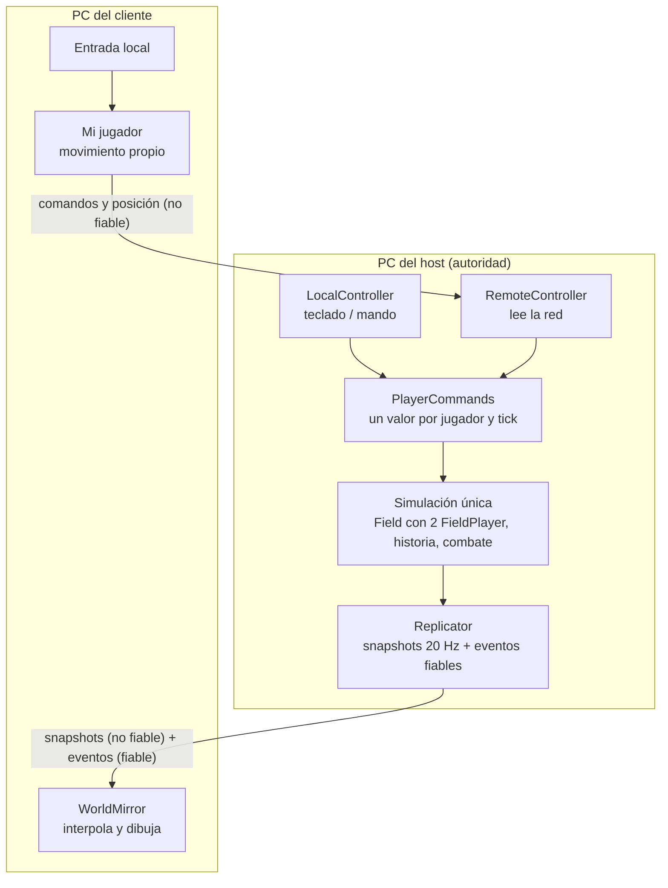

# Multijugador cooperativo en línea (documento de diseño)

Estado: **propuesta** (2026-11-16). Nada de esto está implementado. Las decisiones de juego de §6 llevan una
recomendación, pero están pendientes de aprobar. La decisión de arquitectura está en
[ADR 0024](../adr/0024-co-op-with-authoritative-host.md). Para retomar el trabajo, empieza por §10.

## 0. Propósito y alcance

**Propósito:** que un segundo jugador se conecte por internet a la partida de otro y jueguen juntos en el mismo mundo:
caminar, hablar con NPCs, avanzar la historia y pelear.

**Dentro del alcance:**

- dos jugadores en línea, un host y un invitado;
- conexión directa entre PCs por WebRTC, con el Worker de señalización solo para el primer contacto;
- el mundo de la partida del host, con su historia;
- el invitado con su propio jugador (y su compañero, según la decisión 1 de §6).

**Fuera del alcance:**

- el versus, que ya existe y es otra cosa: un combate suelto en lockstep ([versus](../modules/game/versus.md));
- el multijugador local en una misma pantalla, que el proyecto descartó;
- más de dos jugadores (el diseño no lo cierra, pero no se prueba);
- servidores dedicados y partidas persistentes.

## 1. Idea en una frase

Los dos jugadores usan **los mismos datos de jugador**. Solo cambia **quién los controla**: el teclado del PC donde se
juega o la red. Un PC, el **host**, simula el mundo entero y es la autoridad. El otro, el **cliente**, manda sus
comandos y dibuja lo que el host le replica. Se conectan por WebRTC, con el mismo transporte y la misma señalización
que el versus.



## 2. Lo que el código asume hoy

Estudio sobre `main` en `aa27246b2`. Es lo que obliga a cambiar cosas antes de poner nada en la red.

| Tema | Estado actual | Consecuencia |
|---|---|---|
| Jugador en el campo | `game::field::Field` crea exactamente un jugador y un compañero (`player_`, `partner_`). La entrada, la ruta del clic, `playerFree`, los triggers, `cellSections` y `confirmSection` existen una sola vez. `Body::who` fija «0 = jugador, 1 = compañero». | Hay que sacar el estado por jugador a `FieldPlayer` (§4.4). Un segundo `Field` no sirve, porque cada `Field` es dueño del mapa, los NPCs y los fundidos. |
| Seguimiento del compañero | `PartnerFollow` y `Field::movePartner` siguen al único jugador. El rescate fuera de pantalla usa la cámara del renderer y un aleatorio sin guardar (`FieldScene::gestureRandom_`). | Cada compañero sigue a su dueño. La prueba de fuera de pantalla pasa a la simulación (§4.5). |
| Cámara | `FieldCameraFollow` sigue al jugador en el dibujo, y `FieldScene::followPixel` devuelve `setCameraRest` a la simulación. | El render alimenta la simulación. Hay que cortarlo: una cámara por pantalla, fuera de la simulación. |
| Entrada | `input::InputState` es un objeto con estado y consultas por nombre. `game.cpp` arma cada tick un `field::FieldInput` (`stick`, `run`, `moveTarget`, `cancelTarget`, `confirm`), que ya es un valor plano. Los diálogos, menús, combate, objetos y minijuegos leen `InputState` directamente (`pressStory`, `pressBattle`, …). | `FieldInput` es la base de `PlayerCommands`. Lo demás se convierte en comandos (§4.2). |
| Reloj | Tick fijo de 1/60 s (`core::FixedStep`). El campo da «frames del original» a 20 fps con un acumulador float; la historia, un frame cada 3 ticks; el combate, su propio `FixedStep` a 20 fps. | Sirve tal cual en el host. El cliente no simula el mundo, así que no necesita el mismo reloj. |
| Determinismo | Las posiciones del campo son floats de glm: dan lo mismo en un binario, pero no está garantizado entre máquinas. Hay aleatorios fuera de `ruleset::Random` (`std::minstd_rand` en efectos y gimnasio, `gestureRandom_`). El combate sí es determinista: enteros, `checksum()`, «misma semilla, mismo combate». | El mundo se **replica**, no se sincroniza en lockstep. El checksum del combate queda como herramienta de diagnóstico. |
| Estado del mundo | `PlaySession`/`GameSession` son dueños de todo. `GameSession::saveFile()` da un `SaveFile` YAML determinista con unas 30 secciones, pero solo vale con el campo libre (`savesWait`/`busyWith`). Los scripts en curso, el estado pasajero de los NPCs, los combates y los fundidos no van en el guardado. | El guardado sirve para **unirse en un punto seguro**, no para replicar en vivo. |
| Combate | `FighterId` es el índice en `fighters`: compañero 0, enemigos del 1 al 3. La IA enemiga y los golpes apuntan a `PartnerId`. La enfermedad, la bolsa, los objetos lanzados y el revivir son solo del luchador 0. | Hoy cabe **un solo compañero** por combate. Dos compañeros obligan a rehacer los lados (§6, decisión 3). |
| Red | `net::PeerLink`/`RtcPeerLink` con dos canales («control» fiable y ordenado, «inputs» sin retransmisión). `SignalClient` con códigos de sala de 4 letras sobre el Worker de señalización. `ReliableChannel`, `WireWriter`/`WireReader`, el saludo `Identity` con `contentHash` y el byte de tipo de mensaje del protocolo del versus. `Lockstep` es solo de dos lados. | Todo se reutiliza menos el lockstep, que sirve como mucho para combates. |
| Pausas | Los menús pausan la simulación según la visibilidad local de la interfaz (`PlaySession::tickSystems`, `paused()`, `screenStops()`). La pausa de Start lo congela todo. Los scripts congelan jugador, compañero, reloj y cámara (`holdForScript`, `scriptPauseGame`). | En cooperativo, abrir un menú no puede parar el mundo del otro (§6, decisión 5). |
| Quién mueve un actor | No hay `Player`, `Controller` ni `InputSource`. Lo más parecido: el autotest y el socket de control inyectan teclas en `InputState`; los scripts mueven actores con `driveByScript`/`placeByScript`; el combate y el compañero tienen registros de estrategias (`BattleStrategies`, `PartnerStrategy`). | El controlador es una pieza nueva, pero sigue el mismo patrón que las estrategias. |

## 3. Principios

1. **Un solo mundo, una sola autoridad.** El host simula todo: mapa, NPCs, historia, compañeros, combate, reloj y
   aleatorios. El cliente nunca decide nada del mundo.
2. **El jugador es datos, el controlador es la interfaz.** Los dos jugadores son el mismo `FieldPlayer`. Lo que cambia
   es el `PlayerController` que les da comandos cada tick.
3. **Todo pasa por comandos.** Ningún sistema de juego lee el teclado. Leen `PlayerCommands`, vengan del teclado, de la
   red, de un autotest o de una repetición.
4. **La simulación no depende del dibujo.** La cámara, el renderer y la interfaz son de cada pantalla. Lo que la
   simulación necesita de ellos se calcula dentro de la simulación.
5. **Reutilizar la red del versus.** El mismo transporte, la misma señalización y el mismo saludo. El cooperativo solo
   añade su protocolo.
6. **Cada paso sirve sin red.** La fase C0 (§7) mejora el juego de un jugador: autotests, repeticiones y entrada más
   limpia.

## 4. Piezas

### 4.1 `PlayerController`

La interfaz que da los comandos de un jugador. Una implementación por fuente:

| Implementación | Dónde vive | Qué hace |
|---|---|---|
| `LocalController` | `apps/game` | Lee `InputState` y arma `PlayerCommands`. Sustituye el código de `game.cpp` que hoy arma `FieldInput` y reparte las pulsaciones a cada pantalla. |
| `RemoteController` | `game/coop` (host) | Saca de un búfer los comandos que llegan por la red. Si falta el de un tick, repite el último movimiento y no repite acciones. |
| `ScriptedController` | `apps/game` (autotest) | Da comandos desde una ruta o una repetición. Permite probar dos jugadores sin red. |

La forma sigue a las estrategias que ya existen: una interfaz pequeña y sin estado de juego. El controlador no toca la
simulación; solo produce valores.

### 4.2 `PlayerCommands`

Un valor plano por jugador y tick, serializable con `WireWriter`:

- `field`: el `FieldInput` de hoy (`stick`, `run`, `moveTarget`, `cancelTarget`, `confirm`).
- `actions`: lista corta de acciones discretas: avanzar o elegir en un diálogo, elegir en un menú, orden de combate
  (`battle::Command`), usar o lanzar un objeto, botones de minijuego (`FishingButtons`, curling…).

Las pantallas que hoy reciben `InputState` (`pressStory`, `pressBattle`, `pressItemKeeper`, `pressPartnerMenu`,
`pressCurling`, `pressWorldMap`, `pressDestinationChoice`) pasan a recibir las acciones del jugador que manda en esa
pantalla. La interfaz RmlUi sigue emitiendo `ui::UiCommand`. `LocalController` los traduce a acciones, en lugar de
llamar directamente a `PlaySession::handle`.

### 4.3 `PlayerRegistry`

Vive en `GameSession`. Un registro por jugador:

- `id` (0 = host, 1 = invitado), nombre y si es local o remoto.
- su `PlayerController`.
- su compañero: el del host es el `Partner` de `SessionState`. El del invitado, según la decisión 1 de §6.
- su estado de conexión (conectado, esperando punto seguro, desconectado).

El tamaño máximo sale de las reglas (`max_players: 2` en la primera versión), no de una constante en el código.

### 4.4 `FieldPlayer`

Todo lo que hoy es único en `Field` y pertenece a un jugador pasa a un `FieldPlayer`:

- su entidad y la de su compañero (las etiquetas `PlayerTag`/`PartnerTag` llevan el id del jugador);
- su `FieldInput`, su ruta y objetivo de clic, `freeTick`, rastro y último trigger;
- sus `cellSections` y `confirmSection`;
- su `PartnerFollow` y su prueba de fuera de pantalla.

Siguen siendo **del mundo**: el mapa, los NPCs, los fundidos, el cambio de mapa, las pausas de script
(`holdForScript`, `holdForCare`, `holdForItem`) y el filtro de salidas de `StoryLock`. `Body::who` pasa de «0/1» a
`{jugador, papel}`.

Los scripts de la historia que hablan de «el jugador» usan **el jugador que disparó el evento** (el que pisó la
casilla o habló con el NPC). `StoryAdapter` recibe ese id con cada sección de casilla.

### 4.5 Cámara y vista

- Cada pantalla tiene su `FieldCameraFollow`, que sigue a **su** jugador. El host ve el suyo; el cliente, el suyo.
- La simulación guarda por jugador un «reposo de vista» propio (lo que hoy entra por `setCameraRest`), calculado con
  las mismas reglas que la cámara, pero sin pasar por el renderer.
- La prueba de fuera de pantalla del compañero usa ese reposo de vista, no la cámara dibujada.
- La cámara de script (`Field::scriptCamera`) y `holdCamera` en combate se aplican a todas las pantallas.

### 4.6 Paquete `game/coop`

Paquete nuevo, al lado de `game/versus` y con la misma forma:

| Pieza | Lado | Qué hace |
|---|---|---|
| `protocol` | los dos | Tipos de mensaje (un byte, en un rango propio, sin pisar los del versus ni el lockstep), saludo con `Identity` (protocolo, versión del juego y `contentHash`) y códecs con `WireWriter`/`WireReader`. |
| `CoopLink` | los dos | Saludo, latido, tiempos de espera y motivos de salida, como `VersusLink`. |
| `CoopHost` + `Replicator` | host | Recibe comandos y se los da a `RemoteController`. Arma los snapshots y los eventos. |
| `CoopClient` + `WorldMirror` | cliente | Envía comandos. Aplica snapshots con interpolación y eventos en orden. Dibuja con las mismas escenas del juego, en modo espejo (sin simulación propia del mundo). |

La sesión del cliente es una `PlaySession` en **modo espejo**: carga los mapas y los modelos, y dibuja la interfaz,
pero sus sistemas no avanzan; solo aplican lo que manda el host.

### 4.7 Interfaces (boceto)

Boceto para fijar la forma; los nombres finales salen de la revisión de C0. Sigue las convenciones del código:
`std::expected`, sin excepciones, inicializadores designados.

```cpp
namespace dwe::game {

using PlayerId = std::uint8_t;  // 0 = host, 1 = invitado

struct PlayerAction {
  enum class Kind : std::uint8_t { TextAdvance, TextChoice, MenuChoice, BattleCommand, UseItem, ThrowItem, Minigame };
  Kind kind;
  std::int32_t value = 0;  // opción, orden de combate, objeto…
};

struct PlayerCommands {
  std::uint32_t tick = 0;
  field::FieldInput field;
  std::vector<PlayerAction> actions;  // pocas por tick
};

class PlayerController {
public:
  virtual ~PlayerController() = default;
  // Los comandos del jugador para este tick. Nunca bloquea: si no hay nada, un PlayerCommands vacío.
  [[nodiscard]] virtual PlayerCommands next(std::uint32_t tick) = 0;
};

struct PlayerSlot {
  PlayerId id;
  std::string name;
  bool remote = false;
  std::unique_ptr<PlayerController> controller;
  enum class Link : std::uint8_t { Local, Joining, Connected, Dropped } link = Link::Local;
};

}  // namespace dwe::game

namespace dwe::game::field {

struct FieldPlayer {
  PlayerId id;
  entt::entity body;
  entt::entity partner;
  FieldInput input;
  PartnerFollow follow;
  // ruta del clic, freeTick, rastro, último trigger, cellSections, confirmSection, reposo de vista…
};

}  // namespace dwe::game::field
```

En la red, cada comando se codifica con `WireWriter`: el tick (u32), el `FieldInput` empaquetado (stick en dos i8,
flags en un byte, `moveTarget` opcional) y las acciones (u8 de cantidad, cada una u8 de tipo e i32 de valor).

## 5. Red

### 5.1 Canales

| Flujo | Dirección | Canal | Ritmo | Contenido |
|---|---|---|---|---|
| Comandos | cliente → host | «inputs» (no fiable) | cada tick | `PlayerCommands` de los últimos 3 ticks (redundancia contra pérdidas), con su número de tick. |
| Posición propia | cliente → host | «inputs» (no fiable) | 20 Hz | Posición, rumbo y animación del jugador del cliente (§5.2). |
| Snapshots | host → cliente | «inputs» (no fiable) | 20 Hz | Por entidad visible: id, posición, rumbo, animación y frame. Delta contra el último snapshot confirmado. Más el reloj del juego y el estado de los dos compañeros que muestra el HUD. |
| Eventos | host → cliente | «control» (fiable, ordenado) | cuando pasan | Cambio de mapa, diálogo abierto/avanzado/cerrado, inicio y fin de combate, menú compartido, partida para unirse, desconexión. |
| Acciones | cliente → host | «control» (fiable, ordenado) | cuando pasan | Las `actions` que no pueden perderse (orden de combate, elección de diálogo); también van en los comandos, y el host descarta duplicados por tick. |

Estimación: unas 20 entidades × ~20 bytes × 20 Hz ≈ **8 KB/s** de bajada, y bastante menos de subida.

### 5.2 Autoridad del movimiento

En la primera versión, **cada cliente mueve su propio jugador** y le manda al host su posición.

- Es inmediato en la pantalla del cliente y no hay que corregir posiciones cuando llega la respuesta.
- El host comprueba que la posición es posible (velocidad máxima y colisión con el mapa). Si no lo es, la corrige y se
  lo dice al cliente, que salta a la posición corregida.
- Todo lo demás es del host: triggers, casillas, NPCs, historia, compañeros y combate. Que el cliente pise una salida
  no cambia el mapa hasta que el host lo decide.
- Entre amigos, que alguien haga trampa no es un riesgo que justifique más complejidad.

Más adelante se puede pasar a autoridad total del host con predicción y reconciliación en el cliente, sin cambiar el
resto de piezas.

### 5.3 Unirse a una partida

1. El host abre sala: código de 4 letras por el Worker de señalización, igual que el versus.
2. El cliente entra con el código. Saludo con `Identity`: si la versión del juego o el contenido no coinciden, se corta
   con un motivo claro.
3. El host espera al siguiente **punto seguro** (campo libre, `savesWait` sin bloqueos). Mientras tanto, el cliente ve
   «Esperando al anfitrión…».
4. El host manda su `SaveFile` por el canal fiable, más el mapa y las posiciones actuales.
5. El cliente carga el mapa en modo espejo y aparece junto al jugador del host.
6. Empiezan los snapshots.

La reconexión sigue el mismo camino. Si el invitado se va, su jugador y su compañero desaparecen en el siguiente punto
seguro, y el host sigue jugando solo.

### 5.4 Señalización, relay y salas

Se usa el Worker de señalización del versus (`apps/versus-signal`) con un tipo de sala nuevo. Las tarjetas de salas
abiertas (#291 directorio público, #292 estado explícito de sala, #293 pantalla de partidas públicas, #294 perfil
online local y #295 relay TURN) sirven igual para el cooperativo, así que son **base común**. Desplegar el Worker o
activar TURN sigue necesitando OK.

### 5.5 Mensajes

Un byte de tipo al principio de cada mensaje, en el rango `0x60–0x6F` (el versus usa `0x10–0x14` y el lockstep
`0x40/0x41`).

| Tipo | Nombre | Canal | Dirección | Contenido |
|---|---|---|---|---|
| `0x60` | `Hello` | fiable | los dos | `Identity` (protocolo, versión del juego, `contentHash`), nombre del jugador. |
| `0x61` | `Welcome` / `Refuse` | fiable | host → cliente | id asignado, o motivo del rechazo (versión, contenido, sala llena). |
| `0x62` | `JoinState` | fiable | host → cliente | `SaveFile` del host en el punto seguro, mapa y posiciones. Se trocea si es grande. |
| `0x63` | `Commands` | no fiable | cliente → host | `PlayerCommands` de los últimos 3 ticks. |
| `0x64` | `OwnPose` | no fiable | cliente → host | Posición, rumbo y animación del jugador del cliente. |
| `0x65` | `PoseFix` | fiable | host → cliente | Posición corregida cuando la del cliente no es posible. |
| `0x66` | `Snapshot` | no fiable | host → cliente | Tick, reloj del juego, entidades (delta contra el último confirmado), HUD de los dos compañeros. |
| `0x67` | `SnapshotAck` | no fiable | cliente → host | Último snapshot recibido, para los deltas. |
| `0x68` | `Event` | fiable | host → cliente | Cambio de mapa, diálogo, inicio y fin de combate, menú compartido. |
| `0x69` | `Action` | fiable | cliente → host | Acción que no puede perderse (también va en `Commands`; el host descarta duplicados por tick). |
| `0x6A` | `Leave` | fiable | los dos | Motivo de salida. |

El latido y los tiempos de espera son los de `CoopLink` (§4.6), con los mismos valores que el versus.

## 6. Decisiones de juego (pendientes)

| # | Pregunta | Recomendación | Alternativa |
|---|---|---|---|
| 1 | ¿Qué trae el invitado? | Su domador y **su compañero** desde su propia partida, como visitante. | Solo un domador, sin compañero: mucho más barato, pero aporta menos. |
| 2 | ¿Mapa compartido? | Sí: van **en grupo**, y una salida lleva a los dos. | Cada uno en su mapa: el host simularía varios `Field` a la vez. |
| 3 | Combate | Primera versión: pelea el compañero de **quien empieza el combate**; el otro ayuda con objetos u órdenes de ánimo y ve el combate. Más adelante, los dos compañeros juntos. | Los dos compañeros desde el principio: hay que rehacer los lados del combate (IA enemiga, golpes, comandos, HUD). |
| 4 | Progreso | La historia, los flags, el dinero y el mundo son **del host**. El invitado se lleva a su partida su compañero (stats, edad, técnicas) y los objetos que consiga. | Progreso compartido en las dos partidas: rompe la historia del invitado. |
| 5 | Pausa y menús | En cooperativo, los menús **no pausan** el mundo. Solo el host pausa con Start, y se pausa para los dos. | Pausa para los dos con cualquier menú: corta el juego del otro a cada rato. |
| 6 | Diálogos y escenas | Congelan a los dos jugadores. **Avanza quien los abrió**; el otro ve el mismo cuadro. | Cualquiera avanza: más rápido, pero se saltan textos del otro. |

## 7. Fases

| Fase | Contenido | Criterio de cierre | Tiempo |
|---|---|---|---|
| **C0, sin red** | `PlayerCommands` y los tres controladores; pantallas por acciones; `FieldPlayer`; cámara y prueba de fuera de pantalla fuera del renderer; `PlayerRegistry`. | El juego de un jugador no cambia (cadena de la historia en verde). Un test con dos jugadores scriptados en el mismo `Field` (solo en tests, nunca como modo local). | 2–3 semanas |
| **C1, verse caminar** | `game/coop` con saludo, unión en punto seguro, snapshots, `WorldMirror`, movimiento propio validado por el host. | Dos PCs en el mismo mapa se ven caminar, cada uno con su compañero detrás, con pérdidas simuladas. | ~2 semanas |
| **C2, interactuar** | NPCs y casillas por jugador, diálogos replicados, cambio de mapa en grupo, menús sin pausa, desconexión y reconexión. | Un tramo de la historia jugado entre dos PCs. | ~3 semanas |
| **C3, combate** | Según la decisión 3. | Un combate de la historia ganado en cooperativo. | 2–6 semanas |
| **C4, invitado** | Progreso del invitado de vuelta a su partida, nombres sobre los jugadores, indicador de latencia, pulido. | El invitado vuelve a su partida con lo ganado. | — |

### 7.1 Pruebas

| Nivel | Qué se prueba | Cómo |
|---|---|---|
| Unidad | Códecs de mensajes (ida y vuelta), búfer de `RemoteController` (pérdidas, duplicados, desorden), validación de `OwnPose` | doctest en `game/coop` |
| Simulación | Dos `FieldPlayer` en el mismo `Field` con `ScriptedController`: compañeros que siguen a su dueño, triggers por jugador, cambio de mapa en grupo | doctest en `game/field` y `session` |
| Red local | Host y cliente en el mismo proceso sobre `net::loopback`, con pérdida y retraso simulados | doctest en `game/coop` |
| Juego | Dos instancias del juego en el mismo PC (dos pantallas virtuales) unidas por sala; ruta de autotest en cada una | script nuevo junto a `story-chain.sh` |
| Regresión | El juego de un jugador no cambia | Cadena de la historia completa en verde tras cada fase |

## 8. Riesgos

- **Scripts que asumen un solo jugador.** Se resuelve pasando el id del jugador que disparó el evento (§4.4) y
  revisando las escenas que mueven al jugador.
- **Estado pasajero que no está en el guardado** (NPCs a medio camino, scripts en curso). Por eso la unión espera a un
  punto seguro, y el estado en vivo viaja en los snapshots, no en el guardado.
- **El render alimenta la simulación** (`setCameraRest`, prueba de fuera de pantalla). Se corta en C0.
- **Aleatorios fuera de `ruleset::Random`.** No afectan a la réplica (solo simula el host), pero conviene pasarlos al
  aleatorio de la sesión para que las repeticiones sean exactas.
- **Coste de la fase C3** si se eligen dos compañeros en combate.

## 9. Preguntas abiertas

- Las seis decisiones de §6.
- Si el invitado trae compañero: cómo se valida que su partida no está manipulada (probablemente no se valida, igual
  que en el versus, y basta con el `contentHash`).
- Qué ve el invitado durante una escena de la historia que solo el host dispara (cámara de script para los dos, según
  §4.5, pero falta revisar escena por escena).
- Si `ScriptedController` sustituye del todo a la inyección de teclas del autotest o convive con ella.

## 10. Cómo retomarlo

1. Releer este documento y el [ADR 0024](../adr/0024-co-op-with-authoritative-host.md).
2. Cerrar las decisiones de §6 y apuntarlas aquí (pasar el estado de «propuesta» a «aprobado» y el ADR a
   «Aceptada»).
3. Crear las tarjetas en el tablero, una por fase de §7, empezando por C0. Esa fase no toca la red, así que puede
   empezar en paralelo con las tarjetas de salas (#291–#294).
4. Primer paso de C0: `PlayerCommands` y `LocalController`. Mover a `LocalController` el código de `apps/game/src/game.cpp`
   que hoy arma `FieldInput` y reparte `InputState` a las pantallas, sin cambiar el comportamiento. Después,
   `FieldPlayer` en `packages/game/field`.
5. Los archivos de partida: `packages/game/field/{include/dwe/game/field/field.hpp,src/field.cpp}`,
   `apps/game/src/{game.cpp,play_session.cpp,field_scene.cpp,field_camera_follow.hpp}`,
   `packages/session/include/dwe/session/game_session.hpp`, `packages/engine/net/` y `packages/game/versus/` (la red
   que se reutiliza).

## 11. Documentos relacionados

- [Controles](controls.md) y [ADR 0014](../adr/0014-gamepads-and-input.md): mapa de acciones.
- [Guardar y cargar](save-and-load.md) y [save](save.md): el `SaveFile` que se usa para unirse.
- [Mundo y espacio](world-space.md): coordenadas del campo.
- [net](../modules/engine/net.md), [versus](../modules/game/versus.md) y
  [señalización](../modules/services/versus-signal.md): la red que se reutiliza.
- [field](../modules/game/field.md), [battle](../modules/game/battle.md) y [session](../modules/apps/session.md): los
  módulos que cambian.
