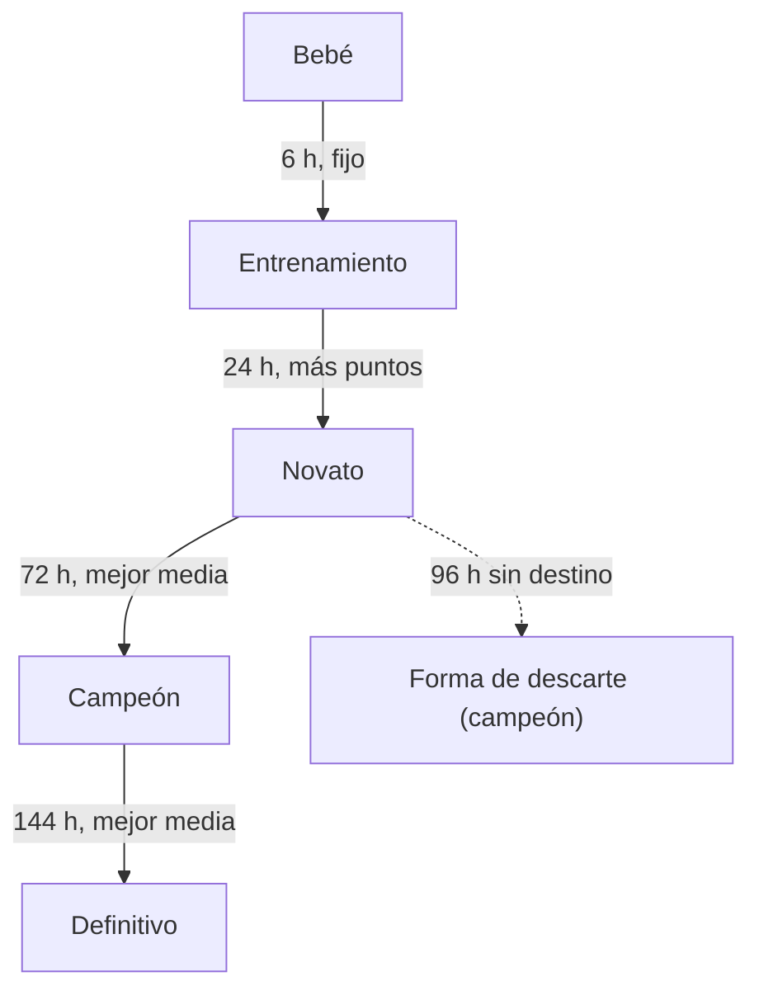
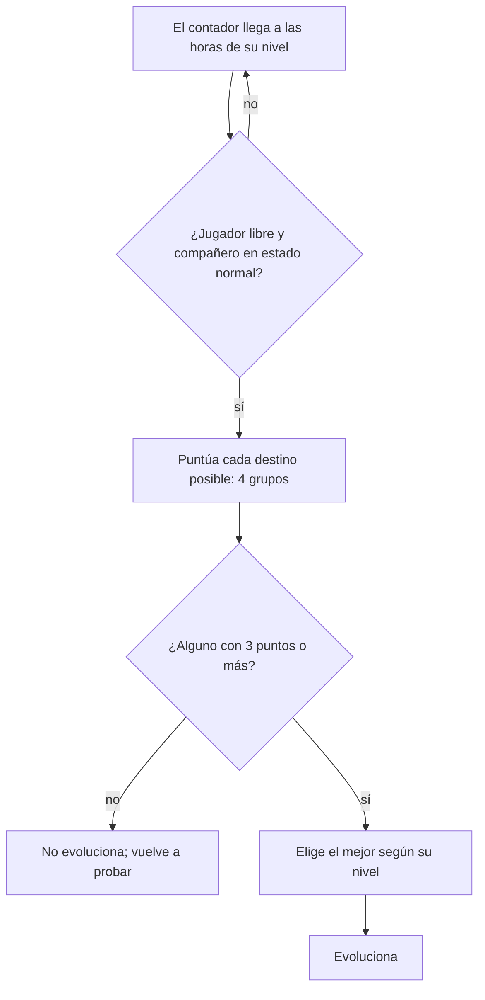

# Cómo funcionan las evoluciones

Esta guía explica, para jugadores y modders, cómo decide el juego en qué forma se convierte tu compañero con las
reglas originales (el ruleset `original`). Es la versión en lenguaje llano de la
[ficha de referencia de evolución](../reference/evolution.md), que tiene cada regla con su cita al decomp; el código
de `dwe` que la reproduce está en el [módulo evolution](../modulos/game/evolution.md).

Lo que la ficha marca como **(suposición)** también va marcado aquí. Por la [política legal](../legal/assets.md), la
guía no nombra especies ni copia la tabla de requisitos de cada una: habla de niveles y de reglas. La tabla de tus
especies la puedes ver en tu propio equipo (ver [la última sección](#tabla-por-especie-en-tu-equipo)).

## Resumen en una frase

Cada cierto número de horas de juego, el juego mira las formas a las que puede pasar tu compañero, puntúa cada una
según cómo lo has criado (errores de cuidado, peso, stats y un requisito extra) y, si alguna saca 3 puntos de 4,
evoluciona a la mejor.

## Niveles y contador de evolución

Hay cinco niveles: **bebé**, **entrenamiento**, **novato**, **campeón** y **definitivo** (en el árbol del menú,
«Ultra»). Los nombres son los habituales en la comunidad **(suposición)**; el número de nivel sí sale de las tablas.

El **contador de evolución** cuenta horas de juego desde el último cambio de nivel. Sube:

- 1 por cada hora del reloj. El reloj solo corre en el campo (no en los cambios de mapa ni pescando). Una hora de
  juego dura más o menos un minuto real **(suposición: depende de la velocidad del original)**.
- Al dormir: suma todas las horas dormidas.
- Al saltar horas (los descansos de los guiones) y con cada sesión del gimnasio.

Vuelve a 0 solo cuando el compañero cambia de nivel. Una evolución dentro del mismo nivel (por ejemplo, una especial)
conserva el contador.

| Nivel actual | El juego empieza a revisar a las | Cómo elige el destino |
|---|---|---|
| Bebé | 6 horas | Destino fijo: cada bebé tiene una sola forma siguiente |
| Entrenamiento | 24 horas | El destino con más puntos |
| Novato | 72 horas | Entre los que aprueban, la mejor media de stats |
| Campeón | 144 horas | Entre los que aprueban, la mejor media de stats |
| Definitivo | — | No evoluciona de forma natural |



### Cuándo se revisa

Desde esas horas, el juego revisa **continuamente**, no una vez por hora: mientras el juego corre, el compañero está
en su estado normal, el jugador está libre y no hay un cambio de mapa. Que «libre» quiera decir sin un evento ni un
menú en marcha es **(suposición)**. Si ningún
destino aprueba, no pasa nada y lo vuelve a intentar en la siguiente revisión. Así, un compañero que no cumple al
llegar a la hora puede evolucionar más tarde, en cuanto cumpla.



## Cómo se puntúa un destino

Cada forma tiene hasta seis destinos posibles. Para cada uno, el juego mira cuatro grupos y da **1 punto por grupo**
que se cumple:

| Grupo | Se cumple si… |
|---|---|
| **Errores de cuidado** | Tienes *al menos* los errores que pide. Algunos destinos los piden al revés: *como mucho* ese número. |
| **Peso** | El peso está a 5 o menos del peso pedido (por ejemplo, si pide 20, vale de 15 a 25). |
| **Stats** | Ver abajo: depende de si el destino es de nivel novato o no. |
| **Extra** | Se cumple *cualquiera* de sus condiciones: venir de una forma concreta, disciplina mínima, felicidad mínima, un número de batallas (mínimo o, en algunos destinos, máximo) o un número mínimo de técnicas aprendidas. |

Un destino **aprueba con 3 puntos o más** de los 4. Un requisito vacío cuenta como cumplido en los stats y no cuenta
en el extra.

**Stats de un destino de nivel novato.** El destino marca uno o varios stats como favoritos y da el punto si el stat
**más alto** de tu compañero es uno de ellos. Para comparar, HP y MP se dividen entre 10: 800 de HP cuentan como 80.
En un empate gana el **último** stat en este orden: HP, MP, ataque, defensa, velocidad, inteligencia.

**Stats de los demás destinos.** El punto es para el compañero que llega al mínimo de **todos** los stats que pide.

**Técnicas aprendidas.** Cuentan las técnicas que ha aprendido alguna vez, pero solo las de las primeras 64 posiciones
de la tabla de técnicas.

**Preferencia por lo nuevo.** El juego prefiere las formas que aún no has criado nunca: entre un candidato ya criado y
otro nuevo, el nuevo se lleva un punto extra y el criado se queda sin ninguno. Una forma cuenta como criada desde que
tu compañero evoluciona a ella o renace en ella.

## Cómo se elige entre varios destinos

- **Entrenamiento → novato:** gana el destino con más puntos. En un empate, el que va primero en la lista de la forma.
- **Novato → campeón y campeón → definitivo:** entre los destinos que aprueban, gana el que tiene la **media más alta
  de los stats que pide su requisito** (otra vez con HP y MP divididos entre 10). Hay una rareza del original: si un
  candidato aprueba pero no mejora al mejor, su suma de stats se arrastra a la media del siguiente, así que el orden de
  la lista puede cambiar el resultado.
- **Forma de descarte:** un novato que no tiene ningún destino que apruebe y cuyo contador llega a **96 horas**
  evoluciona a una forma de campeón fija. Un campeón sin destino se queda como está.

## Evoluciones especiales

Además de la revisión normal, algunos eventos pueden cambiar la forma. Solo pasan con el jugador libre.

- **Al despertar:**
  - Con un 30 % de probabilidad, tres formas de campeón concretas pueden pasar a otra forma. Las tres piden disciplina
    100 y, según el caso, además felicidad 100 y cansancio 0, 50 batallas o más, o defensa de 500 o más.
  - Con un 50 % de probabilidad, una forma de entrenamiento que despierta en un sitio concreto evoluciona a una forma
    de nivel novato. Qué sitio es (la cama de un personaje) es **(suposición)**.
- **Al felicitar o regañar:**
  - Dos campeones concretos con el contador **exactamente en 200 horas** tienen un 30 % de pasar a otra forma.
  - Cualquier campeón con **240 horas o más** tiene un 50 % de pasar a una forma de nivel definitivo.
  - Si regañas a un novato que tenía disciplina 0 y felicidad −100, evoluciona a una forma de nivel campeón.
- **A las 360 horas de campeón:** el juego tira las especiales de felicitar o regañar una vez más (sin el caso del
  regaño). Rareza del original: si ninguna sale, esa revisión **no evoluciona aunque la normal hubiera encontrado
  destino**.
- **Suciedad:** cada caca que el compañero hace en el suelo, fuera del baño, suma 1 a una barra oculta. Con la barra en
  **16**, evoluciona a una forma de nivel campeón ligada a la suciedad; antes, el juego guarda sus stats y su forma, y
  la barra vuelve a 0. Un evento de la historia puede devolverlo a la forma guardada; qué evento es **(suposición)**.
  Al volver, cada stat se reconstruye a partir del guardado: guardado + (actual − guardado / 2) / 2.

## Objetos de evolución

- La mayoría de los objetos de evolución llevan a una forma concreta y **solo funcionan si esa forma está justo un
  nivel por encima** de tu compañero.
- Tres objetos especiales llevan a tres formas fijas sin mirar el nivel.
- Antes, el compañero puede rechazar el objeto. Esa regla es del sistema de objetos y no coincide del todo con la de
  arriba **(suposición: qué casos de juego cubre)**.
- **Cuidado:** usar un objeto de evolución deja una marca para toda la sesión. Con ella, esa evolución y **todas las
  evoluciones naturales siguientes hasta cerrar el juego** no dan ganancias de stats ni las horas de vida del nivel
  definitivo. La marca no va en la partida guardada. Que cargar una partida sin cerrar el juego la borre es
  **(suposición)**; cerrar el juego y abrirlo de nuevo sí la borra.

## Qué pasa al evolucionar

- **Stats.** Cada forma tiene unos valores de referencia. Para cada stat: si tu compañero ya llega a ese valor, gana
  **una décima parte** de la referencia; si no llega, el stat pasa a ser **la media** entre el suyo y la referencia.
- **Casos de escala.** Al pasar a bebé o a entrenamiento, a la forma de descarte, a la de la suciedad, a la del regaño
  y a otra forma de campeón concreta, los stats se multiplican por un factor propio de cada forma, en vez de la regla
  anterior. Por qué esa última forma está en la lista no está claro **(suposición: un caso de diseño o un error)**.
- **Topes.** HP y MP llegan como mucho a 9999; ataque, defensa, velocidad e inteligencia, a 999. En `dwe`, además,
  cada ganancia de una vez es de 999 como mucho (una desviación aprobada del original).
- **Se reinicia:** el peso pasa al peso normal de la forma nueva, y los **errores de cuidado y las batallas vuelven a
  0**. El contador vuelve a 0 si cambia de nivel.
- **Vida.** Al llegar a definitivo sin objeto, la vida restante sube **96 horas**.
- **Nivel de criador.** Al llegar a campeón hay un 20 % de subir un nivel de criador, y al llegar a definitivo un
  100 %, pero solo en un estado concreto del juego; qué estado es **(suposición)**.
- **Técnicas.** La forma nueva aprende la técnica más débil de su primera especialidad que tenga en su lista. Las
  ranuras equipadas se reinician: la primera queda con esa técnica (o con el ataque básico en bebé y entrenamiento).

## Vejez, muerte y renacer

- **Vida restante.** Empieza en **360 horas** (15 días) y baja 1 por hora. También baja al dormir (las horas
  dormidas), en cada combate, en cada entrenamiento, con algunos objetos y con la infelicidad: con felicidad menor que
  80, cada 4 horas pierde de 1 a 4 horas más, más cuanto más baja. Sube al llegar a definitivo sin objeto y con algunas
  comidas.
- **Vidas.** El compañero tiene 3. Perder un combate o dejar una enfermedad 12 horas sin tratar quita una. Sin vidas,
  muere.
- **Muerte por vejez.** Con la vida restante a 0, el jugador libre y fuera de la hora protegida que sigue a dormir,
  muere.
- **Renacer.** Sale uno de los cuatro bebés, al azar. Si la muerte fue natural (por vejez), hereda **un porcentaje de
  los stats del compañero muerto igual a tu nivel de criador**; si no, no hereda nada. Disciplina y felicidad vuelven
  a 50, la vida a 360 horas, las vidas a 3 y los errores y las batallas a 0. Las técnicas equipadas se reinician; las
  aprendidas parecen conservarse **(suposición)**. Más detalle en la [ficha de cuidado](../reference/care.md).

## Consejos de crianza

Salen directamente de las reglas de arriba:

- **Mira la hora de revisión.** 6, 24, 72 y 144 horas desde el último cambio de nivel. Dormir y entrenar adelantan el
  contador: cada sesión de gimnasio adelanta una hora.
- **Los errores de cuidado y las batallas son por nivel.** Vuelven a 0 en cada evolución. Si el destino que quieres pide
  «como mucho» pocos errores, cuídalo bien desde el principio del nivel; si pide «al menos», tendrás que acumularlos.
- **Ajusta el peso antes de la hora.** Solo hay margen de 5. El peso cambia al evolucionar, así que se ajusta en cada
  nivel.
- **Para un destino de novato, cuida el stat más alto.** Solo cuenta cuál es tu stat más alto, no cuánto tienes.
  Recuerda que HP y MP cuentan divididos entre 10 y que en un empate gana el último en el orden HP, MP, ataque,
  defensa, velocidad, inteligencia.
- **Para campeón y definitivo, sube los stats que pide la forma que buscas.** Entre las que aprueban gana la mejor
  media de sus propios stats; si dos destinos aprueban, el que pide los stats que más tienes suele ganar.
- **El extra es el punto fácil.** Basta con una de sus condiciones: a menudo, las batallas o la disciplina.
- **Tres de cuatro bastan.** Si un grupo no te sale (por ejemplo, el peso), asegura los otros tres.
- **Llega a la referencia antes de evolucionar.** Al evolucionar, un stat por encima de la referencia de la forma nueva suma
  un 10 % de esa referencia; uno por debajo se queda en la media. Llegar a la referencia antes de evolucionar compensa.
- **Lleva al compañero al baño.** Con 16 cacas en el suelo evoluciona a la forma de la suciedad.
- **Con un campeón mayor, felicita y regaña con cabeza.** Desde las 240 horas, cada felicitación o regaño tiene un 50 %
  de llevarlo a una forma definitiva concreta.
- **Deja el objeto de evolución para el final**, o cierra y vuelve a abrir el juego después de usarlo: hasta entonces,
  ninguna evolución da stats.
- **Llega a definitivo sin objeto**: suma 96 horas de vida.
- **Para heredar, que muera de viejo.** Solo la muerte natural deja herencia, y crece con tu nivel de criador. Evita
  perder vidas en combates y enfermedades.

## Tabla por especie en tu equipo

Los requisitos de cada especie (qué pide cada destino, en números) son **datos del disco** y el proyecto no los
publica: la [política legal](../legal/assets.md) deja en git las reglas, pero no las tablas por especie
([ADR 0011](../adr/0011-politica-legal-de-assets.md)). Las tienes en tu equipo, sacadas de tu propio disco, de dos
formas.

### En el juego: «Requisitos de evolución»

Es una mejora opcional del motor, **encendida por defecto**. En el árbol de evolución de la página del jugador, cada
destino dice lo que pide; en el árbol de tu compañero, además, cómo va.

Para encenderla o apagarla:

1. Pulsa **Esc** (o `F10`) para abrir el menú directamente en «Opciones». En el mando, Select (Back).
2. Con **Q** y **E** (L1 y R1 en el mando) ve a la pestaña «Juego».
3. Baja con las flechas hasta «Requisitos de evolución» y confírmala (Espacio, Intro o `F`) para encenderla o
   apagarla. Esc vuelve al juego.

El árbol solo existe con el aspecto original de la interfaz (el que viene por defecto: «Opciones», pestaña
«Interfaz», «Aspecto de la interfaz»).

Para verla:

1. Pulsa **Tab** para abrir el menú y elige «Jugador» (flechas y Espacio, Intro o `F`).
2. Elige la pestaña «Árbol».
3. Mueve el cursor a una forma y pulsa **Intro**. Con **arriba** y **abajo** pasas por sus destinos; **izquierda**
   vuelve a la vista original del árbol (de dónde viene y a dónde va) y **derecha** vuelve al cursor.
4. **Ctrl** o **Retroceso** cancelan y vuelven atrás; Tab cierra el menú. **P** pausa el juego, pero no abre el árbol.

Cómo se lee el panel de la izquierda:

| Línea | Qué dice |
|---|---|
| «Errores 0-3» | El rango de errores de cuidado: «0-N» es como mucho N; «N+», N o más |
| «Peso 15-25» | El peso que da el punto |
| «Atributos» y una línea por stat | Los mínimos de cada stat (HP y MP en sus unidades). En un destino de novato, «Mayor atributo» y los stats favoritos |
| «Extra, uno de» | Las condiciones del extra: «De…» (la forma de origen), disciplina, felicidad, batallas, técnicas |
| «Evolución especial» | Un destino sin errores ni peso: solo llega por un evento especial |
| «Siempre» | El destino fijo de un bebé |
| «Revisión 17/72 h» | En tu compañero: el contador frente a las horas de su nivel |
| «3 de 4 listos» | Cuántos grupos cumple tu compañero ahora |
| «La elige al revisar» | El destino al que evolucionaría en la próxima revisión tal como está; los demás se ven atenuados |
| «Al revisar: …» | La próxima revisión elegiría otro destino |
| «???» | Una forma que aún no has descubierto: el juego no enseña su requisito |

En el árbol de tu compañero, cada valor sale en verde si cumple y en rojo si no, con una marca por grupo. La regla es
la misma que decide la evolución, así que lo que dice el panel es lo que hará la revisión.

### Fuera del juego: `dwx evolution-guide`

Para tener la tabla completa de todas las especies, incluidas las que aún no has descubierto, la herramienta `dwx`
que viene con el juego (en la beta de Linux, `bin/dwx`) la escribe en Markdown desde tu contenido extraído:

```sh
dwx evolution-guide <carpeta de contenido> <archivo nuevo.md>
```

- La carpeta de contenido es la que dejó la primera lectura del disco: la carpeta `content` de tus datos de usuario
  (en Linux, `~/.local/share/indie-modding-games/dwe/content`) o la que pasaste con `--content`.
- Escribe una sección por nivel y una tabla por especie, con una fila por destino y las mismas columnas que el panel
  del juego: errores de cuidado, peso, stats (HP y MP en sus unidades) y extra.
- No sustituye nunca un archivo que ya existe: elige un nombre nuevo.
- Escribe el archivo **fuera del repositorio** y no lo compartas: son datos de tu disco.

Es la tabla de las reglas originales. Un ruleset que cambie los requisitos (como el del contenido oculto) no se ve en
ella; el panel del juego, en cambio, sí sigue el ruleset de tu partida.
