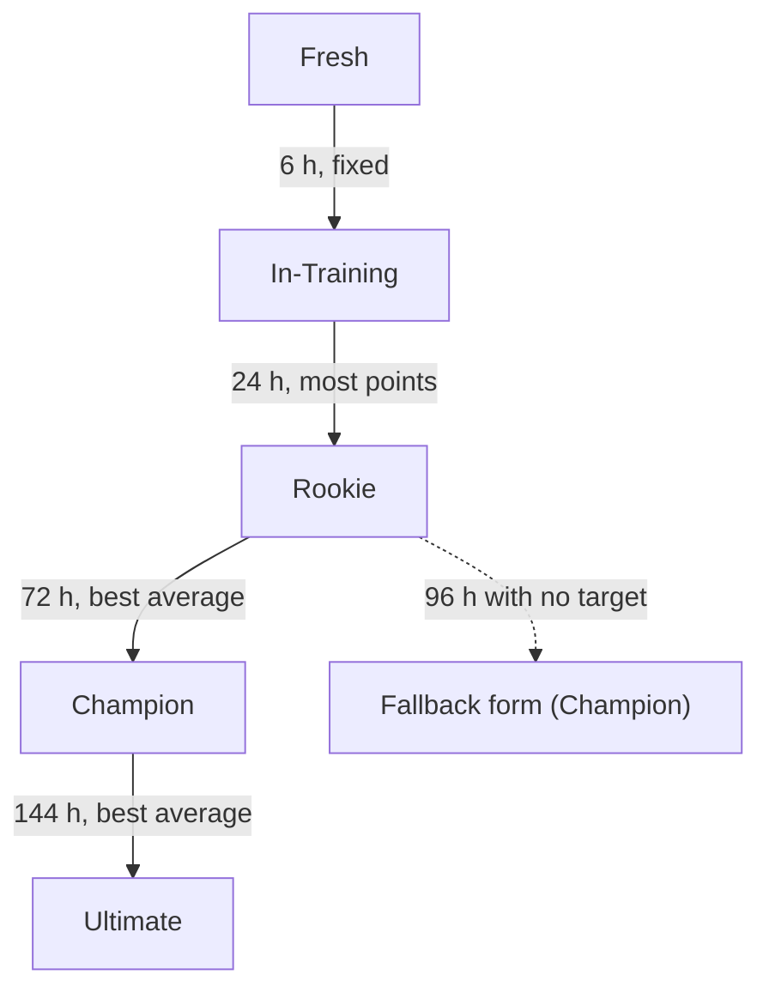
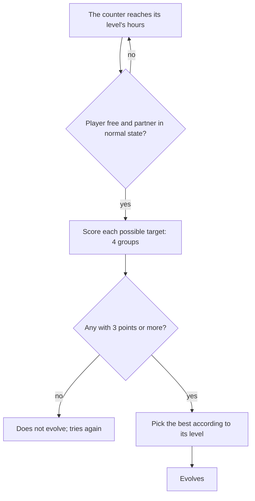

# How evolutions work

This guide explains, for players and modders, how the game decides what form your partner turns into with the
original rules (the `original` ruleset). It is the plain-language version of the
[evolution reference sheet](../reference/evolution.md), which has each rule with its citation to the decomp; the
`dwe` code that reproduces it is in the [evolution module](../modules/game/evolution.md).

What the sheet marks as **(assumption)** is also marked here. Because of the [legal policy](../legal/assets.md), the
guide does not name species or copy each one's requirements table: it talks about levels and rules. You can see your
species' table on your own machine (see [the last section](#per-species-table-on-your-machine)).

## Summary in one sentence

Every so many hours of play, the game looks at the forms your partner can turn into, scores each one according to how
you have raised it (care mistakes, weight, stats and an extra requirement) and, if any gets 3 points out of 4, it
evolves into the best one.

## Levels and the evolution counter

There are five levels: **Fresh**, **In-Training**, **Rookie**, **Champion** and **Ultimate** (in the menu tree,
"Ultra"). The names are the usual ones in the community **(assumption)**; the level number does come from the tables.

The **evolution counter** counts hours of play since the last level change. It goes up:

- 1 for every clock hour. The clock only runs in the field (not during map changes or while fishing). One game hour
  lasts roughly one real minute **(assumption: it depends on the original's speed)**.
- When sleeping: it adds all the hours slept.
- When skipping hours (the script rests) and with every gym session.

It goes back to 0 only when the partner changes level. An evolution within the same level (for example, a special
one) keeps the counter.

| Current level | The game starts checking at | How it picks the target |
|---|---|---|
| Fresh | 6 hours | Fixed target: each Fresh has a single next form |
| In-Training | 24 hours | The target with the most points |
| Rookie | 72 hours | Among those that pass, the best stat average |
| Champion | 144 hours | Among those that pass, the best stat average |
| Ultimate | — | Does not evolve naturally |



### When it is checked

From those hours on, the game checks **continuously**, not once an hour: while the game runs, the partner is in its
normal state, the player is free and there is no map change. That "free" means no event or menu in progress is an
**(assumption)**. If no
target passes, nothing happens and it tries again at the next check. This way, a partner that does not qualify when
the hour arrives can evolve later, as soon as it qualifies.



## How a target is scored

Each form has up to six possible targets. For each one, the game looks at four groups and gives **1 point per group**
that is met:

| Group | It is met if… |
|---|---|
| **Care mistakes** | You have *at least* the mistakes it asks for. Some targets ask for it the other way round: *at most* that number. |
| **Weight** | The weight is within 5 of the requested weight (for example, if it asks for 20, 15 to 25 works). |
| **Stats** | See below: it depends on whether the target is Rookie level or not. |
| **Bonus** | *Any one* of its conditions is met: coming from a specific form, minimum discipline, minimum happiness, a number of battles (a minimum or, in some targets, a maximum) or a minimum number of learned techniques. |

A target **passes with 3 points or more** out of 4. An empty requirement counts as met for stats and does not count
for the bonus.

**Stats of a Rookie-level target.** The target marks one or more stats as favorites and gives the point if your
partner's **highest** stat is one of them. To compare, HP and MP are divided by 10: 800 HP count as 80. In a tie, the
**last** stat in this order wins: HP, MP, Offense, Defense, Speed, Brains.

**Stats of the other targets.** The point goes to the partner that reaches the minimum of **all** the stats it asks
for.

**Learned techniques.** The techniques it has ever learned count, but only those in the first 64 positions of the
technique table.

**Preference for the new.** The game prefers forms you have never raised before: between an already-raised candidate
and a new one, the new one gets an extra point and the raised one gets none. A form counts as raised from when your
partner evolves into it or is reborn into it.

## How one is chosen among several targets

- **In-Training → Rookie:** the target with the most points wins. In a tie, the one that comes first in the form's
  list.
- **Rookie → Champion and Champion → Ultimate:** among the targets that pass, the one with the **highest average of
  the stats its requirement asks for** wins (again with HP and MP divided by 10). There is an oddity in the original:
  if a candidate passes but does not beat the best, its stat sum is carried into the next one's average, so the order
  of the list can change the result.
- **Fallback form:** a Rookie that has no target that passes and whose counter reaches **96 hours** evolves into a
  fixed Champion form. A Champion with no target stays as it is.

## Special evolutions

Besides the normal check, some events can change the form. They only happen with the player free.

- **On waking up:**
  - With a 30% chance, three specific Champion forms can turn into another form. All three ask for discipline 100
    and, depending on the case, also happiness 100 and tiredness 0, 50 battles or more, or defense of 500 or more.
  - With a 50% chance, an In-Training form that wakes up in a specific place evolves into a Rookie-level form. Which
    place it is (a character's bed) is an **(assumption)**.
- **When praising or scolding:**
  - Two specific Champions with the counter at **exactly 200 hours** have a 30% chance of turning into another form.
  - Any Champion with **240 hours or more** has a 50% chance of turning into an Ultimate-level form.
  - If you scold a Rookie that had discipline 0 and happiness −100, it evolves into a Champion-level form.
- **At 360 hours as a Champion:** the game rolls the praise-or-scold specials once more (without the scolding case).
  Oddity in the original: if none comes up, that check **does not evolve even if the normal one would have found a
  target**.
- **Dirt:** each poop the partner makes on the floor, outside the potty, adds 1 to a hidden bar. With the bar at
  **16**, it evolves into a Champion-level form tied to dirt; before that, the game saves its stats and its form, and
  the bar goes back to 0. A story event can return it to the saved form; which event is an **(assumption)**. On
  return, each stat is rebuilt from the save: saved + (current − saved / 2) / 2.

## Evolution items

- Most evolution items lead to a specific form and **only work if that form is exactly one level above** your
  partner.
- Three special items lead to three fixed forms without looking at the level.
- Before that, the partner can refuse the item. That rule belongs to the item system and does not fully match the one
  above **(assumption: which game cases it covers)**.
- **Careful:** using an evolution item leaves a mark for the whole session. With it, that evolution and **all the
  following natural evolutions until the game is closed** give no stat gains or the Ultimate level's hours of life.
  The mark is not in the saved game. That loading a game without closing the program clears it is an
  **(assumption)**; closing the game and opening it again does clear it.

## What happens when evolving

- **Stats.** Each form has some reference values. For each stat: if your partner already reaches that value, it gains
  **one tenth** of the reference; if it does not, the stat becomes **the average** of its own and the reference.
- **Scaling cases.** When going to Fresh or In-Training, to the fallback form, to the dirt form, to the scolding form
  and to another specific Champion form, the stats are multiplied by a factor specific to each form, instead of the
  previous rule. Why that last form is on the list is unclear **(assumption: a design case or a bug)**.
- **Caps.** HP and MP reach at most 9999; Offense, Defense, Speed and Brains, 999. In `dwe`, in addition, each
  one-time gain is at most 999 (an approved deviation from the original).
- **Reset:** the weight goes to the new form's normal weight, and the **care mistakes and battles go back to 0**. The
  counter goes back to 0 if the level changes.
- **Life.** On reaching Ultimate without an item, the remaining life goes up **96 hours**.
- **Tamer level.** On reaching Champion there is a 20% chance of going up one Tamer level, and on reaching Ultimate a
  100% chance, but only in a specific game state; which state is an **(assumption)**.
- **Techniques.** The new form learns the weakest technique of its first specialty that it has in its list. The
  equipped slots are reset: the first one ends up with that technique (or with the basic attack in Fresh and
  In-Training).

## Old age, death and rebirth

- **Remaining life.** It starts at **360 hours** (15 days) and goes down 1 per hour. It also goes down while sleeping
  (the hours slept), in every battle, in every training session, with some items and with unhappiness: with happiness
  below 80, every 4 hours it loses 1 to 4 more hours, more the lower it is. It goes up on reaching Ultimate without an
  item and with some foods.
- **Lives.** The partner has 3. Losing a battle or leaving a sickness untreated for 12 hours takes one away. With no
  lives, it dies.
- **Death from old age.** With the remaining life at 0, the player free and outside the protected hour that follows
  sleeping, it dies.
- **Rebirth.** One of the four Fresh forms comes out, at random. If the death was natural (from old age), it inherits
  **a percentage of the dead partner's stats equal to your Tamer level**; if not, it inherits nothing. Discipline and
  happiness go back to 50, life to 360 hours, lives to 3 and mistakes and battles to 0. The equipped techniques are
  reset; the learned ones seem to be kept **(assumption)**. More detail in the [care sheet](../reference/care.md).

## Raising tips

They come directly from the rules above:

- **Watch the check hour.** 6, 24, 72 and 144 hours since the last level change. Sleeping and training move the
  counter forward: each gym session moves it forward one hour.
- **Care mistakes and battles are per level.** They go back to 0 at every evolution. If the target you want asks for
  "at most" few mistakes, take good care of it from the start of the level; if it asks for "at least", you will have
  to accumulate them.
- **Adjust the weight before the hour.** There is only a margin of 5. The weight changes when evolving, so it is
  adjusted at each level.
- **For a Rookie target, take care of the highest stat.** Only which is your highest stat counts, not how much you
  have. Remember that HP and MP count divided by 10 and that in a tie the last one in the order HP, MP, Offense,
  Defense, Speed, Brains wins.
- **For Champion and Ultimate, raise the stats the form you are after asks for.** Among those that pass, the best
  average of their own stats wins; if two targets pass, the one that asks for the stats you have most of usually wins.
- **The bonus is the easy point.** One of its conditions is enough: often, battles or discipline.
- **Three out of four is enough.** If one group does not work out (for example, weight), make sure of the other
  three.
- **Reach the reference before evolving.** When evolving, a stat above the new form's reference adds 10% of that
  reference; one below ends up at the average. Reaching the reference before evolving pays off.
- **Take your partner to the potty.** With 16 poops on the floor it evolves into the dirt form.
- **With an older Champion, praise and scold wisely.** From 240 hours on, each praise or scold has a 50% chance of
  taking it to a specific Ultimate form.
- **Leave the evolution item for last**, or close and reopen the game after using it: until then, no evolution gives
  stats.
- **Reach Ultimate without an item**: it adds 96 hours of life.
- **To inherit, let it die of old age.** Only natural death leaves an inheritance, and it grows with your Tamer
  level. Avoid losing lives in battles and sicknesses.

## Per-species table on your machine

The requirements of each species (what each target asks for, in numbers) are **disc data** and the project does not
publish them: the [legal policy](../legal/assets.md) leaves the rules in git, but not the per-species tables
([ADR 0011](../adr/0011-asset-legal-policy.md)). You have them on your machine, taken from your own disc, in two
ways.

### In the game: "Evolution requirements"

It is an optional engine improvement, **on by default**. In the evolution tree on the player page, each target says
what it asks for; in your partner's tree, also how it is doing.

To turn it on or off:

1. Press **Esc** (or `F10`) to open the menu directly on "Options". On the controller, Select (Back).
2. With **Q** and **E** (L1 and R1 on the controller) go to the "Game" tab.
3. Go down with the arrows to "Evolution requirements" and confirm it (Space, Enter or `F`) to turn it on or off.
   Esc goes back to the game.

The tree only exists with the interface's original look (the one that comes by default: "Options", "Interface" tab,
"Interface style").

To see it:

1. Press **Tab** to open the menu and choose "Player" (arrows and Space, Enter or `F`).
2. Choose the "Tree" tab.
3. Move the cursor to a form and press **Enter**. With **up** and **down** you go through its targets; **left** goes
   back to the tree's original view (where it comes from and where it goes) and **right** goes back to the cursor.
4. **Ctrl** or **Backspace** cancel and go back; Tab closes the menu. **P** pauses the game, but does not open the
   tree.

How to read the left panel:

| Line | What it says |
|---|---|
| "Mistakes 0-3" | The range of care mistakes: "0-N" is at most N; "N+", N or more |
| "Weight 15-25" | The weight that gives the point |
| "Stats" and one line per stat | The minimums of each stat (HP and MP in their units). In a Rookie target, "Top stat" and the favorite stats |
| "Bonus, one of" | The bonus's conditions: "From…" (the source form), discipline, happiness, battles, techniques |
| "Special evolution" | A target with no mistakes or weight: it only arrives through a special event |
| "Always" | A Fresh's fixed target |
| "Check at 17/72 h" | On your partner: the counter against its level's hours |
| "3 of 4 ready" | How many groups your partner meets now |
| "Next check picks it" | The target it would evolve into at the next check as it is; the others look dimmed |
| "Next check: …" | The next check would pick another target |
| "???" | A form you have not discovered yet: the game does not show its requirement |

In your partner's tree, each value shows in green if met and in red if not, with a mark per group. The rule is the
same one that decides the evolution, so what the panel says is what the check will do.

### Outside the game: `dwx evolution-guide`

To have the complete table of all the species, including those you have not discovered yet, the `dwx` tool that comes
with the game (in the Linux beta, `bin/dwx`) writes it in Markdown from your extracted content:

```sh
dwx evolution-guide <content folder> <new file.md> [--language <en|es>]
```

- The content folder is the one the first disc read left: the `content` folder in your user data (on Linux,
  `~/.local/share/indie-modding-games/dwe/content`) or the one you passed with `--content`.
- It writes one section per level and one table per species, with one row per target and the same columns as the
  game's panel: care mistakes, weight, stats (HP and MP in their units) and bonus.
- The text comes out in English; `--language es` writes it in Spanish.
- It never replaces a file that already exists: pick a new name.
- Write the file **outside the repository** and do not share it: it is data from your disc.

It is the table for the original rules. A ruleset that changes the requirements (like the hidden-content one) does not
show up in it; the game's panel, on the other hand, does follow your game's ruleset.
