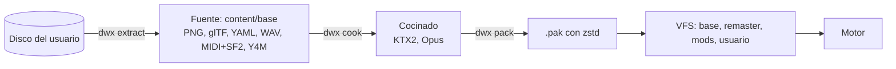

# Fase 1: Tubería de assets

## Objetivo

Todo el contenido del disco original (texturas, modelos, mapas, textos, scripts, música, sonidos y vídeos) se extrae a
formatos abiertos que cualquiera puede abrir y editar, y se prepara (se "cocina") en el formato que el motor carga
rápido. El motor carga el resultado.

## Por qué

El motor no debe entender nunca los formatos de PS1: eso lo ataría a sus límites. La tubería es la única pieza que los
lee, y lo hace una vez, en la máquina del usuario y con su disco. A partir de ahí todo es dato abierto: arte y audio
pueden mejorarse, los mods pueden añadir contenido por ID y el motor no sabe de dónde vino nada. Va antes que el
juego porque todo lo demás necesita estos datos.

## Alcance

- Librería `formats/`: lectores de los formatos del disco (CD e ISO9660, TIM, TMD/MMD, mapas, ALLTIM, textos,
  bytecode de eventos, VAB/SEQ, STR y las tablas del ejecutable). Documentados en [`docs/formats/`](../formats/README.md).
- La CLI `dwx` con `extract`, `validate`, `cook` y `pack`.
- El sistema de ficheros virtual (VFS) con capas y manifiestos de paquete ([VFS](../architecture/vfs.md)).
- Esquemas de cada tipo de dato en `content/schemas/`.
- Visor de assets en el overlay de depuración.
- Primeras fichas de referencia del original: [cuidado](../reference/care.md), [evolución](../reference/evolution.md)
  y [batalla](../reference/battle.md).

## Fuera de alcance

- Volver a construir el disco o buscar igualdad byte a byte: la extracción va en un solo sentido
  ([ADR 0005](../adr/0005-tuberia-de-assets.md)).
- Dibujar modelos y mapas en 3D → fase 2.
- Mejorar el arte (remaster, escalado con IA) → capa `remaster`, fase 4.

## Los tres estados de un asset

| Estado | Para qué | Formatos |
|---|---|---|
| Original | El disco del usuario; nunca entra en el repositorio | Formatos de PS1 |
| Fuente | Trabajar con él: lo más crudo posible, sin pérdida y fácil de editar | PNG (con paleta cuando la hay), glTF binario, YAML, WAV, MIDI + SF2, Y4M + WAV para vídeo |
| Cocinado | Cargar rápido en el juego | KTX2 con Basis UASTC (BC7 en la GPU), Opus, archivos `.pak` con zstd ([ADR 0017](../adr/0017-cocinado-y-archivos-pak.md)) |

## Requisitos

| ID | Requisito | Cómo se comprueba |
|---|---|---|
| R1.1 | `dwx extract` lista y lee todos los ficheros del disco US, incluida la tabla de ficheros del ejecutable | Test con el disco real: 818 ficheros con su SHA-1 |
| R1.2 | Cada fichero del disco tiene un extractor, o un motivo documentado (relleno, datos que nada usa) | `coverage.yaml`: 0 pendientes, 0 parciales |
| R1.3 | La salida es determinista: dos extracciones dan los mismos bytes | Test de extracción repetida |
| R1.4 | Los assets se nombran con IDs estables por nombre, nunca por índice | Esquemas y tests de `assets` |
| R1.5 | Cada tipo de dato tiene su esquema en `content/schemas/` y su página en `docs/formats/` | Revisión y `dwx validate` |
| R1.6 | `dwx validate` comprueba un paquete contra los esquemas y da errores claros | Tests de `validate` |
| R1.7 | `dwx cook` convierte la fuente al formato cocinado, con caché de contenido | Tests de `cook`; tamaño y tiempo medidos |
| R1.8 | `dwx pack` crea un `.pak` que el VFS monta | Test: el motor monta el `.pak` y lista sus IDs |
| R1.9 | El VFS monta capas (base, remaster, mods, usuario) y la de arriba gana por ID | Tests de `assets` |
| R1.10 | El visor muestra los assets de los paquetes montados | Prueba manual con el overlay |
| R1.11 | Nada extraído entra en git | `content/` en `.gitignore`; revisión de los PR |

## Diseño

- `formats/` solo lo usa `apps/dwx`; el motor (`engine/assets`) solo conoce formatos abiertos y cocinados
  ([reglas de dependencias](../architecture/dependency-rules.md)).
- Decisiones: [ADR 0005](../adr/0005-tuberia-de-assets.md) (tubería), [ADR 0011](../adr/0011-politica-legal-de-assets.md)
  (política legal), [ADR 0016](../adr/0016-yaml-con-libyaml.md) (YAML), [ADR 0017](../adr/0017-cocinado-y-archivos-pak.md)
  (cocinado y `.pak`).
- Detalle: [tubería de assets](../architecture/assets-pipeline.md), [formatos y `dwx`](../architecture/formats.md) y
  [cómo se extrae](../formats/extract.md).

## Criterio de cierre

Cada fichero del disco US se extrae, el informe de cobertura está a cero pendientes y el motor carga el resultado.

## Dependencias y riesgos

- Depende de la fase 0 y del disco US del usuario. Europa y Japón se añaden más tarde sobre la misma tubería.
- Riesgo: formatos poco documentados (scripts de eventos, efectos). Se mitiga con el decomp como referencia.
- Riesgo: tamaño. El vídeo crudo ocupa más de 1 GB; su formato cocinado está por decidir.

## Estado (2026-10-19)

- Extracción completa del disco US: 818 de 818 ficheros, 0 parciales, 0 pendientes, 100 % de los bytes. Unos 4600
  ficheros (1,5 GB), en unos 2,5 minutos.
- `cook` y `pack` están en `main`. Se está integrando lo siguiente:
  - texturas en KTX2 con Basis UASTC;
  - audio en Opus;
  - `.pak` con zstd;
  - las correcciones de `validate`.
- Medido antes de contar los vídeos: el contenido cocinado ocupa unos 420 MB.
- Pendiente de decisión: el formato cocinado de los vídeos (propuesta: AV1 + Opus en WebM).
