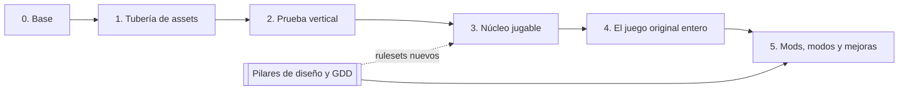

# Plan del proyecto: especificaciones por fase

Esta carpeta explica **qué construye cada fase, por qué y cómo se sabe que está terminada**. Seguimos un enfoque de
desarrollo guiado por especificaciones (*spec-driven development*): antes de programar, cada fase tiene escrita su
especificación con requisitos que se pueden comprobar. El código se acepta cuando cumple esos requisitos, no cuando
"parece que funciona".

El [plan por fases](../roadmap.md) es el resumen con el estado del día. Aquí está el detalle.

## Las fases

| Fase | Especificación | En una frase |
|---|---|---|
| 0 | [Base](fase-0-base.md) | El esqueleto del motor: compila en cualquier PC, abre una ventana, lee el mando y ejecuta Lua |
| 1 | [Tubería de assets](fase-1-tuberia-de-assets.md) | Sacar todo el contenido del disco original a formatos abiertos y prepararlo para el motor |
| 2 | [Prueba vertical](fase-2-prueba-vertical.md) | Un trozo pequeño del juego, jugable de punta a punta: caminar de File City a la casa del anciano y volver |
| 3 | [Núcleo jugable](fase-3-nucleo-jugable.md) | El bucle principal del juego: criar, entrenar, combatir y evolucionar, primero con las reglas del original y sobre rulesets |
| 4 | [Contenido y modos](fase-4-contenido-y-modos.md) | Desde el 2026-10-22, el juego original entero y jugable, entregado por etapas, con la beta por el lanzador. La especificación es la del plan anterior: de ella siguen en la fase 4 la historia convertida a Lua y la base de los mods |
| 5 | Sin especificación todavía | Lo que no es del original: historia reescrita, personajes, modos de juego, el modo versus y la API de mods completa; termina con la primera versión del mod |

Dónde está el proyecto hoy y qué viene después: [plan por fases](../roadmap.md#dónde-estamos-2026-11-06).

Cada fase usa lo que deja la anterior. Dos fases pueden solaparse cuando la siguiente solo necesita lo que ya está
terminado de la anterior. Por ejemplo, la fase 2 empezó con la extracción completa de la fase 1, mientras se integraba
la compresión del cocinado.

## Cómo es una especificación

Todas siguen la misma estructura:

| Sección | Qué responde |
|---|---|
| Objetivo | Qué existe al terminar la fase que no existía antes |
| Por qué | Qué problema resuelve y por qué va en este orden |
| Alcance | Qué entra |
| Fuera de alcance | Qué no entra, aunque lo parezca, y en qué fase va |
| Requisitos | Lista numerada (`R1.3` es el requisito 3 de la fase 1). Cada requisito dice cómo se comprueba |
| Diseño | Módulos que se tocan y las decisiones que aplican (ADR) |
| Criterio de cierre | La prueba concreta que da la fase por terminada |
| Dependencias y riesgos | Qué necesita la fase y qué puede salir mal |
| Estado | Lo que está hecho y lo que falta, con fecha |

## Cómo se trabaja con ellas

1. **Antes de empezar una fase** se escribe o se revisa su especificación. Un cambio de alcance se hace primero aquí,
   en un PR, y luego en el código.
2. **Cada PR dice qué requisitos cumple** (por ejemplo, "R2.4, R2.5"). Si un PR no cumple ningún requisito, o falta
   uno en la especificación o el PR no toca.
3. **Cada requisito tiene su comprobación**: un test automático siempre que se pueda; si no, una prueba manual
   descrita paso a paso.
4. **La fase se cierra** cuando todos los requisitos se cumplen y la prueba del criterio de cierre pasa. Entonces se
   actualiza el estado aquí y en el [plan](../roadmap.md).
5. **Las reglas del juego no se especifican aquí.** Desde la fase 3, cómo funciona cada sistema (cuidado, batalla,
   evolución…) lo define su ficha de referencia para el ruleset del original, y el GDD del repositorio de diseño para
   los rulesets nuevos, según el [ciclo de diseño](../conventions/design-cycle.md). Estas especificaciones dicen qué
   tiene que hacer el motor para que ese diseño se pueda construir.

## Cómo se trabaja sin esperas

El objetivo es que nadie espere a una comprobación: se ejecutan en paralelo y solo se repiten cuando algo cambia.

| Nivel | Cuándo | Qué | Tiempo aproximado |
|---|---|---|---|
| Rápido | Mientras se trabaja | Build incremental y tests del módulo tocado | segundos |
| `check-commit` | Antes de abrir o actualizar un pull request | Build del preset `ci` sin warnings y tests sin el disco (`ctest -LE slow`) | ~30 s con caché |
| CI del pull request | En cada pull request a `main` (obligatoria) | `linux` (formato y lint de lo cambiado, build y todos los tests), `windows` (build cruzado) y `launcher-version` ([Cómo contribuir](../contribuir.md#flujo-de-trabajo)) | ~10 min |
| `check-full` | Opcional, en local | Formato, build, todos los tests (también los del disco), clang-tidy y el sitio de la documentación, en paralelo | ~6 min con caché |
| Gate | Opcional, en local | `scripts/gate.sh`: `short` (rutas de humo) o `daily` (todas las rutas sobre el contenido extraído) ([gate](../guides/gate.md)) | ~10–30 min |

- **Un pull request es un lote.** Junta varias funciones y arreglos ya probados y entra en `main` con un solo commit
  (*squash*) ([commits](../conventions/commits.md)).
- **Integración continua.** Cada pull request entra en `main` en cuanto pasa la CI, y cada fusión que cambia código
  publica una versión de prueba. Al cerrar una fase no queda una integración grande pendiente.
- **La verificación acompaña al trabajo.** Cada sistema se verifica solo, con sus tests y sus rutas, cuando llega a
  `main`; al cerrar la fase solo se repite la prueba del criterio de cierre.
- **Reparto de la máquina.** Con varios builds a la vez, cada uno usa `DWE_JOBS=6`, y como mucho corren dos
  `check-full` al mismo tiempo.
- **La CI confirma, no descubre.** Lo que llega al pull request ya pasó `check-commit` en local; lo que la CI no
  puede pasar (las rutas con el disco, clang-tidy) se pasa en local con `check-full` o el gate cuando el cambio lo
  pide.

Los detalles de las cachés y de cada nivel están en el [ADR 0015](../adr/0015-desarrollo-en-contenedor.md).

## Reglas que valen para todas las fases

- **Sin limitaciones de PS1.** Cualquier resolución, IDs por nombre, nada de tablas de tamaño fijo
  ([ADR 0001](../adr/0001-reimplementacion-nativa.md), [ADR 0013](../adr/0013-juego-nativo-de-pc.md)).
- **El decomp es la referencia, no el código.** Se lee para entender formatos y comportamiento; el motor se escribe
  desde cero.
- **El runtime nunca lee formatos de PS1.** Solo `dwx` usa `packages/formats/`.
- **Nada del juego original en los repositorios.** Cada persona extrae su propio disco
  ([política legal](../legal/assets.md)).
- **Calidad mínima de cada commit en `main`:** compila sin warnings en el preset `ci`, formato correcto y todos los
  tests en verde (lo comprueba la CI), y clang-tidy sin avisos (lo comprueba `check-full`).
